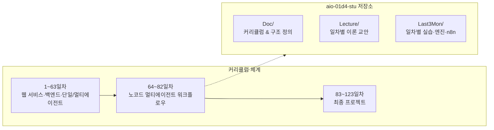
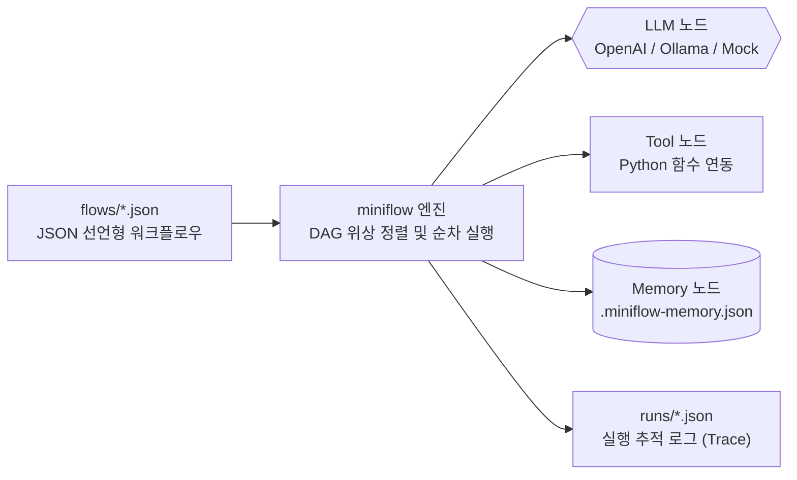
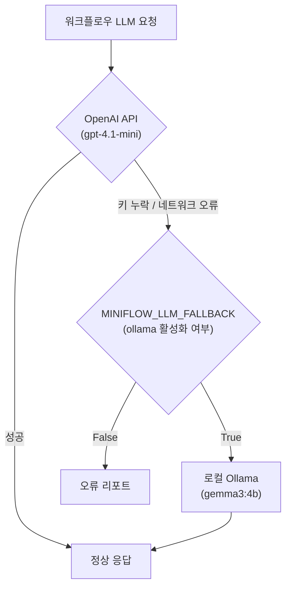
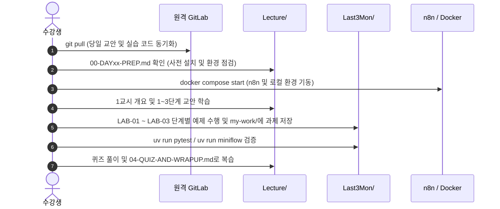

# 프로젝트 구조 및 학습 가이드 (Project Structure Guide)

본 문서는 **노코드 멀티 에이전트 워크플로우 설계 및 운영** 교육과정 수강생 실습 저장소(`aio-01d4-stu`)의 전체 구조, 학습 교안, 실습 환경 및 도구 구성도를 정리한 가이드입니다.

---

## 1. 프로젝트 개요 (Overview)

- **저장소 명**: `aio-01d4-stu`
- **원격 저장소**: [https://gl.isitsoft.kr/publicproj/aio-01d4-stu](https://gl.isitsoft.kr/publicproj/aio-01d4-stu)
- **과정명**: AI 백엔드 및 에이전트 오케스트레이션 과정 (전체 123일차 커리큘럼)
- **주요 교과목**: **노코드 멀티 에이전트 워크플로우 설계 및 운영** (64일차 ~ 82일차) 및 최종 프로젝트 연계
- **프로젝트 목적**:
  1. LLM, Tool, Memory 기반 AI 워크플로우의 동작 원리 습득
  2. 노코드 워크플로우 도구(**n8n**)와 코드 기반 경량 엔진(**miniflow**)을 활용한 실무 자동화 구현
  3. 반복/병렬 처리, 복합 에이전트 라우팅, RAG 및 기업형 AI 지원 자동화(Tech Support) 워크플로우 구축



---

## 2. 전체 디렉토리 구성 (Directory Layout)

```text
aio-01d4-stu/
├── .gitignore                    # 환경 변수(.env), 캐시, venv, 로그 제외 규칙
├── Doc/                          # 프로젝트 및 커리큘럼 문서
│   ├── AIO-CURRICULUM-DAILY.csv  # 전체 123일차 교육과정 일일 진도표
│   └── STRUCT.md                 # [본 문서] 프로젝트 구조 분석 및 가이드
├── Lecture/                      # 이론 강의 자료 (Markdown 슬라이드 형태)
│   ├── vibe-coding-cli-advantages.pdf # CLI 바이브 코딩 활용 안내서
│   ├── 64/                       # 64일차 교안 (AI 워크플로우 개념 및 구성요소)
│   ├── 65/                       # 65일차 교안 (Trigger·Condition·Action & n8n 환경)
│   └── 66/                       # 66일차 교안 (단일 업무 자동화 & 파싱/반복/병렬)
└── Last3Mon/                     # 실습 및 워크플로우 구현 공간 (4분기 / 후반 3개월)
    ├── .env.example              # API 키 및 모델 환경설정 템플릿
    ├── .env                      # [Git 제외] 실제 API 키(OpenAI) 및 모델 설정
    ├── 64/                       # 64일차 실습 (miniflow 기초, LLM-Tool-Memory)
    ├── 65/                       # 65일차 실습 (n8n Docker 환경, Webhook, 라우팅)
    └── 66/                       # 66일차 실습 (회의록 추출, 파싱, 루프/머지, Python 연동)
```

---

## 3. 디렉토리별 세부 설명

### 3.1 Doc/ (문서 및 커리큘럼)

| 파일명 | 설명 |
| --- | --- |
| `AIO-CURRICULUM-DAILY.csv` | 1일차부터 123일차까지의 일자, 교과목, 단원, 세부 학습 내용이 기록된 마스터 커리큘럼 CSV 파일입니다. |
| `STRUCT.md` | 현재 저장소의 구조, 구성 요소, 실행 도구 및 학습 프로세스를 설명하는 메인 구조 가이드 문서입니다. |

#### 커리큘럼 상의 본 교과목 위치 (64일차 ~ 82일차)
- **64~65일차**: AI 워크플로우 개념 및 구성 요소 이해 (LLM, Tool, Memory, Trigger, Condition, Action)
- **66~67일차**: AI 워크플로우 설계 및 구현 (단일 업무 자동화, n8n, Agent-Tool 연동)
- **68~73일차**: 운영·확장 관점의 AI 워크플로우 고도화 (멀티 에이전트, RAG 연계, 최적화, 보안)
- **74~79일차**: AI 워크플로우 운영 및 관리 역량 강화 (버전 관리, 비용 최적화, 에러 처리, Ops Assistant)
- **80~82일차**: 단위 프로젝트 (지능형 기술 지원 자동화 워크플로우 구축)

---

### 3.2 Lecture/ (이론 강의 교안)

매일의 수업은 마크다운 기반의 슬라이드 및 상세 단계별 교안으로 제공됩니다.

```text
Lecture/{일차}/
├── README.md                     # 일차별 개요, 시간표, 학습 목표, 실습 링크
├── 00-DAYxx-PREP.md              # 사전 준비 (전날 저녁까지 세팅할 항목)
├── 00-DAYxx-OVERVIEW.md          # 1교시용 개요 슬라이드 (가로줄 구분)
├── 01-STAGE1-{주제}.md           # 1단계 교안 (개념 및 구조)
├── 02-STAGE2-{주제}.md           # 2단계 교안 (핵심 기능 및 노드)
├── 03-STAGE3-{주제}.md           # 3단계 교안 (실무 시나리오 및 확장)
└── 04-QUIZ-AND-WRAPUP.md         # 퀴즈 풀이, 오늘의 정리 및 다음 날 예고
```

- **슬라이드형 구성**: 별도 PPT 대신 마크다운 파일(`00-DAYxx-OVERVIEW.md`)을 활용하여 단계별 핵심 요약을 시각적으로 제공합니다.
- **점진적 학습 단계**: 각 일차는 3개의 단계(Stage 1~3)로 구분되어 점진적으로 심화됩니다.

---

### 3.3 Last3Mon/ (실습 프로젝트 및 엔진)

후반 3개월 과정 실습의 핵심 영역으로, 각 일차별로 독립된 실습 랩과 공통 자원이 구성되어 있습니다.

#### 공통 서브 구조
각 일차(`64/`, `65/`, `66/`)는 일관된 구조를 따릅니다:

```text
Last3Mon/{일차}/
├── README.md                     # 실습 순서, 실습 목표 및 구성 안내
├── SETUP-*.md                    # 환경 구축 가이드 (Docker, WSL, 모델 세팅 등)
├── LAB-01-*.md                   # 1단계 실습 가이드
├── LAB-02-*.md                   # 2단계 실습 가이드
├── LAB-03-*.md                   # 3단계 실습 가이드
├── templates/                    # 실습 작성용 템플릿 및 워크시트
│   └── *.md
├── my-work/                      # 수강생 개인 실습 결과물 저장 경로 (직접 생성)
├── workflow-lab/                 # Python 기반 경량 워크플로우 엔진 (miniflow)
└── n8n/                          # n8n Docker 및 워크플로우 JSON 자원 (65일차부터)
    ├── compose.yml               # Docker Compose 실행 파일
    ├── register-credentials.sh   # API 키를 n8n Credential로 등록하는 스크립트
    ├── workflows/                # 가져오기(Import) 가능한 n8n 워크플로우 JSON
    └── requests/                 # 웹훅 테스트용 요청 페이로드
```

---

## 4. 주요 기술 스택 및 아키텍처

### 4.1 자체 개발 경량 엔진: `miniflow` (`workflow-lab/`)

노코드 도구의 시각적 노드 연결 원리를 코드로 직접 이해할 수 있도록 구현된 Python(uv) 기반 워크플로우 엔진입니다.



- **주요 명령어 (`uv run miniflow`)**:
  - `miniflow run flows/{파일명}.json -i key=val`: 워크플로우 실행
  - `miniflow validate flows/{파일명}.json`: 구조 검증 및 실행 순서 출력
  - `miniflow show flows/{파일명}.json`: Mermaid 다이어그램으로 시각화 출력
  - `miniflow check`: LLM API 연결 상태 검사
  - `miniflow memory`: 메모리 조회/초기화
- **지원 노드**: `input`, `llm`, `tool`, `memory_read`, `memory_write`, `condition`, `switch`, `output`
- **데이터 바인딩 표현식**: Mustache 문법 기반 `{{input.field}}`, `{{nodes.node_name.output}}` 지원

### 4.2 노코드 워크플로우 도구: `n8n`

Docker Compose 기반으로 WSL 내부에서 실행되며 웹 브라우저(`http://localhost:5678`)로 접속하여 시각적으로 워크플로우를 빌드합니다.

- **실행 환경**: n8n v2.42.6 (공식 한 줄 스크립트 설치 + 수업용 Compose 연동)
- **보안 및 인증 연동**:
  - `Last3Mon/.env`의 `OPENAI_API_KEY`를 `register-credentials.sh`를 통해 n8n 내부의 `OpenAI (.env)` Credential로 자동 등록
  - API 키 노출 없이 안전하게 워크플로우에 주입
- **주요 실습 패턴**:
  - **Webhook Trigger**: 외부 HTTP 요청 수신 및 즉시/지연 응답
  - **Condition / Switch**: 데이터 조건 기반 다중 분기
  - **LLM Node**: 구조화된 JSON 응답 생성
  - **Loop & Merge**: 항목 목록 분할 처리(Split In Batches) 및 병렬 브랜치 결과 결합

### 4.3 LLM 공급자 및 이중화(Failover) 아키텍처



- **기본 LLM**: OpenAI API (`gpt-4.1-mini`)
- **대체 LLM (Failover)**: 로컬 Ollama (`gemma3:4b` 또는 저사양 환경 `gemma3:1b`)
- **환경 변수 계층 구조**: 실행 폴더에서 상위 디렉토리로 탐색하며 `Last3Mon/.env` 파일을 읽어 일괄 적용

---

## 5. 일일 학습 프로세스 (Daily Learning Flow)

수강생은 매일 아래와 같은 사이클로 학습을 진행합니다:



---

## 6. 개발 및 실습 시 유의사항 (Best Practices)

1. **보안 및 환경 변수 관리**:
   - `OPENAI_API_KEY` 등 비밀 키는 반드시 `Last3Mon/.env`에만 작성하며, 절대 Git에 커밋하지 않습니다. (`.gitignore` 등록 확인 필수)
2. **저장소 동기화**:
   - 매일 수업 시작 전 `git pull`을 수행하여 최신 강의 자료와 실습 베이스라인을 업데이트합니다.
   - 개인 실습 결과물은 충돌 방지를 위해 `Last3Mon/{일차}/my-work/` 폴더 내에 저장하는 것을 권장합니다.
3. **포트 관리 및 충돌 방지**:
   - `5678`: n8n 웹 콘솔 포트
   - `11434`: Ollama 로컬 LLM 서빙 포트 (WSL 시스템 서비스와 Docker 컨테이너 간 충돌 시 `sudo systemctl stop ollama` 수행)
4. **테스트 및 검증 자동화**:
   - 각 일차별 `workflow-lab` 디렉토리에서 `uv run pytest -q`를 실행하여 워크플로우 엔진의 무결성을 수시로 확인합니다.
