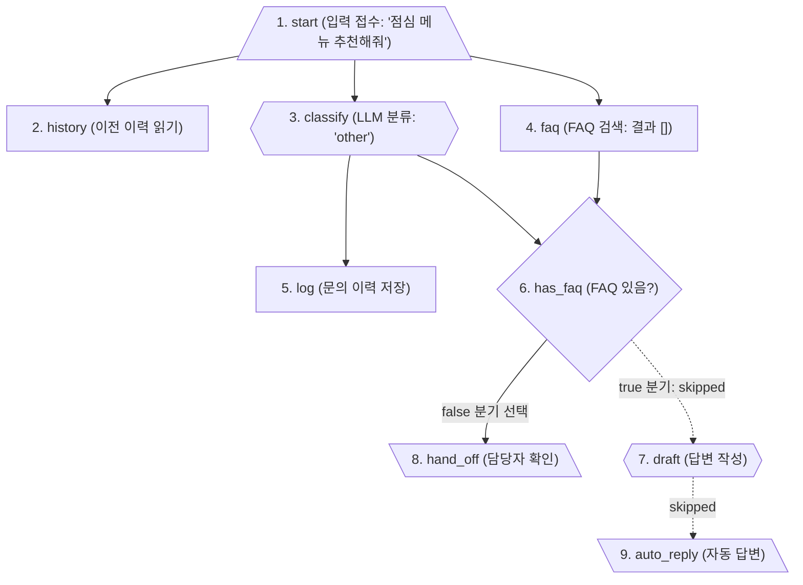

# Miniflow 조건 분기 워크플로우 실행 흐름 및 엔진 분석

본 문서는 `LAB-01-CONDITION-IN-MINIFLOW.md` 실습에서 다음 명령어를 실행했을 때의 전체 흐름, 노드 기반 동작 원리, 그리고 `miniflow` 실행 엔진 구조를 정리한 문서입니다.

```bash
uv run miniflow run flows/06-request-with-condition.json -i user=lee -i text="점심 메뉴 추천해줘"
```

---

## 1. 실행 흐름 개요 (한눈에 보기)

이 실행은 **"IT 지원과 관련 없는 문의(점심 메뉴 추천)"**가 들어왔을 때, FAQ 검색 결과가 없더라도 워크플로우가 중단되지 않고 **`Condition` 노드(`has_faq`)를 통해 `false` 경로(담당자 전달)로 안전하게 분기**되는 과정을 보여줍니다.



---

## 2. 노드별 상세 실행 단계

`flows/06-request-with-condition.json`에 정의된 노드들이 아래 순서대로 처리됩니다.

| 순서 | 노드 ID | 노드 타입 | 상태 | 주요 동작 및 설명 |
| :---: | :--- | :--- | :---: | :--- |
| **1** | `start` | `input` | `ok` | 사용자 입력값(`user: "lee"`, `text: "점심 메뉴 추천해줘"`)을 수신 |
| **2** | `history` | `memory_read` | `ok` | 사용자 `lee`의 이전 문의 이력(`request:lee`)을 메모리에서 조회 |
| **3** | `classify` | `llm` | `ok` | 문의 내용을 분류. IT 지원 카테고리 외 내용이므로 `"other"`로 분류 |
| **4** | `faq` | `tool` | `ok` | `search_faq` 도구 실행. 점심 메뉴 관련 IT FAQ가 없어 빈 배열 `[]` 반환 |
| **5** | `log` | `memory_write` | `ok` | 최근 문의 내역과 분류 결과(`"other"`)를 메모리에 갱신 저장 |
| **6** | `has_faq` | `condition` | `ok` | `left: "{{nodes.faq.output}}", op: "not_empty"` 조건 판정 → **결과: `false`** |
| **7** | `draft` | `llm` | **`skipped`** | `has_faq`의 `true` 경로이므로 **실행을 건너뜀 (Branch not taken)** |
| **8** | `hand_off` | `output` | `ok` | `has_faq`의 `false` 경로 노드 실행. 담당자 전달 메시지 생성 |
| **9** | `auto_reply`| `output` | **`skipped`** | `draft` 노드에 연결된 `true` 경로 노드이므로 **실행을 건너뜀** |

---

## 3. 핵심 동작 원리 (FAQ 결과 없음 대응)

### 3.1. 05번 워크플로우와의 차이점
* **이전 워크플로우 (`05-tech-support-ticket.json`)**:
  - 조건 분기 없이 `faq -> draft`로 바로 연결되어 있었습니다.
  - FAQ 검색 결과가 빈 리스트(`[]`)일 때 `draft` 노드 템플릿에서 없는 인덱스(`{{nodes.faq.output.0.id}}`)를 참조하려다 런타임 에러가 발생하여 멈췄습니다.
* **06번 워크플로우 (`06-request-with-condition.json`)**:
  - `has_faq` (`condition`) 노드를 추가하여 FAQ 결과의 존재 여부(`not_empty`)를 먼저 검사합니다.
  - 검색 결과가 없으면 `true` 쪽 노드(`draft`, `auto_reply`)를 완전히 건너뛰고(`skipped`), 안전하게 `false` 쪽 노드(`hand_off`)로 분기하여 정상 종료됩니다.

### 3.2. 최종 실행 결과
```json
{
  "category": "other",
  "faq_id": "",
  "route": "담당자 확인",
  "reply": "관련 안내를 찾지 못해 담당자가 확인 후 답변드리겠습니다."
}
```

---

## 4. 노드 기반 처리 구조 이해

한마디로 요약하면:
> **"miniflow 실행 엔진이 JSON 파일에 정의된 노드(작업 단위)들과 엣지(연결선)를 '설계도' 삼아 순서대로 방문하며 실행한 것"**입니다.

* `nodes`: 각 단계에서 수행할 구체적인 작업(입력, LLM 질의, 도구 호출, 메모리 입출력, 조건 판정 등)을 정의합니다.
* `edges`: 노드 간의 데이터 흐름과 의존 관계, 조건 분기(`true`/`false`)를 연결합니다.
* 조건 판정 결과에 따라 선택되지 않은 브랜치의 노드는 실행되지 않고 `skipped` 처리됩니다.

---

## 5. Miniflow 실행 엔진 소스 코드 구조

`miniflow` 명령어가 실행되는 파이썬 패키지의 위치와 파일별 역할은 다음과 같습니다.

### 5.1. 위치
* **디렉터리**: `Last3Mon/65/workflow-lab/src/miniflow/`

### 5.2. 주요 모듈 구성
1. **`engine.py` (핵심 실행 엔진)**:
   - `load_workflow(path)`: JSON 워크플로우 파일을 로드하고 유효성을 검사합니다.
   - `Workflow.order()`: 노드 간 의존성을 분석하여 **위상 정렬(Topological Sort / Kahn's algorithm)**로 실행 순서를 결정합니다.
   - `_is_active(node_id, ...)`: 이전 조건 분기(`branch`) 결과에 따라 다음 노드를 실행할지, 건너뛸지(`skipped`) 판정하는 게이트 역할을 합니다.
   - `evaluate_check(check, context)`: 조건 노드의 연산(`equals`, `contains`, `not_empty` 등)을 평가합니다.
   - `run_node(node, context)`: 노드 타입(`input`, `llm`, `tool`, `memory_*`, `output`, `condition`, `switch`)별 작업을 실제로 수행합니다.
   - `run_workflow(...)`: 정렬된 순서대로 노드를 순회하며 워크플로우를 완주합니다.

2. **`cli.py` (CLI 진입점)**:
   - 터미널 명령어 `uv run miniflow run ...`, `validate`, `show` 등을 처리하고 인자(arguments)를 파싱합니다.

3. **`tools.py` (도구 정의 모듈)**:
   - `search_faq`, `create_ticket` 등 노드에서 호출할 수 있는 도구 함수들이 정의되어 있습니다.

4. **`llm.py` (LLM 처리 모듈)**:
   - OpenAI API 호출 및 모의(mock) 규칙(`mock.rules`, `mock.template`)을 평가하여 LLM 응답을 반환합니다.

5. **`memory.py` (메모리 모듈)**:
   - 세션/사용자별 대화 및 상태 데이터를 `.miniflow-memory.json` 파일에 읽고 쓰는 역할을 합니다.
