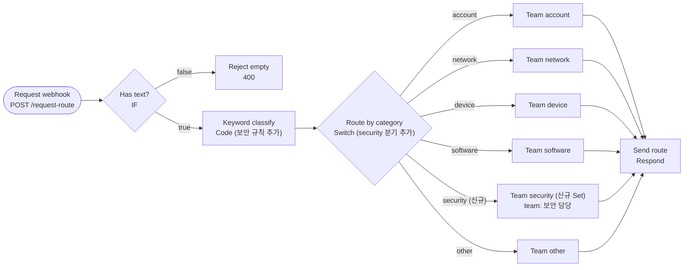

# n8n Webhook Router: "보안(Security)" 분류 및 라우팅 확장 정리

본 문서는 `LAB-02-N8N-FIRST-WORKFLOWS.md`의 **3-3 직접 바꿔 보기** 실습에서 `65-02 Webhook request router` 워크플로우에 **"보안(Security)"** 카테고리를 새로 정의하고 전담 팀으로 자동 라우팅하도록 구현한 과정과 결과를 정리한 문서입니다.

---

## 1. 전체 실행 흐름 개요 (한눈에 보기)

HTTP Webhook 요청으로 접수된 문의 텍스트를 키워드 기반으로 분류하고, 판정된 카테고리에 따라 담당 부서(`team`)를 할당하여 JSON으로 즉시 응답하는 구조입니다.



---

## 2. 노드별 상세 수정 및 추가 내역

### 2.1. `Keyword classify` (Code 노드) 수정
* **역할**: 입력받은 텍스트에 포함된 단어를 검사하여 적절한 `category`를 지정합니다.
* **수정 내용**: `rules` 배열에 `{ category: 'security', words: ['해킹', '피싱', '바이러스'] }` 추가

```javascript
// Rule-based classification: first matched rule wins.
const rules = [
  // 💡 [중요] security를 software보다 앞(맨 위)에 배치
  { category: 'security', words: ['해킹', '피싱', '바이러스'] },
  { category: 'account',  words: ['비밀번호', '계정', '로그인', '잠겨', '잠김'] },
  { category: 'network',  words: ['vpn', '인터넷', '와이파이', '접속', '네트워크'] },
  { category: 'device',   words: ['프린터', '모니터', '키보드', '마우스', '노트북'] },
  { category: 'software', words: ['설치', '프로그램', '라이선스', '메일', '업데이트'] },
];

const body = $input.first().json.body;
const text = String(body.text).toLowerCase();
const hit = rules.find(r => r.words.some(w => text.includes(w)));

return [{ 
  json: { 
    user: body.user || 'anonymous', 
    text: body.text, 
    category: hit ? hit.category : 'other' 
  } 
}];
```

> [!IMPORTANT]
> **키워드 우선순위 (Rule Order) 설계 포인트:**  
> `software` 카테고리에는 `'메일'` 키워드가 포함되어 있습니다.  
> 만약 `security` 규칙을 `software` 뒤에 두면 `"피싱 메일을 받은 것 같아요"` 문장에서 `'메일'`이 먼저 매칭되어 `software`로 오분류됩니다.  
> 따라서 **`security` 규칙을 `software`보다 앞에 배치**해야 `'피싱'` 키워드가 우선 감지되어 보안 팀으로 안전하게 분류됩니다.

---

### 2.2. `Route by category` (Switch 노드) 설정 추가
* **역할**: `category` 필드 값에 따라 노드의 출력 포트를 여러 경로로 분기합니다.
* **추가된 규칙 (Rule)**:
  - **Value 1**: `{{ $json.category }}`
  - **Operation**: `equals` (String)
  - **Value 2**: `security`
  - **Rename Output**: ON (이름: `security`)
* **결과**: Switch 노드 오른쪽에 `security` 전용 출력 단자가 생성됨.

---

### 2.3. `Team security` (Edit Fields / Set 노드) 신규 추가 및 연결
* **역할**: `security` 분기를 타고 들어온 데이터에 `team` 담당자 필드를 부여합니다.
* **설정값**:
  - **Name**: `Team security`
  - **Assignments (Fields to Set)**:
    - 필드명: `team`
    - 타입: `string`
    - 값: `보안 담당`
  - **Include Other Input Fields**: `true` (기존 `user`, `text`, `category` 필드 유지)
* **노드 연결 (Wiring)**:
  - 입력: `Route by category`의 `security` 포트 ➔ `Team security` 노드 입력
  - 출력: `Team security` 노드 출력 ➔ `Send route` (Respond to Webhook) 노드 입력

---

## 3. 실행 테스트 및 검증 결과

### 3.1. 테스트 호출 (curl)
n8n 캔버스에서 `Execute workflow` (또는 `Listen for test event`)를 활성화한 상태에서 터미널 호출을 실행했습니다.

```bash
curl -s -X POST http://localhost:5678/webhook-test/request-route \
  -H 'Content-Type: application/json' \
  -d '{"user":"kim","text":"피싱 메일을 받은 것 같아요"}'
```

### 3.2. 실제 응답 결과 (HTTP 200)
```json
{
  "user": "kim",
  "text": "피싱 메일을 받은 것 같아요",
  "category": "security",
  "team": "보안 담당"
}
```

### 3.3. 데이터 변환 단계 분석

| 단계 | 노드 | 입력 데이터 | 출력 데이터 (변환 결과) |
| :---: | :--- | :--- | :--- |
| **1** | `Request webhook` | HTTP POST Body | `body: { user: "kim", text: "피싱 메일을 받은 것 같아요" }` |
| **2** | `Has text?` | 위 body 데이터 | `true` 경로로 통과 (`text`가 비어있지 않음) |
| **3** | `Keyword classify` | 원본 body | `user`, `text` 유지 + **`category: "security"`** 생성 |
| **4** | `Route by category` | `category: "security"` | `security` 출력 포트로 라우팅 |
| **5** | `Team security` | `category: "security"` | **`team: "보안 담당"`** 필드 추가 |
| **6** | `Send route` | 최종 객체 | 클라이언트에게 JSON 응답 완료 |

---

## 4. 트러블슈팅 및 주의사항

### `404: The requested webhook "request-route" is not registered.` 발생 원인
* **원인**: n8n의 Test URL(`/webhook-test/...`)은 상시 대기하지 않으며, 캔버스에서 **`Execute workflow`** 또는 웹훅 노드의 **`Listen for test event`**를 눌렀을 때만 **1회성**으로 수신 대기 상태가 됩니다.
* **해결 방법**:
  1. **테스트 시**: 화면에서 `Execute workflow` 클릭 후 로딩 스피너가 돌고 있을 때 curl 요청 전송.
  2. **운영(상시) 시**: 우측 상단 토글을 **Active / Published**로 켜고, URL에서 `-test`를 뺀 정식 주소(`http://localhost:5678/webhook/request-route`)로 호출.
