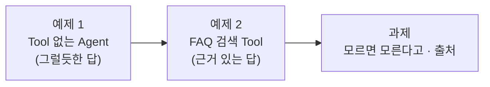
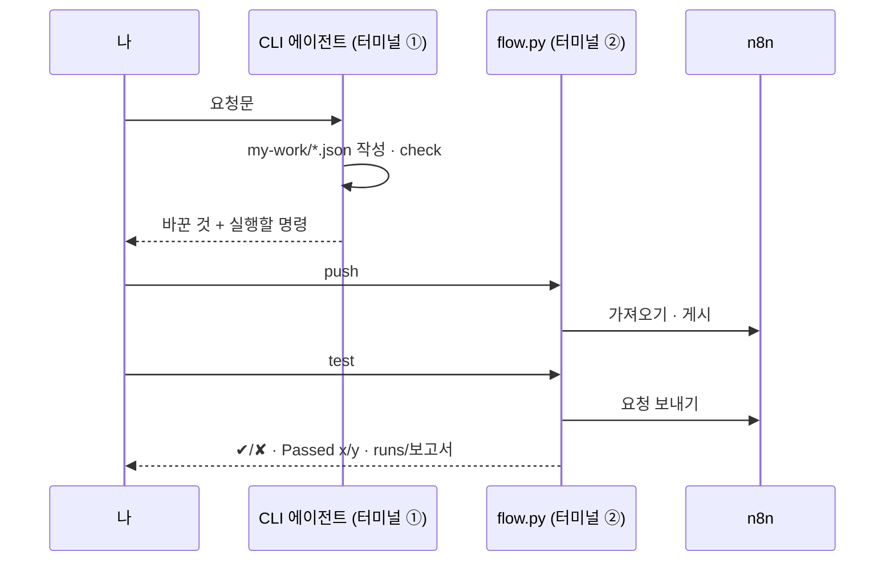

# Lab 01 · CLI 에이전트로 AI Agent 워크플로우 만들기 (Tool 1개)

> **정답본** · 수업이 끝난 뒤 공개합니다. 문제는 [LAB-01-Q-AGENT-AND-FIRST-TOOL.md](LAB-01-Q-AGENT-AND-FIRST-TOOL.md) (요청문 대신 단계별 가이드). 여기 요청문은 수업 준비 때 실제로 보내 결과를 잰 것입니다.

- 관련 강의: [1단계 · 바이브 코딩으로 n8n 만들기, Agent와 Tool](../../Lecture/67/01-STAGE1-VIBE-N8N-AGENT-AND-TOOL.md)
- 소요 시간: 약 40분 (예제 1 10분 · 예제 2 15분 · 과제 15분)
- 준비: [실습 준비](../../Lecture/67/00-DAY67-PREP.md)의 `uv run tools/flow.py doctor` → `ready`
- 목표: n8n 화면에서 노드를 끌어다 놓지 않고, **요청문**으로 워크플로우를 만들고 **테스트로 확인**한다.



## 시작하기 · 터미널 두 개

| 터미널 | 하는 일 |
| --- | --- |
| ① 에이전트 | `cd ~/aio-01d4-stu/Last3Mon/67` 후 `codex` (또는 `claude`, `agy`) 실행. 요청문을 붙여 넣는다 |
| ② 확인 | `cd ~/aio-01d4-stu/Last3Mon/67` 에서 `push`·`test`를 **내가** 실행한다 |

- 에이전트는 이 폴더의 [AGENTS.md](AGENTS.md)를 읽고 일합니다 (노드 모양, Credential, 데이터 API 주소가 들어 있음). `agy`가 읽지 않으면 첫 요청 앞에 "AGENTS.md를 먼저 읽어"를 붙입니다.
- 에이전트가 명령 실행이나 파일 쓰기를 허락해 달라고 하면 **무엇을 하는지 읽고** 허용합니다.
- 에이전트가 만든 파일은 `my-work/`에 생깁니다.



## 예제 1 · Tool 없는 Agent (10분)

터미널 ①에 붙여 넣습니다.

```text
my-work/chat.json 에 n8n 워크플로우를 만들어 줘.
- POST 웹훅, 경로 my-chat. 질문은 요청 본문의 question.
- AI Agent(OpenAI gpt-4.1-mini)가 사내 IT 담당자처럼 한국어 3문장 이내로 답한다. Tool은 아직 넣지 않는다.
- 결과는 {"answer": "..."} 로 돌려준다.
```

에이전트가 끝났다고 하면 터미널 ②에서:

```bash
uv run tools/flow.py push my-work/chat.json
uv run tools/flow.py call my-chat requests/faq-vpn.json
uv run tools/flow.py call my-chat requests/off-topic.json
```

| 확인할 것 | 수업 준비 때 결과 (gpt-4.1-mini) |
| --- | --- |
| VPN 질문 | "인터넷 연결 상태 확인, VPN 클라이언트 업데이트, 방화벽 점검" 같은 **일반적인 답** (사내 FAQ의 "인증서 만료 확인"은 없음) |
| 점심 메뉴 질문 | "비빔밥이나 불고기 덮밥을 추천드립니다" (IT와 무관해도 답함) |

브라우저 n8n에서 `67 ... (my)` 워크플로우를 열어 노드가 어떻게 연결됐는지 봅니다. **내가 노드를 하나도 끌어다 놓지 않았습니다.**

## 예제 2 · FAQ 검색 Tool 붙이기 (15분)

```text
my-work/it-agent.json 에 IT 문의 응답 워크플로우를 만들어 줘. my-work/chat.json 을 바탕으로 한다.
- POST 웹훅 경로 my-it-agent.
- AI Agent에 사내 FAQ 검색 Tool(Search FAQ, 데이터 API /faq)을 붙이고, 모든 질문에 Tool을 먼저 쓰고 그 결과로만 답하게 한다.
- 결과는 {"answer": "...", "tools_used": ["Search_FAQ"]} 처럼 사용한 Tool 이름 목록도 돌려준다.
기대 결과는 cases/lab01.json 에 있다.
```

```bash
uv run tools/flow.py push my-work/it-agent.json
uv run tools/flow.py test cases/lab01.json
uv run tools/flow.py test cases/lab01.json --webhook my-chat     # 같은 테스트를 예제 1에 보내 비교
```

| 워크플로우 | 수업 준비 때 결과 |
| --- | --- |
| 예제 2 `my-it-agent` | `Passed 9/9` (3번 반복) · VPN 답에 "인증서 만료 여부를 확인" |
| 예제 1 `my-chat` | `Passed 3/9` · 비밀번호·VPN에서 `tools_used has none of ['Search_FAQ']` |

예제 1도 비밀번호 질문에 "사내 포털 '비밀번호 찾기'"처럼 **맞는 것 같은 답**을 했습니다. 답만 봐서는 근거가 있는지 모릅니다. 그래서 테스트는 **어떤 Tool을 썼는지**도 봅니다.

n8n에서 확인합니다: 워크플로우 → **Executions** 탭 → 최근 실행 → `IT help agent` 노드 → 오른쪽에서 `Search_FAQ`가 받은 `query`와 돌려받은 FAQ를 봅니다.

## 과제 · 모르면 모른다고, 출처는 밝히고 (15분)

팀장이 요청했습니다.

> "FAQ에 없는 질문에 지어내서 답하면 곤란해요. 그리고 답에 어떤 FAQ를 썼는지 번호도 같이 주세요."

기대 결과는 `cases/lab01-challenge.json`에 있습니다. 먼저 파일을 열어 **무엇을 확인하는지** 읽습니다.

| 케이스 | 기대 |
| --- | --- |
| 비밀번호 출처 | `sources`에 `FAQ-001` |
| VPN 출처 | `sources`에 `FAQ-003` |
| 모르면 모른다고 | 점심 메뉴 질문에 `찾지 못했습니다`가 들어간 답, 메뉴 추천 없음 |

**요청문은 직접 씁니다.** 팀장의 말을 에이전트가 오해하지 않게 ① 무엇을 바꿀지 ② 결과에 무엇이 추가되는지 ③ 기대 결과 파일을 적습니다.

<details><summary>힌트 · 요청문 예시</summary>

```text
my-work/it-agent.json 을 고쳐 줘. 팀장 요청:
1) FAQ에서 답을 못 찾으면 지어내지 말고 "FAQ에서 답을 찾지 못했습니다"라고 답한다.
2) 결과에 sources(답에 쓴 FAQ 번호 목록, 예: ["FAQ-003"])를 추가한다.
기대 결과는 cases/lab01-challenge.json 에 있다.
```
</details>

```bash
uv run tools/flow.py push my-work/it-agent.json
uv run tools/flow.py test cases/lab01-challenge.json --repeat 3
uv run tools/flow.py test cases/lab01.json                        # 원래 테스트도 그대로 통과하는지
```

수업 준비 때 위 요청문으로 Codex가 50초 만에 고쳤고 `Passed 9/9`(3번 반복), 원래 테스트 `3/3`이었습니다.

**더 생각해 보기**: 에이전트는 `sources`를 어디서 가져왔나요? LLM에게 "번호도 써 줘"라고 시켰나요, 아니면 Tool이 돌려준 글자에서 `FAQ-001`을 찾았나요? `my-work/it-agent.json`을 열어 확인하고, 어느 쪽이 더 믿을 만한지 이야기해 봅니다.

## 막혔을 때

| 증상 | 할 일 |
| --- | --- |
| `check`에 ✘ | 에이전트에게 그 줄을 그대로 붙여 주고 고쳐 달라고 합니다 |
| `push` 후 `call`이 404 | 몇 초 뒤 다시. 계속이면 `uv run tools/flow.py doctor` |
| `status 500 · 'Error in workflow'` 가 30초 넘게 걸림 | OpenAI 쪽 일시 오류일 수 있습니다 (수업 준비 때 테스트 요청 405번 중 1번, 약 39초 뒤 500). 한 번 더 실행 |
| 에이전트가 계속 엉뚱하게 고침 | 정답 파일로 이어 갑니다: `cp reference/lab01-example2-faq-tool.json my-work/it-agent.json` 후 push |

## 확인

- [ ] 예제 1: 노드를 직접 놓지 않고 `my-chat` 워크플로우를 만들어 불렀다.
- [ ] 예제 2: `cases/lab01.json` → `Passed`가 전부, 예제 1은 Tool 검사에서 실패하는 것을 봤다.
- [ ] 과제: `cases/lab01-challenge.json` 3번 반복 통과, 원래 테스트도 통과.
