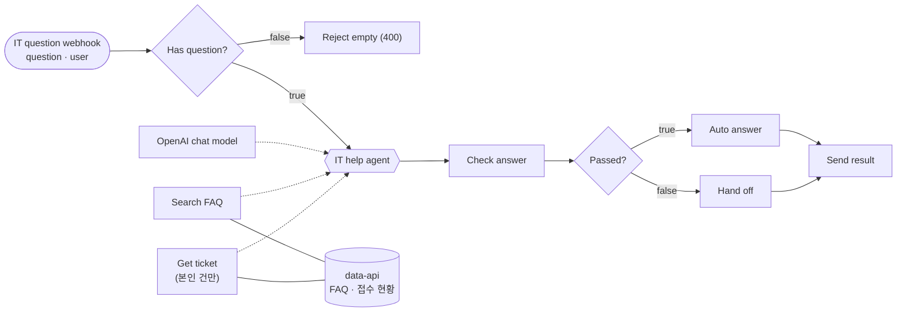
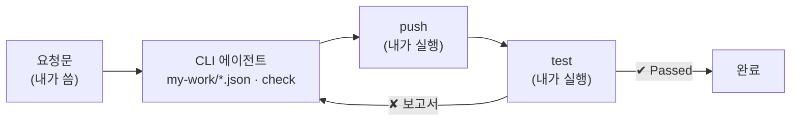

# 67일차 실습 · 바이브 코딩으로 만드는 Agent·Tool·데이터 연계 워크플로우와 결과 검증

- 일자: 2026-10-19 (67일차)
- 교과목: 노코드 멀티 에이전트 워크플로우 설계 및 운영
- 단원: AI 워크플로우 설계 및 구현
- 강의 자료: [Lecture/67](../../Lecture/67/README.md)
- 하루 수강 안내: [LECTURE-67.md](LECTURE-67.md) (수업 준비부터 마칠 때까지 순서대로)
- 66일차처럼 n8n 노드를 손으로 끌어다 놓지 않습니다. CLI 코딩 에이전트(Codex · Claude Code · Antigravity)에게 요청문으로 워크플로우 JSON을 만들게 하고, 우리는 **실행 결과를 테스트로 확인**합니다. 오늘은 정해진 흐름 대신 **Agent가 Tool을 고르는** 워크플로우입니다.

## 오늘 만드는 업무: 사내 IT 문의 응답 Agent



## 일하는 방식



| 누가 | 무엇을 |
| --- | --- |
| 나 | 요청문 쓰기, 기대 결과(테스트) 정하기, push·test 실행, 결과 판단 |
| CLI 에이전트 | [AGENTS.md](AGENTS.md) 규칙대로 워크플로우 JSON 작성, `check`로 형식 오류 고치기, 실패 원인 찾기 |
| `tools/flow.py` | 형식 검사(check), n8n에 가져오기·게시(push), 요청 보내기(call), 테스트(test) |

## 실습 문서 읽는 법

- 실습 문서(`LAB-0x-Q-*.md`, `VIBE-Q-TMAN.md`)에는 **복사해 붙일 요청문이 없습니다.** 만들 것 · 조건 · 기대 결과만 있고, 요청문은 직접 씁니다.
- 막히면 `▶` 를 하나씩 펼칩니다. 1단계는 "무엇을 정해야 하나", 뒤로 갈수록 "빠뜨리기 쉬운 것 · 점검표 · 실패했을 때"처럼 구체적이 되지만 정답 요청문은 나오지 않습니다.
- 쓴 요청문은 `my-work/PROMPTS.md`에 모아 두고, 수업 끝에 옆 사람과 비교합니다.

## 구성

```text
Last3Mon/67/
├── README.md
├── AGENTS.md                     # CLI 에이전트용 n8n 작업 규칙 (CLAUDE.md가 이 파일을 불러옴)
├── LAB-01-Q-AGENT-AND-FIRST-TOOL.md  # 1단계 · Tool 없는 Agent → FAQ Tool → 모르면 모른다고·출처
├── LAB-02-Q-DATA-TOOLS.md          # 2단계 · 접수 현황 Tool → Tool이 받은 값 → 본인 접수 건만
├── LAB-03-Q-VERIFY-AND-FIX.md      # 3단계 · 테스트 읽기 → 검증·담당자 연결 → 어려운 테스트 쓰고 고치기
├── VIBE-Q-TMAN.md                  # 7교시 바이브 코딩 · tman (tldr + man TUI)
├── *-A-*.md                        # 정답본 (요청문 · 실측 결과, 수업이 끝난 뒤 공개)
├── tools/flow.py                 # doctor · check · push · call · test (uv run, 표준 라이브러리만)
├── cases/                        # 테스트 파일 (lab01 · lab01-challenge · lab02 · lab02-challenge · lab03)
├── requests/                     # 요청 9종 (question + user)
├── reference/                    # 막혔을 때 이어 가는 워크플로우 (예제 단계)
├── templates/TEST-REPORT-TEMPLATE.md
├── data-api/                     # 사내 데이터 API (FAQ 검색 · 접수 현황 · 본인 건 확인)
├── my-work/                      # 에이전트가 만든 워크플로우 (git에 올라가지 않음)
└── runs/                         # 테스트 보고서 (자동 생성, git에 올라가지 않음)
```

## 준비

[실습 준비](../../Lecture/67/00-DAY67-PREP.md)를 끝내 주세요. 요약:

```bash
cd ~/aio-01d4-stu/Last3Mon/65/n8n && docker compose start         # 65일차 n8n (Ollama는 쓰지 않음 · 처음 한 번 PREP 1절대로 끄기)
cd ~/aio-01d4-stu/Last3Mon/67/data-api && docker compose up -d --force-recreate
cd ~/aio-01d4-stu/Last3Mon/67 && uv run tools/flow.py doctor      # 마지막 줄 ready
```

## `flow.py` 명령

| 명령 | 하는 일 | 수업 준비 때 |
| --- | --- | --- |
| `uv run tools/flow.py doctor` | n8n · 데이터 API · Credential · CLI 에이전트 확인 | 약 5초 |
| `uv run tools/flow.py check my-work/x.json` | 노드 종류·버전·연결·Credential·API 키 노출 검사 | 1초 미만 |
| `uv run tools/flow.py push my-work/x.json` | n8n에 가져오기 → 게시 → n8n 재시작 → 웹훅 준비 확인. 같은 경로를 쓰던 다른 워크플로우는 게시 해제 | 약 8초 |
| `uv run tools/flow.py call my-it-agent requests/faq-vpn.json` | 요청 한 번 보내고 응답 보기 | 1~4초 |
| `uv run tools/flow.py test cases/lab02.json --repeat 3` | 테스트 실행, `Passed x/y`, 보고서를 `runs/`에 저장 | 케이스당 1~4초 |
