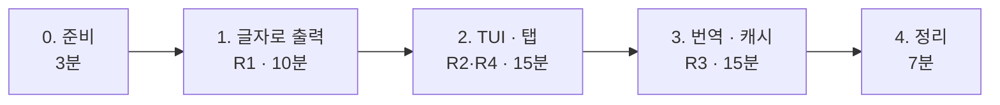

# 7교시 바이브 코딩 · `tman` 만들기

> **정답본** · 수업이 끝난 뒤 공개합니다. 문제는 [VIBE-Q-TMAN.md](VIBE-Q-TMAN.md) (요청문 대신 단계별 가이드). 여기 요청문은 수업 준비 때 실제로 보내 결과를 잰 것입니다.

- 시간: 16:00~16:50 (50분) · 발표와 정리는 8교시
- 도구: CLI 코딩 에이전트(codex / claude / agy), Python + uv + [Textual](https://textual.textualize.io/)
- 결과물: 명령어 이름을 넣으면 **사용 예**를 보여 주는 터미널 프로그램(TUI)

```text
$ tman tar
┌ tman ─────────────────────────────────────────────┐
│ [ tar ]                                            │
│ ┌ tldr ┬ man ┐                                     │
│ │ 아카이브 유틸리티.                               │
│ │ - 아카이브 생성 후 파일로 저장:                  │
│ │   tar cf {{경로/대상/파일.tar}} {{파일1 ...}}    │
│ │ ...                                              │
└────────────────────────────────────────────────────┘
```

## 요구 사항

| 번호 | 요구 | 확인 방법 |
| --- | --- | --- |
| R1 | [tldr pages.ko](https://github.com/tldr-pages/tldr/tree/main/pages.ko)에서 명령어 페이지를 가져와 **사용 예**를 보여 준다 | `tman tar` |
| R2 | 그 명령어의 `man` 결과가 있으면 **별도 탭**에 보여 준다 | `tman ls` → man 탭 |
| R3 | 사용 예(명령 줄)를 **뺀** 모든 설명은 한국어로 자동 번역한다 (한국어 페이지가 없을 때의 영어 tldr, man 설명) | `tman wcurl` (한국어 페이지 없음), `tman ls`의 man 탭 |
| R4 | 화면 안에서 다른 명령어를 검색할 수 있다 | 입력칸에 `git` |

알아 둘 것 (수업 준비 때 확인):

- 한국어 페이지 주소: `https://raw.githubusercontent.com/tldr-pages/tldr/main/pages.ko/common/tar.md` (`tar`, `ls`, `git`, `curl`, `docker` 모두 있음). `common` 외에 `linux` 폴더도 있습니다.
- 2026-10-17 기준 영어 `pages/common` 4,728개 중 한국어 페이지가 없는 것은 96개입니다 (예: `wcurl`, `vllm`). 그래서 번역이 가장 많이 필요한 곳은 **man 탭**입니다.
- 영어 페이지: `.../main/pages/common/<명령>.md`
- 페이지 모양: `# 이름`, `> 설명`, `- 사용 예 설명:`, `` `명령 줄` `` 이 반복됩니다. **백틱 안의 명령 줄은 번역하지 않습니다.**
- 번역 LLM: `gpt-4.1-mini`, 키는 `OPENAI_API_KEY` 환경 변수로 받습니다 (`~/aio-01d4-stu/Last3Mon/.env`에 있는 값). **키를 코드에 쓰지 않습니다.**
- WSL에서 `man ls`가 "minimized" 안내만 보이면 man 페이지가 설치되지 않은 것입니다. 이때는 man 탭에 "man 페이지 없음"을 보여 주면 됩니다.

## 진행 (50분)



### 0. 준비 (3분)

```bash
mkdir -p ~/vibe/tman && cd ~/vibe/tman
git init
codex        # 또는 claude, agy
```

### 1. 글자로 출력 (10분)

화면부터 만들지 말고, **가장 작은 동작**부터 확인합니다.

```text
Python 프로젝트 tman 을 uv로 만들어 줘 (uv init, 패키지 이름 tman, 명령 tman).
1단계: `uv run tman tar` 를 실행하면 tldr pages.ko 의 tar 페이지를 가져와 터미널에 글자로 출력한다.
- 주소: https://raw.githubusercontent.com/tldr-pages/tldr/main/pages.ko/common/<명령>.md, 없으면 linux 폴더.
- 페이지를 (설명, [(사용 예 설명, 명령 줄)]) 구조로 파싱하는 함수를 따로 두고, 그 함수의 pytest 테스트도 만든다.
- 화면(TUI)은 아직 만들지 않는다. 코드와 화면 글자는 영어, 주석도 영어.
```

```bash
uv run tman tar
uv run pytest -q
git add -A && git commit -m "step 1: print tldr page"
```

### 2. TUI와 탭 (15분)

```text
2단계: Textual로 TUI를 만들어 줘.
- 위에 명령어 입력칸, 아래에 탭 두 개: tldr, man.
- tldr 탭: 1단계 파싱 결과를 보여 주고, 명령 줄은 다른 색으로 강조한다.
- man 탭: `man <명령>` 결과(MANPAGER=cat, 서식 문자 제거)를 스크롤로 보여 준다. 없으면 "man page not found".
- `uv run tman tar` 로 시작하면 바로 tar를 보여 주고, 입력칸에 다른 명령을 넣고 Enter 하면 바꾼다.
- 네트워크 요청은 화면을 멈추지 않게 처리한다.
```

```bash
uv run tman tar
uv run tman ls
git add -A && git commit -m "step 2: textual tui with tabs"
```

### 3. 번역과 캐시 (15분)

```text
3단계: 번역을 추가해 줘.
- 한국어 tldr 페이지가 없으면 영어 페이지를 가져와, 명령 줄(백틱 안)은 그대로 두고 설명만 한국어로 번역한다.
- man 탭의 설명 문단도 한국어로 번역한다. 옵션 이름과 명령 예시는 번역하지 않는다.
- OpenAI gpt-4.1-mini, 키는 OPENAI_API_KEY 환경 변수. 키가 없으면 번역 없이 원문을 보여 주고 상태 줄에 알린다.
- 같은 내용을 다시 번역하지 않게 ~/.cache/tman 에 저장한다.
- 번역 함수는 LLM을 부르는 부분을 바꿔 끼울 수 있게 만들고, 가짜 번역기로 테스트한다 (테스트에서 실제 API를 부르지 않는다).
```

```bash
export OPENAI_API_KEY=$(grep '^OPENAI_API_KEY=' ~/aio-01d4-stu/Last3Mon/.env | cut -d= -f2-)
uv run tman ls
uv run pytest -q
git add -A && git commit -m "step 3: translate with cache"
```

### 4. 정리 (7분)

- `README.md`를 에이전트에게 쓰게 하고, `uv tool install -e .` 로 어디서나 `tman` 실행.
- 발표 준비: 아래 3가지를 메모합니다.

| 발표 (3분) | 내용 |
| --- | --- |
| 요청문 | 가장 잘 먹힌 요청문 한 개, 안 먹힌 요청문 한 개 |
| 막힌 곳 | 에이전트가 틀린 것, 어떻게 알아챘고 어떻게 고쳤나 |
| 시연 | `tman tar`, 탭 전환, 번역된 명령 하나 |

## 수업 준비 때 결과 (Codex, 강사 PC)

| 단계 | 에이전트 시간 | 확인 |
| --- | --- | --- |
| 1. 글자로 출력 | 116초 | `uv run tman tar` 한국어 페이지 출력, pytest 19 passed |
| 2. TUI · 탭 | 78초 (Textual은 미리 설치) | tar 페이지와 man 탭 표시, pytest 29 passed |
| 3. 번역 · 캐시 | 133초 | `tman wcurl` 설명 번역·캐시 ("중단된 다운로드 재개:"), pytest 48 passed |

## 확인

- [ ] R1 `tman tar`에 한국어 사용 예가 나온다.
- [ ] R2 man 탭이 있고, man이 없으면 안내가 나온다.
- [ ] R3 한국어 페이지가 없는 명령에서 설명은 한국어, 명령 줄은 원래 그대로다.
- [ ] R4 입력칸으로 다른 명령을 볼 수 있다.
- [ ] `uv run pytest -q` 통과, 단계마다 git commit이 있다.
