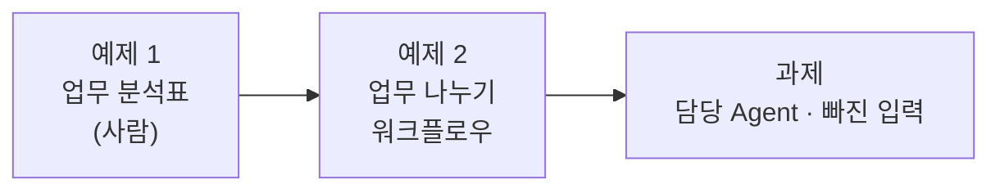

# Lab 01 · 복합 요청을 업무로 나누기

- 관련 강의: [1단계 · 복합 업무 시나리오 분석](../../Lecture/68/01-STAGE1-COMPOSITE-SCENARIO.md)
- 소요 시간: 약 40분 (예제 1 10분 · 예제 2 15분 · 과제 15분)
- 준비: [실습 준비](../../Lecture/68/00-DAY68-PREP.md)의 `uv run tools/flow.py doctor` → `ready`
- 목표: 요청 하나에 섞인 업무를 **사람이 먼저 분석**하고, 그 분석대로 업무를 나누는 워크플로우를 **내가 쓴 요청문**으로 만든다.



> 이 실습에는 **복사해 붙일 요청문이 없습니다.** 요청문은 직접 씁니다. 막히면 아래 `▶` 를 하나씩 펼쳐 보세요. 펼칠수록 구체적이 되지만, 정답 요청문은 나오지 않습니다.

## 시작하기 · 터미널 두 개

| 터미널 | 하는 일 |
| --- | --- |
| ① 에이전트 | `cd ~/aio-01d4-stu/Last3Mon/68` 후 `codex` (또는 `claude`, `agy`) 실행. 내가 쓴 요청문을 보낸다 |
| ② 확인 | `cd ~/aio-01d4-stu/Last3Mon/68` 에서 `push`·`test`를 **내가** 실행한다 |

- 에이전트는 이 폴더의 [AGENTS.md](AGENTS.md)를 읽고 일합니다. `agy`가 읽지 않으면 첫 요청 앞에 "AGENTS.md를 먼저 읽어"를 붙입니다.
- 쓴 요청문은 `my-work/PROMPTS.md`에 모읍니다.

## 예제 1 · 업무 분석표 (10분, 에이전트 없이)

`cp templates/MULTI-AGENT-DESIGN-TEMPLATE.md my-work/DESIGN.md` 후 1절 표를 **직접** 채웁니다. 요청 파일은 `requests/`에 있습니다 (`cat requests/composite.json`).

| 요청 파일 | 직원 요청 |
| --- | --- |
| `composite` | T-1002 처리 상태 알려주고, 첨부한 회의록에서 할 일도 정리해줘. 그리고 프린터 출력이 안 돼요. (회의록 첨부) |
| `two-it` | 비밀번호를 잊어버렸어요. 그리고 메일함 용량이 꽉 찼다고 나와요. |
| `it-and-other` | 프린터 출력이 안 돼요. 그리고 다음 주 회식 장소도 추천해 주세요. |
| `meeting-no-notes` | 이번 회의록 할 일 정리 부탁해요 (회의록 첨부 **없음**) |
| 내 업무 | 64일차 Lab 03의 내 업무 시나리오에서 하나 |

<details><summary>▶ 1단계 · 무엇을 기준으로 나누나</summary>

"한 사람이 한 번에 처리할 수 있는 일"이 업무 하나입니다. 접속사(그리고, 또, ~고)에서 끊기지만, 끊긴 조각이 같은 일을 말하면 하나로 둡니다. 유형은 지금 있는 Agent(IT 문의, 회의록) 기준으로 나누고, 맡을 Agent가 없으면 `other`입니다.
</details>

<details><summary>▶ 2단계 · 빠뜨리기 쉬운 칸</summary>

- **필요한 입력**: 업무를 처리하려면 무엇이 있어야 하나요? 접수 현황은 "누가 물었는지", 회의록 정리는 "회의록 원문"이 필요합니다. 요청 문장에 없고 **요청 본문의 다른 칸**에 있을 수도 있습니다 (`requests/*.json`을 열어 봅니다).
- **업무 관계**: 한 업무의 결과가 다른 업무에 필요한가요? 필요 없다면 "독립"이고, 순서와 상관없이 따로 처리할 수 있습니다.
</details>

**확인**: 옆 사람과 표를 바꿔 봅니다. 업무 개수가 같은가요? 다르면 어느 쪽 기준이 Agent에게 넘기기 좋은가요?

## 예제 2 · 업무 나누기 워크플로우 (15분)

**만들 것**: 직원 요청 문장을 받아 업무 목록으로 나누는 워크플로우. 아직 Agent를 부르지 않고 **나누기만** 합니다.

| 조건 | 값 |
| --- | --- |
| 저장할 파일 | `my-work/split.json` |
| 웹훅 | POST, 경로 `my-split`, 요청 문장은 본문의 `message` |
| 나누는 방법 | LLM(OpenAI `gpt-4.1-mini`)이 나누고, 결과 글자를 코드로 읽어 목록으로 |
| 결과 | `{"count": 3, "tasks": [{"type": "it", "text": "..."}]}` · 유형은 `it`, `meeting`, `other` 셋 |
| 기대 결과 | `cases/lab01.json` (먼저 열어 읽기) |

<details><summary>▶ 1단계 · 예제 1의 표를 요청문으로</summary>

예제 1에서 정한 **나누는 기준과 유형 정의**를 그대로 요청문에 옮깁니다. 에이전트는 이 기준을 LLM 지시문(systemMessage)에 넣게 됩니다. 유형마다 "어떤 요청이 여기에 드는지" 예를 한두 개씩 적어 보세요.
</details>

<details><summary>▶ 2단계 · LLM의 답을 믿지 않기</summary>

LLM에게 JSON으로 달라고 해도 앞뒤에 다른 글자가 붙거나, 정해지지 않은 유형을 쓰기도 합니다. 결과를 읽는 쪽에서 **무엇을 확인하고, 읽지 못하면 어떻게 할지** 요청문에 적었나요? 업무의 순서(요청에 나온 순서)도 지켜야 테스트의 `tasks.0`, `tasks.1`이 맞습니다.
</details>

<details><summary>▶ 3단계 · 보내기 전 점검표</summary>

- [ ] 파일 경로, 웹훅 경로, 입력 필드
- [ ] 유형 셋과 각각의 정의
- [ ] 결과 JSON 모양 (필드 이름 `count`, `tasks`, `type`, `text`)
- [ ] 빈 요청이면 어떻게 할지 (테스트 파일의 마지막 케이스)
- [ ] 테스트 파일 경로
</details>

<details><summary>▶ 4단계 · 테스트가 실패하면</summary>

실패한 줄과 보고서 경로를 그대로 붙입니다. 업무 개수가 틀렸다면, LLM이 받은 문장과 돌려준 글자를 n8n **Executions**에서 직접 보고 "어느 기준이 모호했는지"를 먼저 묻습니다. 지시문에 예를 더하는 것과 기준을 바꾸는 것은 다른 고침입니다.
</details>

```bash
uv run tools/flow.py push my-work/split.json
uv run tools/flow.py test cases/lab01.json --repeat 3
uv run tools/flow.py call my-split requests/composite.json
```

**관찰**: 예제 1의 내 분석표와 워크플로우의 결과가 같은가요? `composite`의 업무 텍스트에 `T-1002`가 남아 있나요 (다음 Agent가 번호를 알아야 합니다)?

## 과제 · 누가 맡는지, 무엇이 빠졌는지 (15분)

팀장이 요청했습니다.

> "업무마다 어느 Agent가 맡는지 같이 적어 주세요. 그리고 처리에 꼭 필요한 게 빠졌으면 무엇이 빠졌는지도요. 그건 LLM이 짐작하지 말고 규칙으로 정해 주세요."

기대 결과는 `cases/lab01-challenge.json`에 있습니다.

| 케이스 | 기대 |
| --- | --- |
| 복합 요청 | `tasks[].agent`에 `it-agent`, `meeting-agent`. 빠진 것 없음 |
| 회의록 없는 회의 요청 | `agent: meeting-agent`, `missing: ["notes"]` |
| 기타 | `agent: 담당자 연결`, `missing: []` |
| IT · 입력 다 있음 | `agent: it-agent`, `missing: []` |

**먼저 생각해 보기 (3분)**: 업무 유형별로 "꼭 필요한 입력"을 적어 봅니다. [AGENTS.md](AGENTS.md) 3절의 Agent 입력 칸이 힌트입니다.

<details><summary>▶ 1단계 · "규칙으로"의 뜻</summary>

어느 Agent가 맡는지는 유형이 정해지면 **표 하나로** 정해집니다. 빠진 입력도 요청 본문에 그 칸이 비었는지만 보면 됩니다. 둘 다 LLM에게 물어볼 일이 아닙니다. 요청문에서 "LLM 지시문을 고치지 말고 결과를 읽는 코드에서" 정하라고 할 수 있습니다.
</details>

<details><summary>▶ 2단계 · 원래 테스트도</summary>

고치는 요청입니다. 고칠 파일, 새 필드 이름과 예시 값, 그리고 `cases/lab01.json`도 계속 통과해야 한다는 조건을 적었나요?
</details>

<details><summary>▶ 3단계 · 하나 더 생각하기</summary>

IT 문의 Agent는 `user`가 없으면 400을 돌려줍니다. 테스트에는 없지만, 이것도 "빠진 입력"으로 표시할지 정해 보세요. Lab 03 과제에서 다시 만납니다.
</details>

```bash
uv run tools/flow.py push my-work/split.json
uv run tools/flow.py test cases/lab01-challenge.json --repeat 3
uv run tools/flow.py test cases/lab01.json
```

## 막혔을 때

| 증상 | 할 일 |
| --- | --- |
| `check`에 ✘ | 에이전트에게 그 줄을 그대로 붙여 주고 고쳐 달라고 합니다 |
| `push` 후 `call`이 404 | 몇 초 뒤 다시. 계속이면 `uv run tools/flow.py doctor` |
| `count`가 매번 다름 | `--repeat 3` 결과를 보고, 다른 답이 나온 요청을 Executions에서 확인 |
| 에이전트가 계속 엉뚱하게 고침 | 요청을 더 작게 나눕니다. 그래도 안 되면 `cp reference/lab01-example2-split.json my-work/split.json` 후 push로 이어 갑니다 |

## 확인

- [ ] 예제 1: `my-work/DESIGN.md` 1절 분석표를 채웠다.
- [ ] 예제 2: `cases/lab01.json` 통과.
- [ ] 과제: `cases/lab01-challenge.json` 3번 반복 통과, 원래 테스트도 통과.
- [ ] `my-work/PROMPTS.md`에 요청문을 모았다.
