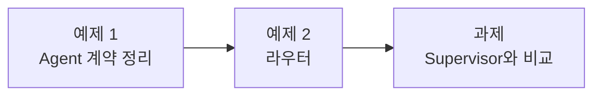

# Lab 02 · 여러 Agent에게 나눠 맡기는 라우터

- 관련 강의: [2단계 · Multi-Agent 워크플로우 설계](../../Lecture/68/02-STAGE2-MULTI-AGENT-DESIGN.md)
- 소요 시간: 약 70분 (예제 1 10분 · 예제 2 25분 · 과제 35분)
- 준비: Lab 01의 `my-work/split.json` (없으면 `cp reference/lab01-example2-split.json my-work/split.json`)
- 목표: 이미 있는 Agent 둘의 **계약**을 정리하고, 업무를 유형별로 나눠 그 Agent들을 부르는 **라우터**를 만든다. 같은 일을 **Supervisor** 방식으로도 만들어 비교한다.



> 복사해 붙일 요청문은 없습니다. 막히면 `▶` 를 하나씩 펼칩니다.

## 예제 1 · Agent 계약 정리 (10분)

**할 일**: 두 Agent를 직접 불러 보고, 에이전트에게 Agent 파일을 읽혀 **계약 표**를 `my-work/DESIGN.md` 2절에 쓰게 한다. 워크플로우는 만들지 않는다.

```bash
uv run tools/flow.py push agents/it-agent.json agents/meeting-agent.json     # 준비 때 했으면 생략
uv run tools/flow.py call it-agent requests/agent-it.json
uv run tools/flow.py call meeting-agent requests/agent-meeting.json
uv run tools/flow.py call meeting-agent '{"title": "주간 회의"}'
```

| 계약 표의 칸 | |
| --- | --- |
| Agent · 맡는 업무 · 웹훅 | |
| 입력 (필수인 것) | |
| 결과 (필드 이름) | |
| 실패할 때 돌려주는 것 | 400? `route: 담당자 연결`? |

<details><summary>▶ 1단계 · 에이전트에게 무엇을 읽게 하나</summary>

`agents/` 폴더의 두 파일이 근거입니다. 웹훅 노드, 입력을 검사하는 If 노드, 마지막 Respond 노드를 보면 계약이 나옵니다. "워크플로우를 만들지 말고 문서만"이라고 분명히 적습니다.
</details>

<details><summary>▶ 2단계 · 에이전트의 표를 믿기 전에</summary>

위 `call` 세 번의 결과와 에이전트가 쓴 표를 비교합니다. 필드 이름 하나라도 다르면 라우터가 그 값을 읽지 못합니다. [AGENTS.md](AGENTS.md) 3절과도 맞춰 봅니다.
</details>

## 예제 2 · 라우터 (25분)

**만들 것**: Lab 01의 업무 나누기를 바탕으로, 업무마다 담당 Agent를 HTTP로 부르고 결과를 하나로 모아 답하는 워크플로우.

| 조건 | 값 |
| --- | --- |
| 저장할 파일 | `my-work/assistant.json` (오늘 끝까지 이 파일을 고쳐 나감) |
| 바탕 | `my-work/split.json` (그 파일은 그대로 둔다) |
| 웹훅 | POST, 경로 `my-assistant`, 본문 `message`, `user`, 회의록이 있으면 `title`, `notes` |
| 분배 | `it` → IT 문의 Agent, `meeting` → 회의록 Agent, `other` → Agent를 부르지 않고 `담당자 연결` |
| 결과 | `{"count": 3, "results": [{"index", "type", "text", "agent", "route", "answer"}], "reply": "..."}` |
| 기대 결과 | `cases/lab02.json` |

<details><summary>▶ 1단계 · 흐름부터 정하기</summary>

`DESIGN.md` 3절에 mermaid로 흐름을 먼저 그려 봅니다: 나누기 → 업무 하나씩 → 유형별 갈래 → Agent 부르기 → 결과 모양 맞추기 → 모으기 → 답. 이 흐름을 요청문에 그대로 순서대로 적으면 에이전트가 덜 헤맵니다. [2단계 교안](../../Lecture/68/02-STAGE2-MULTI-AGENT-DESIGN.md) 4절의 노드 이름을 참고합니다.
</details>

<details><summary>▶ 2단계 · Agent에게 무엇을 넘기나</summary>

IT 문의 Agent에는 **업무 텍스트**와 **요청한 사람**, 회의록 Agent에는 **회의록 제목과 원문**을 넘깁니다. 이 중 LLM이 만든 값은 무엇이고, 웹훅 본문에서 그대로 가져와야 하는 값은 무엇인가요? 예제 1의 계약 표를 요청문에 붙이거나 "AGENTS.md 3절의 계약대로"라고 적습니다.
</details>

<details><summary>▶ 3단계 · 결과를 한 모양으로</summary>

두 Agent의 결과 모양이 다릅니다 (IT는 `answer`, 회의록은 `summary`·`actions`). 모으기 전에 **같은 모양**(`index, type, text, agent, route, answer`)으로 맞춰야 `reply`를 만들 수 있습니다. 회의록 결과의 `answer`에 무엇을 넣을지, `actions`도 남길지 정합니다. 결과 순서는 요청에 나온 순서(`index`).
</details>

<details><summary>▶ 4단계 · 보내기 전 점검표</summary>

- [ ] 바탕 파일과 새 파일 경로, 새 웹훅 경로
- [ ] 유형별 분배와 각 Agent 주소 (n8n 안에서 부르는 주소)
- [ ] 넘길 값과 그 값의 출처
- [ ] 결과 한 항목의 모양, 전체 결과 모양
- [ ] `cases/lab02.json`
</details>

```bash
uv run tools/flow.py push my-work/assistant.json
uv run tools/flow.py test cases/lab02.json
uv run tools/flow.py call my-assistant requests/composite.json
```

**관찰**: n8n **Executions**에서 `my-assistant` 한 번의 실행을 엽니다. `Call IT agent` 노드는 항목 몇 개를 처리했나요(IT 업무가 2개면)? 같은 시간에 `it-agent`, `meeting-agent`의 실행도 따로 생겼나요? `test` 결과에서 복합 요청과 단일 요청의 시간을 비교해 메모합니다 (Lab 03에서 씁니다).

## 과제 · Supervisor로도 만들어 비교 (35분)

팀장이 물었습니다.

> "업무를 미리 나누지 말고, AI 하나가 알아서 필요한 Agent를 부르게 하면 더 간단하지 않아요? 해 보고 어느 쪽이 나은지 알려 주세요."

**만들 것**: 같은 요청을 받아, AI Agent 하나(Supervisor)가 두 Agent를 **Tool로** 골라 부르고 답을 쓰는 워크플로우.

| 조건 | 값 |
| --- | --- |
| 저장할 파일 | `my-work/supervisor.json` (라우터와 별도) |
| 웹훅 | POST, 경로 `my-supervisor`, 입력은 라우터와 같음 |
| 결과 | `{"reply": "...", "agents_used": ["it-agent", ...]}` (실제로 부른 Agent, 겹치지 않게) |
| 기대 결과 | `cases/lab02-challenge.json` |

**먼저 생각해 보기 (3분)**: 라우터에서 코드가 하던 일(나누기, 분배, 모으기) 중 Supervisor에서는 누가 하나요?

<details><summary>▶ 1단계 · Agent를 Tool로</summary>

67일차에 FAQ API를 HTTP Request **Tool**로 붙였던 것처럼, 이번에는 다른 Agent의 웹훅을 Tool로 붙입니다. Tool 설명(`toolDescription`)이 "언제 이 Agent를 부를지"의 근거가 됩니다.
</details>

<details><summary>▶ 2단계 · LLM에게 맡기면 안 되는 값</summary>

Tool의 입력 중 **LLM이 채워도 되는 값**(질문 문장)과 **채우면 안 되는 값**(요청한 사람, 회의록 원문)을 나눕니다. 회의록 원문을 LLM이 다시 써서 넘기면 무엇이 달라질 수 있을까요?
</details>

<details><summary>▶ 3단계 · agents_used는 누가 쓰나</summary>

`agents_used`를 LLM의 답에서 찾게 할 수도, Agent의 Tool 호출 기록에서 찾게 할 수도 있습니다. 67일차 Lab 01 과제의 `sources`와 같은 질문입니다.
</details>

<details><summary>▶ 4단계 · 비교하기</summary>

```bash
uv run tools/flow.py test cases/lab02-challenge.json --repeat 3
uv run tools/flow.py test cases/lab02.json --webhook my-supervisor     # 라우터의 테스트를 Supervisor에
```

`DESIGN.md` 3절 아래에 표로 정리합니다: 복합 요청 시간, 같은 요청 3번의 결과가 같은가, 결과 모양(계약)이 테스트에 맞는가, Agent를 하나 더 붙일 때 고칠 곳. 두 번째 명령이 왜 실패하는지도 적습니다.
</details>

## 막혔을 때

| 증상 | 할 일 |
| --- | --- |
| 응답이 500, 아무 결과 없음 | 부른 Agent가 오류를 돌려줬을 수 있습니다. Executions에서 어느 노드가 빨간지 보고 그 내용을 에이전트에게 붙입니다 (Lab 03에서 다룸) |
| `Call ... agent`가 404 | 그 Agent가 게시되지 않음: `uv run tools/flow.py push agents/it-agent.json agents/meeting-agent.json` |
| `results`가 한 개뿐 | 모으기(Merge·Aggregate) 전에 항목이 하나로 줄었는지 Executions에서 확인 |
| 라우터가 계속 안 됨 | `cp reference/lab02-example2-router.json my-work/assistant.json` 후 push로 이어 갑니다 |

## 확인

- [ ] 예제 1: 두 Agent를 직접 불렀고, 계약 표가 `call` 결과와 맞다.
- [ ] 예제 2: `cases/lab02.json` 통과.
- [ ] 과제: `cases/lab02-challenge.json` 통과, 라우터와 Supervisor 비교 표.
