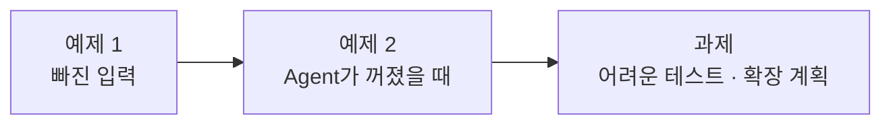

# Lab 03 · 빠진 입력, 꺼진 Agent, 어려운 테스트

- 관련 강의: [3단계 · 검증과 장애 격리, 확장 고려](../../Lecture/68/03-STAGE3-VERIFY-AND-SCALE.md)
- 소요 시간: 약 80분 (예제 1 20분 · 예제 2 20분 · 과제 40분)
- 준비: Lab 02의 `my-work/assistant.json` (없으면 `cp reference/lab02-example2-router.json my-work/assistant.json` 후 push)
- 목표: Multi-Agent에서 **한 곳의 문제가 전체 답을 망치지 않게** 만든다. 테스트로 문제를 드러내고, 고치고, 측정값으로 확장 계획을 쓴다.



> 복사해 붙일 요청문은 없습니다. 이번 Lab은 **실패를 먼저 보고** 요청문을 씁니다.

## 예제 1 · 빠진 입력 (20분)

**시나리오**: 김민지 님이 회의록을 붙이지 않고 "이번 회의록 할 일 정리 부탁해요"만 보냈습니다 (`requests/meeting-no-notes.json`). 새 시나리오를 만들지 않습니다. 이 요청 하나로 시작합니다.

| 조건 | 값 |
| --- | --- |
| 고칠 파일 | `my-work/assistant.json` (Lab 02 예제 2의 라우터, 새 파일을 만들지 않음) |
| 문제 요청 | `requests/meeting-no-notes.json` → `{"message": "이번 회의록 할 일 정리 부탁해요", "user": "김민지"}` (`notes` 없음) |
| 바라는 결과 | HTTP 200, 그 업무의 `route: 입력 필요`, `reply`에 회의록을 보내 달라는 말. **회의록 Agent는 부르지 않음** |
| 테스트 | `cases/lab03.json` (이미 있음, 고치지 않음) · `cases/lab02.json`도 그대로 통과 |

**1) 문제 요청을 직접 불러 봅니다** (라우터 → 회의록 Agent 순서로).

```bash
uv run tools/flow.py push my-work/assistant.json
uv run tools/flow.py call my-assistant requests/meeting-no-notes.json     # 라우터: 어떤 HTTP 코드?
uv run tools/flow.py call meeting-agent requests/meeting-no-notes.json    # 회의록 Agent 직접: 계약대로 무엇을 돌려주나?
```

라우터 응답이 200이 아니라면, 회의록 Agent가 돌려준 것이 라우터를 어떻게 만들었는지 두 결과를 나란히 놓고 봅니다.

**2) 테스트 전체로 확인합니다.** 이 케이스만 실패하고 나머지는 통과하는지 봅니다.

```bash
uv run tools/flow.py test cases/lab03.json
```

| 케이스 | 기대 |
| --- | --- |
| 회의록 없는 회의 요청 | HTTP 200, `results.0.route: 입력 필요`, 답에 "회의록"을 보내 달라는 말 |
| IT 둘 · 둘 다 답 | `count: 2`, 두 업무 모두 `자동 답변` |
| 복합 요청 · 오류 없음 | `count: 3`, 어느 결과에도 `오류` 없음 |
| 기타만 · 빈 요청 | 담당자 연결 · 400 |

<details><summary>▶ 1단계 · 보고서 읽기</summary>

실패한 케이스의 `status`와 `response`를 `runs/lab03-....json`에서 봅니다. 응답이 500이면 라우터 **전체**가 멈춘 것입니다. n8n **Executions**에서 어느 노드가 빨간지, 그 노드가 받은 응답이 무엇인지 확인합니다. 회의록 Agent의 계약(Lab 02 예제 1에서 쓴 `my-work/DESIGN.md` 2절, [AGENTS.md](AGENTS.md) 3절)에서 `notes`가 없을 때 무엇을 돌려준다고 했나요? 1)의 두 번째 `call` 결과와 같은가요?
</details>

<details><summary>▶ 2단계 · 어디서 막을까</summary>

두 가지 방법이 있습니다: (가) Agent를 부르고 오류가 오면 처리, (나) **부르기 전에** 빠진 입력을 보고 Agent를 부르지 않음. Lab 01 과제에서 만든 `missing`이 있다면 어느 쪽이 쉬운가요? 직원에게 무엇이라고 답해야 다음에 제대로 보낼 수 있을까요?
</details>

<details><summary>▶ 3단계 · 요청문 점검</summary>

- [ ] 실패한 케이스 이름, 보고서 경로를 그대로 붙였다
- [ ] 원인 설명을 먼저 요구했다
- [ ] 새 결과 `route` 값과 답 문장을 정했다
- [ ] `cases/lab02.json`도 계속 통과해야 한다고 적었다
</details>

## 예제 2 · Agent가 꺼졌을 때 (20분)

회의록 Agent를 일부러 끕니다.

```bash
uv run tools/flow.py off agents/meeting-agent.json
uv run tools/flow.py test cases/lab03-down.json
```

| 케이스 (회의록 Agent 꺼짐) | 기대 |
| --- | --- |
| 복합 요청 | HTTP 200, `count: 3`. IT 업무는 그대로 `자동 답변`("처리 중"), 회의록 업무는 `담당자 연결`, 답에 "응답하지 않아" |
| 회의록만 | HTTP 200, `담당자 연결` |
| IT만 | 그대로 `자동 답변` |

**먼저 생각해 보기**: 고치기 전 복합 요청의 응답에 T-1002 상태가 들어 있나요? 회의록 Agent 하나가 꺼졌는데 IT 답까지 사라졌다면 왜일까요?

<details><summary>▶ 1단계 · 오류를 "결과"로 바꾸기</summary>

Agent를 부르는 노드가 404·500을 받으면 n8n은 기본으로 워크플로우를 멈춥니다. 멈추지 않고 그 응답을 다음 노드로 넘기는 설정이 있습니다 ([AGENTS.md](AGENTS.md) 5절 HTTP Request). 넘겨받은 뒤 결과 칸(`route`, `answer`)이 비어 있으면 무엇으로 채울지 정합니다.
</details>

<details><summary>▶ 2단계 · 얼마나 기다릴까</summary>

꺼진 Agent는 바로 404가 오지만, **느린** Agent는 응답이 안 올 수도 있습니다. 직원이 얼마나 기다려도 될지 정하고 요청문에 적습니다.
</details>

<details><summary>▶ 3단계 · 다시 켜고 확인</summary>

고친 뒤 `lab03-down`을 통과하면, 회의록 Agent를 **다시 켜고** 나머지 테스트도 봅니다.

```bash
uv run tools/flow.py push agents/meeting-agent.json
uv run tools/flow.py test cases/lab02.json
uv run tools/flow.py test cases/lab03.json --repeat 3
```
</details>

## 과제 · 어려운 테스트 쓰고 고치기, 확장 계획 (40분)

팀장이 요청했습니다.

> "다음 주부터 전 직원이 씁니다. 지금 테스트는 우리가 고친 것만 확인하잖아요. 실제로 들어올 만한 어려운 요청으로 테스트를 더 만들고, 통과시키세요. 그리고 사람이 몰리면 어떻게 할지 숫자로 설명해 주세요."

1. `cases/my-cases.json`에 어려운 케이스 **5개 이상**을 직접 씁니다 (형식은 [AGENTS.md](AGENTS.md) 8절, `body`로 직접 써도 됨).
2. 지금 라우터로 돌려 실패를 보고, 에이전트에게 고치게 합니다 (테스트의 기대 결과는 바꾸지 않음).
3. `my-work/DESIGN.md` 5·6절을 채웁니다. 6절의 시간은 **내 `runs/` 보고서의 값**으로 씁니다.

```bash
uv run tools/flow.py test cases/my-cases.json --repeat 3
uv run tools/flow.py test cases/lab03.json
uv run tools/flow.py test cases/lab02.json
```

<details><summary>▶ 1단계 · 어디서 어려운 요청이 나오나</summary>

다섯 곳에서 찾아봅니다: ① 입력 칸이 비거나 이상함 ② 업무 수가 많거나 섞임 ③ 67일차에 지킨 규칙(남의 접수 건)이 라우터를 거쳐도 지켜지나 ④ 붙어 온 자료와 요청이 안 맞음 ⑤ 다른 언어·다른 표기. 각 케이스의 기대 결과를 **업무 규칙 한 줄**로 먼저 적고 테스트로 옮깁니다.
</details>

<details><summary>▶ 2단계 · 좋은 케이스의 조건</summary>

- 기대 결과가 **하나로** 정해진다 (사람마다 다르게 판단하면 테스트가 아님)
- 통과해도 의미가 있다: 지금 통과하는 케이스도 "고칠 때 깨지지 않게" 남겨 둔다
- `not_contains`로 **나오면 안 되는 것**(남의 이름, 오류)을 확인한다
</details>

<details><summary>▶ 3단계 · 확장 계획 생각하기</summary>

보고서에서 IT 하나, 회의록 하나, 복합 요청의 시간을 찾습니다. 복합 요청 시간은 각 업무 시간의 합에 가까운가요, 가장 긴 것에 가까운가요? 21명이 동시에 보내면 n8n 하나가 몇 개를 동시에 처리해야 하나요? [3단계 교안](../../Lecture/68/03-STAGE3-VERIFY-AND-SCALE.md) 5절의 수직·수평 확장 표를 보고 내 측정값에 맞는 첫 조치를 고릅니다.
</details>

## 막혔을 때

| 증상 | 할 일 |
| --- | --- |
| `off` 후 다른 테스트도 이상함 | 회의록 Agent를 다시 켭니다: `uv run tools/flow.py push agents/meeting-agent.json` |
| 고쳤는데 `lab02`가 깨짐 | 결과 모양(계약)이 바뀌었는지 확인: `results.N`의 필드 이름 |
| 계속 안 됨 | `cp reference/lab03-example2-isolated.json my-work/assistant.json` 후 push로 과제를 이어 갑니다 |

## 확인

- [ ] 예제 1: `cases/lab03.json` 통과 (빠진 입력은 Agent를 부르지 않고 `입력 필요`).
- [ ] 예제 2: 회의록 Agent가 꺼져도 `lab03-down` 통과, 다시 켠 뒤 `lab02`·`lab03` 통과.
- [ ] 과제: `cases/my-cases.json` 5개 이상 3번 반복 통과, `DESIGN.md` 5·6절에 측정값.
- [ ] [테스트 보고서](templates/TEST-REPORT-TEMPLATE.md)를 `my-work/TEST-REPORT.md`로 채웠다.
