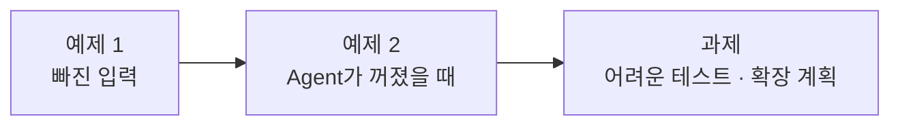
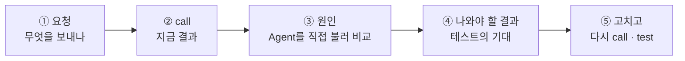

# Lab 03 · 빠진 입력, 꺼진 Agent, 어려운 테스트

- 관련 강의: [3단계 · 검증과 장애 격리, 확장 고려](../../Lecture/68/03-STAGE3-VERIFY-AND-SCALE.md)
- 소요 시간: 약 80분 (예제 1 20분 · 예제 2 20분 · 과제 40분)
- 준비: Lab 02의 `my-work/assistant.json` (없으면 `cp reference/lab02-example2-router.json my-work/assistant.json` 후 push)
- 목표: Multi-Agent에서 **한 곳의 문제가 전체 답을 망치지 않게** 만든다. 테스트로 문제를 드러내고, 고치고, 측정값으로 확장 계획을 쓴다.



> 복사해 붙일 요청문은 없습니다. 이번 Lab은 **실패를 먼저 보고** 요청문을 씁니다.

## 이 Lab을 읽는 법

예제마다 같은 다섯 걸음으로 갑니다.



- 명령은 모두 `~/aio-01d4-stu/Last3Mon/68`에서 실행합니다.
- `uv run tools/flow.py call <웹훅 경로> <요청>`은 `http://localhost:5678/webhook/<경로>`로 POST를 보내고, 첫 줄에 `HTTP 코드 · 걸린 시간`, 그 아래 응답 JSON을 보여 줍니다. `<요청>`은 `requests/` 파일이거나 `'{"message": "..."}'` 같은 JSON 글자입니다.
- 웹훅 경로: 라우터는 `my-assistant` (Lab 02에서 만든 `my-work/assistant.json`), Agent 둘은 `it-agent` · `meeting-agent` (`agents/`, 준비 때 push).
- 아래 "지금 결과"와 "나와야 할 결과"는 수업 준비 때 실제로 돌린 값입니다. LLM 답 문장과 시간은 조금씩 다를 수 있습니다.

---

## 예제 1 · 빠진 입력 (20분)

**시나리오**: 김민지 님이 회의록을 붙이지 않고 "이번 회의록 할 일 정리 부탁해요"만 보냈습니다. 새 시나리오를 만들지 않고 이 요청 하나로 시작합니다.

| 조건 | 값 |
| --- | --- |
| 고칠 파일 | `my-work/assistant.json` (Lab 02 예제 2의 라우터, 새 파일을 만들지 않음) |
| 문제 요청 | `requests/meeting-no-notes.json` |
| 테스트 | `cases/lab03.json` (이미 있음, 고치지 않음) · `cases/lab02.json`도 그대로 통과 |

### ① 보내는 요청 · `requests/meeting-no-notes.json`

```json
{"message": "이번 회의록 할 일 정리 부탁해요", "user": "김민지"}
```

회의 업무인데 회의록 원문 `notes`(그리고 `title`)가 **없습니다.** 비교: 회의록이 있는 `requests/meeting-only.json`에는 `"title": "10월 16일 주간 회의", "notes": "참석: …"`가 있습니다.

### ② 지금 결과 (Lab 02 라우터 그대로)

```bash
uv run tools/flow.py push my-work/assistant.json
uv run tools/flow.py call my-assistant requests/meeting-no-notes.json
```

```text
HTTP 500 · 1.0s
{
  "message": "Error in workflow"
}
```

답 대신 오류입니다. 직원은 무엇이 잘못됐는지 알 수 없습니다.

### ③ 원인 · 회의록 Agent를 라우터 없이 직접 불러 보기

```bash
uv run tools/flow.py call meeting-agent requests/meeting-no-notes.json
```

```text
HTTP 400
{
  "error": "notes are required"
}
```

회의록 Agent는 **계약대로** 동작했습니다 (`notes`가 없으면 400, [AGENTS.md](AGENTS.md) 3절 · Lab 02 예제 1에서 쓴 `my-work/DESIGN.md` 2절). 두 결과를 나란히 놓으면 흐름이 보입니다.

```text
라우터  Split tasks → 업무 1개 (type: meeting) → Switch meeting 갈래 → Call meeting agent (notes 없이 부름)
Agent   notes 없음 → 400 {"error": "notes are required"}   ← 정상
라우터  Call meeting agent가 400을 받고 멈춤 → 워크플로우 전체 실패 → 500 {"message": "Error in workflow"}
```

n8n **Executions**에서 이 실행을 열면 `Call meeting agent` 노드가 빨갛습니다.

### ④ 나와야 할 결과 · `cases/lab03.json` 첫 케이스

```text
HTTP 200 · 2.3s
{
  "count": 1,
  "results": [
    {
      "index": 1,
      "type": "meeting",
      "text": "이번 회의록 할 일 정리 부탁해요",
      "agent": "meeting-agent",
      "route": "입력 필요",
      "answer": "회의록 정리를 하려면 회의록 내용(notes)을 함께 보내 주세요."
    }
  ],
  "reply": "1. 이번 회의록 할 일 정리 부탁해요\n   → [입력 필요] 회의록 정리를 하려면 회의록 내용(notes)을 함께 보내 주세요."
}
```

| 테스트가 보는 곳 | 값 |
| --- | --- |
| `status` | 200 |
| `count` | 1 |
| `results.0.route` | `입력 필요` |
| `reply` | "회의록"이 들어 있음 |

- 응답 모양(`count`, `results[]`의 `index · type · text · agent · route · answer`, `reply`)은 Lab 02와 **같습니다.** 칸을 바꾸면 `lab02`가 깨집니다.
- 회의록 Agent는 **부르지 않습니다** (부르면 또 400).

### ⑤ 고치고 다시 확인

```bash
uv run tools/flow.py push my-work/assistant.json
uv run tools/flow.py call my-assistant requests/meeting-no-notes.json   # ④와 같은 모양인가
uv run tools/flow.py test cases/lab03.json                              # 고치기 전 4/5 → 5/5
uv run tools/flow.py test cases/lab02.json                              # 6/6 그대로
```

`cases/lab03.json`의 다른 케이스 (고치기 전에도 통과, 고친 뒤에도 통과해야 함):

| 케이스 | 요청 | 기대 |
| --- | --- | --- |
| IT 둘 · 둘 다 답 | `requests/two-it.json` | `count: 2`, 두 업무 모두 `자동 답변` |
| 복합 요청 · 오류 없음 | `requests/composite.json` | `count: 3`, 어느 결과에도 `오류` 없음 |
| 기타만 | `requests/other-only.json` | `results.0.route: 담당자 연결` |
| 빈 요청 | `requests/empty-message.json` | HTTP 400 |

<details><summary>▶ 1단계 · 어디서 막을까</summary>

두 가지 방법이 있습니다: (가) Agent를 부르고 400이 오면 처리, (나) **부르기 전에** 빠진 입력을 보고 Agent를 부르지 않음. ③에서 본 것처럼 400은 Agent가 "이 요청은 처리할 수 없다"고 한 것입니다. 부르기 전에 이미 알 수 있는 일인가요? Lab 01 과제에서 만든 `missing`이 있다면 어느 쪽이 쉬운가요?
</details>

<details><summary>▶ 2단계 · 어느 노드를 고치나</summary>

| 노드 | 생각할 것 |
| --- | --- |
| `Parse tasks` (Code) | 업무마다 빠진 입력(`missing`)을 **코드로** 붙일 수 있나요? 회의 업무인데 웹훅 본문의 `notes`가 비었으면? (LLM에게 묻지 않음) |
| `Route by type` (Switch) | 빠진 입력이 있는 업무가 meeting 갈래로 가지 않게 하려면? 그 업무가 갈 **새 갈래**가 필요합니다. Switch는 위에서부터 처음 맞는 갈래 하나로만 갑니다 |
| 새 결과 노드 (Set) | Agent를 부르지 않고 `route: 입력 필요`와 답 문장을 만들어 `Collect results`(Merge)로. Merge의 입력 수도 하나 늘어납니다 |
</details>

<details><summary>▶ 3단계 · 요청문 점검</summary>

- [ ] ②의 `call` 결과(500)와 ③의 결과(400)를 그대로 붙였다
- [ ] 원인 설명을 먼저 요구했다
- [ ] ④의 `route` 값과 답 문장을 정했다
- [ ] 응답 모양은 그대로, `cases/lab02.json`도 계속 통과해야 한다고 적었다
</details>

---

## 예제 2 · Agent가 꺼졌을 때 (20분)

**시나리오**: 회의록 Agent가 고장 나 응답하지 않는 날, 박서연 님이 복합 요청을 보냈습니다. 새 시나리오를 만들지 않습니다.

| 조건 | 값 |
| --- | --- |
| 고칠 파일 | 예제 1을 고친 `my-work/assistant.json` |
| 문제 요청 | `requests/composite.json` (회의록 Agent를 `off`로 꺼 둔 상태) |
| 테스트 | `cases/lab03-down.json` (이미 있음) · 다시 켠 뒤 `cases/lab02.json`, `cases/lab03.json` |

### ① 보내는 요청 · `requests/composite.json`

```json
{
  "message": "T-1002 처리 상태 알려주고, 첨부한 회의록에서 할 일도 정리해줘. 그리고 프린터 출력이 안 돼요.",
  "user": "박서연",
  "title": "10월 16일 주간 회의",
  "notes": "참석: 김민지, 이준호, 박서연. 1) 신규 고객 문의 응답 템플릿을 이준호가 금요일까지 정리한다. 2) … 다음 회의는 10월 23일."
}
```

업무 셋(IT · 회의록 · IT), 입력은 **모두 있습니다.** 회의록 Agent가 켜져 있으면 Lab 02에서 이미 통과한 요청입니다.

### ② 지금 결과 (회의록 Agent를 끄고)

```bash
uv run tools/flow.py off agents/meeting-agent.json
uv run tools/flow.py call my-assistant requests/composite.json
```

```text
HTTP 500 · 4.3s
{
  "message": "Error in workflow"
}
```

**먼저 생각해 보기**: 4.3초 동안 IT 업무 둘(T-1002, 프린터)은 이미 답을 받았습니다. 그런데 응답에 T-1002 상태가 있나요? 회의록 Agent 하나가 꺼졌는데 왜 IT 답까지 사라졌을까요?

### ③ 원인 · 꺼진 Agent를 직접 불러 보기

```bash
uv run tools/flow.py call meeting-agent requests/agent-meeting.json
```

```text
HTTP 404
(웹훅이 게시되어 있지 않다는 n8n의 응답)
```

```text
라우터  Call IT agent → 200 두 번 (T-1002, 프린터 답을 받음)
        Call meeting agent → 404 (꺼진 Agent) → 노드가 멈춤
        → 워크플로우 전체 실패 → 500. 받아 둔 IT 답까지 버림
```

`cases/lab03-down.json`을 돌리면 "회의록만"도 500, "IT만"은 회의록 Agent를 부르지 않으니 200입니다 (고치기 전 1/3).

### ④ 나와야 할 결과 · `cases/lab03-down.json` 첫 케이스

```text
HTTP 200 · 4.6s
{
  "count": 3,
  "results": [
    {"index": 1, "type": "it", "text": "T-1002 처리 상태 알려줘", "agent": "it-agent",
     "route": "자동 답변", "answer": "T-1002 티켓은 현재 \"처리 중\" 상태이며, VPN 인증서 발급 승인 대기 중입니다. …"},
    {"index": 2, "type": "meeting", "text": "첨부한 회의록에서 할 일 정리", "agent": "meeting-agent",
     "route": "담당자 연결", "answer": "담당 Agent가 응답하지 않아 담당자에게 전달했습니다.", "actions": []},
    {"index": 3, "type": "it", "text": "프린터 출력이 안 돼요", "agent": "it-agent",
     "route": "자동 답변", "answer": "프린터 전원과 네트워크 연결을 확인하고, …"}
  ],
  "reply": "1. T-1002 처리 상태 알려줘\n   → [자동 답변] …\n2. 첨부한 회의록에서 할 일 정리\n   → [담당자 연결] 담당 Agent가 응답하지 않아 담당자에게 전달했습니다.\n3. 프린터 출력이 안 돼요\n   → [자동 답변] …"
}
```

| 케이스 (회의록 Agent 꺼짐) | 요청 | 테스트가 보는 곳 |
| --- | --- | --- |
| 복합 요청 | `requests/composite.json` | HTTP 200, `count: 3`, `results.0.route: 자동 답변` + 답에 "처리 중", `results.1.route: 담당자 연결` + 답에 "응답하지 않아" |
| 회의록만 | `requests/meeting-only.json` | HTTP 200, `results.0.route: 담당자 연결` |
| IT만 | `requests/it-only.json` | HTTP 200, `results.0.route: 자동 답변` |

고장 난 업무 **하나만** `담당자 연결`, 나머지는 그대로입니다.

### ⑤ 고치고 다시 확인 (그리고 꼭 다시 켜기)

```bash
uv run tools/flow.py push my-work/assistant.json
uv run tools/flow.py call my-assistant requests/composite.json   # ④와 같은 모양인가
uv run tools/flow.py test cases/lab03-down.json                  # 고치기 전 1/3 → 3/3

uv run tools/flow.py push agents/meeting-agent.json              # 회의록 Agent 다시 켜기
uv run tools/flow.py test cases/lab02.json                       # 6/6
uv run tools/flow.py test cases/lab03.json --repeat 3            # 예제 1이 그대로인지
```

<details><summary>▶ 1단계 · 오류를 "결과"로 바꾸기</summary>

Agent를 부르는 노드가 404 · 500을 받으면 n8n은 기본으로 워크플로우를 멈춥니다. 멈추지 않고 그 응답을 다음 노드로 넘기는 설정이 있습니다 ([AGENTS.md](AGENTS.md) 5절 HTTP Request). 넘겨받은 404 응답에는 `route`도 `answer`도 없습니다.
</details>

<details><summary>▶ 2단계 · 어느 노드를 고치나</summary>

| 노드 | 생각할 것 |
| --- | --- |
| `Call IT agent`, `Call meeting agent` (HTTP Request) | 위 1단계의 설정. 회의록만이 아니라 **둘 다** (IT Agent도 고장 날 수 있음) |
| `IT result`, `Meeting result` (Set) | 응답에 `route`가 있으면 그대로, **없으면** 무엇으로? `answer`가 없으면 어떤 문장으로? (④의 값) |

정상 응답에는 `route`가 있고 404 응답에는 없다는 차이를 이용합니다.
</details>

<details><summary>▶ 3단계 · 얼마나 기다릴까</summary>

꺼진 Agent는 바로 404가 오지만, **느린** Agent는 응답이 안 올 수도 있습니다. 직원이 얼마나 기다려도 될지 정하고 요청문에 적습니다. (느린 Agent는 오늘 테스트로 만들지 않습니다. 값을 정해 넣는 것까지만 합니다.)
</details>

---

## 과제 · 어려운 테스트 쓰고 고치기, 확장 계획 (40분)

팀장이 요청했습니다.

> "다음 주부터 전 직원이 씁니다. 지금 테스트는 우리가 고친 것만 확인하잖아요. 실제로 들어올 만한 어려운 요청으로 테스트를 더 만들고, 통과시키세요. 그리고 사람이 몰리면 어떻게 할지 숫자로 설명해 주세요."

1. `cases/my-cases.json`에 어려운 케이스 **5개 이상**을 직접 씁니다 (아래 예 둘 + 내가 찾은 셋 이상).
2. 지금 라우터로 `call` · `test` 해서 실패를 보고, 에이전트에게 고치게 합니다 (테스트의 기대 결과는 바꾸지 않음).
3. `my-work/DESIGN.md` 5·6절을 채웁니다. 6절의 시간은 **내 `runs/` 보고서의 값**으로 씁니다.

### 케이스 파일 모양 · `cases/my-cases.json`

```json
{
  "webhook": "my-assistant",
  "cases": [
    {"name": "user 없이 IT 질문", "body": {"message": "VPN이 계속 끊겨요"},
     "expect": {"equals": {"results.0.route": "입력 필요"}}},
    {"name": "공백만 보냄", "body": {"message": "   ", "user": "이준호"},
     "expect": {"status": 400}}
  ]
}
```

- `request`(파일) 대신 `body`로 직접 씁니다. 형식은 [AGENTS.md](AGENTS.md) 8절, `cases/lab03.json`을 열어 따라 해도 됩니다.
- 기대 결과는 **업무 규칙 한 줄**에서 나옵니다: "누가 물었는지 모르면 Agent를 부르지 않고 `입력 필요`", "빈 요청은 공백만 있어도 400".

### 예 A · user 없이 IT 질문

```bash
uv run tools/flow.py call my-assistant '{"message": "VPN이 계속 끊겨요"}'
```

| | 결과 |
| --- | --- |
| 지금 (예제 2까지 고친 판) ✘ | `HTTP 200 · 2.3s`, `"route": "담당자 연결"`, `"answer": "담당 Agent가 응답하지 않아 담당자에게 전달했습니다."` |
| 나와야 할 결과 ✔ | `HTTP 200`, `"route": "입력 필요"`, `"answer": "누가 요청했는지(user)를 함께 보내 주세요."` |

**먼저 생각해 보기**: IT Agent는 정말 "응답하지 않았"나요? IT Agent를 직접 불러 봅니다.

```bash
uv run tools/flow.py call it-agent '{"question": "VPN이 계속 끊겨요"}'    # 계약: question · user 둘 다 필수
```

IT Agent는 계약대로 400을 돌려줍니다. 예제 2에서 만든 "응답이 없으면 담당자 연결"이 이 400까지 장애로 처리해 **틀린 말**("응답하지 않아")을 합니다. 테스트가 없었다면 몰랐을 구멍입니다.

### 예 B · 공백만 보냄

```bash
uv run tools/flow.py call my-assistant '{"message": "   ", "user": "이준호"}'
```

| | 결과 |
| --- | --- |
| 지금 ✘ | `HTTP 200 · 0.7s`, 응답 본문이 **비어 있음** |
| 나와야 할 결과 ✔ | `HTTP 400`, `{"error": "message is required"}` (`requests/empty-message.json`과 같음) |

**먼저 생각해 보기**: 공백 세 칸은 "비어 있다"인가요? 0.7초는 무엇을 하느라 걸린 시간일까요 (빈 요청 `requests/empty-message.json`은 0.1초도 안 걸림)?

### 고치고 다시 확인

```bash
uv run tools/flow.py push my-work/assistant.json
uv run tools/flow.py test cases/my-cases.json --repeat 3
uv run tools/flow.py test cases/lab03.json
uv run tools/flow.py test cases/lab02.json
```

<details><summary>▶ 1단계 · 어디서 어려운 요청이 나오나 (나머지 셋 이상)</summary>

다섯 곳에서 찾아봅니다: ① 입력 칸이 비거나 이상함 ② 업무 수가 많거나 섞임 ③ 67일차에 지킨 규칙(남의 접수 건)이 라우터를 거쳐도 지켜지나 ④ 붙어 온 자료와 요청이 안 맞음 ⑤ 다른 언어 · 다른 표기. 각 케이스의 기대 결과를 **업무 규칙 한 줄**로 먼저 적고 테스트로 옮깁니다. 기대가 맞는지 모르겠으면 그 Agent를 직접 `call` 해서 **계약**(AGENTS.md 3절)과 비교합니다.
</details>

<details><summary>▶ 2단계 · 예 A · B는 어느 노드를 고치나</summary>

| 예 | 생각할 것 |
| --- | --- |
| A | 예제 1에서 `missing`을 보고 갈래를 나눈 것은 meeting뿐이었나요? it 업무도 같은 검사를 거치게 하려면 Switch의 어느 조건을? 답 문장은 **무엇이 빠졌는지**에 따라 달라야 합니다 (`notes`면 회의록, `user`면 요청한 사람) |
| B | 웹훅 바로 뒤 `Has message?`가 무엇을 "비어 있음"으로 보나요? 앞뒤 공백을 지운 뒤 보게 하면 LLM도 부르지 않습니다 |
</details>

<details><summary>▶ 3단계 · 좋은 케이스의 조건</summary>

- 기대 결과가 **하나로** 정해진다 (사람마다 다르게 판단하면 테스트가 아님)
- 통과해도 의미가 있다: 지금 통과하는 케이스도 "고칠 때 깨지지 않게" 남겨 둔다
- `not_contains`로 **나오면 안 되는 것**(남의 이름, 오류)을 확인한다
- 테스트가 실패하면 먼저 "테스트가 틀렸나, 워크플로우가 틀렸나"를 **계약 표**로 판단한다
</details>

<details><summary>▶ 4단계 · 확장 계획 생각하기</summary>

보고서에서 IT 하나, 회의록 하나, 복합 요청의 시간을 찾습니다. 복합 요청 시간은 각 업무 시간의 합에 가까운가요, 가장 긴 것에 가까운가요? 두 가지를 같이 생각합니다: ① 단독 요청 시간에는 **나누기 LLM(약 1초)** 이 이미 들어 있다 ② 같은 Agent로 가는 업무들은 HTTP 노드 하나가 **동시에** 보내고, 다른 Agent 갈래는 **차례로** 실행된다. 21명이 동시에 보내면 n8n 하나가 몇 개를 동시에 처리해야 하나요? [3단계 교안](../../Lecture/68/03-STAGE3-VERIFY-AND-SCALE.md) 5절의 수직 · 수평 확장 표를 보고 내 측정값에 맞는 첫 조치를 고릅니다.
</details>

---

## 한눈에

| 단계 | 요청 | 지금 | 원인 (직접 call로 확인) | 나와야 할 결과 |
| --- | --- | --- | --- | --- |
| 예제 1 | 회의록 없는 회의 | 500 | 회의록 Agent의 400에 라우터가 멈춤 | 200, `입력 필요` |
| 예제 2 | 회의록 Agent 꺼짐 + 복합 | 500, IT 답도 사라짐 | 404에 라우터가 멈춤 | 200, 회의록만 `담당자 연결` |
| 과제 예 A | user 없는 IT | 200 `담당자 연결` (틀린 말) | IT Agent의 400을 장애로 처리 | 200, `입력 필요` (user) |
| 과제 예 B | 공백만 | 빈 200 | 공백도 "비어 있지 않음" | 400 |

## 막혔을 때

| 증상 | 할 일 |
| --- | --- |
| `call meeting-agent`가 처음부터 404 | 회의록 Agent가 꺼져 있음: `uv run tools/flow.py push agents/meeting-agent.json` |
| `off` 후 다른 테스트도 이상함 | 위와 같이 다시 켭니다 |
| 고쳤는데 `lab02`가 깨짐 | 결과 모양(계약)이 바뀌었는지 확인: `results.N`의 필드 이름 |
| 계속 안 됨 | `cp reference/lab03-example2-isolated.json my-work/assistant.json` 후 push로 과제를 이어 갑니다 |

## 확인

- [ ] 예제 1: `call` 결과가 500 → ④ 모양, `cases/lab03.json` 5/5 (빠진 입력은 Agent를 부르지 않고 `입력 필요`).
- [ ] 예제 2: 회의록 Agent가 꺼져도 `lab03-down` 3/3, 다시 켠 뒤 `lab02` · `lab03` 통과.
- [ ] 과제: `cases/my-cases.json` 5개 이상(예 A · B 포함) 3번 반복 통과, `DESIGN.md` 5 · 6절에 측정값.
- [ ] [테스트 보고서](templates/TEST-REPORT-TEMPLATE.md)를 `my-work/TEST-REPORT.md`로 채웠다.
