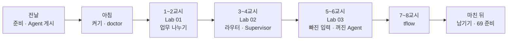
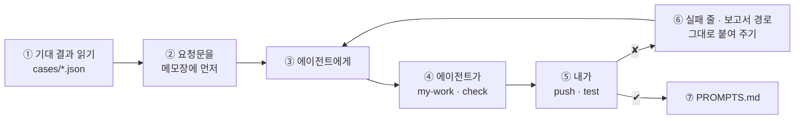
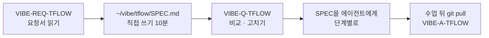

# 68일차 수강 안내 · 수업 준비부터 마칠 때까지

- 일자: 2026-10-20 (화) · 68일차
- 주제: 복합 업무 시나리오 분석과 Multi-Agent 기반 워크플로우 설계
- 실습 폴더: [Last3Mon/68](README.md) · 강의 자료: [Lecture/68](../../Lecture/68/README.md)
- 환경: 65일차 n8n 2.42.6 + **OpenAI API 키만**(`gpt-4.1-mini`) + 67일차 데이터 API + CLI 코딩 에이전트 하나. **Ollama는 쓰지 않습니다.**
- 이 문서: 오늘 하루 내가 할 일을 수업 준비부터 마칠 때까지 순서대로 모은 수강 안내입니다. 수업 중에도 띄워 두고 어디까지 왔는지 확인하세요.



## 0. 하루 한눈에

| 교시 | 시간 | 할 일 | 문서 | 끝났다는 표시 |
| --- | --- | --- | --- | --- |
| 전날 | 약 15분 | 자료 받기 · n8n · 데이터 API · 두 Agent 게시 · doctor | [PREP](../../Lecture/68/00-DAY68-PREP.md) (65~67일차를 못 했다면 [PREPARE-68-FROM-65](PREPARE-68-FROM-65.md), 약 30분) | `ready` |
| 1 | 09:00~09:50 | 개요 · 1단계 강의 (복합 업무 시나리오 분석) | [개요](../../Lecture/68/00-DAY68-OVERVIEW.md), [1단계](../../Lecture/68/01-STAGE1-COMPOSITE-SCENARIO.md) | |
| 2 | 10:00~10:50 | Lab 01 예제 1 · 2 · 과제 | [Lab 01](LAB-01-Q-SCENARIO-AND-SPLIT.md) | `lab01-challenge` 통과 |
| 3 | 11:00~11:50 | 2단계 강의 · Lab 02 예제 1 · 2 | [2단계](../../Lecture/68/02-STAGE2-MULTI-AGENT-DESIGN.md), [Lab 02](LAB-02-Q-ROUTER-AGENTS.md) | `lab02` 통과 |
| 4 | 12:00~12:50 | Lab 02 과제 35분 (Supervisor 비교) · 풀이 | Lab 02 | `lab02-challenge` · 비교 표 |
| - | 13:00~14:00 | 점심 | | |
| 5 | 14:00~14:50 | 3단계 강의 · Lab 03 예제 1 · 2 | [3단계](../../Lecture/68/03-STAGE3-VERIFY-AND-SCALE.md), [Lab 03](LAB-03-Q-VERIFY-AND-ISOLATE.md) | `lab03` · `lab03-down` 통과 |
| 6 | 15:00~15:50 | Lab 03 과제 40분 · 풀이 | Lab 03 | 내 케이스 5개 · 보고서 |
| 7 | 16:00~16:50 | 바이브 코딩 `tflow`: 요청서 → 내 SPEC → 비교 → 만들기 | [VIBE-REQ-TFLOW](VIBE-REQ-TFLOW.md) → [VIBE-Q-TFLOW](VIBE-Q-TFLOW.md) | `SPEC.md` · R1~R6 · `pytest` |
| 8 | 17:00~17:50 | 발표 · 강사 정리 · 강사 바이브 코딩 · 팁 · 69일차 예고 | [진행](../../Lecture/68/04-VIBE-CODING.md) | |

## 1. 전날 준비 (약 15분)

### 1.1 자료 받기

```bash
cd ~/aio-01d4-stu && git pull
```

### 1.2 n8n과 데이터 API 켜기 (Ollama는 끔)

```bash
sudo systemctl disable --now ollama 2>/dev/null   # WSL에 설치한 Ollama가 있으면 끄고 자동 시작도 끔
cd ~/aio-01d4-stu/Last3Mon/65/n8n
docker compose rm -sf ollama                      # Ollama 컨테이너가 있으면 지움 (없으면 그냥 지나감)
docker compose start
cd ~/aio-01d4-stu/Last3Mon/67/data-api
docker compose up -d
curl -s localhost:8800/health                     # {"status": "ok"}
```

- LLM은 **OpenAI API 키**(`Last3Mon/.env`) 하나로 씁니다. n8n은 `start`로 켭니다 (`up -d`는 Ollama 컨테이너를 다시 만듦).

### 1.3 오늘 부를 Agent 두 개 게시 (만들지 않고 게시만)

```bash
cd ~/aio-01d4-stu/Last3Mon/68
uv run tools/flow.py push agents/it-agent.json agents/meeting-agent.json     # 수업 준비 때 약 19초
uv run tools/flow.py call it-agent requests/agent-it.json                     # route 자동 답변, T-1002 처리 중
uv run tools/flow.py call meeting-agent requests/agent-meeting.json           # count 4
```

`! unpublished ...`가 나오면 같은 경로를 쓰던 예전 워크플로우를 게시 해제한 것입니다 (정상).

### 1.4 준비 확인

```bash
uv run tools/flow.py doctor        # 마지막 줄 ready
```

### 1.5 미리 읽기 (선택, 5분)

[PREP 4절](../../Lecture/68/00-DAY68-PREP.md): "T-1002 처리 상태 알려주고, 첨부한 회의록에서 할 일도 정리해줘. 그리고 프린터 출력이 안 돼요." 이 문장에 업무가 몇 개이고, 각각 누가 맡으면 좋을지.

### 준비물

노트북과 충전기, WSL의 Docker, WSL 창 두 개, 브라우저, **67일차 `my-work/it-agent.json`** (7교시에 씀).

## 2. 수업 당일 아침 (09:00 전)

1. 노트북을 껐다 켰다면 1.2를 다시 합니다. 두 Agent는 게시된 채로 남아 있습니다.
2. 터미널 두 개, 둘 다 `cd ~/aio-01d4-stu/Last3Mon/68`. ① 에이전트(`codex`/`claude`/`agy`), ② 확인(`push`·`call`·`test`).
3. 터미널 ②에서 `uv run tools/flow.py doctor` → `ready`.
4. `my-work/PROMPTS.md`를 만들어 둡니다.

## 3. 실습할 때마다 같은 순서



- 요청문 다섯 가지(파일 · 입력 · 처리 · 결과 모양 · 기대 결과), 한 번에 한 가지 변화.
- 막히면 `▶`를 하나씩, 그래도 안 되면 `reference/`로 이어 가기.
- 오늘은 **두 Agent(`it-agent`, `meeting-agent`)를 고치지 않습니다.** 부르기만 합니다.

## 4. 1~2교시 · 1단계 · 복합 요청을 업무로 나누기

[Lab 01](LAB-01-Q-SCENARIO-AND-SPLIT.md) (약 40분).

| 순서 | 할 일 | 파일 · 웹훅 | 확인 |
| --- | --- | --- | --- |
| 예제 1 (10분, 에이전트 없이) | `cp templates/MULTI-AGENT-DESIGN-TEMPLATE.md my-work/DESIGN.md` 후 1절 업무 분석표를 **직접** 채우기 (`cat requests/composite.json`) | | 표 |
| 예제 2 (15분) | 요청 문장을 업무 목록으로 **나누기만** (Agent는 아직 안 부름) | `my-work/split.json` · `my-split` | `push my-work/split.json` → `test cases/lab01.json --repeat 3`, `call my-split requests/composite.json` |
| 과제 (15분) | 업무마다 맡을 Agent, 빠진 입력은 LLM이 아니라 규칙으로 | `my-work/split.json` 고치기 | `test cases/lab01-challenge.json --repeat 3`, `test cases/lab01.json` |

(명령 앞에는 모두 `uv run tools/flow.py`가 붙습니다.)

- 볼 것: 내 분석표와 워크플로우 결과가 같은지, 업무 글에 `T-1002`가 남아 있는지.

## 5. 3~4교시 · 2단계 · 여러 Agent에게 나눠 맡기기

[Lab 02](LAB-02-Q-ROUTER-AGENTS.md) (약 70분).

| 순서 | 할 일 | 파일 · 웹훅 | 확인 |
| --- | --- | --- | --- |
| 예제 1 (10분) | 두 Agent를 직접 불러 계약(입력 · 결과) 표 정리 | | `call it-agent requests/agent-it.json`, `call meeting-agent requests/agent-meeting.json`, `call meeting-agent '{"title": "주간 회의"}'` |
| 예제 2 (25분) | 라우터: 업무마다 담당 Agent를 HTTP로 부르고 결과를 하나로 | `my-work/assistant.json` · `my-assistant` (바탕 `split.json`은 그대로 둠) | `push my-work/assistant.json` → `test cases/lab02.json`, `call my-assistant requests/composite.json` |
| 과제 (35분, 4교시) | Supervisor: AI Agent 하나가 두 Agent를 Tool로 골라 부르기, 라우터와 비교 | `my-work/supervisor.json` · `my-supervisor` | `test cases/lab02-challenge.json`, `DESIGN.md` 비교 표 |

- 볼 것: Executions에서 `my-assistant` 한 번에 `it-agent` · `meeting-agent` 실행이 따로 생기는지, 복합 요청과 단일 요청의 시간 (Lab 03에서 씀).

## 6. 5~6교시 · 3단계 · 빠진 입력, 꺼진 Agent, 어려운 테스트

[Lab 03](LAB-03-Q-VERIFY-AND-ISOLATE.md) (약 80분).

| 순서 | 할 일 | 확인 |
| --- | --- | --- |
| 예제 1 (20분) | 빠진 입력이면 Agent를 부르지 않고 `입력 필요` | `push my-work/assistant.json` → `test cases/lab03.json` |
| 예제 2 (20분) | 회의록 Agent를 끄고도 나머지 업무는 답하게 | `off agents/meeting-agent.json` → `test cases/lab03-down.json`, 고친 뒤 **다시 켜기** `push agents/meeting-agent.json` → `test cases/lab02.json`, `test cases/lab03.json` |
| 과제 (40분, 6교시) | 어려운 요청 5개 이상 `cases/my-cases.json`, 통과시키기, 사람이 몰릴 때의 확장 계획을 숫자로 (`DESIGN.md` 5·6절) | `test cases/my-cases.json --repeat 3`, `test cases/lab03.json`, `test cases/lab02.json` |

- 보고서: `cp templates/TEST-REPORT-TEMPLATE.md my-work/TEST-REPORT.md` 후 채우기.
- `off` 뒤 다른 테스트가 이상하면 회의록 Agent가 꺼져 있는 것입니다. `push agents/meeting-agent.json`.

## 7. 7~8교시 · 바이브 코딩 `tflow`

n8n 워크플로우 JSON을 트리와 mermaid로 보여 주는 TUI. 67일차 `it-agent.json`과 오늘 `my-work/*.json`을 열어 봅니다.

**오늘부터 순서가 바뀝니다.** 문제(VIBE-Q)를 에이전트에게 통째로 주지 않고, 사람의 말인 **요청서에서 요구를 내가 먼저 뽑습니다.**



```bash
mkdir -p ~/vibe/tflow && cd ~/vibe/tflow
git init
# SPEC.md를 다 쓰고 나서 codex (또는 claude, agy)
```

| 시간 | 단계 | 확인 |
| --- | --- | --- |
| 16:00~16:12 | 0. 준비 · [요청서](VIBE-REQ-TFLOW.md) → `SPEC.md` → [VIBE-Q](VIBE-Q-TFLOW.md)와 비교 | 요구마다 확인 방법, 비교한 줄 |
| 16:12~16:23 | 1. 글자로 트리와 mermaid (R1 · R4) | 갈래가 보이고 끝없이 반복되지 않음, `--md`로 만든 `.md`를 미리보기 |
| 16:23~16:35 | 2. TUI · 상세 · 경고 (R2 · R5 · R6) | Agent 아래 모델 1 · Tool 2, 망가진 파일 경고 |
| 16:35~16:45 | 3. 한국어 설명과 캐시 (R3) | 아래 `export` 후, 두 번째는 캐시에서 |
| 16:45~16:50 | 4. 정리 | `SPEC.md` 체크, `uv run pytest -q`, `PROMPTS.md` |

```bash
export OPENAI_API_KEY=$(grep '^OPENAI_API_KEY=' ~/aio-01d4-stu/Last3Mon/.env | cut -d= -f2-)
```

- 8교시: 1~2명 발표, 강사 정리 · 시연 · 팁, 69일차 예고.

## 8. 마친 뒤

| 할 일 | 이유 |
| --- | --- |
| `PROMPTS.md`, `DESIGN.md`, `TEST-REPORT.md` 정리 | 최종 프로젝트 재료 |
| 회의록 Agent가 켜져 있는지 (`call meeting-agent requests/agent-meeting.json`) | 꺼 둔 채로 두지 않기 |
| **`~/vibe/tflow` 지우지 않기** | 69일차에 오늘 만든 워크플로우를 여는 데 씀 |
| `git pull` 후 `VIBE-A-TFLOW.md`(정답본)와 내 `SPEC.md` 비교 | 수업이 끝나면 올라옴. 요구 도출 예시 · 요청문 예 |
| 69일차 준비: [00-DAY69-PREP](../../Lecture/69/00-DAY69-PREP.md) 1~2절 | 내일은 데이터 API를 쓰지 않음 (켜 두어도 됨) |

## 9. 막혔을 때 (오늘 공통)

| 증상 | 할 일 |
| --- | --- |
| `network day65-n8n_default not found` | n8n이 꺼져 있음. 1.2의 n8n부터 |
| `call it-agent`가 404 | 1.3 다시 (`push agents/...`) |
| doctor의 agent webhook ✘ | 1.3 다시 |
| `check`에 ✘ | 그 줄을 그대로 에이전트에게 |
| `status 500`이 30초 넘게 | OpenAI 쪽 일시 오류일 수 있음. 한 번 더 |
| 같은 곳을 3번 고쳐도 실패 | 요청을 더 작게, 또는 `reference/`로 이어 가기 |

## 확인

- [ ] 전날 두 Agent 게시, `doctor` → `ready`
- [ ] Lab 01: `lab01`, `lab01-challenge`
- [ ] Lab 02: `lab02`, `lab02-challenge`, 라우터 · Supervisor 비교 표
- [ ] Lab 03: `lab03`, `lab03-down`, 다시 켠 뒤 `lab02` · `lab03`, 내 케이스 5개, 보고서
- [ ] `tflow`: R1~R5, `pytest`, 단계마다 commit
- [ ] 69일차 준비
