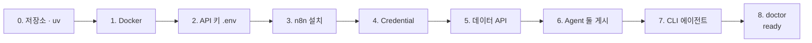

# 68일차를 처음 시작하는 수강생 준비 (65~67일차를 못 했을 때)

- 대상: 65·66·67일차 수업이나 준비를 하지 못해, 오늘(68일차) 실습 환경이 없는 수강생
- 목표: **최소 명령**으로 68일차 `doctor`가 `ready`가 되게 하기. 지난 실습 내용은 나중에 따라잡습니다.
- 왜 65일차부터인가: 68일차는 **65일차에 설치한 n8n**(`~/day65-n8n`)과 **67일차의 데이터 API**를 그대로 씁니다. 66·67일차 실습 결과물은 없어도 됩니다 (오늘 필요한 Agent 둘은 `agents/`에 들어 있음).



## 어디부터 하나

| 나는 | 시작할 절 | 걸리는 시간 |
| --- | --- | --- |
| 64일차도 못 함 (WSL에 저장소 · uv가 없음) | 0절 | 약 40분 (이미지 다운로드 포함) |
| 64일차는 함, 65일차부터 못 함 | 1절 (Docker가 있으면 2절) | 약 30분 |
| 65일차는 함 (n8n · Credential 있음), 66·67일차만 못 함 | 5절 | 약 10분 |

- 모든 명령은 **WSL(Ubuntu) 터미널**에서 합니다.
- 각 절의 자세한 설명과 문제 해결은 [65일차 SETUP-N8N](../65/SETUP-N8N.md), [68일차 실습 준비](../../Lecture/68/00-DAY68-PREP.md)에 있습니다.

---

## 0. 수업 저장소와 uv (64일차를 못 했을 때만, 3분)

```bash
curl -LsSf https://astral.sh/uv/install.sh | sh      # 설치 뒤 터미널을 닫고 다시 열기
cd ~ && git clone https://gl.isitsoft.kr/publicproj/aio-01d4-stu.git
uv --version
```

이미 저장소가 있으면 `cd ~/aio-01d4-stu && git pull`만 합니다.

## 1. Docker (65일차를 못 했을 때, 10분)

```bash
curl -fsSL "https://gl.isitsoft.kr/publicproj/install-sh/-/raw/main/install-docker.sh?ref_type=heads" | bash
```

WSL 터미널을 **모두 닫고 다시 열고** (docker 그룹 적용):

```bash
sudo systemctl enable --now docker
docker run --rm hello-world          # "Hello from Docker!"
```

`docker version`의 Server 줄이 나오면 이미 설치된 것이니 넘어갑니다.

## 2. API 키 `.env` (1분)

```bash
cd ~/aio-01d4-stu/Last3Mon
[ -f .env ] || cp .env.example .env
nano .env                            # OPENAI_API_KEY= 뒤에 과정에서 받은 키 (Ctrl+O, Enter, Ctrl+X)
grep -c '^OPENAI_API_KEY=sk-' .env   # 1 이면 됨 (cat으로 열어 화면에 띄우지 않기)
```

키는 이 파일 한 곳에만 둡니다. 문서 · 워크플로우 · 채팅에 붙여 넣지 않습니다.

## 3. n8n 설치 (이미지 다운로드 5~15분)

```bash
cd ~
curl -fsSL https://get.n8n.io | N8N_DIR=./day65-n8n sh -s -- --version 2.42.6
```

```text
✔ Started n8n 2.42.6 and sandbox services
n8n is running at: http://localhost:5678
```

- 폴더 이름(`day65-n8n`)과 버전(`2.42.6`)을 **바꾸지 않습니다.** 데이터 API와 `flow.py`가 이 이름을 찾습니다.
- 설치 스크립트가 n8n을 바로 켭니다. Windows 브라우저에서 http://localhost:5678 을 열고 관리자 계정(이메일 · 이름 · 비밀번호, 내 노트북 안에만 저장)을 만듭니다.
- **`Last3Mon/65/n8n`에서 `docker compose up -d`를 하지 않습니다.** 65일차 자료에는 Ollama(약 4.2GB)가 들어 있는데, 66일차부터 Ollama는 쓰지 않습니다. 켜고 끄기는 `start` / `stop`만 씁니다 (아래 "다음부터 켜기").

## 4. n8n Credential 등록 (1분)

```bash
cd ~/aio-01d4-stu/Last3Mon/65/n8n
bash register-credentials.sh
```

`Successfully imported 2 credentials.`가 나오면 됩니다. 함께 만들어지는 `Ollama local`은 쓰지 않습니다 (그대로 둠).

## 5. 데이터 API 켜기 (1분)

68일차는 67일차의 사내 데이터 API(FAQ · 접수 현황)를 그대로 씁니다.

```bash
cd ~/aio-01d4-stu/Last3Mon/67/data-api
docker compose up -d --force-recreate
curl -s localhost:8800/health        # {"status": "ok"}
```

`network day65-n8n_default not found` → n8n이 꺼져 있음: `cd ~/aio-01d4-stu/Last3Mon/65/n8n && docker compose start` 후 다시.

## 6. 오늘 부를 Agent 둘 게시 (1분)

```bash
cd ~/aio-01d4-stu/Last3Mon/68
uv run tools/flow.py push agents/it-agent.json agents/meeting-agent.json     # 약 20초
uv run tools/flow.py call it-agent requests/agent-it.json                     # route 자동 답변
uv run tools/flow.py call meeting-agent requests/agent-meeting.json           # count 4
```

- `it-agent`는 67일차 Lab 03 완성본, `meeting-agent`는 66일차 회의록 → 할 일입니다. 오늘은 만들지 않고 **불러 쓰기만** 합니다.

## 7. CLI 코딩 에이전트 (10분)

아래 중 **하나 이상**이 WSL 터미널에서 실행되고 로그인되어 있어야 합니다.

| 에이전트 | 실행 | 확인 |
| --- | --- | --- |
| Codex CLI | `codex` | `codex --version` |
| Claude Code | `claude` | `claude --version` |
| Antigravity CLI | `agy` | `agy --version` |

- 처음 실행하면 브라우저 로그인 안내가 나옵니다. 끝까지 진행한 뒤 "안녕"이라고 물어 답이 오는지 봅니다.
- 설치가 안 되어 있으면 수업 전 IT 문의 시간에 강사에게 알려 주세요.

## 8. 준비 확인

```bash
cd ~/aio-01d4-stu/Last3Mon/68
uv run tools/flow.py doctor
```

```text
✔ n8n install folder /home/<사용자>/day65-n8n
✔ n8n container day65-n8n-n8n-1
✔ n8n http://localhost:5678
✔ data API http://localhost:8800
✔ n8n → http://data-api:8800
✔ credential 'OpenAI (.env)' (openAiCourse0001)
✔ node catalog (for check)
✔ agent webhook /it-agent
✔ agent webhook /meeting-agent
✔ CLI coding agent: codex, claude
ready
```

| ✘ 항목 | 할 일 |
| --- | --- |
| n8n install folder · n8n container | 3절 (이미 설치했다면 `cd ~/aio-01d4-stu/Last3Mon/65/n8n && docker compose start`) |
| data API · n8n → data-api | 5절 |
| credential | 4절 |
| agent webhook | 6절 |
| CLI coding agent | 7절 |

`ready`가 나오면 [68일차 README](README.md)부터 수업을 따라갑니다.

---

## 다음부터 켜기 (날마다)

```bash
cd ~/aio-01d4-stu && git pull
cd Last3Mon/65/n8n && docker compose start        # n8n
cd ~/aio-01d4-stu/Last3Mon/<오늘>/data-api && docker compose up -d --force-recreate   # 그날의 데이터 API (68일차는 67)
```

수업이 끝나면 `cd ~/aio-01d4-stu/Last3Mon/65/n8n && docker compose stop`. `docker compose down -v`는 워크플로우 · 계정 · Credential까지 지우므로 쓰지 않습니다.

## 놓친 날 따라잡기 (나중에)

| 일차 | 볼 것 |
| --- | --- |
| 65 | [README](../65/README.md) · n8n 화면에서 첫 워크플로우 (Lab 02A) |
| 66 | [README](../66/README.md) · 정답본 `LAB-0x-A-*.md`, 과제 정답 `answers/` |
| 67 | [README](../67/README.md) · 정답본 `LAB-0x-A-*.md`, 과제 정답 `answers/` |

66 · 67일차 정답은 그날 폴더에서 `uv run tools/flow.py push answers/<파일>.json`으로 올려 보고 `test`로 확인할 수 있습니다.
