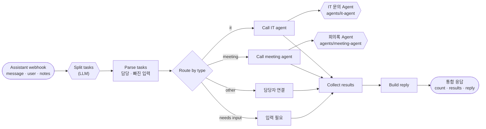
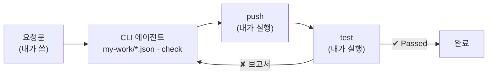

# 68일차 실습 · 복합 업무 시나리오 분석과 Multi-Agent 기반 워크플로우 (바이브 코딩)

- 일자: 2026-10-20 (68일차)
- 교과목: 노코드 멀티 에이전트 워크플로우 설계 및 운영
- 단원: 운영·확장 관점의 AI 워크플로우 설계 고도화
- 강의 자료: [Lecture/68](../../Lecture/68/README.md)
- 하루 수강 안내: [LECTURE-68.md](LECTURE-68.md) (수업 준비부터 마칠 때까지 순서대로)
- 67일차처럼 n8n 노드를 손으로 놓지 않습니다. CLI 코딩 에이전트(Codex · Claude Code · Antigravity)에게 **내가 쓴 요청문**으로 워크플로우를 만들게 하고, **테스트로 확인**합니다.

## 오늘 만드는 업무: 사내 업무 도우미 (여러 Agent에게 나눠 맡기기)

직원 요청 하나에 업무가 여럿 섞여 있어도, 업무를 나누어 담당 Agent(67일차 IT 문의, 66일차 회의록)에게 보내고 결과를 하나로 모아 답합니다.



## 일하는 방식 (67일차와 같음)



| 누가 | 무엇을 |
| --- | --- |
| 나 | 업무 분석, 요청문 쓰기, 기대 결과(테스트) 정하기, push·test 실행, 결과 판단 |
| CLI 에이전트 | [AGENTS.md](AGENTS.md) 규칙대로 워크플로우 JSON 작성, `check`로 형식 오류 고치기, 실패 원인 찾기 |
| `tools/flow.py` | 형식 검사(check), n8n에 가져오기·게시(push), 게시 해제(off), 요청 보내기(call), 테스트(test) |

## 실습 문서 읽는 법

- 실습 문서(`LAB-0x-Q-*.md`, `VIBE-Q-TFLOW.md`)에는 **복사해 붙일 요청문이 없습니다.** 만들 것 · 조건 · 기대 결과만 있고, 요청문은 직접 씁니다.
- 바이브 코딩은 **요청서(`VIBE-REQ-TFLOW.md`)부터** 읽고 요구(`SPEC.md`)를 직접 뽑은 뒤 `VIBE-Q-TFLOW.md`와 비교합니다. 정답본 `VIBE-A-TFLOW.md`도 올라와 있습니다 (수업 뒤 공개).
- 막히면 `▶` 를 하나씩 펼칩니다. 뒤로 갈수록 구체적이 되지만 정답 요청문은 나오지 않습니다.
- 쓴 요청문은 `my-work/PROMPTS.md`에 모아 두고, 수업 끝에 옆 사람과 비교합니다.

## 구성

```text
Last3Mon/68/
├── README.md
├── AGENTS.md                        # CLI 에이전트용 작업 규칙 (CLAUDE.md가 이 파일을 불러옴)
├── LAB-01-Q-SCENARIO-AND-SPLIT.md   # 1단계 · 복합 요청 분석표 → 업무 나누기 → 담당·빠진 입력
├── LAB-02-Q-ROUTER-AGENTS.md        # 2단계 · Agent 계약 → 라우터 → Supervisor와 비교
├── LAB-03-Q-VERIFY-AND-ISOLATE.md   # 3단계 · 입력 부족 → Agent 장애 격리 → 어려운 테스트 · 확장 계획
├── VIBE-REQ-TFLOW.md                # 7교시 바이브 코딩 · 요청서 (가장 먼저, 여기서 SPEC.md를 뽑음)
├── VIBE-Q-TFLOW.md                  # 7교시 바이브 코딩 · tflow 요구 · 단계 (SPEC과 비교)
├── *-A-*.md                         # 정답본 (수업 뒤 공개)
├── answers/                         # 과제 정답 워크플로우 · 케이스
├── agents/                          # 이미 만든 Agent: it-agent (67일차), meeting-agent (66일차)
├── tools/flow.py                    # doctor · check · push · off · call · test
├── cases/                           # lab01 · lab01-challenge · lab02 · lab02-challenge · lab03 · lab03-down
├── requests/                        # 요청 10종 (message · user · title · notes)
├── reference/                       # 막혔을 때 이어 가는 워크플로우 (예제 단계)
├── templates/                       # 설계서 · 테스트 보고서
├── my-work/                         # 내 결과물 (워크플로우 JSON은 git에 올라가지 않음)
└── runs/                            # 테스트 보고서 (자동 생성)
```

## 준비

[실습 준비](../../Lecture/68/00-DAY68-PREP.md)를 끝내 주세요. 65~67일차를 못 했다면 [PREPARE-68-FROM-65.md](PREPARE-68-FROM-65.md)부터 합니다. 요약:

```bash
cd ~/aio-01d4-stu/Last3Mon/65/n8n && docker compose start          # 65일차 n8n (Ollama는 쓰지 않음 · 처음 한 번 PREP 1절대로 끄기)
cd ~/aio-01d4-stu/Last3Mon/67/data-api && docker compose up -d      # 67일차 데이터 API
cd ~/aio-01d4-stu/Last3Mon/68
uv run tools/flow.py push agents/it-agent.json agents/meeting-agent.json
uv run tools/flow.py doctor                                         # 마지막 줄 ready
```

## `flow.py` 명령

| 명령 | 하는 일 | 수업 준비 때 |
| --- | --- | --- |
| `uv run tools/flow.py doctor` | n8n · 데이터 API · Credential · 두 Agent 게시 · CLI 에이전트 확인 | |
| `uv run tools/flow.py check my-work/x.json` | 노드 종류·버전·연결·Credential·API 키 노출 검사 | 1초 미만 |
| `uv run tools/flow.py push a.json b.json` | 여러 파일을 가져오기 → 게시 → n8n 재시작 한 번 → 웹훅 준비 확인 | 두 Agent 함께 약 19초 |
| `uv run tools/flow.py off agents/meeting-agent.json` | 게시 해제 (Agent가 꺼진 상황 만들기). 다시 켜기는 `push` | |
| `uv run tools/flow.py call my-assistant requests/composite.json` | 요청 한 번 보내고 응답 보기 | 복합 요청 약 5~7초 |
| `uv run tools/flow.py test cases/lab02.json` | 테스트 실행, `Passed x/y`, 보고서를 `runs/`에 저장 | 케이스당 1~7초 |
