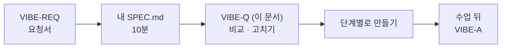
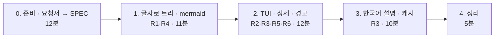

# 7교시 바이브 코딩 · `tflow` 만들기

> **먼저 [VIBE-REQ-TFLOW.md](VIBE-REQ-TFLOW.md)(요청서)를 읽고 `~/vibe/tflow/SPEC.md`를 직접 쓴 뒤** 이 문서를 엽니다. 이 문서는 요청서에서 요구를 뽑아 낸 **다음 단계**입니다. 내 SPEC과 비교하는 데 쓰고, 에이전트에게 통째로 붙여 넣지 않습니다.



- 시간: 16:00~16:50 (50분) · 발표와 정리는 8교시
- 도구: CLI 코딩 에이전트(codex / claude / agy), Python + uv + [Textual](https://textual.textualize.io/)
- 결과물: n8n 워크플로우 JSON을 읽어 **노드와 연결을 트리로** 보여 주고, 노드마다 **하는 일을 한국어로** 설명하는 터미널 프로그램(TUI). 에이전트가 만든 n8n 파일을 열지 않고도 확인하는 도구입니다.

```text
$ tflow ~/aio-01d4-stu/Last3Mon/68/agents/it-agent.json
┌ tflow · 68 IT agent (from day 67) · 노드 14 · 연결 14 ──────────────────┐
│ ▼ IT question webhook  [webhook POST /it-agent] │ IT help agent          │
│   ▼ Has question?      [if]                     │ 종류: AI Agent         │
│     ├ true ▼ Has user? [if]                     │ 모델: OpenAI chat model│
│     │   ├ true ▼ IT help agent [agent]          │ Tool: Search FAQ,      │
│     │   │   ◇ model OpenAI chat model           │       Get ticket       │
│     │   │   ◇ tool  Search FAQ · Get ticket     │ 하는 일: 사내 IT 질문에│
│     │   │   ▼ Check answer [code]               │ FAQ·접수 현황 Tool로 … │
│     ...                                         │                        │
└──────────────────────────────────────────────────────────────────────────┘
```

> 요청문은 **직접** 씁니다. 단계마다 `▶` 를 하나씩 펼치면 생각할 거리가 나옵니다. 정답 요청문은 없습니다.

## 요구 사항 (요청서에서 뽑은 것)

| 번호 | 요구 | 요청서의 말 | 확인 방법 |
| --- | --- | --- | --- |
| R1 | 워크플로우 JSON을 읽어, 웹훅(시작 노드)에서 `main` 연결을 따라가는 **트리**로 보여 준다. If·Switch의 갈래 이름(true/false, 출력 이름)을 붙인다 | ① 어디서 어디로, 갈림길은 어느 쪽이 어떤 경우 | `tflow agents/it-agent.json` |
| R2 | AI 연결(`ai_languageModel`, `ai_tool`)은 따로 표시한다 (어느 Agent의 모델·Tool인지) | ② 모델과 Tool, 순서와는 다르게 붙음 | it-agent의 `IT help agent` 아래 |
| R3 | 노드를 고르면 옆에 **종류 · 중요한 설정 · 하는 일(한국어)** 을 보여 준다. 하는 일은 LLM이 쓰고, 한 번 쓴 설명은 다시 쓰지 않는다 | ③ 설정과 한국어 설명, 매번 묻지 않기 | 노드를 고르기 |
| R4 | `tflow <파일> --md`로 **마크다운 파일**(`<파일 이름>.md`)을 만든다. 안에 워크플로우 이름 · 노드 · 연결 수와 ` ```mermaid ` 흐름도 블록. TUI에서는 `m` 키로 같은 파일 저장 | ④ 문서에 붙이면 그림 | 만든 `.md`를 VS Code 미리보기(`Ctrl+Shift+V`)로 열어 그림 확인 |
| R5 | 어디에도 연결되지 않은 노드, 없는 노드를 가리키는 연결을 **경고**로 보여 준다 | ⑤ 끊긴 연결을 열자마자 | 직접 망가뜨린 파일 |
| R6 | 터미널 화면(TUI)으로 보여 준다 | "브라우저 말고 터미널" | `uv run tflow …`가 터미널에서 열림 |

숨은 요구 (요청서에 직접 없지만 없으면 안 되는 것):

| 숨은 요구 | 어디서 나왔나 |
| --- | --- |
| 다시 모이는 노드는 두 번째부터 펼치지 않는다 (끝없이 반복되지 않게) | 메모 "네 갈래로 나뉘었다가 다시 하나로 모임" |
| 테스트용 **망가진 파일**을 직접 만든다 | ⑤ 끊긴 파일은 함께 받지 않음 |
| 키가 없거나 LLM이 실패해도 트리 · 그림은 그대로 | "키가 없는 날에도 구조는" |
| LLM에는 `credentials`를 보내지 않고, 캐시는 노드 **내용**으로 | ③ "Credential이 밖으로 나가면 안 돼요", "같은 걸 매번 묻지 않기" |
| mermaid id는 번호로, 노드 이름은 보이는 글자로만 | ④ 노드 이름의 빈칸 · `?` · 괄호 |

범위 밖 (오늘 하지 않음): 워크플로우 고치기(편집), n8n에 직접 연결해 가져오기, 실행 기록 보기.

**비교해 보기**: 내 `SPEC.md`에서 빠진 요구, 내가 더 뽑은 요구, 다르게 정한 순서를 `SPEC.md` 끝에 한 줄씩 적고, 필요하면 내 SPEC을 고칩니다. 아래 단계부터는 **고친 내 SPEC.md**를 기준으로 요청문을 씁니다.

알아 둘 것:

- 파일 모양: `nodes`(노드 목록: `name`, `type`, `parameters` …)와 `connections`. 연결은 `{"보내는 노드": {"main": [[{"node": "받는 노드", "index": 0}], [...]]}}` 이고, 바깥 목록의 **순서가 출력 번호**입니다 (If는 0=true, 1=false). [AGENTS.md](AGENTS.md) 6절.
- 연습할 파일 (`~/aio-01d4-stu/Last3Mon/68/` 기준, 노드 · 연결 수는 파일에서 센 값):

| 파일 | 노드 | 연결 | 특징 |
| --- | --- | --- | --- |
| `agents/meeting-agent.json` | 7 | 6 (main 5, model 1) | 가장 단순 |
| `agents/it-agent.json` | 14 | 14 (main 11, model 1, tool 2) | If 둘, Tool 둘, 두 갈래가 `Send result`로 다시 모임 |
| `reference/lab03-example2-isolated.json` | 18 | 20 (main 19, model 1) | Switch 4갈래가 Merge 하나로 모임 |
| `../67/my-work/it-agent.json` | | | 어제 내가 만든 파일 (있으면) |

- 번역·설명 LLM 키는 `OPENAI_API_KEY` 환경 변수로 받습니다. **키를 코드에 쓰지 않습니다.**

## 진행 (50분)



요청문은 단계마다 `~/vibe/tflow/PROMPTS.md`에 남깁니다.

### 0. 준비 · 요청서 → SPEC (12분)

```bash
mkdir -p ~/vibe/tflow && cd ~/vibe/tflow
git init
```

1. [VIBE-REQ-TFLOW.md](VIBE-REQ-TFLOW.md)를 읽고 `SPEC.md`를 **직접** 씁니다 (10분, 에이전트는 아직 켜지 않음).
2. 위 "요구 사항"과 비교해 `SPEC.md`를 고치고 `git add SPEC.md && git commit -m "spec"`.
3. 에이전트를 켭니다 (`codex`, `claude`, `agy`). 첫 요청에 "`SPEC.md`를 읽고, 요구마다 어떻게 확인할지 먼저 말해 줘. 코드는 아직 쓰지 마"처럼 **SPEC을 읽혔는지부터** 확인합니다.

어제 만든 `tman`의 `AGENTS.md`(있다면)를 복사해 와서 고쳐 쓰면 첫 요청이 짧아집니다.

### 1. 글자로 트리와 mermaid (11분)

**목표**: `uv run tflow <파일>`이 트리를 **글자로** 출력하고, `--md`가 mermaid 흐름도가 든 마크다운 파일을 만든다. 화면(TUI)은 아직 없다.

> 터미널은 mermaid를 그림으로 그리지 못합니다. 그래서 그림은 **`.md` 파일로 내보내 마크다운 미리보기에서** 봅니다 (LLM · 인터넷 없이 됨). 웹 편집기로 보내지 않습니다 (워크플로우 내용이 밖으로 나감).

<details><summary>▶ 1단계 · 읽기와 보여 주기를 나누기</summary>

파일을 읽어 "노드 목록과 연결 목록"으로 바꾸는 부분은 글자 출력, mermaid, TUI가 모두 씁니다. 이 부분을 **따로** 만들고 테스트하게 하려면 무엇을 적어야 할까요? 테스트에 쓸 파일(위 표)과 기대하는 노드 · 연결 수도 적을 수 있습니다.
</details>

<details><summary>▶ 2단계 · 트리가 아닌 곳</summary>

워크플로우는 나무가 아니라 **갈래가 다시 모이는** 그림입니다 (it-agent의 `Send result`, Switch 뒤의 `Collect results`). 그대로 따라가면 같은 노드가 여러 번 나오고, 고리(loop)가 있으면 끝나지 않습니다. 이미 나온 노드를 두 번째 만나면 어떻게 보여 줄지 정해 줍니다.
</details>

<details><summary>▶ 3단계 · mermaid에서 깨지는 것</summary>

노드 이름에는 빈칸, `?`, 한글, 괄호가 들어갑니다. mermaid 노드 id로 그대로 쓰면 그림이 깨집니다. id와 보이는 이름을 나누라고 요청합니다. 갈래 이름(true/false)은 화살표 글자로.
</details>

**확인**: 세 파일로 `uv run tflow`, `uv run tflow ... --md` → 생긴 `.md`를 VS Code 미리보기로 열어 그림이 나오는지, `uv run pytest -q`, `git commit`.

### 2. TUI · 상세 · 경고 (12분)

**목표**: 왼쪽 트리, 오른쪽 상세. 노드를 고르면 종류와 중요한 설정을 보여 준다. 경고가 있으면 위에 보여 준다 (R2 · R3 일부 · R5 · R6).

<details><summary>▶ 1단계 · "중요한 설정"은 무엇인가</summary>

노드 종류마다 사람이 확인하고 싶은 칸이 다릅니다. 웹훅은 방식과 경로, HTTP는 주소, Agent는 지시문(systemMessage)과 붙은 모델·Tool, Code는 코드 첫 몇 줄, If는 조건. 종류별로 보여 줄 칸을 표로 적어 요청문에 넣어 봅니다.
</details>

<details><summary>▶ 2단계 · 경고 만들기</summary>

경고를 확인하려면 **망가진 파일**이 필요합니다. 연결에서 노드 이름 하나를 틀리게 고친 파일, 아무 데도 연결 안 된 노드를 더한 파일을 테스트용으로 만들게 합니다. 67일차 `flow.py check`가 하던 검사 중 무엇을 가져올지 골라 봅니다.
</details>

**확인**: `uv run tflow agents/it-agent.json`에서 `IT help agent`를 골라 모델과 Tool이 보이는지, 망가진 파일에서 경고, `git commit`.

### 3. 한국어 설명과 캐시 (10분)

**목표**: 상세에 "하는 일: …" 한두 문장이 한국어로 나온다. 같은 노드는 다시 묻지 않는다 (R3).

<details><summary>▶ 1단계 · LLM에게 무엇을 줄까</summary>

노드 하나만 주면 "Code 노드입니다" 같은 뻔한 설명이 나옵니다. 앞뒤 노드 이름, 설정(지시문, 코드, 주소)을 함께 주면 "이 워크플로우에서" 하는 일을 씁니다. 반대로 **주면 안 되는 것**은 없나요 (Credential 정보)?
</details>

<details><summary>▶ 2단계 · 캐시의 열쇠</summary>

노드 이름만으로 캐시하면, 내용이 바뀐 노드도 옛 설명이 나옵니다. 무엇이 같으면 "같은 노드"로 볼지 정합니다. 키가 없거나 LLM이 실패해도 트리는 그대로 보여야 합니다.
</details>

<details><summary>▶ 3단계 · 테스트에서 진짜 LLM을 부르지 않게</summary>

어제 `tman`의 번역기처럼, 설명기를 바꿔 끼울 수 있게 하고 테스트에서는 가짜를 쓰게 합니다.
</details>

```bash
export OPENAI_API_KEY=$(grep '^OPENAI_API_KEY=' ~/aio-01d4-stu/Last3Mon/.env | cut -d= -f2-)
```

**확인**: 노드를 골라 한국어 설명, 같은 노드를 다시 골라 바로 나오는지, `uv run pytest -q`, `git commit`.

### 4. 정리 (5분)

- 오늘 n8n 실습에서 에이전트가 만든 `my-work/assistant.json`을 `tflow`로 열어 봅니다. 내가 그린 `DESIGN.md` 3절 흐름도와 같은가요?
- `SPEC.md` 1절 표에 됐다 / 안 됐다를 체크합니다. 안 된 것은 왜인지 한 줄.

| 발표 (3분) | 내용 |
| --- | --- |
| 요구 도출 | 내 SPEC에서 VIBE-Q와 달랐던 것 하나 (빠뜨린 것 또는 더 뽑은 것) |
| 요청문 | 가장 잘 먹힌 요청문 한 개, 안 먹힌 요청문 한 개 |
| 막힌 곳 | 다시 모이는 노드, mermaid 깨짐 등 어떻게 알아챘고 고쳤나 |
| 시연 | 내 `assistant.json`의 트리와 `--md` 그림, 노드 설명 하나 |

## 확인

- [ ] `SPEC.md`를 에이전트 없이 먼저 썼고, VIBE-Q와 비교한 줄이 있다.
- [ ] R1 it-agent의 트리에 true/false 갈래가 보이고, 다시 모이는 노드가 끝없이 반복되지 않는다.
- [ ] R2 `IT help agent` 아래(또는 상세)에 모델 1개, Tool 2개.
- [ ] R3 노드를 고르면 종류·설정·한국어 설명, 두 번째는 캐시에서.
- [ ] R4 `--md`로 만든 `.md`가 미리보기에서 그림으로 그려진다 (TUI의 `m`도 같은 파일).
- [ ] R5 망가진 파일에서 경고.
- [ ] R6 터미널에서 열리고 `q`로 닫힌다.
- [ ] 수업 뒤 `git pull` → `VIBE-A-TFLOW.md`의 요구 도출 예시와 내 SPEC 비교.
- [ ] `uv run pytest -q` 통과, 단계마다 git commit, `PROMPTS.md`.
