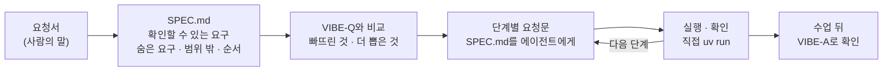

# 7교시 바이브 코딩 · 요청서 `tflow` (가장 먼저 읽기)

- 순서: **이 요청서** → 내가 뽑은 요구 `~/vibe/tflow/SPEC.md` (10분) → [VIBE-Q-TFLOW.md](VIBE-Q-TFLOW.md)와 비교 → 단계별로 만들기 → 수업이 끝나면 `VIBE-A-TFLOW.md`(정답본)로 확인
- 이 문서는 **만들어 달라는 사람의 말**입니다. 요구 사항 표도, 단계도 없습니다. 그것을 뽑아 내는 것이 오늘 첫 10분의 일입니다.



## 왜 요청서부터인가

오늘(그리고 지난 이틀) 바이브 코딩에서 VIBE-Q 문서를 통째로 에이전트에게 주고 "이대로 만들어 줘"라고 한 사람이 많았습니다. 그러면 무엇이 만들어지든 **내가 판단할 기준이 없습니다.** 실무에서는 요구 사항 표가 오지 않고, 이 요청서 같은 **사람의 말**이 옵니다. 말을 확인할 수 있는 요구로 바꾸는 일은 에이전트가 아니라 내가 합니다.

| 단계 | 누가 | 결과 |
| --- | --- | --- |
| 요청 → 요구 | **나** | `SPEC.md`: 요구마다 "됐다 / 안 됐다"를 말할 수 있는 확인 방법 |
| 요구 → 단계 | **나** | 작게 나눈 순서 (무엇부터 만들고 확인할지) |
| 단계 → 코드 | 에이전트 | 단계마다 요청문 하나, `SPEC.md`를 함께 읽게 함 |
| 확인 | **나** | 직접 `uv run tflow …`, `pytest`, 요구 표에 체크 |

## 요청 (운영 담당자에게서 온 메시지, 그대로)

> 오늘 오전에 CLI 에이전트가 사내 업무 도우미 워크플로우(`assistant.json`)를 만들어 줬어요. 테스트는 통과했는데, 솔직히 안이 어떻게 생겼는지 모르겠어요. 파일을 열면 몇백 줄 JSON이고, n8n 화면을 열면 선이 엉켜 있어요.
>
> ① 어디서 시작해서 어디로 가는지, 갈림길에서는 **어느 쪽이 어떤 경우인지** 한눈에 보고 싶어요.
>
> ② Agent에 **어떤 모델과 Tool이 붙어 있는지**도 같이요. 이건 보통 선으로 이어지는 순서와는 다르게 붙어 있더라고요.
>
> ③ 노드 이름만 봐서는 뭘 하는지 모르는 게 많아요. 노드를 하나 고르면 **중요한 설정과 한국어 한두 줄 설명**이 나오면 좋겠어요. 다만 같은 걸 열 때마다 LLM에 물어 돈을 쓰는 건 싫고, **키나 Credential이 밖으로 나가면 절대 안 돼요.**
>
> ④ 주간 회의 때 팀에 구조를 보여 줘야 해서, **문서에 붙이면 그림이 되는** 것도 하나 뽑을 수 있으면 해요.
>
> ⑤ 에이전트가 가끔 노드 이름을 틀려서 **연결이 끊긴 채로** 만들던데, 그런 건 열자마자 알려 주면 좋겠어요.
>
> 브라우저 말고 터미널에서 바로 쓰고 싶어요. 인터넷이나 키가 없는 날에도 구조는 볼 수 있어야 하고요.

## 함께 받은 것

| 파일 (`~/aio-01d4-stu/Last3Mon/68/` 기준) | 메모 |
| --- | --- |
| `agents/meeting-agent.json` | 가장 단순한 것 |
| `agents/it-agent.json` | 갈림길이 둘, Tool이 둘 |
| `reference/lab03-example2-isolated.json` | 네 갈래로 나뉘었다가 다시 하나로 모임 |
| `my-work/assistant.json` | 오늘 오전에 내가 만든 것 (있으면) |

- 파일 모양은 [AGENTS.md](AGENTS.md) 6절 (`nodes`, `connections`).
- LLM 키는 `OPENAI_API_KEY` 환경 변수로 받습니다.

## 할 일 · 요청을 요구로 (10분, 에이전트 없이)

`~/vibe/tflow/SPEC.md`를 만들고 아래 네 가지를 씁니다. **에이전트에게 맡기지 않고 직접** 씁니다 (나중에 에이전트에게 읽힐 문서입니다).

```markdown
# tflow SPEC

## 1. 요구 (확인할 수 있게)
| 번호 | 요구 | 요청의 어느 말 | 확인 방법 (파일 · 숫자 · 화면) |
| --- | --- | --- | --- |
| R1 | | ① | |

## 2. 숨은 요구 (요청에 직접 없지만 없으면 안 되는 것)
## 3. 범위 밖 (오늘 50분 안에 하지 않을 것)
## 4. 만드는 순서 (그리고 그 이유)
```

예 하나만 보여 드립니다. 나머지는 직접 바꿔 봅니다.

| 요청의 말 | 그대로 요청문에 넣으면 | 확인할 수 있는 요구로 |
| --- | --- | --- |
| ① "갈림길에서 어느 쪽이 어떤 경우인지 한눈에" | "보기 좋게 보여 줘" → 무엇이 되든 "됐다"가 됨 | **If·Switch 갈래 이름(true/false, 출력 이름)을 붙인 트리.** 확인: `agents/it-agent.json`의 `Has question?` 아래에 true · false 두 갈래 |

<details><summary>▶ 1단계 · "한눈에", "중요한", "좋겠어요"를 어떻게 확인하나</summary>

형용사는 확인할 수 없습니다. "몇 개가 보이면", "어느 파일에서 무엇이 나오면"으로 바꿉니다. 함께 받은 파일을 열어 **직접 세어 보면** 확인 방법의 숫자가 생깁니다 (노드 수, 연결 수, 갈래 수). `jq '.nodes | length' agents/it-agent.json`처럼 (jq가 없으면 `python3 -c "import json; print(len(json.load(open('agents/it-agent.json'))['nodes']))"`).
</details>

<details><summary>▶ 2단계 · 숨은 요구</summary>

- "갈래가 나뉘었다가 다시 모인다"(메모)는 트리에서 무엇을 뜻할까요? 그대로 따라가면 같은 노드가 몇 번 나올까요?
- "연결이 끊긴 채로"를 확인하려면 무엇이 있어야 할까요? (끊긴 파일은 함께 받지 않았습니다.)
- "키가 없는 날에도"와 "돈을 쓰는 건 싫다"는 각각 어떤 동작이 되어야 할까요?
- "그림이 되는 것"에서, 노드 이름에 빈칸 · `?` · 괄호가 있으면?
</details>

<details><summary>▶ 3단계 · 범위 밖과 순서</summary>

50분입니다. 고치기(편집), n8n에 직접 연결, 실행 기록 보기는 요청에 없습니다. 순서는 "무엇을 먼저 만들면 나머지가 그것을 다시 쓰나"로 정합니다. 화면, 그림, 경고가 모두 **같은 것**(파일에서 읽은 노드와 연결)을 씁니다.
</details>

## 그다음

1. [VIBE-Q-TFLOW.md](VIBE-Q-TFLOW.md)를 열어 내 `SPEC.md`와 비교합니다. 빠뜨린 요구, 내가 더 뽑은 요구, 다르게 정한 순서를 `SPEC.md` 끝에 한 줄씩 적습니다 (8교시 발표 거리).
2. 단계마다 요청문을 쓸 때 "`SPEC.md`를 읽고 4절의 1단계만 해 줘"처럼 **내 SPEC을 기준으로** 시킵니다. VIBE-Q 문서를 통째로 붙여 넣지 않습니다.
3. 단계가 끝날 때마다 `SPEC.md` 1절 표의 확인 방법대로 **내가** 확인하고 체크합니다.
4. 수업이 끝나면 `git pull`로 정답본 `VIBE-A-TFLOW.md`를 받아, 요구 도출 예시와 요청문 예를 내 것과 비교합니다.
