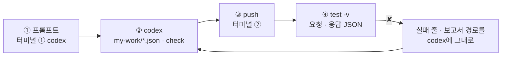
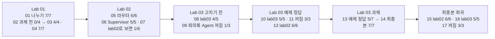

# 68일차 Lab 테스트 결과 · codex 프롬프트 → push → `test -v` 실제 결과

> **정답 자료** · 68일차 n8n 워크플로우를 **만드는 프롬프트(codex) → push → `test -v` 결과**를 학생이 가는 순서대로 한 문서에 모았습니다. 수업이 끝난 뒤 공개합니다.

- 실행: 68일차 수업 당일(2026-10-20) 밤, 강사 노트북의 65일차 n8n 2.42.6 + 67일차 데이터 API, OpenAI `gpt-4.1-mini`, 케이스 파일마다 **한 번씩** (`--repeat` 없음)
- 명령: `~/aio-01d4-stu/Last3Mon/68`에서 `uv run tools/flow.py test <케이스 파일> -v` (`-v`는 이번에 68일차 `flow.py`에도 넣음)
- 아래 단계마다 **codex 프롬프트**, **실행한 명령**, **화면에 나온 출력 전부**(`-v`)를 그대로 붙였습니다. 같은 출력이 `NN-<이름>.txt`에, 같은 실행의 보고서가 `NN-<이름>.json`(케이스마다 `request` · `response` · `problems` · `seconds`)에 있습니다.
- LLM 문장과 시간은 실행마다 조금씩 다릅니다. **점수**는 2026-10-18 수업 준비 때와 모두 같았습니다.

## `-v`가 보여 주는 것

```text
✘ 회의록 없는 회의 요청 · 1.3s · status 500 (expected 200); count = null (expected 1); …   ← 케이스 이름 · 시간 · 틀린 곳
    → request  POST /webhook/my-assistant                                                 ← 보낸 요청 JSON
      {
        "message": "이번 회의록 할 일 정리 부탁해요",
        "user": "김민지"
      }
    ← response HTTP 500                                                                   ← 받은 응답 JSON
      {
        "message": "Error in workflow"
      }
```

## 이 문서 하나로 따라가기

단계마다 **① codex에 넣는 프롬프트 → ② codex가 `my-work/*.json`을 쓰고 `check` → ③ 내가 `push` → ④ 내가 `test -v`** 순서입니다.



```bash
# 터미널 ① (codex) · 터미널 ② (확인) 둘 다
cd ~/aio-01d4-stu/Last3Mon/68
codex          # 터미널 ①에서만. AGENTS.md(작업 규칙 · Agent 계약)를 codex가 스스로 읽음
# 터미널 ②: 준비 때 한 번 (데이터 API와 이미 만든 Agent 둘)
cd ~/aio-01d4-stu/Last3Mon/67/data-api && docker compose up -d --force-recreate && cd -
uv run tools/flow.py push agents/it-agent.json agents/meeting-agent.json
```

### 만든 · 쓴 n8n 워크플로우 파일

| 단계 | 만드는 것 | 웹훅 | codex 프롬프트 | 학생 파일 | 이 기록에서 push한 워크플로우 |
| --- | --- | --- | --- | --- | --- |
| 준비 | IT 문의 Agent · 회의록 Agent (만들지 않고 부름) | `it-agent` · `meeting-agent` | 없음 | — | [`agents/it-agent.json`](../agents/it-agent.json) · [`agents/meeting-agent.json`](../agents/meeting-agent.json) |
| 01 | 업무 나누기 | `my-split` | 01절 | `my-work/split.json` | [`reference/lab01-example2-split.json`](../reference/lab01-example2-split.json) |
| 03 | + 담당 · 빠진 입력 | `my-split` | 03절 | `my-work/split.json` 고침 | [`68-lab01-challenge-split.json`](68-lab01-challenge-split.json) |
| 05 | 라우터 | `my-assistant` | 05절 | `my-work/assistant.json` | [`reference/lab02-example2-router.json`](../reference/lab02-example2-router.json) |
| 06 | Supervisor | `my-supervisor` | 06절 | `my-work/supervisor.json` | [`68-lab02-challenge-supervisor.json`](68-lab02-challenge-supervisor.json) |
| 10 | + 빠진 입력 · 장애 격리 | `my-assistant` | 10절 (예제 1 · 2) | `my-work/assistant.json` 고침 | [`reference/lab03-example2-isolated.json`](../reference/lab03-example2-isolated.json) |
| 14 | + user 빠짐 · 공백 400 (최종본) | `my-assistant` | 14절 | `my-work/assistant.json` 고침 | [`68-lab03-challenge-final.json`](68-lab03-challenge-final.json) |
| 13 | 어려운 케이스 7개 (케이스 파일) | — | 없음 (학생이 직접 씀) | `cases/my-cases.json` | [`68-lab03-challenge-cases.json`](68-lab03-challenge-cases.json) |

- **프롬프트는 정답본(`LAB-0x-A-*.md`)의 요청문 예**입니다. **이 기록의 워크플로우는 수업 준비 때 만든 정답 파일**이고, 위 프롬프트를 codex에 보내 다시 만들어 재지는 않았습니다 (68일차부터 수업 준비는 정답 워크플로우만 실행). codex가 만든 파일은 노드 이름 · 문장이 다를 수 있지만, **테스트가 보는 칸**이 같으면 같은 점수가 나와야 합니다.
- Lab 02 예제 1(Agent 계약 표)은 워크플로우가 아니라 `DESIGN.md`를 쓰는 일이라 여기 넣지 않았습니다 (정답본 `LAB-02-A` 예제 1).

## 시나리오 한눈에



| 단계 | 먼저 올린 것 (`push` / `off`) | 테스트 | 결과 | 파일 |
| --- | --- | --- | --- | --- |
| 01 | Agent 둘 + `reference/lab01-example2-split.json` | `cases/lab01.json` | 7/7 | `01-lab01-split` |
| 02 | (같음, 과제 전) | `cases/lab01-challenge.json` | **0/4** | `02-lab01-challenge-before` |
| 03 | `68-lab01-challenge-split.json` | `cases/lab01-challenge.json` | 4/4 | `03-lab01-challenge-split` |
| 04 | (같음) | `cases/lab01.json` | 7/7 | `04-lab01-with-challenge` |
| 05 | `reference/lab02-example2-router.json` | `cases/lab02.json` | 6/6 | `05-lab02-router` |
| 06 | `68-lab02-challenge-supervisor.json` | `cases/lab02-challenge.json` | 5/5 | `06-lab02-challenge-supervisor` |
| 07 | (같음) | `cases/lab02.json --webhook my-supervisor` | **1/6** | `07-lab02-on-supervisor` |
| 08 | (라우터 그대로, Lab 03 고치기 전) | `cases/lab03.json` | **4/5** | `08-lab03-before` |
| 09 | `off agents/meeting-agent.json` | `cases/lab03-down.json` | **1/3** | `09-lab03-down-before` |
| 10 | 회의록 Agent 다시 켬 + `reference/lab03-example2-isolated.json` | `cases/lab03.json` | 5/5 | `10-lab03-isolated` |
| 11 | `off agents/meeting-agent.json` | `cases/lab03-down.json` | 3/3 | `11-lab03-down-isolated` |
| 12 | 회의록 Agent 다시 켬 | `cases/lab02.json` | 6/6 | `12-lab02-isolated` |
| 13 | (같음) | 어려운 케이스 `68-lab03-challenge-cases.json` | **5/7** | `13-challenge-cases-isolated` |
| 14 | `68-lab03-challenge-final.json` | 어려운 케이스 | 7/7 | `14-challenge-cases-final` |
| 15 | (같음) | `cases/lab02.json` | 6/6 | `15-lab02-final` |
| 16 | (같음) | `cases/lab03.json` | 5/5 | `16-lab03-final` |
| 17 | `off agents/meeting-agent.json` (끝나고 다시 켬) | `cases/lab03-down.json` | 3/3 | `17-lab03-down-final` |

---

## Lab 01 · 복합 요청을 업무로 나누기

### 01 · 업무 나누기 → `lab01` 7/7

codex에 입력하는 프롬프트 (터미널 ①, 학생이 만들 파일 `my-work/split.json` · 이 기록에서 push한 같은 역할의 정답 `reference/lab01-example2-split.json`):

```text
my-work/split.json 에 n8n 워크플로우를 만들어 줘.
- POST 웹훅, 경로 my-split. 직원 요청 문장은 본문의 message.
- message가 비어 있으면 400 {"error": "message is required"}.
- AI Agent(OpenAI gpt-4.1-mini, Tool 없음)가 문장을 업무 목록으로 나눈다. 업무 하나 = 한 번에 처리할 수 있는 요청 하나.
  유형: it(비밀번호·계정·VPN·프린터·메일·소프트웨어, T-1002 같은 접수 현황), meeting(회의록 정리·할 일), other(그 밖).
  업무 텍스트는 직원이 쓴 한국어 그대로, 접수 번호를 지우지 않는다. JSON만 돌려 달라고 한다.
- 다음 Code 노드에서 그 글자를 JSON으로 읽는다. 앞뒤 ``` 는 지우고, 읽지 못하면 빈 목록. 정해지지 않은 유형은 other.
- 결과는 {"count": 업무 수, "tasks": [{"type": "it", "text": "..."}]} (요청에 나온 순서대로).
- 기대 결과는 cases/lab01.json. check까지 하고 push·test 명령을 알려 줘.
```

실행한 명령:

```bash
uv run tools/flow.py push agents/it-agent.json agents/meeting-agent.json reference/lab01-example2-split.json
uv run tools/flow.py test cases/lab01.json -v
```

출력 (그대로):

```text
POST http://localhost:5678/webhook/my-split · 7 case(s) × 1
✔ 복합 요청 · 업무 3개 · 3.7s
    → request  POST /webhook/my-split
      {
        "message": "T-1002 처리 상태 알려주고, 첨부한 회의록에서 할 일도 정리해줘. 그리고 프린터 출력이 안 돼요.",
        "user": "박서연",
        "title": "10월 16일 주간 회의",
        "notes": "참석: 김민지, 이준호, 박서연. 1) 신규 고객 문의 응답 템플릿을 이준호가 금요일까지 정리한다. 2) 박서연은 다음 주 월요일까지 VPN 장애 보고서를 작성한다. 3) 서버 점검 일정은 김민지가 오늘 중 공지한다. 4) 회의실 예약 규칙 개선은 담당자를 다음 회의에서 정한다. 다음 회의는 10월 23일."
      }
    ← response HTTP 200
      {
        "count": 3,
        "tasks": [
          {
            "type": "it",
            "text": "T-1002 처리 상태 알려줘"
          },
          {
            "type": "meeting",
            "text": "첨부한 회의록에서 할 일 정리"
          },
          {
            "type": "it",
            "text": "프린터 출력이 안 돼요"
          }
        ]
      }
✔ IT 하나 · 1.9s
    → request  POST /webhook/my-split
      {
        "message": "VPN이 계속 끊겨요. 어떻게 해야 하나요?",
        "user": "이준호"
      }
    ← response HTTP 200
      {
        "count": 1,
        "tasks": [
          {
            "type": "it",
            "text": "VPN이 계속 끊겨요. 어떻게 해야 하나요?"
          }
        ]
      }
✔ IT 둘 · 1.5s
    → request  POST /webhook/my-split
      {
        "message": "비밀번호를 잊어버렸어요. 그리고 메일함 용량이 꽉 찼다고 나와요.",
        "user": "이준호"
      }
    ← response HTTP 200
      {
        "count": 2,
        "tasks": [
          {
            "type": "it",
            "text": "비밀번호를 잊어버렸어요."
          },
          {
            "type": "it",
            "text": "메일함 용량이 꽉 찼다고 나와요."
          }
        ]
      }
✔ 회의록 정리 · 1.5s
    → request  POST /webhook/my-split
      {
        "message": "이번 회의록 할 일 정리 부탁해요",
        "user": "김민지",
        "title": "10월 16일 주간 회의",
        "notes": "참석: 김민지, 이준호, 박서연. 1) 신규 고객 문의 응답 템플릿을 이준호가 금요일까지 정리한다. 2) 박서연은 다음 주 월요일까지 VPN 장애 보고서를 작성한다. 3) 서버 점검 일정은 김민지가 오늘 중 공지한다. 4) 회의실 예약 규칙 개선은 담당자를 다음 회의에서 정한다. 다음 회의는 10월 23일."
      }
    ← response HTTP 200
      {
        "count": 1,
        "tasks": [
          {
            "type": "meeting",
            "text": "이번 회의록 할 일 정리 부탁해요"
          }
        ]
      }
✔ IT와 기타 · 1.1s
    → request  POST /webhook/my-split
      {
        "message": "프린터 출력이 안 돼요. 그리고 다음 주 회식 장소도 추천해 주세요.",
        "user": "최유진"
      }
    ← response HTTP 200
      {
        "count": 2,
        "tasks": [
          {
            "type": "it",
            "text": "프린터 출력이 안 돼요."
          },
          {
            "type": "other",
            "text": "다음 주 회식 장소도 추천해 주세요."
          }
        ]
      }
✔ 기타만 · 1.0s
    → request  POST /webhook/my-split
      {
        "message": "다음 주 회식 장소 추천해 주세요",
        "user": "최유진"
      }
    ← response HTTP 200
      {
        "count": 1,
        "tasks": [
          {
            "type": "other",
            "text": "다음 주 회식 장소 추천해 주세요"
          }
        ]
      }
✔ 빈 요청 · 0.0s
    → request  POST /webhook/my-split
      {
        "message": "",
        "user": "이준호"
      }
    ← response HTTP 400
      {
        "error": "message is required"
      }
Passed 7/7
report: runs/lab01-20261020-230700.json
```

- 복합 요청 하나가 `{"type": "it", "text": "T-1002 처리 상태 알려줘"}`, `meeting`, `it` 셋으로 나뉘었습니다. 접수 번호를 지우지 않았습니다.
- `빈 요청`은 LLM을 부르지 않고 입구의 If가 400 (0.0초).

### 02 · 과제 전 · 담당 · 빠진 입력 테스트 → `lab01-challenge` 0/4

프롬프트 없음: 예제 2 결과로 과제 테스트를 먼저 돌려 **무엇이 없는지** 봅니다.

실행한 명령:

```bash
uv run tools/flow.py test cases/lab01-challenge.json -v
```

출력 (그대로):

```text
POST http://localhost:5678/webhook/my-split · 4 case(s) × 1
✘ 복합 요청 · 담당 Agent · 1.3s · tasks.0.agent = null (expected it-agent); tasks has none of ['"agent": "meeting-agent"']
    → request  POST /webhook/my-split
      {
        "message": "T-1002 처리 상태 알려주고, 첨부한 회의록에서 할 일도 정리해줘. 그리고 프린터 출력이 안 돼요.",
        "user": "박서연",
        "title": "10월 16일 주간 회의",
        "notes": "참석: 김민지, 이준호, 박서연. 1) 신규 고객 문의 응답 템플릿을 이준호가 금요일까지 정리한다. 2) 박서연은 다음 주 월요일까지 VPN 장애 보고서를 작성한다. 3) 서버 점검 일정은 김민지가 오늘 중 공지한다. 4) 회의실 예약 규칙 개선은 담당자를 다음 회의에서 정한다. 다음 회의는 10월 23일."
      }
    ← response HTTP 200
      {
        "count": 3,
        "tasks": [
          {
            "type": "it",
            "text": "T-1002 처리 상태 알려줘"
          },
          {
            "type": "meeting",
            "text": "첨부한 회의록에서 할 일 정리"
          },
          {
            "type": "it",
            "text": "프린터 출력이 안 돼요"
          }
        ]
      }
✘ 회의록 없는 회의 요청 · 1.6s · tasks.0.agent = null (expected meeting-agent); tasks.0.missing = null (expected ["notes"])
    → request  POST /webhook/my-split
      {
        "message": "이번 회의록 할 일 정리 부탁해요",
        "user": "김민지"
      }
    ← response HTTP 200
      {
        "count": 1,
        "tasks": [
          {
            "type": "meeting",
            "text": "이번 회의록 할 일 정리 부탁해요"
          }
        ]
      }
✘ 기타는 담당자 연결 · 1.1s · tasks.0.agent = null (expected 담당자 연결); tasks.0.missing = null (expected [])
    → request  POST /webhook/my-split
      {
        "message": "다음 주 회식 장소 추천해 주세요",
        "user": "최유진"
      }
    ← response HTTP 200
      {
        "count": 1,
        "tasks": [
          {
            "type": "other",
            "text": "다음 주 회식 장소 추천해 주세요"
          }
        ]
      }
✘ IT · 입력 다 있음 · 1.1s · tasks.0.agent = null (expected it-agent); tasks.0.missing = null (expected [])
    → request  POST /webhook/my-split
      {
        "message": "VPN이 계속 끊겨요. 어떻게 해야 하나요?",
        "user": "이준호"
      }
    ← response HTTP 200
      {
        "count": 1,
        "tasks": [
          {
            "type": "it",
            "text": "VPN이 계속 끊겨요. 어떻게 해야 하나요?"
          }
        ]
      }
Passed 0/4
report: runs/lab01-challenge-20261020-230705.json
```

- 응답에 `agent` · `missing` 칸이 **아직 없어서** 네 케이스가 모두 `= null`로 실패합니다. 나누기는 맞았습니다 (`"type": "meeting"`).

### 03 · 담당 · 빠진 입력 (Code 규칙) → `lab01-challenge` 4/4

codex에 입력하는 프롬프트 (터미널 ①, 학생이 만들 파일 `my-work/split.json (고침)` · 이 기록에서 push한 같은 역할의 정답 `answers/68-lab01-challenge-split.json`):

```text
my-work/split.json 을 고쳐 줘. LLM 지시문(Split tasks)은 그대로 두고 Parse tasks 코드에서만 정한다.
1. 업무마다 agent: it → "it-agent", meeting → "meeting-agent", other → "담당자 연결".
2. 업무마다 missing: 빠진 입력 목록. meeting인데 본문 notes가 비었으면 ["notes"], it인데 본문 user가 비었으면 ["user"], 아니면 [].
   본문은 $('Assistant webhook').first().json.body 로 읽는다.
3. cases/lab01-challenge.json 과 cases/lab01.json 이 둘 다 통과해야 한다.
```

실행한 명령:

```bash
uv run tools/flow.py push answers/68-lab01-challenge-split.json
uv run tools/flow.py test cases/lab01-challenge.json -v
```

출력 (그대로):

```text
POST http://localhost:5678/webhook/my-split · 4 case(s) × 1
✔ 복합 요청 · 담당 Agent · 2.8s
    → request  POST /webhook/my-split
      {
        "message": "T-1002 처리 상태 알려주고, 첨부한 회의록에서 할 일도 정리해줘. 그리고 프린터 출력이 안 돼요.",
        "user": "박서연",
        "title": "10월 16일 주간 회의",
        "notes": "참석: 김민지, 이준호, 박서연. 1) 신규 고객 문의 응답 템플릿을 이준호가 금요일까지 정리한다. 2) 박서연은 다음 주 월요일까지 VPN 장애 보고서를 작성한다. 3) 서버 점검 일정은 김민지가 오늘 중 공지한다. 4) 회의실 예약 규칙 개선은 담당자를 다음 회의에서 정한다. 다음 회의는 10월 23일."
      }
    ← response HTTP 200
      {
        "count": 3,
        "tasks": [
          {
            "type": "it",
            "text": "T-1002 처리 상태 알려줘",
            "agent": "it-agent",
            "missing": []
          },
          {
            "type": "meeting",
            "text": "첨부한 회의록에서 할 일 정리해줘",
            "agent": "meeting-agent",
            "missing": []
          },
          {
            "type": "it",
            "text": "프린터 출력이 안 돼요",
            "agent": "it-agent",
            "missing": []
          }
        ]
      }
✔ 회의록 없는 회의 요청 · 1.3s
    → request  POST /webhook/my-split
      {
        "message": "이번 회의록 할 일 정리 부탁해요",
        "user": "김민지"
      }
    ← response HTTP 200
      {
        "count": 1,
        "tasks": [
          {
            "type": "meeting",
            "text": "이번 회의록 할 일 정리 부탁해요",
            "agent": "meeting-agent",
            "missing": [
              "notes"
            ]
          }
        ]
      }
✔ 기타는 담당자 연결 · 1.0s
    → request  POST /webhook/my-split
      {
        "message": "다음 주 회식 장소 추천해 주세요",
        "user": "최유진"
      }
    ← response HTTP 200
      {
        "count": 1,
        "tasks": [
          {
            "type": "other",
            "text": "다음 주 회식 장소 추천해 주세요",
            "agent": "담당자 연결",
            "missing": []
          }
        ]
      }
✔ IT · 입력 다 있음 · 1.1s
    → request  POST /webhook/my-split
      {
        "message": "VPN이 계속 끊겨요. 어떻게 해야 하나요?",
        "user": "이준호"
      }
    ← response HTTP 200
      {
        "count": 1,
        "tasks": [
          {
            "type": "it",
            "text": "VPN이 계속 끊겨요. 어떻게 해야 하나요?",
            "agent": "it-agent",
            "missing": []
          }
        ]
      }
Passed 4/4
report: runs/lab01-challenge-20261020-230724.json
```

- 회의록 없는 요청: `"agent": "meeting-agent", "missing": ["notes"]`. LLM 지시문은 그대로 두고 **Code**가 정했습니다 (LLM에게는 해석만, 결정과 확인은 규칙에게).

### 04 · 칸을 더한 뒤 → `lab01` 7/7

실행한 명령:

```bash
uv run tools/flow.py test cases/lab01.json -v
```

출력 (그대로):

```text
POST http://localhost:5678/webhook/my-split · 7 case(s) × 1
✔ 복합 요청 · 업무 3개 · 1.5s
    → request  POST /webhook/my-split
      {
        "message": "T-1002 처리 상태 알려주고, 첨부한 회의록에서 할 일도 정리해줘. 그리고 프린터 출력이 안 돼요.",
        "user": "박서연",
        "title": "10월 16일 주간 회의",
        "notes": "참석: 김민지, 이준호, 박서연. 1) 신규 고객 문의 응답 템플릿을 이준호가 금요일까지 정리한다. 2) 박서연은 다음 주 월요일까지 VPN 장애 보고서를 작성한다. 3) 서버 점검 일정은 김민지가 오늘 중 공지한다. 4) 회의실 예약 규칙 개선은 담당자를 다음 회의에서 정한다. 다음 회의는 10월 23일."
      }
    ← response HTTP 200
      {
        "count": 3,
        "tasks": [
          {
            "type": "it",
            "text": "T-1002 처리 상태 알려줘",
            "agent": "it-agent",
            "missing": []
          },
          {
            "type": "meeting",
            "text": "첨부한 회의록에서 할 일 정리",
            "agent": "meeting-agent",
            "missing": []
          },
          {
            "type": "it",
            "text": "프린터 출력이 안 돼요",
            "agent": "it-agent",
            "missing": []
          }
        ]
      }
✔ IT 하나 · 1.1s
    → request  POST /webhook/my-split
      {
        "message": "VPN이 계속 끊겨요. 어떻게 해야 하나요?",
        "user": "이준호"
      }
    ← response HTTP 200
      {
        "count": 1,
        "tasks": [
          {
            "type": "it",
            "text": "VPN이 계속 끊겨요. 어떻게 해야 하나요?",
            "agent": "it-agent",
            "missing": []
          }
        ]
      }
✔ IT 둘 · 1.5s
    → request  POST /webhook/my-split
      {
        "message": "비밀번호를 잊어버렸어요. 그리고 메일함 용량이 꽉 찼다고 나와요.",
        "user": "이준호"
      }
    ← response HTTP 200
      {
        "count": 2,
        "tasks": [
          {
            "type": "it",
            "text": "비밀번호를 잊어버렸어요.",
            "agent": "it-agent",
            "missing": []
          },
          {
            "type": "it",
            "text": "메일함 용량이 꽉 찼다고 나와요.",
            "agent": "it-agent",
            "missing": []
          }
        ]
      }
✔ 회의록 정리 · 1.0s
    → request  POST /webhook/my-split
      {
        "message": "이번 회의록 할 일 정리 부탁해요",
        "user": "김민지",
        "title": "10월 16일 주간 회의",
        "notes": "참석: 김민지, 이준호, 박서연. 1) 신규 고객 문의 응답 템플릿을 이준호가 금요일까지 정리한다. 2) 박서연은 다음 주 월요일까지 VPN 장애 보고서를 작성한다. 3) 서버 점검 일정은 김민지가 오늘 중 공지한다. 4) 회의실 예약 규칙 개선은 담당자를 다음 회의에서 정한다. 다음 회의는 10월 23일."
      }
    ← response HTTP 200
      {
        "count": 1,
        "tasks": [
          {
            "type": "meeting",
            "text": "이번 회의록 할 일 정리 부탁해요",
            "agent": "meeting-agent",
            "missing": []
          }
        ]
      }
✔ IT와 기타 · 1.2s
    → request  POST /webhook/my-split
      {
        "message": "프린터 출력이 안 돼요. 그리고 다음 주 회식 장소도 추천해 주세요.",
        "user": "최유진"
      }
    ← response HTTP 200
      {
        "count": 2,
        "tasks": [
          {
            "type": "it",
            "text": "프린터 출력이 안 돼요.",
            "agent": "it-agent",
            "missing": []
          },
          {
            "type": "other",
            "text": "다음 주 회식 장소도 추천해 주세요.",
            "agent": "담당자 연결",
            "missing": []
          }
        ]
      }
✔ 기타만 · 1.1s
    → request  POST /webhook/my-split
      {
        "message": "다음 주 회식 장소 추천해 주세요",
        "user": "최유진"
      }
    ← response HTTP 200
      {
        "count": 1,
        "tasks": [
          {
            "type": "other",
            "text": "다음 주 회식 장소 추천해 주세요",
            "agent": "담당자 연결",
            "missing": []
          }
        ]
      }
✔ 빈 요청 · 0.0s
    → request  POST /webhook/my-split
      {
        "message": "",
        "user": "이준호"
      }
    ← response HTTP 400
      {
        "error": "message is required"
      }
Passed 7/7
report: runs/lab01-20261020-230732.json
```

- `agent` · `missing`을 **더하기만** 했으므로 예제 테스트도 그대로 통과합니다.

## Lab 02 · 여러 Agent에게 나눠 맡기는 라우터

### 05 · 라우터 → `lab02` 6/6

codex에 입력하는 프롬프트 (터미널 ①, 학생이 만들 파일 `my-work/assistant.json` · 이 기록에서 push한 같은 역할의 정답 `reference/lab02-example2-router.json`):

```text
my-work/split.json 을 바탕으로 my-work/assistant.json 을 새로 만들어 줘 (split.json 은 그대로).
- 웹훅 경로 my-assistant. 본문: message, user, (있으면) title, notes.
- 나누기 결과를 업무 하나당 항목 하나로 바꾸고 index(1부터)를 붙인다.
- Switch로 type별 갈래: it → HTTP POST http://localhost:5678/webhook/it-agent  본문 {question: 업무 text, user: 웹훅 body.user}
  meeting → HTTP POST http://localhost:5678/webhook/meeting-agent  본문 {title, notes: 웹훅 body 그대로}
  other → Agent를 부르지 않고 route "담당자 연결", answer "IT 문의와 회의록 정리 말고는 도와드릴 수 없어 담당자에게 전달했습니다."
- 갈래마다 결과를 같은 모양으로: index, type, text, agent, route, answer. 회의록은 answer에 summary와 "할 일: 담당 - 일 (기한)" 목록, actions도 남김.
- Merge로 모으고 Aggregate로 results 배열 하나로, Code에서 index 순으로 정렬해 {count, results, reply} 를 만든다. reply는 업무마다 한 줄씩.
- 기대 결과 cases/lab02.json. AGENTS.md 5절 노드를 써 줘.
```

실행한 명령:

```bash
uv run tools/flow.py push reference/lab02-example2-router.json
uv run tools/flow.py test cases/lab02.json -v
```

출력 (그대로):

```text
POST http://localhost:5678/webhook/my-assistant · 6 case(s) × 1
✔ 복합 요청 · 3개 모두 답 · 8.7s
    → request  POST /webhook/my-assistant
      {
        "message": "T-1002 처리 상태 알려주고, 첨부한 회의록에서 할 일도 정리해줘. 그리고 프린터 출력이 안 돼요.",
        "user": "박서연",
        "title": "10월 16일 주간 회의",
        "notes": "참석: 김민지, 이준호, 박서연. 1) 신규 고객 문의 응답 템플릿을 이준호가 금요일까지 정리한다. 2) 박서연은 다음 주 월요일까지 VPN 장애 보고서를 작성한다. 3) 서버 점검 일정은 김민지가 오늘 중 공지한다. 4) 회의실 예약 규칙 개선은 담당자를 다음 회의에서 정한다. 다음 회의는 10월 23일."
      }
    ← response HTTP 200
      {
        "count": 3,
        "results": [
          {
            "index": 1,
            "type": "it",
            "text": "T-1002 처리 상태 알려줘",
            "agent": "it-agent",
            "route": "자동 답변",
            "answer": "T-1002 티켓은 현재 \"처리 중\" 상태이며, VPN 인증서 발급 승인 대기 중입니다. 10월 20일에 완료될 예정입니다. 추가 문의가 필요하면 알려주세요."
          },
          {
            "index": 2,
            "type": "meeting",
            "text": "첨부한 회의록에서 할 일 정리",
            "agent": "meeting-agent",
            "route": "자동 답변",
            "answer": "10월 16일 주간 회의에서 신규 고객 문의 응답 템플릿 정리, VPN 장애 보고서 작성, 서버 점검 일정 공지, 회의실 예약 규칙 개선 담당자 선정에 대해 논의함. 할 일: 이준호 - 신규 고객 문의 응답 템플릿 정리 (금요일); 박서연 - VPN 장애 보고서 작성 (다음 주 월요일); 김민지 - 서버 점검 일정 공지 (오늘); 미정 - 회의실 예약 규칙 개선 담당자 선정 (10월 23일)",
            "actions": [
              {
                "owner": "이준호",
                "task": "신규 고객 문의 응답 템플릿 정리",
                "due": "금요일"
              },
              {
                "owner": "박서연",
                "task": "VPN 장애 보고서 작성",
                "due": "다음 주 월요일"
              },
              {
                "owner": "김민지",
                "task": "서버 점검 일정 공지",
                "due": "오늘"
              },
              {
                "owner": "미정",
                "task": "회의실 예약 규칙 개선 담당자 선정",
                "due": "10월 23일"
              }
            ]
          },
          {
            "index": 3,
            "type": "it",
            "text": "프린터 출력이 안 돼요",
            "agent": "it-agent",
            "route": "자동 답변",
            "answer": "프린터 전원과 네트워크 연결을 확인하고, 인쇄 대기열을 비운 뒤 다시 출력해 보세요."
          }
        ],
        "reply": "1. T-1002 처리 상태 알려줘\n   → [자동 답변] T-1002 티켓은 현재 \"처리 중\" 상태이며, VPN 인증서 발급 승인 대기 중입니다. 10월 20일에 완료될 예정입니다. 추가 문의가 필요하면 알려주세요.\n2. 첨부한 회의록에서 할 일 정리\n   → [자동 답변] 10월 16일 주간 회의에서 신규 고객 문의 응답 템플릿 정리, VPN 장애 보고서 작성, 서버 점검 일정 공지, 회의실 예약 규칙 개선 담당자 선정에 대해 논의함. 할 일: 이준호 - 신규 고객 문의 응답 템플릿 정리 (금요일); 박서연 - VPN 장애 보고서 작성 (다음 주 월요일); 김민지 - 서버 점검 일정 공지 (오늘); 미정 - 회의실 예약 규칙 개선 담당자 선정 (10월 23일)\n3. 프린터 출력이 안 돼요\n   → [자동 답변] 프린터 전원과 네트워크 연결을 확인하고, 인쇄 대기열을 비운 뒤 다시 출력해 보세요."
      }
✔ IT 하나 · 3.7s
    → request  POST /webhook/my-assistant
      {
        "message": "VPN이 계속 끊겨요. 어떻게 해야 하나요?",
        "user": "이준호"
      }
    ← response HTTP 200
      {
        "count": 1,
        "results": [
          {
            "index": 1,
            "type": "it",
            "text": "VPN이 계속 끊겨요. 어떻게 해야 하나요?",
            "agent": "it-agent",
            "route": "자동 답변",
            "answer": "VPN이 계속 끊길 경우, VPN 클라이언트를 최신 버전으로 업데이트하고 인증서 만료 여부를 확인한 뒤 다시 접속해 보시기 바랍니다."
          }
        ],
        "reply": "1. VPN이 계속 끊겨요. 어떻게 해야 하나요?\n   → [자동 답변] VPN이 계속 끊길 경우, VPN 클라이언트를 최신 버전으로 업데이트하고 인증서 만료 여부를 확인한 뒤 다시 접속해 보시기 바랍니다."
      }
✔ 회의록 정리 · 3.8s
    → request  POST /webhook/my-assistant
      {
        "message": "이번 회의록 할 일 정리 부탁해요",
        "user": "김민지",
        "title": "10월 16일 주간 회의",
        "notes": "참석: 김민지, 이준호, 박서연. 1) 신규 고객 문의 응답 템플릿을 이준호가 금요일까지 정리한다. 2) 박서연은 다음 주 월요일까지 VPN 장애 보고서를 작성한다. 3) 서버 점검 일정은 김민지가 오늘 중 공지한다. 4) 회의실 예약 규칙 개선은 담당자를 다음 회의에서 정한다. 다음 회의는 10월 23일."
      }
    ← response HTTP 200
      {
        "count": 1,
        "results": [
          {
            "index": 1,
            "type": "meeting",
            "text": "이번 회의록 할 일 정리 부탁해요",
            "agent": "meeting-agent",
            "route": "자동 답변",
            "answer": "10월 16일 주간 회의에서 신규 고객 문의 응답 템플릿 정리, VPN 장애 보고서 작성, 서버 점검 일정 공지, 회의실 예약 규칙 개선 담당자 선정에 대해 논의함. 할 일: 이준호 - 신규 고객 문의 응답 템플릿 정리 (금요일까지); 박서연 - VPN 장애 보고서 작성 (다음 주 월요일까지); 김민지 - 서버 점검 일정 공지 (오늘 중); 미정 - 회의실 예약 규칙 개선 담당자 선정 (10월 23일 다음 회의)",
            "actions": [
              {
                "owner": "이준호",
                "task": "신규 고객 문의 응답 템플릿 정리",
                "due": "금요일까지"
              },
              {
                "owner": "박서연",
                "task": "VPN 장애 보고서 작성",
                "due": "다음 주 월요일까지"
              },
              {
                "owner": "김민지",
                "task": "서버 점검 일정 공지",
                "due": "오늘 중"
              },
              {
                "owner": "미정",
                "task": "회의실 예약 규칙 개선 담당자 선정",
                "due": "10월 23일 다음 회의"
              }
            ]
          }
        ],
        "reply": "1. 이번 회의록 할 일 정리 부탁해요\n   → [자동 답변] 10월 16일 주간 회의에서 신규 고객 문의 응답 템플릿 정리, VPN 장애 보고서 작성, 서버 점검 일정 공지, 회의실 예약 규칙 개선 담당자 선정에 대해 논의함. 할 일: 이준호 - 신규 고객 문의 응답 템플릿 정리 (금요일까지); 박서연 - VPN 장애 보고서 작성 (다음 주 월요일까지); 김민지 - 서버 점검 일정 공지 (오늘 중); 미정 - 회의실 예약 규칙 개선 담당자 선정 (10월 23일 다음 회의)"
      }
✔ IT와 기타 · 3.9s
    → request  POST /webhook/my-assistant
      {
        "message": "프린터 출력이 안 돼요. 그리고 다음 주 회식 장소도 추천해 주세요.",
        "user": "최유진"
      }
    ← response HTTP 200
      {
        "count": 2,
        "results": [
          {
            "index": 1,
            "type": "it",
            "text": "프린터 출력이 안 돼요.",
            "agent": "it-agent",
            "route": "자동 답변",
            "answer": "프린터 전원과 네트워크 연결을 확인하고, 인쇄 대기열을 비운 뒤 다시 출력해 보세요."
          },
          {
            "index": 2,
            "type": "other",
            "text": "다음 주 회식 장소도 추천해 주세요.",
            "agent": "담당자 연결",
            "route": "담당자 연결",
            "answer": "IT 문의와 회의록 정리 말고는 도와드릴 수 없어 담당자에게 전달했습니다."
          }
        ],
        "reply": "1. 프린터 출력이 안 돼요.\n   → [자동 답변] 프린터 전원과 네트워크 연결을 확인하고, 인쇄 대기열을 비운 뒤 다시 출력해 보세요.\n2. 다음 주 회식 장소도 추천해 주세요.\n   → [담당자 연결] IT 문의와 회의록 정리 말고는 도와드릴 수 없어 담당자에게 전달했습니다."
      }
✔ 기타만 · Agent 안 부름 · 1.0s
    → request  POST /webhook/my-assistant
      {
        "message": "다음 주 회식 장소 추천해 주세요",
        "user": "최유진"
      }
    ← response HTTP 200
      {
        "count": 1,
        "results": [
          {
            "index": 1,
            "type": "other",
            "text": "다음 주 회식 장소 추천해 주세요",
            "agent": "담당자 연결",
            "route": "담당자 연결",
            "answer": "IT 문의와 회의록 정리 말고는 도와드릴 수 없어 담당자에게 전달했습니다."
          }
        ],
        "reply": "1. 다음 주 회식 장소 추천해 주세요\n   → [담당자 연결] IT 문의와 회의록 정리 말고는 도와드릴 수 없어 담당자에게 전달했습니다."
      }
✔ 빈 요청 · 0.0s
    → request  POST /webhook/my-assistant
      {
        "message": "",
        "user": "이준호"
      }
    ← response HTTP 400
      {
        "error": "message is required"
      }
Passed 6/6
report: runs/lab02-20261020-230806.json
```

- 복합 요청: `results`에 업무 셋, 각자 `agent`(`it-agent` · `meeting-agent` · `it-agent`)와 `route: 자동 답변`. 회의록 업무에는 `actions` 4개.
- 8.7초: 나누기 LLM + IT Agent 둘(같은 HTTP 노드라 함께 보냄) + 회의록 Agent (다른 갈래라 차례로).
- `기타만`은 Agent를 부르지 않아 1.0초.

### 06 · Supervisor → `lab02-challenge` 5/5

codex에 입력하는 프롬프트 (터미널 ①, 학생이 만들 파일 `my-work/supervisor.json` · 이 기록에서 push한 같은 역할의 정답 `answers/68-lab02-challenge-supervisor.json`):

```text
my-work/supervisor.json 을 새로 만들어 줘 (라우터와 별도). 웹훅 경로 my-supervisor, 입력은 라우터와 같음, message 비면 400.
- AI Agent 하나(Supervisor, gpt-4.1-mini, returnIntermediateSteps true)가 Tool 둘을 쓴다.
  Ask IT agent: HTTP Request Tool POST http://localhost:5678/webhook/it-agent, question은 $fromAI, user는 웹훅 body.user (LLM이 정하지 않음)
  Ask meeting agent: POST .../meeting-agent, title·notes는 웹훅 body 그대로, LLM은 request(무엇을 원하는지)만 채움
- 지시문: 직접 답하지 말 것. IT 질문마다 Ask_IT_agent 한 번, 회의록 요청이면 Ask_meeting_agent 한 번.
  그 밖의 요청은 Tool을 부르지 말고 정확히 "그 요청은 담당자에게 전달했습니다." Tool 결과의 이름·날짜·상태는 그대로.
- 다음 Code에서 intermediateSteps의 Tool 이름으로 agents_used(겹치지 않게)를 만들고 {reply, agents_used} 를 돌려준다.
- 기대 결과 cases/lab02-challenge.json.
```

실행한 명령:

```bash
uv run tools/flow.py push answers/68-lab02-challenge-supervisor.json
uv run tools/flow.py test cases/lab02-challenge.json -v
```

출력 (그대로):

```text
POST http://localhost:5678/webhook/my-supervisor · 5 case(s) × 1
✔ 복합 요청 · 13.0s
    → request  POST /webhook/my-supervisor
      {
        "message": "T-1002 처리 상태 알려주고, 첨부한 회의록에서 할 일도 정리해줘. 그리고 프린터 출력이 안 돼요.",
        "user": "박서연",
        "title": "10월 16일 주간 회의",
        "notes": "참석: 김민지, 이준호, 박서연. 1) 신규 고객 문의 응답 템플릿을 이준호가 금요일까지 정리한다. 2) 박서연은 다음 주 월요일까지 VPN 장애 보고서를 작성한다. 3) 서버 점검 일정은 김민지가 오늘 중 공지한다. 4) 회의실 예약 규칙 개선은 담당자를 다음 회의에서 정한다. 다음 회의는 10월 23일."
      }
    ← response HTTP 200
      {
        "reply": "T-1002 티켓은 현재 \"처리 중\" 상태이며, VPN 인증서 발급 승인 대기 중입니다. 10월 20일에 완료될 예정입니다. \n\n첨부한 10월 16일 주간 회의록에서 할 일은 다음과 같습니다. 이준호는 신규 고객 문의 응답 템플릿 정리를 금요일까지, 박서연은 VPN 장애 보고서 작성을 다음 주 월요일까지, 김민지는 서버 점검 일정 공지를 오늘 중에, 미정은 회의실 예약 규칙 개선 담당자 선정을 10월 23일 다음 회의 때까지 맡았습니다.\n\n프린터 출력 문제는 프린터 전원과 네트워크 연결을 확인하고, 인쇄 대기열을 비운 뒤 다시 출력해 보시기 바랍니다.",
        "agents_used": [
          "it-agent",
          "meeting-agent"
        ],
        "calls": 3
      }
✔ IT 하나 · 4.5s
    → request  POST /webhook/my-supervisor
      {
        "message": "VPN이 계속 끊겨요. 어떻게 해야 하나요?",
        "user": "이준호"
      }
    ← response HTTP 200
      {
        "reply": "VPN이 계속 끊길 경우, VPN 클라이언트를 최신 버전으로 업데이트하고 인증서 만료 여부를 확인한 뒤 다시 접속해 보시기 바랍니다.",
        "agents_used": [
          "it-agent"
        ],
        "calls": 1
      }
✔ 회의록 정리 · 5.1s
    → request  POST /webhook/my-supervisor
      {
        "message": "이번 회의록 할 일 정리 부탁해요",
        "user": "김민지",
        "title": "10월 16일 주간 회의",
        "notes": "참석: 김민지, 이준호, 박서연. 1) 신규 고객 문의 응답 템플릿을 이준호가 금요일까지 정리한다. 2) 박서연은 다음 주 월요일까지 VPN 장애 보고서를 작성한다. 3) 서버 점검 일정은 김민지가 오늘 중 공지한다. 4) 회의실 예약 규칙 개선은 담당자를 다음 회의에서 정한다. 다음 회의는 10월 23일."
      }
    ← response HTTP 200
      {
        "reply": "10월 16일 주간 회의에서 정리된 할 일은 다음과 같습니다. 이준호 님은 신규 고객 문의 응답 템플릿 정리를 금요일까지 완료해야 하고, 박서연 님은 VPN 장애 보고서를 다음 주 월요일까지 작성해야 합니다. 김민지 님은 서버 점검 일정을 오늘 중으로 공지해야 하며, 회의실 예약 규칙 개선 담당자는 10월 23일 다음 회의 전까지 선정해야 합니다.",
        "agents_used": [
          "meeting-agent"
        ],
        "calls": 1
      }
✔ 기타만 · Agent 안 부름 · 1.1s
    → request  POST /webhook/my-supervisor
      {
        "message": "다음 주 회식 장소 추천해 주세요",
        "user": "최유진"
      }
    ← response HTTP 200
      {
        "reply": "그 요청은 담당자에게 전달했습니다.",
        "agents_used": [],
        "calls": 0
      }
✔ 빈 요청 · 0.0s
    → request  POST /webhook/my-supervisor
      {
        "message": "",
        "user": "이준호"
      }
    ← response HTTP 400
      {
        "error": "message is required"
      }
Passed 5/5
report: runs/lab02-challenge-20261020-230841.json
```

- 응답 모양이 라우터와 다릅니다: `{"reply": "…", "agents_used": ["it-agent", "meeting-agent"], "calls": 3}`. 어느 Agent를 몇 번 부를지 **LLM이** 정했습니다.
- 복합 요청 13.0초 (수업 준비 때 9.6~10.8초). LLM이 Tool을 부를 때마다 생각을 한 번 더 하므로 라우터보다 느리고, 실행마다 시간 차이가 큽니다.

### 07 · Supervisor에 라우터 테스트를 대 보면 → `lab02 --webhook my-supervisor` 1/6

프롬프트 없음: 같은 테스트를 다른 웹훅에 대 보는 비교입니다.

실행한 명령:

```bash
uv run tools/flow.py test cases/lab02.json -v --webhook my-supervisor
```

출력 (그대로):

```text
POST http://localhost:5678/webhook/my-supervisor · 6 case(s) × 1
✘ 복합 요청 · 3개 모두 답 · 10.9s · count = null (expected 3); results.0.route = null (expected 자동 답변); results.1.agent = null (expected meeting-agent); results.0.answer has none of ['처리 중']; results.1.answer has none of ['이준호']; results.2.answer has none of ['대기열', '전원']
    → request  POST /webhook/my-supervisor
      {
        "message": "T-1002 처리 상태 알려주고, 첨부한 회의록에서 할 일도 정리해줘. 그리고 프린터 출력이 안 돼요.",
        "user": "박서연",
        "title": "10월 16일 주간 회의",
        "notes": "참석: 김민지, 이준호, 박서연. 1) 신규 고객 문의 응답 템플릿을 이준호가 금요일까지 정리한다. 2) 박서연은 다음 주 월요일까지 VPN 장애 보고서를 작성한다. 3) 서버 점검 일정은 김민지가 오늘 중 공지한다. 4) 회의실 예약 규칙 개선은 담당자를 다음 회의에서 정한다. 다음 회의는 10월 23일."
      }
    ← response HTTP 200
      {
        "reply": "T-1002 티켓은 현재 \"처리 중\" 상태이며, VPN 인증서 발급 승인 대기 중입니다. 10월 20일에 완료될 예정입니다. \n\n첨부한 10월 16일 주간 회의록에서 할 일은 다음과 같습니다. 이준호는 신규 고객 문의 응답 템플릿 정리를 금요일까지, 박서연은 VPN 장애 보고서 작성을 다음 주 월요일까지, 김민지는 서버 점검 일정 공지를 오늘까지, 미정은 회의실 예약 규칙 개선 담당자 선정을 10월 23일까지 완료해야 합니다.\n\n프린터 출력 문제는 프린터 전원과 네트워크 연결을 확인하고, 인쇄 대기열을 비운 뒤 다시 출력해 보시기 바랍니다.",
        "agents_used": [
          "it-agent",
          "meeting-agent"
        ],
        "calls": 3
      }
✘ IT 하나 · 4.5s · count = null (expected 1); results.0.agent = null (expected it-agent)
    → request  POST /webhook/my-supervisor
      {
        "message": "VPN이 계속 끊겨요. 어떻게 해야 하나요?",
        "user": "이준호"
      }
    ← response HTTP 200
      {
        "reply": "VPN이 계속 끊길 경우, VPN 클라이언트를 최신 버전으로 업데이트하고 인증서 만료 여부를 확인한 뒤 다시 접속해 보시기 바랍니다.",
        "agents_used": [
          "it-agent"
        ],
        "calls": 1
      }
✘ 회의록 정리 · 4.7s · count = null (expected 1); results.0.agent = null (expected meeting-agent); results.0.actions has none of ['이준호']
    → request  POST /webhook/my-supervisor
      {
        "message": "이번 회의록 할 일 정리 부탁해요",
        "user": "김민지",
        "title": "10월 16일 주간 회의",
        "notes": "참석: 김민지, 이준호, 박서연. 1) 신규 고객 문의 응답 템플릿을 이준호가 금요일까지 정리한다. 2) 박서연은 다음 주 월요일까지 VPN 장애 보고서를 작성한다. 3) 서버 점검 일정은 김민지가 오늘 중 공지한다. 4) 회의실 예약 규칙 개선은 담당자를 다음 회의에서 정한다. 다음 회의는 10월 23일."
      }
    ← response HTTP 200
      {
        "reply": "10월 16일 주간 회의에서 정리된 할 일은 다음과 같습니다. 이준호 님은 금요일까지 신규 고객 문의 응답 템플릿을 정리하고, 박서연 님은 다음 주 월요일까지 VPN 장애 보고서를 작성해야 합니다. 김민지 님은 오늘까지 서버 점검 일정을 공지하며, 미정 님은 10월 23일까지 회의실 예약 규칙 개선 담당자를 선정하는 업무를 맡았습니다.",
        "agents_used": [
          "meeting-agent"
        ],
        "calls": 1
      }
✘ IT와 기타 · 5.4s · count = null (expected 2); results.1.route = null (expected 담당자 연결); results.0.answer has none of ['대기열', '전원']
    → request  POST /webhook/my-supervisor
      {
        "message": "프린터 출력이 안 돼요. 그리고 다음 주 회식 장소도 추천해 주세요.",
        "user": "최유진"
      }
    ← response HTTP 200
      {
        "reply": "프린터 출력 문제는 프린터 전원과 네트워크 연결을 확인하고, 인쇄 대기열을 비운 뒤 다시 출력해 보시기 바랍니다. 그 요청은 담당자에게 전달했습니다.",
        "agents_used": [
          "it-agent"
        ],
        "calls": 1
      }
✘ 기타만 · Agent 안 부름 · 1.1s · count = null (expected 1); results.0.route = null (expected 담당자 연결); results.0.agent = null (expected 담당자 연결)
    → request  POST /webhook/my-supervisor
      {
        "message": "다음 주 회식 장소 추천해 주세요",
        "user": "최유진"
      }
    ← response HTTP 200
      {
        "reply": "그 요청은 담당자에게 전달했습니다.",
        "agents_used": [],
        "calls": 0
      }
✔ 빈 요청 · 0.0s
    → request  POST /webhook/my-supervisor
      {
        "message": "",
        "user": "이준호"
      }
    ← response HTTP 400
      {
        "error": "message is required"
      }
Passed 1/6
report: runs/lab02-20261020-230908.json
```

- 답 내용은 맞지만 `count` · `results` 칸이 없어 실패합니다. **계약(결과 모양)이 다르면 같은 테스트를 쓸 수 없다**는 것을 보여 주는 단계입니다 (Lab 02 과제의 비교 거리).

## Lab 03 · 빠진 입력, 꺼진 Agent, 어려운 테스트

### 08 · 고치기 전 (Lab 02 라우터 그대로) → `lab03` 4/5

프롬프트 없음: 고치기 전 상태를 먼저 봅니다.

실행한 명령:

```bash
uv run tools/flow.py test cases/lab03.json -v   # my-assistant는 05의 라우터
```

출력 (그대로):

```text
POST http://localhost:5678/webhook/my-assistant · 5 case(s) × 1
✘ 회의록 없는 회의 요청 · 1.3s · status 500 (expected 200); count = null (expected 1); results.0.route = null (expected 입력 필요); reply has none of ['회의록']
    → request  POST /webhook/my-assistant
      {
        "message": "이번 회의록 할 일 정리 부탁해요",
        "user": "김민지"
      }
    ← response HTTP 500
      {
        "message": "Error in workflow"
      }
✔ IT 둘 · 둘 다 답 · 3.6s
    → request  POST /webhook/my-assistant
      {
        "message": "비밀번호를 잊어버렸어요. 그리고 메일함 용량이 꽉 찼다고 나와요.",
        "user": "이준호"
      }
    ← response HTTP 200
      {
        "count": 2,
        "results": [
          {
            "index": 1,
            "type": "it",
            "text": "비밀번호를 잊어버렸어요.",
            "agent": "it-agent",
            "route": "자동 답변",
            "answer": "사내 포털 로그인 화면의 '비밀번호 찾기'에서 휴대폰 인증 후 새 비밀번호를 설정하시면 됩니다."
          },
          {
            "index": 2,
            "type": "it",
            "text": "메일함 용량이 꽉 찼다고 나와요.",
            "agent": "it-agent",
            "route": "자동 답변",
            "answer": "메일함 용량이 꽉 찼을 때는 오래된 메일과 큰 첨부 파일을 보관함으로 옮기거나 삭제하여 용량을 확보하시면 됩니다."
          }
        ],
        "reply": "1. 비밀번호를 잊어버렸어요.\n   → [자동 답변] 사내 포털 로그인 화면의 '비밀번호 찾기'에서 휴대폰 인증 후 새 비밀번호를 설정하시면 됩니다.\n2. 메일함 용량이 꽉 찼다고 나와요.\n   → [자동 답변] 메일함 용량이 꽉 찼을 때는 오래된 메일과 큰 첨부 파일을 보관함으로 옮기거나 삭제하여 용량을 확보하시면 됩니다."
      }
✔ 복합 요청 · 오류 없음 · 6.1s
    → request  POST /webhook/my-assistant
      {
        "message": "T-1002 처리 상태 알려주고, 첨부한 회의록에서 할 일도 정리해줘. 그리고 프린터 출력이 안 돼요.",
        "user": "박서연",
        "title": "10월 16일 주간 회의",
        "notes": "참석: 김민지, 이준호, 박서연. 1) 신규 고객 문의 응답 템플릿을 이준호가 금요일까지 정리한다. 2) 박서연은 다음 주 월요일까지 VPN 장애 보고서를 작성한다. 3) 서버 점검 일정은 김민지가 오늘 중 공지한다. 4) 회의실 예약 규칙 개선은 담당자를 다음 회의에서 정한다. 다음 회의는 10월 23일."
      }
    ← response HTTP 200
      {
        "count": 3,
        "results": [
          {
            "index": 1,
            "type": "it",
            "text": "T-1002 처리 상태 알려줘",
            "agent": "it-agent",
            "route": "자동 답변",
            "answer": "T-1002 티켓은 현재 \"처리 중\" 상태이며, VPN 인증서 발급 승인 대기 중입니다. 10월 20일에 완료될 예정입니다. 추가 문의가 필요하면 알려주세요."
          },
          {
            "index": 2,
            "type": "meeting",
            "text": "첨부한 회의록에서 할 일 정리",
            "agent": "meeting-agent",
            "route": "자동 답변",
            "answer": "10월 16일 주간 회의에서 신규 고객 문의 응답 템플릿 정리, VPN 장애 보고서 작성, 서버 점검 일정 공지, 회의실 예약 규칙 개선 담당자 선정에 대해 논의함. 할 일: 이준호 - 신규 고객 문의 응답 템플릿 정리 (금요일까지); 박서연 - VPN 장애 보고서 작성 (다음 주 월요일까지); 김민지 - 서버 점검 일정 공지 (오늘 중); 미정 - 회의실 예약 규칙 개선 담당자 선정 (10월 23일 다음 회의에서)",
            "actions": [
              {
                "owner": "이준호",
                "task": "신규 고객 문의 응답 템플릿 정리",
                "due": "금요일까지"
              },
              {
                "owner": "박서연",
                "task": "VPN 장애 보고서 작성",
                "due": "다음 주 월요일까지"
              },
              {
                "owner": "김민지",
                "task": "서버 점검 일정 공지",
                "due": "오늘 중"
              },
              {
                "owner": "미정",
                "task": "회의실 예약 규칙 개선 담당자 선정",
                "due": "10월 23일 다음 회의에서"
              }
            ]
          },
          {
            "index": 3,
            "type": "it",
            "text": "프린터 출력이 안 돼요",
            "agent": "it-agent",
            "route": "자동 답변",
            "answer": "프린터 전원과 네트워크 연결을 확인하고, 인쇄 대기열을 비운 뒤 다시 출력해 보세요."
          }
        ],
        "reply": "1. T-1002 처리 상태 알려줘\n   → [자동 답변] T-1002 티켓은 현재 \"처리 중\" 상태이며, VPN 인증서 발급 승인 대기 중입니다. 10월 20일에 완료될 예정입니다. 추가 문의가 필요하면 알려주세요.\n2. 첨부한 회의록에서 할 일 정리\n   → [자동 답변] 10월 16일 주간 회의에서 신규 고객 문의 응답 템플릿 정리, VPN 장애 보고서 작성, 서버 점검 일정 공지, 회의실 예약 규칙 개선 담당자 선정에 대해 논의함. 할 일: 이준호 - 신규 고객 문의 응답 템플릿 정리 (금요일까지); 박서연 - VPN 장애 보고서 작성 (다음 주 월요일까지); 김민지 - 서버 점검 일정 공지 (오늘 중); 미정 - 회의실 예약 규칙 개선 담당자 선정 (10월 23일 다음 회의에서)\n3. 프린터 출력이 안 돼요\n   → [자동 답변] 프린터 전원과 네트워크 연결을 확인하고, 인쇄 대기열을 비운 뒤 다시 출력해 보세요."
      }
✔ 기타만 · 1.1s
    → request  POST /webhook/my-assistant
      {
        "message": "다음 주 회식 장소 추천해 주세요",
        "user": "최유진"
      }
    ← response HTTP 200
      {
        "count": 1,
        "results": [
          {
            "index": 1,
            "type": "other",
            "text": "다음 주 회식 장소 추천해 주세요",
            "agent": "담당자 연결",
            "route": "담당자 연결",
            "answer": "IT 문의와 회의록 정리 말고는 도와드릴 수 없어 담당자에게 전달했습니다."
          }
        ],
        "reply": "1. 다음 주 회식 장소 추천해 주세요\n   → [담당자 연결] IT 문의와 회의록 정리 말고는 도와드릴 수 없어 담당자에게 전달했습니다."
      }
✔ 빈 요청 · 0.0s
    → request  POST /webhook/my-assistant
      {
        "message": "",
        "user": "이준호"
      }
    ← response HTTP 400
      {
        "error": "message is required"
      }
Passed 4/5
report: runs/lab03-20261020-230920.json
```

- 회의록 없는 요청이 **HTTP 500** `{"message": "Error in workflow"}`. 회의록 Agent가 계약대로 400(`notes are required`)을 돌려줬고, 라우터의 `Call meeting agent`가 그 400에 멈췄습니다.

### 09 · 고치기 전, 회의록 Agent 꺼짐 → `lab03-down` 1/3

실행한 명령:

```bash
uv run tools/flow.py off agents/meeting-agent.json
uv run tools/flow.py test cases/lab03-down.json -v
```

출력 (그대로):

```text
POST http://localhost:5678/webhook/my-assistant · 3 case(s) × 1
✘ 회의록 Agent 꺼짐 · 복합 요청 · 5.6s · status 500 (expected 200); count = null (expected 3); results.0.route = null (expected 자동 답변); results.1.route = null (expected 담당자 연결); results.0.answer has none of ['처리 중']; results.1.answer has none of ['응답하지 않아']
    → request  POST /webhook/my-assistant
      {
        "message": "T-1002 처리 상태 알려주고, 첨부한 회의록에서 할 일도 정리해줘. 그리고 프린터 출력이 안 돼요.",
        "user": "박서연",
        "title": "10월 16일 주간 회의",
        "notes": "참석: 김민지, 이준호, 박서연. 1) 신규 고객 문의 응답 템플릿을 이준호가 금요일까지 정리한다. 2) 박서연은 다음 주 월요일까지 VPN 장애 보고서를 작성한다. 3) 서버 점검 일정은 김민지가 오늘 중 공지한다. 4) 회의실 예약 규칙 개선은 담당자를 다음 회의에서 정한다. 다음 회의는 10월 23일."
      }
    ← response HTTP 500
      {
        "message": "Error in workflow"
      }
✘ 회의록 Agent 꺼짐 · 회의록만 · 1.4s · status 500 (expected 200); results.0.route = null (expected 담당자 연결)
    → request  POST /webhook/my-assistant
      {
        "message": "이번 회의록 할 일 정리 부탁해요",
        "user": "김민지",
        "title": "10월 16일 주간 회의",
        "notes": "참석: 김민지, 이준호, 박서연. 1) 신규 고객 문의 응답 템플릿을 이준호가 금요일까지 정리한다. 2) 박서연은 다음 주 월요일까지 VPN 장애 보고서를 작성한다. 3) 서버 점검 일정은 김민지가 오늘 중 공지한다. 4) 회의실 예약 규칙 개선은 담당자를 다음 회의에서 정한다. 다음 회의는 10월 23일."
      }
    ← response HTTP 500
      {
        "message": "Error in workflow"
      }
✔ 회의록 Agent 꺼짐 · IT는 그대로 · 3.0s
    → request  POST /webhook/my-assistant
      {
        "message": "VPN이 계속 끊겨요. 어떻게 해야 하나요?",
        "user": "이준호"
      }
    ← response HTTP 200
      {
        "count": 1,
        "results": [
          {
            "index": 1,
            "type": "it",
            "text": "VPN이 계속 끊겨요. 어떻게 해야 하나요?",
            "agent": "it-agent",
            "route": "자동 답변",
            "answer": "VPN이 계속 끊길 경우, VPN 클라이언트를 최신 버전으로 업데이트하고 인증서 만료 여부를 확인한 뒤 다시 접속해 보시기 바랍니다."
          }
        ],
        "reply": "1. VPN이 계속 끊겨요. 어떻게 해야 하나요?\n   → [자동 답변] VPN이 계속 끊길 경우, VPN 클라이언트를 최신 버전으로 업데이트하고 인증서 만료 여부를 확인한 뒤 다시 접속해 보시기 바랍니다."
      }
Passed 1/3
report: runs/lab03-down-20261020-230939.json
```

- 복합 요청이 500이라 **IT 답 둘까지 사라졌습니다.** 회의록만 보낸 요청도 500. IT만 보낸 요청은 회의록 Agent를 부르지 않아 통과.

### 10 · 예제 정답 (빠진 입력 · 장애 격리) → `lab03` 5/5

codex에 입력하는 프롬프트 (터미널 ①, 학생이 만들 파일 `my-work/assistant.json (고침)` · 이 기록에서 push한 같은 역할의 정답 `reference/lab03-example2-isolated.json`):

```text
[예제 1] cases/lab03.json 의 "회의록 없는 회의 요청"이 status 500 입니다. 보고서: runs/lab03-<시각>.json
먼저 원인을 설명해 줘. 그다음 my-work/assistant.json 을 고쳐 줘:
- Parse tasks에서 업무마다 missing(빠진 입력)을 정한다 (Lab 01 과제와 같음).
- missing이 있는 업무는 Agent를 부르지 않고 route "입력 필요", answer "회의록 정리를 하려면 회의록 내용(notes)을 함께 보내 주세요."
- 결과 모양(index, type, text, agent, route, answer)은 그대로. cases/lab02.json 도 계속 통과.

[예제 2] 회의록 Agent를 꺼 두고(off) cases/lab03-down.json 을 돌리면 복합 요청이 500 이고 IT 답도 사라집니다.
my-work/assistant.json 을 고쳐 줘:
- Call IT agent, Call meeting agent 에 neverError(true)와 timeout 60초.
- 결과 Set에서 route가 비어 있으면 "담당자 연결", answer가 비어 있으면 "담당 Agent가 응답하지 않아 담당자에게 전달했습니다."
- 다른 업무의 결과는 그대로 나와야 한다.
```

실행한 명령:

```bash
uv run tools/flow.py push agents/meeting-agent.json reference/lab03-example2-isolated.json
uv run tools/flow.py test cases/lab03.json -v
```

출력 (그대로):

```text
POST http://localhost:5678/webhook/my-assistant · 5 case(s) × 1
✔ 회의록 없는 회의 요청 · 2.6s
    → request  POST /webhook/my-assistant
      {
        "message": "이번 회의록 할 일 정리 부탁해요",
        "user": "김민지"
      }
    ← response HTTP 200
      {
        "count": 1,
        "results": [
          {
            "index": 1,
            "type": "meeting",
            "text": "이번 회의록 할 일 정리 부탁해요",
            "agent": "meeting-agent",
            "route": "입력 필요",
            "answer": "회의록 정리를 하려면 회의록 내용(notes)을 함께 보내 주세요."
          }
        ],
        "reply": "1. 이번 회의록 할 일 정리 부탁해요\n   → [입력 필요] 회의록 정리를 하려면 회의록 내용(notes)을 함께 보내 주세요."
      }
✔ IT 둘 · 둘 다 답 · 3.9s
    → request  POST /webhook/my-assistant
      {
        "message": "비밀번호를 잊어버렸어요. 그리고 메일함 용량이 꽉 찼다고 나와요.",
        "user": "이준호"
      }
    ← response HTTP 200
      {
        "count": 2,
        "results": [
          {
            "index": 1,
            "type": "it",
            "text": "비밀번호를 잊어버렸어요.",
            "agent": "it-agent",
            "route": "자동 답변",
            "answer": "사내 포털 로그인 화면의 '비밀번호 찾기'에서 휴대폰 인증 후 새 비밀번호를 설정하시면 됩니다."
          },
          {
            "index": 2,
            "type": "it",
            "text": "메일함 용량이 꽉 찼다고 나와요.",
            "agent": "it-agent",
            "route": "자동 답변",
            "answer": "메일함 용량이 꽉 찼을 때는 오래된 메일과 큰 첨부 파일을 보관함으로 옮기거나 삭제하여 용량을 확보하시면 됩니다."
          }
        ],
        "reply": "1. 비밀번호를 잊어버렸어요.\n   → [자동 답변] 사내 포털 로그인 화면의 '비밀번호 찾기'에서 휴대폰 인증 후 새 비밀번호를 설정하시면 됩니다.\n2. 메일함 용량이 꽉 찼다고 나와요.\n   → [자동 답변] 메일함 용량이 꽉 찼을 때는 오래된 메일과 큰 첨부 파일을 보관함으로 옮기거나 삭제하여 용량을 확보하시면 됩니다."
      }
✔ 복합 요청 · 오류 없음 · 8.2s
    → request  POST /webhook/my-assistant
      {
        "message": "T-1002 처리 상태 알려주고, 첨부한 회의록에서 할 일도 정리해줘. 그리고 프린터 출력이 안 돼요.",
        "user": "박서연",
        "title": "10월 16일 주간 회의",
        "notes": "참석: 김민지, 이준호, 박서연. 1) 신규 고객 문의 응답 템플릿을 이준호가 금요일까지 정리한다. 2) 박서연은 다음 주 월요일까지 VPN 장애 보고서를 작성한다. 3) 서버 점검 일정은 김민지가 오늘 중 공지한다. 4) 회의실 예약 규칙 개선은 담당자를 다음 회의에서 정한다. 다음 회의는 10월 23일."
      }
    ← response HTTP 200
      {
        "count": 3,
        "results": [
          {
            "index": 1,
            "type": "it",
            "text": "T-1002 처리 상태 알려줘",
            "agent": "it-agent",
            "route": "자동 답변",
            "answer": "T-1002 티켓은 현재 \"처리 중\" 상태이며, VPN 인증서 발급 승인 대기 중입니다. 10월 20일에 완료될 예정입니다. 추가 문의가 필요하면 알려주세요."
          },
          {
            "index": 2,
            "type": "meeting",
            "text": "첨부한 회의록에서 할 일 정리",
            "agent": "meeting-agent",
            "route": "자동 답변",
            "answer": "10월 16일 주간 회의에서 신규 고객 문의 응답 템플릿 정리, VPN 장애 보고서 작성, 서버 점검 일정 공지, 회의실 예약 규칙 개선 담당자 선정에 대해 논의함. 할 일: 이준호 - 신규 고객 문의 응답 템플릿 정리 (금요일); 박서연 - VPN 장애 보고서 작성 (다음 주 월요일); 김민지 - 서버 점검 일정 공지 (오늘); 미정 - 회의실 예약 규칙 개선 담당자 선정 (10월 23일)",
            "actions": [
              {
                "owner": "이준호",
                "task": "신규 고객 문의 응답 템플릿 정리",
                "due": "금요일"
              },
              {
                "owner": "박서연",
                "task": "VPN 장애 보고서 작성",
                "due": "다음 주 월요일"
              },
              {
                "owner": "김민지",
                "task": "서버 점검 일정 공지",
                "due": "오늘"
              },
              {
                "owner": "미정",
                "task": "회의실 예약 규칙 개선 담당자 선정",
                "due": "10월 23일"
              }
            ]
          },
          {
            "index": 3,
            "type": "it",
            "text": "프린터 출력이 안 돼요",
            "agent": "it-agent",
            "route": "자동 답변",
            "answer": "프린터 전원과 네트워크 연결을 확인하고, 인쇄 대기열을 비운 뒤 다시 출력해 보세요."
          }
        ],
        "reply": "1. T-1002 처리 상태 알려줘\n   → [자동 답변] T-1002 티켓은 현재 \"처리 중\" 상태이며, VPN 인증서 발급 승인 대기 중입니다. 10월 20일에 완료될 예정입니다. 추가 문의가 필요하면 알려주세요.\n2. 첨부한 회의록에서 할 일 정리\n   → [자동 답변] 10월 16일 주간 회의에서 신규 고객 문의 응답 템플릿 정리, VPN 장애 보고서 작성, 서버 점검 일정 공지, 회의실 예약 규칙 개선 담당자 선정에 대해 논의함. 할 일: 이준호 - 신규 고객 문의 응답 템플릿 정리 (금요일); 박서연 - VPN 장애 보고서 작성 (다음 주 월요일); 김민지 - 서버 점검 일정 공지 (오늘); 미정 - 회의실 예약 규칙 개선 담당자 선정 (10월 23일)\n3. 프린터 출력이 안 돼요\n   → [자동 답변] 프린터 전원과 네트워크 연결을 확인하고, 인쇄 대기열을 비운 뒤 다시 출력해 보세요."
      }
✔ 기타만 · 1.0s
    → request  POST /webhook/my-assistant
      {
        "message": "다음 주 회식 장소 추천해 주세요",
        "user": "최유진"
      }
    ← response HTTP 200
      {
        "count": 1,
        "results": [
          {
            "index": 1,
            "type": "other",
            "text": "다음 주 회식 장소 추천해 주세요",
            "agent": "담당자 연결",
            "route": "담당자 연결",
            "answer": "IT 문의와 회의록 정리 말고는 도와드릴 수 없어 담당자에게 전달했습니다."
          }
        ],
        "reply": "1. 다음 주 회식 장소 추천해 주세요\n   → [담당자 연결] IT 문의와 회의록 정리 말고는 도와드릴 수 없어 담당자에게 전달했습니다."
      }
✔ 빈 요청 · 0.0s
    → request  POST /webhook/my-assistant
      {
        "message": "",
        "user": "이준호"
      }
    ← response HTTP 400
      {
        "error": "message is required"
      }
Passed 5/5
report: runs/lab03-20261020-231011.json
```

- 회의록 없는 요청: `"route": "입력 필요"`, `"answer": "회의록 정리를 하려면 회의록 내용(notes)을 함께 보내 주세요."`. 회의록 Agent를 **부르지 않습니다.**

### 11 · 예제 정답, 회의록 Agent 꺼짐 → `lab03-down` 3/3

실행한 명령:

```bash
uv run tools/flow.py off agents/meeting-agent.json
uv run tools/flow.py test cases/lab03-down.json -v
```

출력 (그대로):

```text
POST http://localhost:5678/webhook/my-assistant · 3 case(s) × 1
✔ 회의록 Agent 꺼짐 · 복합 요청 · 5.6s
    → request  POST /webhook/my-assistant
      {
        "message": "T-1002 처리 상태 알려주고, 첨부한 회의록에서 할 일도 정리해줘. 그리고 프린터 출력이 안 돼요.",
        "user": "박서연",
        "title": "10월 16일 주간 회의",
        "notes": "참석: 김민지, 이준호, 박서연. 1) 신규 고객 문의 응답 템플릿을 이준호가 금요일까지 정리한다. 2) 박서연은 다음 주 월요일까지 VPN 장애 보고서를 작성한다. 3) 서버 점검 일정은 김민지가 오늘 중 공지한다. 4) 회의실 예약 규칙 개선은 담당자를 다음 회의에서 정한다. 다음 회의는 10월 23일."
      }
    ← response HTTP 200
      {
        "count": 3,
        "results": [
          {
            "index": 1,
            "type": "it",
            "text": "T-1002 처리 상태 알려줘",
            "agent": "it-agent",
            "route": "자동 답변",
            "answer": "T-1002 티켓은 현재 \"처리 중\" 상태이며, VPN 인증서 발급 승인 대기 중입니다. 10월 20일에 완료될 예정입니다."
          },
          {
            "index": 2,
            "type": "meeting",
            "text": "첨부한 회의록에서 할 일 정리",
            "agent": "meeting-agent",
            "route": "담당자 연결",
            "answer": "담당 Agent가 응답하지 않아 담당자에게 전달했습니다.",
            "actions": []
          },
          {
            "index": 3,
            "type": "it",
            "text": "프린터 출력이 안 돼요",
            "agent": "it-agent",
            "route": "자동 답변",
            "answer": "프린터 전원과 네트워크 연결을 확인하고, 인쇄 대기열을 비운 뒤 다시 출력해 보세요."
          }
        ],
        "reply": "1. T-1002 처리 상태 알려줘\n   → [자동 답변] T-1002 티켓은 현재 \"처리 중\" 상태이며, VPN 인증서 발급 승인 대기 중입니다. 10월 20일에 완료될 예정입니다.\n2. 첨부한 회의록에서 할 일 정리\n   → [담당자 연결] 담당 Agent가 응답하지 않아 담당자에게 전달했습니다.\n3. 프린터 출력이 안 돼요\n   → [자동 답변] 프린터 전원과 네트워크 연결을 확인하고, 인쇄 대기열을 비운 뒤 다시 출력해 보세요."
      }
✔ 회의록 Agent 꺼짐 · 회의록만 · 1.1s
    → request  POST /webhook/my-assistant
      {
        "message": "이번 회의록 할 일 정리 부탁해요",
        "user": "김민지",
        "title": "10월 16일 주간 회의",
        "notes": "참석: 김민지, 이준호, 박서연. 1) 신규 고객 문의 응답 템플릿을 이준호가 금요일까지 정리한다. 2) 박서연은 다음 주 월요일까지 VPN 장애 보고서를 작성한다. 3) 서버 점검 일정은 김민지가 오늘 중 공지한다. 4) 회의실 예약 규칙 개선은 담당자를 다음 회의에서 정한다. 다음 회의는 10월 23일."
      }
    ← response HTTP 200
      {
        "count": 1,
        "results": [
          {
            "index": 1,
            "type": "meeting",
            "text": "이번 회의록 할 일 정리 부탁해요",
            "agent": "meeting-agent",
            "route": "담당자 연결",
            "answer": "담당 Agent가 응답하지 않아 담당자에게 전달했습니다.",
            "actions": []
          }
        ],
        "reply": "1. 이번 회의록 할 일 정리 부탁해요\n   → [담당자 연결] 담당 Agent가 응답하지 않아 담당자에게 전달했습니다."
      }
✔ 회의록 Agent 꺼짐 · IT는 그대로 · 3.2s
    → request  POST /webhook/my-assistant
      {
        "message": "VPN이 계속 끊겨요. 어떻게 해야 하나요?",
        "user": "이준호"
      }
    ← response HTTP 200
      {
        "count": 1,
        "results": [
          {
            "index": 1,
            "type": "it",
            "text": "VPN이 계속 끊겨요. 어떻게 해야 하나요?",
            "agent": "it-agent",
            "route": "자동 답변",
            "answer": "VPN이 계속 끊길 경우, VPN 클라이언트를 최신 버전으로 업데이트하고 인증서 만료 여부를 확인한 뒤 다시 접속해 보시기 바랍니다."
          }
        ],
        "reply": "1. VPN이 계속 끊겨요. 어떻게 해야 하나요?\n   → [자동 답변] VPN이 계속 끊길 경우, VPN 클라이언트를 최신 버전으로 업데이트하고 인증서 만료 여부를 확인한 뒤 다시 접속해 보시기 바랍니다."
      }
Passed 3/3
report: runs/lab03-down-20261020-231029.json
```

- 복합 요청: IT 둘은 `자동 답변` 그대로, 회의록만 `"route": "담당자 연결"`, `"answer": "담당 Agent가 응답하지 않아 담당자에게 전달했습니다."` (fail-open: 고장 난 업무 하나만 사람에게).

### 12 · 다시 켜고 → `lab02` 6/6

실행한 명령:

```bash
uv run tools/flow.py push agents/meeting-agent.json   # 회의록 Agent 다시 켜기
uv run tools/flow.py test cases/lab02.json -v
```

출력 (그대로):

```text
POST http://localhost:5678/webhook/my-assistant · 6 case(s) × 1
✔ 복합 요청 · 3개 모두 답 · 8.0s
    → request  POST /webhook/my-assistant
      {
        "message": "T-1002 처리 상태 알려주고, 첨부한 회의록에서 할 일도 정리해줘. 그리고 프린터 출력이 안 돼요.",
        "user": "박서연",
        "title": "10월 16일 주간 회의",
        "notes": "참석: 김민지, 이준호, 박서연. 1) 신규 고객 문의 응답 템플릿을 이준호가 금요일까지 정리한다. 2) 박서연은 다음 주 월요일까지 VPN 장애 보고서를 작성한다. 3) 서버 점검 일정은 김민지가 오늘 중 공지한다. 4) 회의실 예약 규칙 개선은 담당자를 다음 회의에서 정한다. 다음 회의는 10월 23일."
      }
    ← response HTTP 200
      {
        "count": 3,
        "results": [
          {
            "index": 1,
            "type": "it",
            "text": "T-1002 처리 상태 알려줘",
            "agent": "it-agent",
            "route": "자동 답변",
            "answer": "T-1002 티켓은 현재 \"처리 중\" 상태이며, VPN 인증서 발급 승인 대기 중입니다. 10월 20일에 완료될 예정입니다. 추가 문의가 필요하면 알려주세요."
          },
          {
            "index": 2,
            "type": "meeting",
            "text": "첨부한 회의록에서 할 일 정리",
            "agent": "meeting-agent",
            "route": "자동 답변",
            "answer": "10월 16일 주간 회의에서 신규 고객 문의 응답 템플릿 정리, VPN 장애 보고서 작성, 서버 점검 일정 공지, 회의실 예약 규칙 개선 담당자 선정에 대해 논의함. 할 일: 이준호 - 신규 고객 문의 응답 템플릿 정리 (금요일까지); 박서연 - VPN 장애 보고서 작성 (다음 주 월요일까지); 김민지 - 서버 점검 일정 공지 (오늘 중); 미정 - 회의실 예약 규칙 개선 담당자 선정 (10월 23일 다음 회의)",
            "actions": [
              {
                "owner": "이준호",
                "task": "신규 고객 문의 응답 템플릿 정리",
                "due": "금요일까지"
              },
              {
                "owner": "박서연",
                "task": "VPN 장애 보고서 작성",
                "due": "다음 주 월요일까지"
              },
              {
                "owner": "김민지",
                "task": "서버 점검 일정 공지",
                "due": "오늘 중"
              },
              {
                "owner": "미정",
                "task": "회의실 예약 규칙 개선 담당자 선정",
                "due": "10월 23일 다음 회의"
              }
            ]
          },
          {
            "index": 3,
            "type": "it",
            "text": "프린터 출력이 안 돼요",
            "agent": "it-agent",
            "route": "자동 답변",
            "answer": "프린터 출력이 안 될 때는 프린터 전원과 네트워크 연결을 확인하고, 인쇄 대기열을 비운 뒤 다시 출력해 보세요."
          }
        ],
        "reply": "1. T-1002 처리 상태 알려줘\n   → [자동 답변] T-1002 티켓은 현재 \"처리 중\" 상태이며, VPN 인증서 발급 승인 대기 중입니다. 10월 20일에 완료될 예정입니다. 추가 문의가 필요하면 알려주세요.\n2. 첨부한 회의록에서 할 일 정리\n   → [자동 답변] 10월 16일 주간 회의에서 신규 고객 문의 응답 템플릿 정리, VPN 장애 보고서 작성, 서버 점검 일정 공지, 회의실 예약 규칙 개선 담당자 선정에 대해 논의함. 할 일: 이준호 - 신규 고객 문의 응답 템플릿 정리 (금요일까지); 박서연 - VPN 장애 보고서 작성 (다음 주 월요일까지); 김민지 - 서버 점검 일정 공지 (오늘 중); 미정 - 회의실 예약 규칙 개선 담당자 선정 (10월 23일 다음 회의)\n3. 프린터 출력이 안 돼요\n   → [자동 답변] 프린터 출력이 안 될 때는 프린터 전원과 네트워크 연결을 확인하고, 인쇄 대기열을 비운 뒤 다시 출력해 보세요."
      }
✔ IT 하나 · 3.5s
    → request  POST /webhook/my-assistant
      {
        "message": "VPN이 계속 끊겨요. 어떻게 해야 하나요?",
        "user": "이준호"
      }
    ← response HTTP 200
      {
        "count": 1,
        "results": [
          {
            "index": 1,
            "type": "it",
            "text": "VPN이 계속 끊겨요. 어떻게 해야 하나요?",
            "agent": "it-agent",
            "route": "자동 답변",
            "answer": "VPN이 계속 끊길 경우, VPN 클라이언트를 최신 버전으로 업데이트하고 인증서 만료 여부를 확인한 뒤 다시 접속해 보시기 바랍니다."
          }
        ],
        "reply": "1. VPN이 계속 끊겨요. 어떻게 해야 하나요?\n   → [자동 답변] VPN이 계속 끊길 경우, VPN 클라이언트를 최신 버전으로 업데이트하고 인증서 만료 여부를 확인한 뒤 다시 접속해 보시기 바랍니다."
      }
✔ 회의록 정리 · 4.2s
    → request  POST /webhook/my-assistant
      {
        "message": "이번 회의록 할 일 정리 부탁해요",
        "user": "김민지",
        "title": "10월 16일 주간 회의",
        "notes": "참석: 김민지, 이준호, 박서연. 1) 신규 고객 문의 응답 템플릿을 이준호가 금요일까지 정리한다. 2) 박서연은 다음 주 월요일까지 VPN 장애 보고서를 작성한다. 3) 서버 점검 일정은 김민지가 오늘 중 공지한다. 4) 회의실 예약 규칙 개선은 담당자를 다음 회의에서 정한다. 다음 회의는 10월 23일."
      }
    ← response HTTP 200
      {
        "count": 1,
        "results": [
          {
            "index": 1,
            "type": "meeting",
            "text": "이번 회의록 할 일 정리 부탁해요",
            "agent": "meeting-agent",
            "route": "자동 답변",
            "answer": "10월 16일 주간 회의에서 신규 고객 문의 응답 템플릿 정리, VPN 장애 보고서 작성, 서버 점검 일정 공지, 회의실 예약 규칙 개선 담당자 선정에 대해 논의함. 할 일: 이준호 - 신규 고객 문의 응답 템플릿 정리 (금요일); 박서연 - VPN 장애 보고서 작성 (다음 주 월요일); 김민지 - 서버 점검 일정 공지 (오늘); 미정 - 회의실 예약 규칙 개선 담당자 선정 (10월 23일)",
            "actions": [
              {
                "owner": "이준호",
                "task": "신규 고객 문의 응답 템플릿 정리",
                "due": "금요일"
              },
              {
                "owner": "박서연",
                "task": "VPN 장애 보고서 작성",
                "due": "다음 주 월요일"
              },
              {
                "owner": "김민지",
                "task": "서버 점검 일정 공지",
                "due": "오늘"
              },
              {
                "owner": "미정",
                "task": "회의실 예약 규칙 개선 담당자 선정",
                "due": "10월 23일"
              }
            ]
          }
        ],
        "reply": "1. 이번 회의록 할 일 정리 부탁해요\n   → [자동 답변] 10월 16일 주간 회의에서 신규 고객 문의 응답 템플릿 정리, VPN 장애 보고서 작성, 서버 점검 일정 공지, 회의실 예약 규칙 개선 담당자 선정에 대해 논의함. 할 일: 이준호 - 신규 고객 문의 응답 템플릿 정리 (금요일); 박서연 - VPN 장애 보고서 작성 (다음 주 월요일); 김민지 - 서버 점검 일정 공지 (오늘); 미정 - 회의실 예약 규칙 개선 담당자 선정 (10월 23일)"
      }
✔ IT와 기타 · 3.7s
    → request  POST /webhook/my-assistant
      {
        "message": "프린터 출력이 안 돼요. 그리고 다음 주 회식 장소도 추천해 주세요.",
        "user": "최유진"
      }
    ← response HTTP 200
      {
        "count": 2,
        "results": [
          {
            "index": 1,
            "type": "it",
            "text": "프린터 출력이 안 돼요.",
            "agent": "it-agent",
            "route": "자동 답변",
            "answer": "프린터 전원과 네트워크 연결을 확인하고, 인쇄 대기열을 비운 뒤 다시 출력해 보세요."
          },
          {
            "index": 2,
            "type": "other",
            "text": "다음 주 회식 장소도 추천해 주세요.",
            "agent": "담당자 연결",
            "route": "담당자 연결",
            "answer": "IT 문의와 회의록 정리 말고는 도와드릴 수 없어 담당자에게 전달했습니다."
          }
        ],
        "reply": "1. 프린터 출력이 안 돼요.\n   → [자동 답변] 프린터 전원과 네트워크 연결을 확인하고, 인쇄 대기열을 비운 뒤 다시 출력해 보세요.\n2. 다음 주 회식 장소도 추천해 주세요.\n   → [담당자 연결] IT 문의와 회의록 정리 말고는 도와드릴 수 없어 담당자에게 전달했습니다."
      }
✔ 기타만 · Agent 안 부름 · 1.0s
    → request  POST /webhook/my-assistant
      {
        "message": "다음 주 회식 장소 추천해 주세요",
        "user": "최유진"
      }
    ← response HTTP 200
      {
        "count": 1,
        "results": [
          {
            "index": 1,
            "type": "other",
            "text": "다음 주 회식 장소 추천해 주세요",
            "agent": "담당자 연결",
            "route": "담당자 연결",
            "answer": "IT 문의와 회의록 정리 말고는 도와드릴 수 없어 담당자에게 전달했습니다."
          }
        ],
        "reply": "1. 다음 주 회식 장소 추천해 주세요\n   → [담당자 연결] IT 문의와 회의록 정리 말고는 도와드릴 수 없어 담당자에게 전달했습니다."
      }
✔ 빈 요청 · 0.0s
    → request  POST /webhook/my-assistant
      {
        "message": "",
        "user": "이준호"
      }
    ← response HTTP 400
      {
        "error": "message is required"
      }
Passed 6/6
report: runs/lab02-20261020-231101.json
```

### 13 · 과제 · 예제 정답으로 어려운 케이스 → 5/7

프롬프트 없음: 어려운 케이스(`cases/my-cases.json`)는 학생이 **직접** 씁니다. 이 기록은 강사가 쓴 7개 케이스 `answers/68-lab03-challenge-cases.json`으로 돌렸습니다.

실행한 명령:

```bash
uv run tools/flow.py test answers/68-lab03-challenge-cases.json -v
```

출력 (그대로):

```text
POST http://localhost:5678/webhook/my-assistant · 7 case(s) × 1
✘ user 없이 IT 질문 · 1.3s · results.0.route = 담당자 연결 (expected 입력 필요)
    → request  POST /webhook/my-assistant
      {
        "message": "VPN이 계속 끊겨요"
      }
    ← response HTTP 200
      {
        "count": 1,
        "results": [
          {
            "index": 1,
            "type": "it",
            "text": "VPN이 계속 끊겨요",
            "agent": "it-agent",
            "route": "담당자 연결",
            "answer": "담당 Agent가 응답하지 않아 담당자에게 전달했습니다."
          }
        ],
        "reply": "1. VPN이 계속 끊겨요\n   → [담당자 연결] 담당 Agent가 응답하지 않아 담당자에게 전달했습니다."
      }
✔ 남의 접수 건이 섞인 복합 요청 · 4.9s
    → request  POST /webhook/my-assistant
      {
        "message": "T-1002 처리 상태 알려주고 프린터도 안 돼요",
        "user": "이준호"
      }
    ← response HTTP 200
      {
        "count": 2,
        "results": [
          {
            "index": 1,
            "type": "it",
            "text": "T-1002 처리 상태 알려주고",
            "agent": "it-agent",
            "route": "담당자 연결",
            "answer": "정확한 답을 찾지 못해 IT 담당자에게 문의를 전달했습니다."
          },
          {
            "index": 2,
            "type": "it",
            "text": "프린터도 안 돼요",
            "agent": "it-agent",
            "route": "자동 답변",
            "answer": "프린터 전원과 네트워크 연결을 확인하고, 인쇄 대기열을 비운 뒤 다시 출력해 보세요. 그래도 문제가 지속되면 IT 문의 창구로 연락해 주세요."
          }
        ],
        "reply": "1. T-1002 처리 상태 알려주고\n   → [담당자 연결] 정확한 답을 찾지 못해 IT 담당자에게 문의를 전달했습니다.\n2. 프린터도 안 돼요\n   → [자동 답변] 프린터 전원과 네트워크 연결을 확인하고, 인쇄 대기열을 비운 뒤 다시 출력해 보세요. 그래도 문제가 지속되면 IT 문의 창구로 연락해 주세요."
      }
✔ 회의록은 붙였지만 IT 질문만 · 3.6s
    → request  POST /webhook/my-assistant
      {
        "message": "VPN이 계속 끊겨요",
        "user": "이준호",
        "title": "주간 회의",
        "notes": "참석: 김민지, 이준호, 박서연. 1) 신규 고객 문의 응답 템플릿을 이준호가 금요일까지 정리한다. 2) 박서연은 다음 주 월요일까지 VPN 장애 보고서를 작성한다. 3) 서버 점검 일정은 김민지가 오늘 중 공지한다. 4) 회의실 예약 규칙 개선은 담당자를 다음 회의에서 정한다. 다음 회의는 10월 23일."
      }
    ← response HTTP 200
      {
        "count": 1,
        "results": [
          {
            "index": 1,
            "type": "it",
            "text": "VPN이 계속 끊겨요",
            "agent": "it-agent",
            "route": "자동 답변",
            "answer": "VPN이 계속 끊길 경우, VPN 클라이언트를 최신 버전으로 업데이트하고 인증서 만료 여부를 확인한 뒤 다시 접속해 보시기 바랍니다."
          }
        ],
        "reply": "1. VPN이 계속 끊겨요\n   → [자동 답변] VPN이 계속 끊길 경우, VPN 클라이언트를 최신 버전으로 업데이트하고 인증서 만료 여부를 확인한 뒤 다시 접속해 보시기 바랍니다."
      }
✔ 업무 4개 · 6.7s
    → request  POST /webhook/my-assistant
      {
        "message": "VPN이 끊겨요. 프린터도 안 돼요. 회의록 할 일 정리해 주세요. 회식 장소도 추천해 주세요.",
        "user": "이준호",
        "title": "주간 회의",
        "notes": "참석: 김민지, 이준호, 박서연. 1) 신규 고객 문의 응답 템플릿을 이준호가 금요일까지 정리한다. 2) 박서연은 다음 주 월요일까지 VPN 장애 보고서를 작성한다. 3) 서버 점검 일정은 김민지가 오늘 중 공지한다. 4) 회의실 예약 규칙 개선은 담당자를 다음 회의에서 정한다. 다음 회의는 10월 23일."
      }
    ← response HTTP 200
      {
        "count": 4,
        "results": [
          {
            "index": 1,
            "type": "it",
            "text": "VPN이 끊겨요.",
            "agent": "it-agent",
            "route": "자동 답변",
            "answer": "VPN이 끊길 경우, VPN 클라이언트를 최신 버전으로 업데이트하고 인증서 만료 여부를 확인한 뒤 다시 접속해 보시기 바랍니다."
          },
          {
            "index": 2,
            "type": "it",
            "text": "프린터도 안 돼요.",
            "agent": "it-agent",
            "route": "자동 답변",
            "answer": "프린터 전원과 네트워크 연결을 확인하고, 인쇄 대기열을 비운 뒤 다시 출력해 보세요."
          },
          {
            "index": 3,
            "type": "meeting",
            "text": "회의록 할 일 정리해 주세요.",
            "agent": "meeting-agent",
            "route": "자동 답변",
            "answer": "신규 고객 문의 응답 템플릿 정리, VPN 장애 보고서 작성, 서버 점검 일정 공지, 회의실 예약 규칙 담당자 선정 논의가 필요하다. 할 일: 이준호 - 신규 고객 문의 응답 템플릿 정리 (금요일); 박서연 - VPN 장애 보고서 작성 (다음 주 월요일); 김민지 - 서버 점검 일정 공지 (오늘); 미정 - 회의실 예약 규칙 개선 담당자 선정 (10월 23일)",
            "actions": [
              {
                "owner": "이준호",
                "task": "신규 고객 문의 응답 템플릿 정리",
                "due": "금요일"
              },
              {
                "owner": "박서연",
                "task": "VPN 장애 보고서 작성",
                "due": "다음 주 월요일"
              },
              {
                "owner": "김민지",
                "task": "서버 점검 일정 공지",
                "due": "오늘"
              },
              {
                "owner": "미정",
                "task": "회의실 예약 규칙 개선 담당자 선정",
                "due": "10월 23일"
              }
            ]
          },
          {
            "index": 4,
            "type": "other",
            "text": "회식 장소도 추천해 주세요.",
            "agent": "담당자 연결",
            "route": "담당자 연결",
            "answer": "IT 문의와 회의록 정리 말고는 도와드릴 수 없어 담당자에게 전달했습니다."
          }
        ],
        "reply": "1. VPN이 끊겨요.\n   → [자동 답변] VPN이 끊길 경우, VPN 클라이언트를 최신 버전으로 업데이트하고 인증서 만료 여부를 확인한 뒤 다시 접속해 보시기 바랍니다.\n2. 프린터도 안 돼요.\n   → [자동 답변] 프린터 전원과 네트워크 연결을 확인하고, 인쇄 대기열을 비운 뒤 다시 출력해 보세요.\n3. 회의록 할 일 정리해 주세요.\n   → [자동 답변] 신규 고객 문의 응답 템플릿 정리, VPN 장애 보고서 작성, 서버 점검 일정 공지, 회의실 예약 규칙 담당자 선정 논의가 필요하다. 할 일: 이준호 - 신규 고객 문의 응답 템플릿 정리 (금요일); 박서연 - VPN 장애 보고서 작성 (다음 주 월요일); 김민지 - 서버 점검 일정 공지 (오늘); 미정 - 회의실 예약 규칙 개선 담당자 선정 (10월 23일)\n4. 회식 장소도 추천해 주세요.\n   → [담당자 연결] IT 문의와 회의록 정리 말고는 도와드릴 수 없어 담당자에게 전달했습니다."
      }
✔ 소문자 접수 번호 · 3.5s
    → request  POST /webhook/my-assistant
      {
        "message": "t1002 어떻게 되고 있나요?",
        "user": "박서연"
      }
    ← response HTTP 200
      {
        "count": 1,
        "results": [
          {
            "index": 1,
            "type": "it",
            "text": "t1002 어떻게 되고 있나요?",
            "agent": "it-agent",
            "route": "자동 답변",
            "answer": "T-1002 티켓은 현재 \"처리 중\" 상태이며, VPN 인증서 발급 승인 대기 중입니다. 10월 20일에 완료될 예정입니다. 추가 문의가 필요하면 알려주세요."
          }
        ],
        "reply": "1. t1002 어떻게 되고 있나요?\n   → [자동 답변] T-1002 티켓은 현재 \"처리 중\" 상태이며, VPN 인증서 발급 승인 대기 중입니다. 10월 20일에 완료될 예정입니다. 추가 문의가 필요하면 알려주세요."
      }
✘ 공백만 보냄 · 0.9s · status 200 (expected 400)
    → request  POST /webhook/my-assistant
      {
        "message": "   ",
        "user": "이준호"
      }
    ← response HTTP 200
✔ 영어로 질문 · 3.5s
    → request  POST /webhook/my-assistant
      {
        "message": "My VPN keeps disconnecting. What should I do?",
        "user": "이준호"
      }
    ← response HTTP 200
      {
        "count": 1,
        "results": [
          {
            "index": 1,
            "type": "it",
            "text": "My VPN keeps disconnecting. What should I do?",
            "agent": "it-agent",
            "route": "자동 답변",
            "answer": "VPN 연결이 자주 끊길 경우, VPN 클라이언트를 최신 버전으로 업데이트하고 인증서 만료 여부를 확인한 후 다시 접속해 보시기 바랍니다."
          }
        ],
        "reply": "1. My VPN keeps disconnecting. What should I do?\n   → [자동 답변] VPN 연결이 자주 끊길 경우, VPN 클라이언트를 최신 버전으로 업데이트하고 인증서 만료 여부를 확인한 후 다시 접속해 보시기 바랍니다."
      }
Passed 5/7
report: runs/68-lab03-challenge-cases-20261020-231126.json
```

- **user 없이 IT 질문**: `"route": "담당자 연결"`, `"answer": "담당 Agent가 응답하지 않아 …"`. IT Agent는 계약대로 400(user 필수)을 줬는데, 예제 2의 "응답이 없으면 담당자 연결"이 이것까지 장애로 처리해 **틀린 말**을 했습니다.
- **공백만 보냄**: HTTP 200인데 응답 본문이 **비어 있음** (`""`), 0.9초.

### 14 · 과제 · 최종본 → 어려운 케이스 7/7

codex에 입력하는 프롬프트 (터미널 ①, 학생이 만들 파일 `my-work/assistant.json (고침)` · 이 기록에서 push한 같은 역할의 정답 `answers/68-lab03-challenge-final.json`):

```text
cases/my-cases.json 을 돌린 보고서입니다: runs/my-cases-<시각>.json. 실패: "user 없이 IT 질문", "공백만 보냄".
원인을 먼저 설명하고 my-work/assistant.json 을 고쳐 줘.
- Has message? 는 앞뒤 공백을 지운 뒤 비었는지 본다.
- it 업무도 missing(user)이 있으면 Agent를 부르지 않고 "입력 필요", 답은 "누가 요청했는지(user)를 함께 보내 주세요."
  (Need input 의 답은 무엇이 빠졌는지에 따라 다르게, agent 칸은 원래 담당 Agent)
- cases/lab02.json, cases/lab03.json 도 계속 통과.
```

실행한 명령:

```bash
uv run tools/flow.py push answers/68-lab03-challenge-final.json
uv run tools/flow.py test answers/68-lab03-challenge-cases.json -v
```

출력 (그대로):

```text
POST http://localhost:5678/webhook/my-assistant · 7 case(s) × 1
✔ user 없이 IT 질문 · 2.6s
    → request  POST /webhook/my-assistant
      {
        "message": "VPN이 계속 끊겨요"
      }
    ← response HTTP 200
      {
        "count": 1,
        "results": [
          {
            "index": 1,
            "type": "it",
            "text": "VPN이 계속 끊겨요",
            "agent": "it-agent",
            "route": "입력 필요",
            "answer": "누가 요청했는지(user)를 함께 보내 주세요."
          }
        ],
        "reply": "1. VPN이 계속 끊겨요\n   → [입력 필요] 누가 요청했는지(user)를 함께 보내 주세요."
      }
✔ 남의 접수 건이 섞인 복합 요청 · 3.7s
    → request  POST /webhook/my-assistant
      {
        "message": "T-1002 처리 상태 알려주고 프린터도 안 돼요",
        "user": "이준호"
      }
    ← response HTTP 200
      {
        "count": 2,
        "results": [
          {
            "index": 1,
            "type": "it",
            "text": "T-1002 처리 상태 알려주고",
            "agent": "it-agent",
            "route": "담당자 연결",
            "answer": "정확한 답을 찾지 못해 IT 담당자에게 문의를 전달했습니다."
          },
          {
            "index": 2,
            "type": "it",
            "text": "프린터도 안 돼요",
            "agent": "it-agent",
            "route": "자동 답변",
            "answer": "프린터 전원과 네트워크 연결을 확인하고, 인쇄 대기열을 비운 뒤 다시 출력해 보세요."
          }
        ],
        "reply": "1. T-1002 처리 상태 알려주고\n   → [담당자 연결] 정확한 답을 찾지 못해 IT 담당자에게 문의를 전달했습니다.\n2. 프린터도 안 돼요\n   → [자동 답변] 프린터 전원과 네트워크 연결을 확인하고, 인쇄 대기열을 비운 뒤 다시 출력해 보세요."
      }
✔ 회의록은 붙였지만 IT 질문만 · 3.1s
    → request  POST /webhook/my-assistant
      {
        "message": "VPN이 계속 끊겨요",
        "user": "이준호",
        "title": "주간 회의",
        "notes": "참석: 김민지, 이준호, 박서연. 1) 신규 고객 문의 응답 템플릿을 이준호가 금요일까지 정리한다. 2) 박서연은 다음 주 월요일까지 VPN 장애 보고서를 작성한다. 3) 서버 점검 일정은 김민지가 오늘 중 공지한다. 4) 회의실 예약 규칙 개선은 담당자를 다음 회의에서 정한다. 다음 회의는 10월 23일."
      }
    ← response HTTP 200
      {
        "count": 1,
        "results": [
          {
            "index": 1,
            "type": "it",
            "text": "VPN이 계속 끊겨요",
            "agent": "it-agent",
            "route": "자동 답변",
            "answer": "VPN이 계속 끊길 경우, VPN 클라이언트를 최신 버전으로 업데이트하고 인증서 만료 여부를 확인한 뒤 다시 접속해 보시기 바랍니다."
          }
        ],
        "reply": "1. VPN이 계속 끊겨요\n   → [자동 답변] VPN이 계속 끊길 경우, VPN 클라이언트를 최신 버전으로 업데이트하고 인증서 만료 여부를 확인한 뒤 다시 접속해 보시기 바랍니다."
      }
✔ 업무 4개 · 6.4s
    → request  POST /webhook/my-assistant
      {
        "message": "VPN이 끊겨요. 프린터도 안 돼요. 회의록 할 일 정리해 주세요. 회식 장소도 추천해 주세요.",
        "user": "이준호",
        "title": "주간 회의",
        "notes": "참석: 김민지, 이준호, 박서연. 1) 신규 고객 문의 응답 템플릿을 이준호가 금요일까지 정리한다. 2) 박서연은 다음 주 월요일까지 VPN 장애 보고서를 작성한다. 3) 서버 점검 일정은 김민지가 오늘 중 공지한다. 4) 회의실 예약 규칙 개선은 담당자를 다음 회의에서 정한다. 다음 회의는 10월 23일."
      }
    ← response HTTP 200
      {
        "count": 4,
        "results": [
          {
            "index": 1,
            "type": "it",
            "text": "VPN이 끊겨요.",
            "agent": "it-agent",
            "route": "자동 답변",
            "answer": "VPN이 끊길 경우, VPN 클라이언트를 최신 버전으로 업데이트하고 인증서 만료 여부를 확인한 뒤 다시 접속해 보시기 바랍니다."
          },
          {
            "index": 2,
            "type": "it",
            "text": "프린터도 안 돼요.",
            "agent": "it-agent",
            "route": "자동 답변",
            "answer": "프린터가 안 될 때는 프린터 전원과 네트워크 연결을 확인하고, 인쇄 대기열을 비운 뒤 다시 출력해 보시기 바랍니다."
          },
          {
            "index": 3,
            "type": "meeting",
            "text": "회의록 할 일 정리해 주세요.",
            "agent": "meeting-agent",
            "route": "자동 답변",
            "answer": "신규 고객 문의 응답 템플릿 정리, VPN 장애 보고서 작성, 서버 점검 일정 공지, 회의실 예약 규칙 담당자 선정 논의가 필요하다. 할 일: 이준호 - 신규 고객 문의 응답 템플릿 정리 (금요일); 박서연 - VPN 장애 보고서 작성 (다음 주 월요일); 김민지 - 서버 점검 일정 공지 (오늘); 미정 - 회의실 예약 규칙 개선 담당자 선정 (다음 회의)",
            "actions": [
              {
                "owner": "이준호",
                "task": "신규 고객 문의 응답 템플릿 정리",
                "due": "금요일"
              },
              {
                "owner": "박서연",
                "task": "VPN 장애 보고서 작성",
                "due": "다음 주 월요일"
              },
              {
                "owner": "김민지",
                "task": "서버 점검 일정 공지",
                "due": "오늘"
              },
              {
                "owner": "미정",
                "task": "회의실 예약 규칙 개선 담당자 선정",
                "due": "다음 회의"
              }
            ]
          },
          {
            "index": 4,
            "type": "other",
            "text": "회식 장소도 추천해 주세요.",
            "agent": "담당자 연결",
            "route": "담당자 연결",
            "answer": "IT 문의와 회의록 정리 말고는 도와드릴 수 없어 담당자에게 전달했습니다."
          }
        ],
        "reply": "1. VPN이 끊겨요.\n   → [자동 답변] VPN이 끊길 경우, VPN 클라이언트를 최신 버전으로 업데이트하고 인증서 만료 여부를 확인한 뒤 다시 접속해 보시기 바랍니다.\n2. 프린터도 안 돼요.\n   → [자동 답변] 프린터가 안 될 때는 프린터 전원과 네트워크 연결을 확인하고, 인쇄 대기열을 비운 뒤 다시 출력해 보시기 바랍니다.\n3. 회의록 할 일 정리해 주세요.\n   → [자동 답변] 신규 고객 문의 응답 템플릿 정리, VPN 장애 보고서 작성, 서버 점검 일정 공지, 회의실 예약 규칙 담당자 선정 논의가 필요하다. 할 일: 이준호 - 신규 고객 문의 응답 템플릿 정리 (금요일); 박서연 - VPN 장애 보고서 작성 (다음 주 월요일); 김민지 - 서버 점검 일정 공지 (오늘); 미정 - 회의실 예약 규칙 개선 담당자 선정 (다음 회의)\n4. 회식 장소도 추천해 주세요.\n   → [담당자 연결] IT 문의와 회의록 정리 말고는 도와드릴 수 없어 담당자에게 전달했습니다."
      }
✔ 소문자 접수 번호 · 3.8s
    → request  POST /webhook/my-assistant
      {
        "message": "t1002 어떻게 되고 있나요?",
        "user": "박서연"
      }
    ← response HTTP 200
      {
        "count": 1,
        "results": [
          {
            "index": 1,
            "type": "it",
            "text": "t1002 어떻게 되고 있나요?",
            "agent": "it-agent",
            "route": "자동 답변",
            "answer": "T-1002 티켓은 현재 \"처리 중\" 상태이며, VPN 인증서 발급 승인 대기 중입니다. 10월 20일에 완료될 예정입니다. 추가 문의가 필요하면 알려주세요."
          }
        ],
        "reply": "1. t1002 어떻게 되고 있나요?\n   → [자동 답변] T-1002 티켓은 현재 \"처리 중\" 상태이며, VPN 인증서 발급 승인 대기 중입니다. 10월 20일에 완료될 예정입니다. 추가 문의가 필요하면 알려주세요."
      }
✔ 공백만 보냄 · 0.0s
    → request  POST /webhook/my-assistant
      {
        "message": "   ",
        "user": "이준호"
      }
    ← response HTTP 400
      {
        "error": "message is required"
      }
✔ 영어로 질문 · 3.4s
    → request  POST /webhook/my-assistant
      {
        "message": "My VPN keeps disconnecting. What should I do?",
        "user": "이준호"
      }
    ← response HTTP 200
      {
        "count": 1,
        "results": [
          {
            "index": 1,
            "type": "it",
            "text": "My VPN keeps disconnecting. What should I do?",
            "agent": "it-agent",
            "route": "자동 답변",
            "answer": "VPN 연결이 자주 끊길 경우, VPN 클라이언트를 최신 버전으로 업데이트하고 인증서 만료 여부를 확인한 후 다시 접속해 보시기 바랍니다."
          }
        ],
        "reply": "1. My VPN keeps disconnecting. What should I do?\n   → [자동 답변] VPN 연결이 자주 끊길 경우, VPN 클라이언트를 최신 버전으로 업데이트하고 인증서 만료 여부를 확인한 후 다시 접속해 보시기 바랍니다."
      }
Passed 7/7
report: runs/68-lab03-challenge-cases-20261020-231202.json
```

- user 없음: `"route": "입력 필요"`, `"answer": "누가 요청했는지(user)를 함께 보내 주세요."` (빠진 것에 따라 답이 다름).
- 공백만: HTTP 400 `{"error": "message is required"}`, 0.0초 (LLM을 부르지 않음).

### 15 · 최종본 회귀 → `lab02` 6/6

실행한 명령:

```bash
uv run tools/flow.py test cases/lab02.json -v
```

출력 (그대로):

```text
POST http://localhost:5678/webhook/my-assistant · 6 case(s) × 1
✔ 복합 요청 · 3개 모두 답 · 6.7s
    → request  POST /webhook/my-assistant
      {
        "message": "T-1002 처리 상태 알려주고, 첨부한 회의록에서 할 일도 정리해줘. 그리고 프린터 출력이 안 돼요.",
        "user": "박서연",
        "title": "10월 16일 주간 회의",
        "notes": "참석: 김민지, 이준호, 박서연. 1) 신규 고객 문의 응답 템플릿을 이준호가 금요일까지 정리한다. 2) 박서연은 다음 주 월요일까지 VPN 장애 보고서를 작성한다. 3) 서버 점검 일정은 김민지가 오늘 중 공지한다. 4) 회의실 예약 규칙 개선은 담당자를 다음 회의에서 정한다. 다음 회의는 10월 23일."
      }
    ← response HTTP 200
      {
        "count": 3,
        "results": [
          {
            "index": 1,
            "type": "it",
            "text": "T-1002 처리 상태 알려줘",
            "agent": "it-agent",
            "route": "자동 답변",
            "answer": "T-1002 티켓은 현재 \"처리 중\" 상태이며, VPN 인증서 발급 승인 대기 중입니다. 10월 20일에 완료될 예정입니다."
          },
          {
            "index": 2,
            "type": "meeting",
            "text": "첨부한 회의록에서 할 일 정리",
            "agent": "meeting-agent",
            "route": "자동 답변",
            "answer": "10월 16일 주간 회의에서 신규 고객 문의 응답 템플릿 정리, VPN 장애 보고서 작성, 서버 점검 일정 공지, 회의실 예약 규칙 개선 담당자 선정에 대해 논의함. 할 일: 이준호 - 신규 고객 문의 응답 템플릿 정리 (금요일); 박서연 - VPN 장애 보고서 작성 (다음 주 월요일); 김민지 - 서버 점검 일정 공지 (오늘); 미정 - 회의실 예약 규칙 개선 담당자 선정 (10월 23일)",
            "actions": [
              {
                "owner": "이준호",
                "task": "신규 고객 문의 응답 템플릿 정리",
                "due": "금요일"
              },
              {
                "owner": "박서연",
                "task": "VPN 장애 보고서 작성",
                "due": "다음 주 월요일"
              },
              {
                "owner": "김민지",
                "task": "서버 점검 일정 공지",
                "due": "오늘"
              },
              {
                "owner": "미정",
                "task": "회의실 예약 규칙 개선 담당자 선정",
                "due": "10월 23일"
              }
            ]
          },
          {
            "index": 3,
            "type": "it",
            "text": "프린터 출력이 안 돼요",
            "agent": "it-agent",
            "route": "자동 답변",
            "answer": "프린터 전원과 네트워크 연결을 확인하고, 인쇄 대기열을 비운 뒤 다시 출력해 보세요."
          }
        ],
        "reply": "1. T-1002 처리 상태 알려줘\n   → [자동 답변] T-1002 티켓은 현재 \"처리 중\" 상태이며, VPN 인증서 발급 승인 대기 중입니다. 10월 20일에 완료될 예정입니다.\n2. 첨부한 회의록에서 할 일 정리\n   → [자동 답변] 10월 16일 주간 회의에서 신규 고객 문의 응답 템플릿 정리, VPN 장애 보고서 작성, 서버 점검 일정 공지, 회의실 예약 규칙 개선 담당자 선정에 대해 논의함. 할 일: 이준호 - 신규 고객 문의 응답 템플릿 정리 (금요일); 박서연 - VPN 장애 보고서 작성 (다음 주 월요일); 김민지 - 서버 점검 일정 공지 (오늘); 미정 - 회의실 예약 규칙 개선 담당자 선정 (10월 23일)\n3. 프린터 출력이 안 돼요\n   → [자동 답변] 프린터 전원과 네트워크 연결을 확인하고, 인쇄 대기열을 비운 뒤 다시 출력해 보세요."
      }
✔ IT 하나 · 3.7s
    → request  POST /webhook/my-assistant
      {
        "message": "VPN이 계속 끊겨요. 어떻게 해야 하나요?",
        "user": "이준호"
      }
    ← response HTTP 200
      {
        "count": 1,
        "results": [
          {
            "index": 1,
            "type": "it",
            "text": "VPN이 계속 끊겨요. 어떻게 해야 하나요?",
            "agent": "it-agent",
            "route": "자동 답변",
            "answer": "VPN이 계속 끊길 경우, VPN 클라이언트를 최신 버전으로 업데이트하고 인증서 만료 여부를 확인한 뒤 다시 접속해 보시기 바랍니다."
          }
        ],
        "reply": "1. VPN이 계속 끊겨요. 어떻게 해야 하나요?\n   → [자동 답변] VPN이 계속 끊길 경우, VPN 클라이언트를 최신 버전으로 업데이트하고 인증서 만료 여부를 확인한 뒤 다시 접속해 보시기 바랍니다."
      }
✔ 회의록 정리 · 3.9s
    → request  POST /webhook/my-assistant
      {
        "message": "이번 회의록 할 일 정리 부탁해요",
        "user": "김민지",
        "title": "10월 16일 주간 회의",
        "notes": "참석: 김민지, 이준호, 박서연. 1) 신규 고객 문의 응답 템플릿을 이준호가 금요일까지 정리한다. 2) 박서연은 다음 주 월요일까지 VPN 장애 보고서를 작성한다. 3) 서버 점검 일정은 김민지가 오늘 중 공지한다. 4) 회의실 예약 규칙 개선은 담당자를 다음 회의에서 정한다. 다음 회의는 10월 23일."
      }
    ← response HTTP 200
      {
        "count": 1,
        "results": [
          {
            "index": 1,
            "type": "meeting",
            "text": "이번 회의록 할 일 정리 부탁해요",
            "agent": "meeting-agent",
            "route": "자동 답변",
            "answer": "10월 16일 주간 회의에서 신규 고객 문의 응답 템플릿 정리, VPN 장애 보고서 작성, 서버 점검 일정 공지, 회의실 예약 규칙 개선 담당자 선정에 대해 논의함. 할 일: 이준호 - 신규 고객 문의 응답 템플릿 정리 (금요일까지); 박서연 - VPN 장애 보고서 작성 (다음 주 월요일까지); 김민지 - 서버 점검 일정 공지 (오늘 중); 미정 - 회의실 예약 규칙 개선 담당자 선정 (10월 23일 다음 회의)",
            "actions": [
              {
                "owner": "이준호",
                "task": "신규 고객 문의 응답 템플릿 정리",
                "due": "금요일까지"
              },
              {
                "owner": "박서연",
                "task": "VPN 장애 보고서 작성",
                "due": "다음 주 월요일까지"
              },
              {
                "owner": "김민지",
                "task": "서버 점검 일정 공지",
                "due": "오늘 중"
              },
              {
                "owner": "미정",
                "task": "회의실 예약 규칙 개선 담당자 선정",
                "due": "10월 23일 다음 회의"
              }
            ]
          }
        ],
        "reply": "1. 이번 회의록 할 일 정리 부탁해요\n   → [자동 답변] 10월 16일 주간 회의에서 신규 고객 문의 응답 템플릿 정리, VPN 장애 보고서 작성, 서버 점검 일정 공지, 회의실 예약 규칙 개선 담당자 선정에 대해 논의함. 할 일: 이준호 - 신규 고객 문의 응답 템플릿 정리 (금요일까지); 박서연 - VPN 장애 보고서 작성 (다음 주 월요일까지); 김민지 - 서버 점검 일정 공지 (오늘 중); 미정 - 회의실 예약 규칙 개선 담당자 선정 (10월 23일 다음 회의)"
      }
✔ IT와 기타 · 3.9s
    → request  POST /webhook/my-assistant
      {
        "message": "프린터 출력이 안 돼요. 그리고 다음 주 회식 장소도 추천해 주세요.",
        "user": "최유진"
      }
    ← response HTTP 200
      {
        "count": 2,
        "results": [
          {
            "index": 1,
            "type": "it",
            "text": "프린터 출력이 안 돼요.",
            "agent": "it-agent",
            "route": "자동 답변",
            "answer": "프린터 전원과 네트워크 연결을 확인하고, 인쇄 대기열을 비운 뒤 다시 출력해 보세요."
          },
          {
            "index": 2,
            "type": "other",
            "text": "다음 주 회식 장소도 추천해 주세요.",
            "agent": "담당자 연결",
            "route": "담당자 연결",
            "answer": "IT 문의와 회의록 정리 말고는 도와드릴 수 없어 담당자에게 전달했습니다."
          }
        ],
        "reply": "1. 프린터 출력이 안 돼요.\n   → [자동 답변] 프린터 전원과 네트워크 연결을 확인하고, 인쇄 대기열을 비운 뒤 다시 출력해 보세요.\n2. 다음 주 회식 장소도 추천해 주세요.\n   → [담당자 연결] IT 문의와 회의록 정리 말고는 도와드릴 수 없어 담당자에게 전달했습니다."
      }
✔ 기타만 · Agent 안 부름 · 1.1s
    → request  POST /webhook/my-assistant
      {
        "message": "다음 주 회식 장소 추천해 주세요",
        "user": "최유진"
      }
    ← response HTTP 200
      {
        "count": 1,
        "results": [
          {
            "index": 1,
            "type": "other",
            "text": "다음 주 회식 장소 추천해 주세요",
            "agent": "담당자 연결",
            "route": "담당자 연결",
            "answer": "IT 문의와 회의록 정리 말고는 도와드릴 수 없어 담당자에게 전달했습니다."
          }
        ],
        "reply": "1. 다음 주 회식 장소 추천해 주세요\n   → [담당자 연결] IT 문의와 회의록 정리 말고는 도와드릴 수 없어 담당자에게 전달했습니다."
      }
✔ 빈 요청 · 0.0s
    → request  POST /webhook/my-assistant
      {
        "message": "",
        "user": "이준호"
      }
    ← response HTTP 400
      {
        "error": "message is required"
      }
Passed 6/6
report: runs/lab02-20261020-231222.json
```

### 16 · 최종본 회귀 → `lab03` 5/5

실행한 명령:

```bash
uv run tools/flow.py test cases/lab03.json -v
```

출력 (그대로):

```text
POST http://localhost:5678/webhook/my-assistant · 5 case(s) × 1
✔ 회의록 없는 회의 요청 · 1.1s
    → request  POST /webhook/my-assistant
      {
        "message": "이번 회의록 할 일 정리 부탁해요",
        "user": "김민지"
      }
    ← response HTTP 200
      {
        "count": 1,
        "results": [
          {
            "index": 1,
            "type": "meeting",
            "text": "이번 회의록 할 일 정리 부탁해요",
            "agent": "meeting-agent",
            "route": "입력 필요",
            "answer": "회의록 정리를 하려면 회의록 내용(notes)을 함께 보내 주세요."
          }
        ],
        "reply": "1. 이번 회의록 할 일 정리 부탁해요\n   → [입력 필요] 회의록 정리를 하려면 회의록 내용(notes)을 함께 보내 주세요."
      }
✔ IT 둘 · 둘 다 답 · 3.8s
    → request  POST /webhook/my-assistant
      {
        "message": "비밀번호를 잊어버렸어요. 그리고 메일함 용량이 꽉 찼다고 나와요.",
        "user": "이준호"
      }
    ← response HTTP 200
      {
        "count": 2,
        "results": [
          {
            "index": 1,
            "type": "it",
            "text": "비밀번호를 잊어버렸어요.",
            "agent": "it-agent",
            "route": "자동 답변",
            "answer": "사내 포털 로그인 화면의 '비밀번호 찾기'에서 휴대폰 인증 후 새 비밀번호를 설정하시면 됩니다."
          },
          {
            "index": 2,
            "type": "it",
            "text": "메일함 용량이 꽉 찼다고 나와요.",
            "agent": "it-agent",
            "route": "자동 답변",
            "answer": "메일함 용량이 꽉 찼을 때는 오래된 메일과 큰 첨부 파일을 보관함으로 옮기거나 삭제하여 용량을 확보하시면 됩니다."
          }
        ],
        "reply": "1. 비밀번호를 잊어버렸어요.\n   → [자동 답변] 사내 포털 로그인 화면의 '비밀번호 찾기'에서 휴대폰 인증 후 새 비밀번호를 설정하시면 됩니다.\n2. 메일함 용량이 꽉 찼다고 나와요.\n   → [자동 답변] 메일함 용량이 꽉 찼을 때는 오래된 메일과 큰 첨부 파일을 보관함으로 옮기거나 삭제하여 용량을 확보하시면 됩니다."
      }
✔ 복합 요청 · 오류 없음 · 6.4s
    → request  POST /webhook/my-assistant
      {
        "message": "T-1002 처리 상태 알려주고, 첨부한 회의록에서 할 일도 정리해줘. 그리고 프린터 출력이 안 돼요.",
        "user": "박서연",
        "title": "10월 16일 주간 회의",
        "notes": "참석: 김민지, 이준호, 박서연. 1) 신규 고객 문의 응답 템플릿을 이준호가 금요일까지 정리한다. 2) 박서연은 다음 주 월요일까지 VPN 장애 보고서를 작성한다. 3) 서버 점검 일정은 김민지가 오늘 중 공지한다. 4) 회의실 예약 규칙 개선은 담당자를 다음 회의에서 정한다. 다음 회의는 10월 23일."
      }
    ← response HTTP 200
      {
        "count": 3,
        "results": [
          {
            "index": 1,
            "type": "it",
            "text": "T-1002 처리 상태 알려줘",
            "agent": "it-agent",
            "route": "자동 답변",
            "answer": "T-1002 티켓은 현재 \"처리 중\" 상태이며, VPN 인증서 발급 승인 대기 중입니다. 10월 20일에 완료될 예정입니다. 추가 문의가 필요하면 알려주세요."
          },
          {
            "index": 2,
            "type": "meeting",
            "text": "첨부한 회의록에서 할 일 정리",
            "agent": "meeting-agent",
            "route": "자동 답변",
            "answer": "10월 16일 주간 회의에서 신규 고객 문의 응답 템플릿 정리, VPN 장애 보고서 작성, 서버 점검 일정 공지, 회의실 예약 규칙 개선 담당자 선정에 대해 논의함. 할 일: 이준호 - 신규 고객 문의 응답 템플릿 정리 (금요일); 박서연 - VPN 장애 보고서 작성 (다음 주 월요일); 김민지 - 서버 점검 일정 공지 (오늘 중); 미정 - 회의실 예약 규칙 개선 담당자 선정 (10월 23일)",
            "actions": [
              {
                "owner": "이준호",
                "task": "신규 고객 문의 응답 템플릿 정리",
                "due": "금요일"
              },
              {
                "owner": "박서연",
                "task": "VPN 장애 보고서 작성",
                "due": "다음 주 월요일"
              },
              {
                "owner": "김민지",
                "task": "서버 점검 일정 공지",
                "due": "오늘 중"
              },
              {
                "owner": "미정",
                "task": "회의실 예약 규칙 개선 담당자 선정",
                "due": "10월 23일"
              }
            ]
          },
          {
            "index": 3,
            "type": "it",
            "text": "프린터 출력이 안 돼요",
            "agent": "it-agent",
            "route": "자동 답변",
            "answer": "프린터 전원과 네트워크 연결을 확인하고, 인쇄 대기열을 비운 뒤 다시 출력해 보세요."
          }
        ],
        "reply": "1. T-1002 처리 상태 알려줘\n   → [자동 답변] T-1002 티켓은 현재 \"처리 중\" 상태이며, VPN 인증서 발급 승인 대기 중입니다. 10월 20일에 완료될 예정입니다. 추가 문의가 필요하면 알려주세요.\n2. 첨부한 회의록에서 할 일 정리\n   → [자동 답변] 10월 16일 주간 회의에서 신규 고객 문의 응답 템플릿 정리, VPN 장애 보고서 작성, 서버 점검 일정 공지, 회의실 예약 규칙 개선 담당자 선정에 대해 논의함. 할 일: 이준호 - 신규 고객 문의 응답 템플릿 정리 (금요일); 박서연 - VPN 장애 보고서 작성 (다음 주 월요일); 김민지 - 서버 점검 일정 공지 (오늘 중); 미정 - 회의실 예약 규칙 개선 담당자 선정 (10월 23일)\n3. 프린터 출력이 안 돼요\n   → [자동 답변] 프린터 전원과 네트워크 연결을 확인하고, 인쇄 대기열을 비운 뒤 다시 출력해 보세요."
      }
✔ 기타만 · 1.2s
    → request  POST /webhook/my-assistant
      {
        "message": "다음 주 회식 장소 추천해 주세요",
        "user": "최유진"
      }
    ← response HTTP 200
      {
        "count": 1,
        "results": [
          {
            "index": 1,
            "type": "other",
            "text": "다음 주 회식 장소 추천해 주세요",
            "agent": "담당자 연결",
            "route": "담당자 연결",
            "answer": "IT 문의와 회의록 정리 말고는 도와드릴 수 없어 담당자에게 전달했습니다."
          }
        ],
        "reply": "1. 다음 주 회식 장소 추천해 주세요\n   → [담당자 연결] IT 문의와 회의록 정리 말고는 도와드릴 수 없어 담당자에게 전달했습니다."
      }
✔ 빈 요청 · 0.0s
    → request  POST /webhook/my-assistant
      {
        "message": "",
        "user": "이준호"
      }
    ← response HTTP 400
      {
        "error": "message is required"
      }
Passed 5/5
report: runs/lab03-20261020-231235.json
```

### 17 · 최종본 회귀, 회의록 Agent 꺼짐 → `lab03-down` 3/3

실행한 명령:

```bash
uv run tools/flow.py off agents/meeting-agent.json
uv run tools/flow.py test cases/lab03-down.json -v
uv run tools/flow.py push agents/meeting-agent.json   # 끝나고 다시 켜기
```

출력 (그대로):

```text
POST http://localhost:5678/webhook/my-assistant · 3 case(s) × 1
✔ 회의록 Agent 꺼짐 · 복합 요청 · 5.6s
    → request  POST /webhook/my-assistant
      {
        "message": "T-1002 처리 상태 알려주고, 첨부한 회의록에서 할 일도 정리해줘. 그리고 프린터 출력이 안 돼요.",
        "user": "박서연",
        "title": "10월 16일 주간 회의",
        "notes": "참석: 김민지, 이준호, 박서연. 1) 신규 고객 문의 응답 템플릿을 이준호가 금요일까지 정리한다. 2) 박서연은 다음 주 월요일까지 VPN 장애 보고서를 작성한다. 3) 서버 점검 일정은 김민지가 오늘 중 공지한다. 4) 회의실 예약 규칙 개선은 담당자를 다음 회의에서 정한다. 다음 회의는 10월 23일."
      }
    ← response HTTP 200
      {
        "count": 3,
        "results": [
          {
            "index": 1,
            "type": "it",
            "text": "T-1002 처리 상태 알려줘",
            "agent": "it-agent",
            "route": "자동 답변",
            "answer": "T-1002 티켓은 현재 \"처리 중\" 상태이며, VPN 인증서 발급 승인 대기 중입니다. 10월 20일에 완료될 예정입니다."
          },
          {
            "index": 2,
            "type": "meeting",
            "text": "첨부한 회의록에서 할 일 정리",
            "agent": "meeting-agent",
            "route": "담당자 연결",
            "answer": "담당 Agent가 응답하지 않아 담당자에게 전달했습니다.",
            "actions": []
          },
          {
            "index": 3,
            "type": "it",
            "text": "프린터 출력이 안 돼요",
            "agent": "it-agent",
            "route": "자동 답변",
            "answer": "프린터 출력이 안 될 때는 프린터 전원과 네트워크 연결을 확인하고, 인쇄 대기열을 비운 뒤 다시 출력해 보세요."
          }
        ],
        "reply": "1. T-1002 처리 상태 알려줘\n   → [자동 답변] T-1002 티켓은 현재 \"처리 중\" 상태이며, VPN 인증서 발급 승인 대기 중입니다. 10월 20일에 완료될 예정입니다.\n2. 첨부한 회의록에서 할 일 정리\n   → [담당자 연결] 담당 Agent가 응답하지 않아 담당자에게 전달했습니다.\n3. 프린터 출력이 안 돼요\n   → [자동 답변] 프린터 출력이 안 될 때는 프린터 전원과 네트워크 연결을 확인하고, 인쇄 대기열을 비운 뒤 다시 출력해 보세요."
      }
✔ 회의록 Agent 꺼짐 · 회의록만 · 1.2s
    → request  POST /webhook/my-assistant
      {
        "message": "이번 회의록 할 일 정리 부탁해요",
        "user": "김민지",
        "title": "10월 16일 주간 회의",
        "notes": "참석: 김민지, 이준호, 박서연. 1) 신규 고객 문의 응답 템플릿을 이준호가 금요일까지 정리한다. 2) 박서연은 다음 주 월요일까지 VPN 장애 보고서를 작성한다. 3) 서버 점검 일정은 김민지가 오늘 중 공지한다. 4) 회의실 예약 규칙 개선은 담당자를 다음 회의에서 정한다. 다음 회의는 10월 23일."
      }
    ← response HTTP 200
      {
        "count": 1,
        "results": [
          {
            "index": 1,
            "type": "meeting",
            "text": "이번 회의록 할 일 정리 부탁해요",
            "agent": "meeting-agent",
            "route": "담당자 연결",
            "answer": "담당 Agent가 응답하지 않아 담당자에게 전달했습니다.",
            "actions": []
          }
        ],
        "reply": "1. 이번 회의록 할 일 정리 부탁해요\n   → [담당자 연결] 담당 Agent가 응답하지 않아 담당자에게 전달했습니다."
      }
✔ 회의록 Agent 꺼짐 · IT는 그대로 · 3.2s
    → request  POST /webhook/my-assistant
      {
        "message": "VPN이 계속 끊겨요. 어떻게 해야 하나요?",
        "user": "이준호"
      }
    ← response HTTP 200
      {
        "count": 1,
        "results": [
          {
            "index": 1,
            "type": "it",
            "text": "VPN이 계속 끊겨요. 어떻게 해야 하나요?",
            "agent": "it-agent",
            "route": "자동 답변",
            "answer": "VPN이 계속 끊길 경우, VPN 클라이언트를 최신 버전으로 업데이트하고 인증서 만료 여부를 확인한 뒤 다시 접속해 보시기 바랍니다."
          }
        ],
        "reply": "1. VPN이 계속 끊겨요. 어떻게 해야 하나요?\n   → [자동 답변] VPN이 계속 끊길 경우, VPN 클라이언트를 최신 버전으로 업데이트하고 인증서 만료 여부를 확인한 뒤 다시 접속해 보시기 바랍니다."
      }
Passed 3/3
report: runs/lab03-down-20261020-231253.json
```

- 최종본 하나로 Lab 02 · 03의 모든 테스트를 다시 통과했습니다.

---

## 다시 돌려 보기

```bash
cd ~/aio-01d4-stu/Last3Mon/68
uv run tools/flow.py push agents/it-agent.json agents/meeting-agent.json reference/lab01-example2-split.json
uv run tools/flow.py test cases/lab01.json -v
uv run tools/flow.py push answers/68-lab01-challenge-split.json
uv run tools/flow.py test cases/lab01-challenge.json -v
uv run tools/flow.py push reference/lab02-example2-router.json
uv run tools/flow.py test cases/lab02.json -v
uv run tools/flow.py test cases/lab03.json -v                 # 고치기 전 4/5
uv run tools/flow.py push reference/lab03-example2-isolated.json
uv run tools/flow.py test cases/lab03.json -v                 # 5/5
uv run tools/flow.py push answers/68-lab03-challenge-final.json
uv run tools/flow.py test answers/68-lab03-challenge-cases.json -v   # 7/7
```

- `off` 한 뒤에는 꼭 `uv run tools/flow.py push agents/meeting-agent.json`으로 다시 켭니다.
- 다 끝나면 `uv run tools/flow.py doctor`에서 `agent webhook /it-agent`, `/meeting-agent`가 ✔인지 확인합니다.
