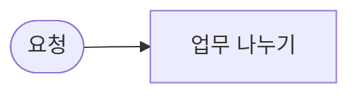

# Multi-Agent 설계서 · 사내 업무 도우미

- 이름:
- 사용한 CLI 에이전트: codex / claude / agy
- 이 파일을 `my-work/DESIGN.md`로 복사해 채웁니다.

## 1. 업무 분석표 (Lab 01 예제 1)

| 요청 | 업무 | 유형 (it · meeting · other) | 필요한 입력 | 요청에 있나 | 업무 관계 (독립 · 순서) |
| --- | --- | --- | --- | --- | --- |
| `composite` |  |  |  |  |  |
| `two-it` |  |  |  |  |  |
| `it-and-other` |  |  |  |  |  |
| `meeting-no-notes` |  |  |  |  |  |
| 내 업무에서 하나 |  |  |  |  |  |

## 2. Agent 목록과 계약 (Lab 02 예제 1)

| Agent | 맡는 업무 | 웹훅 | 입력 | 결과 | 실패할 때 돌려주는 것 |
| --- | --- | --- | --- | --- | --- |
|  |  |  |  |  |  |

## 3. 흐름도 (mermaid)



## 4. 통합 응답 형식

```json
{"count": 0, "results": [{"index": 1, "type": "", "text": "", "agent": "", "route": "", "answer": ""}], "reply": ""}
```

## 5. 예외 경로 (Lab 03)

| 상황 | 라우터가 할 일 | 확인한 테스트 |
| --- | --- | --- |
| 필요한 입력이 없음 |  |  |
| 담당 Agent가 꺼짐 |  |  |
| 맡을 Agent가 없는 업무 |  |  |

## 6. 확장 계획 (Lab 03 과제, 측정값으로)

| 측정 | 값 (`runs/` 보고서) |
| --- | --- |
| IT 하나 |  초 |
| 회의록 하나 |  초 |
| 복합 요청 (업무 3개) |  초 |

- 직원 21명이 동시에 복합 요청을 보내면 어디가 먼저 막히나?
- 수직 확장(더 큰 서버)과 수평 확장(n8n 작업자 여러 개, Agent별 분리) 중 무엇을 먼저 하나? 이유는?
