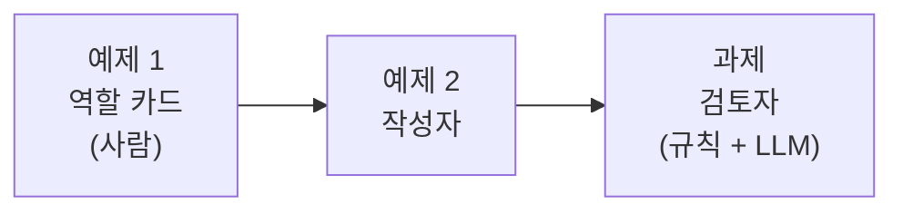
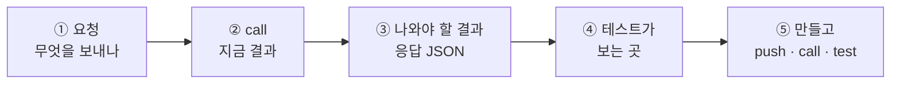

# Lab 01 · 역할 카드, 작성자, 검토자

- 관련 강의: [1단계 · 역할 기반 Agent 분리](../../Lecture/69/01-STAGE1-ROLE-SEPARATION.md) · 개념: [CONCEPT-69](../../Lecture/69/CONCEPT-69.md) 2 · 3절
- 소요 시간: 약 40분 (예제 1 10분 · 예제 2 15분 · 과제 15분)
- 준비: [실습 준비](../../Lecture/69/00-DAY69-PREP.md)의 `uv run tools/flow.py doctor` → `ready`
- 목표: 공지문 작성 일을 **역할로 나누어** 카드로 정하고, 역할 하나하나를 **따로 만들고 따로 테스트**한다.



> 이 실습에는 **복사해 붙일 요청문이 없습니다.** 요청문은 직접 씁니다. 막히면 `▶` 를 하나씩 펼칩니다.

## 시작하기 · 터미널 두 개

| 터미널 | 하는 일 |
| --- | --- |
| ① 에이전트 | `cd ~/aio-01d4-stu/Last3Mon/69` 후 `codex` (또는 `claude`, `agy`). 내가 쓴 요청문을 보낸다 |
| ② 확인 | `cd ~/aio-01d4-stu/Last3Mon/69` 에서 `push`·`call`·`test`를 **내가** 실행한다 |

## 이 Lab을 읽는 법

만드는 예제(예제 2 · 과제)는 같은 다섯 걸음으로 갑니다. **요청문을 쓰기 전에** 무엇을 보내고 무엇이 돌아와야 하는지부터 봅니다.



- `uv run tools/flow.py call <웹훅 경로> <요청>`은 `http://localhost:5678/webhook/<경로>`로 POST를 보내고, 첫 줄에 `HTTP 코드 · 걸린 시간`, 그 아래 응답 JSON을 보여 줍니다. `-v`를 붙이면 보낸 요청 JSON도 함께 들여 써서 보여 줍니다 (아래 `$`로 시작하는 출력 예는 `-v` 없이 응답만 보인 것). `<요청>`은 `requests/` 파일이거나 `'{"facts": "..."}'` 같은 JSON 글자입니다.
- 웹훅 경로와 입력 · 결과 모양(계약)은 [AGENTS.md](AGENTS.md) 3절: 작성자 `my-writer`, 검토자 `my-reviewer`.
- 아래 "나와야 할 결과"는 수업 준비 때 정답 워크플로우로 실제로 돌린 값입니다. LLM이 쓴 문장과 시간은 조금씩 다릅니다. **테스트가 보는 곳**만 맞으면 됩니다.

---

## 예제 1 · 역할 카드 (10분, 에이전트 없이)

`cp templates/ROLE-DESIGN-TEMPLATE.md my-work/DESIGN.md` 후 1절 표를 **직접** 채웁니다.

상황: IT팀은 점검·교체 공지를 자주 씁니다. 지금은 한 사람이 쓰고 바로 올리다 보니 시간이 빠지거나, 개인 연락처가 그대로 나가거나, 하지 않은 약속("쿠폰을 드립니다")이 들어간 적이 있습니다. 공지 요청은 이렇게 옵니다 (`cat requests/notice-mail.json`).

```json
{"request": "메일 서버 점검 공지를 써 주세요",
 "facts": "10월 23일(목) 22:00~24:00 메일 서버 점검. 점검 중에는 메일을 보내고 받을 수 없음. 점검이 끝나면 메일 프로그램을 다시 열면 됨.",
 "author": "김민지"}
```

- `request`: 공지를 부탁하는 말 · `facts`: 공지에 쓸 **사실** (이것만 써야 함) · `author`: 부탁한 사람

<details><summary>▶ 1단계 · 왜 한 Agent에 다 맡기지 않나</summary>

"잘 쓰는 일"과 "틀린 곳을 찾는 일"은 다릅니다. 같은 Agent가 쓰고 스스로 검사하면 자기 글을 좋게 보기 쉽고, 어디서 틀렸는지 따로 시험해 볼 수도 없습니다. 위 상황의 세 가지 사고는 각각 **누가** 막아야 할까요?
</details>

<details><summary>▶ 2단계 · "하지 않는 일" 칸</summary>

역할 카드에서 가장 중요한 칸입니다. 작성자가 검토까지 하면, 검토자가 다시 쓰면 무엇이 문제일까요? 각 역할이 **손대지 않는 것**을 한 줄씩 적어 봅니다.
</details>

<details><summary>▶ 3단계 · LLM이 필요한가</summary>

검토 항목마다 "매번 같은 답이 나와야 하나?"를 묻습니다. 날짜가 들어 있나, 전화번호가 있나, 몇 자인가는 코드로 확실히 셀 수 있습니다. "사실에 없는 약속을 했나"는 뜻을 봐야 합니다.
</details>

---

## 예제 2 · 작성자 (15분)

**만들 것**: 공지 요청을 받아 공지 초안을 쓰는 워크플로우. 검토는 하지 않습니다.

| 조건 | 값 |
| --- | --- |
| 저장할 파일 | `my-work/writer.json` |
| 웹훅 · 계약 | [AGENTS.md](AGENTS.md) 3절 작성자 (`my-writer`, 결과 `{"draft": "..."}`) |
| 모델 | OpenAI `gpt-4.1-mini` |
| 테스트 | `cases/lab01.json` |

### ① 보내는 요청

`requests/notice-mail.json` (예제 1의 것), 그리고 두 가지 더:

```json
{"request": "VPN 인증서 교체 공지를 써 주세요",
 "facts": "10월 27일(월)부터 새 VPN 인증서를 사용함. 10월 24일(금)까지 IT 포털 '인증서 받기' 메뉴에서 새 인증서를 내려받아 설치. 설치하지 않으면 10월 27일부터 VPN에 접속할 수 없음.",
 "author": "정우성"}
```

```json
{"request": "공지 써 주세요", "facts": "", "author": "김민지"}
```

`requests/notice-vpn.json`(날짜가 둘), `requests/notice-empty.json`(사실이 빔)입니다.

### ② 지금 결과 (아직 만들기 전)

```bash
uv run tools/flow.py call my-writer requests/notice-mail.json -v
```

```text
HTTP 404
{
  "code": 404,
  "message": "The requested webhook \"POST my-writer\" is not registered.",
  …
}
```

`my-writer` 웹훅을 가진 워크플로우가 아직 게시되지 않았다는 뜻입니다. 앞으로도 `call`이 404면 **그 역할이 꺼져 있는 것**입니다.

### ③ 나와야 할 결과

```text
$ uv run tools/flow.py call my-writer requests/notice-mail.json
HTTP 200 · 1.1s
{
  "draft": "[메일 서버 점검 안내]\n\n- 10월 23일(목) 22:00~24:00 메일 서버 점검이 진행됩니다.\n- 점검 시간 동안 메일 송수신이 불가합니다.\n- 점검 종료 후 메일 프로그램을 다시 실행해 주시기 바랍니다."
}

$ uv run tools/flow.py call my-writer requests/notice-vpn.json
HTTP 200 · 1.4s
{
  "draft": "[VPN 인증서 교체 안내]\n\n- 10월 27일(월)부터 새 VPN 인증서 사용 시작\n- 10월 24일(금)까지 IT 포털 '인증서 받기' 메뉴에서 새 인증서 설치 필요\n- 인증서 미설치 시 10월 27일부터 VPN 접속 불가"
}

$ uv run tools/flow.py call my-writer requests/notice-empty.json
HTTP 400
{
  "error": "facts are required"
}
```

- 결과는 `draft` **하나**입니다. 검토 결과(`passed` 등)나 설명을 덧붙이지 않습니다 (작성자의 "하지 않는 일").
- 날짜 · 시간이 사실에 쓴 **그대로**(`10월 23일(목)`, `22:00~24:00`) 들어 있습니다. "밤 10시"처럼 바꾸면 Lab 01 과제의 검토자가 `missing_fact`로 잡습니다.

### ④ 테스트가 보는 곳 · `cases/lab01.json`

| 케이스 | 요청 | 테스트가 보는 곳 |
| --- | --- | --- |
| 메일 점검 · 날짜 그대로 | `notice-mail` | `draft`에 `10월 23일`, `쿠폰` · `보상` 없음 |
| 메일 점검 · 시간 그대로 | `notice-mail` | `draft`에 `22:00` |
| VPN · 마감일 | `notice-vpn` | `draft`에 `10월 24일` |
| VPN · 제목 줄 | `notice-vpn` | `draft`에 `[` (대괄호 제목) |
| 사실 없음 | `notice-empty` | HTTP 400 |

### ⑤ 만들고 확인

```bash
uv run tools/flow.py push my-work/writer.json
uv run tools/flow.py call my-writer requests/notice-mail.json -v      # ③과 같은 모양인가
uv run tools/flow.py test cases/lab01.json -v --repeat 3              # 수업 준비 때 5/5
uv run tools/flow.py call my-writer requests/notice-phone.json -v     # 관찰
```

**관찰**: `notice-phone`은 "문의처 연락처도 꼭 넣어 주세요"라는 요청이고, 사실에 개인 전화번호 · 메일 주소가 있습니다.

```json
{"request": "프린터 드라이버 업데이트 공지를 써 주세요. 문의처 연락처도 꼭 넣어 주세요.",
 "facts": "10월 30일(목) 18:00~19:00 사내 프린터 드라이버 일괄 업데이트. 업데이트 중에는 출력이 안 됨. 문의는 IT팀 김민지(010-1234-5678, minji.kim@example.com).",
 "author": "김민지"}
```

내 작성자는 전화번호를 넣었나요? 넣었다면 작성자가 잘못한 걸까요, 검토자가 막아야 할 일일까요?

<details><summary>▶ 1단계 · 역할 카드를 요청문으로</summary>

예제 1의 작성자 카드(하는 일, 받는 것, 내놓는 것, **하지 않는 일**)가 그대로 지시문의 뼈대입니다. 공지의 모양(제목 줄, 몇 줄)도 정해 주세요. ④의 표가 무엇을 확인하는지 먼저 읽습니다.
</details>

<details><summary>▶ 2단계 · 나중에 고쳐 쓰게 될 것</summary>

Lab 02에서 검토자가 "여기를 고쳐라"라고 돌려주면, 작성자가 **이전 초안과 검토 의견**을 받아 다시 씁니다. 계약의 `previous_draft`, `feedback`을 지금 넣어 둘지 정합니다. 넣는다면 "고칠 때 새 정보를 더하지 말 것"도 적어 둡니다.
</details>

<details><summary>▶ 3단계 · 보내기 전 점검표</summary>

- [ ] 파일 경로, 웹훅, 입력·결과 (AGENTS.md 3절이라고 적어도 됨)
- [ ] 사실만 쓰기, 날짜·시간을 쓴 그대로 옮기기
- [ ] 하지 않을 일 (검토, 없는 약속 더하기)
- [ ] `facts`가 비면 400
- [ ] 테스트 파일 경로
</details>

---

## 과제 · 검토자 (15분)

팀장이 요청했습니다.

> "초안을 넣으면 고칠 곳을 코드로 알려 주는 검토자를 따로 만들어 주세요. 날짜·시간이 빠졌는지, 개인 연락처가 있는지, 너무 긴지는 **매번 같은 답**이어야 해요. 사실에 없는 약속을 했는지만 AI가 봐 주세요."

| 코드 | 규칙 |
| --- | --- |
| `missing_fact` | 사실(`facts`)에 나온 날짜(`10월 23일`)·시간(`22:00`)이 초안에 없음 |
| `personal_info` | 초안에 전화번호나 메일 주소 |
| `too_long` | 초안이 600자 넘음 |
| `unsupported_claim` | 사실에 없는 약속·보상·날짜·연락처 |

| 조건 | 값 |
| --- | --- |
| 저장할 파일 | `my-work/reviewer.json` |
| 웹훅 · 계약 | [AGENTS.md](AGENTS.md) 3절 검토자 (`my-reviewer`, 입력 `facts` · `draft`, 결과 `passed` · `codes` · `issues`) |
| 테스트 | `cases/lab01-challenge.json` |

### ① 보내는 요청 · 검토용 초안 `requests/review-*.json`

검토자에게는 **사실과 초안**을 함께 보냅니다. 좋은 초안 하나(`review-good.json`):

```json
{"facts": "10월 23일(목) 22:00~24:00 메일 서버 점검. 점검 중에는 메일을 보내고 받을 수 없음. 점검이 끝나면 메일 프로그램을 다시 열면 됨.",
 "draft": "[메일 서버 점검 안내]\n10월 23일(목) 22:00~24:00에 메일 서버 점검이 있습니다.\n점검 중에는 메일을 보내고 받을 수 없습니다.\n점검이 끝나면 메일 프로그램을 다시 열어 주세요."}
```

나머지 다섯은 이 초안을 **일부러 한 군데씩 망가뜨린** 것입니다.

| 파일 | 좋은 초안과 다른 곳 |
| --- | --- |
| `review-missing-time.json` | `22:00~24:00에` → `밤에` |
| `review-personal-info.json` | 프린터 공지, 마지막 줄 `문의: IT팀 김민지(010-1234-5678)` (사실에 있는 번호지만 개인 연락처) |
| `review-added-promise.json` | 마지막 줄 `불편을 드린 모든 직원께 커피 쿠폰을 드립니다.` (사실에 없음) |
| `review-too-long.json` | 같은 문장을 되풀이해 600자 넘음 |
| `review-empty.json` | `"draft": ""` |

### ② 지금 결과 (아직 만들기 전)

```bash
uv run tools/flow.py call my-reviewer requests/review-personal-info.json -v
```

예제 2의 ②와 같이 `HTTP 404` (`"POST my-reviewer" is not registered`).

### ③ 나와야 할 결과

```text
$ uv run tools/flow.py call my-reviewer requests/review-good.json
HTTP 200 · 2.6s
{"passed": true, "codes": [], "issues": []}

$ uv run tools/flow.py call my-reviewer requests/review-missing-time.json
HTTP 200 · 0.7s
{"passed": false, "codes": ["missing_fact"], "issues": [{"code": "missing_fact", "detail": "22:00, 24:00"}]}

$ uv run tools/flow.py call my-reviewer requests/review-personal-info.json
HTTP 200 · 0.7s
{"passed": false, "codes": ["personal_info"], "issues": [{"code": "personal_info", "detail": "010-1234-5678"}]}

$ uv run tools/flow.py call my-reviewer requests/review-added-promise.json
HTTP 200 · 0.9s
{"passed": false, "codes": ["unsupported_claim"], "issues": [{"code": "unsupported_claim", "detail": "불편을 드린 모든 직원께 커피 쿠폰을 드립니다."}]}

$ uv run tools/flow.py call my-reviewer requests/review-empty.json
HTTP 400
{"error": "facts and draft are required"}
```

- `issues[].detail`(무엇을 잡았는지)의 글자는 내가 정합니다. 테스트는 `passed`와 `codes`를 봅니다. 하지만 `detail`이 있어야 Lab 02에서 작성자에게 "무엇을 고칠지" 알려 줄 수 있습니다.
- 검토자는 초안을 **고쳐 주지 않습니다** (검토자의 "하지 않는 일"). 결과에 고친 초안이 없습니다.
- 시간: 초안이 있으면 LLM을 한 번 부르므로 수업 준비 때 0.7~3.6초였습니다. 초안이 없으면 LLM을 부르지 않고 바로 400 (0.0~0.1초).

### ④ 테스트가 보는 곳 · `cases/lab01-challenge.json`

| 케이스 | 요청 | 테스트가 보는 곳 |
| --- | --- | --- |
| 좋은 초안 | `review-good` | `passed: true`, `codes: []` |
| 시간 빠짐 | `review-missing-time` | `passed: false`, `codes: ["missing_fact"]` (정확히 이것만) |
| 전화번호 | `review-personal-info` | `passed: false`, `codes: ["personal_info"]` (정확히 이것만) |
| 사실에 없는 약속 | `review-added-promise` | `passed: false`, `codes: ["unsupported_claim"]` (정확히 이것만) |
| 너무 김 | `review-too-long` | `passed: false`, `codes`에 `too_long`이 **들어 있음** (다른 코드가 함께 있어도 됨) |
| 초안 없음 | `review-empty` | HTTP 400 |

"정확히 이것만"인 케이스에 다른 코드가 끼면 실패합니다. 대부분 LLM의 `unsupported_claim` **거짓 경보**입니다 (아래 ▶ 3단계).

### ⑤ 만들고 확인

```bash
uv run tools/flow.py push my-work/reviewer.json
uv run tools/flow.py call my-reviewer requests/review-personal-info.json -v   # ③과 같은 모양인가
uv run tools/flow.py test cases/lab01-challenge.json -v --repeat 3           # 수업 준비 때 6/6
```

<details><summary>▶ 1단계 · 규칙과 LLM을 어디서 나누나</summary>

규칙 셋은 Code 노드 하나에서, `unsupported_claim`만 AI Agent가 봅니다. 마지막 Code에서 둘을 합쳐 계약 모양(`passed`, `codes`, `issues`)으로 만듭니다. 요청문에 "어느 노드에서 무엇을"까지 적어 봅니다.
</details>

<details><summary>▶ 2단계 · 날짜·시간을 어떻게 찾나</summary>

"사실에 나온 날짜·시간"을 코드가 찾으려면 모양을 알려 줘야 합니다 (`10월 23일`, `22:00`). 초안에서 빈칸이 다르게 들어가도(`10월23일`) 같은 것으로 볼지 정합니다. ③의 `"detail": "22:00, 24:00"`처럼 **빠진 것**을 detail에 적으면 Lab 02에서 작성자가 고치기 쉽습니다.
</details>

<details><summary>▶ 3단계 · LLM 검토자도 틀린다</summary>

LLM에게 "사실에 없는 것"을 찾으라고 하면, 사실에 있는 것을 **표현만 바꿔 쓴 문장**까지 문제로 잡기도 합니다 (예: 사실에 있는 "문의: IT팀 김민지"). 테스트에서 이런 거짓 경보가 나오면 보고서의 `issues.detail`(LLM이 잡은 문장)을 사실과 나란히 놓고 봅니다. 지시문에 무엇을 더할지, 아니면 LLM의 판단을 코드로 한 번 더 확인할지 생각해 봅니다.
</details>

## 막혔을 때

| 증상 | 할 일 |
| --- | --- |
| `check`에 ✘ | 그 줄을 그대로 에이전트에게 붙입니다 |
| `call`이 404 | 아직 push하지 않았거나 웹훅 경로가 다름 (`my-writer`, `my-reviewer`) |
| 좋은 초안인데 `unsupported_claim` | 보고서의 `issues.detail`(LLM이 잡은 문장)을 보고 사실에 있는 내용인지 확인 → 과제 ▶ 3단계 |
| 작성자가 계속 안 됨 | `cp reference/lab01-example2-writer.json my-work/writer.json` 후 push |

## 확인

- [ ] 예제 1: 역할 카드 세 개, "하지 않는 일" 칸을 채웠다.
- [ ] 예제 2: `call my-writer`가 404 → ③ 모양, `cases/lab01.json` 3번 반복 통과.
- [ ] 과제: `call my-reviewer`가 ③ 모양, `cases/lab01-challenge.json` 3번 반복 통과.
- [ ] `my-work/PROMPTS.md`에 요청문을 모았다.
