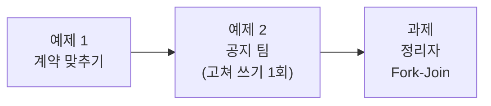
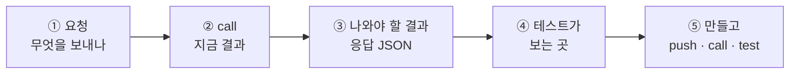

# Lab 02 · 작성 → 검토 → 고쳐 쓰기, 정리자 Fork-Join

- 관련 강의: [2단계 · 업무 분배와 협업 워크플로우](../../Lecture/69/02-STAGE2-COLLABORATION.md) · 개념: [CONCEPT-69](../../Lecture/69/CONCEPT-69.md) 1 · 4 · 6절
- 소요 시간: 약 70분 (예제 1 10분 · 예제 2 25분 · 과제 35분)
- 준비: Lab 01의 `my-work/writer.json`, `my-work/reviewer.json`이 push되어 있어야 합니다. 검토자가 없으면 `cp reference/lab02-start-reviewer.json my-work/reviewer.json` 후 push.
- 목표: 역할들이 **정해진 순서로 이어서** 일하는 공지 팀을 만든다. 고쳐 쓰기는 **한 번만**, 그래도 안 되면 사람에게. 정리자 둘은 서로 기다리지 않게 **갈래를 나눠**(Fork) 돌리고 다시 모은다(Join).



> 복사해 붙일 요청문은 없습니다. 막히면 `▶` 를 하나씩 펼칩니다.

## 이 Lab을 읽는 법

Lab 01과 같은 다섯 걸음입니다. 오늘부터는 **역할이 역할을 부르므로**, 공지 팀의 결과가 이상하면 역할을 하나씩 직접 `call` 해서 어디서 달라졌는지 봅니다.



- 명령은 모두 `~/aio-01d4-stu/Last3Mon/69`에서, `uv run tools/flow.py call <웹훅 경로> <요청>` (첫 줄 `HTTP 코드 · 걸린 시간`, 그 아래 응답 JSON. `-v`를 붙이면 보낸 요청 JSON도 함께. `$`로 시작하는 출력 예는 `-v` 없이 응답만).
- 웹훅 경로 ([AGENTS.md](AGENTS.md) 3절): 작성자 `my-writer`, 검토자 `my-reviewer`, 공지 팀 `my-notice`.
- 아래 "나와야 할 결과"는 수업 준비 때 정답 워크플로우로 실제로 돌린 값입니다. LLM이 쓴 문장과 시간은 조금씩 다릅니다.

---

## 예제 1 · 계약 맞추기 (10분)

공지 팀은 작성자와 검토자를 **HTTP로** 부릅니다. 부르기 전에 두 역할이 계약대로 답하는지 직접 봅니다.

### ① 보내는 요청 · `requests/notice-phone.json`, `requests/review-personal-info.json`

```json
{"request": "프린터 드라이버 업데이트 공지를 써 주세요. 문의처 연락처도 꼭 넣어 주세요.",
 "facts": "10월 30일(목) 18:00~19:00 사내 프린터 드라이버 일괄 업데이트. 업데이트 중에는 출력이 안 됨. 문의는 IT팀 김민지(010-1234-5678, minji.kim@example.com).",
 "author": "김민지"}
```

`review-personal-info.json`은 같은 사실과, 마지막 줄이 `문의: IT팀 김민지(010-1234-5678)`인 초안입니다 (Lab 01 과제).

### ② · ③ 두 역할을 직접 부르기

```bash
uv run tools/flow.py push my-work/writer.json my-work/reviewer.json
uv run tools/flow.py call my-writer requests/notice-phone.json -v
uv run tools/flow.py call my-reviewer requests/review-personal-info.json -v
```

```text
HTTP 200 · 0.7s
{"passed": false, "codes": ["personal_info"], "issues": [{"code": "personal_info", "detail": "010-1234-5678"}]}
```

| 확인 | 왜 |
| --- | --- |
| 작성자 결과에 `draft` 하나 | 공지 팀이 `$json.draft`로 읽음 |
| 검토자 결과에 `passed`(불리언), `codes`(목록), `issues[].detail` | 공지 팀이 `passed`로 갈림길을, `issues`로 고쳐 쓰기 의견을 만듦 |
| 작성자에게 `previous_draft`, `feedback`을 주면 고쳐 쓰나 | 아래 ④에서 직접 |

### ④ 고쳐 쓰기를 직접 시험하기

`call` 뒤에 JSON을 직접 씁니다. 위 검토 결과의 `issues`를 `feedback` 글자로, 처음 초안을 `previous_draft`로 넣습니다.

```bash
uv run tools/flow.py call my-writer '{"request": "프린터 드라이버 업데이트 공지를 써 주세요. 문의처 연락처도 꼭 넣어 주세요.", "facts": "10월 30일(목) 18:00~19:00 사내 프린터 드라이버 일괄 업데이트. 업데이트 중에는 출력이 안 됨. 문의는 IT팀 김민지(010-1234-5678, minji.kim@example.com).", "previous_draft": "[프린터 드라이버 업데이트 안내]\n10월 30일(목) 18:00~19:00에 사내 프린터 드라이버를 일괄 업데이트합니다.\n업데이트 중에는 출력이 안 됩니다.\n문의: IT팀 김민지(010-1234-5678)", "feedback": "personal_info: 010-1234-5678"}' -v
```

나와야 할 모양 (수업 준비 때 공지 팀 안에서 고쳐 쓴 결과의 마지막 줄):

```text
{"draft": "[프린터 드라이버 업데이트 안내]\n…\n문의는 IT팀 김민지에게 연락 바랍니다."}
```

- 번호 · 메일 주소가 **빠지고**, 날짜 · 시간은 **그대로**, 그리고 **새로 생긴 정보가 없어야** 합니다. 수업 준비 때 한 번은 작성자가 지운 번호 대신 `(내선 1234)`를 지어냈습니다.
- 고쳐 쓰지 않고 처음과 같은 초안이 오면 작성자가 `previous_draft` · `feedback`을 읽지 않는 것입니다. 공지 팀을 만들기 **전에** 작성자부터 고칩니다.

<details><summary>▶ 1단계 · 계약이 안 맞으면</summary>

결과 칸 이름이 다르면(`text` 대신 `draft`, `ok` 대신 `passed`) 공지 팀 쪽에서 맞추지 말고 **그 역할을** 계약대로 고칩니다. 그래야 다른 사람의 역할(`reference/lab02-start-reviewer.json`)과도 바꿔 끼울 수 있습니다.
</details>

---

## 예제 2 · 공지 팀 (25분)

**만들 것**: 공지 요청을 받아 작성자 → 검토자 순으로 부르고, 통과하지 못하면 검토 의견을 주어 **한 번** 고쳐 쓰게 한 뒤 다시 검토하는 워크플로우.

| 조건 | 값 |
| --- | --- |
| 저장할 파일 | `my-work/notice.json` (오늘 끝까지 이 파일을 고쳐 나감) |
| 웹훅 · 계약 | [AGENTS.md](AGENTS.md) 3절 공지 팀 (`my-notice`) |
| 결과 | 한 번에 통과 `게시 가능` · 고쳐서 통과 `수정 후 게시 가능` · 고쳐도 실패 `담당자 확인`. `published`, `rounds`, `notice`, `codes` (고쳐 썼으면 `first_codes`) |
| 테스트 | `cases/lab02.json` |

### ① 보내는 요청

Lab 01과 같은 공지 요청 넷: `requests/notice-mail.json`, `notice-vpn.json`, `notice-phone.json`, `notice-empty.json`. 공지 팀이 받는 것은 **작성자와 같은** 요청입니다.

### ② 지금 결과 (아직 만들기 전)

```bash
uv run tools/flow.py call my-notice requests/notice-phone.json -v
```

`HTTP 404` (`"POST my-notice" is not registered`).

### ③ 나와야 할 결과

```text
$ uv run tools/flow.py call my-notice requests/notice-mail.json
HTTP 200 · 2.0s
{
  "route": "게시 가능",
  "published": true,
  "rounds": 1,
  "notice": "[메일 서버 점검 안내]  \n10월 23일(목) 22:00~24:00 메일 서버 점검이 진행됩니다.  \n…",
  "codes": []
}

$ uv run tools/flow.py call my-notice requests/notice-phone.json
HTTP 200 · 4.1s
{
  "route": "수정 후 게시 가능",
  "published": true,
  "rounds": 2,
  "notice": "[프린터 드라이버 업데이트 안내]\n\n10월 30일(목) 18:00~19:00 사내 프린터 드라이버가 일괄 업데이트됩니다.  \n업데이트 시간 동안에는 프린터 출력이 불가합니다.  \n문의는 IT팀 김민지에게 연락 바랍니다.",
  "codes": [],
  "first_codes": ["personal_info"]
}

$ uv run tools/flow.py call my-notice requests/notice-empty.json
HTTP 400
{"error": "facts are required"}
```

- 프린터 공지는 첫 검토에서 `personal_info`(`first_codes`)로 걸리고, 고쳐 쓴 뒤 두 번째 검토를 통과했습니다 (`codes: []`, `rounds: 2`). 시간이 두 배쯤인 이유입니다 (LLM 4번).
- 고쳐도 실패하면: `"route": "담당자 확인"`, `"published": false`, `codes`는 **두 번째** 검토의 코드.

### ④ 테스트가 보는 곳 · `cases/lab02.json`

| 케이스 | 요청 | 테스트가 보는 곳 |
| --- | --- | --- |
| 메일 점검 · 게시 | `notice-mail` | `published: true`, `codes: []`, `route`에 `게시 가능`, `notice`에 `22:00` |
| VPN · 게시 | `notice-vpn` | `published: true`, `codes: []`, `notice`에 `10월 24일` |
| 연락처가 든 사실 · 고쳐서 게시 | `notice-phone` | `published: true`, `codes: []`, `route`에 `게시 가능`, `notice`에 `010-1234-5678` · `minji.kim@example.com` 없음 |
| 사실 없음 | `notice-empty` | HTTP 400 |

### ⑤ 만들고 확인

```bash
uv run tools/flow.py push my-work/notice.json
uv run tools/flow.py call my-notice requests/notice-phone.json -v   # ③과 같은 모양인가
uv run tools/flow.py test cases/lab02.json -v                       # 수업 준비 때 4/4 (처음엔 검토자 거짓 경보로 3/4)
```

**관찰**: `notice-phone`에서 고쳐 쓴 공지를 처음 초안과 비교해 봅니다. 전화번호만 빠졌나요, 다른 것도 바뀌었나요? n8n **Executions**에서 `my-notice` 한 번에 `my-writer`, `my-reviewer` 실행이 몇 개씩 생겼나요?

<details><summary>▶ 1단계 · 흐름을 먼저 그리기</summary>

`DESIGN.md` 3절에 mermaid로 그립니다. 작성 → 검토 → 통과? → (예) 게시 / (아니오) 고쳐 쓰기 → 다시 검토 → 통과? 각 화살표에 **무엇이 넘어가는지**(draft, issues)를 적습니다. ③의 결과 셋이 그림의 어느 끝인지 표시합니다.
</details>

<details><summary>▶ 2단계 · 왜 "한 번만"인가</summary>

"통과할 때까지 고쳐라"라고 하면 어떻게 될까요? 작성자와 검토자가 끝없이 주고받거나, 고칠수록 이상한 글이 될 수 있습니다. 고쳐 쓰기 횟수와 그 뒤에 할 일을 요청문에 정확히 적습니다. n8n에서 같은 역할을 두 번 부르는 방법은 [AGENTS.md](AGENTS.md) 5절 HTTP Request의 주의를 봅니다.
</details>

<details><summary>▶ 3단계 · 넘기는 값의 출처</summary>

다시 검토할 때 검토자에게 주는 `facts`는 어디서 가져오나요? 고쳐 쓴 작성자가 사실을 바꿔 전했다면? 사실은 **처음 요청에서** 가져와야 검토가 의미가 있습니다. `feedback`은 검토 결과의 무엇으로 만들지도 정합니다 (예제 1 ④에서 직접 넣어 본 모양).
</details>

<details><summary>▶ 4단계 · 보내기 전 점검표</summary>

- [ ] 새 파일, 웹훅, 부를 역할 둘의 주소
- [ ] 고쳐 쓰기 1회와 결과 세 가지(route 값)
- [ ] 각 결과의 필드 (`published`, `rounds`, `notice`, `codes`, `first_codes`)
- [ ] `facts`의 출처, `feedback` 만드는 법
- [ ] `cases/lab02.json`
</details>

---

## 과제 · 정리자 둘을 나눠 돌리고 모으기 (35분)

팀장이 요청했습니다.

> "통과한 공지는 메일로도, 메신저로도 보내요. 메일 제목 한 줄, 메신저용 짧은 글을 같이 만들어 주세요. 둘은 서로 상관없으니 기다리지 말고 동시에요."

| 조건 | 값 |
| --- | --- |
| 고칠 파일 | `my-work/notice.json` |
| 새 필드 | `title` (메일 제목, 40자 이내), `chat` (메신저 글, 2줄 · 120자 이내, 날짜·시간 그대로) |
| 언제 | 통과한 공지만 (`게시 가능`, `수정 후 게시 가능`). `담당자 확인`이면 만들지 않음 |
| 테스트 | `cases/lab02-challenge.json`, 그리고 `cases/lab02.json`도 계속 통과 |

### ① 보내는 요청 · 예제 2와 같음

### ② 지금 결과 (예제 2 완성본)

예제 2 ③과 같습니다. `title`, `chat` 칸이 **없습니다.**

### ③ 나와야 할 결과

```text
$ uv run tools/flow.py call my-notice requests/notice-mail.json
HTTP 200 · 6.5s
{
  "route": "게시 가능",
  "published": true,
  "rounds": 1,
  "notice": "[메일 서버 점검 안내]\n\n- 10월 23일(목) 22:00~24:00 메일 서버 점검이 진행됩니다.\n- …",
  "codes": [],
  "title": "10월 23일 메일 서버 점검 안내드립니다",
  "chat": "10월 23일(목) 22:00~24:00 메일 서버 점검으로 송수신 불가, 종료 후 프로그램 재실행 바랍니다."
}

$ uv run tools/flow.py call my-notice requests/notice-phone.json
HTTP 200 · 5.8s
{
  "route": "수정 후 게시 가능",
  …
  "first_codes": ["personal_info"],
  "title": "10월 30일 프린터 드라이버 업데이트 안내",
  "chat": "10/30(목) 18:00~19:00 프린터 드라이버 업데이트로 출력 불가. 문의: IT팀 김민지."
}
```

- 예제 2의 칸은 **그대로** 두고 `title`, `chat`만 더합니다 (`lab02`가 계속 통과해야 함).
- `chat`에도 개인 연락처가 없어야 합니다. 정리자가 줄이면서 지운 번호를 되살리면 검토가 소용없습니다.

### ④ 테스트가 보는 곳 · `cases/lab02-challenge.json`

| 케이스 | 요청 | 테스트가 보는 곳 |
| --- | --- | --- |
| 메일 점검 · 제목과 메신저 | `notice-mail` | `published: true`, `title`에 `점검`, `chat`에 `10월 23일`, `chat`에 `쿠폰` 없음 |
| VPN · 메신저에 마감일 | `notice-vpn` | `chat`에 `10월 24일`, `title`에 `VPN` 또는 `인증서` |
| 고쳐서 게시 · 메신저에도 연락처 없음 | `notice-phone` | `published: true`, `chat` · `notice`에 `010-1234-5678` · `minji.kim@example.com` 없음 |
| 사실 없음 | `notice-empty` | HTTP 400 |

### ⑤ 만들고 확인

```bash
uv run tools/flow.py push my-work/notice.json
uv run tools/flow.py call my-notice requests/notice-mail.json -v            # ③과 같은 모양인가
uv run tools/flow.py test cases/lab02-challenge.json -v --repeat 3          # 수업 준비 때 4/4
uv run tools/flow.py test cases/lab02.json -v                               # 4/4 그대로
```

<details><summary>▶ 1단계 · Fork-Join</summary>

한 노드에서 두 노드로 함께 보내고(Fork), 둘이 끝나면 하나로 모읍니다(Join). [AGENTS.md](AGENTS.md) 5·6절의 Merge와 연결 예를 봅니다. 통과한 길이 두 개(`게시 가능`, `수정 후 게시 가능`)인데, 정리자를 두 번 만들지 않으려면?
</details>

<details><summary>▶ 2단계 · 정리자의 "하지 않는 일"</summary>

정리자가 공지를 줄이면서 날짜를 바꾸거나, 지운 연락처를 되살리면 검토가 소용없어집니다. 정리자에게 무엇을 금지할지, 테스트가 무엇으로 확인하는지(④의 `not_contains`) 봅니다. 정리자 결과는 다시 검토하지 않아도 될까요? 내 생각을 `DESIGN.md`에 적습니다.
</details>

<details><summary>▶ 3단계 · 시간 재기 · 정말 동시에 돌았나</summary>

정리자를 붙이기 전(`lab02` 보고서, 수업 준비 때 2.0~4.1초)과 뒤(`lab02-challenge` 보고서)의 `seconds`를 비교합니다. 그리고 n8n **Executions**에서 `my-notice` 실행 하나를 열어 `Make title`, `Make chat message`(내가 붙인 두 정리자 노드)를 하나씩 눌러 봅니다. 각 노드의 **시작 시각과 걸린 시간**을 적어 보세요.

- 두 노드가 거의 같은 시각에 시작했나요, 하나가 끝난 시각에 다른 하나가 시작했나요?
- 늘어난 시간은 두 정리자 시간의 **합**에 가까운가요, **긴 쪽**에 가까운가요?

설계(서로 기다릴 필요 없음)와 n8n이 실제로 돌리는 방식이 같은지 `DESIGN.md`에 적습니다. 68일차 3단계 교안에서 본 "같은 HTTP 노드의 항목은 함께, 갈래는 차례로"도 떠올려 봅니다.
</details>

## 막혔을 때

| 증상 | 할 일 |
| --- | --- |
| 응답 500 `{"message": "Error in workflow"}` | 부른 역할이 400·404를 돌려줬을 수 있습니다. `call my-writer` · `call my-reviewer`로 하나씩 직접 불러 보고, Executions에서 빨간 노드 확인 (Lab 03에서 다룸) |
| 공지 팀이 404 | 아직 push하지 않았거나 웹훅 경로가 `my-notice`가 아님 |
| 좋은 공지인데 계속 `담당자 확인` | `call my-reviewer`로 그 초안을 직접 검토해 `issues.detail`을 봅니다. 검토자의 거짓 경보일 수 있음 (Lab 01 과제 ▶ 3단계) |
| 고쳐 쓴 공지에 새 번호(내선 등) | 작성자 지시문의 "고칠 때 새 정보를 더하지 않는다"를 확인 (예제 1 ④로 직접 시험) |
| 공지 팀이 계속 안 됨 | `cp reference/lab02-example2-pipeline.json my-work/notice.json` 후 push |

## 확인

- [ ] 예제 1: 두 역할을 직접 불러 계약을 확인하고, 고쳐 쓰기를 `call my-writer '{...}'`로 시험했다.
- [ ] 예제 2: `call my-notice`가 404 → ③ 모양, `cases/lab02.json` 통과, 연락처 공지가 고쳐져 게시된다.
- [ ] 과제: `cases/lab02-challenge.json` 3번 반복 통과, `lab02`도 통과, 두 정리자의 시작 시각을 `DESIGN.md`에 적었다.
