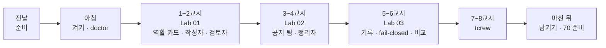
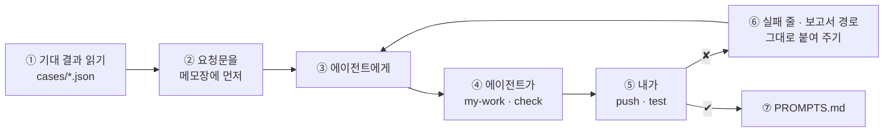

# 69일차 수강 안내 · 수업 준비부터 마칠 때까지

- 일자: 2026-10-21 (수) · 69일차
- 주제: 역할 기반 Agent 분리와 협업 워크플로우 설계 (작성자 · 검토자 · 정리자)
- 실습 폴더: [Last3Mon/69](README.md) · 강의 자료: [Lecture/69](../../Lecture/69/README.md)
- 환경: 65일차 n8n 2.42.6 + **OpenAI API 키만**(`gpt-4.1-mini`) + CLI 코딩 에이전트 하나. 데이터 API는 쓰지 않습니다 (켜 두어도 됨). **Ollama는 쓰지 않습니다.**
- 이 문서: 오늘 하루 내가 할 일을 수업 준비부터 마칠 때까지 순서대로 모은 수강 안내입니다. 수업 중에도 띄워 두고 어디까지 왔는지 확인하세요.



## 0. 하루 한눈에

| 교시 | 시간 | 할 일 | 문서 | 끝났다는 표시 |
| --- | --- | --- | --- | --- |
| 전날 | 약 5분 | 자료 받기 · n8n 켜기 · doctor | [PREP](../../Lecture/69/00-DAY69-PREP.md) (65~68일차를 못 했다면 [PREPARE-69-FROM-65](PREPARE-69-FROM-65.md), 약 25분) | `ready` |
| 1 | 09:00~09:50 | 개요 · 1단계 강의 (역할 기반 Agent 분리) | [개요](../../Lecture/69/00-DAY69-OVERVIEW.md), [1단계](../../Lecture/69/01-STAGE1-ROLE-SEPARATION.md), [개념 정리](../../Lecture/69/CONCEPT-69.md) | |
| 2 | 10:00~10:50 | Lab 01 예제 1 · 2 · 과제 | [Lab 01](LAB-01-Q-ROLE-CARDS.md) | `lab01-challenge` 통과 |
| 3 | 11:00~11:50 | 2단계 강의 · Lab 02 예제 1 · 2 | [2단계](../../Lecture/69/02-STAGE2-COLLABORATION.md), [Lab 02](LAB-02-Q-COLLABORATION.md) | `lab02` 통과 |
| 4 | 12:00~12:50 | Lab 02 과제 35분 (정리자 Fork-Join) · 풀이 | Lab 02 | `lab02-challenge` 통과 |
| - | 13:00~14:00 | 점심 | | |
| 5 | 14:00~14:50 | 3단계 강의 · Lab 03 예제 1 · 2 | [3단계](../../Lecture/69/03-STAGE3-VERIFY-AND-COMPARE.md), [Lab 03](LAB-03-Q-TRACE-AND-COMPARE.md) | `lab03` · `lab03-down` 통과 |
| 6 | 15:00~15:50 | Lab 03 과제 40분 (단일 Agent 비교) · 풀이 | Lab 03 | 비교 숫자 · 보고서 |
| 7 | 16:00~16:50 | 바이브 코딩 `tcrew`: 요청서 → 내 SPEC → 만들기 | [VIBE-REQ-TCREW](VIBE-REQ-TCREW.md) → [VIBE-Q-TCREW](VIBE-Q-TCREW.md) | `SPEC.md` · R1~R5 · `pytest` |
| 8 | 17:00~17:50 | 발표 · 강사 정리 · 강사 바이브 코딩 · 팁 · 70일차 예고 | [진행](../../Lecture/69/04-VIBE-CODING.md) | |

## 1. 전날 준비 (약 5분)

### 1.1 자료 받기

```bash
cd ~/aio-01d4-stu && git pull
```

### 1.2 n8n 켜기 (Ollama는 끔)

```bash
sudo systemctl disable --now ollama 2>/dev/null   # WSL에 설치한 Ollama가 있으면 끄고 자동 시작도 끔
cd ~/aio-01d4-stu/Last3Mon/65/n8n
docker compose rm -sf ollama                      # Ollama 컨테이너가 있으면 지움 (없으면 그냥 지나감)
docker compose start
```

LLM은 **OpenAI API 키**(`Last3Mon/.env`) 하나로 씁니다. n8n은 `start`로 켭니다.

### 1.3 준비 확인

```bash
cd ~/aio-01d4-stu/Last3Mon/69
uv run tools/flow.py doctor        # 마지막 줄 ready (데이터 API는 경고만)
```

### 1.4 미리 읽기 (선택, 5분)

[PREP 3절](../../Lecture/69/00-DAY69-PREP.md): IT팀이 "메일 서버 점검" 공지를 쓴다면 누가 쓰고, 누가 확인하고, 확인하는 사람이 휴가 중이면 공지를 그냥 올릴까?

### 준비물

노트북과 충전기, WSL의 Docker, WSL 창 두 개, 브라우저, 68일차 `~/vibe/tflow` (7교시에 오늘 워크플로우를 열어 봄).

## 2. 수업 당일 아침 (09:00 전)

1. 노트북을 껐다 켰다면 1.2를 다시 합니다.
2. 터미널 두 개, 둘 다 `cd ~/aio-01d4-stu/Last3Mon/69`. ① 에이전트, ② 확인.
3. 터미널 ②에서 `uv run tools/flow.py doctor` → `ready`.
4. `my-work/PROMPTS.md`를 만들어 둡니다.

## 3. 실습할 때마다 같은 순서



- 오늘은 **역할마다 워크플로우 파일이 따로**입니다 (작성자 · 검토자 · 공지 팀). 웹훅과 결과 모양은 [AGENTS.md](AGENTS.md) 3절의 계약을 따릅니다.
- 고칠 때는 **문제가 된 역할의 파일만** 고칩니다.

## 4. 1~2교시 · 1단계 · 역할 카드, 작성자, 검토자

[Lab 01](LAB-01-Q-ROLE-CARDS.md) (약 40분).

| 순서 | 할 일 | 파일 · 웹훅 | 확인 |
| --- | --- | --- | --- |
| 예제 1 (10분, 에이전트 없이) | `cp templates/ROLE-DESIGN-TEMPLATE.md my-work/DESIGN.md` 후 1절 역할 카드를 **직접** (특히 "하지 않는 일") | | 표 |
| 예제 2 (15분) | 작성자: 공지 요청 → 공지 초안 (검토는 안 함) | `my-work/writer.json` · `my-writer` | `push my-work/writer.json` → `test cases/lab01.json --repeat 3`, `call my-writer requests/notice-phone.json` |
| 과제 (15분) | 검토자: 날짜·시간 빠짐 · 개인 연락처 · 길이는 **코드로**, 사실에 없는 약속만 AI가 | `my-work/reviewer.json` · `my-reviewer` | `push my-work/reviewer.json` → `test cases/lab01-challenge.json --repeat 3` |

(명령 앞에는 모두 `uv run tools/flow.py`가 붙습니다.)

- 볼 것: `notice-phone`("문의처 연락처도 꼭 넣어 주세요")에 작성자가 전화번호를 넣었나요? 작성자가 잘못한 건가요, 검토자가 막아야 할 일인가요?

## 5. 3~4교시 · 2단계 · 작성 → 검토 → 고쳐 쓰기, 정리자

[Lab 02](LAB-02-Q-COLLABORATION.md) (약 70분).

| 순서 | 할 일 | 파일 · 웹훅 | 확인 |
| --- | --- | --- | --- |
| 예제 1 (10분) | 작성자 · 검토자의 계약 맞추기 (서로 부를 수 있게) | | `push my-work/writer.json my-work/reviewer.json`, `call my-writer requests/notice-phone.json`, `call my-reviewer requests/review-personal-info.json` |
| 예제 2 (25분) | 공지 팀: 작성자 → 검토자, 통과 못 하면 의견을 주어 **한 번** 고쳐 쓰고 다시 검토 | `my-work/notice.json` · `my-notice` (오늘 끝까지 고쳐 나감) | `push my-work/notice.json` → `test cases/lab02.json`, `call my-notice requests/notice-phone.json` |
| 과제 (35분, 4교시) | 통과한 공지로 메일 제목 한 줄 · 메신저용 짧은 글을 두 정리자가 나눠 만들고 모으기 (Fork-Join) | `my-work/notice.json` 고치기 | `test cases/lab02-challenge.json --repeat 3`, `test cases/lab02.json` |

- 볼 것: 고쳐 쓴 공지에서 전화번호만 빠졌나요, 다른 것도 바뀌었나요? Executions에서 두 정리자 노드의 시작·끝 시각: **정말 동시에 돌았나요?** `DESIGN.md`에 적습니다.

## 6. 5~6교시 · 3단계 · 협업 기록, 검토자가 꺼졌을 때, 단일 Agent와 비교

[Lab 03](LAB-03-Q-TRACE-AND-COMPARE.md) (약 80분).

| 순서 | 할 일 | 확인 |
| --- | --- | --- |
| 예제 1 (20분) | 결과만 보고 협업 과정을 알 수 있게 기록 (`rounds`, `steps`, `first_codes`). `steps`는 LLM이 아니라 워크플로우가 | `push my-work/notice.json` → `test cases/lab03.json` |
| 예제 2 (20분) | 검토자가 꺼지면 **게시하지 않기** (fail-closed) | `off my-reviewer` → `test cases/lab03-down.json`, 고친 뒤 **다시 켜기** `push my-work/reviewer.json` → `test cases/lab02.json`, `test cases/lab03.json --repeat 3` |
| 과제 (40분, 6교시) | 어려운 케이스 `cases/my-cases.json`, 같은 테스트로 AI 하나짜리(단일 Agent)와 숫자로 비교 | `test cases/my-cases.json --repeat 3`, `push reference/lab03-single-agent.json`, `test cases/my-cases.json --webhook my-single --repeat 3` |

- 먼저 생각해 보기: 68일차에는 Agent가 꺼져도 나머지 답을 **계속** 냈습니다. 오늘은 왜 **멈춰야** 할까요?
- 보고서: `cp templates/TEST-REPORT-TEMPLATE.md my-work/TEST-REPORT.md` 후 채우기.

## 7. 7~8교시 · 바이브 코딩 `tcrew`

[VIBE-REQ-TCREW](VIBE-REQ-TCREW.md)(요청서)를 **먼저** 읽고 `~/vibe/tcrew/SPEC.md`를 에이전트 없이 직접 쓴 뒤, [VIBE-Q-TCREW](VIBE-Q-TCREW.md)와 비교합니다. 만드는 것은 한 요청을 역할별 LLM이 차례로 처리하는 TUI (`crew.yaml`에 역할). 정답본 `VIBE-A-TCREW.md`는 수업이 끝나면 `git pull`로 받습니다.

```bash
mkdir -p ~/vibe/tcrew && cd ~/vibe/tcrew
git init
# 에이전트는 SPEC.md를 쓴 뒤에 켭니다: codex (또는 claude, agy)
```

| 시간 | 단계 | 확인 |
| --- | --- | --- |
| 16:00~16:12 | 0. 준비 · 요청서 → `SPEC.md` (에이전트 없이 10분) → VIBE-Q와 비교 · commit | 요구마다 확인 방법, 비교한 줄 |
| 16:12~16:23 | 1. YAML과 차례로 부르기 (R1) | `tcrew "..." --plain`, 앞 답이 다음 입력 |
| 16:23~16:35 | 2. 검토 · 고쳐 쓰기 · 기록 (R3 · R5) | 고쳐 쓰기는 한 번, `runs/*.json` |
| 16:35~16:45 | 3. TUI 탭 (R2 · R4) | 역할별 탭에 답과 시간, `translator` → 탭 4개 |
| 16:45~16:50 | 4. 정리 | `SPEC.md` 체크, `uv run pytest -q`(가짜 LLM), `PROMPTS.md` |

```bash
export OPENAI_API_KEY=$(grep '^OPENAI_API_KEY=' ~/aio-01d4-stu/Last3Mon/.env | cut -d= -f2-)
```

- 8교시: 1~2명 발표, 강사 정리 · 시연 · 팁, 70일차 예고.

## 8. 마친 뒤

| 할 일 | 이유 |
| --- | --- |
| `PROMPTS.md`, `DESIGN.md`, `TEST-REPORT.md` 정리 | 최종 프로젝트 재료 |
| 검토자가 켜져 있는지 (`call my-reviewer requests/review-personal-info.json`) | 꺼 둔 채로 두지 않기 |
| **`my-work/*.json` 지우지 않기** | 70일차 `tkit` 템플릿 재료, 70일차 `samples/`와 비교 |
| 70일차 준비: [00-DAY70-PREP](../../Lecture/70/00-DAY70-PREP.md) 1~2절 | n8n 켜기 · doctor |

## 9. 막혔을 때 (오늘 공통)

| 증상 | 할 일 |
| --- | --- |
| `.../day65-n8n/compose.yml: no such file` | `Last3Mon/65/n8n/.env`에 `N8N_HOME=<설치 폴더>` |
| 공지 팀이 404 · 빈 결과 | 작성자 · 검토자가 게시돼 있는지: `push my-work/writer.json my-work/reviewer.json` |
| `off` 뒤 다른 테스트도 이상함 | `push my-work/reviewer.json`으로 다시 켜기 |
| 검토자가 맞는 문장을 의심함 | 그 케이스의 Executions를 보고 **검토자 파일만** 고치기 |
| `status 500`이 30초 넘게 | OpenAI 쪽 일시 오류일 수 있음. 한 번 더 |
| 같은 곳을 3번 고쳐도 실패 | 요청을 더 작게, 또는 `reference/`로 이어 가기 |

## 확인

- [ ] 전날 `doctor` → `ready`
- [ ] Lab 01: `lab01`, `lab01-challenge`, 역할 카드
- [ ] Lab 02: `lab02`, `lab02-challenge`, 동시에 돌았는지 확인
- [ ] Lab 03: `lab03`, `lab03-down`, 다시 켠 뒤 `lab02` · `lab03`, 단일 Agent 비교 숫자, 보고서
- [ ] `tcrew`: `SPEC.md` 먼저, R1~R5, `pytest`, 단계마다 commit
- [ ] 70일차 준비
