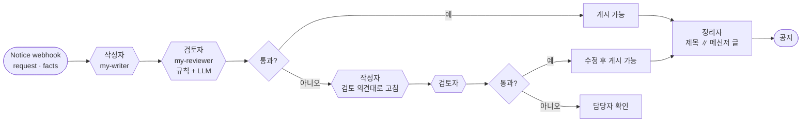

# 69일차 실습 · 역할 기반 Agent 분리와 협업 워크플로우 (바이브 코딩)

- 일자: 2026-10-21 (69일차)
- 교과목: 노코드 멀티 에이전트 워크플로우 설계 및 운영
- 단원: 운영·확장 관점의 AI 워크플로우 설계 고도화
- 강의 자료: [Lecture/69](../../Lecture/69/README.md)
- 하루 수강 안내: [LECTURE-69.md](LECTURE-69.md) (수업 준비부터 마칠 때까지 순서대로)
- 67·68일차처럼 CLI 코딩 에이전트에게 **내가 쓴 요청문**으로 워크플로우를 만들게 하고, **테스트로 확인**합니다.

## 오늘 만드는 업무: IT 공지문 작성 팀

68일차에는 서로 **독립**인 업무를 Agent에게 나눠 맡겼습니다. 오늘은 **한 업무**(공지문 하나)를 역할이 다른 Agent가 **이어서** 처리합니다. 사람 팀처럼 작성자가 쓰고, 검토자가 보고, 고칠 곳이 있으면 한 번 고치고, 정리자가 채널별로 다듬습니다.



## 일하는 방식 (67·68일차와 같음)

| 누가 | 무엇을 |
| --- | --- |
| 나 | 역할 카드 쓰기, 요청문 쓰기, 기대 결과(테스트) 정하기, push·test 실행, 결과 판단 |
| CLI 에이전트 | [AGENTS.md](AGENTS.md) 규칙대로 워크플로우 JSON 작성, `check`로 형식 오류 고치기, 실패 원인 찾기 |
| `tools/flow.py` | check · push(여러 파일) · off(파일 또는 웹훅 경로) · call · test |

## 실습 문서 읽는 법

- 실습 문서(`LAB-0x-Q-*.md`, `VIBE-Q-TCREW.md`)에는 **복사해 붙일 요청문이 없습니다.** 만들 것 · 조건 · 기대 결과만 있고, 요청문은 직접 씁니다.
- Lab 문서는 예제마다 **① 보낼 요청 → ② `call` 명령과 지금 결과 → ③ 원인 → ④ 나와야 할 결과 → ⑤ 고치고 확인** 순서입니다. 요청 JSON과 결과 JSON을 직접 보고 시작합니다.
- 바이브 코딩은 **요청서(`VIBE-REQ-TCREW.md`)부터** 읽고 요구(`SPEC.md`)를 직접 뽑은 뒤 `VIBE-Q-TCREW.md`와 비교합니다. 정답본 `VIBE-A-TCREW.md`는 수업이 끝나면 올라옵니다.
- 개념이 헷갈리면 [개념 정리](../../Lecture/69/CONCEPT-69.md) (분배와 협업, fail-open과 fail-closed, Fork-Join).
- 막히면 `▶` 를 하나씩 펼칩니다. 정답 요청문은 나오지 않습니다.
- 쓴 요청문은 `my-work/PROMPTS.md`에 모아 둡니다.

## 구성

```text
Last3Mon/69/
├── README.md
├── AGENTS.md                         # CLI 에이전트용 작업 규칙 (역할 계약 3절)
├── LAB-01-Q-ROLE-CARDS.md            # 1단계 · 역할 카드 → 작성자 → 검토자
├── LAB-02-Q-COLLABORATION.md         # 2단계 · 역할 계약 → 공지 팀(보완 1회) → 정리자 Fork-Join
├── LAB-03-Q-TRACE-AND-COMPARE.md     # 3단계 · 협업 기록 → 검토자가 꺼졌을 때 → 어려운 테스트 · 단일 Agent 비교
├── PREPARE-69-FROM-65.md             # 65~68일차를 못 했을 때 최소 준비
├── VIBE-REQ-TCREW.md                 # 7교시 바이브 코딩 · 요청서 (가장 먼저, 여기서 SPEC.md를 뽑음)
├── VIBE-Q-TCREW.md                   # 7교시 바이브 코딩 · tcrew 요구 · 단계 (SPEC과 비교)
├── *-A-*.md                          # 정답본 (VIBE-A는 수업이 끝난 뒤 올라옴, LAB-A는 아직 없음)
├── tools/flow.py
├── cases/                            # lab01 · lab01-challenge · lab02 · lab02-challenge · lab03 · lab03-down
├── requests/                         # 공지 요청 4종, 검토용 초안 6종
├── reference/                        # 막혔을 때 이어 가는 워크플로우, 단일 Agent 비교용
├── templates/                        # 역할 카드 · 테스트 보고서
├── my-work/                          # 내 결과물 (워크플로우 JSON은 git에 올라가지 않음)
└── runs/                             # 테스트 보고서 (자동 생성)
```

## 준비

[실습 준비](../../Lecture/69/00-DAY69-PREP.md)를 끝내 주세요. 65~68일차를 못 했다면 [PREPARE-69-FROM-65.md](PREPARE-69-FROM-65.md)부터 합니다. 요약:

```bash
cd ~/aio-01d4-stu/Last3Mon/65/n8n && docker compose start      # 65일차 n8n (Ollama는 쓰지 않음 · 처음 한 번 PREP 1절대로 끄기)
cd ~/aio-01d4-stu/Last3Mon/69 && uv run tools/flow.py doctor    # 마지막 줄 ready
```

## `flow.py` 명령 (68일차와 같음, `off`에 웹훅 경로)

| 명령 | 하는 일 | 수업 준비 때 |
| --- | --- | --- |
| `uv run tools/flow.py push my-work/writer.json my-work/reviewer.json` | 여러 파일을 가져오기 → 게시 → n8n 재시작 한 번 | |
| `uv run tools/flow.py off my-reviewer` | 그 웹훅을 쓰는 워크플로우 게시 해제 (역할이 꺼진 상황). 다시 켜기는 `push` | |
| `uv run tools/flow.py call my-notice requests/notice-phone.json -v` | 요청 한 번 보내고 응답 보기 (`-v`: 보낸 요청 JSON도) | 공지 팀 2~6초 |
| `uv run tools/flow.py test cases/lab02.json -v` | 테스트 실행, 보고서를 `runs/`에 저장. `-v`는 케이스마다 보낸 요청 JSON과 받은 응답 JSON을 화면에 보여 줌 | 케이스당 0~7초 (빈 요청 0초, 고쳐 쓰기 + 정리자 약 7초) |
