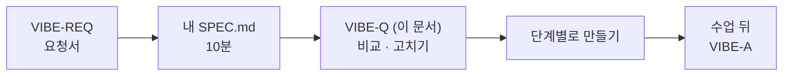

# 7교시 바이브 코딩 · `tcrew` 만들기

> **먼저 [VIBE-REQ-TCREW.md](VIBE-REQ-TCREW.md)(요청서)를 읽고 `~/vibe/tcrew/SPEC.md`를 직접 쓴 뒤** 이 문서를 엽니다. 이 문서는 요청서에서 요구를 뽑아 낸 **다음 단계**입니다. 내 SPEC과 비교하는 데 쓰고, 에이전트에게 통째로 붙여 넣지 않습니다.



- 시간: 16:00~16:50 (50분) · 발표와 정리는 8교시
- 도구: CLI 코딩 에이전트(codex / claude / agy), Python + uv + [Textual](https://textual.textualize.io/)
- 결과물: 질문 하나를 **작성자 → 검토자 → 정리자** 역할의 LLM이 차례로 처리하고, 역할마다 탭으로 답을 보여 주는 TUI. 역할 지시문은 **YAML 파일**로 따로 둡니다. 오늘 n8n으로 만든 공지 팀을 파이썬 프로그램으로 다시 만들어 보는 셈입니다.

```text
$ tcrew "VPN 인증서 교체 공지를 써 줘. 10월 27일부터 새 인증서, 24일까지 설치"
┌ tcrew · crew.yaml (3 roles) ───────────────────────────────┐
│ ┌ writer ✔ 1.2s ┬ reviewer ✘ 0.9s ┬ writer#2 ✔ ┬ editor ┐   │
│ │ [VPN 인증서 교체 안내]                                │   │
│ │ 10월 27일(월)부터 새 VPN 인증서를 사용합니다. ...     │   │
│ └───────────────────────────────────────────────────────┘   │
│ 질문: ____________________________  [Enter] 실행  [q] 종료 │
└─────────────────────────────────────────────────────────────┘
```

> 요청문은 **직접** 씁니다. 단계마다 `▶` 를 펼치면 생각할 거리가 나옵니다. 정답 요청문은 없습니다.

## 요구 사항 (요청서에서 뽑은 것)

| 번호 | 요구 | 요청서의 말 | 확인 방법 |
| --- | --- | --- | --- |
| R1 | 역할(이름, 지시문, 받는 것)을 `crew.yaml`에 적고, 프로그램은 그 순서대로 LLM을 부른다. 앞 역할의 답이 다음 역할의 입력 | ① 쓰는 사람 · 보는 사람 · 다듬는 사람이 차례로 | `tcrew "..." --plain` (글자 출력), 가짜 LLM 테스트의 호출 순서 |
| R2 | 역할마다 **탭**으로 답과 걸린 시간을 보여 준다 | ② 무엇을 썼는지 따로따로, 얼마나 걸렸는지 | TUI 탭 제목에 이름 · ✔/✘ · 초 |
| R3 | 검토자가 "고칠 것 있음"이라고 하면 작성자가 **한 번** 고쳐 쓰고 다시 검토한다. 그래도 안 되면 멈추고 표시. 검토 답을 읽지 못하면 통과로 보지 않는다 | ③ 끝없이 주고받지 않기, 모르겠으면 통과로 치지 않기 | 일부러 엄격한 검토자 지시문: LLM 호출 4번 뒤 멈춤 |
| R4 | YAML만 바꿔 역할을 더하거나 바꿀 수 있다 (코드 수정 없이) | ④ 설정 파일만 고쳐서 | `crew.yaml`에 `translator` 역할 추가 → 탭 4개 |
| R5 | 실행 기록(역할, 입력, 출력, 시간)을 JSON 파일로 남긴다 | ⑤ 돌릴 때마다 기록 | `runs/*.json` |

숨은 요구 (요청서에 직접 없지만 없으면 안 되는 것):

| 숨은 요구 | 어디서 나왔나 |
| --- | --- |
| 검토자는 프로그램이 읽을 수 있는 **정해진 모양**으로 답한다 (첫 줄 `PASS` / `FIX`, 또는 JSON) | ③ "통과인지 아닌지" — 자유로운 글은 프로그램이 판단 못 함 |
| 테스트는 **가짜 LLM**으로 (진짜 LLM을 부르지 않음). 이상한 답 · 늘 FIX도 가짜 LLM으로 만든다 | "테스트하느라 돈이 나가는 건 싫어요", ③을 시험하려면 이상한 답이 필요 |
| 고쳐 쓸 때 작성자는 **처음 질문 + 이전 초안 + 검토 의견**을 받는다 | ③ "고쳐야죠" (오늘 Lab 02의 `previous_draft`, `feedback`) |
| 고쳐 쓰기 횟수는 설정 (`max_revisions: 1`) | ③ "한 번", ④ 설정 파일만 |
| 키는 환경 변수에서만 읽고 YAML · 코드 · `runs` 파일에 남기지 않는다 | "키가 설정 파일이나 기록에 찍히면 안 돼요" |
| LLM을 부르는 동안 화면이 멈추지 않고, 끝난 역할부터 탭이 채워진다 | ② (LLM 3~4번, 수 초씩) |

범위 밖 (오늘 하지 않음): n8n 웹훅과 직접 연결하기, 여러 질문을 한꺼번에 돌리기, 역할마다 다른 회사의 LLM. (강사 바이브 코딩에서 writer를 n8n `my-writer`로 바꿔 끼우기를 보여 줄 수 있음)

**비교해 보기**: 내 `SPEC.md`에서 빠진 요구, 내가 더 뽑은 요구, 다르게 정한 순서를 `SPEC.md` 끝에 한 줄씩 적고, 필요하면 내 SPEC을 고칩니다. 아래 단계부터는 **고친 내 SPEC.md**를 기준으로 요청문을 씁니다.

알아 둘 것:

- LLM 키는 `OPENAI_API_KEY` 환경 변수 (`~/aio-01d4-stu/Last3Mon/.env`). **키를 코드나 YAML에 쓰지 않습니다.** 모델 `gpt-4.1-mini`.
- 검토자의 답을 프로그램이 읽어야 하므로(R3), 검토자에게는 정해진 모양(예: 첫 줄 `PASS` / `FIX`, 또는 JSON)으로 답하게 합니다.
- 오늘 n8n Lab의 `requests/notice-*.json`의 `facts`를 질문으로 써 볼 수 있습니다.

## 진행 (50분)


요청문은 단계마다 `~/vibe/tcrew/PROMPTS.md`에 남깁니다.

### 0. 준비 · 요청서 → SPEC (12분)

```bash
mkdir -p ~/vibe/tcrew && cd ~/vibe/tcrew
git init
```

1. **에이전트는 아직 켜지 않습니다.** [VIBE-REQ-TCREW.md](VIBE-REQ-TCREW.md)를 읽고 `SPEC.md`를 직접 씁니다 (10분).
2. 이 문서의 요구 표 · 숨은 요구와 비교해 `SPEC.md`를 고치고 `git commit`.
3. 그다음 에이전트를 켭니다: `codex` (또는 `claude`, `agy`). 첫 요청은 "`SPEC.md`를 읽고, 1단계를 만들기 전에 확인 방법부터 말해 줘".

### 1. YAML과 차례로 부르기 (11분)

**목표**: `uv run tcrew "질문" --plain`이 역할 셋의 답을 차례로 **글자로** 출력한다. 화면은 아직 없다.

<details><summary>▶ 1단계 · YAML에 무엇을 둘까</summary>

역할마다 무엇이 있어야 프로그램이 부를 수 있나요? 이름, 지시문, 그리고 **무엇을 받는지**(처음 질문? 앞 역할의 답? 둘 다?). 모델 이름도 역할마다 다르게 할 수 있게 할지 정합니다. 예시 `crew.yaml`을 요청문에 직접 적어 주면 에이전트가 헤매지 않습니다.
</details>

<details><summary>▶ 2단계 · LLM 부르는 부분을 바꿔 끼울 수 있게</summary>

`tman`, `tflow`와 같습니다. 테스트에서 진짜 LLM을 부르지 않으려면? 가짜 LLM이 "역할 이름을 붙여 입력을 되돌려 주기"만 해도 순서가 맞는지 테스트할 수 있습니다.
</details>

**확인**: `uv run tcrew "..." --plain`, `uv run pytest -q`, `git commit`.

### 2. 검토 · 고쳐 쓰기 · 기록 (12분)

**목표**: 검토자가 고칠 것을 말하면 작성자가 한 번 고쳐 쓰고 다시 검토한다 (R3). 실행 기록을 JSON으로 남긴다 (R5).

<details><summary>▶ 1단계 · 프로그램이 읽을 수 있는 검토</summary>

검토자가 자유롭게 쓰면 프로그램은 통과인지 모릅니다. 오늘 n8n 검토자의 `passed`·`codes`처럼, 읽을 수 있는 모양을 정해 YAML 지시문에 넣습니다. 그 모양이 아니면 어떻게 할지도 정합니다 (오늘 Lab의 fail-closed).
</details>

<details><summary>▶ 2단계 · 고쳐 쓰기 횟수</summary>

"한 번만"을 어디에 둘까요? 코드에 고정할지, YAML의 설정(`max_revisions: 1`)으로 둘지 정합니다. 고쳐 쓸 때 작성자에게 무엇을 줄지(이전 초안, 검토 의견)도.
</details>

**확인**: 일부러 엄격한 검토자 지시문(예: "항상 FIX")으로 바꿔 한 번만 고쳐 쓰고 멈추는지, `runs/` 파일, `pytest`, `git commit`.

### 3. TUI 탭 (10분)

**목표**: 위에 역할 탭(이름 · ✔/✘ · 시간), 아래에 질문 입력칸. 역할을 YAML에 더하면 탭도 늘어난다 (R2 · R4).

<details><summary>▶ 1단계 · 기다리는 동안</summary>

역할 셋이면 LLM을 세 번 이상 부릅니다. 화면이 멈추지 않게, 끝난 역할부터 탭이 채워지게 하려면 어떻게 요청할까요?
</details>

<details><summary>▶ 2단계 · 코드 수정 없이 역할 더하기</summary>

`crew.yaml`에 `translator`(영어로 번역) 역할을 더해 봅니다. 코드를 고쳐야 했다면, 어디가 역할 이름에 묶여 있었는지 에이전트에게 찾게 합니다.
</details>

```bash
export OPENAI_API_KEY=$(grep '^OPENAI_API_KEY=' ~/aio-01d4-stu/Last3Mon/.env | cut -d= -f2-)
```

**확인**: `uv run tcrew`, 탭 전환, `translator` 추가 후 탭 4개, `git commit`.

### 4. 정리 (5분)

`SPEC.md` 1절 표의 확인 방법대로 하나씩 체크하고, 발표 메모를 씁니다.

| 발표 (3분) | 내용 |
| --- | --- |
| SPEC | 내 SPEC과 VIBE-Q가 달랐던 곳 (빠뜨린 요구, 더 뽑은 요구) |
| 요청문 | 가장 잘 먹힌 요청문 한 개, 안 먹힌 요청문 한 개 |
| 막힌 곳 | 검토 답을 읽지 못함, 끝없는 고쳐 쓰기 등 어떻게 알아챘고 고쳤나 |
| 시연 | 오늘 Lab의 `notice-phone` 사실로 tcrew 실행, n8n 공지 팀 결과와 비교 |

## 확인

- [ ] `SPEC.md`를 에이전트 없이 먼저 쓰고, VIBE-Q와 비교한 줄을 남겼다.
- [ ] R1 `crew.yaml`의 역할 순서대로 실행, 앞 답이 다음 입력.
- [ ] R2 역할별 탭에 답과 시간.
- [ ] R3 고쳐 쓰기는 한 번, 검토 답을 못 읽으면 통과로 보지 않는다.
- [ ] R4 YAML만 바꿔 역할 추가.
- [ ] R5 `runs/*.json` 실행 기록.
- [ ] `uv run pytest -q` 통과(가짜 LLM), 단계마다 git commit, `PROMPTS.md`.
