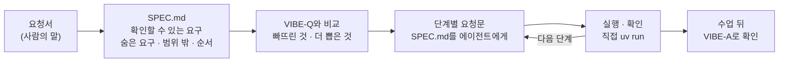

# 7교시 바이브 코딩 · 요청서 `tcrew` (가장 먼저 읽기)

- 순서: **이 요청서** → 내가 뽑은 요구 `~/vibe/tcrew/SPEC.md` (10분) → [VIBE-Q-TCREW.md](VIBE-Q-TCREW.md)와 비교 → 단계별로 만들기 → 수업이 끝나면 `VIBE-A-TCREW.md`(정답본)로 확인
- 이 문서는 **만들어 달라는 사람의 말**입니다. 요구 사항 표도, 단계도 없습니다. 그것을 뽑아 내는 것이 첫 10분의 일입니다. 68일차 `tflow` 때와 같은 순서입니다.



## 왜 요청서부터인가

VIBE-Q 문서를 통째로 에이전트에게 주고 "이대로 만들어 줘"라고 하면, 무엇이 만들어지든 **내가 판단할 기준이 없습니다.** 실무에서는 요구 사항 표가 오지 않고, 이 요청서 같은 **사람의 말**이 옵니다. 말을 확인할 수 있는 요구로 바꾸는 일은 에이전트가 아니라 내가 합니다. 오늘 오전 Lab 01에서 역할 카드를 직접 쓴 것과 같은 일입니다.

| 단계 | 누가 | 결과 |
| --- | --- | --- |
| 요청 → 요구 | **나** | `SPEC.md`: 요구마다 "됐다 / 안 됐다"를 말할 수 있는 확인 방법 |
| 요구 → 단계 | **나** | 작게 나눈 순서 (무엇부터 만들고 확인할지) |
| 단계 → 코드 | 에이전트 | 단계마다 요청문 하나, `SPEC.md`를 함께 읽게 함 |
| 확인 | **나** | 직접 `uv run tcrew …`, `pytest`, 요구 표에 체크 |

## 요청 (IT팀 공지 담당자에게서 온 메시지, 그대로)

> 오늘 n8n으로 만든 공지 팀(작성자 → 검토자 → 정리자) 잘 봤어요. 그런데 역할 지시문을 조금 바꿔 보고 싶을 때마다 워크플로우를 열어 노드를 고치는 게 번거로워요. 터미널에서 바로 돌려 보는 작은 프로그램이 있으면 좋겠어요.
>
> ① 공지 팀처럼 **쓰는 사람, 보는 사람, 다듬는 사람**이 차례로 일했으면 해요. 앞사람이 쓴 걸 다음 사람이 받아서요.
>
> ② 각 역할이 **무엇을 썼는지 따로따로**, 그리고 **얼마나 걸렸는지** 보고 싶어요. 한 화면에 다 섞여 나오면 누가 뭘 했는지 모르겠더라고요.
>
> ③ 보는 사람이 "고칠 게 있다"고 하면 쓰는 사람이 고쳐야죠. 그런데 **끝없이 주고받으면 안 되고**, 한 번 고쳐도 안 되면 멈추고 알려 주세요. 보는 사람 답이 이상하게 와서 **통과인지 아닌지 모르겠으면, 통과로 치면 절대 안 돼요.**
>
> ④ 역할 지시문을 바꾸거나, 영어 번역 담당 같은 **역할을 하나 더하는 건 개발자한테 부탁하지 않고** 설정 파일만 고쳐서 하고 싶어요.
>
> ⑤ 나중에 "그때 검토자가 뭐라고 했지?" 하고 찾아볼 수 있게, **돌릴 때마다 기록**을 남겨 주세요.
>
> 키는 이미 환경 변수에 넣어 뒀어요. 그런데 **키가 설정 파일이나 기록에 찍히면 안 돼요.** 그리고 프로그램을 고칠 때마다 테스트하느라 돈이 나가는 건 싫어요.

## 함께 받은 것

| 파일 · 자료 (`~/aio-01d4-stu/Last3Mon/69/` 기준) | 메모 |
| --- | --- |
| `requests/notice-mail.json` · `notice-vpn.json` · `notice-phone.json`의 `facts` | 질문으로 써 볼 사실. `notice-phone`은 연락처가 들어 있어 검토에서 걸리는 것 |
| 오늘 내가 만든 `my-work/notice.json` 결과 (`call my-notice requests/notice-phone.json`) | 같은 사실을 넣어 비교해 볼 것 |
| [AGENTS.md](AGENTS.md) 3절 | n8n 공지 팀의 역할 계약 (검토자는 `passed`, `codes`를 돌려줌) |

- LLM 키는 `OPENAI_API_KEY` 환경 변수, 모델은 `gpt-4.1-mini`.

## 할 일 · 요청을 요구로 (10분, 에이전트 없이)

`~/vibe/tcrew/SPEC.md`를 만들고 아래 네 가지를 씁니다. **에이전트에게 맡기지 않고 직접** 씁니다 (나중에 에이전트에게 읽힐 문서입니다).

```markdown
# tcrew SPEC

## 1. 요구 (확인할 수 있게)
| 번호 | 요구 | 요청의 어느 말 | 확인 방법 (파일 · 숫자 · 화면) |
| --- | --- | --- | --- |
| R1 | | ① | |

## 2. 숨은 요구 (요청에 직접 없지만 없으면 안 되는 것)
## 3. 범위 밖 (오늘 50분 안에 하지 않을 것)
## 4. 만드는 순서 (그리고 그 이유)
```

예 하나만 보여 드립니다. 나머지는 직접 바꿔 봅니다.

| 요청의 말 | 그대로 요청문에 넣으면 | 확인할 수 있는 요구로 |
| --- | --- | --- |
| ① "쓰는 사람, 보는 사람, 다듬는 사람이 차례로. 앞사람이 쓴 걸 다음 사람이" | "역할 셋이 협업하게 해 줘" → 무엇이 되든 "됐다"가 됨 | **역할 목록을 설정 파일에 적고, 그 순서대로 LLM을 부른다. 다음 역할의 입력에 앞 역할의 답이 들어간다.** 확인: 가짜 LLM으로 돌리면 호출 순서가 `writer, reviewer, editor`, editor가 받은 글에 writer의 답이 있음 |

<details><summary>▶ 1단계 · "따로따로", "이상하게", "통과로 치면 안 돼요"를 어떻게 확인하나</summary>

형용사와 부탁은 확인할 수 없습니다. "몇 번 불리면", "어느 파일에 무엇이 남으면", "화면에 무엇이 몇 개 보이면"으로 바꿉니다. ③은 숫자로 바꾸기 좋습니다: 검토자가 늘 "고칠 것 있음"이라고 하면 **LLM이 몇 번 불리고** 멈춰야 하나요? 직접 세어 보면 확인 방법이 생깁니다.
</details>

<details><summary>▶ 2단계 · 숨은 요구</summary>

- 프로그램이 "통과인지 아닌지" 알려면 검토자의 답이 **어떤 모양**이어야 할까요? 오늘 n8n 검토자는 무엇을 돌려줬나요? (AGENTS.md 3절)
- "이상하게 와서 모르겠으면"을 시험하려면, 이상한 답을 내는 검토자가 있어야 합니다. 진짜 LLM으로 그걸 만들 수 있나요?
- "테스트하느라 돈이 나가는 건 싫어요"는 테스트가 무엇을 부르지 않아야 한다는 뜻일까요?
- 고쳐 쓰는 사람은 무엇을 받아야 제대로 고칠까요? (오늘 Lab 02의 `previous_draft`, `feedback`)
- LLM을 세 번 넘게 부르는 동안 화면은 어떻게 되어야 할까요?
</details>

<details><summary>▶ 3단계 · 범위 밖과 순서</summary>

50분입니다. n8n과 직접 연결하기, 여러 질문을 한꺼번에 돌리기, 역할마다 다른 회사의 LLM 쓰기는 요청에 없습니다. 순서는 "무엇을 먼저 만들면 나머지가 그것을 다시 쓰나"로 정합니다. 화면 · 기록 · 고쳐 쓰기가 모두 **같은 것**(설정 파일에서 읽은 역할 목록, 역할마다의 실행 결과)을 씁니다.
</details>

## 그다음

1. [VIBE-Q-TCREW.md](VIBE-Q-TCREW.md)를 열어 내 `SPEC.md`와 비교합니다. 빠뜨린 요구, 내가 더 뽑은 요구, 다르게 정한 순서를 `SPEC.md` 끝에 한 줄씩 적습니다 (8교시 발표 거리).
2. 단계마다 요청문을 쓸 때 "`SPEC.md`를 읽고 4절의 1단계만 해 줘"처럼 **내 SPEC을 기준으로** 시킵니다. VIBE-Q 문서를 통째로 붙여 넣지 않습니다.
3. 단계가 끝날 때마다 `SPEC.md` 1절 표의 확인 방법대로 **내가** 확인하고 체크합니다.
4. 수업이 끝나면 `git pull`로 정답본 `VIBE-A-TCREW.md`를 받아, 요구 도출 예시와 요청문 예를 내 것과 비교합니다.
