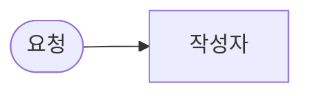

# 역할 설계서 · IT 공지문 작성 팀

- 이름:
- 사용한 CLI 에이전트: codex / claude / agy
- 이 파일을 `my-work/DESIGN.md`로 복사해 채웁니다.

## 1. 역할 카드 (Lab 01 예제 1)

| 칸 | 작성자 | 검토자 | 정리자 |
| --- | --- | --- | --- |
| 하는 일 (한 줄) |  |  |  |
| 받는 것 |  |  |  |
| 내놓는 것 |  |  |  |
| **하지 않는 일** |  |  |  |
| 잘했는지 아는 법 (테스트) |  |  |  |
| LLM이 필요한가 · 규칙으로 되나 |  |  |  |

## 2. 검토 규칙 (Lab 01 과제)

| 코드 | 규칙 | 규칙(Code) · LLM | 확인한 테스트 |
| --- | --- | --- | --- |
| `missing_fact` |  |  |  |
| `personal_info` |  |  |  |
| `too_long` |  |  |  |
| `unsupported_claim` |  |  |  |

## 3. 협업 흐름 (Lab 02, mermaid)

- 고쳐 쓰기는 몇 번까지? 그래도 안 되면?
- 검토자가 응답하지 않으면? (Lab 03)

## 4. 역할 분리의 값 (Lab 03 과제, 측정값으로)

| | 역할 팀 (`my-notice`) | 단일 Agent (`my-single`) |
| --- | --- | --- |
| 어려운 케이스 통과 |  |  |
| 단일 Agent 결과를 검토자로 다시 보면 | — |  |
| 요청 하나 시간 |  초 |  초 |
| LLM 호출 수 (요청 하나) |  |  |
| 실패했을 때 어디가 문제인지 아는가 |  |  |
