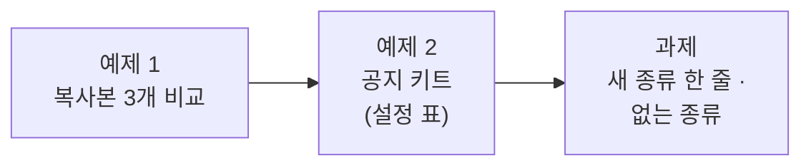

# Lab 01 · 복사본 3개를 공지 키트 하나로

- 관련 강의: [1단계 · 템플릿화: 같은 것과 다른 것 나누기](../../Lecture/70/01-STAGE1-TEMPLATE.md)
- 소요 시간: 약 40분 (예제 1 10분 · 예제 2 15분 · 과제 15분)
- 준비: [실습 준비](../../Lecture/70/00-DAY70-PREP.md)의 `uv run tools/flow.py doctor` → `ready`
- 목표: 복사해서 조금씩 고친 워크플로우 3개에서 **같은 것과 다른 것**을 찾고, 다른 것만 **설정 표**로 빼서 워크플로우 하나로 만든다.



> 이 실습에는 **복사해 붙일 요청문이 없습니다.** 막히면 `▶` 를 하나씩 펼칩니다.

## 예제 1 · 복사본 3개 비교 (10분)

`samples/`의 세 파일은 69일차 공지 팀을 점검·보안·교육용으로 **복사해서 고친** 것입니다. 하나씩 돌려 보고, 에이전트에게 비교를 맡겨 `my-work/DESIGN.md` 1절을 채웁니다 (`cp templates/REUSE-DESIGN-TEMPLATE.md my-work/DESIGN.md`).

```bash
uv run tools/flow.py push samples/notice-maintenance.json samples/notice-security.json samples/notice-training.json
uv run tools/flow.py call sample-security requests/kit-security.json -v
```

<details><summary>▶ 1단계 · 비교를 에이전트에게 시킬 때</summary>

"차이를 알려 줘"만 쓰면 위치(`position`)나 웹훅 id 같은 의미 없는 차이까지 나옵니다. **노드 단위로**, 어떤 값이 다른지, 그 값이 업무상 무엇인지(머리말? 길이 제한?) 표로 달라고 합니다. 파일은 고치지 말라고 적습니다.
</details>

<details><summary>▶ 2단계 · 다른 것을 셋으로 나누기</summary>

다른 값마다 정합니다: (가) 종류마다 다른 **설정**(머리말, 최대 길이, 꼭 넣을 문장) (나) 종류와 상관없이 같아야 하는데 **우연히 다른** 것 (다) 정말로 다른 **흐름**. (나)가 있다면 복사가 만든 버그입니다.
</details>

**확인**: 보안 공지의 규칙을 하나 고쳐야 한다면 지금은 몇 곳을 고쳐야 하나요? 1절 아래에 적습니다.

## 예제 2 · 공지 키트 (15분)

**만들 것**: `kind`를 받아 종류에 맞는 공지를 쓰는 워크플로우 **하나**. 종류마다 다른 값은 설정 표 한 곳에만.

| 조건 | 값 |
| --- | --- |
| 저장할 파일 | `my-work/notice-kit.json` (오늘 끝까지 이 파일을 고쳐 나감) |
| 웹훅 · 계약 | [AGENTS.md](AGENTS.md) 3절 공지 키트 (`my-notice-kit`) |
| 종류 | `maintenance`, `security`, `training` — 값은 예제 1의 표에서 |
| 기대 결과 | `cases/lab01.json` |

<details><summary>▶ 1단계 · 바탕을 무엇으로</summary>

세 파일 중 하나를 바탕으로 고치게 할 수도, 새로 만들게 할 수도 있습니다. 바탕 파일을 주면 에이전트가 덜 헤맵니다. 그때 **무엇을 바꾸는지**(값을 설정 표로 옮기고, 프롬프트와 검사가 표를 읽게)를 분명히 적습니다.
</details>

<details><summary>▶ 2단계 · 설정 표의 모양</summary>

표의 한 줄 = 한 종류. 칸 이름을 정해 요청문에 적습니다 (예제 1 2절 표). 작성자의 지시문과 규칙 검사가 **같은 표**를 읽어야 합니다. 같은 값을 두 곳에 쓰면 다시 복사가 됩니다.
</details>

<details><summary>▶ 3단계 · 점검표</summary>

- [ ] 새 파일, 웹훅, 입력(`kind`, `facts` 필수)
- [ ] 설정 표 칸 이름과 세 종류의 값
- [ ] 표를 읽는 곳 (지시문, 규칙 검사)
- [ ] 결과 모양 (`kind`, `route`, `published`, `notice`, `codes`)
- [ ] `cases/lab01.json`
</details>

```bash
uv run tools/flow.py push my-work/notice-kit.json
uv run tools/flow.py test cases/lab01.json -v --repeat 3
```

## 과제 · 새 종류는 표 한 줄로 (15분)

팀장이 요청했습니다.

> "다음 주부터 설문 공지도 나가요. 머리말은 `[설문 안내]`, 500자 이내, '응답은 익명으로 처리됩니다.'를 꼭 넣어 주세요. 그런데 표에 없는 종류가 들어오면 이상한 공지가 나가면 안 돼요. 어떤 종류가 있는지 알려 주고 멈추세요."

기대 결과는 `cases/lab01-challenge.json` (설문 공지, 없는 종류 400과 종류 목록 `kinds`, 원래 종류도 그대로).

<details><summary>▶ 1단계 · 바뀐 곳이 한 곳인지</summary>

설문을 더하려고 고친 노드가 설정 표 하나뿐이어야 템플릿화가 된 것입니다. 에이전트에게 "어느 노드를 바꿨는지"를 보고하게 하고, 두 곳 이상이면 왜 그런지 묻습니다.
</details>

<details><summary>▶ 2단계 · 없는 종류</summary>

지금 키트에 `kind: party`를 보내 보세요 (`call my-notice-kit requests/kit-unknown.json`). 무엇이 나오나요? 400으로 멈추면서 `kinds` 목록을 돌려주려면 어느 노드 다음에 무엇이 필요할까요? 목록은 **표에서** 만들어야 종류를 더할 때 따로 고치지 않습니다.
</details>

```bash
uv run tools/flow.py push my-work/notice-kit.json
uv run tools/flow.py test cases/lab01-challenge.json -v --repeat 3
uv run tools/flow.py test cases/lab01.json -v
```

## 막혔을 때

| 증상 | 할 일 |
| --- | --- |
| 꼭 넣을 문장이 빠짐 | 보고서의 `codes`에 `missing_phrase`가 있나 → 지시문에 표의 문장이 들어가는지 Executions에서 확인 |
| 머리말이 다름 | 지시문이 표의 `prefix`를 읽는지 확인 |
| 계속 안 됨 | `cp reference/lab01-example2-kit.json my-work/notice-kit.json` 후 push |

## 확인

- [ ] 예제 1: 노드 단위 비교표, 보안 규칙을 고치려면 몇 곳인지 적었다.
- [ ] 예제 2: `cases/lab01.json` 3번 반복 통과.
- [ ] 과제: `cases/lab01-challenge.json` 통과, 바꾼 노드가 표(와 없는 종류 처리)뿐이다.
