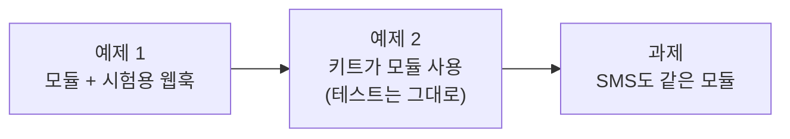

# Lab 02 · 규칙 검사를 모듈로, 두 곳에서 쓰기

- 관련 강의: [2단계 · 모듈화: Sub-workflow와 계약](../../Lecture/70/02-STAGE2-MODULES.md)
- 소요 시간: 약 70분 (예제 1 20분 · 예제 2 15분 · 과제 35분)
- 준비: Lab 01의 `my-work/notice-kit.json` (없으면 `cp reference/lab01-example2-kit.json my-work/notice-kit.json` 후 push)
- 목표: 규칙 검사를 **모듈**(Sub-workflow)로 떼어 내 따로 시험하고, 공지 키트가 그 모듈을 부르게 바꾼다 (결과는 그대로). 다른 워크플로우(SMS)도 같은 모듈을 쓴다.



> 복사해 붙일 요청문은 없습니다. 막히면 `▶` 를 하나씩 펼칩니다.

## 예제 1 · 규칙 검사 모듈과 시험용 웹훅 (20분)

**만들 것**: 두 파일.

| 파일 | 하는 일 |
| --- | --- |
| `my-work/rule-check.json` | 모듈. **Execute Workflow Trigger**로 시작, 입력 4개를 받아 `{passed, codes, issues}`. 파일 안에 `"id": "modRuleCheck01"` |
| `my-work/rule-check-test.json` | 시험용 웹훅 `my-rule-check`: 본문을 그대로 모듈에 넘기고 결과를 돌려줌 |

계약은 [AGENTS.md](AGENTS.md) 3절, 노드 모양은 5절. 기대 결과 `cases/lab02-module.json` (LLM 없이 규칙만, 케이스당 0.1초 정도).

<details><summary>▶ 1단계 · 모듈의 입력을 정하기</summary>

키트 안의 `Rule checks` 코드가 지금 **무엇을 읽고 있나요**? 웹훅 본문, 설정 표, 앞 노드의 초안. 모듈은 이것들을 직접 읽을 수 없습니다 (부르는 쪽이 다르기 때문). 그래서 필요한 값을 모두 **입력**으로 받아야 합니다. 입력마다 이름과 종류(글자, 숫자, 목록)를 정합니다.
</details>

<details><summary>▶ 2단계 · 왜 시험용 웹훅이 따로 있나</summary>

모듈은 웹훅이 없어서 `call`이나 `test`로 바로 부를 수 없습니다. 웹훅 → 모듈 호출 → 응답, 세 노드짜리 워크플로우를 하나 더 두면 모듈만 따로 시험할 수 있습니다. 두 파일을 함께 push합니다.
</details>

<details><summary>▶ 3단계 · 모듈 id</summary>

부르는 쪽은 모듈을 **id**로 찾습니다. id를 파일에 직접 적으라고 요청문에 넣었나요? ([AGENTS.md](AGENTS.md) 3절)
</details>

```bash
uv run tools/flow.py push my-work/rule-check.json my-work/rule-check-test.json
uv run tools/flow.py test cases/lab02-module.json -v
```

## 예제 2 · 키트가 모듈을 부르게 (15분)

**할 일**: `my-work/notice-kit.json` 안의 규칙 검사 코드를 지우고, 그 자리에 모듈 호출(Execute Workflow)을 둔다. **결과는 바뀌면 안 된다.**

<details><summary>▶ 1단계 · "결과는 그대로"를 어떻게 확인하나</summary>

바꾸기 전에 `test cases/lab01.json`을 돌려 보고서를 남겨 두고, 바꾼 뒤 같은 테스트를 돌립니다. 테스트를 하나도 고치지 않고 통과하면 결과가 그대로인 것입니다 (리팩터링).
</details>

<details><summary>▶ 2단계 · 무엇을 넘기나</summary>

예제 1에서 정한 입력 4개를 키트의 어디에서 가져오나요? 사실은 웹훅에서, 초안은 앞 노드에서, 길이와 꼭 넣을 문장은 설정 표에서.
</details>

```bash
uv run tools/flow.py test cases/lab01.json -v              # 바꾸기 전
uv run tools/flow.py push my-work/notice-kit.json
uv run tools/flow.py test cases/lab01.json -v              # 바꾼 뒤 (테스트는 그대로)
uv run tools/flow.py test cases/lab01-challenge.json -v    # 과제를 했다면
```

**관찰**: n8n **Executions**에서 키트 실행 하나에 모듈 실행이 따로 생기나요? 웹훅으로 다른 역할을 부르던 69일차와 무엇이 다른가요?

## 과제 · SMS도 같은 모듈 (35분)

팀장이 요청했습니다.

> "급한 공지는 문자로도 보내요. 80자 이내 한두 문장, 날짜·시간은 그대로, 연락처나 링크는 넣지 마세요. 검사 규칙은 공지와 같은 걸 써 주세요. 따로 만들면 나중에 또 달라집니다."

| 조건 | 값 |
| --- | --- |
| 저장할 파일 | `my-work/sms.json` |
| 웹훅 · 계약 | [AGENTS.md](AGENTS.md) 3절 SMS (`my-sms`) |
| 검사 | 예제 1의 모듈 (최대 길이 80, 꼭 넣을 문장 없음) |
| 기대 결과 | `cases/lab02-challenge.json`, 그리고 키트의 `cases/lab01.json`도 계속 통과 |

<details><summary>▶ 1단계 · 모듈을 고치지 않고</summary>

SMS는 길이 80, 꼭 넣을 문장 없음. 모듈 **안**을 고치지 않고 **입력**만 다르게 주면 됩니다. 모듈 안에 "SMS면 80"을 넣으면 무엇이 문제일까요?
</details>

<details><summary>▶ 2단계 · 한 줄로 영향 보기</summary>

`DESIGN.md` 3절 표의 "쓰는 곳"에 키트, SMS, 시험용 웹훅을 적습니다. 모듈을 고치면 이 세 곳의 테스트를 모두 돌려야 합니다 (Lab 03).
</details>

```bash
uv run tools/flow.py push my-work/sms.json
uv run tools/flow.py test cases/lab02-challenge.json -v --repeat 3
uv run tools/flow.py test cases/lab01.json -v
```

## 막혔을 때

| 증상 | 할 일 |
| --- | --- |
| 모듈을 부르는 노드가 빨강 (모듈을 찾지 못함) | 모듈 파일의 `id`와 부르는 쪽의 `workflowId.value`가 같은지, 모듈을 push했는지 |
| 모듈 결과의 `codes`가 이상함 | 모듈 입력의 종류(`max_length`가 숫자, `required_phrases`가 목록)를 Executions에서 확인 |
| 계속 안 됨 | `reference/lab02-example1-rule-check.json`, `lab02-example1-rule-check-test.json`, `lab02-example2-kit-module.json`을 `my-work/`로 복사 후 push |

## 확인

- [ ] 예제 1: `cases/lab02-module.json` 통과 (모듈만 따로).
- [ ] 예제 2: 키트가 모듈을 부르고, `cases/lab01.json`이 테스트 수정 없이 통과.
- [ ] 과제: `cases/lab02-challenge.json` 3번 반복 통과, 모듈 안은 고치지 않았다.
