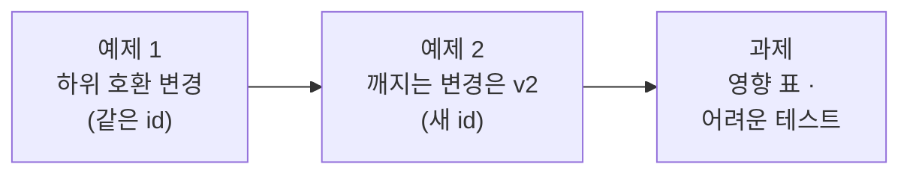

# Lab 03 · 모듈을 바꿀 때: 하위 호환과 새 버전

- 관련 강의: [3단계 · 재사용 구조의 변경 관리](../../Lecture/70/03-STAGE3-CHANGE-AND-VERSION.md)
- 소요 시간: 약 80분 (예제 1 20분 · 예제 2 20분 · 과제 40분)
- 준비: Lab 02의 모듈·시험용 웹훅·키트·SMS가 push되어 있어야 합니다.
- 목표: 여러 곳에서 쓰는 모듈을 고칠 때 **쓰는 곳이 깨지지 않게** 한다. 깨지는 변경은 **새 버전**으로 따로 두고 옮겨 간다.



> 복사해 붙일 요청문은 없습니다. 이번 Lab은 **바꾸기 전에 무엇이 깨질지** 먼저 적고 시작합니다.

## 예제 1 · 바깥 링크 검사 더하기 (20분)

팀장: "공지·문자에 사외 링크(단축 URL 등)가 들어가면 안 됩니다. 사내 주소 `intra.example.com`만 허용하고, 필요하면 허용할 곳을 부르는 쪽에서 더 줄 수 있게."

```bash
uv run tools/flow.py test cases/lab03.json -v      # 지금 모듈로 먼저
```

| 케이스 | 기대 |
| --- | --- |
| 바깥 링크 | `codes: ["external_link"]` |
| 사내 링크는 통과 | `passed: true` |
| 허용 도메인을 직접 줌 (`allowed_domains: ["bit.ly"]`) | `passed: true` |
| 예전 호출(`allowed_domains` 없음)도 그대로 | 예전과 같은 결과 |

**먼저 적어 보기 (3분)**: 모듈에 입력 `allowed_domains`를 **더하면** 지금 모듈을 부르는 키트·SMS는 고쳐야 하나요? 입력을 더하되 **안 줘도 되게** 하려면?

<details><summary>▶ 1단계 · 하위 호환이란</summary>

예전 호출이 **아무것도 바꾸지 않아도** 예전처럼 동작하면 하위 호환입니다. 새 입력은 없을 때의 기본값을 정하고, 결과의 기존 필드(`passed`, `codes`, `issues`)는 그대로 둡니다. 새 코드(`external_link`)는 `codes`에 하나 더 들어갈 뿐입니다.
</details>

<details><summary>▶ 2단계 · 같은 id로 고친다는 것</summary>

하위 호환 변경은 모듈을 **같은 id로** 고칩니다. push하는 순간 키트·SMS 모두 새 모듈을 씁니다. 그래서 push 뒤에 **쓰는 곳 테스트를 모두** 다시 돌려야 합니다 (아래 명령).
</details>

<details><summary>▶ 3단계 · 링크를 찾을 때 주의</summary>

n8n Code 노드 안에서는 쓸 수 없는 JavaScript 기능이 있습니다 ([AGENTS.md](AGENTS.md) 5절 Code). 사내 링크까지 막히면 그 줄을 의심합니다.
</details>

```bash
uv run tools/flow.py push my-work/rule-check.json my-work/rule-check-test.json
uv run tools/flow.py test cases/lab03.json -v
uv run tools/flow.py test cases/lab02-module.json -v      # 모듈 시험
uv run tools/flow.py test cases/lab01.json -v             # 키트
uv run tools/flow.py test cases/lab02-challenge.json -v   # SMS
```

## 예제 2 · 심각도: 깨지는 변경은 v2로 (20분)

팀장: "글자 수가 조금 넘는 건 막지 말고 경고만 주세요. 연락처·링크·빠진 사실은 지금처럼 막고요. 결과에 막는 것(`blocking`)과 경고(`warnings`)를 나눠 주세요. 단, 문자는 지금 그대로 둡니다."

| 무엇 | 값 |
| --- | --- |
| 새 모듈 | `my-work/rule-check-v2.json`, **새 id** `modRuleCheck02`, 결과 `{passed, blocking, warnings, issues}` (`too_long`만 경고) |
| 시험용 웹훅 | `my-work/rule-check-v2-test.json` (`my-rule-check-v2`) |
| 키트 | v2를 부르게, 결과에 `blocking`, `warnings`를 더한다 |
| SMS | **그대로 v1** |
| 기대 결과 | `cases/lab03-v2.json` (v2 모듈, 키트, SMS를 한 번에) |

<details><summary>▶ 1단계 · 왜 같은 id로 고치면 안 되나</summary>

`passed`의 뜻이 바뀝니다 (`too_long`이어도 통과). `codes` 대신 `blocking`·`warnings`를 쓰면 지금 SMS가 읽던 필드가 사라집니다. 같은 id로 바꾸면 SMS가 그 순간 깨집니다. 그래서 새 id로 **나란히** 두고, 쓰는 곳을 하나씩 옮깁니다.
</details>

<details><summary>▶ 2단계 · 키트의 계약도 지키기</summary>

키트가 v2로 옮겨 가면서 키트의 결과에서 `codes`가 없어지면, 키트를 쓰는 쪽(`cases/lab01.json`)이 깨집니다. 모듈만이 아니라 **키트의 계약**도 지켜야 합니다. 새 필드는 **더하고**, 예전 필드는 남기는 방법을 생각합니다.
</details>

```bash
uv run tools/flow.py push my-work/rule-check-v2.json my-work/rule-check-v2-test.json my-work/notice-kit.json
uv run tools/flow.py test cases/lab03-v2.json -v
uv run tools/flow.py test cases/lab01.json -v
uv run tools/flow.py test cases/lab02-challenge.json -v
```

## 과제 · 영향 표와 어려운 테스트 (40분)

1. `DESIGN.md` 5절 **영향 표**: 모듈·버전마다 쓰는 워크플로우와 그 테스트 파일. 에이전트에게 `my-work/*.json`에서 `executeWorkflow`의 `workflowId`를 찾아 표를 만들게 하고, 직접 확인합니다.
2. `cases/my-cases.json`에 키트의 어려운 요청 **5개 이상**을 쓰고, 실패를 보고 고칩니다 (기대 결과는 바꾸지 않음).

```bash
uv run tools/flow.py test cases/my-cases.json -v --repeat 3
```

<details><summary>▶ 1단계 · 어디서 어려운 요청이 나오나</summary>

① `kind`가 이상함 (대소문자, 앞뒤 공백, 한국어 이름) ② 사실이 이상함 (공백만) ③ 요청이 규칙과 부딪힘 ("이 링크 꼭 넣어 주세요", "아주 짧게만") ④ 표에 없는 종류. 각 케이스의 기대를 업무 규칙 한 줄로 먼저 적습니다.
</details>

<details><summary>▶ 2단계 · 고칠 곳은 어디인가</summary>

실패마다 "설정 표 · 키트 흐름 · 모듈" 중 어디를 고칠지 정합니다. **모듈을 고쳐야 한다면** 1의 영향 표에 있는 테스트를 모두 돌립니다. 키트만의 문제면 키트만.
</details>

## 막혔을 때

| 증상 | 할 일 |
| --- | --- |
| v2를 만들었더니 SMS가 깨짐 | v1을 같은 id로 덮어쓰지 않았는지 (`modRuleCheck01` 파일 내용 확인) |
| 사내 링크도 `external_link` | 위 예제 1 ▶ 3단계 |
| 계속 안 됨 | `reference/lab03-example1-*`, `lab03-example2-*` 파일을 `my-work/`로 복사 후 push |

## 확인

- [ ] 예제 1: `cases/lab03.json` 통과, 모듈 시험·키트·SMS 테스트도 그대로 통과.
- [ ] 예제 2: `cases/lab03-v2.json` 통과, `lab01`·`lab02-challenge`도 통과 (SMS는 v1).
- [ ] 과제: 영향 표, `cases/my-cases.json` 5개 이상 3번 반복 통과.
- [ ] [테스트 보고서](templates/TEST-REPORT-TEMPLATE.md)를 `my-work/TEST-REPORT.md`로 채웠다.
