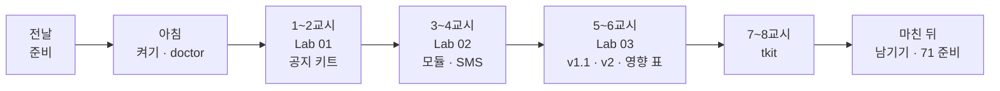
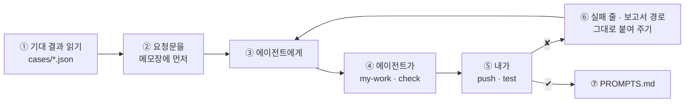

# 70일차 수강 안내 · 수업 준비부터 마칠 때까지

- 일자: 2026-10-22 (목) · 70일차
- 주제: Workflow 템플릿화와 모듈화, 재사용 가능한 구조 설계
- 실습 폴더: [Last3Mon/70](README.md) · 강의 자료: [Lecture/70](../../Lecture/70/README.md)
- 환경: 65일차 n8n 2.42.6 + **OpenAI API 키만**(`gpt-4.1-mini`) + CLI 코딩 에이전트 하나. 데이터 API는 쓰지 않습니다 (켜 두어도 됨). **Ollama는 쓰지 않습니다.**
- 이 문서: 오늘 하루 내가 할 일을 수업 준비부터 마칠 때까지 순서대로 모은 수강 안내입니다. 수업 중에도 띄워 두고 어디까지 왔는지 확인하세요.



## 0. 하루 한눈에

| 교시 | 시간 | 할 일 | 문서 | 끝났다는 표시 |
| --- | --- | --- | --- | --- |
| 전날 | 약 5분 | 자료 받기 · n8n 켜기 · doctor | [PREP](../../Lecture/70/00-DAY70-PREP.md) | `ready` |
| 1 | 09:00~09:50 | 개요 · 1단계 강의 (템플릿화: 같은 것과 다른 것 나누기) | [개요](../../Lecture/70/00-DAY70-OVERVIEW.md), [1단계](../../Lecture/70/01-STAGE1-TEMPLATE.md) | |
| 2 | 10:00~10:50 | Lab 01 예제 1 · 2 · 과제 | [Lab 01](LAB-01-Q-TEMPLATE-KIT.md) | `lab01-challenge` 통과 |
| 3 | 11:00~11:50 | 2단계 강의 (Sub-workflow와 계약) · Lab 02 예제 1 · 2 | [2단계](../../Lecture/70/02-STAGE2-MODULES.md), [Lab 02](LAB-02-Q-MODULES.md) | `lab02-module` · `lab01` 통과 |
| 4 | 12:00~12:50 | Lab 02 과제 35분 (SMS도 같은 모듈) · 풀이 | Lab 02 | `lab02-challenge` 통과 |
| - | 13:00~14:00 | 점심 | | |
| 5 | 14:00~14:50 | 3단계 강의 (변경 관리) · Lab 03 예제 1 · 2 | [3단계](../../Lecture/70/03-STAGE3-CHANGE-AND-VERSION.md), [Lab 03](LAB-03-Q-CHANGE-AND-VERSION.md) | `lab03` · `lab03-v2` 통과 |
| 6 | 15:00~15:50 | Lab 03 과제 40분 (영향 표 · 어려운 테스트) · 풀이 | Lab 03 | 영향 표 · 내 케이스 5개 · 보고서 |
| 7 | 16:00~16:50 | 바이브 코딩 `tkit` 각자 만들기 | [VIBE-Q-TKIT](VIBE-Q-TKIT.md) | R1~R5 · `pytest` |
| 8 | 17:00~17:50 | 발표 · 강사 정리 · 강사 바이브 코딩 · 팁 · 71일차 예고 | [진행](../../Lecture/70/04-VIBE-CODING.md) | |

## 1. 전날 준비 (약 5분)

### 1.1 자료 받기

```bash
cd ~/aio-01d4-stu && git pull
```

### 1.2 n8n 켜기 (Ollama는 끔)

```bash
sudo systemctl disable --now ollama 2>/dev/null   # WSL에 설치한 Ollama가 있으면 끄고 자동 시작도 끔
cd ~/aio-01d4-stu/Last3Mon/65/n8n
docker compose rm -sf ollama                      # Ollama 컨테이너가 있으면 지움 (없으면 그냥 지나감)
docker compose start
```

LLM은 **OpenAI API 키**(`Last3Mon/.env`) 하나로 씁니다. n8n은 `start`로 켭니다.

### 1.3 준비 확인

```bash
cd ~/aio-01d4-stu/Last3Mon/70
uv run tools/flow.py doctor        # 마지막 줄 ready (데이터 API는 경고만)
```

### 1.4 미리 읽기 (선택, 5분)

[PREP 3절](../../Lecture/70/00-DAY70-PREP.md): 69일차 공지 팀을 보안 · 교육 · 설문용으로 복사해 고치면 파일이 4개. **모든 공지에 같은 규칙**을 더하려면 몇 곳을 고쳐야 할까?

### 준비물

노트북과 충전기, WSL의 Docker, WSL 창 두 개, 브라우저. (선택) 69일차 `Last3Mon/69/my-work/*.json`, 68일차 `~/vibe/tflow`.

## 2. 수업 당일 아침 (09:00 전)

1. 노트북을 껐다 켰다면 1.2를 다시 합니다.
2. 터미널 두 개, 둘 다 `cd ~/aio-01d4-stu/Last3Mon/70`. ① 에이전트, ② 확인.
3. 터미널 ②에서 `uv run tools/flow.py doctor` → `ready`.
4. `my-work/PROMPTS.md`를 만들어 둡니다.

## 3. 실습할 때마다 같은 순서



- 오늘은 **고치기 전에도 테스트를 돌립니다.** 바꾸기 전과 뒤에 같은 테스트가 통과해야 "결과는 그대로"입니다.
- 모듈은 파일 안의 `id`(`modRuleCheck01`, `modRuleCheck02`)로 불립니다. 에이전트가 id를 바꾸지 않게 합니다.
- 계약(웹훅 · 입력 · 결과)은 [AGENTS.md](AGENTS.md) 3절.

## 4. 1~2교시 · 1단계 · 복사본 3개를 공지 키트 하나로

[Lab 01](LAB-01-Q-TEMPLATE-KIT.md) (약 40분).

| 순서 | 할 일 | 파일 · 웹훅 | 확인 |
| --- | --- | --- | --- |
| 예제 1 (10분) | 복사본 3개(점검 · 보안 · 교육)를 돌려 보고 비교. `cp templates/REUSE-DESIGN-TEMPLATE.md my-work/DESIGN.md` 1절 | `samples/*.json` | `push samples/notice-maintenance.json samples/notice-security.json samples/notice-training.json`, `call sample-security requests/kit-security.json` |
| 예제 2 (15분) | `kind`를 받아 종류에 맞는 공지를 쓰는 워크플로우 **하나**, 다른 값은 설정 표 한 곳에 | `my-work/notice-kit.json` · `my-notice-kit` (오늘 끝까지 고쳐 나감) | `push my-work/notice-kit.json` → `test cases/lab01.json --repeat 3` |
| 과제 (15분) | 설문 공지는 표 한 줄로, 표에 없는 종류는 목록을 알려 주고 멈춤 | `my-work/notice-kit.json` 고치기 | `test cases/lab01-challenge.json --repeat 3`, `test cases/lab01.json` |

(명령 앞에는 모두 `uv run tools/flow.py`가 붙습니다.)

- 먼저 해 보기: 지금 키트에 없는 종류 보내기 `call my-notice-kit requests/kit-unknown.json`.

## 5. 3~4교시 · 2단계 · 규칙 검사를 모듈로, 두 곳에서 쓰기

[Lab 02](LAB-02-Q-MODULES.md) (약 70분).

| 순서 | 할 일 | 파일 · 웹훅 | 확인 |
| --- | --- | --- | --- |
| 예제 1 (20분) | 규칙 검사 모듈(Execute Workflow Trigger, 입력 4개 → `{passed, codes, issues}`)과 시험용 웹훅 | `my-work/rule-check.json`(id `modRuleCheck01`), `my-work/rule-check-test.json` · `my-rule-check` | `push my-work/rule-check.json my-work/rule-check-test.json` → `test cases/lab02-module.json` |
| 예제 2 (15분) | 키트 안의 검사 코드를 모듈 호출로 바꾸기, **결과는 그대로** | `my-work/notice-kit.json` | 바꾸기 전 `test cases/lab01.json` → `push my-work/notice-kit.json` → 바꾼 뒤 `test cases/lab01.json`, `test cases/lab01-challenge.json` |
| 과제 (35분, 4교시) | SMS(80자 이내, 연락처 · 링크 없음)도 **같은 모듈**로 검사 | `my-work/sms.json` · `my-sms` | `push my-work/sms.json` → `test cases/lab02-challenge.json --repeat 3`, `test cases/lab01.json` |

- 볼 것: Executions에서 키트 실행 하나에 모듈 실행이 따로 생기나요? 웹훅으로 다른 역할을 부르던 69일차와 무엇이 다른가요?

## 6. 5~6교시 · 3단계 · 모듈을 바꿀 때: 하위 호환과 새 버전

[Lab 03](LAB-03-Q-CHANGE-AND-VERSION.md) (약 80분).

| 순서 | 할 일 | 확인 |
| --- | --- | --- |
| 예제 1 (20분) | 사외 링크 검사 더하기 (사내 `intra.example.com`만, 허용 목록은 부르는 쪽에서 더 줄 수 있게). **같은 id**, 하위 호환 (v1.1) | 먼저 `test cases/lab03.json` → `push my-work/rule-check.json my-work/rule-check-test.json` → `test cases/lab03.json`, `lab02-module`, `lab01`, `lab02-challenge` |
| 예제 2 (20분) | 결과 모양이 바뀌는 심각도(`blocking` · `warnings`)는 **새 id** `modRuleCheck02`. 키트만 v2, SMS는 그대로 v1 | `push my-work/rule-check-v2.json my-work/rule-check-v2-test.json my-work/notice-kit.json` → `test cases/lab03-v2.json`, `test cases/lab01.json`, `test cases/lab02-challenge.json` |
| 과제 (40분, 6교시) | ① `DESIGN.md` 5절 영향 표 (모듈 · 버전마다 쓰는 워크플로우와 테스트) ② 키트의 어려운 요청 5개 이상 `cases/my-cases.json`, 실패 고치기 | `test cases/my-cases.json --repeat 3`, 모듈을 고쳤다면 영향 표의 테스트 **모두** |

- 보고서: `cp templates/TEST-REPORT-TEMPLATE.md my-work/TEST-REPORT.md` 후 채우기.
- 고칠 곳은 "설정 표 · 키트 흐름 · 모듈" 중 어디인지 먼저 정합니다.

## 7. 7~8교시 · 바이브 코딩 `tkit`

[VIBE-Q-TKIT](VIBE-Q-TKIT.md): 템플릿 폴더를 골라 변수를 넣으면 새 n8n 워크플로우 · 프로젝트 뼈대를 만드는 TUI.

```bash
mkdir -p ~/vibe/tkit ~/vibe/templates && cd ~/vibe/tkit
git init
codex        # 또는 claude, agy
```

| 시간 | 단계 | 확인 |
| --- | --- | --- |
| 16:00~16:05 | 0. 준비와 템플릿 폴더: `~/vibe/templates/n8n-notice-kit/`에 오늘 키트 JSON 복사, 바뀔 값을 변수로, `template.yaml` (**직접**) | |
| 16:05~16:20 | 1. 글자 모드로 채우기 (R1) | `uv run tkit render ... --out /tmp/x`, n8n 표현식 `{{ $json... }}`이 그대로 남는지 |
| 16:20~16:30 | 2. 미리 보기 · 덮어쓰기 · 검사 (R2 · R3 · R5) | 있는 파일은 덮어쓰지 않음, `flow.py check` |
| 16:30~16:43 | 3. TUI (R4) | 입력칸이 `template.yaml`에서, 만든 파일을 Lab 폴더에서 `push` · `call` |
| 16:43~16:50 | 4. 정리 | `uv run pytest -q`, `PROMPTS.md` |

- 요청문에 꼭 적을 것: 템플릿 변수 `{{ name }}`과 n8n 표현식 `{{ $json.body.facts }}`가 한 파일에 섞이는 문제.
- 8교시: 1~2명 발표, 강사 정리 · 시연 · 팁, 71일차 예고.

## 8. 마친 뒤

| 할 일 | 이유 |
| --- | --- |
| `PROMPTS.md`, `DESIGN.md`(영향 표), `TEST-REPORT.md` 정리 | 최종 프로젝트 재료 |
| `my-work/*.json`, `~/vibe/templates` 지우지 않기 | 이후 재사용 연습 |
| 71일차 준비: [00-DAY71-PREP](../../Lecture/71/00-DAY71-PREP.md) 1~2절 | **71일차 판 데이터 API**를 `--force-recreate`로 켜기 · doctor |

## 9. 막혔을 때 (오늘 공통)

| 증상 | 할 일 |
| --- | --- |
| `.../day65-n8n/compose.yml: no such file` | `Last3Mon/65/n8n/.env`에 `N8N_HOME=<설치 폴더>` |
| 키트가 모듈을 못 부름 | 모듈을 먼저 push했는지, 키트 안의 `workflowId`가 파일의 `id`와 같은지 |
| 모듈을 바꿨더니 SMS가 깨짐 | 하위 호환이 아닌 변경. 새 id(v2)로 나누고 SMS는 v1 그대로 |
| 에이전트가 모듈 id를 바꿈 | 파일의 `id`는 그대로 두라고 다시 요청 |
| `status 500`이 30초 넘게 | OpenAI 쪽 일시 오류일 수 있음. 한 번 더 |
| 같은 곳을 3번 고쳐도 실패 | 요청을 더 작게, 또는 `reference/`로 이어 가기 |

## 확인

- [ ] 전날 `doctor` → `ready`
- [ ] Lab 01: `lab01`, `lab01-challenge`
- [ ] Lab 02: `lab02-module`, 바꾸기 전·후 `lab01`, `lab02-challenge`
- [ ] Lab 03: `lab03`, `lab03-v2`, 영향 표, 내 케이스 5개, 보고서
- [ ] `tkit`: R1~R5, `pytest`, 단계마다 commit
- [ ] 71일차 준비
