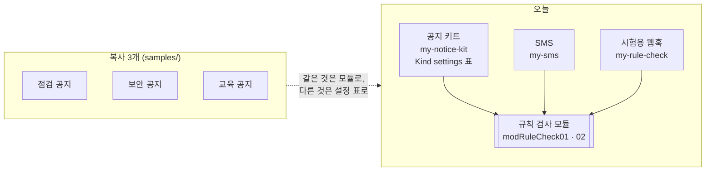

# 70일차 실습 · Workflow 템플릿화와 모듈화, 재사용 가능한 구조 (바이브 코딩)

- 일자: 2026-10-22 (70일차)
- 교과목: 노코드 멀티 에이전트 워크플로우 설계 및 운영
- 단원: 운영·확장 관점의 AI 워크플로우 설계 고도화
- 강의 자료: [Lecture/70](../../Lecture/70/README.md)
- 하루 수강 안내: [LECTURE-70.md](LECTURE-70.md) (수업 준비부터 마칠 때까지 순서대로)
- 67~69일차처럼 CLI 코딩 에이전트에게 **내가 쓴 요청문**으로 워크플로우를 만들게 하고, **테스트로 확인**합니다.

## 오늘 만드는 것: 공지 키트와 규칙 검사 모듈

69일차 공지 팀을 점검·보안·교육 공지에도 쓰고 싶습니다. 워크플로우를 세 번 복사하는 대신, 종류마다 다른 것은 **설정 표**로 빼고(템플릿화), 여러 곳에서 쓰는 규칙 검사는 **모듈**(Sub-workflow)로 떼어 냅니다(모듈화). 모듈을 고칠 때는 쓰는 곳이 깨지지 않게 **버전**을 관리합니다.



## 일하는 방식 (67~69일차와 같음)

| 누가 | 무엇을 |
| --- | --- |
| 나 | 같은 것·다른 것 찾기, 요청문 쓰기, 기대 결과(테스트) 정하기, push·test 실행, 바꿀 때 영향 판단 |
| CLI 에이전트 | [AGENTS.md](AGENTS.md) 규칙대로 워크플로우 JSON 작성, 파일 비교, `check`로 형식 오류 고치기 |
| `tools/flow.py` | check · push(여러 파일, 모듈은 파일의 id 그대로) · off · call · test |

## 실습 문서 읽는 법

- 실습 문서(`LAB-0x-Q-*.md`, `VIBE-Q-TKIT.md`)에는 **복사해 붙일 요청문이 없습니다.** 막히면 `▶` 를 하나씩 펼칩니다.
- 쓴 요청문은 `my-work/PROMPTS.md`에 모아 둡니다.

## 구성

```text
Last3Mon/70/
├── README.md
├── AGENTS.md                         # CLI 에이전트용 작업 규칙 (계약 3절, 모듈 노드 5절)
├── LAB-01-Q-TEMPLATE-KIT.md          # 1단계 · 복사본 3개 비교 → 공지 키트(설정 표) → 새 종류 · 없는 종류
├── LAB-02-Q-MODULES.md               # 2단계 · 규칙 검사 모듈 + 시험용 웹훅 → 키트가 모듈 사용 → SMS도 모듈 사용
├── LAB-03-Q-CHANGE-AND-VERSION.md    # 3단계 · 하위 호환 변경 → 깨지는 변경은 v2 → 어려운 테스트 · 영향 표
├── VIBE-Q-TKIT.md                    # 7교시 바이브 코딩 · tkit (템플릿으로 새 파일 만드는 TUI)
├── *-A-*.md                          # 강사용 정답본 (학생 저장소에는 없음)
├── tools/flow.py
├── samples/                          # 69일차 공지 팀을 종류별로 복사한 워크플로우 3개 (비교용)
├── cases/                            # lab01 · lab01-challenge · lab02-module · lab02-challenge · lab03 · lab03-v2
├── requests/                         # 키트 7종, 모듈 7종, SMS 4종
├── reference/                        # 막혔을 때 이어 가는 워크플로우
├── templates/                        # 재사용 설계서 · 테스트 보고서
├── my-work/                          # 내 결과물
└── runs/                             # 테스트 보고서 (자동 생성)
```

## 준비

[실습 준비](../../Lecture/70/00-DAY70-PREP.md)를 끝내 주세요. 요약:

```bash
cd ~/aio-01d4-stu/Last3Mon/65/n8n && docker compose start      # 65일차 n8n (Ollama는 쓰지 않음 · 처음 한 번 PREP 1절대로 끄기)
cd ~/aio-01d4-stu/Last3Mon/70 && uv run tools/flow.py doctor    # 마지막 줄 ready
```

## `flow.py` 명령 (69일차와 같음)

| 명령 | 하는 일 | 수업 준비 때 |
| --- | --- | --- |
| `uv run tools/flow.py push my-work/rule-check.json my-work/rule-check-test.json` | 모듈과 시험용 웹훅을 함께 게시 (모듈은 파일의 `id` 그대로) | |
| `uv run tools/flow.py call my-rule-check requests/module-good.json -v` | 모듈을 시험용 웹훅으로 부르기 | 0.1초 (LLM 없음) |
| `uv run tools/flow.py call my-notice-kit requests/kit-security.json -v` | 공지 키트 | 1.2~3.8초 |
| `uv run tools/flow.py test cases/lab01.json -v` | 테스트 실행, 보고서를 `runs/`에 저장. `-v`는 케이스마다 보낸 요청 JSON과 받은 응답 JSON을 화면에 보여 줌 (`call`도 같음) | |
