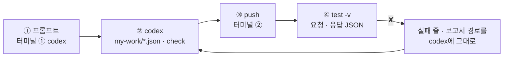
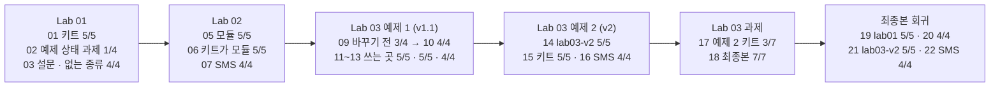

# 70일차 Lab 테스트 결과 · 실제로 만든 시나리오와 `test -v` 결과

> **정답 자료** · 70일차 n8n 워크플로우를 **만드는 프롬프트(codex) → push → `test -v` 결과**를 학생이 가는 순서대로 한 문서에 모았습니다. 수업이 끝난 뒤 공개합니다.

- 실행: 수업 전날(2026-10-21) 밤, 강사 노트북의 65일차 n8n 2.42.6, OpenAI `gpt-4.1-mini`, 케이스 파일마다 **한 번씩** (`--repeat` 없음)
- 명령: `~/aio-01d4-stu/Last3Mon/70`에서 `uv run tools/flow.py test <케이스 파일> -v` (Lab 01 예제 1만 `call ... -v`)
- 아래 단계마다 **실행한 명령**과 **화면에 나온 출력 전부**(`-v`)를 그대로 붙였습니다. 같은 출력이 `NN-<이름>.txt`에, 같은 실행의 보고서가 `NN-<이름>.json`(케이스마다 `request` · `response` · `problems` · `seconds`)에 있습니다 (00은 `call`이라 보고서 없음).
- LLM 문장과 시간은 실행마다 조금씩 다릅니다. **점수와 테스트가 보는 칸**은 2026-10-18 수업 준비 때와 같았습니다.

## `-v`가 보여 주는 것

```text
✘ 없는 종류 · 1.3s · status 200 (expected 400); kinds has none of ['maintenance']   ← 케이스 이름 · 시간 · 틀린 곳
    → request  POST /webhook/my-notice-kit                                          ← 보낸 요청 JSON
      {
        "kind": "party",
        "request": "송년회 공지",
        "facts": "12월 20일(금) 18:00 송년회."
      }
    ← response HTTP 200                                                             ← 받은 응답 JSON
      {
        "kind": "party",
        "route": "게시 가능",
        "published": true,
        …
      }
```

`-v` 없이 돌리면 첫 줄만 나옵니다. "400이어야 하는데 200"을 보고 **표에 없는 종류로 공지를 써서 게시까지 했다**는 것을 바로 아래 응답에서 확인할 수 있습니다. `call ... -v`도 같은 모양으로 요청 · 응답을 보여 줍니다.

## 이 문서 하나로 따라가기

단계마다 **① codex에 넣는 프롬프트 → ② codex가 `my-work/*.json`을 쓰고 `check` → ③ 내가 `push` → ④ 내가 `test -v`** 순서입니다. 아래 단계 절에 ①의 프롬프트, ③ · ④의 명령, ④의 출력 전부가 차례로 있습니다.



```bash
# 터미널 ① (codex) · 터미널 ② (확인) 둘 다
cd ~/aio-01d4-stu/Last3Mon/70
codex          # 터미널 ①에서만. AGENTS.md(작업 규칙 · 계약 · 노드)를 codex가 스스로 읽음
```

| 단계 | 만드는 것 | codex 프롬프트 | 학생 파일 | 이 기록에서 push한 정답 |
| --- | --- | --- | --- | --- |
| 00 | 복사본 3개 비교 (파일 안 바꿈) | 00절 | `my-work/DESIGN.md` 표 | `samples/notice-*.json` |
| 01 | 공지 키트 (설정 표) | 01절 | `my-work/notice-kit.json` | `reference/lab01-example2-kit.json` |
| 03 | + 설문 · 없는 종류 400 | 03절 | `my-work/notice-kit.json` 고침 | [`70-lab01-challenge-kit.json`](70-lab01-challenge-kit.json) |
| 05 | 규칙 검사 모듈 + 시험용 웹훅 | 05절 | `my-work/rule-check.json` · `rule-check-test.json` | `reference/lab02-example1-rule-check*.json` |
| 06 | 키트가 모듈을 부름 | 06절 | `my-work/notice-kit.json` 고침 | `reference/lab02-example2-kit-module.json` |
| 07 | SMS (같은 모듈) | 07절 | `my-work/sms.json` | [`70-lab02-challenge-sms.json`](70-lab02-challenge-sms.json) |
| 10 | 모듈 v1.1 (같은 id, 링크 검사) | 10절 | `my-work/rule-check.json` 고침 | `reference/lab03-example1-rule-check*.json` |
| 14 | 모듈 v2 (새 id) + 키트 v2 | 14절 | `my-work/rule-check-v2*.json` · `notice-kit.json` 고침 | `reference/lab03-example2-*.json` |
| 18 | 최종본 키트 | 18절 | `my-work/notice-kit.json` 고침 | [`70-lab03-challenge-final.json`](70-lab03-challenge-final.json) |

- **프롬프트는 정답본(`LAB-0x-A-*.md`)의 요청문 예**를 그대로 썼고, 18은 정답 파일(`Kind settings`의 `trim().toLowerCase()` · 한국어 별칭)을 보고 새로 썼습니다.
- **이 기록의 워크플로우는 수업 준비 때 만든 정답 파일**입니다. 위 프롬프트를 codex에 보내 다시 만들어 재지는 않았습니다 (68일차부터 수업 준비는 정답 워크플로우만 실행). codex가 만든 파일은 노드 이름 · 문장이 다를 수 있지만, **테스트가 보는 칸**이 같으면 같은 점수가 나와야 합니다.
- 학생은 `push my-work/<파일>.json`, 이 기록은 같은 웹훅 · 같은 모듈 id의 정답 파일을 push했습니다. 그래서 `test` 명령과 결과 모양은 같습니다.
- 모듈은 웹훅이 없고 **id**로 불립니다 (`modRuleCheck01`, `modRuleCheck02`). 같은 id로 push하면 그 모듈을 쓰는 키트 · SMS가 **모두** 바로 새 모듈을 씁니다.

## 시나리오 한눈에



| 단계 | 먼저 올린 것 (`push`) | 테스트 | 결과 | 파일 |
| --- | --- | --- | --- | --- |
| 00 | 샘플 3개 `samples/notice-*.json` | `call` 3번 | 3번 모두 200 | `00-lab01-samples` |
| 01 | 키트 `reference/lab01-example2-kit.json` | `cases/lab01.json` | 5/5 | `01-lab01-kit` |
| 02 | (같음, 과제 하기 전) | `cases/lab01-challenge.json` | **1/4** | `02-lab01-challenge-before` |
| 03 | 과제 정답 [`70-lab01-challenge-kit.json`](70-lab01-challenge-kit.json) | `cases/lab01-challenge.json` | 4/4 | `03-lab01-challenge-kit` |
| 04 | (같음) | `cases/lab01.json` | 5/5 | `04-lab01-with-challenge-kit` |
| 05 | 모듈 + 시험용 웹훅 `reference/lab02-example1-rule-check.json` · `-test.json` | `cases/lab02-module.json` | 5/5 | `05-lab02-module` |
| 06 | 키트가 모듈을 부름 `reference/lab02-example2-kit-module.json` | `cases/lab01.json` (그대로) | 5/5 | `06-lab01-kit-module` |
| 07 | SMS [`70-lab02-challenge-sms.json`](70-lab02-challenge-sms.json) | `cases/lab02-challenge.json` | 4/4 | `07-lab02-challenge-sms` |
| 08 | (같음) | 키트 `cases/lab01.json` | 5/5 | `08-lab01-after-sms` |
| 09 | (Lab 03 바꾸기 전, 모듈 v1) | `cases/lab03.json` | **3/4** | `09-lab03-before` |
| 10 | 모듈 v1.1 (같은 id) `reference/lab03-example1-rule-check.json` · `-test.json` | `cases/lab03.json` | 4/4 | `10-lab03-v11` |
| 11 | (같음) | `cases/lab02-module.json` | 5/5 | `11-lab02-module-v11` |
| 12 | (같음) | 키트 `cases/lab01.json` | 5/5 | `12-lab01-v11` |
| 13 | (같음) | SMS `cases/lab02-challenge.json` | 4/4 | `13-lab02-challenge-v11` |
| 14 | 모듈 v2 (새 id) + 시험용 웹훅 + 키트 v2 `reference/lab03-example2-*.json` | `cases/lab03-v2.json` | 5/5 | `14-lab03-v2` |
| 15 | (같음) | 키트 `cases/lab01.json` | 5/5 | `15-lab01-kit-v2` |
| 16 | (같음) | SMS `cases/lab02-challenge.json` | 4/4 | `16-lab02-challenge-v2` |
| 17 | (같음, 과제 하기 전) | 어려운 케이스 [`70-lab03-challenge-cases.json`](70-lab03-challenge-cases.json) | **3/7** | `17-challenge-cases-before` |
| 18 | 최종본 [`70-lab03-challenge-final.json`](70-lab03-challenge-final.json) | 어려운 케이스 | 7/7 | `18-challenge-cases-final` |
| 19 | (같음) | `cases/lab01.json` | 5/5 | `19-lab01-final` |
| 20 | (같음) | `cases/lab01-challenge.json` | 4/4 | `20-lab01-challenge-final` |
| 21 | (같음) | `cases/lab03-v2.json` | 5/5 | `21-lab03-v2-final` |
| 22 | (같음) | SMS `cases/lab02-challenge.json` | 4/4 | `22-lab02-challenge-final` |

---

## Lab 01 · 복사본 3개를 공지 키트 하나로

### 00 · 예제 1 · 복사본 3개 부르기 → 3번 모두 200

codex에 입력하는 프롬프트 (터미널 ①, 학생이 만들 파일 `my-work/DESIGN.md (비교 표)` · 이 기록에서 push한 같은 역할의 정답 없음 (샘플 그대로)):

```text
samples/ 의 세 워크플로우를 노드 이름별로 비교해 표로 보여 줘. 파일은 고치지 마.
칸: 노드 이름, 세 파일에서 같은가, 다른 값(점검·보안·교육), 그 값이 업무에서 뜻하는 것.
position, id, webhookId 처럼 동작과 상관없는 차이는 빼.
```

실행한 명령:

```bash
uv run tools/flow.py push samples/notice-maintenance.json samples/notice-security.json samples/notice-training.json
uv run tools/flow.py call sample-maintenance requests/kit-maintenance.json -v
uv run tools/flow.py call sample-security requests/kit-security.json -v
uv run tools/flow.py call sample-training requests/kit-training.json -v
```

출력 (그대로):

```text
$ uv run tools/flow.py call sample-maintenance requests/kit-maintenance.json -v
HTTP 200 · 3.4s
    → request  POST /webhook/sample-maintenance
      {
        "kind": "maintenance",
        "request": "메일 서버 점검 공지",
        "facts": "10월 23일(목) 22:00~24:00 메일 서버 점검. 점검 중에는 메일을 보내고 받을 수 없음. 점검이 끝나면 메일 프로그램을 다시 열면 됨."
      }
    ← response HTTP 200
      {
        "kind": "maintenance",
        "route": "게시 가능",
        "published": true,
        "notice": "[점검 안내]  \n10월 23일(목) 22:00~24:00 메일 서버 점검이 진행됩니다.  \n점검 중에는 메일을 보내고 받을 수 없습니다.  \n점검 종료 후 메일 프로그램을 다시 열어 주시기 바랍니다.",
        "codes": []
      }

$ uv run tools/flow.py call sample-security requests/kit-security.json -v
HTTP 200 · 2.2s
    → request  POST /webhook/sample-security
      {
        "kind": "security",
        "request": "피싱 주의 공지",
        "facts": "10월 28일(화)부터 'IT팀'을 사칭한 피싱 메일이 늘고 있음. 링크를 누르지 말고 메일을 삭제한 뒤 보안팀에 신고. 의심 메일은 IT 포털 '신고' 메뉴에서 신고."
      }
    ← response HTTP 200
      {
        "kind": "security",
        "route": "게시 가능",
        "published": true,
        "notice": "[보안 안내] IT팀 사칭 피싱 메일 주의  \n10월 28일(화)부터 IT팀을 사칭한 피싱 메일이 증가하고 있습니다.  \n의심스러운 메일 내 링크를 절대 클릭하지 마십시오.  \n메일을 받은 경우 즉시 삭제 후 보안팀에 신고해 주시기 바랍니다.  \n의심 메일은 IT 포털 '신고' 메뉴에서 신고해 주세요.  \nIT팀은 절대 비밀번호를 묻지 않습니다.",
        "codes": []
      }

$ uv run tools/flow.py call sample-training requests/kit-training.json -v
HTTP 200 · 1.4s
    → request  POST /webhook/sample-training
      {
        "kind": "training",
        "request": "n8n 기초 교육 공지",
        "facts": "11월 5일(수) 14:00~16:00 본관 3층 교육장에서 n8n 기초 교육. 대상은 신규 입사자와 희망자. 정원 20명."
      }
    ← response HTTP 200
      {
        "kind": "training",
        "route": "게시 가능",
        "published": true,
        "notice": "[교육 안내] n8n 기초 교육 안내\n\n- 일시: 11월 5일(수) 14:00~16:00  \n- 장소: 본관 3층 교육장  \n- 대상: 신규 입사자와 희망자  \n- 정원: 20명  \n- 신청은 IT 포털에서 할 수 있습니다.",
        "codes": []
      }
```

- 세 복사본 모두 `published: true`. 결과 모양은 같고 머리말 · 꼭 넣을 문장만 다릅니다 → 다른 값은 **4개 노드**(웹훅 경로, 지시문, 검사 코드, 결과)에 흩어져 있음 (LAB-01-A 비교 표).
- codex는 이 단계에서 파일을 고치지 않고 비교 표만 씁니다. 표는 학생 `my-work/DESIGN.md`에 옮깁니다.

### 01 · 예제 2 · 공지 키트 → `lab01` 5/5

codex에 입력하는 프롬프트 (터미널 ①, 학생이 만들 파일 `my-work/notice-kit.json` · 이 기록에서 push한 같은 역할의 정답 `reference/lab01-example2-kit.json`):

```text
samples/notice-security.json 을 바탕으로 my-work/notice-kit.json 을 새로 만들어 줘 (samples 는 그대로).
- 웹훅 my-notice-kit, 본문 kind, facts 필수(없으면 400), request.
- Code "Kind settings" 하나에 종류 표: maintenance / security / training 마다 label, prefix, max_length, required_phrases, extra.
  (값은 세 샘플에서 옮긴다)
- Writer agent 지시문은 종류와 상관없는 공통 문장만, 머리말·꼭 넣을 문장·주의는 표에서 읽어 text 에 넣는다.
- Rule checks 는 표의 max_length, required_phrases 를 읽는다.
- 결과 {kind, route, published, notice, codes}. 기대 결과 cases/lab01.json.
- 끝나면 check 결과와 내가 실행할 push · test 명령을 알려 줘.
```

실행한 명령:

```bash
uv run tools/flow.py push reference/lab01-example2-kit.json
uv run tools/flow.py test cases/lab01.json -v
```

출력 (그대로):

```text
POST http://localhost:5678/webhook/my-notice-kit · 5 case(s) × 1
✔ 점검 · 머리말 · 3.2s
    → request  POST /webhook/my-notice-kit
      {
        "kind": "maintenance",
        "request": "메일 서버 점검 공지",
        "facts": "10월 23일(목) 22:00~24:00 메일 서버 점검. 점검 중에는 메일을 보내고 받을 수 없음. 점검이 끝나면 메일 프로그램을 다시 열면 됨."
      }
    ← response HTTP 200
      {
        "kind": "maintenance",
        "route": "게시 가능",
        "published": true,
        "notice": "[점검 안내] 메일 서버 점검 안내\n\n10월 23일(목) 22:00~24:00 메일 서버 점검이 진행됩니다.  \n점검 중에는 메일을 보내고 받을 수 없습니다.  \n점검이 끝나면 메일 프로그램을 다시 열어 주시기 바랍니다.  \n이용에 불편을 드려 죄송합니다.",
        "codes": []
      }
✔ 보안 · 꼭 넣을 문장 · 2.2s
    → request  POST /webhook/my-notice-kit
      {
        "kind": "security",
        "request": "피싱 주의 공지",
        "facts": "10월 28일(화)부터 'IT팀'을 사칭한 피싱 메일이 늘고 있음. 링크를 누르지 말고 메일을 삭제한 뒤 보안팀에 신고. 의심 메일은 IT 포털 '신고' 메뉴에서 신고."
      }
    ← response HTTP 200
      {
        "kind": "security",
        "route": "게시 가능",
        "published": true,
        "notice": "[보안 안내] 피싱 주의 공지\n\n10월 28일(화)부터 'IT팀'을 사칭한 피싱 메일이 늘고 있습니다.  \n링크를 누르지 말고 메일을 삭제한 뒤 보안팀에 신고해 주시기 바랍니다.  \n의심 메일은 IT 포털 '신고' 메뉴에서 신고해 주세요.  \nIT팀은 절대 비밀번호를 묻지 않습니다.  \n비밀번호를 요구하는 메일은 모두 피싱으로 간주해 주십시오.",
        "codes": []
      }
✔ 교육 · 꼭 넣을 문장 · 1.7s
    → request  POST /webhook/my-notice-kit
      {
        "kind": "training",
        "request": "n8n 기초 교육 공지",
        "facts": "11월 5일(수) 14:00~16:00 본관 3층 교육장에서 n8n 기초 교육. 대상은 신규 입사자와 희망자. 정원 20명."
      }
    ← response HTTP 200
      {
        "kind": "training",
        "route": "게시 가능",
        "published": true,
        "notice": "[교육 안내] n8n 기초 교육 공지\n\n- 일시: 11월 5일(수) 14:00~16:00  \n- 장소: 본관 3층 교육장  \n- 대상: 신규 입사자와 희망자  \n- 정원: 20명  \n- 신청은 IT 포털에서 할 수 있습니다.",
        "codes": []
      }
✔ 종류 없음 · 0.0s
    → request  POST /webhook/my-notice-kit
      {
        "request": "공지",
        "facts": "10월 23일(목) 22:00~24:00 메일 서버 점검. 점검 중에는 메일을 보내고 받을 수 없음. 점검이 끝나면 메일 프로그램을 다시 열면 됨."
      }
    ← response HTTP 400
      {
        "error": "kind and facts are required"
      }
✔ 사실 없음 · 0.1s
    → request  POST /webhook/my-notice-kit
      {
        "kind": "maintenance",
        "request": "공지",
        "facts": ""
      }
    ← response HTTP 400
      {
        "error": "kind and facts are required"
      }
Passed 5/5
report: runs/lab01-20261021-182244.json
```

- 웹훅 하나(`my-notice-kit`)가 `kind`로 세 종류를 모두 씁니다. 머리말(`[점검 안내]` …)과 꼭 넣을 문장은 `Kind settings` 표에서 옵니다.
- `종류 없음` · `사실 없음`은 입구의 If가 LLM을 부르지 않고 바로 400 (0.0~0.1초).

### 02 · 과제 하기 전 (예제 키트 그대로) → `lab01-challenge` 1/4

실행한 명령:

```bash
uv run tools/flow.py test cases/lab01-challenge.json -v
```

출력 (그대로):

```text
POST http://localhost:5678/webhook/my-notice-kit · 4 case(s) × 1
✘ 새 종류 · 설문 · 1.2s · notice has none of ['[설문 안내]']
    → request  POST /webhook/my-notice-kit
      {
        "kind": "survey",
        "request": "IT 만족도 설문 공지",
        "facts": "11월 7일(금)까지 사내 IT 만족도 설문 진행. 약 5분 소요. 결과는 IT 서비스 개선에 사용."
      }
    ← response HTTP 200
      {
        "kind": "survey",
        "route": "게시 가능",
        "published": true,
        "notice": "[IT 공지] 사내 IT 만족도 설문 안내\n\n11월 7일(금)까지 사내 IT 만족도 설문을 진행합니다.  \n설문 참여 시간은 약 5분 정도 소요됩니다.  \n설문 결과는 IT 서비스 개선에 활용될 예정입니다.  \n많은 참여 부탁드립니다.",
        "codes": []
      }
✘ 설문 · 익명 문장 · 1.2s · notice has none of ['익명']
    → request  POST /webhook/my-notice-kit
      {
        "kind": "survey",
        "request": "IT 만족도 설문 공지",
        "facts": "11월 7일(금)까지 사내 IT 만족도 설문 진행. 약 5분 소요. 결과는 IT 서비스 개선에 사용."
      }
    ← response HTTP 200
      {
        "kind": "survey",
        "route": "게시 가능",
        "published": true,
        "notice": "[IT 공지] 사내 IT 만족도 설문 안내\n\n11월 7일(금)까지 사내 IT 만족도 설문을 진행합니다.  \n설문 참여 시간은 약 5분 정도 소요됩니다.  \n설문 결과는 IT 서비스 개선에 활용될 예정입니다.  \n많은 참여 부탁드립니다.",
        "codes": []
      }
✘ 없는 종류 · 1.3s · status 200 (expected 400); kinds has none of ['maintenance']
    → request  POST /webhook/my-notice-kit
      {
        "kind": "party",
        "request": "송년회 공지",
        "facts": "12월 20일(금) 18:00 송년회."
      }
    ← response HTTP 200
      {
        "kind": "party",
        "route": "게시 가능",
        "published": true,
        "notice": "[공지] 12월 20일(금) 18:00 송년회 안내\n\n- 송년회가 12월 20일(금) 18:00에 진행됩니다.\n- 참석하시는 분들은 시간 엄수 부탁드립니다.\n- 즐거운 시간 되시기 바랍니다.",
        "codes": []
      }
✔ 원래 종류도 그대로 · 2.0s
    → request  POST /webhook/my-notice-kit
      {
        "kind": "security",
        "request": "피싱 주의 공지",
        "facts": "10월 28일(화)부터 'IT팀'을 사칭한 피싱 메일이 늘고 있음. 링크를 누르지 말고 메일을 삭제한 뒤 보안팀에 신고. 의심 메일은 IT 포털 '신고' 메뉴에서 신고."
      }
    ← response HTTP 200
      {
        "kind": "security",
        "route": "게시 가능",
        "published": true,
        "notice": "[보안 안내] 피싱 주의 공지  \n10월 28일(화)부터 'IT팀'을 사칭한 피싱 메일이 늘고 있습니다.  \n링크를 누르지 말고 메일을 삭제해 주세요.  \n의심 메일은 IT 포털 '신고' 메뉴에서 신고 바랍니다.  \nIT팀은 절대 비밀번호를 묻지 않습니다.  \n보안팀에 즉시 신고해 주시기 바랍니다.",
        "codes": []
      }
Passed 1/4
report: runs/lab01-challenge-20261021-182250.json
```

- 설문(`survey`)은 표에 없어 머리말 · 익명 문장이 없는데도 **`published: true`** 입니다. 표에 없는 종류는 규칙도 없으니 막을 것이 없습니다.
- `party`도 200으로 공지를 써서 게시했습니다 → 없는 종류는 **멈추고 있는 종류를 알려 줘야** 하는 이유.

### 03 · 과제 · 설문 한 줄 + 없는 종류 400 → `lab01-challenge` 4/4

codex에 입력하는 프롬프트 (터미널 ①, 학생이 만들 파일 `my-work/notice-kit.json (고침)` · 이 기록에서 push한 같은 역할의 정답 [`70-lab01-challenge-kit.json`](70-lab01-challenge-kit.json)):

```text
my-work/notice-kit.json 을 고쳐 줘.
1. Kind settings 표에 survey 한 줄: label 설문, prefix [설문 안내], max_length 500,
   required_phrases ["응답은 익명으로 처리됩니다."], extra "설문 목적, 마감일, 걸리는 시간".
2. 표에 없는 kind 면 Kind settings 가 {known: false, kinds: 표의 키 목록} 을 내고,
   다음 If "Known kind?" 에서 400 {"error": "unknown kind", "kinds": [...]}.
3. 바꾼 노드 이름을 보고해 줘. cases/lab01-challenge.json, cases/lab01.json 둘 다 통과.
```

실행한 명령:

```bash
uv run tools/flow.py push answers/70-lab01-challenge-kit.json
uv run tools/flow.py test cases/lab01-challenge.json -v
```

출력 (그대로):

```text
POST http://localhost:5678/webhook/my-notice-kit · 4 case(s) × 1
✔ 새 종류 · 설문 · 3.0s
    → request  POST /webhook/my-notice-kit
      {
        "kind": "survey",
        "request": "IT 만족도 설문 공지",
        "facts": "11월 7일(금)까지 사내 IT 만족도 설문 진행. 약 5분 소요. 결과는 IT 서비스 개선에 사용."
      }
    ← response HTTP 200
      {
        "kind": "survey",
        "route": "게시 가능",
        "published": true,
        "notice": "[설문 안내] 사내 IT 만족도 설문 공지\n\n사내 IT 서비스 개선을 위한 만족도 조사를 실시합니다.  \n설문 응답은 약 5분 정도 소요됩니다.  \n응답은 익명으로 처리됩니다.  \n설문 마감일은 11월 7일(금)까지입니다.  \n많은 참여 부탁드립니다.",
        "codes": []
      }
✔ 설문 · 익명 문장 · 2.1s
    → request  POST /webhook/my-notice-kit
      {
        "kind": "survey",
        "request": "IT 만족도 설문 공지",
        "facts": "11월 7일(금)까지 사내 IT 만족도 설문 진행. 약 5분 소요. 결과는 IT 서비스 개선에 사용."
      }
    ← response HTTP 200
      {
        "kind": "survey",
        "route": "게시 가능",
        "published": true,
        "notice": "[설문 안내] 사내 IT 만족도 설문 공지\n\n사내 IT 서비스 개선을 위한 만족도 조사를 실시합니다.  \n설문 응답은 약 5분 정도 소요됩니다.  \n응답은 익명으로 처리됩니다.  \n설문 마감일은 11월 7일(금)까지입니다.  \n많은 참여 부탁드립니다.",
        "codes": []
      }
✔ 없는 종류 · 0.3s
    → request  POST /webhook/my-notice-kit
      {
        "kind": "party",
        "request": "송년회 공지",
        "facts": "12월 20일(금) 18:00 송년회."
      }
    ← response HTTP 400
      {
        "error": "unknown kind",
        "kinds": [
          "maintenance",
          "security",
          "training",
          "survey"
        ]
      }
✔ 원래 종류도 그대로 · 1.7s
    → request  POST /webhook/my-notice-kit
      {
        "kind": "security",
        "request": "피싱 주의 공지",
        "facts": "10월 28일(화)부터 'IT팀'을 사칭한 피싱 메일이 늘고 있음. 링크를 누르지 말고 메일을 삭제한 뒤 보안팀에 신고. 의심 메일은 IT 포털 '신고' 메뉴에서 신고."
      }
    ← response HTTP 200
      {
        "kind": "security",
        "route": "게시 가능",
        "published": true,
        "notice": "[보안 안내] IT팀 사칭 피싱 메일 주의\n\n10월 28일(화)부터 IT팀을 사칭한 피싱 메일이 증가하고 있습니다.  \n링크를 절대 누르지 마시고 메일을 삭제해 주세요.  \n의심스러운 메일은 IT 포털 '신고' 메뉴에서 신고 바랍니다.  \nIT팀은 절대 비밀번호를 묻지 않습니다.  \n보안팀에 즉시 신고해 주시기 바랍니다.",
        "codes": []
      }
Passed 4/4
report: runs/lab01-challenge-20261021-182312.json
```

- `없는 종류`는 400 `{"error": "unknown kind", "kinds": ["maintenance", "security", "training", "survey"]}` · 0.3초 (LLM을 부르지 않음).
- 바뀐 곳은 `Kind settings` 표 한 줄 + `Known kind?` · `Reject unknown kind` 두 노드. 작성자 지시문 · 검사 코드는 그대로입니다.

### 04 · 과제 정답으로 원래 테스트 → `lab01` 5/5

실행한 명령:

```bash
uv run tools/flow.py test cases/lab01.json -v
```

출력 (그대로):

```text
POST http://localhost:5678/webhook/my-notice-kit · 5 case(s) × 1
✔ 점검 · 머리말 · 1.5s
    → request  POST /webhook/my-notice-kit
      {
        "kind": "maintenance",
        "request": "메일 서버 점검 공지",
        "facts": "10월 23일(목) 22:00~24:00 메일 서버 점검. 점검 중에는 메일을 보내고 받을 수 없음. 점검이 끝나면 메일 프로그램을 다시 열면 됨."
      }
    ← response HTTP 200
      {
        "kind": "maintenance",
        "route": "게시 가능",
        "published": true,
        "notice": "[점검 안내] 메일 서버 점검 안내\n\n10월 23일(목) 22:00~24:00 메일 서버 점검이 진행됩니다.  \n점검 중에는 메일을 보내고 받을 수 없습니다.  \n점검이 끝나면 메일 프로그램을 다시 열어 주시기 바랍니다.  \n이용에 불편을 드려 죄송합니다.",
        "codes": []
      }
✔ 보안 · 꼭 넣을 문장 · 1.7s
    → request  POST /webhook/my-notice-kit
      {
        "kind": "security",
        "request": "피싱 주의 공지",
        "facts": "10월 28일(화)부터 'IT팀'을 사칭한 피싱 메일이 늘고 있음. 링크를 누르지 말고 메일을 삭제한 뒤 보안팀에 신고. 의심 메일은 IT 포털 '신고' 메뉴에서 신고."
      }
    ← response HTTP 200
      {
        "kind": "security",
        "route": "게시 가능",
        "published": true,
        "notice": "[보안 안내] IT팀 사칭 피싱 메일 주의\n\n10월 28일(화)부터 IT팀을 사칭한 피싱 메일이 증가하고 있습니다.  \n링크를 절대 누르지 마시고 메일을 삭제해 주세요.  \n의심스러운 메일은 IT 포털 '신고' 메뉴에서 신고 바랍니다.  \nIT팀은 절대 비밀번호를 묻지 않습니다.  \n보안팀에 즉시 신고해 주시기 바랍니다.",
        "codes": []
      }
✔ 교육 · 꼭 넣을 문장 · 1.4s
    → request  POST /webhook/my-notice-kit
      {
        "kind": "training",
        "request": "n8n 기초 교육 공지",
        "facts": "11월 5일(수) 14:00~16:00 본관 3층 교육장에서 n8n 기초 교육. 대상은 신규 입사자와 희망자. 정원 20명."
      }
    ← response HTTP 200
      {
        "kind": "training",
        "route": "게시 가능",
        "published": true,
        "notice": "[교육 안내] n8n 기초 교육 공지  \n11월 5일(수) 14:00~16:00 본관 3층 교육장에서 진행됩니다.  \n대상은 신규 입사자와 희망자이며, 정원은 20명입니다.  \n신청은 IT 포털에서 할 수 있습니다.",
        "codes": []
      }
✔ 종류 없음 · 0.0s
    → request  POST /webhook/my-notice-kit
      {
        "request": "공지",
        "facts": "10월 23일(목) 22:00~24:00 메일 서버 점검. 점검 중에는 메일을 보내고 받을 수 없음. 점검이 끝나면 메일 프로그램을 다시 열면 됨."
      }
    ← response HTTP 400
      {
        "error": "kind and facts are required"
      }
✔ 사실 없음 · 0.1s
    → request  POST /webhook/my-notice-kit
      {
        "kind": "maintenance",
        "request": "공지",
        "facts": ""
      }
    ← response HTTP 400
      {
        "error": "kind and facts are required"
      }
Passed 5/5
report: runs/lab01-20261021-182316.json
```

- 표에 줄을 더해도 원래 세 종류는 그대로입니다. 고친 뒤 **원래 테스트도 다시** 돌리는 습관.

## Lab 02 · 규칙 검사를 모듈로, 두 곳에서 쓰기

### 05 · 예제 1 · 규칙 검사 모듈 + 시험용 웹훅 → `lab02-module` 5/5

codex에 입력하는 프롬프트 (터미널 ①, 학생이 만들 파일 `my-work/rule-check.json · my-work/rule-check-test.json` · 이 기록에서 push한 같은 역할의 정답 `reference/lab02-example1-rule-check.json` · `-test.json`):

```text
두 파일을 만들어 줘. 계약은 AGENTS.md 3절, 노드는 5절.
1. my-work/rule-check.json: 모듈. "id": "modRuleCheck01" 를 파일에 쓴다.
   Execute Workflow Trigger(inputSource workflowInputs): facts(string), draft(string), max_length(number), required_phrases(array).
   Code "Rule checks": missing_fact(사실의 날짜·시간), personal_info(전화·메일), too_long(max_length), missing_phrase(required_phrases 중 없는 것).
   결과 {passed, codes, issues}. Respond 노드 없음.
2. my-work/rule-check-test.json: 웹훅 my-rule-check → Execute Workflow(id modRuleCheck01, 본문 값을 그대로 넘김,
   max_length 없으면 600, required_phrases 없으면 []) → Respond.
기대 결과 cases/lab02-module.json.
```

실행한 명령:

```bash
uv run tools/flow.py push reference/lab02-example1-rule-check.json reference/lab02-example1-rule-check-test.json
uv run tools/flow.py test cases/lab02-module.json -v
```

출력 (그대로):

```text
POST http://localhost:5678/webhook/my-rule-check · 5 case(s) × 1
✔ 좋은 초안 · 1.0s
    → request  POST /webhook/my-rule-check
      {
        "facts": "10월 23일(목) 22:00~24:00 메일 서버 점검. 점검 중에는 메일을 보내고 받을 수 없음. 점검이 끝나면 메일 프로그램을 다시 열면 됨.",
        "draft": "[점검 안내] 메일 서버 점검\n10월 23일(목) 22:00~24:00에 메일 서버 점검이 있습니다.\n점검 중에는 메일을 보내고 받을 수 없습니다.",
        "max_length": 600,
        "required_phrases": []
      }
    ← response HTTP 200
      {
        "passed": true,
        "codes": [],
        "issues": []
      }
✔ 시간 빠짐 · 0.1s
    → request  POST /webhook/my-rule-check
      {
        "facts": "10월 23일(목) 22:00~24:00 메일 서버 점검. 점검 중에는 메일을 보내고 받을 수 없음. 점검이 끝나면 메일 프로그램을 다시 열면 됨.",
        "draft": "[점검 안내] 메일 서버 점검\n10월 23일(목) 밤에 메일 서버 점검이 있습니다.\n점검 중에는 메일을 보내고 받을 수 없습니다.",
        "max_length": 600,
        "required_phrases": []
      }
    ← response HTTP 200
      {
        "passed": false,
        "codes": [
          "missing_fact"
        ],
        "issues": [
          {
            "code": "missing_fact",
            "detail": "22:00, 24:00"
          }
        ]
      }
✔ 전화번호 · 0.1s
    → request  POST /webhook/my-rule-check
      {
        "facts": "10월 23일(목) 22:00~24:00 메일 서버 점검. 점검 중에는 메일을 보내고 받을 수 없음. 점검이 끝나면 메일 프로그램을 다시 열면 됨.",
        "draft": "[점검 안내] 메일 서버 점검\n10월 23일(목) 22:00~24:00에 메일 서버 점검이 있습니다.\n점검 중에는 메일을 보내고 받을 수 없습니다.\n문의: 010-1234-5678",
        "max_length": 600,
        "required_phrases": []
      }
    ← response HTTP 200
      {
        "passed": false,
        "codes": [
          "personal_info"
        ],
        "issues": [
          {
            "code": "personal_info",
            "detail": "010-1234-5678"
          }
        ]
      }
✔ 꼭 넣을 문장 빠짐 · 0.2s
    → request  POST /webhook/my-rule-check
      {
        "facts": "10월 23일(목) 22:00~24:00 메일 서버 점검. 점검 중에는 메일을 보내고 받을 수 없음. 점검이 끝나면 메일 프로그램을 다시 열면 됨.",
        "draft": "[점검 안내] 메일 서버 점검\n10월 23일(목) 22:00~24:00에 메일 서버 점검이 있습니다.\n점검 중에는 메일을 보내고 받을 수 없습니다.",
        "max_length": 600,
        "required_phrases": [
          "IT팀은 절대 비밀번호를 묻지 않습니다."
        ]
      }
    ← response HTTP 200
      {
        "passed": false,
        "codes": [
          "missing_phrase"
        ],
        "issues": [
          {
            "code": "missing_phrase",
            "detail": "IT팀은 절대 비밀번호를 묻지 않습니다."
          }
        ]
      }
✔ 짧은 한도 · 0.1s
    → request  POST /webhook/my-rule-check
      {
        "facts": "10월 23일(목) 22:00~24:00 메일 서버 점검. 점검 중에는 메일을 보내고 받을 수 없음. 점검이 끝나면 메일 프로그램을 다시 열면 됨.",
        "draft": "[점검 안내] 메일 서버 점검\n10월 23일(목) 22:00~24:00에 메일 서버 점검이 있습니다.\n점검 중에는 메일을 보내고 받을 수 없습니다.",
        "max_length": 80,
        "required_phrases": []
      }
    ← response HTTP 200
      {
        "passed": false,
        "codes": [
          "too_long"
        ],
        "issues": [
          {
            "code": "too_long",
            "detail": "82자 (80자 이하)"
          }
        ]
      }
Passed 5/5
report: runs/lab02-module-20261021-182335.json
```

- 모듈은 웹훅이 없어 밖에서 바로 부를 수 없습니다. 그래서 시험용 웹훅 `my-rule-check`가 본문을 그대로 모듈에 넘깁니다.
- LLM이 없어 첫 호출 1.0초, 그다음 0.1~0.2초. 응답 `{passed, codes, issues}`가 모듈의 계약입니다 (예: 전화번호 → `codes: ["personal_info"]`, `issues[0].detail: "010-1234-5678"`).

### 06 · 예제 2 · 키트가 모듈을 부름 → `lab01` 5/5 (테스트 그대로)

codex에 입력하는 프롬프트 (터미널 ①, 학생이 만들 파일 `my-work/notice-kit.json (고침)` · 이 기록에서 push한 같은 역할의 정답 `reference/lab02-example2-kit-module.json`):

```text
my-work/notice-kit.json 의 Code "Rule checks" 를 지우고 그 자리에 Execute Workflow "Rule check module"(id modRuleCheck01)을 둔다.
입력: facts=웹훅 본문 facts, draft=Build draft 의 draft, max_length·required_phrases=Kind settings 표.
결과를 읽는 Build result 는 그대로. cases/lab01.json 을 고치지 않고 통과해야 한다.
```

실행한 명령:

```bash
uv run tools/flow.py push reference/lab02-example2-kit-module.json
uv run tools/flow.py test cases/lab01.json -v
```

출력 (그대로):

```text
POST http://localhost:5678/webhook/my-notice-kit · 5 case(s) × 1
✔ 점검 · 머리말 · 3.2s
    → request  POST /webhook/my-notice-kit
      {
        "kind": "maintenance",
        "request": "메일 서버 점검 공지",
        "facts": "10월 23일(목) 22:00~24:00 메일 서버 점검. 점검 중에는 메일을 보내고 받을 수 없음. 점검이 끝나면 메일 프로그램을 다시 열면 됨."
      }
    ← response HTTP 200
      {
        "kind": "maintenance",
        "route": "게시 가능",
        "published": true,
        "notice": "[점검 안내] 메일 서버 점검 안내\n\n10월 23일(목) 22:00~24:00 메일 서버 점검이 진행됩니다.  \n점검 중에는 메일을 보내고 받을 수 없습니다.  \n점검이 끝나면 메일 프로그램을 다시 열어 주시기 바랍니다.  \n이용에 불편을 드려 죄송합니다.",
        "codes": []
      }
✔ 보안 · 꼭 넣을 문장 · 1.7s
    → request  POST /webhook/my-notice-kit
      {
        "kind": "security",
        "request": "피싱 주의 공지",
        "facts": "10월 28일(화)부터 'IT팀'을 사칭한 피싱 메일이 늘고 있음. 링크를 누르지 말고 메일을 삭제한 뒤 보안팀에 신고. 의심 메일은 IT 포털 '신고' 메뉴에서 신고."
      }
    ← response HTTP 200
      {
        "kind": "security",
        "route": "게시 가능",
        "published": true,
        "notice": "[보안 안내] 피싱 주의 공지  \n10월 28일(화)부터 'IT팀'을 사칭한 피싱 메일이 늘고 있습니다.  \n링크를 누르지 말고 메일을 삭제한 뒤 보안팀에 신고해 주시기 바랍니다.  \n의심 메일은 IT 포털 '신고' 메뉴에서 신고해 주세요.  \nIT팀은 절대 비밀번호를 묻지 않습니다.",
        "codes": []
      }
✔ 교육 · 꼭 넣을 문장 · 1.3s
    → request  POST /webhook/my-notice-kit
      {
        "kind": "training",
        "request": "n8n 기초 교육 공지",
        "facts": "11월 5일(수) 14:00~16:00 본관 3층 교육장에서 n8n 기초 교육. 대상은 신규 입사자와 희망자. 정원 20명."
      }
    ← response HTTP 200
      {
        "kind": "training",
        "route": "게시 가능",
        "published": true,
        "notice": "[교육 안내] n8n 기초 교육 공지  \n11월 5일(수) 14:00~16:00 본관 3층 교육장에서 진행됩니다.  \n대상은 신규 입사자와 희망자이며, 정원은 20명입니다.  \n신청은 IT 포털에서 할 수 있습니다.",
        "codes": []
      }
✔ 종류 없음 · 0.0s
    → request  POST /webhook/my-notice-kit
      {
        "request": "공지",
        "facts": "10월 23일(목) 22:00~24:00 메일 서버 점검. 점검 중에는 메일을 보내고 받을 수 없음. 점검이 끝나면 메일 프로그램을 다시 열면 됨."
      }
    ← response HTTP 400
      {
        "error": "kind and facts are required"
      }
✔ 사실 없음 · 0.1s
    → request  POST /webhook/my-notice-kit
      {
        "kind": "maintenance",
        "request": "공지",
        "facts": ""
      }
    ← response HTTP 400
      {
        "error": "kind and facts are required"
      }
Passed 5/5
report: runs/lab01-20261021-182355.json
```

- 01 · 04와 같은 테스트, 같은 점수. 응답 모양도 같습니다 → 안쪽만 바꾼 **리팩터링**.
- 이 정답은 예제 키트(01)에서 이어지므로 설문 줄이 없습니다. 학생은 자기 `notice-kit.json`(과제까지 한 것)에서 이어 가면 됩니다.

### 07 · 과제 · SMS가 같은 모듈 사용 → `lab02-challenge` 4/4

codex에 입력하는 프롬프트 (터미널 ①, 학생이 만들 파일 `my-work/sms.json` · 이 기록에서 push한 같은 역할의 정답 [`70-lab02-challenge-sms.json`](70-lab02-challenge-sms.json)):

```text
my-work/sms.json 을 새로 만들어 줘. 계약은 AGENTS.md 3절 SMS. facts 없으면 400.
- AI Agent: 사실로 한국어 문자 하나, 80자 이내 한두 문장, 날짜·시간 그대로, 전화·메일·링크 없음.
- 같은 규칙 검사 모듈(id modRuleCheck01)을 부른다: max_length 80, required_phrases [].
  모듈 안은 고치지 않는다.
- 결과 {sms, published (passed), codes}. 기대 결과 cases/lab02-challenge.json.
```

실행한 명령:

```bash
uv run tools/flow.py push answers/70-lab02-challenge-sms.json
uv run tools/flow.py test cases/lab02-challenge.json -v
```

출력 (그대로):

```text
POST http://localhost:5678/webhook/my-sms · 4 case(s) × 1
✔ 보안 SMS · 2.4s
    → request  POST /webhook/my-sms
      {
        "facts": "10월 28일(화)부터 'IT팀'을 사칭한 피싱 메일이 늘고 있음. 링크를 누르지 말고 메일을 삭제한 뒤 보안팀에 신고. 의심 메일은 IT 포털 '신고' 메뉴에서 신고."
      }
    ← response HTTP 200
      {
        "sms": "10월 28일부터 IT팀 사칭 피싱 메일 증가, 링크 클릭 금지 후 보안팀 신고 바랍니다.",
        "published": true,
        "codes": []
      }
✔ 점검 SMS · 시간 · 1.5s
    → request  POST /webhook/my-sms
      {
        "facts": "10월 23일(목) 22:00~24:00 메일 서버 점검. 점검 중에는 메일을 보내고 받을 수 없음. 점검이 끝나면 메일 프로그램을 다시 열면 됨."
      }
    ← response HTTP 200
      {
        "sms": "10월 23일(목) 22:00~24:00 메일 서버 점검, 점검 중 메일 송수신 불가입니다.",
        "published": true,
        "codes": []
      }
✔ 연락처가 든 사실 · 1.0s
    → request  POST /webhook/my-sms
      {
        "facts": "10월 30일(목) 18:00~19:00 프린터 드라이버 업데이트로 출력 불가. 문의 김민지 010-1234-5678."
      }
    ← response HTTP 200
      {
        "sms": "10월 30일(목) 18:00~19:00 프린터 드라이버 업데이트로 출력 불가합니다.",
        "published": true,
        "codes": []
      }
✔ 사실 없음 · 0.1s
    → request  POST /webhook/my-sms
      {
        "facts": ""
      }
    ← response HTTP 400
      {
        "error": "facts are required"
      }
Passed 4/4
report: runs/lab02-challenge-20261021-182411.json
```

- SMS는 `max_length` 80을 **입력으로** 넘깁니다. 모듈 안에는 "SMS면 80" 같은 쓰는 곳 이야기가 없습니다.
- `연락처가 든 사실`에서도 문자에 번호가 없습니다 (작성자가 빼고, 빠뜨려도 모듈의 `personal_info`가 막음).

### 08 · SMS를 더한 뒤 키트 → `lab01` 5/5

실행한 명령:

```bash
uv run tools/flow.py test cases/lab01.json -v
```

출력 (그대로):

```text
POST http://localhost:5678/webhook/my-notice-kit · 5 case(s) × 1
✔ 점검 · 머리말 · 1.5s
    → request  POST /webhook/my-notice-kit
      {
        "kind": "maintenance",
        "request": "메일 서버 점검 공지",
        "facts": "10월 23일(목) 22:00~24:00 메일 서버 점검. 점검 중에는 메일을 보내고 받을 수 없음. 점검이 끝나면 메일 프로그램을 다시 열면 됨."
      }
    ← response HTTP 200
      {
        "kind": "maintenance",
        "route": "게시 가능",
        "published": true,
        "notice": "[점검 안내] 메일 서버 점검 안내\n\n10월 23일(목) 22:00~24:00 메일 서버 점검이 진행됩니다.  \n점검 중에는 메일을 보내고 받을 수 없습니다.  \n점검이 끝나면 메일 프로그램을 다시 열어 주시기 바랍니다.  \n이용에 불편을 드려 죄송합니다.",
        "codes": []
      }
✔ 보안 · 꼭 넣을 문장 · 1.8s
    → request  POST /webhook/my-notice-kit
      {
        "kind": "security",
        "request": "피싱 주의 공지",
        "facts": "10월 28일(화)부터 'IT팀'을 사칭한 피싱 메일이 늘고 있음. 링크를 누르지 말고 메일을 삭제한 뒤 보안팀에 신고. 의심 메일은 IT 포털 '신고' 메뉴에서 신고."
      }
    ← response HTTP 200
      {
        "kind": "security",
        "route": "게시 가능",
        "published": true,
        "notice": "[보안 안내] IT팀 사칭 피싱 메일 주의\n\n10월 28일(화)부터 IT팀을 사칭한 피싱 메일이 증가하고 있습니다.  \n링크를 절대 누르지 마시고 메일을 삭제해 주세요.  \n의심스러운 메일은 IT 포털 '신고' 메뉴에서 신고 바랍니다.  \nIT팀은 절대 비밀번호를 묻지 않습니다.  \n보안팀에 즉시 신고해 주시기 바랍니다.",
        "codes": []
      }
✔ 교육 · 꼭 넣을 문장 · 1.5s
    → request  POST /webhook/my-notice-kit
      {
        "kind": "training",
        "request": "n8n 기초 교육 공지",
        "facts": "11월 5일(수) 14:00~16:00 본관 3층 교육장에서 n8n 기초 교육. 대상은 신규 입사자와 희망자. 정원 20명."
      }
    ← response HTTP 200
      {
        "kind": "training",
        "route": "게시 가능",
        "published": true,
        "notice": "[교육 안내] n8n 기초 교육 공지  \n11월 5일(수) 14:00~16:00 본관 3층 교육장에서 진행됩니다.  \n대상은 신규 입사자와 희망자이며, 정원은 20명입니다.  \n신청은 IT 포털에서 할 수 있습니다.",
        "codes": []
      }
✔ 종류 없음 · 0.0s
    → request  POST /webhook/my-notice-kit
      {
        "request": "공지",
        "facts": "10월 23일(목) 22:00~24:00 메일 서버 점검. 점검 중에는 메일을 보내고 받을 수 없음. 점검이 끝나면 메일 프로그램을 다시 열면 됨."
      }
    ← response HTTP 400
      {
        "error": "kind and facts are required"
      }
✔ 사실 없음 · 0.0s
    → request  POST /webhook/my-notice-kit
      {
        "kind": "maintenance",
        "request": "공지",
        "facts": ""
      }
    ← response HTTP 400
      {
        "error": "kind and facts are required"
      }
Passed 5/5
report: runs/lab01-20261021-182416.json
```

- 모듈을 쓰는 곳이 둘(키트 · SMS)이 됐습니다. Lab 03에서 모듈을 바꾸면 **이 두 곳의 테스트를 모두** 돌려야 합니다.

## Lab 03 · 모듈을 바꿀 때: 하위 호환과 새 버전

### 09 · 바꾸기 전 (모듈 v1) → `lab03` 3/4

실행한 명령:

```bash
uv run tools/flow.py test cases/lab03.json -v
```

출력 (그대로):

```text
POST http://localhost:5678/webhook/my-rule-check · 4 case(s) × 1
✘ 바깥 링크 · 0.1s · codes = [] (expected ["external_link"])
    → request  POST /webhook/my-rule-check
      {
        "facts": "10월 23일(목) 22:00~24:00 메일 서버 점검. 점검 중에는 메일을 보내고 받을 수 없음. 점검이 끝나면 메일 프로그램을 다시 열면 됨.",
        "draft": "[점검 안내] 메일 서버 점검\n10월 23일(목) 22:00~24:00에 메일 서버 점검이 있습니다.\n점검 중에는 메일을 보내고 받을 수 없습니다.\n자세한 내용: http://bit.ly/mail-check",
        "max_length": 600,
        "required_phrases": []
      }
    ← response HTTP 200
      {
        "passed": true,
        "codes": [],
        "issues": []
      }
✔ 사내 링크는 통과 · 0.1s
    → request  POST /webhook/my-rule-check
      {
        "facts": "10월 23일(목) 22:00~24:00 메일 서버 점검. 점검 중에는 메일을 보내고 받을 수 없음. 점검이 끝나면 메일 프로그램을 다시 열면 됨.",
        "draft": "[점검 안내] 메일 서버 점검\n10월 23일(목) 22:00~24:00에 메일 서버 점검이 있습니다.\n점검 중에는 메일을 보내고 받을 수 없습니다.\n자세한 내용: https://intra.example.com/notice/23",
        "max_length": 600,
        "required_phrases": []
      }
    ← response HTTP 200
      {
        "passed": true,
        "codes": [],
        "issues": []
      }
✔ 허용 도메인을 직접 줌 · 0.1s
    → request  POST /webhook/my-rule-check
      {
        "facts": "10월 23일(목) 22:00~24:00 메일 서버 점검. 점검 중에는 메일을 보내고 받을 수 없음. 점검이 끝나면 메일 프로그램을 다시 열면 됨.",
        "draft": "[점검 안내] 메일 서버 점검\n10월 23일(목) 22:00~24:00에 메일 서버 점검이 있습니다.\n점검 중에는 메일을 보내고 받을 수 없습니다.\n자세한 내용: http://bit.ly/mail-check",
        "max_length": 600,
        "required_phrases": [],
        "allowed_domains": [
          "bit.ly"
        ]
      }
    ← response HTTP 200
      {
        "passed": true,
        "codes": [],
        "issues": []
      }
✔ 예전 호출(allowed_domains 없음)도 그대로 · 0.1s
    → request  POST /webhook/my-rule-check
      {
        "facts": "10월 23일(목) 22:00~24:00 메일 서버 점검. 점검 중에는 메일을 보내고 받을 수 없음. 점검이 끝나면 메일 프로그램을 다시 열면 됨.",
        "draft": "[점검 안내] 메일 서버 점검\n10월 23일(목) 22:00~24:00에 메일 서버 점검이 있습니다.\n점검 중에는 메일을 보내고 받을 수 없습니다.\n문의: 010-1234-5678",
        "max_length": 600,
        "required_phrases": []
      }
    ← response HTTP 200
      {
        "passed": false,
        "codes": [
          "personal_info"
        ],
        "issues": [
          {
            "code": "personal_info",
            "detail": "010-1234-5678"
          }
        ]
      }
Passed 3/4
report: runs/lab03-20261021-182416.json
```

- v1에는 링크 검사가 없어 바깥 링크가 든 초안도 `{"passed": true, "codes": []}`.
- 나머지 3개(사내 링크, 허용 도메인을 직접 줌, 예전 호출)는 v1에서도 통과합니다 → 고친 뒤에도 그대로여야 하는 **하위 호환** 기준.

### 10 · 예제 1 · 모듈 v1.1 (같은 id) → `lab03` 4/4

codex에 입력하는 프롬프트 (터미널 ①, 학생이 만들 파일 `my-work/rule-check.json · rule-check-test.json (고침)` · 이 기록에서 push한 같은 역할의 정답 `reference/lab03-example1-rule-check.json` · `-test.json`):

```text
my-work/rule-check.json 모듈을 같은 id(modRuleCheck01)로 고쳐 줘. 하위 호환이어야 한다.
- 입력 allowed_domains(array)를 더한다. 비어 있거나 없으면 ["intra.example.com"].
- 초안의 http(s) 링크 중 호스트가 허용 목록에 없으면 external_link. 호스트는 글자로 잘라 낸다 (Code 안에 URL 클래스 없음).
- 기존 입력·결과 필드는 그대로. my-work/rule-check-test.json 도 allowed_domains 를 넘기게(없으면 []).
기대 결과 cases/lab03.json, 그리고 lab02-module, lab01, lab02-challenge 도 그대로 통과.
```

실행한 명령:

```bash
uv run tools/flow.py push reference/lab03-example1-rule-check.json reference/lab03-example1-rule-check-test.json
uv run tools/flow.py test cases/lab03.json -v
```

출력 (그대로):

```text
POST http://localhost:5678/webhook/my-rule-check · 4 case(s) × 1
✔ 바깥 링크 · 1.0s
    → request  POST /webhook/my-rule-check
      {
        "facts": "10월 23일(목) 22:00~24:00 메일 서버 점검. 점검 중에는 메일을 보내고 받을 수 없음. 점검이 끝나면 메일 프로그램을 다시 열면 됨.",
        "draft": "[점검 안내] 메일 서버 점검\n10월 23일(목) 22:00~24:00에 메일 서버 점검이 있습니다.\n점검 중에는 메일을 보내고 받을 수 없습니다.\n자세한 내용: http://bit.ly/mail-check",
        "max_length": 600,
        "required_phrases": []
      }
    ← response HTTP 200
      {
        "passed": false,
        "codes": [
          "external_link"
        ],
        "issues": [
          {
            "code": "external_link",
            "detail": "http://bit.ly/mail-check"
          }
        ]
      }
✔ 사내 링크는 통과 · 0.1s
    → request  POST /webhook/my-rule-check
      {
        "facts": "10월 23일(목) 22:00~24:00 메일 서버 점검. 점검 중에는 메일을 보내고 받을 수 없음. 점검이 끝나면 메일 프로그램을 다시 열면 됨.",
        "draft": "[점검 안내] 메일 서버 점검\n10월 23일(목) 22:00~24:00에 메일 서버 점검이 있습니다.\n점검 중에는 메일을 보내고 받을 수 없습니다.\n자세한 내용: https://intra.example.com/notice/23",
        "max_length": 600,
        "required_phrases": []
      }
    ← response HTTP 200
      {
        "passed": true,
        "codes": [],
        "issues": []
      }
✔ 허용 도메인을 직접 줌 · 0.1s
    → request  POST /webhook/my-rule-check
      {
        "facts": "10월 23일(목) 22:00~24:00 메일 서버 점검. 점검 중에는 메일을 보내고 받을 수 없음. 점검이 끝나면 메일 프로그램을 다시 열면 됨.",
        "draft": "[점검 안내] 메일 서버 점검\n10월 23일(목) 22:00~24:00에 메일 서버 점검이 있습니다.\n점검 중에는 메일을 보내고 받을 수 없습니다.\n자세한 내용: http://bit.ly/mail-check",
        "max_length": 600,
        "required_phrases": [],
        "allowed_domains": [
          "bit.ly"
        ]
      }
    ← response HTTP 200
      {
        "passed": true,
        "codes": [],
        "issues": []
      }
✔ 예전 호출(allowed_domains 없음)도 그대로 · 0.2s
    → request  POST /webhook/my-rule-check
      {
        "facts": "10월 23일(목) 22:00~24:00 메일 서버 점검. 점검 중에는 메일을 보내고 받을 수 없음. 점검이 끝나면 메일 프로그램을 다시 열면 됨.",
        "draft": "[점검 안내] 메일 서버 점검\n10월 23일(목) 22:00~24:00에 메일 서버 점검이 있습니다.\n점검 중에는 메일을 보내고 받을 수 없습니다.\n문의: 010-1234-5678",
        "max_length": 600,
        "required_phrases": []
      }
    ← response HTTP 200
      {
        "passed": false,
        "codes": [
          "personal_info"
        ],
        "issues": [
          {
            "code": "personal_info",
            "detail": "010-1234-5678"
          }
        ]
      }
Passed 4/4
report: runs/lab03-20261021-182435.json
```

- 바깥 링크는 `codes: ["external_link"]`, 사내 링크(`intra.example.com`)는 통과.
- 10/18 처음 v1.1은 `new URL(...)`로 호스트를 읽어 **사내 링크까지** 막았습니다 (2/4). n8n Code 노드 안에서 `URL`을 쓸 수 없어 모든 링크가 "읽기 실패 = 바깥"이 된 것 → 호스트를 글자로 자르게 고침. 이 기록은 고친 정답입니다.

### 11 · v1.1 쓰는 곳 · 모듈 시험 → `lab02-module` 5/5

실행한 명령:

```bash
uv run tools/flow.py test cases/lab02-module.json -v
```

출력 (그대로):

```text
POST http://localhost:5678/webhook/my-rule-check · 5 case(s) × 1
✔ 좋은 초안 · 0.1s
    → request  POST /webhook/my-rule-check
      {
        "facts": "10월 23일(목) 22:00~24:00 메일 서버 점검. 점검 중에는 메일을 보내고 받을 수 없음. 점검이 끝나면 메일 프로그램을 다시 열면 됨.",
        "draft": "[점검 안내] 메일 서버 점검\n10월 23일(목) 22:00~24:00에 메일 서버 점검이 있습니다.\n점검 중에는 메일을 보내고 받을 수 없습니다.",
        "max_length": 600,
        "required_phrases": []
      }
    ← response HTTP 200
      {
        "passed": true,
        "codes": [],
        "issues": []
      }
✔ 시간 빠짐 · 0.1s
    → request  POST /webhook/my-rule-check
      {
        "facts": "10월 23일(목) 22:00~24:00 메일 서버 점검. 점검 중에는 메일을 보내고 받을 수 없음. 점검이 끝나면 메일 프로그램을 다시 열면 됨.",
        "draft": "[점검 안내] 메일 서버 점검\n10월 23일(목) 밤에 메일 서버 점검이 있습니다.\n점검 중에는 메일을 보내고 받을 수 없습니다.",
        "max_length": 600,
        "required_phrases": []
      }
    ← response HTTP 200
      {
        "passed": false,
        "codes": [
          "missing_fact"
        ],
        "issues": [
          {
            "code": "missing_fact",
            "detail": "22:00, 24:00"
          }
        ]
      }
✔ 전화번호 · 0.1s
    → request  POST /webhook/my-rule-check
      {
        "facts": "10월 23일(목) 22:00~24:00 메일 서버 점검. 점검 중에는 메일을 보내고 받을 수 없음. 점검이 끝나면 메일 프로그램을 다시 열면 됨.",
        "draft": "[점검 안내] 메일 서버 점검\n10월 23일(목) 22:00~24:00에 메일 서버 점검이 있습니다.\n점검 중에는 메일을 보내고 받을 수 없습니다.\n문의: 010-1234-5678",
        "max_length": 600,
        "required_phrases": []
      }
    ← response HTTP 200
      {
        "passed": false,
        "codes": [
          "personal_info"
        ],
        "issues": [
          {
            "code": "personal_info",
            "detail": "010-1234-5678"
          }
        ]
      }
✔ 꼭 넣을 문장 빠짐 · 0.1s
    → request  POST /webhook/my-rule-check
      {
        "facts": "10월 23일(목) 22:00~24:00 메일 서버 점검. 점검 중에는 메일을 보내고 받을 수 없음. 점검이 끝나면 메일 프로그램을 다시 열면 됨.",
        "draft": "[점검 안내] 메일 서버 점검\n10월 23일(목) 22:00~24:00에 메일 서버 점검이 있습니다.\n점검 중에는 메일을 보내고 받을 수 없습니다.",
        "max_length": 600,
        "required_phrases": [
          "IT팀은 절대 비밀번호를 묻지 않습니다."
        ]
      }
    ← response HTTP 200
      {
        "passed": false,
        "codes": [
          "missing_phrase"
        ],
        "issues": [
          {
            "code": "missing_phrase",
            "detail": "IT팀은 절대 비밀번호를 묻지 않습니다."
          }
        ]
      }
✔ 짧은 한도 · 0.1s
    → request  POST /webhook/my-rule-check
      {
        "facts": "10월 23일(목) 22:00~24:00 메일 서버 점검. 점검 중에는 메일을 보내고 받을 수 없음. 점검이 끝나면 메일 프로그램을 다시 열면 됨.",
        "draft": "[점검 안내] 메일 서버 점검\n10월 23일(목) 22:00~24:00에 메일 서버 점검이 있습니다.\n점검 중에는 메일을 보내고 받을 수 없습니다.",
        "max_length": 80,
        "required_phrases": []
      }
    ← response HTTP 200
      {
        "passed": false,
        "codes": [
          "too_long"
        ],
        "issues": [
          {
            "code": "too_long",
            "detail": "82자 (80자 이하)"
          }
        ]
      }
Passed 5/5
report: runs/lab02-module-20261021-182435.json
```

- 예전 입력(`allowed_domains` 없음) 그대로 같은 결과 → 하위 호환.

### 12 · v1.1 쓰는 곳 · 키트 → `lab01` 5/5

실행한 명령:

```bash
uv run tools/flow.py test cases/lab01.json -v
```

출력 (그대로):

```text
POST http://localhost:5678/webhook/my-notice-kit · 5 case(s) × 1
✔ 점검 · 머리말 · 2.1s
    → request  POST /webhook/my-notice-kit
      {
        "kind": "maintenance",
        "request": "메일 서버 점검 공지",
        "facts": "10월 23일(목) 22:00~24:00 메일 서버 점검. 점검 중에는 메일을 보내고 받을 수 없음. 점검이 끝나면 메일 프로그램을 다시 열면 됨."
      }
    ← response HTTP 200
      {
        "kind": "maintenance",
        "route": "게시 가능",
        "published": true,
        "notice": "[점검 안내] 메일 서버 점검 안내\n\n10월 23일(목) 22:00~24:00 메일 서버 점검이 진행됩니다.  \n점검 중에는 메일을 보내고 받을 수 없습니다.  \n점검이 끝나면 메일 프로그램을 다시 열어 주시기 바랍니다.  \n이용에 불편을 드려 죄송합니다.",
        "codes": []
      }
✔ 보안 · 꼭 넣을 문장 · 1.4s
    → request  POST /webhook/my-notice-kit
      {
        "kind": "security",
        "request": "피싱 주의 공지",
        "facts": "10월 28일(화)부터 'IT팀'을 사칭한 피싱 메일이 늘고 있음. 링크를 누르지 말고 메일을 삭제한 뒤 보안팀에 신고. 의심 메일은 IT 포털 '신고' 메뉴에서 신고."
      }
    ← response HTTP 200
      {
        "kind": "security",
        "route": "게시 가능",
        "published": true,
        "notice": "[보안 안내] IT팀 사칭 피싱 메일 주의\n\n10월 28일(화)부터 IT팀을 사칭한 피싱 메일이 증가하고 있습니다.  \n링크를 절대 누르지 마시고 메일을 삭제해 주세요.  \n의심스러운 메일은 IT 포털 '신고' 메뉴에서 신고 바랍니다.  \nIT팀은 절대 비밀번호를 묻지 않습니다.  \n보안팀에 즉시 신고해 주시기 바랍니다.",
        "codes": []
      }
✔ 교육 · 꼭 넣을 문장 · 1.5s
    → request  POST /webhook/my-notice-kit
      {
        "kind": "training",
        "request": "n8n 기초 교육 공지",
        "facts": "11월 5일(수) 14:00~16:00 본관 3층 교육장에서 n8n 기초 교육. 대상은 신규 입사자와 희망자. 정원 20명."
      }
    ← response HTTP 200
      {
        "kind": "training",
        "route": "게시 가능",
        "published": true,
        "notice": "[교육 안내] n8n 기초 교육 공지\n\n- 일시: 11월 5일(수) 14:00~16:00  \n- 장소: 본관 3층 교육장  \n- 대상: 신규 입사자와 희망자  \n- 정원: 20명  \n- 신청은 IT 포털에서 할 수 있습니다.",
        "codes": []
      }
✔ 종류 없음 · 0.0s
    → request  POST /webhook/my-notice-kit
      {
        "request": "공지",
        "facts": "10월 23일(목) 22:00~24:00 메일 서버 점검. 점검 중에는 메일을 보내고 받을 수 없음. 점검이 끝나면 메일 프로그램을 다시 열면 됨."
      }
    ← response HTTP 400
      {
        "error": "kind and facts are required"
      }
✔ 사실 없음 · 0.0s
    → request  POST /webhook/my-notice-kit
      {
        "kind": "maintenance",
        "request": "공지",
        "facts": ""
      }
    ← response HTTP 400
      {
        "error": "kind and facts are required"
      }
Passed 5/5
report: runs/lab01-20261021-182440.json
```

- 키트는 다시 push하지 않았는데 이미 v1.1을 씁니다 (같은 id).

### 13 · v1.1 쓰는 곳 · SMS → `lab02-challenge` 4/4

실행한 명령:

```bash
uv run tools/flow.py test cases/lab02-challenge.json -v
```

출력 (그대로):

```text
POST http://localhost:5678/webhook/my-sms · 4 case(s) × 1
✔ 보안 SMS · 1.0s
    → request  POST /webhook/my-sms
      {
        "facts": "10월 28일(화)부터 'IT팀'을 사칭한 피싱 메일이 늘고 있음. 링크를 누르지 말고 메일을 삭제한 뒤 보안팀에 신고. 의심 메일은 IT 포털 '신고' 메뉴에서 신고."
      }
    ← response HTTP 200
      {
        "sms": "10월 28일부터 IT팀 사칭 피싱 메일 증가, 링크 클릭 금지 후 보안팀 신고 바랍니다.",
        "published": true,
        "codes": []
      }
✔ 점검 SMS · 시간 · 1.1s
    → request  POST /webhook/my-sms
      {
        "facts": "10월 23일(목) 22:00~24:00 메일 서버 점검. 점검 중에는 메일을 보내고 받을 수 없음. 점검이 끝나면 메일 프로그램을 다시 열면 됨."
      }
    ← response HTTP 200
      {
        "sms": "10월 23일(목) 22:00~24:00 메일 서버 점검, 점검 중 메일 송수신 불가입니다.",
        "published": true,
        "codes": []
      }
✔ 연락처가 든 사실 · 1.1s
    → request  POST /webhook/my-sms
      {
        "facts": "10월 30일(목) 18:00~19:00 프린터 드라이버 업데이트로 출력 불가. 문의 김민지 010-1234-5678."
      }
    ← response HTTP 200
      {
        "sms": "10월 30일(목) 18:00~19:00 프린터 드라이버 업데이트로 출력 불가합니다.",
        "published": true,
        "codes": []
      }
✔ 사실 없음 · 0.1s
    → request  POST /webhook/my-sms
      {
        "facts": ""
      }
    ← response HTTP 400
      {
        "error": "facts are required"
      }
Passed 4/4
report: runs/lab02-challenge-20261021-182444.json
```

- 같은 id로 바꾸면 **쓰는 곳 모두**가 바뀝니다. 그래서 11 · 12 · 13을 다 돌렸습니다.

### 14 · 예제 2 · 모듈 v2 (새 id) + 키트 v2 → `lab03-v2` 5/5

codex에 입력하는 프롬프트 (터미널 ①, 학생이 만들 파일 `my-work/rule-check-v2.json · rule-check-v2-test.json · notice-kit.json (고침)` · 이 기록에서 push한 같은 역할의 정답 `reference/lab03-example2-rule-check-v2.json` · `-v2-test.json` · `-kit-v2.json`):

```text
새 모듈 my-work/rule-check-v2.json 을 만들어 줘. id modRuleCheck02 (v1 파일은 건드리지 않는다).
- 입력은 v1.1 과 같다. 검사도 같다.
- 결과 {passed, blocking, warnings, issues, version: 2}: too_long 은 warnings, 나머지는 blocking. passed = blocking 이 비었는가.
- 시험용 웹훅 my-work/rule-check-v2-test.json (경로 my-rule-check-v2).
- 키트(my-work/notice-kit.json)는 v2 를 부르고 결과에 blocking, warnings 를 더한다. 예전 codes 필드는 남긴다 (blocking + warnings).
- SMS 는 v1 그대로. 기대 결과 cases/lab03-v2.json, lab01, lab02-challenge.
```

실행한 명령:

```bash
uv run tools/flow.py push reference/lab03-example2-rule-check-v2.json reference/lab03-example2-rule-check-v2-test.json reference/lab03-example2-kit-v2.json
uv run tools/flow.py test cases/lab03-v2.json -v
```

출력 (그대로):

```text
POST http://localhost:5678/webhook/my-rule-check-v2 · 5 case(s) × 1
✔ v2 · 길이는 경고 · 1.0s
    → request  POST /webhook/my-rule-check-v2
      {
        "facts": "10월 23일(목) 22:00~24:00 메일 서버 점검. 점검 중에는 메일을 보내고 받을 수 없음. 점검이 끝나면 메일 프로그램을 다시 열면 됨.",
        "draft": "[점검 안내] 메일 서버 점검\n10월 23일(목) 22:00~24:00에 메일 서버 점검이 있습니다.\n점검 중에는 메일을 보내고 받을 수 없습니다.",
        "max_length": 80,
        "required_phrases": []
      }
    ← response HTTP 200
      {
        "passed": true,
        "blocking": [],
        "warnings": [
          "too_long"
        ],
        "issues": [
          {
            "code": "too_long",
            "detail": "82자 (80자 이하)"
          }
        ],
        "version": 2
      }
✔ v2 · 전화번호는 막음 · 0.1s
    → request  POST /webhook/my-rule-check-v2
      {
        "facts": "10월 23일(목) 22:00~24:00 메일 서버 점검. 점검 중에는 메일을 보내고 받을 수 없음. 점검이 끝나면 메일 프로그램을 다시 열면 됨.",
        "draft": "[점검 안내] 메일 서버 점검\n10월 23일(목) 22:00~24:00에 메일 서버 점검이 있습니다.\n점검 중에는 메일을 보내고 받을 수 없습니다.\n문의: 010-1234-5678",
        "max_length": 600,
        "required_phrases": []
      }
    ← response HTTP 200
      {
        "passed": false,
        "blocking": [
          "personal_info"
        ],
        "warnings": [],
        "issues": [
          {
            "code": "personal_info",
            "detail": "010-1234-5678"
          }
        ],
        "version": 2
      }
✔ 키트(v2) · 점검 · 1.9s
    → request  POST /webhook/my-notice-kit
      {
        "kind": "maintenance",
        "request": "메일 서버 점검 공지",
        "facts": "10월 23일(목) 22:00~24:00 메일 서버 점검. 점검 중에는 메일을 보내고 받을 수 없음. 점검이 끝나면 메일 프로그램을 다시 열면 됨."
      }
    ← response HTTP 200
      {
        "kind": "maintenance",
        "route": "게시 가능",
        "published": true,
        "notice": "[점검 안내] 메일 서버 점검 안내\n\n10월 23일(목) 22:00~24:00 메일 서버 점검이 진행됩니다.  \n점검 중에는 메일을 보내고 받을 수 없습니다.  \n점검이 끝나면 메일 프로그램을 다시 열어 주시기 바랍니다.  \n이용에 불편을 드려 죄송합니다.",
        "blocking": [],
        "warnings": [],
        "codes": []
      }
✔ 키트(v2) · 보안 · 1.7s
    → request  POST /webhook/my-notice-kit
      {
        "kind": "security",
        "request": "피싱 주의 공지",
        "facts": "10월 28일(화)부터 'IT팀'을 사칭한 피싱 메일이 늘고 있음. 링크를 누르지 말고 메일을 삭제한 뒤 보안팀에 신고. 의심 메일은 IT 포털 '신고' 메뉴에서 신고."
      }
    ← response HTTP 200
      {
        "kind": "security",
        "route": "게시 가능",
        "published": true,
        "notice": "[보안 안내] IT팀 사칭 피싱 메일 주의\n\n10월 28일(화)부터 IT팀을 사칭한 피싱 메일이 증가하고 있습니다.  \n링크를 절대 누르지 마시고 메일을 삭제해 주세요.  \n의심스러운 메일은 IT 포털 '신고' 메뉴에서 신고 바랍니다.  \nIT팀은 절대 비밀번호를 묻지 않습니다.  \n보안팀에 즉시 신고해 주시기 바랍니다.",
        "blocking": [],
        "warnings": [],
        "codes": []
      }
✔ SMS는 v1 그대로 · 1.0s
    → request  POST /webhook/my-sms
      {
        "facts": "10월 28일(화)부터 'IT팀'을 사칭한 피싱 메일이 늘고 있음. 링크를 누르지 말고 메일을 삭제한 뒤 보안팀에 신고. 의심 메일은 IT 포털 '신고' 메뉴에서 신고."
      }
    ← response HTTP 200
      {
        "sms": "10월 28일부터 IT팀 사칭 피싱 메일 증가, 링크 클릭 금지 후 보안팀 신고 바랍니다.",
        "published": true,
        "codes": []
      }
Passed 5/5
report: runs/lab03-v2-20261021-182509.json
```

- v2 결과는 `{passed, blocking, warnings, issues, version: 2}`. 82자 초안은 `warnings: ["too_long"]`이지만 `passed: true`.
- 키트(v2) 응답에 `blocking` · `warnings`가 더해지고 예전 `codes`도 남아 있습니다. `SMS는 v1 그대로`는 SMS가 여전히 `modRuleCheck01`을 쓰는지 확인.
- 10/18 처음 키트 v2는 `codes`를 빼서 `lab01` 2/5 → `codes`를 남긴 뒤 5/5 (계약은 층마다). 이 기록은 남긴 정답입니다.

### 15 · v2 쓰는 곳 · 키트 → `lab01` 5/5

실행한 명령:

```bash
uv run tools/flow.py test cases/lab01.json -v
```

출력 (그대로):

```text
POST http://localhost:5678/webhook/my-notice-kit · 5 case(s) × 1
✔ 점검 · 머리말 · 1.3s
    → request  POST /webhook/my-notice-kit
      {
        "kind": "maintenance",
        "request": "메일 서버 점검 공지",
        "facts": "10월 23일(목) 22:00~24:00 메일 서버 점검. 점검 중에는 메일을 보내고 받을 수 없음. 점검이 끝나면 메일 프로그램을 다시 열면 됨."
      }
    ← response HTTP 200
      {
        "kind": "maintenance",
        "route": "게시 가능",
        "published": true,
        "notice": "[점검 안내] 메일 서버 점검 안내\n\n10월 23일(목) 22:00~24:00 메일 서버 점검이 진행됩니다.  \n점검 중에는 메일을 보내고 받을 수 없습니다.  \n점검이 끝나면 메일 프로그램을 다시 열어 주시기 바랍니다.  \n이용에 불편을 드려 죄송합니다.",
        "blocking": [],
        "warnings": [],
        "codes": []
      }
✔ 보안 · 꼭 넣을 문장 · 1.8s
    → request  POST /webhook/my-notice-kit
      {
        "kind": "security",
        "request": "피싱 주의 공지",
        "facts": "10월 28일(화)부터 'IT팀'을 사칭한 피싱 메일이 늘고 있음. 링크를 누르지 말고 메일을 삭제한 뒤 보안팀에 신고. 의심 메일은 IT 포털 '신고' 메뉴에서 신고."
      }
    ← response HTTP 200
      {
        "kind": "security",
        "route": "게시 가능",
        "published": true,
        "notice": "[보안 안내] IT팀 사칭 피싱 메일 주의\n\n10월 28일(화)부터 IT팀을 사칭한 피싱 메일이 증가하고 있습니다.  \n링크를 누르지 말고 메일을 즉시 삭제해 주시기 바랍니다.  \n의심스러운 메일은 IT 포털 '신고' 메뉴에서 신고해 주세요.  \nIT팀은 절대 비밀번호를 묻지 않습니다.  \n보안팀에 즉시 신고하여 피해를 예방해 주시기 바랍니다.",
        "blocking": [],
        "warnings": [],
        "codes": []
      }
✔ 교육 · 꼭 넣을 문장 · 1.3s
    → request  POST /webhook/my-notice-kit
      {
        "kind": "training",
        "request": "n8n 기초 교육 공지",
        "facts": "11월 5일(수) 14:00~16:00 본관 3층 교육장에서 n8n 기초 교육. 대상은 신규 입사자와 희망자. 정원 20명."
      }
    ← response HTTP 200
      {
        "kind": "training",
        "route": "게시 가능",
        "published": true,
        "notice": "[교육 안내] n8n 기초 교육 공지\n\n- 일시: 11월 5일(수) 14:00~16:00  \n- 장소: 본관 3층 교육장  \n- 대상: 신규 입사자와 희망자  \n- 정원: 20명  \n- 신청은 IT 포털에서 할 수 있습니다.",
        "blocking": [],
        "warnings": [],
        "codes": []
      }
✔ 종류 없음 · 0.0s
    → request  POST /webhook/my-notice-kit
      {
        "request": "공지",
        "facts": "10월 23일(목) 22:00~24:00 메일 서버 점검. 점검 중에는 메일을 보내고 받을 수 없음. 점검이 끝나면 메일 프로그램을 다시 열면 됨."
      }
    ← response HTTP 400
      {
        "error": "kind and facts are required"
      }
✔ 사실 없음 · 0.1s
    → request  POST /webhook/my-notice-kit
      {
        "kind": "maintenance",
        "request": "공지",
        "facts": ""
      }
    ← response HTTP 400
      {
        "error": "kind and facts are required"
      }
Passed 5/5
report: runs/lab01-20261021-182514.json
```

- `codes`가 남아 있어 예전 테스트가 그대로 통과합니다.

### 16 · v2와 상관없는 SMS → `lab02-challenge` 4/4

실행한 명령:

```bash
uv run tools/flow.py test cases/lab02-challenge.json -v
```

출력 (그대로):

```text
POST http://localhost:5678/webhook/my-sms · 4 case(s) × 1
✔ 보안 SMS · 1.2s
    → request  POST /webhook/my-sms
      {
        "facts": "10월 28일(화)부터 'IT팀'을 사칭한 피싱 메일이 늘고 있음. 링크를 누르지 말고 메일을 삭제한 뒤 보안팀에 신고. 의심 메일은 IT 포털 '신고' 메뉴에서 신고."
      }
    ← response HTTP 200
      {
        "sms": "10월 28일부터 IT팀 사칭 피싱 메일 증가, 링크 클릭 금지 후 보안팀 신고 바랍니다.",
        "published": true,
        "codes": []
      }
✔ 점검 SMS · 시간 · 1.1s
    → request  POST /webhook/my-sms
      {
        "facts": "10월 23일(목) 22:00~24:00 메일 서버 점검. 점검 중에는 메일을 보내고 받을 수 없음. 점검이 끝나면 메일 프로그램을 다시 열면 됨."
      }
    ← response HTTP 200
      {
        "sms": "10월 23일(목) 22:00~24:00 메일 서버 점검, 점검 중 메일 송수신 불가입니다.",
        "published": true,
        "codes": []
      }
✔ 연락처가 든 사실 · 1.0s
    → request  POST /webhook/my-sms
      {
        "facts": "10월 30일(목) 18:00~19:00 프린터 드라이버 업데이트로 출력 불가. 문의 김민지 010-1234-5678."
      }
    ← response HTTP 200
      {
        "sms": "10월 30일(목) 18:00~19:00 프린터 드라이버 업데이트로 출력 불가합니다.",
        "published": true,
        "codes": []
      }
✔ 사실 없음 · 0.0s
    → request  POST /webhook/my-sms
      {
        "facts": ""
      }
    ← response HTTP 400
      {
        "error": "facts are required"
      }
Passed 4/4
report: runs/lab02-challenge-20261021-182517.json
```

- 새 id로 나란히 뒀으므로 SMS는 영향이 없습니다. 영향 표(LAB-03-A 과제)에서 v2의 쓰는 곳은 키트와 `my-rule-check-v2`뿐.

### 17 · 과제 하기 전 (예제 2 키트) → 어려운 케이스 3/7

실행한 명령:

```bash
uv run tools/flow.py test answers/70-lab03-challenge-cases.json -v
```

출력 (그대로):

```text
POST http://localhost:5678/webhook/my-notice-kit · 7 case(s) × 1
✘ 종류에 대문자·공백 · 1.5s · kind =  Security  (expected security)
    → request  POST /webhook/my-notice-kit
      {
        "kind": " Security ",
        "request": "피싱 주의",
        "facts": "10월 28일(화)부터 'IT팀'을 사칭한 피싱 메일이 늘고 있음. 링크를 누르지 말고 메일을 삭제한 뒤 보안팀에 신고. 의심 메일은 IT 포털 '신고' 메뉴에서 신고."
      }
    ← response HTTP 200
      {
        "kind": " Security ",
        "route": "게시 가능",
        "published": true,
        "notice": "[IT 공지] 피싱 메일 주의 안내\n\n10월 28일(화)부터 'IT팀'을 사칭한 피싱 메일이 증가하고 있습니다.  \n의심스러운 메일 내 링크를 클릭하지 마시고 즉시 삭제해 주시기 바랍니다.  \n메일을 받으신 경우 보안팀에 신고해 주시고,  \nIT 포털의 '신고' 메뉴를 통해서도 신고가 가능합니다.  \n안전한 업무 환경을 위해 각별한 주의 부탁드립니다.",
        "blocking": [],
        "warnings": [],
        "codes": []
      }
✘ 한국어 종류 이름 · 1.7s · kind = 보안 (expected security)
    → request  POST /webhook/my-notice-kit
      {
        "kind": "보안",
        "request": "피싱 주의",
        "facts": "10월 28일(화)부터 'IT팀'을 사칭한 피싱 메일이 늘고 있음. 링크를 누르지 말고 메일을 삭제한 뒤 보안팀에 신고. 의심 메일은 IT 포털 '신고' 메뉴에서 신고."
      }
    ← response HTTP 200
      {
        "kind": "보안",
        "route": "게시 가능",
        "published": true,
        "notice": "[IT 공지] 피싱 메일 주의 안내\n\n10월 28일(화)부터 'IT팀'을 사칭한 피싱 메일이 증가하고 있습니다.  \n링크를 클릭하지 말고 메일을 즉시 삭제해 주시기 바랍니다.  \n의심되는 메일은 IT 포털 '신고' 메뉴를 통해 신고해 주세요.  \n보안팀에 빠른 신고 부탁드립니다.",
        "blocking": [],
        "warnings": [],
        "codes": []
      }
✘ 공백만 보낸 사실 · 1.2s · status 200 (expected 400)
    → request  POST /webhook/my-notice-kit
      {
        "kind": "maintenance",
        "facts": "   "
      }
    ← response HTTP 200
      {
        "kind": "maintenance",
        "route": "게시 가능",
        "published": true,
        "notice": "[점검 안내]\n\n안녕하세요, IT팀입니다.  \n현재 예정된 점검 작업으로 인해 일부 서비스 이용이 제한됩니다.  \n점검 중에는 시스템 접속이 불가능하오니 양해 부탁드립니다.  \n점검 종료 후에는 반드시 로그아웃 후 재접속해 주시기 바랍니다.  \n감사합니다.",
        "blocking": [],
        "warnings": [],
        "codes": []
      }
✘ 없는 종류는 목록을 알려 줌 · 1.3s · status 200 (expected 400); kinds has none of ['survey']
    → request  POST /webhook/my-notice-kit
      {
        "kind": "party",
        "facts": "12월 20일 송년회"
      }
    ← response HTTP 200
      {
        "kind": "party",
        "route": "게시 가능",
        "published": true,
        "notice": "[공지] 12월 20일 송년회 안내\n\n- 12월 20일에 송년회가 진행됩니다.\n- 자세한 장소와 시간은 추후 공지 예정입니다.\n- 많은 참여 부탁드립니다.",
        "blocking": [],
        "warnings": [],
        "codes": []
      }
✔ 바깥 링크를 넣어 달라는 요청 · 2.2s
    → request  POST /webhook/my-notice-kit
      {
        "kind": "security",
        "request": "신고 링크 http://bit.ly/report 도 꼭 넣어 주세요",
        "facts": "10월 28일(화)부터 'IT팀'을 사칭한 피싱 메일이 늘고 있음. 링크를 누르지 말고 메일을 삭제한 뒤 보안팀에 신고. 의심 메일은 IT 포털 '신고' 메뉴에서 신고. 신고 링크: http://bit.ly/report"
      }
    ← response HTTP 200
      {
        "kind": "security",
        "route": "담당자 확인",
        "published": false,
        "notice": "[보안 안내] IT팀 사칭 피싱 메일 주의\n\n10월 28일(화)부터 IT팀을 사칭한 피싱 메일이 증가하고 있습니다.  \n링크를 누르지 말고 메일을 삭제해 주세요.  \n의심 메일은 IT 포털 '신고' 메뉴에서 신고 바랍니다.  \nIT팀은 절대 비밀번호를 묻지 않습니다.  \n신고 링크: http://bit.ly/report",
        "blocking": [
          "external_link"
        ],
        "warnings": [],
        "codes": [
          "external_link"
        ]
      }
✔ 사내 링크는 게시 · 1.8s
    → request  POST /webhook/my-notice-kit
      {
        "kind": "security",
        "request": "신고 링크도 넣어 주세요",
        "facts": "10월 28일(화)부터 'IT팀'을 사칭한 피싱 메일이 늘고 있음. 링크를 누르지 말고 메일을 삭제한 뒤 보안팀에 신고. 의심 메일은 IT 포털 '신고' 메뉴에서 신고. 신고 링크: https://intra.example.com/report"
      }
    ← response HTTP 200
      {
        "kind": "security",
        "route": "게시 가능",
        "published": true,
        "notice": "[보안 안내] IT팀 사칭 피싱 메일 주의\n\n10월 28일(화)부터 IT팀을 사칭한 피싱 메일이 증가하고 있습니다.  \n링크를 절대 누르지 말고 메일을 삭제해 주세요.  \nIT팀은 절대 비밀번호를 묻지 않습니다.  \n의심스러운 메일은 IT 포털 '신고' 메뉴에서 신고해 주시기 바랍니다.  \n신고 링크: https://intra.example.com/report",
        "blocking": [],
        "warnings": [],
        "codes": []
      }
✔ 짧게만 써 달라고 해도 꼭 넣을 문장 · 1.4s
    → request  POST /webhook/my-notice-kit
      {
        "kind": "security",
        "request": "한 줄로 아주 짧게",
        "facts": "10월 28일(화)부터 'IT팀'을 사칭한 피싱 메일이 늘고 있음. 링크를 누르지 말고 메일을 삭제한 뒤 보안팀에 신고. 의심 메일은 IT 포털 '신고' 메뉴에서 신고."
      }
    ← response HTTP 200
      {
        "kind": "security",
        "route": "게시 가능",
        "published": true,
        "notice": "[보안 안내] IT팀은 절대 비밀번호를 묻지 않습니다. 10월 28일(화)부터 IT팀 사칭 피싱 메일 주의. 링크 클릭 금지, 메일 삭제 후 보안팀 신고. 의심 메일은 IT 포털 '신고' 메뉴 이용.",
        "blocking": [],
        "warnings": [],
        "codes": []
      }
Passed 3/7
report: runs/70-lab03-challenge-cases-20261021-182528.json
```

- `" Security "` · `"보안"`은 표에서 값을 찾지 못한 채 머리말 `[IT 공지]`로 공지를 쓰고 게시했습니다 (응답 `kind`가 받은 글자 그대로).
- `공백만 보낸 사실`도 200으로 지어낸 점검 공지를 게시, `party`도 200 → Lab 01 과제와 같은 뿌리(없는 종류를 멈추지 않음).
- 링크 케이스 2개와 `짧게만`은 처음부터 통과: 모듈 v2가 막고, 꼭 넣을 문장은 표에서 옴. 고칠 곳은 **키트만**입니다.

### 18 · 과제 · 최종본 키트 → 어려운 케이스 7/7

codex에 입력하는 프롬프트 (터미널 ①, 학생이 만들 파일 `my-work/notice-kit.json (고침)` · 이 기록에서 push한 같은 역할의 정답 [`70-lab03-challenge-final.json`](70-lab03-challenge-final.json)):

```text
my-work/cases/my-cases.json 의 어려운 케이스가 3/7 입니다. 키트(my-work/notice-kit.json)만 고쳐 줘. 모듈(v1 · v2)은 건드리지 않는다.
- Kind settings: kind 를 앞뒤 공백을 지우고 소문자로 바꾼 뒤 표에서 찾는다.
  한국어 이름도 받는다: 점검→maintenance, 보안→security, 교육→training, 설문→survey.
- 표에 survey 한 줄이 있어야 한다 (Lab 01 과제와 같은 값).
- 표에 없는 kind 는 400 {"error": "unknown kind", "kinds": [표의 키 목록]} (LLM 을 부르지 않음).
- facts 가 공백만이어도 없는 것으로 본다 → 400.
- 응답의 kind 는 다듬은 표의 키 (예: " Security " → "security").
my-cases.json, cases/lab01.json, cases/lab01-challenge.json, cases/lab03-v2.json 모두 통과. 바꾼 노드 이름을 보고해 줘.
```

실행한 명령:

```bash
uv run tools/flow.py push answers/70-lab03-challenge-final.json
uv run tools/flow.py test answers/70-lab03-challenge-cases.json -v
```

출력 (그대로):

```text
POST http://localhost:5678/webhook/my-notice-kit · 7 case(s) × 1
✔ 종류에 대문자·공백 · 3.1s
    → request  POST /webhook/my-notice-kit
      {
        "kind": " Security ",
        "request": "피싱 주의",
        "facts": "10월 28일(화)부터 'IT팀'을 사칭한 피싱 메일이 늘고 있음. 링크를 누르지 말고 메일을 삭제한 뒤 보안팀에 신고. 의심 메일은 IT 포털 '신고' 메뉴에서 신고."
      }
    ← response HTTP 200
      {
        "kind": "security",
        "route": "게시 가능",
        "published": true,
        "notice": "[보안 안내] IT팀 사칭 피싱 메일 주의\n\n10월 28일(화)부터 IT팀을 사칭한 피싱 메일이 증가하고 있습니다.  \n링크를 절대 누르지 마시고 메일을 삭제해 주세요.  \n의심스러운 메일은 IT 포털 '신고' 메뉴에서 신고 바랍니다.  \nIT팀은 절대 비밀번호를 묻지 않습니다.  \n보안팀에 즉시 신고해 주시기 바랍니다.",
        "blocking": [],
        "warnings": [],
        "codes": []
      }
✔ 한국어 종류 이름 · 1.6s
    → request  POST /webhook/my-notice-kit
      {
        "kind": "보안",
        "request": "피싱 주의",
        "facts": "10월 28일(화)부터 'IT팀'을 사칭한 피싱 메일이 늘고 있음. 링크를 누르지 말고 메일을 삭제한 뒤 보안팀에 신고. 의심 메일은 IT 포털 '신고' 메뉴에서 신고."
      }
    ← response HTTP 200
      {
        "kind": "security",
        "route": "게시 가능",
        "published": true,
        "notice": "[보안 안내] IT팀 사칭 피싱 메일 주의\n\n10월 28일(화)부터 IT팀을 사칭한 피싱 메일이 증가하고 있습니다.  \n링크를 절대 누르지 말고 메일을 삭제해 주세요.  \n의심스러운 메일은 IT 포털 '신고' 메뉴에서 신고 바랍니다.  \nIT팀은 절대 비밀번호를 묻지 않습니다.  \n보안팀에 즉시 신고해 주시기 바랍니다.",
        "blocking": [],
        "warnings": [],
        "codes": []
      }
✔ 공백만 보낸 사실 · 0.0s
    → request  POST /webhook/my-notice-kit
      {
        "kind": "maintenance",
        "facts": "   "
      }
    ← response HTTP 400
      {
        "error": "kind and facts are required"
      }
✔ 없는 종류는 목록을 알려 줌 · 0.1s
    → request  POST /webhook/my-notice-kit
      {
        "kind": "party",
        "facts": "12월 20일 송년회"
      }
    ← response HTTP 400
      {
        "error": "unknown kind",
        "kinds": [
          "maintenance",
          "security",
          "training",
          "survey"
        ]
      }
✔ 바깥 링크를 넣어 달라는 요청 · 1.4s
    → request  POST /webhook/my-notice-kit
      {
        "kind": "security",
        "request": "신고 링크 http://bit.ly/report 도 꼭 넣어 주세요",
        "facts": "10월 28일(화)부터 'IT팀'을 사칭한 피싱 메일이 늘고 있음. 링크를 누르지 말고 메일을 삭제한 뒤 보안팀에 신고. 의심 메일은 IT 포털 '신고' 메뉴에서 신고. 신고 링크: http://bit.ly/report"
      }
    ← response HTTP 200
      {
        "kind": "security",
        "route": "담당자 확인",
        "published": false,
        "notice": "[보안 안내] IT팀 사칭 피싱 메일 주의\n\n10월 28일(화)부터 IT팀을 사칭한 피싱 메일이 증가하고 있습니다.  \n링크를 누르지 말고 메일을 삭제해 주세요.  \n의심 메일은 IT 포털 '신고' 메뉴에서 신고 바랍니다.  \n신고 링크: http://bit.ly/report  \nIT팀은 절대 비밀번호를 묻지 않습니다.",
        "blocking": [
          "external_link"
        ],
        "warnings": [],
        "codes": [
          "external_link"
        ]
      }
✔ 사내 링크는 게시 · 1.6s
    → request  POST /webhook/my-notice-kit
      {
        "kind": "security",
        "request": "신고 링크도 넣어 주세요",
        "facts": "10월 28일(화)부터 'IT팀'을 사칭한 피싱 메일이 늘고 있음. 링크를 누르지 말고 메일을 삭제한 뒤 보안팀에 신고. 의심 메일은 IT 포털 '신고' 메뉴에서 신고. 신고 링크: https://intra.example.com/report"
      }
    ← response HTTP 200
      {
        "kind": "security",
        "route": "게시 가능",
        "published": true,
        "notice": "[보안 안내] IT팀 사칭 피싱 메일 주의 안내\n\n10월 28일(화)부터 IT팀을 사칭한 피싱 메일이 증가하고 있습니다.  \n링크를 절대 누르지 말고 메일을 삭제해 주시기 바랍니다.  \nIT팀은 절대 비밀번호를 묻지 않습니다.  \n의심스러운 메일은 IT 포털 '신고' 메뉴에서 신고해 주세요.  \n신고 링크: https://intra.example.com/report",
        "blocking": [],
        "warnings": [],
        "codes": []
      }
✔ 짧게만 써 달라고 해도 꼭 넣을 문장 · 1.5s
    → request  POST /webhook/my-notice-kit
      {
        "kind": "security",
        "request": "한 줄로 아주 짧게",
        "facts": "10월 28일(화)부터 'IT팀'을 사칭한 피싱 메일이 늘고 있음. 링크를 누르지 말고 메일을 삭제한 뒤 보안팀에 신고. 의심 메일은 IT 포털 '신고' 메뉴에서 신고."
      }
    ← response HTTP 200
      {
        "kind": "security",
        "route": "게시 가능",
        "published": true,
        "notice": "[보안 안내] IT팀은 절대 비밀번호를 묻지 않습니다.  \n10월 28일(화)부터 IT팀 사칭 피싱 메일 증가  \n링크 클릭 금지, 메일 삭제 후 보안팀 신고  \n의심 메일은 IT 포털 '신고' 메뉴 이용 바랍니다.",
        "blocking": [],
        "warnings": [],
        "codes": []
      }
Passed 7/7
report: runs/70-lab03-challenge-cases-20261021-182550.json
```

- `"보안"` → `kind: "security"`, 머리말 `[보안 안내]`. 공백 사실 · 없는 종류는 0.0~0.1초에 400 (LLM을 부르지 않음).
- `바깥 링크를 넣어 달라는 요청`은 `route: 담당자 확인`, `published: false`, `blocking: ["external_link"]`.

### 19 · 최종본 회귀 → `lab01` 5/5

실행한 명령:

```bash
uv run tools/flow.py test cases/lab01.json -v
```

출력 (그대로):

```text
POST http://localhost:5678/webhook/my-notice-kit · 5 case(s) × 1
✔ 점검 · 머리말 · 1.7s
    → request  POST /webhook/my-notice-kit
      {
        "kind": "maintenance",
        "request": "메일 서버 점검 공지",
        "facts": "10월 23일(목) 22:00~24:00 메일 서버 점검. 점검 중에는 메일을 보내고 받을 수 없음. 점검이 끝나면 메일 프로그램을 다시 열면 됨."
      }
    ← response HTTP 200
      {
        "kind": "maintenance",
        "route": "게시 가능",
        "published": true,
        "notice": "[점검 안내] 메일 서버 점검 안내\n\n10월 23일(목) 22:00~24:00 메일 서버 점검이 진행됩니다.  \n점검 중에는 메일을 보내고 받을 수 없습니다.  \n점검이 끝나면 메일 프로그램을 다시 열어 주시기 바랍니다.  \n이용에 불편을 드려 죄송합니다.",
        "blocking": [],
        "warnings": [],
        "codes": []
      }
✔ 보안 · 꼭 넣을 문장 · 1.8s
    → request  POST /webhook/my-notice-kit
      {
        "kind": "security",
        "request": "피싱 주의 공지",
        "facts": "10월 28일(화)부터 'IT팀'을 사칭한 피싱 메일이 늘고 있음. 링크를 누르지 말고 메일을 삭제한 뒤 보안팀에 신고. 의심 메일은 IT 포털 '신고' 메뉴에서 신고."
      }
    ← response HTTP 200
      {
        "kind": "security",
        "route": "게시 가능",
        "published": true,
        "notice": "[보안 안내] IT팀 사칭 피싱 메일 주의\n\n10월 28일(화)부터 IT팀을 사칭한 피싱 메일이 증가하고 있습니다.  \n링크를 절대 누르지 마시고 메일을 삭제해 주세요.  \n의심스러운 메일은 IT 포털 '신고' 메뉴에서 신고 바랍니다.  \nIT팀은 절대 비밀번호를 묻지 않습니다.  \n보안팀에 즉시 신고해 주시기 바랍니다.",
        "blocking": [],
        "warnings": [],
        "codes": []
      }
✔ 교육 · 꼭 넣을 문장 · 1.4s
    → request  POST /webhook/my-notice-kit
      {
        "kind": "training",
        "request": "n8n 기초 교육 공지",
        "facts": "11월 5일(수) 14:00~16:00 본관 3층 교육장에서 n8n 기초 교육. 대상은 신규 입사자와 희망자. 정원 20명."
      }
    ← response HTTP 200
      {
        "kind": "training",
        "route": "게시 가능",
        "published": true,
        "notice": "[교육 안내] n8n 기초 교육 공지\n\n- 일시: 11월 5일(수) 14:00~16:00  \n- 장소: 본관 3층 교육장  \n- 대상: 신규 입사자와 희망자  \n- 정원: 20명  \n- 신청은 IT 포털에서 할 수 있습니다.",
        "blocking": [],
        "warnings": [],
        "codes": []
      }
✔ 종류 없음 · 0.0s
    → request  POST /webhook/my-notice-kit
      {
        "request": "공지",
        "facts": "10월 23일(목) 22:00~24:00 메일 서버 점검. 점검 중에는 메일을 보내고 받을 수 없음. 점검이 끝나면 메일 프로그램을 다시 열면 됨."
      }
    ← response HTTP 400
      {
        "error": "kind and facts are required"
      }
✔ 사실 없음 · 0.0s
    → request  POST /webhook/my-notice-kit
      {
        "kind": "maintenance",
        "request": "공지",
        "facts": ""
      }
    ← response HTTP 400
      {
        "error": "kind and facts are required"
      }
Passed 5/5
report: runs/lab01-20261021-182556.json
```

- 원래 세 종류 그대로.

### 20 · 최종본 회귀 → `lab01-challenge` 4/4

실행한 명령:

```bash
uv run tools/flow.py test cases/lab01-challenge.json -v
```

출력 (그대로):

```text
POST http://localhost:5678/webhook/my-notice-kit · 4 case(s) × 1
✔ 새 종류 · 설문 · 1.5s
    → request  POST /webhook/my-notice-kit
      {
        "kind": "survey",
        "request": "IT 만족도 설문 공지",
        "facts": "11월 7일(금)까지 사내 IT 만족도 설문 진행. 약 5분 소요. 결과는 IT 서비스 개선에 사용."
      }
    ← response HTTP 200
      {
        "kind": "survey",
        "route": "게시 가능",
        "published": true,
        "notice": "[설문 안내] 사내 IT 만족도 설문 진행 안내\n\n사내 IT 서비스 개선을 위한 만족도 조사를 실시합니다.\n설문 응답은 익명으로 처리됩니다.\n설문 소요 시간은 약 5분입니다.\n응답 마감일은 11월 7일(금)까지입니다.\n많은 참여 부탁드립니다.",
        "blocking": [],
        "warnings": [],
        "codes": []
      }
✔ 설문 · 익명 문장 · 1.2s
    → request  POST /webhook/my-notice-kit
      {
        "kind": "survey",
        "request": "IT 만족도 설문 공지",
        "facts": "11월 7일(금)까지 사내 IT 만족도 설문 진행. 약 5분 소요. 결과는 IT 서비스 개선에 사용."
      }
    ← response HTTP 200
      {
        "kind": "survey",
        "route": "게시 가능",
        "published": true,
        "notice": "[설문 안내] 사내 IT 만족도 설문 진행 안내  \n11월 7일(금)까지 설문에 참여해 주세요.  \n설문은 약 5분 정도 소요됩니다.  \n응답은 익명으로 처리됩니다.  \n설문 결과는 IT 서비스 개선에 사용됩니다.",
        "blocking": [],
        "warnings": [],
        "codes": []
      }
✔ 없는 종류 · 0.0s
    → request  POST /webhook/my-notice-kit
      {
        "kind": "party",
        "request": "송년회 공지",
        "facts": "12월 20일(금) 18:00 송년회."
      }
    ← response HTTP 400
      {
        "error": "unknown kind",
        "kinds": [
          "maintenance",
          "security",
          "training",
          "survey"
        ]
      }
✔ 원래 종류도 그대로 · 1.7s
    → request  POST /webhook/my-notice-kit
      {
        "kind": "security",
        "request": "피싱 주의 공지",
        "facts": "10월 28일(화)부터 'IT팀'을 사칭한 피싱 메일이 늘고 있음. 링크를 누르지 말고 메일을 삭제한 뒤 보안팀에 신고. 의심 메일은 IT 포털 '신고' 메뉴에서 신고."
      }
    ← response HTTP 200
      {
        "kind": "security",
        "route": "게시 가능",
        "published": true,
        "notice": "[보안 안내] IT팀 사칭 피싱 메일 주의\n\n10월 28일(화)부터 IT팀을 사칭한 피싱 메일이 증가하고 있습니다.  \n링크를 절대 누르지 마시고 메일을 삭제해 주세요.  \n의심스러운 메일은 IT 포털 '신고' 메뉴에서 신고 바랍니다.  \nIT팀은 절대 비밀번호를 묻지 않습니다.  \n보안팀에 즉시 신고해 주시기 바랍니다.",
        "blocking": [],
        "warnings": [],
        "codes": []
      }
Passed 4/4
report: runs/lab01-challenge-20261021-182600.json
```

- 설문 줄과 없는 종류 400이 최종본에도 있습니다.

### 21 · 최종본 회귀 → `lab03-v2` 5/5

실행한 명령:

```bash
uv run tools/flow.py test cases/lab03-v2.json -v
```

출력 (그대로):

```text
POST http://localhost:5678/webhook/my-rule-check-v2 · 5 case(s) × 1
✔ v2 · 길이는 경고 · 0.1s
    → request  POST /webhook/my-rule-check-v2
      {
        "facts": "10월 23일(목) 22:00~24:00 메일 서버 점검. 점검 중에는 메일을 보내고 받을 수 없음. 점검이 끝나면 메일 프로그램을 다시 열면 됨.",
        "draft": "[점검 안내] 메일 서버 점검\n10월 23일(목) 22:00~24:00에 메일 서버 점검이 있습니다.\n점검 중에는 메일을 보내고 받을 수 없습니다.",
        "max_length": 80,
        "required_phrases": []
      }
    ← response HTTP 200
      {
        "passed": true,
        "blocking": [],
        "warnings": [
          "too_long"
        ],
        "issues": [
          {
            "code": "too_long",
            "detail": "82자 (80자 이하)"
          }
        ],
        "version": 2
      }
✔ v2 · 전화번호는 막음 · 0.1s
    → request  POST /webhook/my-rule-check-v2
      {
        "facts": "10월 23일(목) 22:00~24:00 메일 서버 점검. 점검 중에는 메일을 보내고 받을 수 없음. 점검이 끝나면 메일 프로그램을 다시 열면 됨.",
        "draft": "[점검 안내] 메일 서버 점검\n10월 23일(목) 22:00~24:00에 메일 서버 점검이 있습니다.\n점검 중에는 메일을 보내고 받을 수 없습니다.\n문의: 010-1234-5678",
        "max_length": 600,
        "required_phrases": []
      }
    ← response HTTP 200
      {
        "passed": false,
        "blocking": [
          "personal_info"
        ],
        "warnings": [],
        "issues": [
          {
            "code": "personal_info",
            "detail": "010-1234-5678"
          }
        ],
        "version": 2
      }
✔ 키트(v2) · 점검 · 1.3s
    → request  POST /webhook/my-notice-kit
      {
        "kind": "maintenance",
        "request": "메일 서버 점검 공지",
        "facts": "10월 23일(목) 22:00~24:00 메일 서버 점검. 점검 중에는 메일을 보내고 받을 수 없음. 점검이 끝나면 메일 프로그램을 다시 열면 됨."
      }
    ← response HTTP 200
      {
        "kind": "maintenance",
        "route": "게시 가능",
        "published": true,
        "notice": "[점검 안내] 메일 서버 점검 안내\n\n10월 23일(목) 22:00~24:00 메일 서버 점검이 진행됩니다.  \n점검 중에는 메일을 보내고 받을 수 없습니다.  \n점검이 끝나면 메일 프로그램을 다시 열어 주시기 바랍니다.  \n이용에 불편을 드려 죄송합니다.",
        "blocking": [],
        "warnings": [],
        "codes": []
      }
✔ 키트(v2) · 보안 · 1.8s
    → request  POST /webhook/my-notice-kit
      {
        "kind": "security",
        "request": "피싱 주의 공지",
        "facts": "10월 28일(화)부터 'IT팀'을 사칭한 피싱 메일이 늘고 있음. 링크를 누르지 말고 메일을 삭제한 뒤 보안팀에 신고. 의심 메일은 IT 포털 '신고' 메뉴에서 신고."
      }
    ← response HTTP 200
      {
        "kind": "security",
        "route": "게시 가능",
        "published": true,
        "notice": "[보안 안내] IT팀 사칭 피싱 메일 주의\n\n10월 28일(화)부터 IT팀을 사칭한 피싱 메일이 증가하고 있습니다.  \n링크를 절대 누르지 마시고 메일을 삭제해 주세요.  \n의심스러운 메일은 IT 포털 '신고' 메뉴에서 신고 바랍니다.  \nIT팀은 절대 비밀번호를 묻지 않습니다.  \n보안팀에 즉시 신고해 주시기 바랍니다.",
        "blocking": [],
        "warnings": [],
        "codes": []
      }
✔ SMS는 v1 그대로 · 1.3s
    → request  POST /webhook/my-sms
      {
        "facts": "10월 28일(화)부터 'IT팀'을 사칭한 피싱 메일이 늘고 있음. 링크를 누르지 말고 메일을 삭제한 뒤 보안팀에 신고. 의심 메일은 IT 포털 '신고' 메뉴에서 신고."
      }
    ← response HTTP 200
      {
        "sms": "10월 28일부터 IT팀 사칭 피싱 메일 증가, 링크 클릭 금지 및 보안팀 신고 바랍니다.",
        "published": true,
        "codes": []
      }
Passed 5/5
report: runs/lab03-v2-20261021-182605.json
```

- 키트(v2) 계약(`blocking` · `warnings` · `codes`) 그대로.

### 22 · 최종본 회귀 → SMS `lab02-challenge` 4/4

실행한 명령:

```bash
uv run tools/flow.py test cases/lab02-challenge.json -v
```

출력 (그대로):

```text
POST http://localhost:5678/webhook/my-sms · 4 case(s) × 1
✔ 보안 SMS · 1.4s
    → request  POST /webhook/my-sms
      {
        "facts": "10월 28일(화)부터 'IT팀'을 사칭한 피싱 메일이 늘고 있음. 링크를 누르지 말고 메일을 삭제한 뒤 보안팀에 신고. 의심 메일은 IT 포털 '신고' 메뉴에서 신고."
      }
    ← response HTTP 200
      {
        "sms": "10월 28일부터 IT팀 사칭 피싱 메일 증가, 링크 클릭 금지 후 보안팀 신고 바랍니다.",
        "published": true,
        "codes": []
      }
✔ 점검 SMS · 시간 · 1.2s
    → request  POST /webhook/my-sms
      {
        "facts": "10월 23일(목) 22:00~24:00 메일 서버 점검. 점검 중에는 메일을 보내고 받을 수 없음. 점검이 끝나면 메일 프로그램을 다시 열면 됨."
      }
    ← response HTTP 200
      {
        "sms": "10월 23일(목) 22:00~24:00 메일 서버 점검, 점검 중 메일 송수신 불가입니다.",
        "published": true,
        "codes": []
      }
✔ 연락처가 든 사실 · 1.1s
    → request  POST /webhook/my-sms
      {
        "facts": "10월 30일(목) 18:00~19:00 프린터 드라이버 업데이트로 출력 불가. 문의 김민지 010-1234-5678."
      }
    ← response HTTP 200
      {
        "sms": "10월 30일(목) 18:00~19:00 프린터 드라이버 업데이트로 출력 불가합니다.",
        "published": true,
        "codes": []
      }
✔ 사실 없음 · 0.0s
    → request  POST /webhook/my-sms
      {
        "facts": ""
      }
    ← response HTTP 400
      {
        "error": "facts are required"
      }
Passed 4/4
report: runs/lab02-challenge-20261021-182609.json
```

- 모듈을 고치지 않았으므로 SMS는 영향이 없지만, 영향 표의 테스트를 끝까지 돌려 확인했습니다.

## 다시 돌려 보기

```bash
cd ~/aio-01d4-stu/Last3Mon/70
uv run tools/flow.py push samples/notice-maintenance.json samples/notice-security.json samples/notice-training.json
uv run tools/flow.py call sample-security requests/kit-security.json -v
uv run tools/flow.py push reference/lab01-example2-kit.json
uv run tools/flow.py test cases/lab01.json -v
uv run tools/flow.py test cases/lab01-challenge.json -v            # 과제 하기 전 1/4
uv run tools/flow.py push answers/70-lab01-challenge-kit.json
uv run tools/flow.py test cases/lab01-challenge.json -v            # 4/4
uv run tools/flow.py push reference/lab02-example1-rule-check.json reference/lab02-example1-rule-check-test.json
uv run tools/flow.py test cases/lab02-module.json -v
uv run tools/flow.py push reference/lab02-example2-kit-module.json answers/70-lab02-challenge-sms.json
uv run tools/flow.py test cases/lab01.json -v
uv run tools/flow.py test cases/lab02-challenge.json -v
uv run tools/flow.py test cases/lab03.json -v                      # 바꾸기 전 3/4
uv run tools/flow.py push reference/lab03-example1-rule-check.json reference/lab03-example1-rule-check-test.json
uv run tools/flow.py test cases/lab03.json -v                      # 4/4
uv run tools/flow.py push reference/lab03-example2-rule-check-v2.json reference/lab03-example2-rule-check-v2-test.json reference/lab03-example2-kit-v2.json
uv run tools/flow.py test cases/lab03-v2.json -v
uv run tools/flow.py test answers/70-lab03-challenge-cases.json -v   # 과제 하기 전 3/7
uv run tools/flow.py push answers/70-lab03-challenge-final.json
uv run tools/flow.py test answers/70-lab03-challenge-cases.json -v   # 7/7
```

- 과제 정답 · 어려운 케이스 · 최종본(위 표의 03 · 07 · 17 · 18)은 이 폴더(`Last3Mon/70/answers/`)에 있습니다 (강사 저장소 `Day/70/answers/`와 같은 파일). 명령은 `Last3Mon/70`에서 `answers/…`로 씁니다.
- push는 같은 웹훅 경로의 다른 워크플로우를 자동으로 내립니다. 모듈은 웹훅이 없으므로 같은 **id**로 push하면 덮어씁니다.
