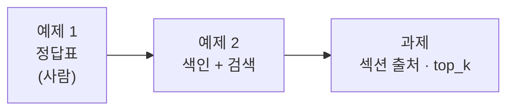

# Lab 01 · 정답표, 색인, 검색

- 관련 강의: [1단계 · RAG와 색인](../../Lecture/71/01-STAGE1-RAG-AND-INDEX.md)
- 소요 시간: 약 40분 (예제 1 10분 · 예제 2 15분 · 과제 15분)
- 준비: [실습 준비](../../Lecture/71/00-DAY71-PREP.md)의 `uv run tools/flow.py doctor` → `ready` (데이터 API가 **71일차 판**이어야 `/docs`가 보임)
- 목표: 검색을 만들기 **전에** "어느 질문이 어느 문서에서 답을 찾아야 하는지" 정답표를 만들고, 규정 문서를 색인·검색하는 워크플로우를 내가 쓴 요청문으로 만든다.



> 이 실습에는 **복사해 붙일 요청문이 없습니다.** 막히면 `▶` 를 하나씩 펼칩니다.

## 예제 1 · 정답표 (10분, 에이전트 없이)

`cp templates/RAG-EVAL-TEMPLATE.md my-work/RAG-EVAL.md` 후 1절을 **직접** 채웁니다. 문서는 `data-api/data/docs/`에 있습니다 (또는 `curl -s localhost:8800/docs`).

| 질문 |
| --- |
| 비밀번호는 몇 자 이상이어야 하나요? |
| 암호를 얼마나 자주 바꿔야 해? |
| 회사를 그만두면 노트북은 언제까지 돌려줘야 하나요? |
| 첨부 파일이 너무 커서 메일이 안 보내져요 |
| 생성형 AI에 고객 자료를 넣어도 되나요? |
| 연차 휴가는 며칠이에요? |

<details><summary>▶ 1단계 · 왜 먼저 정답표를</summary>

검색 결과를 보고 "그럴듯하다"고 판단하면, 틀린 문서가 나와도 알아채기 어렵습니다. 먼저 사람이 정답(문서 · 섹션 · 답 문구)을 정해 두면 검색이 맞았는지 **숫자로** 셀 수 있습니다 (Lab 03에서 24문항으로).
</details>

<details><summary>▶ 2단계 · 답이 없는 질문</summary>

마지막 질문의 답은 어느 문서에 있나요? "없음"도 정답입니다. 이런 질문에 검색은 무엇을 돌려줄까요? Lab 02에서 다룹니다.
</details>

<details><summary>▶ 정답 (직접 채운 뒤에 펼치기)</summary>

| 질문 | 문서 | 섹션 | 답 문구 | 원문 |
| --- | --- | --- | --- | --- |
| 비밀번호는 몇 자 이상이어야 하나요? | `password-policy` | 1. 비밀번호 만들기 | 12자 이상 | 비밀번호는 12자 이상으로 만든다. |
| 암호를 얼마나 자주 바꿔야 해? | `password-policy` | 2. 변경 주기 | 90일마다 | 비밀번호는 90일마다 바꾼다. |
| 회사를 그만두면 노트북은 언제까지 돌려줘야 하나요? | `device-issue-return` | 3. 반납 | 5영업일 이내 | 퇴사하거나 장비를 교체할 때는 5영업일 이내에 장비를 IT 담당자에게 반납한다. |
| 첨부 파일이 너무 커서 메일이 안 보내져요 | `email-and-documents` | 2. 첨부 파일 | 25MB, 사내 드라이브 | 메일 첨부 파일은 25MB까지 보낼 수 있다. 25MB를 넘는 파일은 사내 드라이브에 올리고 공유 링크를 보낸다. |
| 생성형 AI에 고객 자료를 넣어도 되나요? | `software-usage` | 3. 생성형 AI 서비스 | 입력하지 않는다 | 고객 정보, 개인정보, 대외비 문서는 생성형 AI 서비스에 입력하지 않는다. |
| 연차 휴가는 며칠이에요? | **없음** | — | — | 규정 8개 어디에도 없음 |

- "암호"(질문)와 "비밀번호"(문서), "그만두면"(질문)과 "퇴사"(문서)처럼 **질문의 낱말이 문서에 없는** 것이 있습니다. 예제 2에서 검색이 이것을 찾는지 봅니다.
- 노트북 질문의 답은 "1. 지급과 교체"가 아니라 "3. 반납"에 있습니다. "노트북"이라는 낱말은 1절에만 나옵니다. Lab 03에서 이 차이가 실패를 만듭니다.
</details>

## 예제 2 · 색인과 검색 (15분)

**만들 것**: 두 워크플로우.

| 파일 | 하는 일 |
| --- | --- |
| `my-work/index.json` (`my-index`) | 규정 문서를 모두 가져와 **섹션(`## `)마다 청크** 하나 → 임베딩 → 메모리 저장소 `my_policy_docs`. 결과 `indexed_chunks` |
| `my-work/search.json` (`my-search`) | 질문과 가까운 청크 `top_k`(기본 3)개. 결과 `hits[]`에 순위·문서·제목·점수·글 |

계약은 [AGENTS.md](AGENTS.md) 3절, 노드는 5절. 기대 결과 `cases/lab01.json` (`before`가 먼저 색인합니다).

<details><summary>▶ 1단계 · 한 번에 하나씩</summary>

색인과 검색은 따로 만들고 따로 확인합니다. 색인을 먼저 push하고 `call my-index`로 청크 수를 봅니다. 섹션이 모두 몇 개인지 문서에서 세어 보면 결과가 맞는지 알 수 있습니다.
</details>

<details><summary>▶ 2단계 · 청크에 무엇을 붙일까</summary>

청크 글만 저장하면 검색 결과가 **어느 문서**에서 왔는지 모릅니다. 문서 이름·제목을 함께 저장하라고 적었나요? 청크 글 앞에 문서 제목을 붙이는 것도 검색에 도움이 됩니다 (AGENTS.md 5절 Code).
</details>

<details><summary>▶ 3단계 · 메모리 저장소의 함정</summary>

색인을 만든 뒤 검색을 push하면 n8n이 재시작되면서 저장소가 **비워집니다.** 검색 결과가 비면 먼저 `call my-index`. 저장소가 비었을 때 검색이 멈추지 않게 하는 설정도 AGENTS.md 5절에 있습니다.
</details>

<details><summary>▶ 빈칸 채우기 · 요청문 뼈대</summary>

요청문에 꼭 들어갈 것: **① 문서를 어디서 ② 청크를 무엇으로 나누나 ③ 청크와 함께 저장할 것 ④ 저장소 이름 ⑤ 결과 칸 이름 ⑥ 비었을 때 ⑦ 기대 결과**. 아래 `____`를 채워 `my-work/PROMPTS.md`에 쓴 뒤 에이전트에게 보냅니다.

```text
두 워크플로우를 만들어 줘. 계약은 AGENTS.md 3절, 노드는 5절.

1. my-work/index.json (웹훅 my-index)
   - 문서: GET http://data-api:8800/____ 로 목록 → 문서마다 GET /docs/<name>
   - 청크: Code 에서 본문을 "____" 마다 하나씩. 청크 글 앞에 ____ 를 붙인다.
   - 함께 저장: ____ , ____ , 청크 번호
   - 저장: 메모리 Vector Store (insert, memoryKey ____ , 매번 비우고) + OpenAI Embeddings ____
   - 결과: { ____ , chunking }

2. my-work/search.json (웹훅 my-search)
   - question 이 없으면 ____
   - 같은 저장소에서 load, topK = 본문 top_k (없으면 ____ ), 메타데이터 포함
   - 저장소가 비어도 멈추지 않게: ____
   - 결과: { question, hits: [{ rank, ____ , ____ , score, text }], top_score, indexed }

기대 결과는 cases/lab01.json. 끝나면 check 결과와 내가 실행할 push · test 명령을 알려 줘.
```

채울 값은 모두 [AGENTS.md](AGENTS.md) 3절(계약)과 5절(노드)에 있습니다.
</details>

<details><summary>▶ 그래도 막히면 · 빈칸을 채운 모양</summary>

```text
두 워크플로우를 만들어 줘. 계약은 AGENTS.md 3절, 노드는 5절.

1. my-work/index.json (웹훅 my-index)
   - 문서: GET http://data-api:8800/docs 로 목록 → 문서마다 GET /docs/<name>
   - 청크: Code 에서 본문을 "## " 섹션마다 하나씩. 청크 글 앞에 문서 제목을 붙인다.
     본문 chunking 이 숫자면 그 글자 수로 자른다 (기본 section, Lab 03에서 씀).
   - 함께 저장: source(문서 name), title, 청크 번호 (Default Data Loader 메타데이터)
   - 저장: 메모리 Vector Store (insert, memoryKey my_policy_docs, clearStore true) + OpenAI Embeddings text-embedding-3-large
   - 결과: { indexed_chunks, chunking }

2. my-work/search.json (웹훅 my-search)
   - question 이 없으면 400
   - 같은 저장소에서 load, topK = 본문 top_k (없으면 3), 메타데이터 포함
   - 저장소가 비어도 멈추지 않게: Always Output Data, 다음 Code 에서 document 가 있는 항목만
   - 결과: { question, hits: [{ rank, source, title, score(소수 셋째 자리), text }], top_score, indexed }

기대 결과는 cases/lab01.json. 끝나면 check 결과와 내가 실행할 push · test 명령을 알려 줘.
```

- 보내기 전에 내 뼈대와 다른 곳을 찾아 봅니다. 빠뜨린 곳이 에이전트가 **멋대로 정하는 곳**입니다.
- 에이전트가 답하면 바로 push하지 말고, 1절 작업 순서대로 "입력 · 노드 순서 · 결과 모양"을 먼저 보여 주는지 확인합니다.
</details>

```bash
uv run tools/flow.py push my-work/index.json my-work/search.json
uv run tools/flow.py call my-index requests/index-section.json -v
uv run tools/flow.py call my-search requests/q-password-length.json -v
uv run tools/flow.py test cases/lab01.json -v
```

**관찰**: 예제 1의 정답표와 검색 1등이 같은가요? "연차 휴가" 질문의 1등 점수는 다른 질문보다 높나요, 낮나요? 2절 표에 적습니다.

## 과제 · 섹션까지 출처, 개수는 요청에서 (15분)

팀장이 요청했습니다.

> "답에 문서 이름만 나오면 긴 문서에서는 어디를 봐야 할지 몰라요. 섹션 제목까지 주세요. 그리고 몇 개를 찾을지는 부르는 쪽에서 정하게 해 주세요."

기대 결과 `cases/lab01-challenge.json`: `hits[].section`에 섹션 제목(예: `2. 변경 주기`), `top_k` 1 · 5.

<details><summary>▶ 1단계 · 섹션 제목은 언제 정하나</summary>

검색할 때 청크 글에서 찾아낼 수도 있지만, **색인할 때** 저장해 두면 검색은 꺼내기만 하면 됩니다. 색인과 검색 두 파일을 모두 고쳐야 합니다.
</details>

<details><summary>▶ 2단계 · 확인</summary>

색인을 고쳤으면 다시 색인해야 새 정보가 들어갑니다 (`before`가 해 줌). 원래 테스트 `cases/lab01.json`도 그대로 통과해야 합니다.
</details>

<details><summary>▶ 빈칸 채우기 · 요청문 뼈대</summary>

요청문에 꼭 들어갈 것: **① 고칠 파일 둘 ② 섹션 제목을 언제 · 어디에 저장하나 ③ 결과에 더할 칸 ④ 없을 때 ⑤ `top_k`를 어디서 받나 ⑥ 두 테스트 모두 통과**. 아래 `____`를 채워 `my-work/PROMPTS.md`에 쓴 뒤 에이전트에게 보냅니다.

```text
my-work/index.json 의 ____ (Code) 에서 청크마다 ____ (그 청크의 "## " 제목 글자)를 정하고,
Loader 메타데이터에 ____ 을 더해 줘.
my-work/search.json 의 hits 에 ____ 을 더해 줘 (없으면 ____ ).
top_k 는 ____ 에서 받는다 (기본 ____ ).
____ , ____ 둘 다 통과.
```

채울 값은 위 과제 설명, [AGENTS.md](AGENTS.md) 5절(Loader 메타데이터)에 있습니다.
</details>

<details><summary>▶ 그래도 막히면 · 빈칸을 채운 모양</summary>

```text
my-work/index.json 의 Make chunks 에서 청크마다 section(그 청크의 "## " 제목 글자)을 정하고,
Loader 메타데이터에 section 을 더해 줘.
my-work/search.json 의 hits 에 section 을 더해 줘 (없으면 빈 글자).
top_k 는 본문에서 받는다 (기본 3).
cases/lab01-challenge.json, cases/lab01.json 둘 다 통과.
```

- `Make chunks`는 내 `index.json`의 Code 노드 이름입니다. 이름이 다르면 내 파일의 이름으로 씁니다.
- "새로 만들어 줘"가 아니라 "**고쳐 줘**"입니다. 이미 있는 파일을 고치게 해야 예제 2에서 맞춘 계약이 그대로 남습니다.
</details>

```bash
uv run tools/flow.py push my-work/index.json my-work/search.json
uv run tools/flow.py test cases/lab01-challenge.json -v
uv run tools/flow.py test cases/lab01.json -v
```

## 막혔을 때

| 증상 | 할 일 |
| --- | --- |
| `doctor`에 `policy documents /docs` ✘ | 데이터 API가 예전 판: `cd ~/aio-01d4-stu/Last3Mon/71/data-api && docker compose up -d --force-recreate` |
| 검색 결과 `hits: []`, `indexed: false` | 저장소가 비었음 → `call my-index` (push 뒤에는 항상) |
| `indexed_chunks`가 문서 수(8)와 같음 | 섹션으로 나누지 않고 문서 통째로 저장됨 → Make chunks 확인 |
| 계속 안 됨 | `cp reference/lab01-example2-index.json my-work/index.json`, `cp reference/lab01-example2-search.json my-work/search.json` 후 push |

## 확인

- [ ] 예제 1: 질문 6개의 정답표 (답 없는 질문 포함).
- [ ] 예제 2: `cases/lab01.json` 통과, 청크 수가 섹션 수와 같다.
- [ ] 과제: `cases/lab01-challenge.json` 통과.
