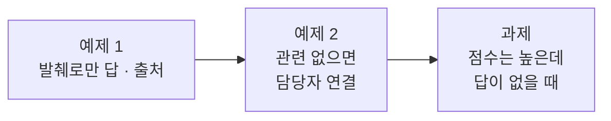

# Lab 02 · 규정으로만 답하기, 모르면 넘기기, 답 검사

- 관련 강의: [2단계 · 근거로 답하는 RAG 워크플로우](../../Lecture/71/02-STAGE2-RAG-ANSWER.md)
- 소요 시간: 약 70분 (예제 1 20분 · 예제 2 15분 · 과제 35분)
- 준비: Lab 01의 `my-work/index.json`, `my-work/search.json` (없으면 `reference/lab01-example2-*.json`을 복사 후 push)
- 목표: 검색한 규정 발췌로만 답하고 **출처**를 붙인다. 관련 없는 질문은 LLM을 부르지 않고 넘기고, LLM의 답도 **검사**한 뒤 내보낸다.



> 복사해 붙일 요청문은 없습니다. 막히면 `▶` 를 하나씩 펼칩니다.

## 예제 1 · 발췌로만 답하고 출처 붙이기 (20분)

**만들 것**: `my-work/policy-qa.json` (`my-policy-qa`). 질문 → 가까운 청크 3개 → 번호 붙인 발췌 → LLM이 **발췌로만** 답하고 번호 인용 → 번호를 문서 제목으로 바꾸고 `cited`에 인용한 문서.

| 조건 | 값 |
| --- | --- |
| 계약 | [AGENTS.md](AGENTS.md) 3절 규정 Q&A |
| 답 | 한국어 3문장 이내, 사실마다 `[번호]` → 결과에서는 `[비밀번호·계정 보안 규정]`처럼 제목 |
| 기대 결과 | `cases/lab02.json` 앞 네 케이스 (나머지는 예제 2) |

<details><summary>▶ 1단계 · 검색을 다시 만들까</summary>

`my-search`를 HTTP로 부를 수도, 같은 검색 노드를 Q&A 안에 둘 수도 있습니다. 어느 쪽이든 **같은 저장소**(`my_policy_docs`)를 씁니다. 70일차에 배운 "모듈로 부르기"와 "한 곳에서만 쓰면 그대로"를 떠올려 정합니다.
</details>

<details><summary>▶ 2단계 · LLM에게 주는 지시</summary>

"발췌로만", "모르면 모른다고", "번호로 출처" 세 가지를 지시문에 넣습니다. 번호를 쓰게 하는 이유는 **코드가** 출처를 확인할 수 있게 하기 위해서입니다 (67일차 Lab 01 과제의 `sources`와 같은 생각).
</details>

<details><summary>▶ 3단계 · 번호를 제목으로</summary>

`[2]`를 사람이 읽는 제목으로 바꾸는 것은 LLM이 아니라 **Code**에서. 범위 밖 번호(`[7]`)는 어떻게 할까요?
</details>

<details><summary>▶ 빈칸 채우기 · 요청문 뼈대</summary>

요청문에 꼭 들어갈 것: **① 파일 · 웹훅 ② 어느 저장소에서 몇 개 ③ 발췌를 어떤 모양으로 ④ LLM 지시 셋(발췌로만 · 번호 · 모를 때의 문장) ⑤ 번호 → 제목 · `cited`는 어디서 ⑥ 기대 결과**. 아래 `____`를 채워 `my-work/PROMPTS.md`에 쓴 뒤 에이전트에게 보냅니다.

```text
my-work/policy-qa.json 을 만들어 줘. 계약은 AGENTS.md 3절 ____ . question 없으면 ____ .
1. 같은 메모리 저장소( ____ )에서 load, topK ____ , 메타데이터 포함, Always Output Data.
2. Code "Build context": 청크를 ____ 번호 붙인 발췌로, hits(source, title, score), top_score.
3. AI Agent( ____ , Tool 없음): 발췌로만, 한국어 ____ 문장 이내, 사실마다 ____ ,
   없으면 정확히 " ____ "
4. Code "Build answer": [번호] → ____ , cited = 인용한 번호의 ____ , route "자동 답변". 범위 밖 번호는 ____ .
기대 결과 cases/lab02.json 앞 네 케이스.
```

채울 값은 [AGENTS.md](AGENTS.md) 3절(계약) · 5절(노드)과 위 표에 있습니다.
</details>

<details><summary>▶ 그래도 막히면 · 빈칸을 채운 모양</summary>

```text
my-work/policy-qa.json 을 만들어 줘. 계약은 AGENTS.md 3절 규정 Q&A. question 없으면 400.
1. 같은 메모리 저장소(my_policy_docs)에서 load, topK 3, 메타데이터 포함, Always Output Data.
2. Code "Build context": 청크를 [1] [2] [3] 번호 붙인 발췌로, hits(source, title, score), top_score.
3. AI Agent(gpt-4.1-mini, Tool 없음): 발췌로만, 한국어 3문장 이내, 사실마다 [번호],
   없으면 정확히 "규정에서 답을 찾지 못했습니다."
4. Code "Build answer": [번호] → [문서 제목], cited = 인용한 번호의 source, route "자동 답변". 범위 밖 번호는 버린다.
기대 결과 cases/lab02.json 앞 네 케이스.
```

- 이 모양은 검색 노드를 Q&A 안에 다시 둡니다 (1단계 힌트의 두 길 중 하나). `my-search`를 HTTP로 부르게 해도 됩니다.
- 점심 메뉴 · 질문 없음 케이스는 아직 실패해도 됩니다 (예제 2에서).
</details>

```bash
uv run tools/flow.py push my-work/policy-qa.json
uv run tools/flow.py test cases/lab02.json -v
```

## 예제 2 · 관련 없으면 담당자 연결 (15분)

```bash
uv run tools/flow.py call my-policy-qa requests/q-off-topic.json -v
```

점심 메뉴 질문에도 가장 가까운 청크 3개는 **언제나** 나옵니다. 그 점수(`top_score`)를 봅니다.

<details><summary>▶ 1단계 · 기준값을 어디서</summary>

Lab 01에서 적어 둔 1등 점수들(규정 질문, 연차 질문)을 봅니다. 그 사이 어디에 선을 그으면 될까요? [AGENTS.md](AGENTS.md) 3절에 수업 준비 때 잰 범위가 있습니다. 기준값은 바꿔 가며 재 볼 수 있게 요청 본문(`min_score`)으로도 받습니다.
</details>

<details><summary>▶ 2단계 · LLM을 부르지 않는 길</summary>

기준 아래면 LLM을 부르지 않고 바로 정해진 답. 빠르고, 돈이 들지 않고, 지어낼 일이 없습니다. 결과 모양(`route`, `answer`, `cited: []`)은 같게.
</details>

<details><summary>▶ 빈칸 채우기 · 요청문 뼈대</summary>

요청문에 꼭 들어갈 것: **① 고칠 파일 ② 기준값과 그 값을 어디서 받나 ③ 무엇을 비교하나 ④ 기준 아래면 무엇을(LLM 없이) ⑤ 결과 모양은 그대로 ⑥ 기대 결과**. 아래 `____`를 채워 `my-work/PROMPTS.md`에 쓴 뒤 에이전트에게 보냅니다.

```text
my-work/policy-qa.json 을 고쳐 줘.
1. Build context 에 min_score = 본문 ____ (없으면 ____ ), relevant = ____ >= min_score.
2. If "Relevant?" 를 Build context 뒤에 둔다.
3. relevant 가 아니면 LLM 을 ____ 않고 route " ____ ",
   answer " ____ ", cited ____ .
4. 결과 모양(route, answer, sources, cited, top_score)은 두 길 모두 같게.
기대 결과 cases/lab02.json 전부.
```

채울 값은 [AGENTS.md](AGENTS.md) 3절(계약) · 5절(노드)과 위 표에 있습니다.
</details>

<details><summary>▶ 그래도 막히면 · 빈칸을 채운 모양</summary>

```text
my-work/policy-qa.json 을 고쳐 줘.
1. Build context 에 min_score = 본문 min_score (없으면 0.33), relevant = top_score >= min_score.
2. If "Relevant?" 를 Build context 뒤에 둔다.
3. relevant 가 아니면 LLM 을 부르지 않고 route "담당자 연결",
   answer "규정에서 답을 찾지 못했습니다. IT 문의 창구로 연결해 드릴게요.", cited [].
4. 결과 모양(route, answer, sources, cited, top_score)은 두 길 모두 같게.
기대 결과 cases/lab02.json 전부.
```

- 0.33은 AGENTS.md 3절의 측정 범위(규정 질문 0.46~0.62, 규정 밖 0.20~0.26) 사이입니다. 내 Lab 01 기록과도 맞는지 봅니다.
- AGENTS.md 5절의 `Not in policies`(Edit Fields)가 3번의 모양입니다.
</details>

```bash
uv run tools/flow.py push my-work/policy-qa.json
uv run tools/flow.py test cases/lab02.json -v
```

## 과제 · 점수는 높은데 규정에 답이 없을 때 (35분)

먼저 돌려 봅니다.

```bash
uv run tools/flow.py test cases/lab02-challenge.json -v
```

"VPN 접속 속도가 느리면?", "노트북 사양은?", "비밀번호를 잊어버리면 어디서 바꿔요?", "보안 교육은 1년에 몇 번?" — 비슷한 낱말이 규정에 있어 점수는 기준을 넘지만, **답은 규정에 없습니다.** 지금 결과의 `route`와 `answer`를 봅니다.

팀장이 요청했습니다.

> "'규정에서 찾지 못했다'는 답이 '자동 답변'으로 나가면 안 됩니다. 그리고 답에 숫자가 나오면 그 숫자가 정말 규정에 있는지 확인해 주세요."

예제 2까지 만든 Q&A로 먼저 돌리면 **2/8**입니다 (예제 정답 `reference/lab02-example2-qa.json`으로 수업 전날 2026-10-22에 잰 값, 10/18 수업 준비 때도 2/8). 케이스마다:

| 케이스 | 질문 | LLM이 받은 발췌 (검색 top 3) | 지금 결과 (예제 2까지) | 왜 틀리나 | 나와야 할 결과 (테스트가 보는 칸) |
| --- | --- | --- | --- | --- | --- |
| 규정에 없음 (VPN 속도) | VPN 접속 속도가 느리면 어떻게 해요? | [1] 원격근무·VPN · 1. 접속 원칙 0.462<br>[2] 원격근무·VPN · 2. VPN 인증서 0.435<br>[3] 원격근무·VPN · 3. 재택근무 중 보안 0.409 | ✘ `top_score` 0.463 → `자동 답변`: "…언급하고 있지 않습니다. 따라서 규정에서 답을 찾지 못했습니다." | 규정에 VPN 이야기가 있어 기준을 넘음. LLM은 "못 찾았다"고 했지만 그 답이 자동으로 나감 | `route` = `담당자 연결` |
| 규정에 없음 (노트북 사양) | 노트북 사양은 어떻게 되나요? | [1] 장비 · 1. 지급과 교체 0.383<br>[2] 메일·문서 · 1. 메일함 0.234<br>[3] 장비 · 2. 분실과 도난 0.215 | ✘ 0.379 → `자동 답변`: "…포함되어 있지 않습니다." + 출처 3개 | 장비 규정에 노트북은 있지만 사양은 없음. 출처까지 붙어 근거 있는 답처럼 보임 | `route` = `담당자 연결` |
| 규정에 없음 (비밀번호 잊음) | 비밀번호를 잊어버리면 어디서 바꿔요? | [1] 비밀번호 · 2. 변경 주기 0.551<br>[2] 비밀번호 · 1. 만들기 0.484<br>[3] 비밀번호 · 4. 다단계 인증 0.474 | ✘ 0.551 → `자동 답변`: "규정에서 답을 찾지 못했습니다." | 비밀번호 규정에 잊었을 때의 방법이 없음. 정해 준 문장 그대로인데도 자동으로 나감 | `route` = `담당자 연결` |
| 규정에 없음 (보안 교육) | 보안 교육은 1년에 몇 번 받아야 하나요? | [1] 보안 사고 · 1. 피싱 메일 0.353<br>[2] 원격근무·VPN · 2. VPN 인증서 0.334<br>[3] 비밀번호 · 2. 변경 주기 0.304 | ✘ 0.352 → `자동 답변`: "규정에서 답을 찾지 못했습니다." | 보안 사고 절차에 교육 이야기가 없음 | `route` = `담당자 연결` |
| 점수가 낮아 걸러짐 (연차) | 연차 휴가는 며칠이에요? | [1] 회의실 · 1. 예약 0.259<br>[2] 원격근무·VPN · 3. 재택 보안 0.224<br>[3] 원격근무·VPN · 2. VPN 인증서 0.221<br>(기준 미달이라 LLM에게 가지 않음) | ✔ 0.259 → `담당자 연결` (LLM 없음) | 이미 맞음 — 예제 2의 기준값이 거름. 고친 뒤에도 그대로여야 함 | `route` = `담당자 연결` |
| 틀린 전제 (30일) | 비밀번호는 30일마다 바꾸면 되죠? | [1] 비밀번호 · 2. 변경 주기 0.685<br>[2] 비밀번호 · 1. 만들기 0.585<br>[3] 비밀번호 · 3. 잠금 0.552 | ✔ "30일마다 바꾸는 것이 아니라 90일마다 …" | 이미 맞음 — 발췌로만 답하게 해서. 검사를 더해도 이 답을 막으면 안 됨 | `answer`에 "90일", "30일마다 바꾸면 됩니다"는 없음 |
| 근거 있는 답은 그대로 | 암호를 얼마나 자주 바꿔야 해? | [1] 비밀번호 · 2. 변경 주기 0.576<br>[2] 비밀번호 · 1. 만들기 0.512<br>[3] 비밀번호 · 4. 다단계 인증 0.456 | ✘ `자동 답변` "암호는 90일마다 …" — **답은 맞음**. 결과 칸은 `route` · `answer` · `sources` · `cited` · `top_score` 다섯 개뿐 | 이 케이스는 답 내용과 함께 **`failed` 칸**을 봅니다. `failed`는 답 검사를 만들어야 생기는 칸이라 지금은 없음 → 실패. 확인하려는 것: 검사를 더한 뒤에도 **좋은 답이 막히지 않는지** | `route` = `자동 답변`, `failed` = `[]` (검사를 모두 통과), `answer`에 "90일" |
| 검사 기록 | 컴퓨터가 바이러스에 걸린 것 같아요 | [1] 보안 사고 · 2. 악성코드 감염 의심 0.479<br>[2] 보안 사고 · 1. 피싱 메일 0.357<br>[3] 원격근무·VPN · 3. 재택 보안 0.249 | ✘ `자동 답변` "…랜선을 뽑고 와이파이를 꺼서 …" — **답은 맞음**. `checks` 칸이 없음 | 이 케이스는 답이 아니라 **`checks` 칸**만 봅니다. 검사를 만들고 그 기록을 결과에 남겼는지 확인. 지금은 검사가 없으니 칸도 없음 → 실패 | `checks` 목록에 이름이 `grounded`인 검사가 있음 |

- 발췌 열은 같은 질문을 검색만 따로 불러 본 값입니다 (2026-10-22, 섹션 색인). 1등 점수가 Q&A의 `top_score`와 0.004 이내로 같고, 문서도 Q&A 결과의 `sources`와 같습니다.
- 답이 없는 네 질문도 LLM은 **비슷한 주제의 발췌 3개**를 받았습니다. "노트북 사양"의 [2] · [3]은 0.234 · 0.215로 관련이 거의 없는데도 LLM에게 갔고, LLM은 이것까지 출처로 붙였습니다. 기준값은 **1등 점수**만 보기 때문입니다.
- 위 네 줄(✘)이 과제의 핵심입니다: **답이 없는 질문을 사람에게 넘기기.**
- 아래 두 줄(✘)은 답이 아니라 **결과 JSON의 칸**을 봅니다. 답은 이미 맞지만, 과제에서 만들 칸(`checks`, `failed`)이 아직 없어서 실패합니다. 하나는 좋은 답이 검사에 막히지 않는지(`failed: []`), 하나는 검사 기록이 남는지(`checks`)를 확인합니다.
- 가운데 두 줄(✔)은 지금도 맞습니다. 검사를 더한 뒤에도 **깨지지 않아야** 합니다.

<details><summary>▶ 고치기 전 · 후 응답 비교 (VPN 속도)</summary>

고치기 전 (예제 2까지):

```json
{"route": "자동 답변",
 "answer": "규정에서는 VPN 접속 속도가 느릴 때의 대처 방법에 대해 언급하고 있지 않습니다. 따라서 규정에서 답을 찾지 못했습니다.",
 "sources": ["remote-work-vpn"], "cited": [], "top_score": 0.463}
```

고친 뒤 나와야 할 모양:

```json
{"route": "담당자 연결",
 "answer": "규정에서 확실한 답을 찾지 못해 IT 담당자에게 전달했습니다.",
 "draft": "(LLM이 쓴 원래 답)",
 "sources": ["remote-work-vpn"], "cited": [], "top_score": 0.462,
 "checks": [{"name": "…", "passed": false}, {"name": "grounded", "passed": false}, …],
 "failed": ["…", "grounded", …]}
```

검사 이름 · 개수는 내가 정합니다 (1단계 힌트). 테스트는 `route`, `failed`(근거 있는 답에서 빈 목록), `checks` 안의 `grounded`만 봅니다.
</details>

<details><summary>▶ 1단계 · 검사 항목 정하기</summary>

67일차 Check answer를 떠올립니다. RAG 답에서 코드로 확인할 수 있는 것은? (모른다고 했나, 인용 번호가 있나, 답 글이 발췌와 겹치나, 답의 숫자가 발췌에 있나) 검사마다 이름을 붙이고 `checks`, `failed`로 남기게 합니다.
</details>

<details><summary>▶ 2단계 · "모른다"는 여러 모양</summary>

지시문에 정확한 문장을 주어도 LLM은 "포함되어 있지 않습니다", "명시되어 있지 않습니다"처럼 다르게 말하기도 합니다. 보고서에서 실제 답을 보고, 검사가 이 모양들을 잡는지 확인합니다.
</details>

<details><summary>▶ 3단계 · 넘길 때 무엇을 남기나</summary>

담당자에게 넘길 때 LLM이 쓴 초안(`draft`)과 실패한 검사(`failed`)를 남기면 담당자가 빨리 판단합니다. 원래 테스트 `cases/lab02.json`도 계속 통과해야 합니다.
</details>

<details><summary>▶ 빈칸 채우기 · 요청문 뼈대</summary>

요청문에 꼭 들어갈 것: **① 고칠 노드 ② 검사 넷의 이름과 기준 ③ 결과에 남길 칸 ④ 하나라도 실패하면 무엇을 ⑤ 원래 답은 어디에 ⑥ 두 테스트 모두 통과**. 아래 `____`를 채워 `my-work/PROMPTS.md`에 쓴 뒤 에이전트에게 보냅니다.

```text
my-work/policy-qa.json 의 ____ 에 검사를 더해 줘. 검사마다 {name, passed} 를 ____ 에, 실패 이름을 ____ 에.
- found_in_policies: "찾지 못했", " ____ ", " ____ ", "언급이 없", "나와 있지 않" 이 없어야
- cites_excerpt: 인용 번호가 ____ 이상
- grounded: 답 글(번호 뺀)의 ____ 글자 묶음 중 ____ % 이상이 발췌에 있어야
- numbers_from_policies: 답에 나온 ____ 가 모두 발췌에 있어야
failed 가 있으면 route " ____ ", answer " ____ ", ____ 에 원래 답.
____ , ____ 둘 다 통과.
```

채울 값은 위 1~3단계 힌트와 먼저 돌려 본 보고서(`runs/lab02-challenge-*.json`)의 실제 답에 있습니다.
</details>

<details><summary>▶ 그래도 막히면 · 빈칸을 채운 모양</summary>

```text
my-work/policy-qa.json 의 Build answer 에 검사를 더해 줘. 검사마다 {name, passed} 를 checks 에, 실패 이름을 failed 에.
- found_in_policies: "찾지 못했", "포함되어 있지 않", "명시되어 있지 않", "언급이 없", "나와 있지 않" 이 없어야
- cites_excerpt: 인용 번호가 하나 이상
- grounded: 답 글(번호 뺀)의 두 글자 묶음 중 30% 이상이 발췌에 있어야
- numbers_from_policies: 답에 나온 숫자가 모두 발췌에 있어야
failed 가 있으면 route "담당자 연결", answer "규정에서 확실한 답을 찾지 못해 IT 담당자에게 전달했습니다.", draft 에 원래 답.
cases/lab02-challenge.json, cases/lab02.json 둘 다 통과.
```

- "모른다"의 모양은 먼저 돌려 본 보고서의 실제 답에서 찾습니다. 위 다섯 개는 수업 준비 때 본 모양이고, 내 결과에 다른 모양이 있으면 더합니다.
- `--repeat 3`으로 세 번 돌려 확인합니다. LLM 답은 매번 조금 다릅니다.
</details>

```bash
uv run tools/flow.py push my-work/policy-qa.json
uv run tools/flow.py test cases/lab02-challenge.json -v --repeat 3
uv run tools/flow.py test cases/lab02.json -v
```

## 막혔을 때

| 증상 | 할 일 |
| --- | --- |
| 모든 질문이 `담당자 연결` | 저장소가 비었을 수 있음 (`top_score: 0`) → `call my-index` |
| 답에 `[1]` 그대로 | 번호를 제목으로 바꾸는 Code 확인 |
| 근거 있는 답도 `담당자 연결` | 보고서의 `failed`를 보고 어느 검사가 너무 엄격한지 확인 |
| 계속 안 됨 | `cp reference/lab02-example2-qa.json my-work/policy-qa.json` 후 push |

## 확인

- [ ] 예제 1·2: `cases/lab02.json` 통과, 출처가 제목으로 나온다.
- [ ] 과제: `cases/lab02-challenge.json` 3번 반복 통과, `lab02`도 통과.
- [ ] `RAG-EVAL.md` 3절에 "기준값에 걸러지지 않았는데 답이 없는 질문"을 적었다.
