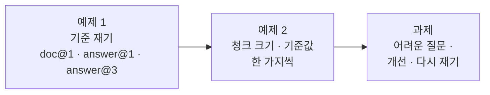

# Lab 03 · 검색 품질을 숫자로 재고, 한 가지씩 고치기

- 관련 강의: [3단계 · 검색 품질 측정과 개선](../../Lecture/71/03-STAGE3-RETRIEVAL-QUALITY.md)
- 소요 시간: 약 80분 (예제 1 15분 · 예제 2 25분 · 과제 40분)
- 준비: Lab 01·02의 `my-work/index.json`, `search.json`, `policy-qa.json`이 push되어 있어야 합니다.
- 목표: 검색이 "잘 되는 것 같다"가 아니라 **몇 개 중 몇 개**인지 잰다. 설정을 **한 번에 하나만** 바꿔 다시 재고, 어려운 질문으로 고친 것이 다른 것을 깨뜨리지 않는지 확인한다.



> 복사해 붙일 요청문은 없습니다. 이번 Lab은 요청문보다 **재는 순서**가 중요합니다.

## 예제 1 · 기준 재기 (15분)

**할 일**: 지금 설정(섹션 청크)의 검색 점수를 세 지표로 잽니다. 예제 2와 과제에서 무엇을 바꾸든 **이 숫자와 비교**합니다. 에이전트는 쓰지 않습니다 (워크플로우를 고치지 않음).

질문 24개와 정답(문서, 답 문구)이 `cases/retrieval-*.json`에 들어 있습니다. 세 파일은 **같은 24개 질문**을 서로 다른 기준으로 채점합니다.

| 파일 | 지표 | 뜻 | 케이스가 보는 칸 (예: "회사를 그만두면 노트북은 …") |
| --- | --- | --- | --- |
| `retrieval-doc.json` | doc@1 | 1등 청크가 **맞는 문서**에서 왔나 | `hits.0.source` = `device-issue-return` |
| `retrieval-answer.json` | answer@1 | 1등 청크 안에 **답 문구**가 있나 | `hits.0.text`에 "5영업일" |
| `retrieval-answer3.json` | answer@3 | 3등 안에 답 문구가 있나 | `hits`(1~3등 전부)에 "5영업일" |

```bash
uv run tools/flow.py call my-index requests/index-section.json -v
uv run tools/flow.py test cases/retrieval-doc.json -v --no-before
uv run tools/flow.py test cases/retrieval-answer.json -v --no-before
uv run tools/flow.py test cases/retrieval-answer3.json -v --no-before
```

`RAG-EVAL.md` 4절 첫 줄(섹션)을 채웁니다. 아래 `▶`를 순서대로 펼치며 진행합니다.

<details><summary>▶ 1단계 · 먼저 색인 상태를 확인</summary>

첫 명령 `call my-index requests/index-section.json -v`는 저장소를 비우고 **섹션 청크로 다시 색인**합니다. 응답이 이렇게 나와야 합니다.

```text
HTTP 200 · …s
    → request  POST /webhook/my-index
      {
        "chunking": "section"
      }
    ← response HTTP 200
      {
        "indexed_chunks": 25,
        "chunking": "section"
      }
```

- `indexed_chunks`가 **25**인지 봅니다. 규정 8개의 `## ` 섹션 수를 더하면 25입니다 (Lab 01 예제 2와 같음).
- 25가 아니면 Lab 01 과제까지 한 내 `my-work/index.json`이 push되어 있는지 확인합니다.
- 왜 굳이 다시 색인하나: 앞에서 무엇을 push했는지에 따라 저장소가 비었거나(push하면 n8n 재시작) 다른 설정으로 색인되어 있을 수 있습니다. **잴 때마다 출발점을 내 손으로 정합니다.**
</details>

<details><summary>▶ 2단계 · 왜 <code>--no-before</code>를 붙이나</summary>

세 케이스 파일에는 `before` 칸(명령이 아니라 파일 안의 칸)이 있어서, `test`는 보통 채점 전에 섹션으로 다시 색인합니다. 예제 1은 방금 섹션으로 색인했으니 붙이지 않아도 결과는 같지만, **예제 2에서는 200자로 색인한 것을 그대로 재야** 하므로 지금부터 붙이는 습관을 들입니다.

- 붙였으면 출력 첫 줄이 `POST http://localhost:5678/webhook/my-search · 24 case(s) × 1`입니다.
- 첫 줄에 `✔ before: POST /webhook/my-index …`가 있으면 `--no-before`가 빠진 것입니다.
</details>

<details><summary>▶ 3단계 · 결과 읽는 법</summary>

`-v`를 붙였으므로 케이스마다 요청 · 응답 JSON이 길게 나옵니다. 먼저 **한 줄씩 된 결과**와 **마지막 두 줄**만 봅니다.

```text
POST http://localhost:5678/webhook/my-search · 24 case(s) × 1
✔ 비밀번호는 몇 자 이상이어야 하나요? · 0.3s
✔ 암호를 얼마나 자주 바꿔야 해? · 0.3s
…
✘ 회사를 그만두면 노트북은 언제까지 돌려줘야 하나요? · 0.3s · hits.0.text has none of ['5영업일']
…
Passed 22/24
report: runs/retrieval-answer-20261022-201052.json
```

| 부분 | 뜻 |
| --- | --- |
| `✔` / `✘` | 이 질문을 맞혔나 / 틀렸나 |
| `· 0.3s` | 검색 한 번 걸린 시간 |
| `hits.0.text has none of ['5영업일']` | 틀린 까닭: 1등(`hits.0`) 글에 "5영업일"이 없음 |
| `Passed 22/24` | **이 지표의 점수** → 표에 적을 숫자 |
| `report: runs/…json` | 케이스마다 요청 · 응답이 모두 든 보고서 |

틀린 줄만 모아 보려면:

```bash
uv run tools/flow.py test cases/retrieval-answer.json -v --no-before | grep -E "^(✘|Passed)"
```
</details>

<details><summary>▶ 4단계 · 틀린 질문 하나를 열어 보기</summary>

`✘` 줄 바로 아래에 그 질문의 응답이 있습니다. `hits`의 1~3등에서 **문서(`source`) · 섹션(`section`) · 점수(`score`) · 글(`text`)**을 봅니다.

```text
✘ 회사를 그만두면 노트북은 언제까지 돌려줘야 하나요? · 0.3s · hits.0.text has none of ['5영업일']
    ← response HTTP 200
      { "hits": [
          { "rank": 1, "source": "device-issue-return", "section": "1. 지급과 교체", "score": 0.464,
            "text": "…업무용 노트북은 입사일에 지급한다. 노트북 교체 주기는 4년이다. …" },
          { "rank": 2, "source": "device-issue-return", "section": "3. 반납", "score": 0.45,
            "text": "…퇴사하거나 장비를 교체할 때는 5영업일 이내에 장비를 IT 담당자에게 반납한다. …" },
          { "rank": 3, "source": "device-issue-return", "section": "2. 분실과 도난", "score": 0.369, … } ] }
```

스스로 답해 봅니다.

1. 1등 문서는 맞았나요? (정답 문서 `device-issue-return`)
2. 답 문구 "5영업일"은 몇 등에 있나요?
3. 1등과 그 등수의 점수 차이는 얼마인가요?
4. 1등 섹션에는 질문의 어떤 낱말이 들어 있나요?

같은 질문이 `retrieval-doc.json`, `retrieval-answer3.json`에서는 ✔인지 ✘인지도 봅니다.
</details>

<details><summary>▶ 5단계 · 세 숫자가 다른 이유</summary>

doc@1은 맞는데 answer@1이 틀린 질문을 보고서에서 찾습니다. 맞는 문서의 **다른 섹션**이 1등이었나요? answer@3에서는 맞았다면, LLM에게 3개를 주는 지금 설정에서는 답할 수 있다는 뜻입니다. 어느 지표가 내 업무에 중요한지 정합니다.

| 세 지표 결과 | 뜻 |
| --- | --- |
| doc@1 ✔ · answer@1 ✔ | 1등 하나로 답할 수 있음 |
| doc@1 ✔ · answer@1 ✘ · answer@3 ✔ | 맞는 문서의 다른 섹션이 1등. 3개를 주면 답할 수 있음 |
| doc@1 ✘ | 다른 문서가 1등. 질문의 낱말이 다른 규정과 더 가까움 |
| answer@3 ✘ | 답이 3등 안에 없음. LLM도 답할 수 없음 |
</details>

<details><summary>▶ 6단계 · <code>RAG-EVAL.md</code>에 적기</summary>

4절 표의 첫 줄(섹션)을 채우고, 표 아래에 **틀린 질문**을 적습니다. 예제 2에서 숫자가 같아도 틀린 질문이 다를 수 있기 때문입니다.

```markdown
| 설정 | 청크 수 | doc@1 | answer@1 | answer@3 |
| --- | --- | --- | --- | --- |
| 섹션 (기준) | 25 | __/24 | __/24 | __/24 |

- 섹션에서 answer@1을 틀린 질문: ______ (답 문구가 __등에 있음), ______
```
</details>

<details><summary>▶ 정답 (직접 잰 뒤에 펼치기)</summary>

수업 준비 때(10/18)와 다시 돌렸을 때(10/22) 모두 같았습니다.

| 설정 | 청크 수 | doc@1 | answer@1 | answer@3 |
| --- | --- | --- | --- | --- |
| 섹션 (기준) | 25 | 24/24 | 22/24 | 24/24 |

answer@1에서 틀린 두 질문 (둘 다 doc@1 ✔, answer@3 ✔):

| 질문 | 1등 | 답이 있는 섹션 | 점수 차이 |
| --- | --- | --- | --- |
| 회사를 그만두면 노트북은 언제까지 돌려줘야 하나요? | 장비 · 1. 지급과 교체 0.464 | 장비 · 3. 반납 0.45 ("5영업일", 2등) | 0.014 |
| 고객 정보가 밖으로 샌 것 같아요 | 개인정보 · 2. 이용과 보관 0.395 | 개인정보 · 3. 유출 대응 0.375 ("1시간", 2등) | 0.02 |

- 1등 섹션에는 질문의 명사("노트북", "고객")가 그대로 있고, 답이 있는 섹션은 다른 낱말("장비", "유출")로 쓰여 있습니다.
- 시간은 검색 한 번 0.2~0.9초였습니다.
</details>

## 예제 2 · 한 가지씩 바꾸기 (25분)

**청크 크기**: 색인만 다른 설정으로 다시 하고, 검색 테스트는 `--no-before`로 그대로 돌립니다 (워크플로우는 고치지 않음).

```bash
uv run tools/flow.py call my-index requests/index-200.json -v
uv run tools/flow.py test cases/retrieval-answer.json -v --no-before
uv run tools/flow.py call my-index requests/index-400.json -v
uv run tools/flow.py test cases/retrieval-answer.json -v --no-before
```

doc@1, answer@3도 같은 식으로 재어 4절 표를 채웁니다. 끝나면 섹션으로 되돌립니다.

**관련도 기준**: `cases/lab03-threshold.json`은 규정 질문 5개(답해야 함)와 규정 밖 5개(넘겨야 함)입니다.

```bash
uv run tools/flow.py call my-index requests/index-section.json -v
uv run tools/flow.py test cases/lab03-threshold.json -v --no-before
```

<details><summary>▶ 1단계 · 왜 한 번에 하나만</summary>

청크 크기와 기준값을 함께 바꾸고 숫자가 좋아지면, 무엇 때문인지 모릅니다. 바꾼 것 하나, 잰 숫자 셋을 한 줄에 적습니다.
</details>

<details><summary>▶ 2단계 · 기준값을 바꿔 보려면</summary>

보고서의 `top_score`를 봅니다 (`runs/lab03-threshold-....json`). 규정 질문의 가장 낮은 점수와 규정 밖 질문의 가장 높은 점수 사이가 얼마나 벌어져 있나요? Q&A의 기본 `min_score`를 바꿔 push하고 다시 재 봅니다. Lab 02 과제의 "점수는 높은데 답이 없는 질문"은 기준값으로 거를 수 있을까요?
</details>

<details><summary>▶ 3단계 · 청크 크기의 함정</summary>

글자 수로 자르면 섹션 중간이 잘리고, 청크 수도 달라집니다 (`indexed_chunks`). 우리 문서는 짧아서 400자로 자르면 청크가 오히려 **적어집니다.** 문서의 모양을 보고 정합니다.
</details>

## 과제 · 어려운 질문으로 고치기 (40분)

팀장이 요청했습니다.

> "직원들은 규정 낱말로 묻지 않아요. '챗GPT', '폰', '비번'처럼 물어요. 그런 질문으로 테스트를 만들고, 검색을 고쳐 주세요. 대신 지금 잘 되는 24문항이 나빠지면 안 됩니다."

1. `cases/my-cases.json`에 **어려운 질문 6개 이상** (기대: `hits.0.source`). 예제 1의 정답표처럼 답이 있는 문서를 먼저 확인합니다 (답이 **없는** 질문은 넣지 않음).
2. 한 가지 개선을 골라 에이전트에게 맡깁니다.
3. 어려운 질문과 `retrieval-*` 세 파일을 **모두** 다시 잽니다.

```bash
uv run tools/flow.py test cases/my-cases.json -v
uv run tools/flow.py push my-work/search.json
uv run tools/flow.py test cases/my-cases.json -v
uv run tools/flow.py test cases/retrieval-answer.json -v
```

<details><summary>▶ 1단계 · 어떤 개선이 있나</summary>

| 개선 | 어디를 고치나 |
| --- | --- |
| 질문 다시 쓰기: LLM이 질문을 규정 낱말로 바꾼 뒤 검색 | 검색 (LLM 한 번 더) |
| 청크에 문서 제목·섹션 제목 붙이기 | 색인 |
| 같은 뜻 낱말표(챗GPT → 생성형 AI)로 질문 넓히기 | 검색 (Code) |
| 더 많이 찾고(top_k 5) LLM에게 맡기기 | 검색·Q&A |

하나만 고릅니다. 고른 이유를 `RAG-EVAL.md` 5절에 적습니다.
</details>

<details><summary>▶ 2단계 · 실패를 보고 고치되, 맞추지는 않기</summary>

어려운 질문이 실패한 이유를 보고서에서 봅니다 (1등 문서는 어디였나?). 개선을 그 실패에만 맞추면(질문 하나하나의 낱말을 지시문에 넣기) 다른 질문에서는 안 됩니다. 그래서 `retrieval-*` 24문항을 **함께** 잽니다.
</details>

<details><summary>▶ 3단계 · 고쳐서 깨진 것</summary>

개선 뒤 **새로 틀린** 질문이 있나요? 있다면 그대로 적습니다. 좋아진 것과 나빠진 것을 함께 적는 것이 측정입니다. 시간(보고서 `seconds`)도 비교합니다.
</details>

<details><summary>▶ 빈칸 채우기 · 요청문 뼈대</summary>

요청문에 꼭 들어갈 것: **① 고칠 파일 ② 어디에 무엇을 더하나 ③ LLM에게 줄 지시(무엇으로 바꾸나 · 예 · 그대로 둘 것) ④ 검색이 무엇을 쓰나 ⑤ 결과에 더할 칸 ⑥ 다시 잴 테스트 전부**. 아래 `____`를 채워 `my-work/PROMPTS.md`에 쓴 뒤 에이전트에게 보냅니다.

```text
my-work/search.json 을 고쳐 줘. 검색 전에 AI Agent " ____ "( ____ , Tool 없음)를 둔다.
지시: 직원 질문을 ____ 의 낱말로 바꾼 짧은 한국어 검색어 한 줄.
  예: ____ → ____ , ____ → ____ , ____ → ____   (내 어려운 질문에서 찾은 낱말)
  ____ 와 ____ 은 그대로.
검색 prompt 는 ____ 의 output. 결과에 ____ 를 더한다. 나머지 계약은 그대로.
____ 과 retrieval-doc · retrieval-answer · retrieval-answer3 를 모두 다시 잰다.
```

채울 값은 1단계 표, 내 `cases/my-cases.json`에서 틀린 질문, [AGENTS.md](AGENTS.md) 5절(AI Agent · 질문 다시 쓰기)에 있습니다.
</details>

<details><summary>▶ 그래도 막히면 · 빈칸을 채운 모양</summary>

```text
my-work/search.json 을 고쳐 줘. 검색 전에 AI Agent "Rewrite query"(gpt-4.1-mini, Tool 없음)를 둔다.
지시: 직원 질문을 규정 문서의 낱말로 바꾼 짧은 한국어 검색어 한 줄. 예: 암호·비번 → 비밀번호, 그만두면 → 퇴사, 깔다 → 설치,
챗GPT·제미나이 → 생성형 AI 서비스, 개인 메일로 보내다 → 외부로 보내다·첨부 파일, 폰 → 휴대폰. 숫자와 이름은 그대로.
검색 prompt 는 Rewrite query 의 output. 결과에 query 를 더한다. 나머지 계약은 그대로.
cases/my-cases.json 과 retrieval-doc · retrieval-answer · retrieval-answer3 를 모두 다시 잰다.
```

- 이 모양은 1단계 표의 **질문 다시 쓰기**를 고른 경우입니다. 다른 개선을 골랐다면 같은 순서(고칠 파일 → 더할 것 → 그대로 둘 것 → 다시 잴 테스트)로 씁니다.
- 예 낱말을 내 어려운 질문에만 맞추면 그 질문만 좋아집니다 (2단계 힌트). 24문항을 함께 재는 줄을 빼지 않습니다.
- 다시 쓴 검색어는 실행마다 조금씩 다릅니다. `--repeat 3`으로 재 보면 범위가 보입니다.
</details>

## 막혔을 때

| 증상 | 할 일 |
| --- | --- |
| 숫자가 매번 다름 | 색인 설정을 확인 (`call my-index`의 `chunking`), `--no-before`를 붙였는지 |
| 200자 색인 뒤 Q&A가 이상함 | 테스트가 끝나면 `call my-index requests/index-section.json`으로 되돌리기 |
| 계속 안 됨 | `reference/`의 파일로 이어 가기 |

## 확인

- [ ] 예제 1: 섹션 설정의 doc@1 · answer@1 · answer@3.
- [ ] 예제 2: 200자 · 400자 줄, 기준값 테스트, 바꾼 것은 한 번에 하나.
- [ ] 과제: 어려운 질문 6개 이상, 개선 전·후, `retrieval-*` 다시, 새로 틀린 것도 적었다.
- [ ] [테스트 보고서](templates/TEST-REPORT-TEMPLATE.md)를 `my-work/TEST-REPORT.md`로 채웠다.
