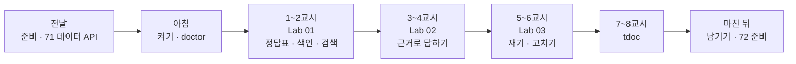
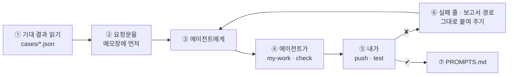

# 71일차 수강 안내 · 수업 준비부터 마칠 때까지

- 일자: 2026-10-23 (금) · 71일차
- 주제: RAG 기반 검색·응답 Workflow와 검색 품질 개선
- 실습 폴더: [Last3Mon/71](README.md) · 강의 자료: [Lecture/71](../../Lecture/71/README.md)
- 환경: 65일차 n8n 2.42.6 + **OpenAI API 키만**(`gpt-4.1-mini`, 임베딩 `text-embedding-3-large`, 같은 Credential) + **71일차 판 데이터 API**(규정 문서 `/docs`) + CLI 코딩 에이전트 하나. **Ollama는 쓰지 않습니다.**
- 이 문서: 오늘 하루 내가 할 일을 수업 준비부터 마칠 때까지 순서대로 모은 수강 안내입니다. 수업 중에도 띄워 두고 어디까지 왔는지 확인하세요.



## 0. 하루 한눈에

| 교시 | 시간 | 할 일 | 문서 | 끝났다는 표시 |
| --- | --- | --- | --- | --- |
| 전날 | 약 5분 | 자료 받기 · n8n · 71일차 데이터 API · doctor | [PREP](../../Lecture/71/00-DAY71-PREP.md) | `ready` |
| 1 | 09:00~09:50 | 개요 · 1단계 강의 (RAG와 색인) | [개요](../../Lecture/71/00-DAY71-OVERVIEW.md), [1단계](../../Lecture/71/01-STAGE1-RAG-AND-INDEX.md) | |
| 2 | 10:00~10:50 | Lab 01 예제 1 · 2 · 과제 | [Lab 01](LAB-01-Q-INDEX-AND-SEARCH.md) | `lab01-challenge` 통과 |
| 3 | 11:00~11:50 | 2단계 강의 (근거로 답하기) · Lab 02 예제 1 · 2 | [2단계](../../Lecture/71/02-STAGE2-RAG-ANSWER.md), [Lab 02](LAB-02-Q-ANSWER-FROM-POLICIES.md) | `lab02` 통과 |
| 4 | 12:00~12:50 | Lab 02 과제 35분 (점수는 높은데 답이 없을 때) · 풀이 | Lab 02 | `lab02-challenge` 통과 |
| - | 13:00~14:00 | 점심 | | |
| 5 | 14:00~14:50 | 3단계 강의 (검색 품질) · Lab 03 예제 1 · 2 | [3단계](../../Lecture/71/03-STAGE3-RETRIEVAL-QUALITY.md), [Lab 03](LAB-03-Q-MEASURE-AND-IMPROVE.md) | 지표 셋 · 바꾼 설정별 숫자 |
| 6 | 15:00~15:50 | Lab 03 과제 40분 (어려운 질문으로 고치기) · 풀이 | Lab 03 | 개선 전·후 · 보고서 |
| 7 | 16:00~16:50 | 바이브 코딩 `tdoc`: 요청서 → 내 SPEC → 만들기 | [VIBE-REQ-TDOC](VIBE-REQ-TDOC.md) → [VIBE-Q-TDOC](VIBE-Q-TDOC.md) | `SPEC.md` · R1~R5 · `pytest` |
| 8 | 17:00~17:50 | 발표 · 강사 정리 · 강사 바이브 코딩 · 팁 · 72일차 예고 | [진행](../../Lecture/71/04-VIBE-CODING.md) | |

## 1. 전날 준비 (약 5분)

### 1.1 자료 받기

```bash
cd ~/aio-01d4-stu && git pull
```

### 1.2 n8n과 **71일차** 데이터 API 켜기 (Ollama는 끔)

```bash
sudo systemctl disable --now ollama 2>/dev/null   # WSL에 설치한 Ollama가 있으면 끄고 자동 시작도 끔
cd ~/aio-01d4-stu/Last3Mon/65/n8n
docker compose rm -sf ollama                      # Ollama 컨테이너가 있으면 지움 (없으면 그냥 지나감)
docker compose start
cd ~/aio-01d4-stu/Last3Mon/71/data-api
docker compose up -d --force-recreate             # 67일차 데이터 API를 71일차 판(+ 규정 문서)으로 바꿈
curl -s localhost:8800/docs | head -c 120         # {"docs": [{"name": "device-issue-return", ...
```

- LLM과 임베딩 모두 **OpenAI API 키**(`Last3Mon/.env`) 하나로 씁니다. n8n은 `start`로 켭니다.
- 데이터 API는 67일차와 이름이 같아 하나만 돕니다. 71일차 폴더에서 `--force-recreate`로 다시 만들어야 `/docs`가 생깁니다.

### 1.3 준비 확인

```bash
cd ~/aio-01d4-stu/Last3Mon/71
uv run tools/flow.py doctor        # 마지막 줄 ready
```

### 1.4 미리 읽기 (선택, 5분)

[PREP 3절](../../Lecture/71/00-DAY71-PREP.md): "비밀번호는 며칠마다 바꿔야 하나요?"를 LLM에게 그냥 물으면 그럴듯한 숫자를 말합니다. 우리 규정(90일)으로 답하게 하려면?

### 준비물

노트북과 충전기, WSL의 Docker, WSL 창 두 개, 브라우저, 7교시 `tdoc`에 쓸 내 md 문서 폴더 (없으면 이 과정의 `Lecture/` 폴더).

## 2. 수업 당일 아침 (09:00 전)

1. 노트북을 껐다 켰다면 1.2를 다시 합니다.
2. 터미널 두 개, 둘 다 `cd ~/aio-01d4-stu/Last3Mon/71`. ① 에이전트, ② 확인.
3. 터미널 ②에서 `uv run tools/flow.py doctor` → `ready`.
4. `my-work/PROMPTS.md`를 만들어 둡니다.

## 3. 실습할 때마다 같은 순서



- **오늘만의 주의: 메모리 저장소는 n8n이 재시작되면 지워집니다.** `push`할 때마다 n8n이 재시작되므로 색인을 다시 해야 합니다.
  - `test`는 케이스 파일의 `before` 단계가 색인을 다시 해 줍니다.
  - 직접 `call` 할 때는 먼저 `uv run tools/flow.py call my-index requests/index-section.json -v`.
  - Lab 03에서 색인 설정을 바꿔 가며 잴 때는 `--no-before`로 내가 만든 색인을 그대로 씁니다.
- 바꾸는 것은 **한 번에 하나**, 바꿀 때마다 같은 질문 목록으로 다시 잽니다.

## 4. 1~2교시 · 1단계 · 정답표, 색인, 검색

[Lab 01](LAB-01-Q-INDEX-AND-SEARCH.md) (약 40분).

| 순서 | 할 일 | 파일 · 웹훅 | 확인 |
| --- | --- | --- | --- |
| 예제 1 (10분, 에이전트 없이) | `cp templates/RAG-EVAL-TEMPLATE.md my-work/RAG-EVAL.md` 후 질문 6개의 정답표(답 없는 질문 포함)를 **직접** (`curl -s localhost:8800/docs`, `data-api/data/docs/`) | | 표 |
| 예제 2 (15분) | 색인: 규정 문서를 섹션(`## `)마다 청크 → 임베딩 → 메모리 저장소. 검색: 질문과 가까운 청크 `top_k`개 | `my-work/index.json` · `my-index`, `my-work/search.json` · `my-search` | `push my-work/index.json my-work/search.json` → `call my-index requests/index-section.json`, `call my-search requests/q-password-length.json`, `test cases/lab01.json` |
| 과제 (15분) | 출처를 섹션 제목까지, 찾을 개수는 부르는 쪽에서 | 두 파일 고치기 | `test cases/lab01-challenge.json`, `test cases/lab01.json` |

(명령 앞에는 모두 `uv run tools/flow.py`가 붙습니다.)

- 볼 것: 정답표와 검색 1등이 같은지, "연차 휴가"(규정에 없는 질문)의 1등 점수가 다른 질문보다 높은지 낮은지. `RAG-EVAL.md` 2절에 적습니다 (Lab 02의 기준값에 씀).

## 5. 3~4교시 · 2단계 · 규정으로만 답하기, 모르면 넘기기, 답 검사

[Lab 02](LAB-02-Q-ANSWER-FROM-POLICIES.md) (약 70분).

| 순서 | 할 일 | 파일 · 웹훅 | 확인 |
| --- | --- | --- | --- |
| 예제 1 (20분) | 질문 → 가까운 청크 3개 → 번호 붙인 발췌 → LLM이 **발췌로만** 답하고 번호 인용 → 번호를 문서 제목으로, `cited` | `my-work/policy-qa.json` · `my-policy-qa` | `push my-work/policy-qa.json` → `test cases/lab02.json` (앞 네 케이스) |
| 예제 2 (15분) | 1등 점수가 기준값 아래면 LLM을 부르지 않고 담당자 연결 (`min_score`로도 받기) | 같은 파일 | 먼저 `call my-policy-qa requests/q-off-topic.json`의 `top_score` 보기 → `test cases/lab02.json` 전체 |
| 과제 (35분, 4교시) | "규정에서 찾지 못했다"는 답은 자동 답변으로 내보내지 않기, 답의 숫자가 규정에 정말 있는지 검사 | 같은 파일 | 고치기 전 `test cases/lab02-challenge.json` → 고친 뒤 `--repeat 3`, `test cases/lab02.json` |

- `RAG-EVAL.md` 3절에 "기준값에 걸러지지 않았는데 답이 없는 질문"을 적습니다.

## 6. 5~6교시 · 3단계 · 검색 품질을 숫자로 재고, 한 가지씩 고치기

[Lab 03](LAB-03-Q-MEASURE-AND-IMPROVE.md) (약 80분).

| 지표 | 테스트 파일 | 뜻 |
| --- | --- | --- |
| doc@1 | `cases/retrieval-doc.json` | 1등 청크가 맞는 문서에서 왔나 |
| answer@1 | `cases/retrieval-answer.json` | 1등 청크 안에 답 문구가 있나 |
| answer@3 | `cases/retrieval-answer3.json` | 3등 안에 답 문구가 있나 |

| 순서 | 할 일 | 확인 |
| --- | --- | --- |
| 예제 1 (15분) | 섹션 청크로 기준 재기 | `call my-index requests/index-section.json` → 위 세 파일을 `test ... --no-before` |
| 예제 2 (25분) | 청크 크기를 바꿔 가며 재기 (200자 · 400자), 기준값 테스트 | `call my-index requests/index-200.json` → `test cases/retrieval-answer.json --no-before`, `index-400`도 같게, 섹션으로 되돌린 뒤 `test cases/lab03-threshold.json --no-before` |
| 과제 (40분, 6교시) | 직원 말투 질문('챗GPT', '폰', '비번') 6개 이상 `cases/my-cases.json`, 검색 고치기. 지금 잘 되는 문항이 나빠지면 안 됨 | 고치기 전 `test cases/my-cases.json` → `push my-work/search.json` → `test cases/my-cases.json`, `test cases/retrieval-answer.json` |

- 개선 전·후와 **새로 틀린 것**도 적습니다. 보고서: `cp templates/TEST-REPORT-TEMPLATE.md my-work/TEST-REPORT.md`.

## 7. 7~8교시 · 바이브 코딩 `tdoc`

[VIBE-REQ-TDOC](VIBE-REQ-TDOC.md)(요청서)를 **먼저** 읽고 `~/vibe/tdoc/SPEC.md`를 에이전트 없이 직접 쓴 뒤, [VIBE-Q-TDOC](VIBE-Q-TDOC.md)와 비교합니다. 만드는 것은 내 md 문서 폴더를 색인하고 근거와 함께 답하는 TUI (SQLite 하나에 저장). 정답본 `VIBE-A-TDOC.md`는 수업이 끝나면 `git pull`로 받습니다.

```bash
mkdir -p ~/vibe/tdoc && cd ~/vibe/tdoc
git init
export OPENAI_API_KEY=$(grep '^OPENAI_API_KEY=' ~/aio-01d4-stu/Last3Mon/.env | cut -d= -f2-)   # 처음부터 필요 (임베딩)
# 에이전트는 SPEC.md를 쓴 뒤에 켭니다: codex (또는 claude, agy)
```

| 시간 | 단계 | 확인 |
| --- | --- | --- |
| 16:00~16:12 | 0. 준비 · 요청서 → `SPEC.md` (에이전트 없이 10분) → VIBE-Q와 비교 · commit | 요구마다 확인 방법, 비교한 줄 |
| 16:12~16:25 | 1. 색인과 검색 (R1 · R2) | 두 번째 색인은 바뀐 파일만, 점수 · 파일 · 섹션과 함께 `top_k`개 |
| 16:25~16:35 | 2. 답과 근거 (R3) | 근거 번호, 근거가 없으면 모른다고 |
| 16:35~16:45 | 3. TUI와 비교 (R4 · R5) | 근거를 고르면 원문, 같은 질문 목록으로 두 설정 비교 |
| 16:45~16:50 | 4. 정리 | `SPEC.md` 체크, `uv run pytest -q`(가짜 임베딩), `PROMPTS.md` |

- 8교시: 1~2명 발표, 강사 정리 · 시연 · 팁, 72일차 예고.

## 8. 마친 뒤

| 할 일 | 이유 |
| --- | --- |
| `PROMPTS.md`, `RAG-EVAL.md`, `TEST-REPORT.md` 정리 | 최종 프로젝트 재료 (RAG 측정표) |
| `my-work/*.json`, `~/vibe/tdoc` 지우지 않기 | 72일차 이후 최적화 · 측정 연습 |
| 데이터 API는 71일차 판을 그대로 켜 두기 | 67일차 FAQ · 접수 현황도 들어 있음 |
| 72일차 준비: [00-DAY72-PREP](../../Lecture/72/00-DAY72-PREP.md) 1~2절 | **72일차 판 데이터 API `--force-recreate`** · 기준 워크플로우 게시 · doctor |

## 9. 막혔을 때 (오늘 공통)

| 증상 | 할 일 |
| --- | --- |
| `curl localhost:8800/docs`가 404 | 67일차 판이 켜져 있음. 1.2의 71일차 `--force-recreate` |
| 검색 결과가 비어 있음 · `hits: []` | push로 n8n이 재시작되어 색인이 지워짐. `call my-index requests/index-section.json` |
| Lab 03 숫자가 설정을 바꿔도 같음 | `--no-before`를 빠뜨려 `before`가 섹션 색인으로 되돌림 |
| doctor의 credential ✘ | `cd ~/aio-01d4-stu/Last3Mon/65/n8n && bash register-credentials.sh` |
| `status 500`이 30초 넘게 | OpenAI 쪽 일시 오류일 수 있음. 한 번 더 |
| 같은 곳을 3번 고쳐도 실패 | 요청을 더 작게, 또는 `reference/`로 이어 가기 |

## 확인

- [ ] 전날 71일차 데이터 API, `doctor` → `ready`
- [ ] Lab 01: 정답표, `lab01`, `lab01-challenge`
- [ ] Lab 02: `lab02`, `lab02-challenge`, `RAG-EVAL.md` 3절
- [ ] Lab 03: doc@1 · answer@1 · answer@3, 200자 · 400자, 기준값, 개선 전·후, 보고서
- [ ] `tdoc`: `SPEC.md` 먼저, R1~R5, `pytest`, 단계마다 commit
- [ ] 72일차 준비
