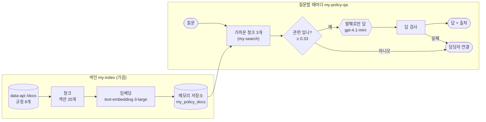

# 71일차 실습 · RAG 기반 규정 검색·응답과 검색 품질 개선 (바이브 코딩)

- 일자: 2026-10-23 (71일차)
- 교과목: 노코드 멀티 에이전트 워크플로우 설계 및 운영
- 단원: 운영·확장 관점의 AI 워크플로우 설계 고도화
- 강의 자료: [Lecture/71](../../Lecture/71/README.md)
- 하루 수강 안내: [LECTURE-71.md](LECTURE-71.md) (수업 준비부터 마칠 때까지 순서대로)
- 67~70일차처럼 CLI 코딩 에이전트에게 **내가 쓴 요청문**으로 워크플로우를 만들게 하고, **테스트로 확인**합니다.

## 오늘 만드는 것: 사내 IT 규정 Q&A

사내 IT 규정 문서 8개(25개 섹션)를 잘게 나누어 임베딩하고, 질문과 뜻이 가까운 부분을 찾아 **그 내용으로만** 답합니다. 검색이 잘 되는지는 질문 24개로 **숫자로** 재고, 한 가지씩 바꿔 가며 고칩니다.



## 일하는 방식 (67~70일차와 같음)

| 누가 | 무엇을 |
| --- | --- |
| 나 | 정답표(질문 → 문서·답 문구) 만들기, 요청문 쓰기, 한 가지씩 바꾸고 재기, 결과 판단 |
| CLI 에이전트 | [AGENTS.md](AGENTS.md) 규칙대로 워크플로우 JSON 작성, `check`로 형식 오류 고치기 |
| `tools/flow.py` | check · push · call · test (`before`로 테스트 전에 색인, `--no-before`로 건너뛰기) |

> **메모리 저장소는 n8n이 재시작되면 지워집니다.** `push`할 때마다 n8n이 재시작되므로 색인을 다시 해야 합니다. 테스트 파일의 `before`가 이것을 해 줍니다. 직접 `call` 할 때는 먼저 `uv run tools/flow.py call my-index -v`.

## 실습 문서 읽는 법

- 실습 문서(`LAB-0x-Q-*.md`)는 요청문을 바로 주지 않습니다. 막히면 `▶` 를 위에서부터 하나씩 펼칩니다: 생각할 거리 → **빈칸 채우기**(요청문 뼈대의 `____`를 내가 채움) → **그래도 막히면**(빈칸을 채운 모양, 내 것과 비교). `VIBE-Q-TDOC.md`는 요청서 → 내 SPEC 순서입니다.
- 쓴 요청문은 `my-work/PROMPTS.md`에 모아 둡니다.
- 바이브 코딩은 **요청서(`VIBE-REQ-TDOC.md`)부터** 읽고 요구(`SPEC.md`)를 직접 뽑은 뒤 `VIBE-Q-TDOC.md`와 비교합니다. 정답본 `VIBE-A-TDOC.md`는 수업이 끝나면 올라옵니다.

## 구성

```text
Last3Mon/71/
├── README.md
├── AGENTS.md                         # CLI 에이전트용 작업 규칙 (계약 3절, 벡터 저장소 노드 5절)
├── LAB-01-Q-INDEX-AND-SEARCH.md      # 1단계 · 정답표 → 색인 · 검색 → 섹션 출처 · top_k
├── LAB-02-Q-ANSWER-FROM-POLICIES.md  # 2단계 · 발췌로만 답 · 출처 → 관련 없음 → 답 검사
├── LAB-03-Q-MEASURE-AND-IMPROVE.md   # 3단계 · doc@1 · answer@1 · answer@3 → 한 가지씩 바꾸기 → 어려운 질문
├── VIBE-REQ-TDOC.md                  # 7교시 바이브 코딩 · 요청서 (가장 먼저, 여기서 SPEC.md를 뽑음)
├── VIBE-Q-TDOC.md                    # 7교시 바이브 코딩 · tdoc 요구 · 단계 (SPEC과 비교)
├── *-A-*.md                          # 정답본 (VIBE-A는 수업이 끝난 뒤 올라옴, LAB-A는 아직 없음)
├── tools/flow.py
├── data-api/                         # 71일차 판 데이터 API (67일차 + 규정 문서 /docs)
│   └── data/docs/*.md                # 규정 8개
├── cases/                            # lab01 · lab01-challenge · lab02 · lab02-challenge · retrieval-doc · retrieval-answer · retrieval-answer3 · lab03-threshold
├── requests/                         # 질문 15종, 색인 설정 3종
├── reference/                        # 막혔을 때 이어 가는 워크플로우
├── templates/                        # 검색 평가표 · 테스트 보고서
├── my-work/
└── runs/
```

## 준비

[실습 준비](../../Lecture/71/00-DAY71-PREP.md)를 끝내 주세요. 요약:

```bash
cd ~/aio-01d4-stu/Last3Mon/65/n8n && docker compose start   # Ollama는 쓰지 않음 · 처음 한 번 PREP 1절대로 끄기
cd ~/aio-01d4-stu/Last3Mon/71/data-api && docker compose up -d --force-recreate   # 71일차 판으로 바꿈 (/docs 추가)
cd ~/aio-01d4-stu/Last3Mon/71 && uv run tools/flow.py doctor                       # 마지막 줄 ready
```

## `flow.py` 명령

| 명령 | 하는 일 | 수업 준비 때 |
| --- | --- | --- |
| `uv run tools/flow.py push my-work/index.json my-work/search.json` | 게시 (n8n 재시작 → 메모리 저장소 비워짐) | |
| `uv run tools/flow.py call my-index requests/index-section.json -v` | 색인 (섹션 25개) | 약 1.2초 |
| `uv run tools/flow.py call my-search requests/q-password-length.json -v` | 검색만 | 0.2~0.5초 |
| `uv run tools/flow.py test cases/retrieval-answer.json -v` | `before`로 색인한 뒤 24문항. `-v`는 케이스마다 보낸 요청 JSON과 받은 응답 JSON을 화면에 보여 줌 (`call`도 같음) | 케이스당 0.2~0.5초 |
| `uv run tools/flow.py test cases/retrieval-answer.json -v --no-before` | 지금 색인 그대로 (설정 비교할 때) | |
