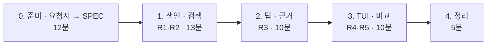

# 7교시 바이브 코딩 · `tdoc` 만들기

> **먼저 [VIBE-REQ-TDOC.md](VIBE-REQ-TDOC.md)(요청서)를 읽고 `~/vibe/tdoc/SPEC.md`를 직접 쓴 뒤** 이 문서를 엽니다. 이 문서는 요청서에서 요구를 뽑아 낸 **다음 단계**입니다. 내 SPEC과 비교하는 데 쓰고, 에이전트에게 통째로 붙여 넣지 않습니다.


- 시간: 16:00~16:50 (50분) · 발표와 정리는 8교시
- 도구: CLI 코딩 에이전트(codex / claude / agy), Python + uv + [Textual](https://textual.textualize.io/), SQLite
- 결과물: **내 md 문서**를 임베딩해 SQLite에 저장하고, 질문하면 답과 **근거 문단**을 보여 주는 RAG TUI. `top_k`, 청크 크기를 바꿔 가며 결과를 비교합니다. 오늘 n8n으로 한 일을 내 문서(이 과정의 `Lecture/` 교안 등)에 직접 해 봅니다.

```text
$ tdoc ~/aio-01d4-stu/Lecture
┌ tdoc · 문서 N · 청크 M · section ───────────────────────────────┐
│ 질문: [ 메모리 저장소는 언제 지워져요?                ] top_k [3] │
│ ┌ 답 ────────────────────────────────────────────────────────────┐ │
│ │ n8n이 재시작되면 지워집니다 [1]. push할 때마다 …                │ │
│ └────────────────────────────────────────────────────────────────┘ │
│ ┌ 근거 ──────────────────────────────────────────────────────────┐ │
│ │ [1] 0.xx Lecture/71/01-STAGE1-RAG-AND-INDEX.md · 5. 메모리 저장소 │ │
│ │ [2] 0.xx Lecture/71/00-DAY71-PREP.md · 1. n8n과 데이터 API      │ │
└──────────────────────────────────────────────────────────────────┘
```

> 요청문은 **직접** 씁니다. 단계마다 `▶` 를 펼치면 생각할 거리가 나옵니다. 정답 요청문은 없습니다.

## 요구 사항 (요청서에서 뽑은 것)

| 번호 | 요구 | 요청서의 말 | 확인 방법 |
| --- | --- | --- | --- |
| R1 | 폴더의 `*.md`를 청크로 나눠(섹션 또는 글자 수) 임베딩하고 SQLite 파일 하나에 저장한다. 바뀐 파일만 다시 임베딩한다 | ① 폴더 통째로, 매번 처음부터 다시 읽지 않기, 껐다 켜도 남기 | `tdoc index <폴더>` 두 번 (두 번째는 임베딩 0번), 가짜 임베딩 테스트의 호출 수 |
| R2 | 질문하면 가까운 청크 `top_k`개를 점수·파일·섹션과 함께 보여 준다 | ② 어느 파일 어느 부분, 얼마나 가까운지, 몇 개까지 | `tdoc search "..." --top-k 5` → 5줄, 줄마다 점수 · 파일 · 섹션 |
| R3 | 그 청크들로만 답을 쓰고 `[번호]`로 근거를 단다. 1등 점수가 기준 아래면 LLM을 부르지 않고 모른다고 한다 | ③ 문서 내용으로만, 어디서 나왔는지, 지어내지 말고 모른다고 | `tdoc ask "..."`, 문서에 없는 질문 → "문서에서 찾지 못했습니다" (가짜 LLM 호출 0번) |
| R4 | TUI: 질문 입력, 답, 근거 목록. 근거를 고르면 원문 문단 전체 | ④ 찾은 부분 목록, 고르면 원문 전체 | `tdoc <폴더>` |
| R5 | 청크 설정을 바꿔 **같은 질문 목록**으로 비교한다 (질문 · 기대 파일 → 맞은 수) | ⑤ 자르는 크기를 바꿔 숫자로 | `tdoc eval questions.yaml --chunking 200` → 설정마다 "몇 개 중 몇 개" |

숨은 요구 (요청서에 직접 없지만 없으면 안 되는 것):

| 숨은 요구 | 어디서 나왔나 |
| --- | --- |
| 청크마다 **파일 경로 · 섹션 제목 · 글 · 벡터**를 저장하고, 파일마다 **내용 해시 · 청크 설정**을 저장한다 | ② "어느 파일 어느 부분", ① "바뀐 파일만" |
| 테스트는 **가짜 임베딩 · 가짜 LLM**으로 (진짜를 부르지 않음). 임베딩 · LLM을 바꿔 끼울 수 있게 | "테스트하느라 돈이 나가는 건 싫어요" |
| LLM이 붙인 `[번호]`가 발췌 범위 밖이면 **코드가** 버린다 | ③ "어디서 나왔는지" — 없는 근거를 붙이면 지어낸 것과 같음 (오늘 Lab 02 `cited`는 코드가 만듦) |
| 비교하기 전에 **질문 · 기대 파일 정답표**(`questions.yaml`, 5개 이상)를 먼저 쓴다 | ⑤ "숫자로" (오늘 Lab 01 예제 1) |
| 청크 설정마다 **DB 파일을 따로** (두 설정이 한 DB에 섞이지 않게) | ⑤ 크기를 바꿔 비교 |
| 키는 환경 변수에서만 읽고 코드 · SQLite에 남기지 않는다 | "키가 코드나 저장 파일에 찍히면 안 돼요" |
| 임베딩 · LLM을 부르는 동안 화면이 멈추지 않는다 | ④ (색인 수십 초, 답 수 초) |

범위 밖 (오늘 하지 않음): PDF · 워드 읽기, 여러 사람이 함께 쓰는 서버, 벡터 DB 설치, n8n과 직접 연결하기. (강사 바이브 코딩에서 `tdoc serve`로 n8n에서 부르기를 보여 줄 수 있음)

**비교해 보기**: 내 `SPEC.md`에서 빠진 요구, 내가 더 뽑은 요구, 다르게 정한 순서를 `SPEC.md` 끝에 한 줄씩 적고, 필요하면 내 SPEC을 고칩니다. 아래 단계부터는 **고친 내 SPEC.md**를 기준으로 요청문을 씁니다.

알아 둘 것:

- 임베딩 `text-embedding-3-large`, 답 `gpt-4.1-mini`, 키는 `OPENAI_API_KEY` 환경 변수. **키를 코드에 쓰지 않습니다.**
- 벡터 검색은 SQLite에 숫자 목록(벡터)을 저장하고 파이썬에서 코사인 유사도를 계산해도 충분합니다 (문서 수백 개 규모).
- 오늘 Lab의 `cases/retrieval-*.json`이 R5의 질문 목록 모양입니다.

## 진행 (50분)



### 0. 준비 · 요청서 → SPEC (12분)

```bash
mkdir -p ~/vibe/tdoc && cd ~/vibe/tdoc
git init
export OPENAI_API_KEY=$(grep '^OPENAI_API_KEY=' ~/aio-01d4-stu/Last3Mon/.env | cut -d= -f2-)
# 에이전트는 SPEC.md를 쓴 뒤에 켭니다: codex (또는 claude, agy)
```

1. **에이전트는 아직 켜지 않습니다.** [VIBE-REQ-TDOC.md](VIBE-REQ-TDOC.md)를 읽고 `SPEC.md`를 직접 씁니다 (10분).
2. 이 문서의 요구 표 · 숨은 요구와 비교해 `SPEC.md`를 고치고 `git commit`.
3. 그다음 에이전트를 켭니다: `codex` (또는 `claude`, `agy`). 첫 요청은 "`SPEC.md`를 읽고, 1단계를 만들기 전에 확인 방법부터 말해 줘".

### 1. 색인과 검색 (13분)

<details><summary>▶ 1단계 · 저장할 것</summary>

청크마다 무엇을 저장해야 검색 결과를 보여 줄 수 있나요? (파일 경로, 섹션 제목, 글, 벡터) 그리고 "바뀐 파일만 다시"를 하려면 파일마다 무엇을 기억해야 할까요?
</details>

<details><summary>▶ 2단계 · 테스트에서 진짜 임베딩을 부르지 않게</summary>

`tman`의 번역기, `tcrew`의 LLM처럼 임베딩도 바꿔 끼울 수 있게 합니다. 가짜 임베딩(예: 낱말 수를 센 벡터)만으로도 "같은 낱말이 많은 청크가 1등"을 테스트할 수 있습니다.
</details>

**확인**: `uv run tdoc index ~/aio-01d4-stu/Lecture/71`, 다시 한 번(빠른가), `uv run tdoc search "메모리 저장소"`, `pytest`, `git commit`.

### 2. 답과 근거 (10분)

<details><summary>▶ 1단계 · 오늘 n8n에서 배운 것 그대로</summary>

발췌로만 답하기, 번호로 근거, 모르면 모른다고, 점수가 낮으면 LLM을 부르지 않기. 요청문에 이 네 가지가 있나요? Lab 02 과제의 "점수는 높은데 답이 없을 때"도 생각해 봅니다.
</details>

### 3. TUI와 비교 (10분)

<details><summary>▶ 1단계 · 비교는 같은 질문으로</summary>

`questions.yaml`(질문 · 기대 파일)을 직접 5개 써 봅니다. 청크 설정을 바꿔 맞은 수를 표로 보여 주게 합니다. 오늘 Lab 03과 같습니다: 한 번에 하나만 바꾸기.
</details>

**확인**: `uv run tdoc ~/aio-01d4-stu/Lecture`, 근거 선택 → 원문, `tdoc eval`로 두 설정 비교, `git commit`.

### 4. 정리 (5분)

`SPEC.md` 1절 표의 확인 방법대로 하나씩 체크하고, 발표 메모를 씁니다.

| 발표 (3분) | 내용 |
| --- | --- |
| SPEC | 내 SPEC과 VIBE-Q가 달랐던 곳 (빠뜨린 요구, 더 뽑은 요구) |
| 요청문 | 가장 잘 먹힌 요청문 한 개, 안 먹힌 요청문 한 개 |
| 막힌 곳 | 다시 색인이 느림, 근거 번호가 틀림 등 어떻게 알아챘고 고쳤나 |
| 시연 | 교안 폴더에 질문 하나, 두 설정의 비교 표 |

## 확인

- [ ] `SPEC.md`를 에이전트 없이 먼저 쓰고, VIBE-Q와 비교한 줄을 남겼다.
- [ ] R1 SQLite 하나에 저장, 두 번째 색인은 바뀐 파일만.
- [ ] R2 점수 · 파일 · 섹션과 함께 `top_k`개.
- [ ] R3 근거 번호, 근거가 없으면 모른다고.
- [ ] R4 TUI에서 근거를 고르면 원문.
- [ ] R5 같은 질문 목록으로 두 설정 비교.
- [ ] `pytest`(가짜 임베딩), 단계마다 git commit, `PROMPTS.md`.
