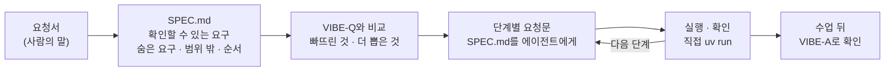

# 7교시 바이브 코딩 · 요청서 `tdoc` (가장 먼저 읽기)

- 순서: **이 요청서** → 내가 뽑은 요구 `~/vibe/tdoc/SPEC.md` (10분) → [VIBE-Q-TDOC.md](VIBE-Q-TDOC.md)와 비교 → 단계별로 만들기 → 수업이 끝나면 `VIBE-A-TDOC.md`(정답본)로 확인
- 이 문서는 **만들어 달라는 사람의 말**입니다. 요구 사항 표도, 단계도 없습니다. 그것을 뽑아 내는 것이 첫 10분의 일입니다. 68 · 69일차와 같은 순서입니다.



## 왜 요청서부터인가

VIBE-Q 문서를 통째로 에이전트에게 주고 "이대로 만들어 줘"라고 하면, 무엇이 만들어지든 **내가 판단할 기준이 없습니다.** 실무에서는 요구 사항 표가 오지 않고, 이 요청서 같은 **사람의 말**이 옵니다. 말을 확인할 수 있는 요구로 바꾸는 일은 에이전트가 아니라 내가 합니다. 오늘 오전 Lab 01 예제 1에서 검색을 만들기 전에 **정답표**를 먼저 쓴 것과 같은 일입니다.

| 단계 | 누가 | 결과 |
| --- | --- | --- |
| 요청 → 요구 | **나** | `SPEC.md`: 요구마다 "됐다 / 안 됐다"를 말할 수 있는 확인 방법 |
| 요구 → 단계 | **나** | 작게 나눈 순서 (무엇부터 만들고 확인할지) |
| 단계 → 코드 | 에이전트 | 단계마다 요청문 하나, `SPEC.md`를 함께 읽게 함 |
| 확인 | **나** | 직접 `uv run tdoc …`, `pytest`, 요구 표에 체크 |

## 요청 (IT 문의 창구 담당자에게서 온 메시지, 그대로)

> 오늘 n8n으로 만든 규정 Q&A 잘 봤어요. 그런데 저희 팀 업무 안내랑 교육 자료는 규정 말고도 md 파일로 폴더에 잔뜩 쌓여 있거든요. n8n은 다시 켜면 색인이 날아간다면서요? 제 노트북 터미널에서 **제 폴더로 바로 물어보는** 작은 프로그램이 있으면 좋겠어요.
>
> ① 폴더를 통째로 넣고 싶어요. 그런데 파일이 자주 **조금씩** 바뀌어요. 한 줄 고쳤다고 **매번 처음부터 다시 읽느라 오래 걸리고 돈이 나가면** 곤란해요. 그리고 노트북을 껐다 켜도 남아 있어야 해요.
>
> ② 물어보면 **어느 파일 어느 부분**에서 찾았는지, **얼마나 가까운지** 보고 싶어요. 몇 개까지 볼지는 제가 정할게요.
>
> ③ 답은 **문서에 있는 내용으로만**, 어디서 나왔는지 붙여서 주세요. 문서에 없는 걸 물으면 **지어내지 말고 모른다고** 해야 해요. 그럴듯하게 지어낸 답이 제일 무서워요.
>
> ④ 답 옆에 찾은 부분 목록이 있고, 하나 고르면 그 부분 **원문 전체**를 화면에서 바로 읽을 수 있으면 좋겠어요.
>
> ⑤ 문서를 자르는 크기를 바꿔 보고 싶은데, "좋아진 것 같다"는 말고 **숫자로** 비교하고 싶어요. 오늘 Lab 03에서 하신 것처럼요.
>
> 키는 이미 환경 변수에 넣어 뒀어요. 그런데 **키가 코드나 저장 파일에 찍히면 안 돼요.** 그리고 프로그램을 고칠 때마다 테스트하느라 돈이 나가는 건 싫어요.

## 함께 받은 것

| 파일 · 자료 | 메모 |
| --- | --- |
| `~/aio-01d4-stu/Lecture/` (또는 내 md 폴더) | 넣어 볼 문서 폴더. 일차마다 `##` 섹션이 있는 md 여러 개 |
| `~/aio-01d4-stu/Last3Mon/71/cases/retrieval-doc.json` | 오늘 Lab 03의 "질문 · 기대 문서" 목록 모양 |
| 오늘 만든 `my-work/policy-qa.json` (Lab 02) | 발췌 · 번호 · 기준값 · "찾지 못했습니다"를 어떻게 했는지 |
| [AGENTS.md](AGENTS.md) 3절 | n8n 색인 · 검색 · Q&A의 계약 (`hits`의 `source` · `section` · `score`, `top_score`) |

- LLM 키는 `OPENAI_API_KEY` 환경 변수, 임베딩 `text-embedding-3-large`, 답 `gpt-4.1-mini`.

## 할 일 · 요청을 요구로 (10분, 에이전트 없이)

`~/vibe/tdoc/SPEC.md`를 만들고 아래 네 가지를 씁니다. **에이전트에게 맡기지 않고 직접** 씁니다 (나중에 에이전트에게 읽힐 문서입니다).

```markdown
# tdoc SPEC

## 1. 요구 (확인할 수 있게)
| 번호 | 요구 | 요청의 어느 말 | 확인 방법 (파일 · 숫자 · 화면) |
| --- | --- | --- | --- |
| R1 | | ① | |

## 2. 숨은 요구 (요청에 직접 없지만 없으면 안 되는 것)
## 3. 범위 밖 (오늘 50분 안에 하지 않을 것)
## 4. 만드는 순서 (그리고 그 이유)
```

예 하나만 보여 드립니다. 나머지는 직접 바꿔 봅니다.

| 요청의 말 | 그대로 요청문에 넣으면 | 확인할 수 있는 요구로 |
| --- | --- | --- |
| ① "한 줄 고쳤다고 매번 처음부터 다시 읽느라 오래 걸리고 돈이 나가면 곤란해요" | "색인을 빠르게 해 줘" → 무엇이 되든 "됐다"가 됨 | **파일마다 내용 해시를 저장하고, 해시가 같은 파일은 다시 임베딩하지 않는다.** 확인: 가짜 임베딩으로 파일 2개를 색인 → 바로 다시 색인하면 임베딩 호출 **0번**, 한 파일만 고치면 **그 파일의 청크 수만큼만** 호출 |

<details><summary>▶ 1단계 · "얼마나 가까운지", "모른다고", "숫자로"를 어떻게 확인하나</summary>

형용사와 부탁은 확인할 수 없습니다. "몇 번 불리면", "어느 파일에 무엇이 남으면", "화면에 무엇이 몇 개 보이면"으로 바꿉니다. ③ "모른다고"는 **언제** 모른다고 하나요? 오늘 Lab 02에서 LLM을 부르기 전에 무엇을 보고 넘겼는지 떠올립니다. 그리고 모른다고 할 때 화면에 **어떤 문장**이 나와야 확인할 수 있나요?
</details>

<details><summary>▶ 2단계 · 숨은 요구</summary>

- ②를 보여 주려면 청크마다 **무엇을 저장**해 두어야 하나요? (파일, 섹션, 글, 벡터 …) ①의 "바뀐 파일만"을 하려면 파일마다 무엇을 기억해야 하나요?
- "테스트하느라 돈이 나가는 건 싫어요" → 테스트에서 진짜 임베딩 · 진짜 LLM을 부르지 않으려면 무엇이 있어야 하나요?
- ③ "어디서 나왔는지 붙여서": LLM이 없는 번호(`[7]`)를 붙이면 어떻게 하나요? 그것은 누가 확인하나요?
- ⑤ "숫자로 비교"하려면 프로그램보다 먼저 **무엇**이 있어야 하나요? (오늘 Lab 01 예제 1)
- ⑤ 크기를 바꿔 색인하면, 앞서 다른 크기로 만든 색인은 어떻게 되나요? 두 설정이 섞이면 비교가 될까요?
- 임베딩 · LLM을 부르는 동안 화면은 어떻게 되어야 할까요?
</details>

<details><summary>▶ 3단계 · 범위 밖과 순서</summary>

50분입니다. PDF · 워드 파일 읽기, 여러 사람이 함께 쓰는 서버, 벡터 DB 설치, n8n과 직접 연결하기는 요청에 없습니다. 순서는 "무엇을 먼저 만들면 나머지가 그것을 다시 쓰나"로 정합니다. 답(③) · 화면(④) · 비교(⑤)가 모두 **같은 것**(색인과, 질문으로 찾은 청크 목록)을 씁니다.
</details>

## 그다음

1. [VIBE-Q-TDOC.md](VIBE-Q-TDOC.md)를 열어 내 `SPEC.md`와 비교합니다. 빠뜨린 요구, 내가 더 뽑은 요구, 다르게 정한 순서를 `SPEC.md` 끝에 한 줄씩 적습니다 (8교시 발표 거리).
2. 단계마다 요청문을 쓸 때 "`SPEC.md`를 읽고 4절의 1단계만 해 줘"처럼 **내 SPEC을 기준으로** 시킵니다. VIBE-Q 문서를 통째로 붙여 넣지 않습니다.
3. 단계가 끝날 때마다 `SPEC.md` 1절 표의 확인 방법대로 **내가** 확인하고 체크합니다.
4. 수업이 끝나면 `git pull`로 정답본 `VIBE-A-TDOC.md`를 받아, 요구 도출 예시와 요청문 예를 내 것과 비교합니다.
