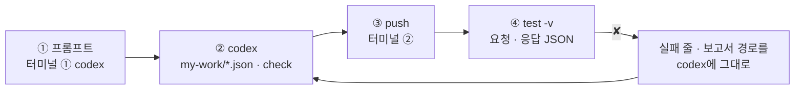
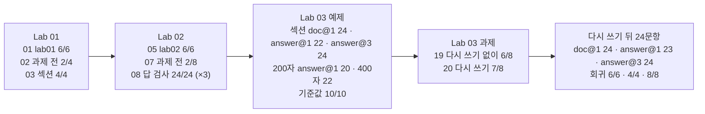

# 71일차 Lab 테스트 결과 · 실제로 만든 시나리오와 `test -v` 결과

> **정답 자료** · 71일차 n8n 워크플로우를 **만드는 프롬프트(codex) → push → `call -v` · `test -v` 결과**를 학생이 가는 순서대로 한 문서에 모았습니다. 수업이 끝난 뒤 공개합니다.

- 실행: 수업 전날(2026-10-22), 강사 노트북의 65일차 n8n 2.42.6 + 71일차 판 데이터 API(`/docs` 규정 8개), OpenAI `gpt-4.1-mini` · `text-embedding-3-large`, 케이스 파일마다 **한 번씩** (Lab 02 과제만 `--repeat 3`)
- 명령: `~/aio-01d4-stu/Last3Mon/71`에서 `uv run tools/flow.py test <케이스 파일> -v`, 색인 · 검색 한 번은 `call ... -v`
- 아래 단계마다 **실행한 명령**과 **화면에 나온 출력 전부**(`-v`)를 그대로 붙였습니다. 같은 출력이 `NN-<이름>.txt`에, 같은 실행의 보고서가 `NN-<이름>.json`(케이스마다 `request` · `response` · `problems` · `seconds`)에 있습니다 (`call`만 한 00 · 06 · 11 · 15 · 17은 보고서 없음).
- LLM 문장과 시간은 실행마다 조금씩 다릅니다. **점수**는 2026-10-18 수업 준비 때와 같았고, 하나만 달랐습니다: 22단계 질문 다시 쓰기 뒤 answer@1이 **23/24** (수업 준비 때 24/24). 까닭은 22절에 적었습니다.

## `-v`가 보여 주는 것

```text
✘ 고객 정보가 밖으로 샌 것 같아요 · 1.3s · hits.0.text has none of ['1시간']   ← 케이스 이름 · 시간 · 틀린 곳
    → request  POST /webhook/my-search                                          ← 보낸 요청 JSON
      {
        "question": "고객 정보가 밖으로 샌 것 같아요"
      }
    ← response HTTP 200                                                         ← 받은 응답 JSON
      {
        "question": "고객 정보가 밖으로 샌 것 같아요",
        "query": "고객 정보 외부 유출 방지 정책",
        "hits": [ … 1등 "2. 이용과 보관" · 2등 "3. 유출 대응" … ]
      }
```

`-v` 없이 돌리면 첫 줄만 나옵니다. 아래 응답을 보면 **문서(`privacy`)는 맞았는데 섹션 순서가 바뀌었다**는 것과 다시 쓴 검색어(`query`)가 무엇이었는지 바로 보입니다. `call ... -v`도 같은 모양으로 요청 · 응답을 보여 줍니다.

## 이 문서 하나로 따라가기

단계마다 **① codex에 넣는 프롬프트 → ② codex가 `my-work/*.json`을 쓰고 `check` → ③ 내가 `push` → ④ 내가 `test -v`** 순서입니다. 아래 단계 절에 ①의 프롬프트, ③ · ④의 명령, ④의 출력 전부가 차례로 있습니다. Lab 03 예제는 워크플로우를 만들지 않고 **색인 설정만 바꿔 재므로** 프롬프트가 없습니다.



```bash
# 터미널 ① (codex) · 터미널 ② (확인) 둘 다
cd ~/aio-01d4-stu/Last3Mon/71
codex          # 터미널 ①에서만. AGENTS.md(작업 규칙 · 계약 · 노드)를 codex가 스스로 읽음
```

| 단계 | 만드는 것 | codex 프롬프트 | 학생 파일 | 이 기록에서 push한 정답 |
| --- | --- | --- | --- | --- |
| 00 | 색인 + 검색 | 00절 | `my-work/index.json` · `search.json` | `reference/lab01-example2-index.json` · `-search.json` |
| 03 | + 섹션 제목 · `top_k` | 03절 | `my-work/index.json` · `search.json` 고침 | [`71-lab01-challenge-index.json`](71-lab01-challenge-index.json) · [`-search.json`](71-lab01-challenge-search.json) |
| 05 | 규정 Q&A (발췌 · 번호 · 기준값) | 05절 | `my-work/policy-qa.json` | `reference/lab02-example2-qa.json` |
| 08 | + 답 검사 4가지 | 08절 | `my-work/policy-qa.json` 고침 | [`71-lab02-challenge-qa.json`](71-lab02-challenge-qa.json) |
| 19 | 어려운 질문 8개 (케이스 파일) | (직접 씀) | `cases/my-cases.json` | [`71-lab03-challenge-cases.json`](71-lab03-challenge-cases.json) |
| 20 | 검색 앞 질문 다시 쓰기 | 20절 | `my-work/search.json` 고침 | [`71-lab03-challenge-search.json`](71-lab03-challenge-search.json) |

- **프롬프트는 정답본(`LAB-0x-A-*.md`)의 요청문 예**를 그대로 썼습니다.
- **이 기록의 워크플로우는 수업 준비 때 만든 정답 파일**입니다. 위 프롬프트를 codex에 보내 다시 만들어 재지는 않았습니다 (68일차부터 수업 준비는 정답 워크플로우만 실행). codex가 만든 파일은 노드 이름 · 문장이 다를 수 있지만, **테스트가 보는 칸**이 같으면 같은 점수가 나와야 합니다.
- 학생은 `push my-work/<파일>.json`, 이 기록은 같은 웹훅의 정답 파일을 push했습니다. 그래서 `test` 명령과 결과 모양은 같습니다.
- **push마다 n8n이 재시작되어 메모리 저장소가 비워집니다.** 케이스 파일의 `before`(첫 줄 `✔ before: POST /webhook/my-index`)가 섹션 설정으로 다시 색인하고 케이스를 돌립니다. Lab 03 예제는 내가 다른 설정으로 색인한 것을 재야 하므로 `--no-before`를 붙입니다.

## 시나리오 한눈에



| 단계 | 먼저 올린 것 (`push`) · 색인 | 테스트 | 결과 | 파일 |
| --- | --- | --- | --- | --- |
| 00 | 색인 · 검색 `reference/lab01-example2-*.json` | `call my-index` · `call my-search` | 둘 다 200, 청크 25 | `00-lab01-index-search` |
| 01 | (같음) | `cases/lab01.json` | 6/6 | `01-lab01` |
| 02 | (같음, 과제 하기 전) | `cases/lab01-challenge.json` | **2/4** | `02-lab01-challenge-before` |
| 03 | 과제 정답 [`71-lab01-challenge-index.json`](71-lab01-challenge-index.json) · [`-search.json`](71-lab01-challenge-search.json) | `cases/lab01-challenge.json` | 4/4 | `03-lab01-challenge` |
| 04 | (같음) | `cases/lab01.json` | 6/6 | `04-lab01-after-challenge` |
| 05 | 규정 Q&A `reference/lab02-example2-qa.json` | `cases/lab02.json` | 6/6 | `05-lab02` |
| 06 | (같음) | `call my-policy-qa` 규정 밖 질문 | 200, `담당자 연결` | `06-lab02-off-topic` |
| 07 | (같음, 과제 하기 전) | `cases/lab02-challenge.json` | **2/8** | `07-lab02-challenge-before` |
| 08 | 과제 정답 [`71-lab02-challenge-qa.json`](71-lab02-challenge-qa.json) | `cases/lab02-challenge.json --repeat 3` | 24/24 | `08-lab02-challenge` |
| 09 | (같음) | `cases/lab02.json` | 6/6 | `09-lab02-after-challenge` |
| 10 | (같음) | `cases/lab03-threshold.json` | 10/10 | `10-lab03-threshold` |
| 11 | 색인 섹션 (`call my-index`) | — | 청크 25 | `11-lab03-index-section` |
| 12 | (같음) | `cases/retrieval-doc.json --no-before` | doc@1 24/24 | `12-retrieval-doc-section` |
| 13 | (같음) | `cases/retrieval-answer.json --no-before` | answer@1 **22/24** | `13-retrieval-answer-section` |
| 14 | (같음) | `cases/retrieval-answer3.json --no-before` | answer@3 24/24 | `14-retrieval-answer3-section` |
| 15 | 색인 200자 | — | 청크 20 | `15-lab03-index-200` |
| 16 | (같음) | `cases/retrieval-answer.json --no-before` | answer@1 **20/24** | `16-retrieval-answer-200` |
| 17 | 색인 400자 | — | 청크 12 | `17-lab03-index-400` |
| 18 | (같음) | `cases/retrieval-answer.json --no-before` | answer@1 **22/24** | `18-retrieval-answer-400` |
| 19 | (Lab 01 과제 정답 검색, 과제 하기 전) | 어려운 질문 [`71-lab03-challenge-cases.json`](71-lab03-challenge-cases.json) | **6/8** | `19-challenge-cases-before` |
| 20 | 다시 쓰기 [`71-lab03-challenge-search.json`](71-lab03-challenge-search.json) | 어려운 질문 | 7/8 | `20-challenge-cases-rewrite` |
| 21 | (같음) | `cases/retrieval-doc.json` | doc@1 24/24 | `21-retrieval-doc-rewrite` |
| 22 | (같음) | `cases/retrieval-answer.json` | answer@1 **23/24** (준비 때 24) | `22-retrieval-answer-rewrite` |
| 23 | (같음) | `cases/retrieval-answer3.json` | answer@3 24/24 | `23-retrieval-answer3-rewrite` |
| 24 | (같음) | `cases/lab01.json` | 6/6 | `24-lab01-final` |
| 25 | (같음) | `cases/lab01-challenge.json` | 4/4 | `25-lab01-challenge-final` |
| 26 | (같음) | `cases/lab02-challenge.json` | 8/8 | `26-lab02-challenge-final` |

설정 비교 (Lab 03 예제 표, 이 기록의 값):

| 설정 | 청크 | doc@1 | answer@1 | answer@3 |
| --- | --- | --- | --- | --- |
| 섹션 | 25 | 24/24 (12) | 22/24 (13) | 24/24 (14) |
| 200자 | 20 | — | 20/24 (16) | — |
| 400자 | 12 | — | 22/24 (18) | — |
| 섹션 + 질문 다시 쓰기 | 25 | 24/24 (21) | 23/24 (22) | 24/24 (23) |

- 학생 Lab 03 예제 2는 answer@1만 재므로 이 기록도 200자 · 400자는 answer@1만 쟀습니다. 수업 준비 때 doc@1 · answer@3까지 잰 값은 200자 24 · 24, 400자 22 · 24입니다 (LAB-03-A).

---

## Lab 01 · 정답표, 색인, 검색

예제 1(정답표)은 codex 없이 종이에 씁니다 (질문 · 문서 · 섹션 · 답 문구, 답 없는 질문 포함). 정답표 예는 LAB-01-A에 있습니다.

### 00 · 예제 2 · 색인 + 검색 한 번씩 → 둘 다 200

codex에 입력하는 프롬프트 (터미널 ①, 학생이 만들 파일 `my-work/index.json · my-work/search.json` · 이 기록에서 push한 같은 역할의 정답 `reference/lab01-example2-index.json` · `-search.json`):

```text
두 워크플로우를 만들어 줘. 계약은 AGENTS.md 3절, 노드는 5절.
1. my-work/index.json (웹훅 my-index): GET http://data-api:8800/docs → 문서마다 GET /docs/<name>
   → Code에서 본문을 "## " 섹션마다 청크로 (청크 글 앞에 문서 제목), source(name)·title·chunk 번호를 같이.
   본문 chunking 이 숫자면 그 글자 수로 자른다 (기본 section).
   → 메모리 Vector Store(insert, memoryKey my_policy_docs, clearStore true) + OpenAI Embeddings text-embedding-3-large + Default Data Loader(metadata source, title, chunk).
   → {indexed_chunks, chunking}.
2. my-work/search.json (웹훅 my-search): question 없으면 400. 같은 저장소에서 load, topK = 본문 top_k 없으면 3, 메타데이터 포함, Always Output Data.
   → Code: {question, hits:[{rank, source, title, score(소수 셋째 자리), text}], top_score, indexed}.
기대 결과 cases/lab01.json.
```

실행한 명령:

```bash
uv run tools/flow.py push reference/lab01-example2-index.json reference/lab01-example2-search.json
uv run tools/flow.py call my-index requests/index-section.json -v
uv run tools/flow.py call my-search requests/q-password-length.json -v
```

출력 (그대로):

```text
$ uv run tools/flow.py call my-index requests/index-section.json -v
HTTP 200 · 3.8s
    → request  POST /webhook/my-index
      {
        "chunking": "section"
      }
    ← response HTTP 200
      {
        "indexed_chunks": 25,
        "chunking": "section"
      }

$ uv run tools/flow.py call my-search requests/q-password-length.json -v
HTTP 200 · 0.6s
    → request  POST /webhook/my-search
      {
        "question": "비밀번호는 몇 자 이상이어야 하나요?"
      }
    ← response HTTP 200
      {
        "question": "비밀번호는 몇 자 이상이어야 하나요?",
        "hits": [
          {
            "rank": 1,
            "source": "password-policy",
            "title": "비밀번호·계정 보안 규정",
            "score": 0.748,
            "text": "비밀번호·계정 보안 규정\n## 1. 비밀번호 만들기\n- 비밀번호는 12자 이상으로 만든다.\n- 영문 대문자, 영문 소문자, 숫자, 특수문자 중 3종류 이상을 섞는다.\n- 이름, 생일, 전화번호, 회사 이름처럼 추측하기 쉬운 단어는 쓰지 않는다."
          },
          {
            "rank": 2,
            "source": "password-policy",
            "title": "비밀번호·계정 보안 규정",
            "score": 0.54,
            "text": "비밀번호·계정 보안 규정\n## 2. 변경 주기\n- 비밀번호는 90일마다 바꾼다. 만료 7일 전부터 사내 포털에 변경 안내가 표시된다.\n- 최근에 쓴 비밀번호 5개는 다시 쓸 수 없다."
          },
          {
            "rank": 3,
            "source": "password-policy",
            "title": "비밀번호·계정 보안 규정",
            "score": 0.484,
            "text": "비밀번호·계정 보안 규정\n## 3. 로그인 실패와 잠금\n- 로그인에 5번 연속 실패하면 계정이 30분 동안 잠긴다.\n- 30분이 지나면 자동으로 풀린다. 급한 경우 IT 문의로 잠금 해제를 요청한다."
          }
        ],
        "top_score": 0.748,
        "indexed": true
      }
```

- 색인은 규정 8개를 `## ` 섹션마다 잘라 청크 25개. push 직후라 임베딩 25개를 만드는 데 3.8초.
- 검색 1등은 `password-policy`의 "1. 비밀번호 만들기"(0.748), 2등 "2. 변경 주기"(0.54). `hits`에 아직 섹션 칸이 없습니다 (과제에서 더함).

### 01 · 예제 2 · `lab01` 6/6

실행한 명령:

```bash
uv run tools/flow.py test cases/lab01.json -v
```

출력 (그대로):

```text
✔ before: POST /webhook/my-index · HTTP 200 · 0.5s · {"indexed_chunks": 25, "chunking": "section"}
POST http://localhost:5678/webhook/my-search · 6 case(s) × 1
✔ 색인 · 청크 수 · 0.5s
    → request  POST /webhook/my-index
      {
        "chunking": "section"
      }
    ← response HTTP 200
      {
        "indexed_chunks": 25,
        "chunking": "section"
      }
✔ 비밀번호 길이 → 비밀번호 규정 · 0.3s
    → request  POST /webhook/my-search
      {
        "question": "비밀번호는 몇 자 이상이어야 하나요?"
      }
    ← response HTTP 200
      {
        "question": "비밀번호는 몇 자 이상이어야 하나요?",
        "hits": [
          {
            "rank": 1,
            "source": "password-policy",
            "title": "비밀번호·계정 보안 규정",
            "score": 0.748,
            "text": "비밀번호·계정 보안 규정\n## 1. 비밀번호 만들기\n- 비밀번호는 12자 이상으로 만든다.\n- 영문 대문자, 영문 소문자, 숫자, 특수문자 중 3종류 이상을 섞는다.\n- 이름, 생일, 전화번호, 회사 이름처럼 추측하기 쉬운 단어는 쓰지 않는다."
          },
          {
            "rank": 2,
            "source": "password-policy",
            "title": "비밀번호·계정 보안 규정",
            "score": 0.54,
            "text": "비밀번호·계정 보안 규정\n## 2. 변경 주기\n- 비밀번호는 90일마다 바꾼다. 만료 7일 전부터 사내 포털에 변경 안내가 표시된다.\n- 최근에 쓴 비밀번호 5개는 다시 쓸 수 없다."
          },
          {
            "rank": 3,
            "source": "password-policy",
            "title": "비밀번호·계정 보안 규정",
            "score": 0.484,
            "text": "비밀번호·계정 보안 규정\n## 3. 로그인 실패와 잠금\n- 로그인에 5번 연속 실패하면 계정이 30분 동안 잠긴다.\n- 30분이 지나면 자동으로 풀린다. 급한 경우 IT 문의로 잠금 해제를 요청한다."
          }
        ],
        "top_score": 0.748,
        "indexed": true
      }
✔ 퇴사 노트북 → 장비 규정 · 0.9s
    → request  POST /webhook/my-search
      {
        "question": "회사를 그만두면 노트북은 언제까지 돌려줘야 하나요?"
      }
    ← response HTTP 200
      {
        "question": "회사를 그만두면 노트북은 언제까지 돌려줘야 하나요?",
        "hits": [
          {
            "rank": 1,
            "source": "device-issue-return",
            "title": "업무용 장비 지급·반납 규정",
            "score": 0.464,
            "text": "업무용 장비 지급·반납 규정\n## 1. 지급과 교체\n- 업무용 노트북은 입사일에 지급한다.\n- 노트북 교체 주기는 4년이다. 고장이나 배터리 교체는 IT 문의로 접수한다."
          },
          {
            "rank": 2,
            "source": "device-issue-return",
            "title": "업무용 장비 지급·반납 규정",
            "score": 0.45,
            "text": "업무용 장비 지급·반납 규정\n## 3. 반납\n- 퇴사하거나 장비를 교체할 때는 5영업일 이내에 장비를 IT 담당자에게 반납한다.\n- 반납 전에 개인 파일을 지우지 말고, 업무 파일은 사내 드라이브로 옮긴다."
          },
          {
            "rank": 3,
            "source": "device-issue-return",
            "title": "업무용 장비 지급·반납 규정",
            "score": 0.369,
            "text": "업무용 장비 지급·반납 규정\n## 2. 분실과 도난\n- 업무용 장비를 잃어버리거나 도난당하면 24시간 이내에 IT 문의와 보안팀에 신고한다.\n- 신고가 접수되면 IT 담당자가 원격으로 장비의 데이터를 잠근다."
          }
        ],
        "top_score": 0.464,
        "indexed": true
      }
✔ 첨부 파일 → 메일 규정 · 0.3s
    → request  POST /webhook/my-search
      {
        "question": "첨부 파일이 너무 커서 메일이 안 보내져요"
      }
    ← response HTTP 200
      {
        "question": "첨부 파일이 너무 커서 메일이 안 보내져요",
        "hits": [
          {
            "rank": 1,
            "source": "email-and-documents",
            "title": "메일·문서 보안 규정",
            "score": 0.616,
            "text": "메일·문서 보안 규정\n## 2. 첨부 파일\n- 메일 첨부 파일은 25MB까지 보낼 수 있다.\n- 25MB를 넘는 파일은 사내 드라이브에 올리고 공유 링크를 보낸다.\n- 개인정보가 들어 있는 파일을 외부로 보낼 때는 반드시 암호를 걸고, 암호는 메신저 등 다른 경로로 알려 준다."
          },
          {
            "rank": 2,
            "source": "email-and-documents",
            "title": "메일·문서 보안 규정",
            "score": 0.455,
            "text": "메일·문서 보안 규정\n## 1. 메일함\n- 개인 메일함 용량은 10GB이다. 용량이 90%를 넘으면 안내 메일이 발송된다.\n- 오래된 메일은 보관함으로 옮겨 용량을 확보한다."
          },
          {
            "rank": 3,
            "source": "security-incident",
            "title": "보안 사고 대응 절차",
            "score": 0.335,
            "text": "보안 사고 대응 절차\n## 1. 피싱 메일\n- 보낸 사람이 의심스럽거나 급하게 클릭을 요구하는 메일은 링크를 누르지 않는다.\n- 메일 화면의 '피싱 신고' 버튼으로 신고한다.\n- 이미 링크를 눌렀거나 비밀번호를 입력했다면 즉시 비밀번호를 바꾸고 IT 문의로 알린다."
          }
        ],
        "top_score": 0.616,
        "indexed": true
      }
✔ 결과 3개 · 0.4s
    → request  POST /webhook/my-search
      {
        "question": "컴퓨터가 바이러스에 걸린 것 같아요"
      }
    ← response HTTP 200
      {
        "question": "컴퓨터가 바이러스에 걸린 것 같아요",
        "hits": [
          {
            "rank": 1,
            "source": "security-incident",
            "title": "보안 사고 대응 절차",
            "score": 0.478,
            "text": "보안 사고 대응 절차\n## 2. 악성코드 감염 의심\n- 컴퓨터가 갑자기 느려지거나 모르는 프로그램이 실행되면 악성코드 감염을 의심한다.\n- 감염이 의심되면 먼저 랜선을 뽑고 와이파이를 꺼서 네트워크에서 분리한 뒤 IT 문의로 알린다.\n- 컴퓨터를 끄거나 파일을 지우지 않는다. 원인 분석에 필요하다."
          },
          {
            "rank": 2,
            "source": "security-incident",
            "title": "보안 사고 대응 절차",
            "score": 0.357,
            "text": "보안 사고 대응 절차\n## 1. 피싱 메일\n- 보낸 사람이 의심스럽거나 급하게 클릭을 요구하는 메일은 링크를 누르지 않는다.\n- 메일 화면의 '피싱 신고' 버튼으로 신고한다.\n- 이미 링크를 눌렀거나 비밀번호를 입력했다면 즉시 비밀번호를 바꾸고 IT 문의로 알린다."
          },
          {
            "rank": 3,
            "source": "remote-work-vpn",
            "title": "원격근무·VPN 이용 규정",
            "score": 0.249,
            "text": "원격근무·VPN 이용 규정\n## 3. 재택근무 중 보안\n- 자리를 비울 때는 화면을 잠그고, 5분 동안 사용하지 않으면 자동으로 잠기게 설정한다.\n- 가족과 함께 쓰는 컴퓨터로는 업무를 하지 않는다.\n- VPN 접속 기록은 1년 동안 보관된다."
          }
        ],
        "top_score": 0.478,
        "indexed": true
      }
✔ 질문 없음 · 0.0s
    → request  POST /webhook/my-search
      {
        "question": ""
      }
    ← response HTTP 400
      {
        "error": "question is required"
      }
Passed 6/6
report: runs/lab01-20261022-200827.json
```

- `before`가 다시 색인(청크 25)하고 6문항: 청크 수, 질문 3개의 1등 문서, 결과 3개, `질문 없음` 400 (0.0초).
- "퇴사 노트북"은 질문에 없는 낱말("퇴사")로도 장비 규정을 찾습니다 (임베딩은 뜻이 가까우면 찾음).

### 02 · 과제 하기 전 (예제 색인 · 검색 그대로) → `lab01-challenge` 2/4

실행한 명령:

```bash
uv run tools/flow.py test cases/lab01-challenge.json -v
```

출력 (그대로):

```text
✔ before: POST /webhook/my-index · HTTP 200 · 0.5s · {"indexed_chunks": 25, "chunking": "section"}
POST http://localhost:5678/webhook/my-search · 4 case(s) × 1
✘ 섹션 · 비밀번호 길이 · 0.4s · hits.0.section has none of ['비밀번호 만들기']
    → request  POST /webhook/my-search
      {
        "question": "비밀번호는 몇 자 이상이어야 하나요?"
      }
    ← response HTTP 200
      {
        "question": "비밀번호는 몇 자 이상이어야 하나요?",
        "hits": [
          {
            "rank": 1,
            "source": "password-policy",
            "title": "비밀번호·계정 보안 규정",
            "score": 0.748,
            "text": "비밀번호·계정 보안 규정\n## 1. 비밀번호 만들기\n- 비밀번호는 12자 이상으로 만든다.\n- 영문 대문자, 영문 소문자, 숫자, 특수문자 중 3종류 이상을 섞는다.\n- 이름, 생일, 전화번호, 회사 이름처럼 추측하기 쉬운 단어는 쓰지 않는다."
          },
          {
            "rank": 2,
            "source": "password-policy",
            "title": "비밀번호·계정 보안 규정",
            "score": 0.54,
            "text": "비밀번호·계정 보안 규정\n## 2. 변경 주기\n- 비밀번호는 90일마다 바꾼다. 만료 7일 전부터 사내 포털에 변경 안내가 표시된다.\n- 최근에 쓴 비밀번호 5개는 다시 쓸 수 없다."
          },
          {
            "rank": 3,
            "source": "password-policy",
            "title": "비밀번호·계정 보안 규정",
            "score": 0.484,
            "text": "비밀번호·계정 보안 규정\n## 3. 로그인 실패와 잠금\n- 로그인에 5번 연속 실패하면 계정이 30분 동안 잠긴다.\n- 30분이 지나면 자동으로 풀린다. 급한 경우 IT 문의로 잠금 해제를 요청한다."
          }
        ],
        "top_score": 0.748,
        "indexed": true
      }
✘ 섹션 · 변경 주기 · 0.2s · hits.0.section has none of ['변경 주기']
    → request  POST /webhook/my-search
      {
        "question": "암호를 얼마나 자주 바꿔야 해?"
      }
    ← response HTTP 200
      {
        "question": "암호를 얼마나 자주 바꿔야 해?",
        "hits": [
          {
            "rank": 1,
            "source": "password-policy",
            "title": "비밀번호·계정 보안 규정",
            "score": 0.576,
            "text": "비밀번호·계정 보안 규정\n## 2. 변경 주기\n- 비밀번호는 90일마다 바꾼다. 만료 7일 전부터 사내 포털에 변경 안내가 표시된다.\n- 최근에 쓴 비밀번호 5개는 다시 쓸 수 없다."
          },
          {
            "rank": 2,
            "source": "password-policy",
            "title": "비밀번호·계정 보안 규정",
            "score": 0.512,
            "text": "비밀번호·계정 보안 규정\n## 1. 비밀번호 만들기\n- 비밀번호는 12자 이상으로 만든다.\n- 영문 대문자, 영문 소문자, 숫자, 특수문자 중 3종류 이상을 섞는다.\n- 이름, 생일, 전화번호, 회사 이름처럼 추측하기 쉬운 단어는 쓰지 않는다."
          },
          {
            "rank": 3,
            "source": "password-policy",
            "title": "비밀번호·계정 보안 규정",
            "score": 0.456,
            "text": "비밀번호·계정 보안 규정\n## 4. 다단계 인증\n- 회사 밖에서 사내 시스템에 접속할 때는 OTP 다단계 인증을 반드시 사용한다.\n- OTP 앱이 설치된 휴대폰을 바꾸면 IT 포털에서 OTP를 다시 등록한다."
          }
        ],
        "top_score": 0.576,
        "indexed": true
      }
✔ top_k 5 · 0.3s
    → request  POST /webhook/my-search
      {
        "question": "컴퓨터가 바이러스에 걸린 것 같아요",
        "top_k": 5
      }
    ← response HTTP 200
      {
        "question": "컴퓨터가 바이러스에 걸린 것 같아요",
        "hits": [
          {
            "rank": 1,
            "source": "security-incident",
            "title": "보안 사고 대응 절차",
            "score": 0.479,
            "text": "보안 사고 대응 절차\n## 2. 악성코드 감염 의심\n- 컴퓨터가 갑자기 느려지거나 모르는 프로그램이 실행되면 악성코드 감염을 의심한다.\n- 감염이 의심되면 먼저 랜선을 뽑고 와이파이를 꺼서 네트워크에서 분리한 뒤 IT 문의로 알린다.\n- 컴퓨터를 끄거나 파일을 지우지 않는다. 원인 분석에 필요하다."
          },
          {
            "rank": 2,
            "source": "security-incident",
            "title": "보안 사고 대응 절차",
            "score": 0.357,
            "text": "보안 사고 대응 절차\n## 1. 피싱 메일\n- 보낸 사람이 의심스럽거나 급하게 클릭을 요구하는 메일은 링크를 누르지 않는다.\n- 메일 화면의 '피싱 신고' 버튼으로 신고한다.\n- 이미 링크를 눌렀거나 비밀번호를 입력했다면 즉시 비밀번호를 바꾸고 IT 문의로 알린다."
          },
          {
            "rank": 3,
            "source": "remote-work-vpn",
            "title": "원격근무·VPN 이용 규정",
            "score": 0.249,
            "text": "원격근무·VPN 이용 규정\n## 3. 재택근무 중 보안\n- 자리를 비울 때는 화면을 잠그고, 5분 동안 사용하지 않으면 자동으로 잠기게 설정한다.\n- 가족과 함께 쓰는 컴퓨터로는 업무를 하지 않는다.\n- VPN 접속 기록은 1년 동안 보관된다."
          },
          {
            "rank": 4,
            "source": "password-policy",
            "title": "비밀번호·계정 보안 규정",
            "score": 0.246,
            "text": "비밀번호·계정 보안 규정\n## 3. 로그인 실패와 잠금\n- 로그인에 5번 연속 실패하면 계정이 30분 동안 잠긴다.\n- 30분이 지나면 자동으로 풀린다. 급한 경우 IT 문의로 잠금 해제를 요청한다."
          },
          {
            "rank": 5,
            "source": "software-usage",
            "title": "소프트웨어 사용 규정",
            "score": 0.242,
            "text": "소프트웨어 사용 규정\n## 1. 설치와 승인\n- 업무용 컴퓨터에는 승인된 소프트웨어만 설치한다.\n- 새 소프트웨어가 필요하면 IT 포털의 '소프트웨어 신청'에서 요청한다. 승인까지 보통 2영업일이 걸린다.\n- 무료 소프트웨어라도 회사 업무에 쓰려면 상업적 이용이 허용되는지 라이선스를 확인한다."
          }
        ],
        "top_score": 0.479,
        "indexed": true
      }
✔ top_k 1 · 0.2s
    → request  POST /webhook/my-search
      {
        "question": "컴퓨터가 바이러스에 걸린 것 같아요",
        "top_k": 1
      }
    ← response HTTP 200
      {
        "question": "컴퓨터가 바이러스에 걸린 것 같아요",
        "hits": [
          {
            "rank": 1,
            "source": "security-incident",
            "title": "보안 사고 대응 절차",
            "score": 0.479,
            "text": "보안 사고 대응 절차\n## 2. 악성코드 감염 의심\n- 컴퓨터가 갑자기 느려지거나 모르는 프로그램이 실행되면 악성코드 감염을 의심한다.\n- 감염이 의심되면 먼저 랜선을 뽑고 와이파이를 꺼서 네트워크에서 분리한 뒤 IT 문의로 알린다.\n- 컴퓨터를 끄거나 파일을 지우지 않는다. 원인 분석에 필요하다."
          }
        ],
        "top_score": 0.479,
        "indexed": true
      }
Passed 2/4
report: runs/lab01-challenge-20261022-200829.json
```

- 섹션 두 케이스는 `hits.0.section`이 없어 실패. 응답을 보면 `text`에는 `## 1. 비밀번호 만들기`가 들어 있지만 **칸으로 빠져 있지 않습니다**.
- `top_k` 케이스 2개는 예제도 이미 본문 `top_k`를 받아 통과합니다.

### 03 · 과제 · 섹션 제목까지 출처 → `lab01-challenge` 4/4

codex에 입력하는 프롬프트 (터미널 ①, 학생이 만들 파일 `my-work/index.json · my-work/search.json (고침)` · 이 기록에서 push한 같은 역할의 정답 [`71-lab01-challenge-index.json`](71-lab01-challenge-index.json) · [`-search.json`](71-lab01-challenge-search.json)):

```text
my-work/index.json 의 Make chunks 에서 청크마다 section(그 청크의 "## " 제목 글자)을 정하고, Loader 메타데이터에 section 을 더해 줘.
my-work/search.json 의 hits 에 section 을 더해 줘 (없으면 빈 글자). top_k 는 본문에서 받는다 (기본 3).
cases/lab01-challenge.json, cases/lab01.json 둘 다 통과.
```

실행한 명령:

```bash
uv run tools/flow.py push answers/71-lab01-challenge-index.json answers/71-lab01-challenge-search.json
uv run tools/flow.py test cases/lab01-challenge.json -v
```

출력 (그대로):

```text
✔ before: POST /webhook/my-index · HTTP 200 · 1.7s · {"indexed_chunks": 25, "chunking": "section"}
POST http://localhost:5678/webhook/my-search · 4 case(s) × 1
✔ 섹션 · 비밀번호 길이 · 0.4s
    → request  POST /webhook/my-search
      {
        "question": "비밀번호는 몇 자 이상이어야 하나요?"
      }
    ← response HTTP 200
      {
        "question": "비밀번호는 몇 자 이상이어야 하나요?",
        "hits": [
          {
            "rank": 1,
            "source": "password-policy",
            "title": "비밀번호·계정 보안 규정",
            "section": "1. 비밀번호 만들기",
            "score": 0.748,
            "text": "비밀번호·계정 보안 규정\n## 1. 비밀번호 만들기\n- 비밀번호는 12자 이상으로 만든다.\n- 영문 대문자, 영문 소문자, 숫자, 특수문자 중 3종류 이상을 섞는다.\n- 이름, 생일, 전화번호, 회사 이름처럼 추측하기 쉬운 단어는 쓰지 않는다."
          },
          {
            "rank": 2,
            "source": "password-policy",
            "title": "비밀번호·계정 보안 규정",
            "section": "2. 변경 주기",
            "score": 0.54,
            "text": "비밀번호·계정 보안 규정\n## 2. 변경 주기\n- 비밀번호는 90일마다 바꾼다. 만료 7일 전부터 사내 포털에 변경 안내가 표시된다.\n- 최근에 쓴 비밀번호 5개는 다시 쓸 수 없다."
          },
          {
            "rank": 3,
            "source": "password-policy",
            "title": "비밀번호·계정 보안 규정",
            "section": "3. 로그인 실패와 잠금",
            "score": 0.484,
            "text": "비밀번호·계정 보안 규정\n## 3. 로그인 실패와 잠금\n- 로그인에 5번 연속 실패하면 계정이 30분 동안 잠긴다.\n- 30분이 지나면 자동으로 풀린다. 급한 경우 IT 문의로 잠금 해제를 요청한다."
          }
        ],
        "top_score": 0.748,
        "indexed": true
      }
✔ 섹션 · 변경 주기 · 0.2s
    → request  POST /webhook/my-search
      {
        "question": "암호를 얼마나 자주 바꿔야 해?"
      }
    ← response HTTP 200
      {
        "question": "암호를 얼마나 자주 바꿔야 해?",
        "hits": [
          {
            "rank": 1,
            "source": "password-policy",
            "title": "비밀번호·계정 보안 규정",
            "section": "2. 변경 주기",
            "score": 0.576,
            "text": "비밀번호·계정 보안 규정\n## 2. 변경 주기\n- 비밀번호는 90일마다 바꾼다. 만료 7일 전부터 사내 포털에 변경 안내가 표시된다.\n- 최근에 쓴 비밀번호 5개는 다시 쓸 수 없다."
          },
          {
            "rank": 2,
            "source": "password-policy",
            "title": "비밀번호·계정 보안 규정",
            "section": "1. 비밀번호 만들기",
            "score": 0.512,
            "text": "비밀번호·계정 보안 규정\n## 1. 비밀번호 만들기\n- 비밀번호는 12자 이상으로 만든다.\n- 영문 대문자, 영문 소문자, 숫자, 특수문자 중 3종류 이상을 섞는다.\n- 이름, 생일, 전화번호, 회사 이름처럼 추측하기 쉬운 단어는 쓰지 않는다."
          },
          {
            "rank": 3,
            "source": "password-policy",
            "title": "비밀번호·계정 보안 규정",
            "section": "4. 다단계 인증",
            "score": 0.456,
            "text": "비밀번호·계정 보안 규정\n## 4. 다단계 인증\n- 회사 밖에서 사내 시스템에 접속할 때는 OTP 다단계 인증을 반드시 사용한다.\n- OTP 앱이 설치된 휴대폰을 바꾸면 IT 포털에서 OTP를 다시 등록한다."
          }
        ],
        "top_score": 0.576,
        "indexed": true
      }
✔ top_k 5 · 0.3s
    → request  POST /webhook/my-search
      {
        "question": "컴퓨터가 바이러스에 걸린 것 같아요",
        "top_k": 5
      }
    ← response HTTP 200
      {
        "question": "컴퓨터가 바이러스에 걸린 것 같아요",
        "hits": [
          {
            "rank": 1,
            "source": "security-incident",
            "title": "보안 사고 대응 절차",
            "section": "2. 악성코드 감염 의심",
            "score": 0.478,
            "text": "보안 사고 대응 절차\n## 2. 악성코드 감염 의심\n- 컴퓨터가 갑자기 느려지거나 모르는 프로그램이 실행되면 악성코드 감염을 의심한다.\n- 감염이 의심되면 먼저 랜선을 뽑고 와이파이를 꺼서 네트워크에서 분리한 뒤 IT 문의로 알린다.\n- 컴퓨터를 끄거나 파일을 지우지 않는다. 원인 분석에 필요하다."
          },
          {
            "rank": 2,
            "source": "security-incident",
            "title": "보안 사고 대응 절차",
            "section": "1. 피싱 메일",
            "score": 0.357,
            "text": "보안 사고 대응 절차\n## 1. 피싱 메일\n- 보낸 사람이 의심스럽거나 급하게 클릭을 요구하는 메일은 링크를 누르지 않는다.\n- 메일 화면의 '피싱 신고' 버튼으로 신고한다.\n- 이미 링크를 눌렀거나 비밀번호를 입력했다면 즉시 비밀번호를 바꾸고 IT 문의로 알린다."
          },
          {
            "rank": 3,
            "source": "remote-work-vpn",
            "title": "원격근무·VPN 이용 규정",
            "section": "3. 재택근무 중 보안",
            "score": 0.249,
            "text": "원격근무·VPN 이용 규정\n## 3. 재택근무 중 보안\n- 자리를 비울 때는 화면을 잠그고, 5분 동안 사용하지 않으면 자동으로 잠기게 설정한다.\n- 가족과 함께 쓰는 컴퓨터로는 업무를 하지 않는다.\n- VPN 접속 기록은 1년 동안 보관된다."
          },
          {
            "rank": 4,
            "source": "password-policy",
            "title": "비밀번호·계정 보안 규정",
            "section": "3. 로그인 실패와 잠금",
            "score": 0.246,
            "text": "비밀번호·계정 보안 규정\n## 3. 로그인 실패와 잠금\n- 로그인에 5번 연속 실패하면 계정이 30분 동안 잠긴다.\n- 30분이 지나면 자동으로 풀린다. 급한 경우 IT 문의로 잠금 해제를 요청한다."
          },
          {
            "rank": 5,
            "source": "software-usage",
            "title": "소프트웨어 사용 규정",
            "section": "1. 설치와 승인",
            "score": 0.241,
            "text": "소프트웨어 사용 규정\n## 1. 설치와 승인\n- 업무용 컴퓨터에는 승인된 소프트웨어만 설치한다.\n- 새 소프트웨어가 필요하면 IT 포털의 '소프트웨어 신청'에서 요청한다. 승인까지 보통 2영업일이 걸린다.\n- 무료 소프트웨어라도 회사 업무에 쓰려면 상업적 이용이 허용되는지 라이선스를 확인한다."
          }
        ],
        "top_score": 0.478,
        "indexed": true
      }
✔ top_k 1 · 0.2s
    → request  POST /webhook/my-search
      {
        "question": "컴퓨터가 바이러스에 걸린 것 같아요",
        "top_k": 1
      }
    ← response HTTP 200
      {
        "question": "컴퓨터가 바이러스에 걸린 것 같아요",
        "hits": [
          {
            "rank": 1,
            "source": "security-incident",
            "title": "보안 사고 대응 절차",
            "section": "2. 악성코드 감염 의심",
            "score": 0.478,
            "text": "보안 사고 대응 절차\n## 2. 악성코드 감염 의심\n- 컴퓨터가 갑자기 느려지거나 모르는 프로그램이 실행되면 악성코드 감염을 의심한다.\n- 감염이 의심되면 먼저 랜선을 뽑고 와이파이를 꺼서 네트워크에서 분리한 뒤 IT 문의로 알린다.\n- 컴퓨터를 끄거나 파일을 지우지 않는다. 원인 분석에 필요하다."
          }
        ],
        "top_score": 0.478,
        "indexed": true
      }
Passed 4/4
report: runs/lab01-challenge-20261022-200850.json
```

- `hits`마다 `section`(예: `1. 비밀번호 만들기`)이 붙습니다. 색인할 때 메타데이터로 넣어야 검색 결과에서 꺼낼 수 있습니다.
- Lab 02 · 03은 이 정답 색인 · 검색 위에서 이어 갑니다.

### 04 · 과제 정답으로 원래 테스트 → `lab01` 6/6

실행한 명령:

```bash
uv run tools/flow.py test cases/lab01.json -v
```

출력 (그대로):

```text
✔ before: POST /webhook/my-index · HTTP 200 · 1.6s · {"indexed_chunks": 25, "chunking": "section"}
POST http://localhost:5678/webhook/my-search · 6 case(s) × 1
✔ 색인 · 청크 수 · 0.5s
    → request  POST /webhook/my-index
      {
        "chunking": "section"
      }
    ← response HTTP 200
      {
        "indexed_chunks": 25,
        "chunking": "section"
      }
✔ 비밀번호 길이 → 비밀번호 규정 · 0.2s
    → request  POST /webhook/my-search
      {
        "question": "비밀번호는 몇 자 이상이어야 하나요?"
      }
    ← response HTTP 200
      {
        "question": "비밀번호는 몇 자 이상이어야 하나요?",
        "hits": [
          {
            "rank": 1,
            "source": "password-policy",
            "title": "비밀번호·계정 보안 규정",
            "section": "1. 비밀번호 만들기",
            "score": 0.748,
            "text": "비밀번호·계정 보안 규정\n## 1. 비밀번호 만들기\n- 비밀번호는 12자 이상으로 만든다.\n- 영문 대문자, 영문 소문자, 숫자, 특수문자 중 3종류 이상을 섞는다.\n- 이름, 생일, 전화번호, 회사 이름처럼 추측하기 쉬운 단어는 쓰지 않는다."
          },
          {
            "rank": 2,
            "source": "password-policy",
            "title": "비밀번호·계정 보안 규정",
            "section": "2. 변경 주기",
            "score": 0.54,
            "text": "비밀번호·계정 보안 규정\n## 2. 변경 주기\n- 비밀번호는 90일마다 바꾼다. 만료 7일 전부터 사내 포털에 변경 안내가 표시된다.\n- 최근에 쓴 비밀번호 5개는 다시 쓸 수 없다."
          },
          {
            "rank": 3,
            "source": "password-policy",
            "title": "비밀번호·계정 보안 규정",
            "section": "3. 로그인 실패와 잠금",
            "score": 0.484,
            "text": "비밀번호·계정 보안 규정\n## 3. 로그인 실패와 잠금\n- 로그인에 5번 연속 실패하면 계정이 30분 동안 잠긴다.\n- 30분이 지나면 자동으로 풀린다. 급한 경우 IT 문의로 잠금 해제를 요청한다."
          }
        ],
        "top_score": 0.748,
        "indexed": true
      }
✔ 퇴사 노트북 → 장비 규정 · 0.3s
    → request  POST /webhook/my-search
      {
        "question": "회사를 그만두면 노트북은 언제까지 돌려줘야 하나요?"
      }
    ← response HTTP 200
      {
        "question": "회사를 그만두면 노트북은 언제까지 돌려줘야 하나요?",
        "hits": [
          {
            "rank": 1,
            "source": "device-issue-return",
            "title": "업무용 장비 지급·반납 규정",
            "section": "1. 지급과 교체",
            "score": 0.464,
            "text": "업무용 장비 지급·반납 규정\n## 1. 지급과 교체\n- 업무용 노트북은 입사일에 지급한다.\n- 노트북 교체 주기는 4년이다. 고장이나 배터리 교체는 IT 문의로 접수한다."
          },
          {
            "rank": 2,
            "source": "device-issue-return",
            "title": "업무용 장비 지급·반납 규정",
            "section": "3. 반납",
            "score": 0.45,
            "text": "업무용 장비 지급·반납 규정\n## 3. 반납\n- 퇴사하거나 장비를 교체할 때는 5영업일 이내에 장비를 IT 담당자에게 반납한다.\n- 반납 전에 개인 파일을 지우지 말고, 업무 파일은 사내 드라이브로 옮긴다."
          },
          {
            "rank": 3,
            "source": "device-issue-return",
            "title": "업무용 장비 지급·반납 규정",
            "section": "2. 분실과 도난",
            "score": 0.369,
            "text": "업무용 장비 지급·반납 규정\n## 2. 분실과 도난\n- 업무용 장비를 잃어버리거나 도난당하면 24시간 이내에 IT 문의와 보안팀에 신고한다.\n- 신고가 접수되면 IT 담당자가 원격으로 장비의 데이터를 잠근다."
          }
        ],
        "top_score": 0.464,
        "indexed": true
      }
✔ 첨부 파일 → 메일 규정 · 0.3s
    → request  POST /webhook/my-search
      {
        "question": "첨부 파일이 너무 커서 메일이 안 보내져요"
      }
    ← response HTTP 200
      {
        "question": "첨부 파일이 너무 커서 메일이 안 보내져요",
        "hits": [
          {
            "rank": 1,
            "source": "email-and-documents",
            "title": "메일·문서 보안 규정",
            "section": "2. 첨부 파일",
            "score": 0.616,
            "text": "메일·문서 보안 규정\n## 2. 첨부 파일\n- 메일 첨부 파일은 25MB까지 보낼 수 있다.\n- 25MB를 넘는 파일은 사내 드라이브에 올리고 공유 링크를 보낸다.\n- 개인정보가 들어 있는 파일을 외부로 보낼 때는 반드시 암호를 걸고, 암호는 메신저 등 다른 경로로 알려 준다."
          },
          {
            "rank": 2,
            "source": "email-and-documents",
            "title": "메일·문서 보안 규정",
            "section": "1. 메일함",
            "score": 0.455,
            "text": "메일·문서 보안 규정\n## 1. 메일함\n- 개인 메일함 용량은 10GB이다. 용량이 90%를 넘으면 안내 메일이 발송된다.\n- 오래된 메일은 보관함으로 옮겨 용량을 확보한다."
          },
          {
            "rank": 3,
            "source": "security-incident",
            "title": "보안 사고 대응 절차",
            "section": "1. 피싱 메일",
            "score": 0.335,
            "text": "보안 사고 대응 절차\n## 1. 피싱 메일\n- 보낸 사람이 의심스럽거나 급하게 클릭을 요구하는 메일은 링크를 누르지 않는다.\n- 메일 화면의 '피싱 신고' 버튼으로 신고한다.\n- 이미 링크를 눌렀거나 비밀번호를 입력했다면 즉시 비밀번호를 바꾸고 IT 문의로 알린다."
          }
        ],
        "top_score": 0.616,
        "indexed": true
      }
✔ 결과 3개 · 0.3s
    → request  POST /webhook/my-search
      {
        "question": "컴퓨터가 바이러스에 걸린 것 같아요"
      }
    ← response HTTP 200
      {
        "question": "컴퓨터가 바이러스에 걸린 것 같아요",
        "hits": [
          {
            "rank": 1,
            "source": "security-incident",
            "title": "보안 사고 대응 절차",
            "section": "2. 악성코드 감염 의심",
            "score": 0.478,
            "text": "보안 사고 대응 절차\n## 2. 악성코드 감염 의심\n- 컴퓨터가 갑자기 느려지거나 모르는 프로그램이 실행되면 악성코드 감염을 의심한다.\n- 감염이 의심되면 먼저 랜선을 뽑고 와이파이를 꺼서 네트워크에서 분리한 뒤 IT 문의로 알린다.\n- 컴퓨터를 끄거나 파일을 지우지 않는다. 원인 분석에 필요하다."
          },
          {
            "rank": 2,
            "source": "security-incident",
            "title": "보안 사고 대응 절차",
            "section": "1. 피싱 메일",
            "score": 0.357,
            "text": "보안 사고 대응 절차\n## 1. 피싱 메일\n- 보낸 사람이 의심스럽거나 급하게 클릭을 요구하는 메일은 링크를 누르지 않는다.\n- 메일 화면의 '피싱 신고' 버튼으로 신고한다.\n- 이미 링크를 눌렀거나 비밀번호를 입력했다면 즉시 비밀번호를 바꾸고 IT 문의로 알린다."
          },
          {
            "rank": 3,
            "source": "remote-work-vpn",
            "title": "원격근무·VPN 이용 규정",
            "section": "3. 재택근무 중 보안",
            "score": 0.249,
            "text": "원격근무·VPN 이용 규정\n## 3. 재택근무 중 보안\n- 자리를 비울 때는 화면을 잠그고, 5분 동안 사용하지 않으면 자동으로 잠기게 설정한다.\n- 가족과 함께 쓰는 컴퓨터로는 업무를 하지 않는다.\n- VPN 접속 기록은 1년 동안 보관된다."
          }
        ],
        "top_score": 0.478,
        "indexed": true
      }
✔ 질문 없음 · 0.0s
    → request  POST /webhook/my-search
      {
        "question": ""
      }
    ← response HTTP 400
      {
        "error": "question is required"
      }
Passed 6/6
report: runs/lab01-20261022-200853.json
```

- 칸을 더해도 원래 계약은 그대로. 고친 뒤 **원래 테스트도 다시** 돌리는 습관.

## Lab 02 · 규정으로만 답하기, 모르면 넘기기, 답 검사

### 05 · 예제 1 + 2 · 규정 Q&A → `lab02` 6/6

codex에 입력하는 프롬프트 (터미널 ①, 학생이 만들 파일 `my-work/policy-qa.json` · 이 기록에서 push한 같은 역할의 정답 `reference/lab02-example2-qa.json`):

```text
my-work/policy-qa.json 을 만들어 줘. 계약은 AGENTS.md 3절 규정 Q&A. question 없으면 400.
1. 같은 메모리 저장소(my_policy_docs)에서 load, topK 3, 메타데이터 포함, Always Output Data.
2. Code "Build context": 청크를 [1] [2] [3] 번호 붙인 발췌로, hits(source, title, score), top_score.
   min_score = 본문 min_score 없으면 0.33, relevant = top_score >= min_score.
3. relevant 가 아니면 LLM을 부르지 않고 route "담당자 연결", answer "규정에서 답을 찾지 못했습니다. IT 문의 창구로 연결해 드릴게요.", cited [].
4. relevant 면 AI Agent(gpt-4.1-mini, Tool 없음): 발췌로만, 한국어 3문장 이내, 사실마다 [번호], 없으면 정확히 "규정에서 답을 찾지 못했습니다."
5. Code "Build answer": [번호] → [문서 제목], cited = 인용한 번호의 source, route "자동 답변".
기대 결과 cases/lab02.json.
```

실행한 명령:

```bash
uv run tools/flow.py push reference/lab02-example2-qa.json
uv run tools/flow.py test cases/lab02.json -v
```

출력 (그대로):

```text
✔ before: POST /webhook/my-index · HTTP 200 · 1.4s · {"indexed_chunks": 25, "chunking": "section"}
POST http://localhost:5678/webhook/my-policy-qa · 6 case(s) × 1
✔ 비밀번호 주기 · 답과 출처 · 3.0s
    → request  POST /webhook/my-policy-qa
      {
        "question": "암호를 얼마나 자주 바꿔야 해?"
      }
    ← response HTTP 200
      {
        "route": "자동 답변",
        "answer": "암호는 90일마다 변경해야 하며, 만료 7일 전부터 사내 포털에 변경 안내가 표시됩니다. 또한 최근에 사용한 비밀번호 5개는 다시 사용할 수 없습니다[비밀번호·계정 보안 규정].",
        "sources": [
          "password-policy"
        ],
        "cited": [
          "password-policy"
        ],
        "top_score": 0.576
      }
✔ 퇴사 노트북 · 1.8s
    → request  POST /webhook/my-policy-qa
      {
        "question": "회사를 그만두면 노트북은 언제까지 돌려줘야 하나요?"
      }
    ← response HTTP 200
      {
        "route": "자동 답변",
        "answer": "회사를 그만두면 업무용 노트북은 퇴사 후 5영업일 이내에 IT 담당자에게 반납해야 합니다. 반납 전에 개인 파일을 지우지 말고, 업무 파일은 사내 드라이브로 옮겨야 합니다[업무용 장비 지급·반납 규정].",
        "sources": [
          "device-issue-return"
        ],
        "cited": [
          "device-issue-return"
        ],
        "top_score": 0.461
      }
✔ 생성형 AI · 1.9s
    → request  POST /webhook/my-policy-qa
      {
        "question": "생성형 AI에 고객 자료를 넣어도 되나요?"
      }
    ← response HTTP 200
      {
        "route": "자동 답변",
        "answer": "고객 정보는 생성형 AI 서비스에 입력하지 말아야 합니다. 회사가 승인한 생성형 AI 서비스만 업무에 사용해야 하며, 고객 정보, 개인정보, 대외비 문서는 생성형 AI 서비스에 입력하지 않는 것이 규정입니다[소프트웨어 사용 규정].",
        "sources": [
          "software-usage",
          "privacy"
        ],
        "cited": [
          "software-usage"
        ],
        "top_score": 0.51
      }
✔ 출처는 제목으로 · 2.1s
    → request  POST /webhook/my-policy-qa
      {
        "question": "첨부 파일이 너무 커서 메일이 안 보내져요"
      }
    ← response HTTP 200
      {
        "route": "자동 답변",
        "answer": "메일 첨부 파일은 25MB까지 보낼 수 있으며, 25MB를 넘는 파일은 사내 드라이브에 올리고 공유 링크를 보내야 합니다. 따라서 첨부 파일이 너무 크면 사내 드라이브에 올린 후 링크를 보내세요[메일·문서 보안 규정].",
        "sources": [
          "email-and-documents",
          "security-incident"
        ],
        "cited": [
          "email-and-documents"
        ],
        "top_score": 0.616
      }
✔ 점심 메뉴 · 담당자 연결 · 0.3s
    → request  POST /webhook/my-policy-qa
      {
        "question": "오늘 점심 메뉴 추천해줘"
      }
    ← response HTTP 200
      {
        "route": "담당자 연결",
        "answer": "규정에서 답을 찾지 못했습니다. IT 문의 창구로 연결해 드릴게요.",
        "sources": [],
        "cited": [],
        "top_score": 0.202
      }
✔ 질문 없음 · 0.0s
    → request  POST /webhook/my-policy-qa
      {
        "question": ""
      }
    ← response HTTP 400
      {
        "error": "question is required"
      }
Passed 6/6
report: runs/lab02-20261022-200916.json
```

- 답은 발췌로만, 사실마다 `[문서 제목]`. `cited`는 LLM이 아니라 **코드가** 번호를 보고 만듭니다.
- `점심 메뉴`는 `top_score`가 기준값 0.33보다 낮아 LLM을 부르지 않고 `담당자 연결` (0.3초). LLM을 부르는 질문은 1.8~3.0초.

### 06 · 예제 2 · 규정 밖 질문 한 번 → `담당자 연결`

실행한 명령:

```bash
uv run tools/flow.py call my-policy-qa requests/q-off-topic.json -v
```

출력 (그대로):

```text
$ uv run tools/flow.py call my-policy-qa requests/q-off-topic.json -v
HTTP 200 · 0.3s
    → request  POST /webhook/my-policy-qa
      {
        "question": "오늘 점심 메뉴 추천해줘"
      }
    ← response HTTP 200
      {
        "route": "담당자 연결",
        "answer": "규정에서 답을 찾지 못했습니다. IT 문의 창구로 연결해 드릴게요.",
        "sources": [],
        "cited": [],
        "top_score": 0.202
      }
```

- "오늘 점심 메뉴 추천해줘" → `top_score` 0.202, LLM 없이 0.3초. `sources` · `cited` 모두 빈 목록.
- 05의 `before`가 만든 색인이 그대로 있어 바로 부를 수 있습니다 (push 직후라면 `call my-index`부터).

### 07 · 과제 하기 전 (예제 Q&A 그대로) → `lab02-challenge` 2/8

실행한 명령:

```bash
uv run tools/flow.py test cases/lab02-challenge.json -v
```

출력 (그대로):

```text
✔ before: POST /webhook/my-index · HTTP 200 · 0.6s · {"indexed_chunks": 25, "chunking": "section"}
POST http://localhost:5678/webhook/my-policy-qa · 8 case(s) × 1
✘ 점수는 높은데 규정에 없음 (VPN 속도) · 1.6s · route = 자동 답변 (expected 담당자 연결)
    → request  POST /webhook/my-policy-qa
      {
        "question": "VPN 접속 속도가 느리면 어떻게 해요?"
      }
    ← response HTTP 200
      {
        "route": "자동 답변",
        "answer": "규정에서는 VPN 접속 속도가 느릴 때의 대처 방법에 대해 언급하고 있지 않습니다. 따라서 규정에서 답을 찾지 못했습니다.",
        "sources": [
          "remote-work-vpn"
        ],
        "cited": [],
        "top_score": 0.463
      }
✘ 점수는 높은데 규정에 없음 (노트북 사양) · 1.1s · route = 자동 답변 (expected 담당자 연결)
    → request  POST /webhook/my-policy-qa
      {
        "question": "노트북 사양은 어떻게 되나요?"
      }
    ← response HTTP 200
      {
        "route": "자동 답변",
        "answer": "규정 발췌에는 노트북 사양에 대한 내용이 포함되어 있지 않습니다. 따라서 노트북 사양에 관한 정보는 제공되지 않았습니다. [업무용 장비 지급·반납 규정][메일·문서 보안 규정][업무용 장비 지급·반납 규정]",
        "sources": [
          "device-issue-return",
          "email-and-documents"
        ],
        "cited": [
          "device-issue-return",
          "email-and-documents"
        ],
        "top_score": 0.379
      }
✘ 점수는 높은데 규정에 없음 (비밀번호 잊음) · 1.6s · route = 자동 답변 (expected 담당자 연결)
    → request  POST /webhook/my-policy-qa
      {
        "question": "비밀번호를 잊어버리면 어디서 바꿔요?"
      }
    ← response HTTP 200
      {
        "route": "자동 답변",
        "answer": "규정에서 답을 찾지 못했습니다.",
        "sources": [
          "password-policy"
        ],
        "cited": [],
        "top_score": 0.551
      }
✘ 점수는 높은데 규정에 없음 (보안 교육) · 1.2s · route = 자동 답변 (expected 담당자 연결)
    → request  POST /webhook/my-policy-qa
      {
        "question": "보안 교육은 1년에 몇 번 받아야 하나요?"
      }
    ← response HTTP 200
      {
        "route": "자동 답변",
        "answer": "규정에서 답을 찾지 못했습니다.",
        "sources": [
          "security-incident",
          "remote-work-vpn",
          "password-policy"
        ],
        "cited": [],
        "top_score": 0.352
      }
✔ 점수가 낮아 걸러짐 (연차) · 0.3s
    → request  POST /webhook/my-policy-qa
      {
        "question": "연차 휴가는 며칠이에요?"
      }
    ← response HTTP 200
      {
        "route": "담당자 연결",
        "answer": "규정에서 답을 찾지 못했습니다. IT 문의 창구로 연결해 드릴게요.",
        "sources": [],
        "cited": [],
        "top_score": 0.259
      }
✔ 틀린 전제 (30일) · 1.3s
    → request  POST /webhook/my-policy-qa
      {
        "question": "비밀번호는 30일마다 바꾸면 되죠?"
      }
    ← response HTTP 200
      {
        "route": "자동 답변",
        "answer": "비밀번호는 30일마다 바꾸는 것이 아니라 90일마다 바꿔야 합니다. 만료 7일 전부터 사내 포털에 변경 안내가 표시됩니다[비밀번호·계정 보안 규정].",
        "sources": [
          "password-policy"
        ],
        "cited": [
          "password-policy"
        ],
        "top_score": 0.685
      }
✘ 근거 있는 답은 그대로 · 1.5s · failed = null (expected [])
    → request  POST /webhook/my-policy-qa
      {
        "question": "암호를 얼마나 자주 바꿔야 해?"
      }
    ← response HTTP 200
      {
        "route": "자동 답변",
        "answer": "암호는 90일마다 변경해야 하며, 만료 7일 전부터 사내 포털에 변경 안내가 표시됩니다. 또한 최근에 사용한 비밀번호 5개는 다시 사용할 수 없습니다[비밀번호·계정 보안 규정].",
        "sources": [
          "password-policy"
        ],
        "cited": [
          "password-policy"
        ],
        "top_score": 0.576
      }
✘ 검사 기록 · 7.3s · checks has none of ['grounded']
    → request  POST /webhook/my-policy-qa
      {
        "question": "컴퓨터가 바이러스에 걸린 것 같아요"
      }
    ← response HTTP 200
      {
        "route": "자동 답변",
        "answer": "컴퓨터가 갑자기 느려지거나 모르는 프로그램이 실행되면 악성코드 감염을 의심해야 합니다. 감염이 의심되면 먼저 랜선을 뽑고 와이파이를 꺼서 네트워크에서 분리한 뒤 IT 문의로 알리세요. 컴퓨터를 끄거나 파일을 지우지 마십시오. 원인 분석에 필요합니다[보안 사고 대응 절차].",
        "sources": [
          "security-incident",
          "remote-work-vpn"
        ],
        "cited": [
          "security-incident"
        ],
        "top_score": 0.478
      }
Passed 2/8
report: runs/lab02-challenge-20261022-200933.json
```

- "VPN 속도" · "노트북 사양" · "비밀번호 잊음" · "보안 교육"은 `top_score`가 기준값보다 높아 LLM까지 갑니다. LLM이 "찾지 못했습니다"라고 말해도 `route`는 **`자동 답변`**으로 나갑니다.
- `checks` · `failed` 칸이 없어 검사 기록 케이스 2개도 실패 → 기준값만으로는 "점수는 높은데 답이 없는 질문"을 거르지 못합니다.

### 08 · 과제 · 답 검사 4가지 → `lab02-challenge` 24/24 (8개 × 3번)

codex에 입력하는 프롬프트 (터미널 ①, 학생이 만들 파일 `my-work/policy-qa.json (고침)` · 이 기록에서 push한 같은 역할의 정답 [`71-lab02-challenge-qa.json`](71-lab02-challenge-qa.json)):

```text
my-work/policy-qa.json 의 Build answer 에 검사를 더해 줘. 검사마다 {name, passed} 를 checks 에, 실패 이름을 failed 에.
- found_in_policies: "찾지 못했", "포함되어 있지 않", "명시되어 있지 않", "언급이 없", "나와 있지 않" 이 없어야
- cites_excerpt: 인용 번호가 하나 이상
- grounded: 답 글(번호 뺀)의 두 글자 묶음 중 30% 이상이 발췌에 있어야
- numbers_from_policies: 답에 나온 숫자가 모두 발췌에 있어야
failed 가 있으면 route "담당자 연결", answer "규정에서 확실한 답을 찾지 못해 IT 담당자에게 전달했습니다.", draft 에 원래 답.
cases/lab02-challenge.json, cases/lab02.json 둘 다 통과.
```

실행한 명령:

```bash
uv run tools/flow.py push answers/71-lab02-challenge-qa.json
uv run tools/flow.py test cases/lab02-challenge.json -v --repeat 3
```

출력 (그대로):

```text
✔ before: POST /webhook/my-index · HTTP 200 · 1.5s · {"indexed_chunks": 25, "chunking": "section"}
POST http://localhost:5678/webhook/my-policy-qa · 8 case(s) × 3
✔ 점수는 높은데 규정에 없음 (VPN 속도) #1 · 1.9s
    → request  POST /webhook/my-policy-qa
      {
        "question": "VPN 접속 속도가 느리면 어떻게 해요?"
      }
    ← response HTTP 200
      {
        "route": "담당자 연결",
        "answer": "규정에서 확실한 답을 찾지 못해 IT 담당자에게 전달했습니다.",
        "draft": "규정에서는 VPN 접속 속도가 느릴 때의 대처 방법에 대해 언급하고 있지 않습니다. 따라서 답변을 드리기 어렵습니다. 규정에서 답을 찾지 못했습니다.",
        "sources": [
          "remote-work-vpn"
        ],
        "cited": [],
        "top_score": 0.463,
        "checks": [
          {
            "name": "found_in_policies",
            "passed": false
          },
          {
            "name": "cites_excerpt",
            "passed": false
          },
          {
            "name": "grounded",
            "passed": false
          },
          {
            "name": "numbers_from_policies",
            "passed": true
          }
        ],
        "failed": [
          "found_in_policies",
          "cites_excerpt",
          "grounded"
        ]
      }
✔ 점수는 높은데 규정에 없음 (VPN 속도) #2 · 1.4s
    → request  POST /webhook/my-policy-qa
      {
        "question": "VPN 접속 속도가 느리면 어떻게 해요?"
      }
    ← response HTTP 200
      {
        "route": "담당자 연결",
        "answer": "규정에서 확실한 답을 찾지 못해 IT 담당자에게 전달했습니다.",
        "draft": "규정에서는 VPN 접속 속도가 느릴 때의 대처 방법에 대해 언급하고 있지 않습니다. 따라서 답변을 드릴 수 없습니다. 규정에서 답을 찾지 못했습니다.",
        "sources": [
          "remote-work-vpn"
        ],
        "cited": [],
        "top_score": 0.463,
        "checks": [
          {
            "name": "found_in_policies",
            "passed": false
          },
          {
            "name": "cites_excerpt",
            "passed": false
          },
          {
            "name": "grounded",
            "passed": false
          },
          {
            "name": "numbers_from_policies",
            "passed": true
          }
        ],
        "failed": [
          "found_in_policies",
          "cites_excerpt",
          "grounded"
        ]
      }
✔ 점수는 높은데 규정에 없음 (VPN 속도) #3 · 1.5s
    → request  POST /webhook/my-policy-qa
      {
        "question": "VPN 접속 속도가 느리면 어떻게 해요?"
      }
    ← response HTTP 200
      {
        "route": "담당자 연결",
        "answer": "규정에서 확실한 답을 찾지 못해 IT 담당자에게 전달했습니다.",
        "draft": "규정에서는 VPN 접속 속도가 느릴 때의 대처 방법에 대해 명시하고 있지 않습니다. 따라서 규정에서 답을 찾지 못했습니다.",
        "sources": [
          "remote-work-vpn"
        ],
        "cited": [],
        "top_score": 0.463,
        "checks": [
          {
            "name": "found_in_policies",
            "passed": false
          },
          {
            "name": "cites_excerpt",
            "passed": false
          },
          {
            "name": "grounded",
            "passed": false
          },
          {
            "name": "numbers_from_policies",
            "passed": true
          }
        ],
        "failed": [
          "found_in_policies",
          "cites_excerpt",
          "grounded"
        ]
      }
✔ 점수는 높은데 규정에 없음 (노트북 사양) #1 · 1.2s
    → request  POST /webhook/my-policy-qa
      {
        "question": "노트북 사양은 어떻게 되나요?"
      }
    ← response HTTP 200
      {
        "route": "담당자 연결",
        "answer": "규정에서 확실한 답을 찾지 못해 IT 담당자에게 전달했습니다.",
        "draft": "규정 발췌에는 노트북 사양에 대한 내용이 포함되어 있지 않습니다. 따라서 노트북 사양에 대해서는 규정에서 답을 찾지 못했습니다.",
        "sources": [
          "device-issue-return",
          "email-and-documents"
        ],
        "cited": [],
        "top_score": 0.379,
        "checks": [
          {
            "name": "found_in_policies",
            "passed": false
          },
          {
            "name": "cites_excerpt",
            "passed": false
          },
          {
            "name": "grounded",
            "passed": false
          },
          {
            "name": "numbers_from_policies",
            "passed": true
          }
        ],
        "failed": [
          "found_in_policies",
          "cites_excerpt",
          "grounded"
        ]
      }
✔ 점수는 높은데 규정에 없음 (노트북 사양) #2 · 1.3s
    → request  POST /webhook/my-policy-qa
      {
        "question": "노트북 사양은 어떻게 되나요?"
      }
    ← response HTTP 200
      {
        "route": "담당자 연결",
        "answer": "규정에서 확실한 답을 찾지 못해 IT 담당자에게 전달했습니다.",
        "draft": "규정에는 노트북 사양에 대한 내용이 포함되어 있지 않습니다. 따라서 노트북 사양에 대해서는 규정에서 답을 찾지 못했습니다.",
        "sources": [
          "device-issue-return",
          "email-and-documents"
        ],
        "cited": [],
        "top_score": 0.379,
        "checks": [
          {
            "name": "found_in_policies",
            "passed": false
          },
          {
            "name": "cites_excerpt",
            "passed": false
          },
          {
            "name": "grounded",
            "passed": false
          },
          {
            "name": "numbers_from_policies",
            "passed": true
          }
        ],
        "failed": [
          "found_in_policies",
          "cites_excerpt",
          "grounded"
        ]
      }
✔ 점수는 높은데 규정에 없음 (노트북 사양) #3 · 1.4s
    → request  POST /webhook/my-policy-qa
      {
        "question": "노트북 사양은 어떻게 되나요?"
      }
    ← response HTTP 200
      {
        "route": "담당자 연결",
        "answer": "규정에서 확실한 답을 찾지 못해 IT 담당자에게 전달했습니다.",
        "draft": "규정 발췌에는 노트북 사양에 대한 내용이 포함되어 있지 않습니다. 따라서 노트북 사양에 대해서는 규정에서 답을 찾지 못했습니다.",
        "sources": [
          "device-issue-return",
          "email-and-documents"
        ],
        "cited": [],
        "top_score": 0.379,
        "checks": [
          {
            "name": "found_in_policies",
            "passed": false
          },
          {
            "name": "cites_excerpt",
            "passed": false
          },
          {
            "name": "grounded",
            "passed": false
          },
          {
            "name": "numbers_from_policies",
            "passed": true
          }
        ],
        "failed": [
          "found_in_policies",
          "cites_excerpt",
          "grounded"
        ]
      }
✔ 점수는 높은데 규정에 없음 (비밀번호 잊음) #1 · 1.7s
    → request  POST /webhook/my-policy-qa
      {
        "question": "비밀번호를 잊어버리면 어디서 바꿔요?"
      }
    ← response HTTP 200
      {
        "route": "담당자 연결",
        "answer": "규정에서 확실한 답을 찾지 못해 IT 담당자에게 전달했습니다.",
        "draft": "규정에서 답을 찾지 못했습니다.",
        "sources": [
          "password-policy"
        ],
        "cited": [],
        "top_score": 0.551,
        "checks": [
          {
            "name": "found_in_policies",
            "passed": false
          },
          {
            "name": "cites_excerpt",
            "passed": false
          },
          {
            "name": "grounded",
            "passed": false
          },
          {
            "name": "numbers_from_policies",
            "passed": true
          }
        ],
        "failed": [
          "found_in_policies",
          "cites_excerpt",
          "grounded"
        ]
      }
✔ 점수는 높은데 규정에 없음 (비밀번호 잊음) #2 · 1.1s
    → request  POST /webhook/my-policy-qa
      {
        "question": "비밀번호를 잊어버리면 어디서 바꿔요?"
      }
    ← response HTTP 200
      {
        "route": "담당자 연결",
        "answer": "규정에서 확실한 답을 찾지 못해 IT 담당자에게 전달했습니다.",
        "draft": "규정에서 답을 찾지 못했습니다.",
        "sources": [
          "password-policy"
        ],
        "cited": [],
        "top_score": 0.551,
        "checks": [
          {
            "name": "found_in_policies",
            "passed": false
          },
          {
            "name": "cites_excerpt",
            "passed": false
          },
          {
            "name": "grounded",
            "passed": false
          },
          {
            "name": "numbers_from_policies",
            "passed": true
          }
        ],
        "failed": [
          "found_in_policies",
          "cites_excerpt",
          "grounded"
        ]
      }
✔ 점수는 높은데 규정에 없음 (비밀번호 잊음) #3 · 1.2s
    → request  POST /webhook/my-policy-qa
      {
        "question": "비밀번호를 잊어버리면 어디서 바꿔요?"
      }
    ← response HTTP 200
      {
        "route": "담당자 연결",
        "answer": "규정에서 확실한 답을 찾지 못해 IT 담당자에게 전달했습니다.",
        "draft": "규정에서 답을 찾지 못했습니다.",
        "sources": [
          "password-policy"
        ],
        "cited": [],
        "top_score": 0.551,
        "checks": [
          {
            "name": "found_in_policies",
            "passed": false
          },
          {
            "name": "cites_excerpt",
            "passed": false
          },
          {
            "name": "grounded",
            "passed": false
          },
          {
            "name": "numbers_from_policies",
            "passed": true
          }
        ],
        "failed": [
          "found_in_policies",
          "cites_excerpt",
          "grounded"
        ]
      }
✔ 점수는 높은데 규정에 없음 (보안 교육) #1 · 1.1s
    → request  POST /webhook/my-policy-qa
      {
        "question": "보안 교육은 1년에 몇 번 받아야 하나요?"
      }
    ← response HTTP 200
      {
        "route": "담당자 연결",
        "answer": "규정에서 확실한 답을 찾지 못해 IT 담당자에게 전달했습니다.",
        "draft": "규정에서 답을 찾지 못했습니다.",
        "sources": [
          "security-incident",
          "remote-work-vpn",
          "password-policy"
        ],
        "cited": [],
        "top_score": 0.353,
        "checks": [
          {
            "name": "found_in_policies",
            "passed": false
          },
          {
            "name": "cites_excerpt",
            "passed": false
          },
          {
            "name": "grounded",
            "passed": false
          },
          {
            "name": "numbers_from_policies",
            "passed": true
          }
        ],
        "failed": [
          "found_in_policies",
          "cites_excerpt",
          "grounded"
        ]
      }
✔ 점수는 높은데 규정에 없음 (보안 교육) #2 · 1.3s
    → request  POST /webhook/my-policy-qa
      {
        "question": "보안 교육은 1년에 몇 번 받아야 하나요?"
      }
    ← response HTTP 200
      {
        "route": "담당자 연결",
        "answer": "규정에서 확실한 답을 찾지 못해 IT 담당자에게 전달했습니다.",
        "draft": "규정에서 답을 찾지 못했습니다.",
        "sources": [
          "security-incident",
          "remote-work-vpn",
          "password-policy"
        ],
        "cited": [],
        "top_score": 0.353,
        "checks": [
          {
            "name": "found_in_policies",
            "passed": false
          },
          {
            "name": "cites_excerpt",
            "passed": false
          },
          {
            "name": "grounded",
            "passed": false
          },
          {
            "name": "numbers_from_policies",
            "passed": true
          }
        ],
        "failed": [
          "found_in_policies",
          "cites_excerpt",
          "grounded"
        ]
      }
✔ 점수는 높은데 규정에 없음 (보안 교육) #3 · 1.2s
    → request  POST /webhook/my-policy-qa
      {
        "question": "보안 교육은 1년에 몇 번 받아야 하나요?"
      }
    ← response HTTP 200
      {
        "route": "담당자 연결",
        "answer": "규정에서 확실한 답을 찾지 못해 IT 담당자에게 전달했습니다.",
        "draft": "규정에서 답을 찾지 못했습니다.",
        "sources": [
          "security-incident",
          "remote-work-vpn",
          "password-policy"
        ],
        "cited": [],
        "top_score": 0.353,
        "checks": [
          {
            "name": "found_in_policies",
            "passed": false
          },
          {
            "name": "cites_excerpt",
            "passed": false
          },
          {
            "name": "grounded",
            "passed": false
          },
          {
            "name": "numbers_from_policies",
            "passed": true
          }
        ],
        "failed": [
          "found_in_policies",
          "cites_excerpt",
          "grounded"
        ]
      }
✔ 점수가 낮아 걸러짐 (연차) #1 · 0.3s
    → request  POST /webhook/my-policy-qa
      {
        "question": "연차 휴가는 며칠이에요?"
      }
    ← response HTTP 200
      {
        "route": "담당자 연결",
        "answer": "규정에서 답을 찾지 못했습니다. IT 문의 창구로 연결해 드릴게요.",
        "sources": [],
        "cited": [],
        "top_score": 0.259
      }
✔ 점수가 낮아 걸러짐 (연차) #2 · 0.3s
    → request  POST /webhook/my-policy-qa
      {
        "question": "연차 휴가는 며칠이에요?"
      }
    ← response HTTP 200
      {
        "route": "담당자 연결",
        "answer": "규정에서 답을 찾지 못했습니다. IT 문의 창구로 연결해 드릴게요.",
        "sources": [],
        "cited": [],
        "top_score": 0.259
      }
✔ 점수가 낮아 걸러짐 (연차) #3 · 0.4s
    → request  POST /webhook/my-policy-qa
      {
        "question": "연차 휴가는 며칠이에요?"
      }
    ← response HTTP 200
      {
        "route": "담당자 연결",
        "answer": "규정에서 답을 찾지 못했습니다. IT 문의 창구로 연결해 드릴게요.",
        "sources": [],
        "cited": [],
        "top_score": 0.259
      }
✔ 틀린 전제 (30일) #1 · 1.8s
    → request  POST /webhook/my-policy-qa
      {
        "question": "비밀번호는 30일마다 바꾸면 되죠?"
      }
    ← response HTTP 200
      {
        "route": "자동 답변",
        "answer": "비밀번호는 30일마다 바꾸는 것이 아니라 90일마다 바꿔야 합니다. 만료 7일 전부터 사내 포털에 변경 안내가 표시됩니다[비밀번호·계정 보안 규정].",
        "draft": "비밀번호는 30일마다 바꾸는 것이 아니라 90일마다 바꿔야 합니다. 만료 7일 전부터 사내 포털에 변경 안내가 표시됩니다[비밀번호·계정 보안 규정].",
        "sources": [
          "password-policy"
        ],
        "cited": [
          "password-policy"
        ],
        "top_score": 0.685,
        "checks": [
          {
            "name": "found_in_policies",
            "passed": true
          },
          {
            "name": "cites_excerpt",
            "passed": true
          },
          {
            "name": "grounded",
            "passed": true
          },
          {
            "name": "numbers_from_policies",
            "passed": true
          }
        ],
        "failed": []
      }
✔ 틀린 전제 (30일) #2 · 1.5s
    → request  POST /webhook/my-policy-qa
      {
        "question": "비밀번호는 30일마다 바꾸면 되죠?"
      }
    ← response HTTP 200
      {
        "route": "자동 답변",
        "answer": "비밀번호는 30일마다 바꾸는 것이 아니라 90일마다 바꿔야 합니다. 만료 7일 전부터 사내 포털에 변경 안내가 표시됩니다[비밀번호·계정 보안 규정].",
        "draft": "비밀번호는 30일마다 바꾸는 것이 아니라 90일마다 바꿔야 합니다. 만료 7일 전부터 사내 포털에 변경 안내가 표시됩니다[비밀번호·계정 보안 규정].",
        "sources": [
          "password-policy"
        ],
        "cited": [
          "password-policy"
        ],
        "top_score": 0.685,
        "checks": [
          {
            "name": "found_in_policies",
            "passed": true
          },
          {
            "name": "cites_excerpt",
            "passed": true
          },
          {
            "name": "grounded",
            "passed": true
          },
          {
            "name": "numbers_from_policies",
            "passed": true
          }
        ],
        "failed": []
      }
✔ 틀린 전제 (30일) #3 · 1.8s
    → request  POST /webhook/my-policy-qa
      {
        "question": "비밀번호는 30일마다 바꾸면 되죠?"
      }
    ← response HTTP 200
      {
        "route": "자동 답변",
        "answer": "비밀번호는 30일마다 바꾸는 것이 아니라 90일마다 바꿔야 합니다. 만료 7일 전부터 사내 포털에 변경 안내가 표시됩니다[비밀번호·계정 보안 규정].",
        "draft": "비밀번호는 30일마다 바꾸는 것이 아니라 90일마다 바꿔야 합니다. 만료 7일 전부터 사내 포털에 변경 안내가 표시됩니다[비밀번호·계정 보안 규정].",
        "sources": [
          "password-policy"
        ],
        "cited": [
          "password-policy"
        ],
        "top_score": 0.685,
        "checks": [
          {
            "name": "found_in_policies",
            "passed": true
          },
          {
            "name": "cites_excerpt",
            "passed": true
          },
          {
            "name": "grounded",
            "passed": true
          },
          {
            "name": "numbers_from_policies",
            "passed": true
          }
        ],
        "failed": []
      }
✔ 근거 있는 답은 그대로 #1 · 1.3s
    → request  POST /webhook/my-policy-qa
      {
        "question": "암호를 얼마나 자주 바꿔야 해?"
      }
    ← response HTTP 200
      {
        "route": "자동 답변",
        "answer": "암호는 90일마다 변경해야 하며, 만료 7일 전부터 사내 포털에 변경 안내가 표시됩니다. 또한 최근에 사용한 비밀번호 5개는 다시 사용할 수 없습니다[비밀번호·계정 보안 규정].",
        "draft": "암호는 90일마다 변경해야 하며, 만료 7일 전부터 사내 포털에 변경 안내가 표시됩니다. 또한 최근에 사용한 비밀번호 5개는 다시 사용할 수 없습니다[비밀번호·계정 보안 규정].",
        "sources": [
          "password-policy"
        ],
        "cited": [
          "password-policy"
        ],
        "top_score": 0.576,
        "checks": [
          {
            "name": "found_in_policies",
            "passed": true
          },
          {
            "name": "cites_excerpt",
            "passed": true
          },
          {
            "name": "grounded",
            "passed": true
          },
          {
            "name": "numbers_from_policies",
            "passed": true
          }
        ],
        "failed": []
      }
✔ 근거 있는 답은 그대로 #2 · 1.3s
    → request  POST /webhook/my-policy-qa
      {
        "question": "암호를 얼마나 자주 바꿔야 해?"
      }
    ← response HTTP 200
      {
        "route": "자동 답변",
        "answer": "암호는 90일마다 변경해야 하며, 만료 7일 전부터 사내 포털에 변경 안내가 표시됩니다. 또한 최근에 사용한 비밀번호 5개는 다시 사용할 수 없습니다[비밀번호·계정 보안 규정].",
        "draft": "암호는 90일마다 변경해야 하며, 만료 7일 전부터 사내 포털에 변경 안내가 표시됩니다. 또한 최근에 사용한 비밀번호 5개는 다시 사용할 수 없습니다[비밀번호·계정 보안 규정].",
        "sources": [
          "password-policy"
        ],
        "cited": [
          "password-policy"
        ],
        "top_score": 0.576,
        "checks": [
          {
            "name": "found_in_policies",
            "passed": true
          },
          {
            "name": "cites_excerpt",
            "passed": true
          },
          {
            "name": "grounded",
            "passed": true
          },
          {
            "name": "numbers_from_policies",
            "passed": true
          }
        ],
        "failed": []
      }
✔ 근거 있는 답은 그대로 #3 · 1.5s
    → request  POST /webhook/my-policy-qa
      {
        "question": "암호를 얼마나 자주 바꿔야 해?"
      }
    ← response HTTP 200
      {
        "route": "자동 답변",
        "answer": "암호는 90일마다 변경해야 하며, 만료 7일 전부터 사내 포털에 변경 안내가 표시됩니다. 또한 최근에 사용한 비밀번호 5개는 다시 사용할 수 없습니다[비밀번호·계정 보안 규정].",
        "draft": "암호는 90일마다 변경해야 하며, 만료 7일 전부터 사내 포털에 변경 안내가 표시됩니다. 또한 최근에 사용한 비밀번호 5개는 다시 사용할 수 없습니다[비밀번호·계정 보안 규정].",
        "sources": [
          "password-policy"
        ],
        "cited": [
          "password-policy"
        ],
        "top_score": 0.576,
        "checks": [
          {
            "name": "found_in_policies",
            "passed": true
          },
          {
            "name": "cites_excerpt",
            "passed": true
          },
          {
            "name": "grounded",
            "passed": true
          },
          {
            "name": "numbers_from_policies",
            "passed": true
          }
        ],
        "failed": []
      }
✔ 검사 기록 #1 · 1.8s
    → request  POST /webhook/my-policy-qa
      {
        "question": "컴퓨터가 바이러스에 걸린 것 같아요"
      }
    ← response HTTP 200
      {
        "route": "자동 답변",
        "answer": "컴퓨터가 갑자기 느려지거나 모르는 프로그램이 실행되면 악성코드 감염을 의심해야 합니다. 감염이 의심되면 먼저 랜선을 뽑고 와이파이를 꺼서 네트워크에서 분리한 뒤 IT 문의로 알리세요. 컴퓨터를 끄거나 파일을 지우지 마십시오. 원인 분석에 필요합니다[보안 사고 대응 절차].",
        "draft": "컴퓨터가 갑자기 느려지거나 모르는 프로그램이 실행되면 악성코드 감염을 의심해야 합니다. 감염이 의심되면 먼저 랜선을 뽑고 와이파이를 꺼서 네트워크에서 분리한 뒤 IT 문의로 알리세요. 컴퓨터를 끄거나 파일을 지우지 마십시오. 원인 분석에 필요합니다[보안 사고 대응 절차].",
        "sources": [
          "security-incident",
          "remote-work-vpn"
        ],
        "cited": [
          "security-incident"
        ],
        "top_score": 0.478,
        "checks": [
          {
            "name": "found_in_policies",
            "passed": true
          },
          {
            "name": "cites_excerpt",
            "passed": true
          },
          {
            "name": "grounded",
            "passed": true
          },
          {
            "name": "numbers_from_policies",
            "passed": true
          }
        ],
        "failed": []
      }
✔ 검사 기록 #2 · 1.6s
    → request  POST /webhook/my-policy-qa
      {
        "question": "컴퓨터가 바이러스에 걸린 것 같아요"
      }
    ← response HTTP 200
      {
        "route": "자동 답변",
        "answer": "컴퓨터가 갑자기 느려지거나 모르는 프로그램이 실행되면 악성코드 감염을 의심해야 합니다. 감염이 의심되면 먼저 랜선을 뽑고 와이파이를 꺼서 네트워크에서 분리한 뒤 IT 문의로 알리세요. 컴퓨터를 끄거나 파일을 지우지 마십시오. 원인 분석에 필요합니다[보안 사고 대응 절차].",
        "draft": "컴퓨터가 갑자기 느려지거나 모르는 프로그램이 실행되면 악성코드 감염을 의심해야 합니다. 감염이 의심되면 먼저 랜선을 뽑고 와이파이를 꺼서 네트워크에서 분리한 뒤 IT 문의로 알리세요. 컴퓨터를 끄거나 파일을 지우지 마십시오. 원인 분석에 필요합니다[보안 사고 대응 절차].",
        "sources": [
          "security-incident",
          "remote-work-vpn"
        ],
        "cited": [
          "security-incident"
        ],
        "top_score": 0.478,
        "checks": [
          {
            "name": "found_in_policies",
            "passed": true
          },
          {
            "name": "cites_excerpt",
            "passed": true
          },
          {
            "name": "grounded",
            "passed": true
          },
          {
            "name": "numbers_from_policies",
            "passed": true
          }
        ],
        "failed": []
      }
✔ 검사 기록 #3 · 1.5s
    → request  POST /webhook/my-policy-qa
      {
        "question": "컴퓨터가 바이러스에 걸린 것 같아요"
      }
    ← response HTTP 200
      {
        "route": "자동 답변",
        "answer": "컴퓨터가 갑자기 느려지거나 모르는 프로그램이 실행되면 악성코드 감염을 의심해야 합니다. 감염이 의심되면 먼저 랜선을 뽑고 와이파이를 꺼서 네트워크에서 분리한 뒤 IT 문의로 알리세요. 컴퓨터를 끄거나 파일을 지우지 마십시오. 원인 분석에 필요합니다[보안 사고 대응 절차].",
        "draft": "컴퓨터가 갑자기 느려지거나 모르는 프로그램이 실행되면 악성코드 감염을 의심해야 합니다. 감염이 의심되면 먼저 랜선을 뽑고 와이파이를 꺼서 네트워크에서 분리한 뒤 IT 문의로 알리세요. 컴퓨터를 끄거나 파일을 지우지 마십시오. 원인 분석에 필요합니다[보안 사고 대응 절차].",
        "sources": [
          "security-incident",
          "remote-work-vpn"
        ],
        "cited": [
          "security-incident"
        ],
        "top_score": 0.478,
        "checks": [
          {
            "name": "found_in_policies",
            "passed": true
          },
          {
            "name": "cites_excerpt",
            "passed": true
          },
          {
            "name": "grounded",
            "passed": true
          },
          {
            "name": "numbers_from_policies",
            "passed": true
          }
        ],
        "failed": []
      }
Passed 24/24
report: runs/lab02-challenge-20261022-201018.json
```

- 예: "보안 교육" → `failed: [found_in_policies, cites_excerpt, grounded]`, `route: 담당자 연결`, `draft`에 LLM의 원래 답("규정에서 답을 찾지 못했습니다.").
- LLM 답은 매번 다르므로 3번 돌렸습니다. 3번 모두 같은 결과.

### 09 · 과제 정답으로 원래 테스트 → `lab02` 6/6

실행한 명령:

```bash
uv run tools/flow.py test cases/lab02.json -v
```

출력 (그대로):

```text
✔ before: POST /webhook/my-index · HTTP 200 · 0.5s · {"indexed_chunks": 25, "chunking": "section"}
POST http://localhost:5678/webhook/my-policy-qa · 6 case(s) × 1
✔ 비밀번호 주기 · 답과 출처 · 1.6s
    → request  POST /webhook/my-policy-qa
      {
        "question": "암호를 얼마나 자주 바꿔야 해?"
      }
    ← response HTTP 200
      {
        "route": "자동 답변",
        "answer": "암호는 90일마다 변경해야 하며, 만료 7일 전부터 사내 포털에 변경 안내가 표시됩니다. 또한 최근에 사용한 비밀번호 5개는 다시 사용할 수 없습니다[비밀번호·계정 보안 규정].",
        "draft": "암호는 90일마다 변경해야 하며, 만료 7일 전부터 사내 포털에 변경 안내가 표시됩니다. 또한 최근에 사용한 비밀번호 5개는 다시 사용할 수 없습니다[비밀번호·계정 보안 규정].",
        "sources": [
          "password-policy"
        ],
        "cited": [
          "password-policy"
        ],
        "top_score": 0.576,
        "checks": [
          {
            "name": "found_in_policies",
            "passed": true
          },
          {
            "name": "cites_excerpt",
            "passed": true
          },
          {
            "name": "grounded",
            "passed": true
          },
          {
            "name": "numbers_from_policies",
            "passed": true
          }
        ],
        "failed": []
      }
✔ 퇴사 노트북 · 1.6s
    → request  POST /webhook/my-policy-qa
      {
        "question": "회사를 그만두면 노트북은 언제까지 돌려줘야 하나요?"
      }
    ← response HTTP 200
      {
        "route": "자동 답변",
        "answer": "회사를 그만두면 업무용 노트북은 퇴사 후 5영업일 이내에 IT 담당자에게 반납해야 합니다. 반납 전에 개인 파일을 지우지 말고, 업무 파일은 사내 드라이브로 옮겨야 합니다[업무용 장비 지급·반납 규정].",
        "draft": "회사를 그만두면 업무용 노트북은 퇴사 후 5영업일 이내에 IT 담당자에게 반납해야 합니다. 반납 전에 개인 파일을 지우지 말고, 업무 파일은 사내 드라이브로 옮겨야 합니다[업무용 장비 지급·반납 규정].",
        "sources": [
          "device-issue-return"
        ],
        "cited": [
          "device-issue-return"
        ],
        "top_score": 0.464,
        "checks": [
          {
            "name": "found_in_policies",
            "passed": true
          },
          {
            "name": "cites_excerpt",
            "passed": true
          },
          {
            "name": "grounded",
            "passed": true
          },
          {
            "name": "numbers_from_policies",
            "passed": true
          }
        ],
        "failed": []
      }
✔ 생성형 AI · 1.3s
    → request  POST /webhook/my-policy-qa
      {
        "question": "생성형 AI에 고객 자료를 넣어도 되나요?"
      }
    ← response HTTP 200
      {
        "route": "자동 답변",
        "answer": "고객 정보는 생성형 AI 서비스에 입력하지 말아야 합니다. 회사가 승인한 생성형 AI 서비스만 업무에 사용해야 하며, 고객 정보, 개인정보, 대외비 문서는 생성형 AI 서비스에 입력하지 않는 것이 규정입니다[소프트웨어 사용 규정].",
        "draft": "고객 정보는 생성형 AI 서비스에 입력하지 말아야 합니다. 회사가 승인한 생성형 AI 서비스만 업무에 사용해야 하며, 고객 정보, 개인정보, 대외비 문서는 생성형 AI 서비스에 입력하지 않는 것이 규정입니다[소프트웨어 사용 규정].",
        "sources": [
          "software-usage",
          "privacy"
        ],
        "cited": [
          "software-usage"
        ],
        "top_score": 0.512,
        "checks": [
          {
            "name": "found_in_policies",
            "passed": true
          },
          {
            "name": "cites_excerpt",
            "passed": true
          },
          {
            "name": "grounded",
            "passed": true
          },
          {
            "name": "numbers_from_policies",
            "passed": true
          }
        ],
        "failed": []
      }
✔ 출처는 제목으로 · 1.4s
    → request  POST /webhook/my-policy-qa
      {
        "question": "첨부 파일이 너무 커서 메일이 안 보내져요"
      }
    ← response HTTP 200
      {
        "route": "자동 답변",
        "answer": "메일 첨부 파일은 25MB까지 보낼 수 있으며, 25MB를 넘는 파일은 사내 드라이브에 올리고 공유 링크를 보내야 합니다[메일·문서 보안 규정].",
        "draft": "메일 첨부 파일은 25MB까지 보낼 수 있으며, 25MB를 넘는 파일은 사내 드라이브에 올리고 공유 링크를 보내야 합니다[메일·문서 보안 규정].",
        "sources": [
          "email-and-documents",
          "security-incident"
        ],
        "cited": [
          "email-and-documents"
        ],
        "top_score": 0.616,
        "checks": [
          {
            "name": "found_in_policies",
            "passed": true
          },
          {
            "name": "cites_excerpt",
            "passed": true
          },
          {
            "name": "grounded",
            "passed": true
          },
          {
            "name": "numbers_from_policies",
            "passed": true
          }
        ],
        "failed": []
      }
✔ 점심 메뉴 · 담당자 연결 · 0.4s
    → request  POST /webhook/my-policy-qa
      {
        "question": "오늘 점심 메뉴 추천해줘"
      }
    ← response HTTP 200
      {
        "route": "담당자 연결",
        "answer": "규정에서 답을 찾지 못했습니다. IT 문의 창구로 연결해 드릴게요.",
        "sources": [],
        "cited": [],
        "top_score": 0.202
      }
✔ 질문 없음 · 0.0s
    → request  POST /webhook/my-policy-qa
      {
        "question": ""
      }
    ← response HTTP 400
      {
        "error": "question is required"
      }
Passed 6/6
report: runs/lab02-20261022-201025.json
```

- 근거 있는 답은 검사를 모두 통과해 그대로 `자동 답변`.

### 10 · 관련도 기준값 확인 → `lab03-threshold` 10/10

실행한 명령:

```bash
uv run tools/flow.py test cases/lab03-threshold.json -v
```

출력 (그대로):

```text
✔ before: POST /webhook/my-index · HTTP 200 · 0.5s · {"indexed_chunks": 25, "chunking": "section"}
POST http://localhost:5678/webhook/my-policy-qa · 10 case(s) × 1
✔ 규정 질문 · 암호를 얼마나 자주 바꿔야 해? · 1.5s
    → request  POST /webhook/my-policy-qa
      {
        "question": "암호를 얼마나 자주 바꿔야 해?"
      }
    ← response HTTP 200
      {
        "route": "자동 답변",
        "answer": "암호는 90일마다 변경해야 하며, 만료 7일 전부터 사내 포털에 변경 안내가 표시됩니다. 또한 최근에 사용한 비밀번호 5개는 다시 사용할 수 없습니다[비밀번호·계정 보안 규정].",
        "draft": "암호는 90일마다 변경해야 하며, 만료 7일 전부터 사내 포털에 변경 안내가 표시됩니다. 또한 최근에 사용한 비밀번호 5개는 다시 사용할 수 없습니다[비밀번호·계정 보안 규정].",
        "sources": [
          "password-policy"
        ],
        "cited": [
          "password-policy"
        ],
        "top_score": 0.575,
        "checks": [
          {
            "name": "found_in_policies",
            "passed": true
          },
          {
            "name": "cites_excerpt",
            "passed": true
          },
          {
            "name": "grounded",
            "passed": true
          },
          {
            "name": "numbers_from_policies",
            "passed": true
          }
        ],
        "failed": []
      }
✔ 규정 질문 · 회사를 그만두면 노트북은 언제까지 돌려줘야 하나요? · 1.4s
    → request  POST /webhook/my-policy-qa
      {
        "question": "회사를 그만두면 노트북은 언제까지 돌려줘야 하나요?"
      }
    ← response HTTP 200
      {
        "route": "자동 답변",
        "answer": "회사를 그만두면 업무용 노트북은 퇴사 후 5영업일 이내에 IT 담당자에게 반납해야 합니다. 반납 전에 개인 파일을 지우지 말고, 업무 파일은 사내 드라이브로 옮겨야 합니다[업무용 장비 지급·반납 규정].",
        "draft": "회사를 그만두면 업무용 노트북은 퇴사 후 5영업일 이내에 IT 담당자에게 반납해야 합니다. 반납 전에 개인 파일을 지우지 말고, 업무 파일은 사내 드라이브로 옮겨야 합니다[업무용 장비 지급·반납 규정].",
        "sources": [
          "device-issue-return"
        ],
        "cited": [
          "device-issue-return"
        ],
        "top_score": 0.464,
        "checks": [
          {
            "name": "found_in_policies",
            "passed": true
          },
          {
            "name": "cites_excerpt",
            "passed": true
          },
          {
            "name": "grounded",
            "passed": true
          },
          {
            "name": "numbers_from_policies",
            "passed": true
          }
        ],
        "failed": []
      }
✔ 규정 질문 · 첨부 파일이 너무 커서 메일이 안 보내져요 · 1.7s
    → request  POST /webhook/my-policy-qa
      {
        "question": "첨부 파일이 너무 커서 메일이 안 보내져요"
      }
    ← response HTTP 200
      {
        "route": "자동 답변",
        "answer": "메일 첨부 파일은 25MB까지 보낼 수 있으며, 25MB를 넘는 파일은 사내 드라이브에 올리고 공유 링크를 보내야 합니다[메일·문서 보안 규정]. 따라서 첨부 파일이 너무 커서 메일이 안 보내진다면, 파일을 사내 드라이브에 올리고 링크를 공유하세요[메일·문서 보안 규정].",
        "draft": "메일 첨부 파일은 25MB까지 보낼 수 있으며, 25MB를 넘는 파일은 사내 드라이브에 올리고 공유 링크를 보내야 합니다[메일·문서 보안 규정]. 따라서 첨부 파일이 너무 커서 메일이 안 보내진다면, 파일을 사내 드라이브에 올리고 링크를 공유하세요[메일·문서 보안 규정].",
        "sources": [
          "email-and-documents",
          "security-incident"
        ],
        "cited": [
          "email-and-documents"
        ],
        "top_score": 0.616,
        "checks": [
          {
            "name": "found_in_policies",
            "passed": true
          },
          {
            "name": "cites_excerpt",
            "passed": true
          },
          {
            "name": "grounded",
            "passed": true
          },
          {
            "name": "numbers_from_policies",
            "passed": true
          }
        ],
        "failed": []
      }
✔ 규정 질문 · 생성형 AI에 고객 자료를 넣어도 되나요? · 1.8s
    → request  POST /webhook/my-policy-qa
      {
        "question": "생성형 AI에 고객 자료를 넣어도 되나요?"
      }
    ← response HTTP 200
      {
        "route": "자동 답변",
        "answer": "고객 정보는 생성형 AI 서비스에 입력하지 말아야 합니다. 회사가 승인한 생성형 AI 서비스만 업무에 사용해야 하며, 고객 정보, 개인정보, 대외비 문서는 생성형 AI 서비스에 입력하지 않는 것이 규정입니다[소프트웨어 사용 규정].",
        "draft": "고객 정보는 생성형 AI 서비스에 입력하지 말아야 합니다. 회사가 승인한 생성형 AI 서비스만 업무에 사용해야 하며, 고객 정보, 개인정보, 대외비 문서는 생성형 AI 서비스에 입력하지 않는 것이 규정입니다[소프트웨어 사용 규정].",
        "sources": [
          "software-usage",
          "privacy"
        ],
        "cited": [
          "software-usage"
        ],
        "top_score": 0.51,
        "checks": [
          {
            "name": "found_in_policies",
            "passed": true
          },
          {
            "name": "cites_excerpt",
            "passed": true
          },
          {
            "name": "grounded",
            "passed": true
          },
          {
            "name": "numbers_from_policies",
            "passed": true
          }
        ],
        "failed": []
      }
✔ 규정 질문 · 컴퓨터가 바이러스에 걸린 것 같아요 · 1.4s
    → request  POST /webhook/my-policy-qa
      {
        "question": "컴퓨터가 바이러스에 걸린 것 같아요"
      }
    ← response HTTP 200
      {
        "route": "자동 답변",
        "answer": "컴퓨터가 갑자기 느려지거나 모르는 프로그램이 실행되면 악성코드 감염을 의심해야 합니다. 감염이 의심되면 먼저 랜선을 뽑고 와이파이를 꺼서 네트워크에서 분리한 뒤 IT 문의로 알리세요. 컴퓨터를 끄거나 파일을 지우지 마십시오. 원인 분석에 필요합니다[보안 사고 대응 절차].",
        "draft": "컴퓨터가 갑자기 느려지거나 모르는 프로그램이 실행되면 악성코드 감염을 의심해야 합니다. 감염이 의심되면 먼저 랜선을 뽑고 와이파이를 꺼서 네트워크에서 분리한 뒤 IT 문의로 알리세요. 컴퓨터를 끄거나 파일을 지우지 마십시오. 원인 분석에 필요합니다[보안 사고 대응 절차].",
        "sources": [
          "security-incident",
          "remote-work-vpn"
        ],
        "cited": [
          "security-incident"
        ],
        "top_score": 0.478,
        "checks": [
          {
            "name": "found_in_policies",
            "passed": true
          },
          {
            "name": "cites_excerpt",
            "passed": true
          },
          {
            "name": "grounded",
            "passed": true
          },
          {
            "name": "numbers_from_policies",
            "passed": true
          }
        ],
        "failed": []
      }
✔ 규정 밖 · 오늘 점심 메뉴 추천해줘 · 0.3s
    → request  POST /webhook/my-policy-qa
      {
        "question": "오늘 점심 메뉴 추천해줘"
      }
    ← response HTTP 200
      {
        "route": "담당자 연결",
        "answer": "규정에서 답을 찾지 못했습니다. IT 문의 창구로 연결해 드릴게요.",
        "sources": [],
        "cited": [],
        "top_score": 0.202
      }
✔ 규정 밖 · 연차 휴가는 며칠이에요? · 0.3s
    → request  POST /webhook/my-policy-qa
      {
        "question": "연차 휴가는 며칠이에요?"
      }
    ← response HTTP 200
      {
        "route": "담당자 연결",
        "answer": "규정에서 답을 찾지 못했습니다. IT 문의 창구로 연결해 드릴게요.",
        "sources": [],
        "cited": [],
        "top_score": 0.259
      }
✔ 규정 밖 · 주말에 볼 영화 추천해 주세요 · 0.3s
    → request  POST /webhook/my-policy-qa
      {
        "question": "주말에 볼 영화 추천해 주세요"
      }
    ← response HTTP 200
      {
        "route": "담당자 연결",
        "answer": "규정에서 답을 찾지 못했습니다. IT 문의 창구로 연결해 드릴게요.",
        "sources": [],
        "cited": [],
        "top_score": 0.211
      }
✔ 규정 밖 · 회사 근처 맛집 알려 줘 · 0.4s
    → request  POST /webhook/my-policy-qa
      {
        "question": "회사 근처 맛집 알려 줘"
      }
    ← response HTTP 200
      {
        "route": "담당자 연결",
        "answer": "규정에서 답을 찾지 못했습니다. IT 문의 창구로 연결해 드릴게요.",
        "sources": [],
        "cited": [],
        "top_score": 0.232
      }
✔ 규정 밖 · 올해 연봉 인상률은요? · 0.5s
    → request  POST /webhook/my-policy-qa
      {
        "question": "올해 연봉 인상률은요?"
      }
    ← response HTTP 200
      {
        "route": "담당자 연결",
        "answer": "규정에서 답을 찾지 못했습니다. IT 문의 창구로 연결해 드릴게요.",
        "sources": [],
        "cited": [],
        "top_score": 0.261
      }
Passed 10/10
report: runs/lab03-threshold-20261022-201035.json
```

- 규정 질문 5개는 기준값 위, 규정 밖 5개(점심 · 연차 · 영화 · 맛집 · 연봉)는 아래. 학생 Lab 03 예제 2 끝에서 돌리는 테스트를 여기서 함께 쟀습니다 (Lab 02 과제 정답으로).

## Lab 03 · 검색 품질을 숫자로 재고, 한 가지씩 고치기

### 11 · 예제 1 · 섹션으로 색인

실행한 명령:

```bash
uv run tools/flow.py call my-index requests/index-section.json -v
```

출력 (그대로):

```text
$ uv run tools/flow.py call my-index requests/index-section.json -v
HTTP 200 · 1.7s
    → request  POST /webhook/my-index
      {
        "chunking": "section"
      }
    ← response HTTP 200
      {
        "indexed_chunks": 25,
        "chunking": "section"
      }
```

- Lab 01 과제 정답 색인 · 검색 그대로. 아래 12~14는 `--no-before`로 **이 색인을 그대로** 잽니다.

### 12 · 예제 1 · doc@1 (1등이 맞는 문서) → 24/24

실행한 명령:

```bash
uv run tools/flow.py test cases/retrieval-doc.json -v --no-before
```

출력 (그대로):

```text
POST http://localhost:5678/webhook/my-search · 24 case(s) × 1
✔ 비밀번호는 몇 자 이상이어야 하나요? · 0.2s
    → request  POST /webhook/my-search
      {
        "question": "비밀번호는 몇 자 이상이어야 하나요?"
      }
    ← response HTTP 200
      {
        "question": "비밀번호는 몇 자 이상이어야 하나요?",
        "hits": [
          {
            "rank": 1,
            "source": "password-policy",
            "title": "비밀번호·계정 보안 규정",
            "section": "1. 비밀번호 만들기",
            "score": 0.748,
            "text": "비밀번호·계정 보안 규정\n## 1. 비밀번호 만들기\n- 비밀번호는 12자 이상으로 만든다.\n- 영문 대문자, 영문 소문자, 숫자, 특수문자 중 3종류 이상을 섞는다.\n- 이름, 생일, 전화번호, 회사 이름처럼 추측하기 쉬운 단어는 쓰지 않는다."
          },
          {
            "rank": 2,
            "source": "password-policy",
            "title": "비밀번호·계정 보안 규정",
            "section": "2. 변경 주기",
            "score": 0.54,
            "text": "비밀번호·계정 보안 규정\n## 2. 변경 주기\n- 비밀번호는 90일마다 바꾼다. 만료 7일 전부터 사내 포털에 변경 안내가 표시된다.\n- 최근에 쓴 비밀번호 5개는 다시 쓸 수 없다."
          },
          {
            "rank": 3,
            "source": "password-policy",
            "title": "비밀번호·계정 보안 규정",
            "section": "3. 로그인 실패와 잠금",
            "score": 0.484,
            "text": "비밀번호·계정 보안 규정\n## 3. 로그인 실패와 잠금\n- 로그인에 5번 연속 실패하면 계정이 30분 동안 잠긴다.\n- 30분이 지나면 자동으로 풀린다. 급한 경우 IT 문의로 잠금 해제를 요청한다."
          }
        ],
        "top_score": 0.748,
        "indexed": true
      }
✔ 암호를 얼마나 자주 바꿔야 해? · 0.3s
    → request  POST /webhook/my-search
      {
        "question": "암호를 얼마나 자주 바꿔야 해?"
      }
    ← response HTTP 200
      {
        "question": "암호를 얼마나 자주 바꿔야 해?",
        "hits": [
          {
            "rank": 1,
            "source": "password-policy",
            "title": "비밀번호·계정 보안 규정",
            "section": "2. 변경 주기",
            "score": 0.576,
            "text": "비밀번호·계정 보안 규정\n## 2. 변경 주기\n- 비밀번호는 90일마다 바꾼다. 만료 7일 전부터 사내 포털에 변경 안내가 표시된다.\n- 최근에 쓴 비밀번호 5개는 다시 쓸 수 없다."
          },
          {
            "rank": 2,
            "source": "password-policy",
            "title": "비밀번호·계정 보안 규정",
            "section": "1. 비밀번호 만들기",
            "score": 0.512,
            "text": "비밀번호·계정 보안 규정\n## 1. 비밀번호 만들기\n- 비밀번호는 12자 이상으로 만든다.\n- 영문 대문자, 영문 소문자, 숫자, 특수문자 중 3종류 이상을 섞는다.\n- 이름, 생일, 전화번호, 회사 이름처럼 추측하기 쉬운 단어는 쓰지 않는다."
          },
          {
            "rank": 3,
            "source": "password-policy",
            "title": "비밀번호·계정 보안 규정",
            "section": "4. 다단계 인증",
            "score": 0.456,
            "text": "비밀번호·계정 보안 규정\n## 4. 다단계 인증\n- 회사 밖에서 사내 시스템에 접속할 때는 OTP 다단계 인증을 반드시 사용한다.\n- OTP 앱이 설치된 휴대폰을 바꾸면 IT 포털에서 OTP를 다시 등록한다."
          }
        ],
        "top_score": 0.576,
        "indexed": true
      }
✔ 로그인을 여러 번 틀리면 어떻게 돼요? · 0.3s
    → request  POST /webhook/my-search
      {
        "question": "로그인을 여러 번 틀리면 어떻게 돼요?"
      }
    ← response HTTP 200
      {
        "question": "로그인을 여러 번 틀리면 어떻게 돼요?",
        "hits": [
          {
            "rank": 1,
            "source": "password-policy",
            "title": "비밀번호·계정 보안 규정",
            "section": "3. 로그인 실패와 잠금",
            "score": 0.563,
            "text": "비밀번호·계정 보안 규정\n## 3. 로그인 실패와 잠금\n- 로그인에 5번 연속 실패하면 계정이 30분 동안 잠긴다.\n- 30분이 지나면 자동으로 풀린다. 급한 경우 IT 문의로 잠금 해제를 요청한다."
          },
          {
            "rank": 2,
            "source": "password-policy",
            "title": "비밀번호·계정 보안 규정",
            "section": "4. 다단계 인증",
            "score": 0.419,
            "text": "비밀번호·계정 보안 규정\n## 4. 다단계 인증\n- 회사 밖에서 사내 시스템에 접속할 때는 OTP 다단계 인증을 반드시 사용한다.\n- OTP 앱이 설치된 휴대폰을 바꾸면 IT 포털에서 OTP를 다시 등록한다."
          },
          {
            "rank": 3,
            "source": "security-incident",
            "title": "보안 사고 대응 절차",
            "section": "1. 피싱 메일",
            "score": 0.41,
            "text": "보안 사고 대응 절차\n## 1. 피싱 메일\n- 보낸 사람이 의심스럽거나 급하게 클릭을 요구하는 메일은 링크를 누르지 않는다.\n- 메일 화면의 '피싱 신고' 버튼으로 신고한다.\n- 이미 링크를 눌렀거나 비밀번호를 입력했다면 즉시 비밀번호를 바꾸고 IT 문의로 알린다."
          }
        ],
        "top_score": 0.563,
        "indexed": true
      }
✔ 카페 와이파이로 회사 시스템에 접속해도 되나요? · 0.2s
    → request  POST /webhook/my-search
      {
        "question": "카페 와이파이로 회사 시스템에 접속해도 되나요?"
      }
    ← response HTTP 200
      {
        "question": "카페 와이파이로 회사 시스템에 접속해도 되나요?",
        "hits": [
          {
            "rank": 1,
            "source": "remote-work-vpn",
            "title": "원격근무·VPN 이용 규정",
            "section": "1. 접속 원칙",
            "score": 0.591,
            "text": "원격근무·VPN 이용 규정\n## 1. 접속 원칙\n- 회사 밖에서 사내 시스템에 접속할 때는 반드시 회사 VPN을 먼저 연결한다.\n- 카페, 공항 같은 공용 와이파이에서는 VPN 없이 사내 시스템에 접속하지 않는다."
          },
          {
            "rank": 2,
            "source": "remote-work-vpn",
            "title": "원격근무·VPN 이용 규정",
            "section": "3. 재택근무 중 보안",
            "score": 0.388,
            "text": "원격근무·VPN 이용 규정\n## 3. 재택근무 중 보안\n- 자리를 비울 때는 화면을 잠그고, 5분 동안 사용하지 않으면 자동으로 잠기게 설정한다.\n- 가족과 함께 쓰는 컴퓨터로는 업무를 하지 않는다.\n- VPN 접속 기록은 1년 동안 보관된다."
          },
          {
            "rank": 3,
            "source": "device-issue-return",
            "title": "업무용 장비 지급·반납 규정",
            "section": "4. 개인 장비 사용",
            "score": 0.349,
            "text": "업무용 장비 지급·반납 규정\n## 4. 개인 장비 사용\n- 개인 휴대폰이나 태블릿으로는 업무 메일과 메신저만 쓸 수 있다.\n- 개인 장비로 업무 메일을 보려면 회사의 모바일 관리 앱(MDM)을 먼저 설치한다."
          }
        ],
        "top_score": 0.591,
        "indexed": true
      }
✔ VPN 인증서는 언제 다시 받아야 해요? · 0.3s
    → request  POST /webhook/my-search
      {
        "question": "VPN 인증서는 언제 다시 받아야 해요?"
      }
    ← response HTTP 200
      {
        "question": "VPN 인증서는 언제 다시 받아야 해요?",
        "hits": [
          {
            "rank": 1,
            "source": "remote-work-vpn",
            "title": "원격근무·VPN 이용 규정",
            "section": "2. VPN 인증서",
            "score": 0.631,
            "text": "원격근무·VPN 이용 규정\n## 2. VPN 인증서\n- VPN 인증서의 유효 기간은 1년이다.\n- 만료 30일 전부터 IT 포털의 '인증서 재발급' 메뉴에서 새 인증서를 신청한다.\n- 인증서가 만료되면 VPN에 접속할 수 없으므로, 만료 전에 재발급한다."
          },
          {
            "rank": 2,
            "source": "remote-work-vpn",
            "title": "원격근무·VPN 이용 규정",
            "section": "3. 재택근무 중 보안",
            "score": 0.394,
            "text": "원격근무·VPN 이용 규정\n## 3. 재택근무 중 보안\n- 자리를 비울 때는 화면을 잠그고, 5분 동안 사용하지 않으면 자동으로 잠기게 설정한다.\n- 가족과 함께 쓰는 컴퓨터로는 업무를 하지 않는다.\n- VPN 접속 기록은 1년 동안 보관된다."
          },
          {
            "rank": 3,
            "source": "remote-work-vpn",
            "title": "원격근무·VPN 이용 규정",
            "section": "1. 접속 원칙",
            "score": 0.372,
            "text": "원격근무·VPN 이용 규정\n## 1. 접속 원칙\n- 회사 밖에서 사내 시스템에 접속할 때는 반드시 회사 VPN을 먼저 연결한다.\n- 카페, 공항 같은 공용 와이파이에서는 VPN 없이 사내 시스템에 접속하지 않는다."
          }
        ],
        "top_score": 0.631,
        "indexed": true
      }
✔ 회사를 그만두면 노트북은 언제까지 돌려줘야 하나요? · 0.3s
    → request  POST /webhook/my-search
      {
        "question": "회사를 그만두면 노트북은 언제까지 돌려줘야 하나요?"
      }
    ← response HTTP 200
      {
        "question": "회사를 그만두면 노트북은 언제까지 돌려줘야 하나요?",
        "hits": [
          {
            "rank": 1,
            "source": "device-issue-return",
            "title": "업무용 장비 지급·반납 규정",
            "section": "1. 지급과 교체",
            "score": 0.464,
            "text": "업무용 장비 지급·반납 규정\n## 1. 지급과 교체\n- 업무용 노트북은 입사일에 지급한다.\n- 노트북 교체 주기는 4년이다. 고장이나 배터리 교체는 IT 문의로 접수한다."
          },
          {
            "rank": 2,
            "source": "device-issue-return",
            "title": "업무용 장비 지급·반납 규정",
            "section": "3. 반납",
            "score": 0.45,
            "text": "업무용 장비 지급·반납 규정\n## 3. 반납\n- 퇴사하거나 장비를 교체할 때는 5영업일 이내에 장비를 IT 담당자에게 반납한다.\n- 반납 전에 개인 파일을 지우지 말고, 업무 파일은 사내 드라이브로 옮긴다."
          },
          {
            "rank": 3,
            "source": "device-issue-return",
            "title": "업무용 장비 지급·반납 규정",
            "section": "2. 분실과 도난",
            "score": 0.369,
            "text": "업무용 장비 지급·반납 규정\n## 2. 분실과 도난\n- 업무용 장비를 잃어버리거나 도난당하면 24시간 이내에 IT 문의와 보안팀에 신고한다.\n- 신고가 접수되면 IT 담당자가 원격으로 장비의 데이터를 잠근다."
          }
        ],
        "top_score": 0.464,
        "indexed": true
      }
✔ 노트북을 잃어버렸어요. 어떻게 해야 하나요? · 0.2s
    → request  POST /webhook/my-search
      {
        "question": "노트북을 잃어버렸어요. 어떻게 해야 하나요?"
      }
    ← response HTTP 200
      {
        "question": "노트북을 잃어버렸어요. 어떻게 해야 하나요?",
        "hits": [
          {
            "rank": 1,
            "source": "device-issue-return",
            "title": "업무용 장비 지급·반납 규정",
            "section": "2. 분실과 도난",
            "score": 0.484,
            "text": "업무용 장비 지급·반납 규정\n## 2. 분실과 도난\n- 업무용 장비를 잃어버리거나 도난당하면 24시간 이내에 IT 문의와 보안팀에 신고한다.\n- 신고가 접수되면 IT 담당자가 원격으로 장비의 데이터를 잠근다."
          },
          {
            "rank": 2,
            "source": "device-issue-return",
            "title": "업무용 장비 지급·반납 규정",
            "section": "1. 지급과 교체",
            "score": 0.386,
            "text": "업무용 장비 지급·반납 규정\n## 1. 지급과 교체\n- 업무용 노트북은 입사일에 지급한다.\n- 노트북 교체 주기는 4년이다. 고장이나 배터리 교체는 IT 문의로 접수한다."
          },
          {
            "rank": 3,
            "source": "device-issue-return",
            "title": "업무용 장비 지급·반납 규정",
            "section": "3. 반납",
            "score": 0.325,
            "text": "업무용 장비 지급·반납 규정\n## 3. 반납\n- 퇴사하거나 장비를 교체할 때는 5영업일 이내에 장비를 IT 담당자에게 반납한다.\n- 반납 전에 개인 파일을 지우지 말고, 업무 파일은 사내 드라이브로 옮긴다."
          }
        ],
        "top_score": 0.484,
        "indexed": true
      }
✔ 개인 휴대폰으로 업무 메일 봐도 되나요? · 0.4s
    → request  POST /webhook/my-search
      {
        "question": "개인 휴대폰으로 업무 메일 봐도 되나요?"
      }
    ← response HTTP 200
      {
        "question": "개인 휴대폰으로 업무 메일 봐도 되나요?",
        "hits": [
          {
            "rank": 1,
            "source": "device-issue-return",
            "title": "업무용 장비 지급·반납 규정",
            "section": "4. 개인 장비 사용",
            "score": 0.648,
            "text": "업무용 장비 지급·반납 규정\n## 4. 개인 장비 사용\n- 개인 휴대폰이나 태블릿으로는 업무 메일과 메신저만 쓸 수 있다.\n- 개인 장비로 업무 메일을 보려면 회사의 모바일 관리 앱(MDM)을 먼저 설치한다."
          },
          {
            "rank": 2,
            "source": "security-incident",
            "title": "보안 사고 대응 절차",
            "section": "1. 피싱 메일",
            "score": 0.392,
            "text": "보안 사고 대응 절차\n## 1. 피싱 메일\n- 보낸 사람이 의심스럽거나 급하게 클릭을 요구하는 메일은 링크를 누르지 않는다.\n- 메일 화면의 '피싱 신고' 버튼으로 신고한다.\n- 이미 링크를 눌렀거나 비밀번호를 입력했다면 즉시 비밀번호를 바꾸고 IT 문의로 알린다."
          },
          {
            "rank": 3,
            "source": "password-policy",
            "title": "비밀번호·계정 보안 규정",
            "section": "4. 다단계 인증",
            "score": 0.385,
            "text": "비밀번호·계정 보안 규정\n## 4. 다단계 인증\n- 회사 밖에서 사내 시스템에 접속할 때는 OTP 다단계 인증을 반드시 사용한다.\n- OTP 앱이 설치된 휴대폰을 바꾸면 IT 포털에서 OTP를 다시 등록한다."
          }
        ],
        "top_score": 0.648,
        "indexed": true
      }
✔ 새 프로그램 설치 승인은 며칠 걸려요? · 0.3s
    → request  POST /webhook/my-search
      {
        "question": "새 프로그램 설치 승인은 며칠 걸려요?"
      }
    ← response HTTP 200
      {
        "question": "새 프로그램 설치 승인은 며칠 걸려요?",
        "hits": [
          {
            "rank": 1,
            "source": "software-usage",
            "title": "소프트웨어 사용 규정",
            "section": "1. 설치와 승인",
            "score": 0.466,
            "text": "소프트웨어 사용 규정\n## 1. 설치와 승인\n- 업무용 컴퓨터에는 승인된 소프트웨어만 설치한다.\n- 새 소프트웨어가 필요하면 IT 포털의 '소프트웨어 신청'에서 요청한다. 승인까지 보통 2영업일이 걸린다.\n- 무료 소프트웨어라도 회사 업무에 쓰려면 상업적 이용이 허용되는지 라이선스를 확인한다."
          },
          {
            "rank": 2,
            "source": "password-policy",
            "title": "비밀번호·계정 보안 규정",
            "section": "2. 변경 주기",
            "score": 0.308,
            "text": "비밀번호·계정 보안 규정\n## 2. 변경 주기\n- 비밀번호는 90일마다 바꾼다. 만료 7일 전부터 사내 포털에 변경 안내가 표시된다.\n- 최근에 쓴 비밀번호 5개는 다시 쓸 수 없다."
          },
          {
            "rank": 3,
            "source": "password-policy",
            "title": "비밀번호·계정 보안 규정",
            "section": "3. 로그인 실패와 잠금",
            "score": 0.303,
            "text": "비밀번호·계정 보안 규정\n## 3. 로그인 실패와 잠금\n- 로그인에 5번 연속 실패하면 계정이 30분 동안 잠긴다.\n- 30분이 지나면 자동으로 풀린다. 급한 경우 IT 문의로 잠금 해제를 요청한다."
          }
        ],
        "top_score": 0.466,
        "indexed": true
      }
✔ 생성형 AI에 고객 자료를 넣어도 되나요? · 0.2s
    → request  POST /webhook/my-search
      {
        "question": "생성형 AI에 고객 자료를 넣어도 되나요?"
      }
    ← response HTTP 200
      {
        "question": "생성형 AI에 고객 자료를 넣어도 되나요?",
        "hits": [
          {
            "rank": 1,
            "source": "software-usage",
            "title": "소프트웨어 사용 규정",
            "section": "3. 생성형 AI 서비스",
            "score": 0.51,
            "text": "소프트웨어 사용 규정\n## 3. 생성형 AI 서비스\n- 회사가 승인한 생성형 AI 서비스만 업무에 사용한다.\n- 고객 정보, 개인정보, 대외비 문서는 생성형 AI 서비스에 입력하지 않는다.\n- 생성형 AI가 만든 결과는 사람이 확인한 뒤에 사용한다."
          },
          {
            "rank": 2,
            "source": "privacy",
            "title": "개인정보 처리 지침",
            "section": "2. 이용과 보관",
            "score": 0.367,
            "text": "개인정보 처리 지침\n## 2. 이용과 보관\n- 고객 개인정보가 보이는 화면은 캡처하거나 촬영하지 않는다.\n- 개인정보가 들어 있는 출력물은 다 쓴 뒤 바로 파쇄한다."
          },
          {
            "rank": 3,
            "source": "privacy",
            "title": "개인정보 처리 지침",
            "section": "1. 수집",
            "score": 0.336,
            "text": "개인정보 처리 지침\n## 1. 수집\n- 업무에 꼭 필요한 개인정보만 수집한다.\n- 주민등록번호는 법에서 정한 경우가 아니면 수집하지 않는다."
          }
        ],
        "top_score": 0.51,
        "indexed": true
      }
✔ 첨부 파일이 너무 커서 메일이 안 보내져요 · 0.3s
    → request  POST /webhook/my-search
      {
        "question": "첨부 파일이 너무 커서 메일이 안 보내져요"
      }
    ← response HTTP 200
      {
        "question": "첨부 파일이 너무 커서 메일이 안 보내져요",
        "hits": [
          {
            "rank": 1,
            "source": "email-and-documents",
            "title": "메일·문서 보안 규정",
            "section": "2. 첨부 파일",
            "score": 0.616,
            "text": "메일·문서 보안 규정\n## 2. 첨부 파일\n- 메일 첨부 파일은 25MB까지 보낼 수 있다.\n- 25MB를 넘는 파일은 사내 드라이브에 올리고 공유 링크를 보낸다.\n- 개인정보가 들어 있는 파일을 외부로 보낼 때는 반드시 암호를 걸고, 암호는 메신저 등 다른 경로로 알려 준다."
          },
          {
            "rank": 2,
            "source": "email-and-documents",
            "title": "메일·문서 보안 규정",
            "section": "1. 메일함",
            "score": 0.455,
            "text": "메일·문서 보안 규정\n## 1. 메일함\n- 개인 메일함 용량은 10GB이다. 용량이 90%를 넘으면 안내 메일이 발송된다.\n- 오래된 메일은 보관함으로 옮겨 용량을 확보한다."
          },
          {
            "rank": 3,
            "source": "security-incident",
            "title": "보안 사고 대응 절차",
            "section": "1. 피싱 메일",
            "score": 0.335,
            "text": "보안 사고 대응 절차\n## 1. 피싱 메일\n- 보낸 사람이 의심스럽거나 급하게 클릭을 요구하는 메일은 링크를 누르지 않는다.\n- 메일 화면의 '피싱 신고' 버튼으로 신고한다.\n- 이미 링크를 눌렀거나 비밀번호를 입력했다면 즉시 비밀번호를 바꾸고 IT 문의로 알린다."
          }
        ],
        "top_score": 0.616,
        "indexed": true
      }
✔ 고객 주민등록번호를 받아도 되나요? · 0.3s
    → request  POST /webhook/my-search
      {
        "question": "고객 주민등록번호를 받아도 되나요?"
      }
    ← response HTTP 200
      {
        "question": "고객 주민등록번호를 받아도 되나요?",
        "hits": [
          {
            "rank": 1,
            "source": "privacy",
            "title": "개인정보 처리 지침",
            "section": "1. 수집",
            "score": 0.494,
            "text": "개인정보 처리 지침\n## 1. 수집\n- 업무에 꼭 필요한 개인정보만 수집한다.\n- 주민등록번호는 법에서 정한 경우가 아니면 수집하지 않는다."
          },
          {
            "rank": 2,
            "source": "privacy",
            "title": "개인정보 처리 지침",
            "section": "2. 이용과 보관",
            "score": 0.373,
            "text": "개인정보 처리 지침\n## 2. 이용과 보관\n- 고객 개인정보가 보이는 화면은 캡처하거나 촬영하지 않는다.\n- 개인정보가 들어 있는 출력물은 다 쓴 뒤 바로 파쇄한다."
          },
          {
            "rank": 3,
            "source": "password-policy",
            "title": "비밀번호·계정 보안 규정",
            "section": "1. 비밀번호 만들기",
            "score": 0.304,
            "text": "비밀번호·계정 보안 규정\n## 1. 비밀번호 만들기\n- 비밀번호는 12자 이상으로 만든다.\n- 영문 대문자, 영문 소문자, 숫자, 특수문자 중 3종류 이상을 섞는다.\n- 이름, 생일, 전화번호, 회사 이름처럼 추측하기 쉬운 단어는 쓰지 않는다."
          }
        ],
        "top_score": 0.494,
        "indexed": true
      }
✔ 고객 정보가 밖으로 샌 것 같아요 · 0.3s
    → request  POST /webhook/my-search
      {
        "question": "고객 정보가 밖으로 샌 것 같아요"
      }
    ← response HTTP 200
      {
        "question": "고객 정보가 밖으로 샌 것 같아요",
        "hits": [
          {
            "rank": 1,
            "source": "privacy",
            "title": "개인정보 처리 지침",
            "section": "2. 이용과 보관",
            "score": 0.395,
            "text": "개인정보 처리 지침\n## 2. 이용과 보관\n- 고객 개인정보가 보이는 화면은 캡처하거나 촬영하지 않는다.\n- 개인정보가 들어 있는 출력물은 다 쓴 뒤 바로 파쇄한다."
          },
          {
            "rank": 2,
            "source": "privacy",
            "title": "개인정보 처리 지침",
            "section": "3. 유출 대응",
            "score": 0.375,
            "text": "개인정보 처리 지침\n## 3. 유출 대응\n- 개인정보가 유출되었거나 유출이 의심되면 1시간 이내에 보안팀에 신고한다.\n- 신고할 때는 유출된 정보의 종류, 대략적인 건수, 발견한 시각을 함께 알린다."
          },
          {
            "rank": 3,
            "source": "password-policy",
            "title": "비밀번호·계정 보안 규정",
            "section": "4. 다단계 인증",
            "score": 0.367,
            "text": "비밀번호·계정 보안 규정\n## 4. 다단계 인증\n- 회사 밖에서 사내 시스템에 접속할 때는 OTP 다단계 인증을 반드시 사용한다.\n- OTP 앱이 설치된 휴대폰을 바꾸면 IT 포털에서 OTP를 다시 등록한다."
          }
        ],
        "top_score": 0.395,
        "indexed": true
      }
✔ 회의실을 하루 종일 잡아도 되나요? · 0.2s
    → request  POST /webhook/my-search
      {
        "question": "회의실을 하루 종일 잡아도 되나요?"
      }
    ← response HTTP 200
      {
        "question": "회의실을 하루 종일 잡아도 되나요?",
        "hits": [
          {
            "rank": 1,
            "source": "meeting-room",
            "title": "회의실 이용 규정",
            "section": "1. 예약",
            "score": 0.576,
            "text": "회의실 이용 규정\n## 1. 예약\n- 회의실은 사내 포털에서 예약한다. 한 번에 최대 3시간까지 예약할 수 있다.\n- 예약 시작 후 10분이 지나도록 아무도 사용하지 않으면 예약이 자동으로 취소된다."
          },
          {
            "rank": 2,
            "source": "meeting-room",
            "title": "회의실 이용 규정",
            "section": "2. 장비",
            "score": 0.508,
            "text": "회의실 이용 규정\n## 2. 장비\n- 대회의실의 화상회의 장비를 쓰려면 회의 시작 30분 전까지 IT 문의로 요청한다.\n- 프로젝터는 B회의실과 대회의실에 있다."
          },
          {
            "rank": 3,
            "source": "meeting-room",
            "title": "회의실 이용 규정",
            "section": "3. 사용 후",
            "score": 0.471,
            "text": "회의실 이용 규정\n## 3. 사용 후\n- 회의가 끝나면 화이트보드를 지우고 의자를 정리한다."
          }
        ],
        "top_score": 0.576,
        "indexed": true
      }
✔ 수상한 메일의 링크를 눌렀어요 · 0.2s
    → request  POST /webhook/my-search
      {
        "question": "수상한 메일의 링크를 눌렀어요"
      }
    ← response HTTP 200
      {
        "question": "수상한 메일의 링크를 눌렀어요",
        "hits": [
          {
            "rank": 1,
            "source": "security-incident",
            "title": "보안 사고 대응 절차",
            "section": "1. 피싱 메일",
            "score": 0.524,
            "text": "보안 사고 대응 절차\n## 1. 피싱 메일\n- 보낸 사람이 의심스럽거나 급하게 클릭을 요구하는 메일은 링크를 누르지 않는다.\n- 메일 화면의 '피싱 신고' 버튼으로 신고한다.\n- 이미 링크를 눌렀거나 비밀번호를 입력했다면 즉시 비밀번호를 바꾸고 IT 문의로 알린다."
          },
          {
            "rank": 2,
            "source": "email-and-documents",
            "title": "메일·문서 보안 규정",
            "section": "2. 첨부 파일",
            "score": 0.381,
            "text": "메일·문서 보안 규정\n## 2. 첨부 파일\n- 메일 첨부 파일은 25MB까지 보낼 수 있다.\n- 25MB를 넘는 파일은 사내 드라이브에 올리고 공유 링크를 보낸다.\n- 개인정보가 들어 있는 파일을 외부로 보낼 때는 반드시 암호를 걸고, 암호는 메신저 등 다른 경로로 알려 준다."
          },
          {
            "rank": 3,
            "source": "email-and-documents",
            "title": "메일·문서 보안 규정",
            "section": "1. 메일함",
            "score": 0.321,
            "text": "메일·문서 보안 규정\n## 1. 메일함\n- 개인 메일함 용량은 10GB이다. 용량이 90%를 넘으면 안내 메일이 발송된다.\n- 오래된 메일은 보관함으로 옮겨 용량을 확보한다."
          }
        ],
        "top_score": 0.524,
        "indexed": true
      }
✔ 컴퓨터가 바이러스에 걸린 것 같아요 · 0.3s
    → request  POST /webhook/my-search
      {
        "question": "컴퓨터가 바이러스에 걸린 것 같아요"
      }
    ← response HTTP 200
      {
        "question": "컴퓨터가 바이러스에 걸린 것 같아요",
        "hits": [
          {
            "rank": 1,
            "source": "security-incident",
            "title": "보안 사고 대응 절차",
            "section": "2. 악성코드 감염 의심",
            "score": 0.478,
            "text": "보안 사고 대응 절차\n## 2. 악성코드 감염 의심\n- 컴퓨터가 갑자기 느려지거나 모르는 프로그램이 실행되면 악성코드 감염을 의심한다.\n- 감염이 의심되면 먼저 랜선을 뽑고 와이파이를 꺼서 네트워크에서 분리한 뒤 IT 문의로 알린다.\n- 컴퓨터를 끄거나 파일을 지우지 않는다. 원인 분석에 필요하다."
          },
          {
            "rank": 2,
            "source": "security-incident",
            "title": "보안 사고 대응 절차",
            "section": "1. 피싱 메일",
            "score": 0.357,
            "text": "보안 사고 대응 절차\n## 1. 피싱 메일\n- 보낸 사람이 의심스럽거나 급하게 클릭을 요구하는 메일은 링크를 누르지 않는다.\n- 메일 화면의 '피싱 신고' 버튼으로 신고한다.\n- 이미 링크를 눌렀거나 비밀번호를 입력했다면 즉시 비밀번호를 바꾸고 IT 문의로 알린다."
          },
          {
            "rank": 3,
            "source": "remote-work-vpn",
            "title": "원격근무·VPN 이용 규정",
            "section": "3. 재택근무 중 보안",
            "score": 0.249,
            "text": "원격근무·VPN 이용 규정\n## 3. 재택근무 중 보안\n- 자리를 비울 때는 화면을 잠그고, 5분 동안 사용하지 않으면 자동으로 잠기게 설정한다.\n- 가족과 함께 쓰는 컴퓨터로는 업무를 하지 않는다.\n- VPN 접속 기록은 1년 동안 보관된다."
          }
        ],
        "top_score": 0.478,
        "indexed": true
      }
✔ OTP 앱 깔린 휴대폰을 새로 바꿨어요 · 0.2s
    → request  POST /webhook/my-search
      {
        "question": "OTP 앱 깔린 휴대폰을 새로 바꿨어요"
      }
    ← response HTTP 200
      {
        "question": "OTP 앱 깔린 휴대폰을 새로 바꿨어요",
        "hits": [
          {
            "rank": 1,
            "source": "password-policy",
            "title": "비밀번호·계정 보안 규정",
            "section": "4. 다단계 인증",
            "score": 0.526,
            "text": "비밀번호·계정 보안 규정\n## 4. 다단계 인증\n- 회사 밖에서 사내 시스템에 접속할 때는 OTP 다단계 인증을 반드시 사용한다.\n- OTP 앱이 설치된 휴대폰을 바꾸면 IT 포털에서 OTP를 다시 등록한다."
          },
          {
            "rank": 2,
            "source": "password-policy",
            "title": "비밀번호·계정 보안 규정",
            "section": "2. 변경 주기",
            "score": 0.376,
            "text": "비밀번호·계정 보안 규정\n## 2. 변경 주기\n- 비밀번호는 90일마다 바꾼다. 만료 7일 전부터 사내 포털에 변경 안내가 표시된다.\n- 최근에 쓴 비밀번호 5개는 다시 쓸 수 없다."
          },
          {
            "rank": 3,
            "source": "security-incident",
            "title": "보안 사고 대응 절차",
            "section": "1. 피싱 메일",
            "score": 0.33,
            "text": "보안 사고 대응 절차\n## 1. 피싱 메일\n- 보낸 사람이 의심스럽거나 급하게 클릭을 요구하는 메일은 링크를 누르지 않는다.\n- 메일 화면의 '피싱 신고' 버튼으로 신고한다.\n- 이미 링크를 눌렀거나 비밀번호를 입력했다면 즉시 비밀번호를 바꾸고 IT 문의로 알린다."
          }
        ],
        "top_score": 0.526,
        "indexed": true
      }
✔ 출력한 고객 명단은 어떻게 버려요? · 0.3s
    → request  POST /webhook/my-search
      {
        "question": "출력한 고객 명단은 어떻게 버려요?"
      }
    ← response HTTP 200
      {
        "question": "출력한 고객 명단은 어떻게 버려요?",
        "hits": [
          {
            "rank": 1,
            "source": "privacy",
            "title": "개인정보 처리 지침",
            "section": "2. 이용과 보관",
            "score": 0.443,
            "text": "개인정보 처리 지침\n## 2. 이용과 보관\n- 고객 개인정보가 보이는 화면은 캡처하거나 촬영하지 않는다.\n- 개인정보가 들어 있는 출력물은 다 쓴 뒤 바로 파쇄한다."
          },
          {
            "rank": 2,
            "source": "meeting-room",
            "title": "회의실 이용 규정",
            "section": "3. 사용 후",
            "score": 0.306,
            "text": "회의실 이용 규정\n## 3. 사용 후\n- 회의가 끝나면 화이트보드를 지우고 의자를 정리한다."
          },
          {
            "rank": 3,
            "source": "device-issue-return",
            "title": "업무용 장비 지급·반납 규정",
            "section": "3. 반납",
            "score": 0.292,
            "text": "업무용 장비 지급·반납 규정\n## 3. 반납\n- 퇴사하거나 장비를 교체할 때는 5영업일 이내에 장비를 IT 담당자에게 반납한다.\n- 반납 전에 개인 파일을 지우지 말고, 업무 파일은 사내 드라이브로 옮긴다."
          }
        ],
        "top_score": 0.443,
        "indexed": true
      }
✔ 개인정보 파일을 거래처에 메일로 보내도 되나요? · 0.3s
    → request  POST /webhook/my-search
      {
        "question": "개인정보 파일을 거래처에 메일로 보내도 되나요?"
      }
    ← response HTTP 200
      {
        "question": "개인정보 파일을 거래처에 메일로 보내도 되나요?",
        "hits": [
          {
            "rank": 1,
            "source": "email-and-documents",
            "title": "메일·문서 보안 규정",
            "section": "2. 첨부 파일",
            "score": 0.497,
            "text": "메일·문서 보안 규정\n## 2. 첨부 파일\n- 메일 첨부 파일은 25MB까지 보낼 수 있다.\n- 25MB를 넘는 파일은 사내 드라이브에 올리고 공유 링크를 보낸다.\n- 개인정보가 들어 있는 파일을 외부로 보낼 때는 반드시 암호를 걸고, 암호는 메신저 등 다른 경로로 알려 준다."
          },
          {
            "rank": 2,
            "source": "privacy",
            "title": "개인정보 처리 지침",
            "section": "2. 이용과 보관",
            "score": 0.447,
            "text": "개인정보 처리 지침\n## 2. 이용과 보관\n- 고객 개인정보가 보이는 화면은 캡처하거나 촬영하지 않는다.\n- 개인정보가 들어 있는 출력물은 다 쓴 뒤 바로 파쇄한다."
          },
          {
            "rank": 3,
            "source": "privacy",
            "title": "개인정보 처리 지침",
            "section": "3. 유출 대응",
            "score": 0.402,
            "text": "개인정보 처리 지침\n## 3. 유출 대응\n- 개인정보가 유출되었거나 유출이 의심되면 1시간 이내에 보안팀에 신고한다.\n- 신고할 때는 유출된 정보의 종류, 대략적인 건수, 발견한 시각을 함께 알린다."
          }
        ],
        "top_score": 0.497,
        "indexed": true
      }
✔ 자리 비울 때 화면은 몇 분 뒤 잠기게 해요? · 0.3s
    → request  POST /webhook/my-search
      {
        "question": "자리 비울 때 화면은 몇 분 뒤 잠기게 해요?"
      }
    ← response HTTP 200
      {
        "question": "자리 비울 때 화면은 몇 분 뒤 잠기게 해요?",
        "hits": [
          {
            "rank": 1,
            "source": "remote-work-vpn",
            "title": "원격근무·VPN 이용 규정",
            "section": "3. 재택근무 중 보안",
            "score": 0.354,
            "text": "원격근무·VPN 이용 규정\n## 3. 재택근무 중 보안\n- 자리를 비울 때는 화면을 잠그고, 5분 동안 사용하지 않으면 자동으로 잠기게 설정한다.\n- 가족과 함께 쓰는 컴퓨터로는 업무를 하지 않는다.\n- VPN 접속 기록은 1년 동안 보관된다."
          },
          {
            "rank": 2,
            "source": "password-policy",
            "title": "비밀번호·계정 보안 규정",
            "section": "3. 로그인 실패와 잠금",
            "score": 0.322,
            "text": "비밀번호·계정 보안 규정\n## 3. 로그인 실패와 잠금\n- 로그인에 5번 연속 실패하면 계정이 30분 동안 잠긴다.\n- 30분이 지나면 자동으로 풀린다. 급한 경우 IT 문의로 잠금 해제를 요청한다."
          },
          {
            "rank": 3,
            "source": "password-policy",
            "title": "비밀번호·계정 보안 규정",
            "section": "2. 변경 주기",
            "score": 0.265,
            "text": "비밀번호·계정 보안 규정\n## 2. 변경 주기\n- 비밀번호는 90일마다 바꾼다. 만료 7일 전부터 사내 포털에 변경 안내가 표시된다.\n- 최근에 쓴 비밀번호 5개는 다시 쓸 수 없다."
          }
        ],
        "top_score": 0.354,
        "indexed": true
      }
✔ 화상회의 장비는 언제까지 요청해야 하나요? · 0.3s
    → request  POST /webhook/my-search
      {
        "question": "화상회의 장비는 언제까지 요청해야 하나요?"
      }
    ← response HTTP 200
      {
        "question": "화상회의 장비는 언제까지 요청해야 하나요?",
        "hits": [
          {
            "rank": 1,
            "source": "meeting-room",
            "title": "회의실 이용 규정",
            "section": "2. 장비",
            "score": 0.439,
            "text": "회의실 이용 규정\n## 2. 장비\n- 대회의실의 화상회의 장비를 쓰려면 회의 시작 30분 전까지 IT 문의로 요청한다.\n- 프로젝터는 B회의실과 대회의실에 있다."
          },
          {
            "rank": 2,
            "source": "device-issue-return",
            "title": "업무용 장비 지급·반납 규정",
            "section": "3. 반납",
            "score": 0.315,
            "text": "업무용 장비 지급·반납 규정\n## 3. 반납\n- 퇴사하거나 장비를 교체할 때는 5영업일 이내에 장비를 IT 담당자에게 반납한다.\n- 반납 전에 개인 파일을 지우지 말고, 업무 파일은 사내 드라이브로 옮긴다."
          },
          {
            "rank": 3,
            "source": "meeting-room",
            "title": "회의실 이용 규정",
            "section": "1. 예약",
            "score": 0.31,
            "text": "회의실 이용 규정\n## 1. 예약\n- 회의실은 사내 포털에서 예약한다. 한 번에 최대 3시간까지 예약할 수 있다.\n- 예약 시작 후 10분이 지나도록 아무도 사용하지 않으면 예약이 자동으로 취소된다."
          }
        ],
        "top_score": 0.439,
        "indexed": true
      }
✔ 노트북 배터리가 금방 닳아요 · 0.4s
    → request  POST /webhook/my-search
      {
        "question": "노트북 배터리가 금방 닳아요"
      }
    ← response HTTP 200
      {
        "question": "노트북 배터리가 금방 닳아요",
        "hits": [
          {
            "rank": 1,
            "source": "device-issue-return",
            "title": "업무용 장비 지급·반납 규정",
            "section": "1. 지급과 교체",
            "score": 0.372,
            "text": "업무용 장비 지급·반납 규정\n## 1. 지급과 교체\n- 업무용 노트북은 입사일에 지급한다.\n- 노트북 교체 주기는 4년이다. 고장이나 배터리 교체는 IT 문의로 접수한다."
          },
          {
            "rank": 2,
            "source": "security-incident",
            "title": "보안 사고 대응 절차",
            "section": "2. 악성코드 감염 의심",
            "score": 0.285,
            "text": "보안 사고 대응 절차\n## 2. 악성코드 감염 의심\n- 컴퓨터가 갑자기 느려지거나 모르는 프로그램이 실행되면 악성코드 감염을 의심한다.\n- 감염이 의심되면 먼저 랜선을 뽑고 와이파이를 꺼서 네트워크에서 분리한 뒤 IT 문의로 알린다.\n- 컴퓨터를 끄거나 파일을 지우지 않는다. 원인 분석에 필요하다."
          },
          {
            "rank": 3,
            "source": "device-issue-return",
            "title": "업무용 장비 지급·반납 규정",
            "section": "2. 분실과 도난",
            "score": 0.282,
            "text": "업무용 장비 지급·반납 규정\n## 2. 분실과 도난\n- 업무용 장비를 잃어버리거나 도난당하면 24시간 이내에 IT 문의와 보안팀에 신고한다.\n- 신고가 접수되면 IT 담당자가 원격으로 장비의 데이터를 잠근다."
          }
        ],
        "top_score": 0.372,
        "indexed": true
      }
✔ 공짜 프로그램은 그냥 써도 되죠? · 0.3s
    → request  POST /webhook/my-search
      {
        "question": "공짜 프로그램은 그냥 써도 되죠?"
      }
    ← response HTTP 200
      {
        "question": "공짜 프로그램은 그냥 써도 되죠?",
        "hits": [
          {
            "rank": 1,
            "source": "software-usage",
            "title": "소프트웨어 사용 규정",
            "section": "1. 설치와 승인",
            "score": 0.267,
            "text": "소프트웨어 사용 규정\n## 1. 설치와 승인\n- 업무용 컴퓨터에는 승인된 소프트웨어만 설치한다.\n- 새 소프트웨어가 필요하면 IT 포털의 '소프트웨어 신청'에서 요청한다. 승인까지 보통 2영업일이 걸린다.\n- 무료 소프트웨어라도 회사 업무에 쓰려면 상업적 이용이 허용되는지 라이선스를 확인한다."
          },
          {
            "rank": 2,
            "source": "software-usage",
            "title": "소프트웨어 사용 규정",
            "section": "2. 금지 사항",
            "score": 0.264,
            "text": "소프트웨어 사용 규정\n## 2. 금지 사항\n- 불법으로 복제한 소프트웨어는 설치하지 않는다. 적발되면 징계 대상이 된다."
          },
          {
            "rank": 3,
            "source": "security-incident",
            "title": "보안 사고 대응 절차",
            "section": "2. 악성코드 감염 의심",
            "score": 0.253,
            "text": "보안 사고 대응 절차\n## 2. 악성코드 감염 의심\n- 컴퓨터가 갑자기 느려지거나 모르는 프로그램이 실행되면 악성코드 감염을 의심한다.\n- 감염이 의심되면 먼저 랜선을 뽑고 와이파이를 꺼서 네트워크에서 분리한 뒤 IT 문의로 알린다.\n- 컴퓨터를 끄거나 파일을 지우지 않는다. 원인 분석에 필요하다."
          }
        ],
        "top_score": 0.267,
        "indexed": true
      }
✔ 감염된 것 같은데 컴퓨터를 꺼도 되나요? · 0.2s
    → request  POST /webhook/my-search
      {
        "question": "감염된 것 같은데 컴퓨터를 꺼도 되나요?"
      }
    ← response HTTP 200
      {
        "question": "감염된 것 같은데 컴퓨터를 꺼도 되나요?",
        "hits": [
          {
            "rank": 1,
            "source": "security-incident",
            "title": "보안 사고 대응 절차",
            "section": "2. 악성코드 감염 의심",
            "score": 0.507,
            "text": "보안 사고 대응 절차\n## 2. 악성코드 감염 의심\n- 컴퓨터가 갑자기 느려지거나 모르는 프로그램이 실행되면 악성코드 감염을 의심한다.\n- 감염이 의심되면 먼저 랜선을 뽑고 와이파이를 꺼서 네트워크에서 분리한 뒤 IT 문의로 알린다.\n- 컴퓨터를 끄거나 파일을 지우지 않는다. 원인 분석에 필요하다."
          },
          {
            "rank": 2,
            "source": "security-incident",
            "title": "보안 사고 대응 절차",
            "section": "1. 피싱 메일",
            "score": 0.311,
            "text": "보안 사고 대응 절차\n## 1. 피싱 메일\n- 보낸 사람이 의심스럽거나 급하게 클릭을 요구하는 메일은 링크를 누르지 않는다.\n- 메일 화면의 '피싱 신고' 버튼으로 신고한다.\n- 이미 링크를 눌렀거나 비밀번호를 입력했다면 즉시 비밀번호를 바꾸고 IT 문의로 알린다."
          },
          {
            "rank": 3,
            "source": "remote-work-vpn",
            "title": "원격근무·VPN 이용 규정",
            "section": "3. 재택근무 중 보안",
            "score": 0.306,
            "text": "원격근무·VPN 이용 규정\n## 3. 재택근무 중 보안\n- 자리를 비울 때는 화면을 잠그고, 5분 동안 사용하지 않으면 자동으로 잠기게 설정한다.\n- 가족과 함께 쓰는 컴퓨터로는 업무를 하지 않는다.\n- VPN 접속 기록은 1년 동안 보관된다."
          }
        ],
        "top_score": 0.507,
        "indexed": true
      }
Passed 24/24
report: runs/retrieval-doc-20261022-201044.json
```

- 24문항 모두 1등 청크의 문서가 맞습니다.

### 13 · 예제 1 · answer@1 (1등 청크에 답 문구) → 22/24

실행한 명령:

```bash
uv run tools/flow.py test cases/retrieval-answer.json -v --no-before
```

출력 (그대로):

```text
POST http://localhost:5678/webhook/my-search · 24 case(s) × 1
✔ 비밀번호는 몇 자 이상이어야 하나요? · 0.3s
    → request  POST /webhook/my-search
      {
        "question": "비밀번호는 몇 자 이상이어야 하나요?"
      }
    ← response HTTP 200
      {
        "question": "비밀번호는 몇 자 이상이어야 하나요?",
        "hits": [
          {
            "rank": 1,
            "source": "password-policy",
            "title": "비밀번호·계정 보안 규정",
            "section": "1. 비밀번호 만들기",
            "score": 0.748,
            "text": "비밀번호·계정 보안 규정\n## 1. 비밀번호 만들기\n- 비밀번호는 12자 이상으로 만든다.\n- 영문 대문자, 영문 소문자, 숫자, 특수문자 중 3종류 이상을 섞는다.\n- 이름, 생일, 전화번호, 회사 이름처럼 추측하기 쉬운 단어는 쓰지 않는다."
          },
          {
            "rank": 2,
            "source": "password-policy",
            "title": "비밀번호·계정 보안 규정",
            "section": "2. 변경 주기",
            "score": 0.54,
            "text": "비밀번호·계정 보안 규정\n## 2. 변경 주기\n- 비밀번호는 90일마다 바꾼다. 만료 7일 전부터 사내 포털에 변경 안내가 표시된다.\n- 최근에 쓴 비밀번호 5개는 다시 쓸 수 없다."
          },
          {
            "rank": 3,
            "source": "password-policy",
            "title": "비밀번호·계정 보안 규정",
            "section": "3. 로그인 실패와 잠금",
            "score": 0.484,
            "text": "비밀번호·계정 보안 규정\n## 3. 로그인 실패와 잠금\n- 로그인에 5번 연속 실패하면 계정이 30분 동안 잠긴다.\n- 30분이 지나면 자동으로 풀린다. 급한 경우 IT 문의로 잠금 해제를 요청한다."
          }
        ],
        "top_score": 0.748,
        "indexed": true
      }
✔ 암호를 얼마나 자주 바꿔야 해? · 0.3s
    → request  POST /webhook/my-search
      {
        "question": "암호를 얼마나 자주 바꿔야 해?"
      }
    ← response HTTP 200
      {
        "question": "암호를 얼마나 자주 바꿔야 해?",
        "hits": [
          {
            "rank": 1,
            "source": "password-policy",
            "title": "비밀번호·계정 보안 규정",
            "section": "2. 변경 주기",
            "score": 0.576,
            "text": "비밀번호·계정 보안 규정\n## 2. 변경 주기\n- 비밀번호는 90일마다 바꾼다. 만료 7일 전부터 사내 포털에 변경 안내가 표시된다.\n- 최근에 쓴 비밀번호 5개는 다시 쓸 수 없다."
          },
          {
            "rank": 2,
            "source": "password-policy",
            "title": "비밀번호·계정 보안 규정",
            "section": "1. 비밀번호 만들기",
            "score": 0.512,
            "text": "비밀번호·계정 보안 규정\n## 1. 비밀번호 만들기\n- 비밀번호는 12자 이상으로 만든다.\n- 영문 대문자, 영문 소문자, 숫자, 특수문자 중 3종류 이상을 섞는다.\n- 이름, 생일, 전화번호, 회사 이름처럼 추측하기 쉬운 단어는 쓰지 않는다."
          },
          {
            "rank": 3,
            "source": "password-policy",
            "title": "비밀번호·계정 보안 규정",
            "section": "4. 다단계 인증",
            "score": 0.456,
            "text": "비밀번호·계정 보안 규정\n## 4. 다단계 인증\n- 회사 밖에서 사내 시스템에 접속할 때는 OTP 다단계 인증을 반드시 사용한다.\n- OTP 앱이 설치된 휴대폰을 바꾸면 IT 포털에서 OTP를 다시 등록한다."
          }
        ],
        "top_score": 0.576,
        "indexed": true
      }
✔ 로그인을 여러 번 틀리면 어떻게 돼요? · 0.3s
    → request  POST /webhook/my-search
      {
        "question": "로그인을 여러 번 틀리면 어떻게 돼요?"
      }
    ← response HTTP 200
      {
        "question": "로그인을 여러 번 틀리면 어떻게 돼요?",
        "hits": [
          {
            "rank": 1,
            "source": "password-policy",
            "title": "비밀번호·계정 보안 규정",
            "section": "3. 로그인 실패와 잠금",
            "score": 0.563,
            "text": "비밀번호·계정 보안 규정\n## 3. 로그인 실패와 잠금\n- 로그인에 5번 연속 실패하면 계정이 30분 동안 잠긴다.\n- 30분이 지나면 자동으로 풀린다. 급한 경우 IT 문의로 잠금 해제를 요청한다."
          },
          {
            "rank": 2,
            "source": "password-policy",
            "title": "비밀번호·계정 보안 규정",
            "section": "4. 다단계 인증",
            "score": 0.419,
            "text": "비밀번호·계정 보안 규정\n## 4. 다단계 인증\n- 회사 밖에서 사내 시스템에 접속할 때는 OTP 다단계 인증을 반드시 사용한다.\n- OTP 앱이 설치된 휴대폰을 바꾸면 IT 포털에서 OTP를 다시 등록한다."
          },
          {
            "rank": 3,
            "source": "security-incident",
            "title": "보안 사고 대응 절차",
            "section": "1. 피싱 메일",
            "score": 0.41,
            "text": "보안 사고 대응 절차\n## 1. 피싱 메일\n- 보낸 사람이 의심스럽거나 급하게 클릭을 요구하는 메일은 링크를 누르지 않는다.\n- 메일 화면의 '피싱 신고' 버튼으로 신고한다.\n- 이미 링크를 눌렀거나 비밀번호를 입력했다면 즉시 비밀번호를 바꾸고 IT 문의로 알린다."
          }
        ],
        "top_score": 0.563,
        "indexed": true
      }
✔ 카페 와이파이로 회사 시스템에 접속해도 되나요? · 0.2s
    → request  POST /webhook/my-search
      {
        "question": "카페 와이파이로 회사 시스템에 접속해도 되나요?"
      }
    ← response HTTP 200
      {
        "question": "카페 와이파이로 회사 시스템에 접속해도 되나요?",
        "hits": [
          {
            "rank": 1,
            "source": "remote-work-vpn",
            "title": "원격근무·VPN 이용 규정",
            "section": "1. 접속 원칙",
            "score": 0.591,
            "text": "원격근무·VPN 이용 규정\n## 1. 접속 원칙\n- 회사 밖에서 사내 시스템에 접속할 때는 반드시 회사 VPN을 먼저 연결한다.\n- 카페, 공항 같은 공용 와이파이에서는 VPN 없이 사내 시스템에 접속하지 않는다."
          },
          {
            "rank": 2,
            "source": "remote-work-vpn",
            "title": "원격근무·VPN 이용 규정",
            "section": "3. 재택근무 중 보안",
            "score": 0.388,
            "text": "원격근무·VPN 이용 규정\n## 3. 재택근무 중 보안\n- 자리를 비울 때는 화면을 잠그고, 5분 동안 사용하지 않으면 자동으로 잠기게 설정한다.\n- 가족과 함께 쓰는 컴퓨터로는 업무를 하지 않는다.\n- VPN 접속 기록은 1년 동안 보관된다."
          },
          {
            "rank": 3,
            "source": "device-issue-return",
            "title": "업무용 장비 지급·반납 규정",
            "section": "4. 개인 장비 사용",
            "score": 0.349,
            "text": "업무용 장비 지급·반납 규정\n## 4. 개인 장비 사용\n- 개인 휴대폰이나 태블릿으로는 업무 메일과 메신저만 쓸 수 있다.\n- 개인 장비로 업무 메일을 보려면 회사의 모바일 관리 앱(MDM)을 먼저 설치한다."
          }
        ],
        "top_score": 0.591,
        "indexed": true
      }
✔ VPN 인증서는 언제 다시 받아야 해요? · 0.3s
    → request  POST /webhook/my-search
      {
        "question": "VPN 인증서는 언제 다시 받아야 해요?"
      }
    ← response HTTP 200
      {
        "question": "VPN 인증서는 언제 다시 받아야 해요?",
        "hits": [
          {
            "rank": 1,
            "source": "remote-work-vpn",
            "title": "원격근무·VPN 이용 규정",
            "section": "2. VPN 인증서",
            "score": 0.631,
            "text": "원격근무·VPN 이용 규정\n## 2. VPN 인증서\n- VPN 인증서의 유효 기간은 1년이다.\n- 만료 30일 전부터 IT 포털의 '인증서 재발급' 메뉴에서 새 인증서를 신청한다.\n- 인증서가 만료되면 VPN에 접속할 수 없으므로, 만료 전에 재발급한다."
          },
          {
            "rank": 2,
            "source": "remote-work-vpn",
            "title": "원격근무·VPN 이용 규정",
            "section": "3. 재택근무 중 보안",
            "score": 0.394,
            "text": "원격근무·VPN 이용 규정\n## 3. 재택근무 중 보안\n- 자리를 비울 때는 화면을 잠그고, 5분 동안 사용하지 않으면 자동으로 잠기게 설정한다.\n- 가족과 함께 쓰는 컴퓨터로는 업무를 하지 않는다.\n- VPN 접속 기록은 1년 동안 보관된다."
          },
          {
            "rank": 3,
            "source": "remote-work-vpn",
            "title": "원격근무·VPN 이용 규정",
            "section": "1. 접속 원칙",
            "score": 0.372,
            "text": "원격근무·VPN 이용 규정\n## 1. 접속 원칙\n- 회사 밖에서 사내 시스템에 접속할 때는 반드시 회사 VPN을 먼저 연결한다.\n- 카페, 공항 같은 공용 와이파이에서는 VPN 없이 사내 시스템에 접속하지 않는다."
          }
        ],
        "top_score": 0.631,
        "indexed": true
      }
✘ 회사를 그만두면 노트북은 언제까지 돌려줘야 하나요? · 0.3s · hits.0.text has none of ['5영업일']
    → request  POST /webhook/my-search
      {
        "question": "회사를 그만두면 노트북은 언제까지 돌려줘야 하나요?"
      }
    ← response HTTP 200
      {
        "question": "회사를 그만두면 노트북은 언제까지 돌려줘야 하나요?",
        "hits": [
          {
            "rank": 1,
            "source": "device-issue-return",
            "title": "업무용 장비 지급·반납 규정",
            "section": "1. 지급과 교체",
            "score": 0.464,
            "text": "업무용 장비 지급·반납 규정\n## 1. 지급과 교체\n- 업무용 노트북은 입사일에 지급한다.\n- 노트북 교체 주기는 4년이다. 고장이나 배터리 교체는 IT 문의로 접수한다."
          },
          {
            "rank": 2,
            "source": "device-issue-return",
            "title": "업무용 장비 지급·반납 규정",
            "section": "3. 반납",
            "score": 0.45,
            "text": "업무용 장비 지급·반납 규정\n## 3. 반납\n- 퇴사하거나 장비를 교체할 때는 5영업일 이내에 장비를 IT 담당자에게 반납한다.\n- 반납 전에 개인 파일을 지우지 말고, 업무 파일은 사내 드라이브로 옮긴다."
          },
          {
            "rank": 3,
            "source": "device-issue-return",
            "title": "업무용 장비 지급·반납 규정",
            "section": "2. 분실과 도난",
            "score": 0.369,
            "text": "업무용 장비 지급·반납 규정\n## 2. 분실과 도난\n- 업무용 장비를 잃어버리거나 도난당하면 24시간 이내에 IT 문의와 보안팀에 신고한다.\n- 신고가 접수되면 IT 담당자가 원격으로 장비의 데이터를 잠근다."
          }
        ],
        "top_score": 0.464,
        "indexed": true
      }
✔ 노트북을 잃어버렸어요. 어떻게 해야 하나요? · 0.2s
    → request  POST /webhook/my-search
      {
        "question": "노트북을 잃어버렸어요. 어떻게 해야 하나요?"
      }
    ← response HTTP 200
      {
        "question": "노트북을 잃어버렸어요. 어떻게 해야 하나요?",
        "hits": [
          {
            "rank": 1,
            "source": "device-issue-return",
            "title": "업무용 장비 지급·반납 규정",
            "section": "2. 분실과 도난",
            "score": 0.484,
            "text": "업무용 장비 지급·반납 규정\n## 2. 분실과 도난\n- 업무용 장비를 잃어버리거나 도난당하면 24시간 이내에 IT 문의와 보안팀에 신고한다.\n- 신고가 접수되면 IT 담당자가 원격으로 장비의 데이터를 잠근다."
          },
          {
            "rank": 2,
            "source": "device-issue-return",
            "title": "업무용 장비 지급·반납 규정",
            "section": "1. 지급과 교체",
            "score": 0.386,
            "text": "업무용 장비 지급·반납 규정\n## 1. 지급과 교체\n- 업무용 노트북은 입사일에 지급한다.\n- 노트북 교체 주기는 4년이다. 고장이나 배터리 교체는 IT 문의로 접수한다."
          },
          {
            "rank": 3,
            "source": "device-issue-return",
            "title": "업무용 장비 지급·반납 규정",
            "section": "3. 반납",
            "score": 0.325,
            "text": "업무용 장비 지급·반납 규정\n## 3. 반납\n- 퇴사하거나 장비를 교체할 때는 5영업일 이내에 장비를 IT 담당자에게 반납한다.\n- 반납 전에 개인 파일을 지우지 말고, 업무 파일은 사내 드라이브로 옮긴다."
          }
        ],
        "top_score": 0.484,
        "indexed": true
      }
✔ 개인 휴대폰으로 업무 메일 봐도 되나요? · 0.4s
    → request  POST /webhook/my-search
      {
        "question": "개인 휴대폰으로 업무 메일 봐도 되나요?"
      }
    ← response HTTP 200
      {
        "question": "개인 휴대폰으로 업무 메일 봐도 되나요?",
        "hits": [
          {
            "rank": 1,
            "source": "device-issue-return",
            "title": "업무용 장비 지급·반납 규정",
            "section": "4. 개인 장비 사용",
            "score": 0.648,
            "text": "업무용 장비 지급·반납 규정\n## 4. 개인 장비 사용\n- 개인 휴대폰이나 태블릿으로는 업무 메일과 메신저만 쓸 수 있다.\n- 개인 장비로 업무 메일을 보려면 회사의 모바일 관리 앱(MDM)을 먼저 설치한다."
          },
          {
            "rank": 2,
            "source": "security-incident",
            "title": "보안 사고 대응 절차",
            "section": "1. 피싱 메일",
            "score": 0.392,
            "text": "보안 사고 대응 절차\n## 1. 피싱 메일\n- 보낸 사람이 의심스럽거나 급하게 클릭을 요구하는 메일은 링크를 누르지 않는다.\n- 메일 화면의 '피싱 신고' 버튼으로 신고한다.\n- 이미 링크를 눌렀거나 비밀번호를 입력했다면 즉시 비밀번호를 바꾸고 IT 문의로 알린다."
          },
          {
            "rank": 3,
            "source": "password-policy",
            "title": "비밀번호·계정 보안 규정",
            "section": "4. 다단계 인증",
            "score": 0.385,
            "text": "비밀번호·계정 보안 규정\n## 4. 다단계 인증\n- 회사 밖에서 사내 시스템에 접속할 때는 OTP 다단계 인증을 반드시 사용한다.\n- OTP 앱이 설치된 휴대폰을 바꾸면 IT 포털에서 OTP를 다시 등록한다."
          }
        ],
        "top_score": 0.648,
        "indexed": true
      }
✔ 새 프로그램 설치 승인은 며칠 걸려요? · 0.3s
    → request  POST /webhook/my-search
      {
        "question": "새 프로그램 설치 승인은 며칠 걸려요?"
      }
    ← response HTTP 200
      {
        "question": "새 프로그램 설치 승인은 며칠 걸려요?",
        "hits": [
          {
            "rank": 1,
            "source": "software-usage",
            "title": "소프트웨어 사용 규정",
            "section": "1. 설치와 승인",
            "score": 0.466,
            "text": "소프트웨어 사용 규정\n## 1. 설치와 승인\n- 업무용 컴퓨터에는 승인된 소프트웨어만 설치한다.\n- 새 소프트웨어가 필요하면 IT 포털의 '소프트웨어 신청'에서 요청한다. 승인까지 보통 2영업일이 걸린다.\n- 무료 소프트웨어라도 회사 업무에 쓰려면 상업적 이용이 허용되는지 라이선스를 확인한다."
          },
          {
            "rank": 2,
            "source": "password-policy",
            "title": "비밀번호·계정 보안 규정",
            "section": "2. 변경 주기",
            "score": 0.308,
            "text": "비밀번호·계정 보안 규정\n## 2. 변경 주기\n- 비밀번호는 90일마다 바꾼다. 만료 7일 전부터 사내 포털에 변경 안내가 표시된다.\n- 최근에 쓴 비밀번호 5개는 다시 쓸 수 없다."
          },
          {
            "rank": 3,
            "source": "password-policy",
            "title": "비밀번호·계정 보안 규정",
            "section": "3. 로그인 실패와 잠금",
            "score": 0.303,
            "text": "비밀번호·계정 보안 규정\n## 3. 로그인 실패와 잠금\n- 로그인에 5번 연속 실패하면 계정이 30분 동안 잠긴다.\n- 30분이 지나면 자동으로 풀린다. 급한 경우 IT 문의로 잠금 해제를 요청한다."
          }
        ],
        "top_score": 0.466,
        "indexed": true
      }
✔ 생성형 AI에 고객 자료를 넣어도 되나요? · 0.2s
    → request  POST /webhook/my-search
      {
        "question": "생성형 AI에 고객 자료를 넣어도 되나요?"
      }
    ← response HTTP 200
      {
        "question": "생성형 AI에 고객 자료를 넣어도 되나요?",
        "hits": [
          {
            "rank": 1,
            "source": "software-usage",
            "title": "소프트웨어 사용 규정",
            "section": "3. 생성형 AI 서비스",
            "score": 0.51,
            "text": "소프트웨어 사용 규정\n## 3. 생성형 AI 서비스\n- 회사가 승인한 생성형 AI 서비스만 업무에 사용한다.\n- 고객 정보, 개인정보, 대외비 문서는 생성형 AI 서비스에 입력하지 않는다.\n- 생성형 AI가 만든 결과는 사람이 확인한 뒤에 사용한다."
          },
          {
            "rank": 2,
            "source": "privacy",
            "title": "개인정보 처리 지침",
            "section": "2. 이용과 보관",
            "score": 0.367,
            "text": "개인정보 처리 지침\n## 2. 이용과 보관\n- 고객 개인정보가 보이는 화면은 캡처하거나 촬영하지 않는다.\n- 개인정보가 들어 있는 출력물은 다 쓴 뒤 바로 파쇄한다."
          },
          {
            "rank": 3,
            "source": "privacy",
            "title": "개인정보 처리 지침",
            "section": "1. 수집",
            "score": 0.336,
            "text": "개인정보 처리 지침\n## 1. 수집\n- 업무에 꼭 필요한 개인정보만 수집한다.\n- 주민등록번호는 법에서 정한 경우가 아니면 수집하지 않는다."
          }
        ],
        "top_score": 0.51,
        "indexed": true
      }
✔ 첨부 파일이 너무 커서 메일이 안 보내져요 · 0.3s
    → request  POST /webhook/my-search
      {
        "question": "첨부 파일이 너무 커서 메일이 안 보내져요"
      }
    ← response HTTP 200
      {
        "question": "첨부 파일이 너무 커서 메일이 안 보내져요",
        "hits": [
          {
            "rank": 1,
            "source": "email-and-documents",
            "title": "메일·문서 보안 규정",
            "section": "2. 첨부 파일",
            "score": 0.616,
            "text": "메일·문서 보안 규정\n## 2. 첨부 파일\n- 메일 첨부 파일은 25MB까지 보낼 수 있다.\n- 25MB를 넘는 파일은 사내 드라이브에 올리고 공유 링크를 보낸다.\n- 개인정보가 들어 있는 파일을 외부로 보낼 때는 반드시 암호를 걸고, 암호는 메신저 등 다른 경로로 알려 준다."
          },
          {
            "rank": 2,
            "source": "email-and-documents",
            "title": "메일·문서 보안 규정",
            "section": "1. 메일함",
            "score": 0.455,
            "text": "메일·문서 보안 규정\n## 1. 메일함\n- 개인 메일함 용량은 10GB이다. 용량이 90%를 넘으면 안내 메일이 발송된다.\n- 오래된 메일은 보관함으로 옮겨 용량을 확보한다."
          },
          {
            "rank": 3,
            "source": "security-incident",
            "title": "보안 사고 대응 절차",
            "section": "1. 피싱 메일",
            "score": 0.335,
            "text": "보안 사고 대응 절차\n## 1. 피싱 메일\n- 보낸 사람이 의심스럽거나 급하게 클릭을 요구하는 메일은 링크를 누르지 않는다.\n- 메일 화면의 '피싱 신고' 버튼으로 신고한다.\n- 이미 링크를 눌렀거나 비밀번호를 입력했다면 즉시 비밀번호를 바꾸고 IT 문의로 알린다."
          }
        ],
        "top_score": 0.616,
        "indexed": true
      }
✔ 고객 주민등록번호를 받아도 되나요? · 0.3s
    → request  POST /webhook/my-search
      {
        "question": "고객 주민등록번호를 받아도 되나요?"
      }
    ← response HTTP 200
      {
        "question": "고객 주민등록번호를 받아도 되나요?",
        "hits": [
          {
            "rank": 1,
            "source": "privacy",
            "title": "개인정보 처리 지침",
            "section": "1. 수집",
            "score": 0.494,
            "text": "개인정보 처리 지침\n## 1. 수집\n- 업무에 꼭 필요한 개인정보만 수집한다.\n- 주민등록번호는 법에서 정한 경우가 아니면 수집하지 않는다."
          },
          {
            "rank": 2,
            "source": "privacy",
            "title": "개인정보 처리 지침",
            "section": "2. 이용과 보관",
            "score": 0.373,
            "text": "개인정보 처리 지침\n## 2. 이용과 보관\n- 고객 개인정보가 보이는 화면은 캡처하거나 촬영하지 않는다.\n- 개인정보가 들어 있는 출력물은 다 쓴 뒤 바로 파쇄한다."
          },
          {
            "rank": 3,
            "source": "password-policy",
            "title": "비밀번호·계정 보안 규정",
            "section": "1. 비밀번호 만들기",
            "score": 0.304,
            "text": "비밀번호·계정 보안 규정\n## 1. 비밀번호 만들기\n- 비밀번호는 12자 이상으로 만든다.\n- 영문 대문자, 영문 소문자, 숫자, 특수문자 중 3종류 이상을 섞는다.\n- 이름, 생일, 전화번호, 회사 이름처럼 추측하기 쉬운 단어는 쓰지 않는다."
          }
        ],
        "top_score": 0.494,
        "indexed": true
      }
✘ 고객 정보가 밖으로 샌 것 같아요 · 0.3s · hits.0.text has none of ['1시간']
    → request  POST /webhook/my-search
      {
        "question": "고객 정보가 밖으로 샌 것 같아요"
      }
    ← response HTTP 200
      {
        "question": "고객 정보가 밖으로 샌 것 같아요",
        "hits": [
          {
            "rank": 1,
            "source": "privacy",
            "title": "개인정보 처리 지침",
            "section": "2. 이용과 보관",
            "score": 0.395,
            "text": "개인정보 처리 지침\n## 2. 이용과 보관\n- 고객 개인정보가 보이는 화면은 캡처하거나 촬영하지 않는다.\n- 개인정보가 들어 있는 출력물은 다 쓴 뒤 바로 파쇄한다."
          },
          {
            "rank": 2,
            "source": "privacy",
            "title": "개인정보 처리 지침",
            "section": "3. 유출 대응",
            "score": 0.375,
            "text": "개인정보 처리 지침\n## 3. 유출 대응\n- 개인정보가 유출되었거나 유출이 의심되면 1시간 이내에 보안팀에 신고한다.\n- 신고할 때는 유출된 정보의 종류, 대략적인 건수, 발견한 시각을 함께 알린다."
          },
          {
            "rank": 3,
            "source": "password-policy",
            "title": "비밀번호·계정 보안 규정",
            "section": "4. 다단계 인증",
            "score": 0.367,
            "text": "비밀번호·계정 보안 규정\n## 4. 다단계 인증\n- 회사 밖에서 사내 시스템에 접속할 때는 OTP 다단계 인증을 반드시 사용한다.\n- OTP 앱이 설치된 휴대폰을 바꾸면 IT 포털에서 OTP를 다시 등록한다."
          }
        ],
        "top_score": 0.395,
        "indexed": true
      }
✔ 회의실을 하루 종일 잡아도 되나요? · 0.3s
    → request  POST /webhook/my-search
      {
        "question": "회의실을 하루 종일 잡아도 되나요?"
      }
    ← response HTTP 200
      {
        "question": "회의실을 하루 종일 잡아도 되나요?",
        "hits": [
          {
            "rank": 1,
            "source": "meeting-room",
            "title": "회의실 이용 규정",
            "section": "1. 예약",
            "score": 0.576,
            "text": "회의실 이용 규정\n## 1. 예약\n- 회의실은 사내 포털에서 예약한다. 한 번에 최대 3시간까지 예약할 수 있다.\n- 예약 시작 후 10분이 지나도록 아무도 사용하지 않으면 예약이 자동으로 취소된다."
          },
          {
            "rank": 2,
            "source": "meeting-room",
            "title": "회의실 이용 규정",
            "section": "2. 장비",
            "score": 0.508,
            "text": "회의실 이용 규정\n## 2. 장비\n- 대회의실의 화상회의 장비를 쓰려면 회의 시작 30분 전까지 IT 문의로 요청한다.\n- 프로젝터는 B회의실과 대회의실에 있다."
          },
          {
            "rank": 3,
            "source": "meeting-room",
            "title": "회의실 이용 규정",
            "section": "3. 사용 후",
            "score": 0.471,
            "text": "회의실 이용 규정\n## 3. 사용 후\n- 회의가 끝나면 화이트보드를 지우고 의자를 정리한다."
          }
        ],
        "top_score": 0.576,
        "indexed": true
      }
✔ 수상한 메일의 링크를 눌렀어요 · 0.3s
    → request  POST /webhook/my-search
      {
        "question": "수상한 메일의 링크를 눌렀어요"
      }
    ← response HTTP 200
      {
        "question": "수상한 메일의 링크를 눌렀어요",
        "hits": [
          {
            "rank": 1,
            "source": "security-incident",
            "title": "보안 사고 대응 절차",
            "section": "1. 피싱 메일",
            "score": 0.524,
            "text": "보안 사고 대응 절차\n## 1. 피싱 메일\n- 보낸 사람이 의심스럽거나 급하게 클릭을 요구하는 메일은 링크를 누르지 않는다.\n- 메일 화면의 '피싱 신고' 버튼으로 신고한다.\n- 이미 링크를 눌렀거나 비밀번호를 입력했다면 즉시 비밀번호를 바꾸고 IT 문의로 알린다."
          },
          {
            "rank": 2,
            "source": "email-and-documents",
            "title": "메일·문서 보안 규정",
            "section": "2. 첨부 파일",
            "score": 0.381,
            "text": "메일·문서 보안 규정\n## 2. 첨부 파일\n- 메일 첨부 파일은 25MB까지 보낼 수 있다.\n- 25MB를 넘는 파일은 사내 드라이브에 올리고 공유 링크를 보낸다.\n- 개인정보가 들어 있는 파일을 외부로 보낼 때는 반드시 암호를 걸고, 암호는 메신저 등 다른 경로로 알려 준다."
          },
          {
            "rank": 3,
            "source": "email-and-documents",
            "title": "메일·문서 보안 규정",
            "section": "1. 메일함",
            "score": 0.321,
            "text": "메일·문서 보안 규정\n## 1. 메일함\n- 개인 메일함 용량은 10GB이다. 용량이 90%를 넘으면 안내 메일이 발송된다.\n- 오래된 메일은 보관함으로 옮겨 용량을 확보한다."
          }
        ],
        "top_score": 0.524,
        "indexed": true
      }
✔ 컴퓨터가 바이러스에 걸린 것 같아요 · 0.3s
    → request  POST /webhook/my-search
      {
        "question": "컴퓨터가 바이러스에 걸린 것 같아요"
      }
    ← response HTTP 200
      {
        "question": "컴퓨터가 바이러스에 걸린 것 같아요",
        "hits": [
          {
            "rank": 1,
            "source": "security-incident",
            "title": "보안 사고 대응 절차",
            "section": "2. 악성코드 감염 의심",
            "score": 0.478,
            "text": "보안 사고 대응 절차\n## 2. 악성코드 감염 의심\n- 컴퓨터가 갑자기 느려지거나 모르는 프로그램이 실행되면 악성코드 감염을 의심한다.\n- 감염이 의심되면 먼저 랜선을 뽑고 와이파이를 꺼서 네트워크에서 분리한 뒤 IT 문의로 알린다.\n- 컴퓨터를 끄거나 파일을 지우지 않는다. 원인 분석에 필요하다."
          },
          {
            "rank": 2,
            "source": "security-incident",
            "title": "보안 사고 대응 절차",
            "section": "1. 피싱 메일",
            "score": 0.357,
            "text": "보안 사고 대응 절차\n## 1. 피싱 메일\n- 보낸 사람이 의심스럽거나 급하게 클릭을 요구하는 메일은 링크를 누르지 않는다.\n- 메일 화면의 '피싱 신고' 버튼으로 신고한다.\n- 이미 링크를 눌렀거나 비밀번호를 입력했다면 즉시 비밀번호를 바꾸고 IT 문의로 알린다."
          },
          {
            "rank": 3,
            "source": "remote-work-vpn",
            "title": "원격근무·VPN 이용 규정",
            "section": "3. 재택근무 중 보안",
            "score": 0.249,
            "text": "원격근무·VPN 이용 규정\n## 3. 재택근무 중 보안\n- 자리를 비울 때는 화면을 잠그고, 5분 동안 사용하지 않으면 자동으로 잠기게 설정한다.\n- 가족과 함께 쓰는 컴퓨터로는 업무를 하지 않는다.\n- VPN 접속 기록은 1년 동안 보관된다."
          }
        ],
        "top_score": 0.478,
        "indexed": true
      }
✔ OTP 앱 깔린 휴대폰을 새로 바꿨어요 · 0.3s
    → request  POST /webhook/my-search
      {
        "question": "OTP 앱 깔린 휴대폰을 새로 바꿨어요"
      }
    ← response HTTP 200
      {
        "question": "OTP 앱 깔린 휴대폰을 새로 바꿨어요",
        "hits": [
          {
            "rank": 1,
            "source": "password-policy",
            "title": "비밀번호·계정 보안 규정",
            "section": "4. 다단계 인증",
            "score": 0.526,
            "text": "비밀번호·계정 보안 규정\n## 4. 다단계 인증\n- 회사 밖에서 사내 시스템에 접속할 때는 OTP 다단계 인증을 반드시 사용한다.\n- OTP 앱이 설치된 휴대폰을 바꾸면 IT 포털에서 OTP를 다시 등록한다."
          },
          {
            "rank": 2,
            "source": "password-policy",
            "title": "비밀번호·계정 보안 규정",
            "section": "2. 변경 주기",
            "score": 0.376,
            "text": "비밀번호·계정 보안 규정\n## 2. 변경 주기\n- 비밀번호는 90일마다 바꾼다. 만료 7일 전부터 사내 포털에 변경 안내가 표시된다.\n- 최근에 쓴 비밀번호 5개는 다시 쓸 수 없다."
          },
          {
            "rank": 3,
            "source": "security-incident",
            "title": "보안 사고 대응 절차",
            "section": "1. 피싱 메일",
            "score": 0.33,
            "text": "보안 사고 대응 절차\n## 1. 피싱 메일\n- 보낸 사람이 의심스럽거나 급하게 클릭을 요구하는 메일은 링크를 누르지 않는다.\n- 메일 화면의 '피싱 신고' 버튼으로 신고한다.\n- 이미 링크를 눌렀거나 비밀번호를 입력했다면 즉시 비밀번호를 바꾸고 IT 문의로 알린다."
          }
        ],
        "top_score": 0.526,
        "indexed": true
      }
✔ 출력한 고객 명단은 어떻게 버려요? · 0.4s
    → request  POST /webhook/my-search
      {
        "question": "출력한 고객 명단은 어떻게 버려요?"
      }
    ← response HTTP 200
      {
        "question": "출력한 고객 명단은 어떻게 버려요?",
        "hits": [
          {
            "rank": 1,
            "source": "privacy",
            "title": "개인정보 처리 지침",
            "section": "2. 이용과 보관",
            "score": 0.443,
            "text": "개인정보 처리 지침\n## 2. 이용과 보관\n- 고객 개인정보가 보이는 화면은 캡처하거나 촬영하지 않는다.\n- 개인정보가 들어 있는 출력물은 다 쓴 뒤 바로 파쇄한다."
          },
          {
            "rank": 2,
            "source": "meeting-room",
            "title": "회의실 이용 규정",
            "section": "3. 사용 후",
            "score": 0.306,
            "text": "회의실 이용 규정\n## 3. 사용 후\n- 회의가 끝나면 화이트보드를 지우고 의자를 정리한다."
          },
          {
            "rank": 3,
            "source": "device-issue-return",
            "title": "업무용 장비 지급·반납 규정",
            "section": "3. 반납",
            "score": 0.292,
            "text": "업무용 장비 지급·반납 규정\n## 3. 반납\n- 퇴사하거나 장비를 교체할 때는 5영업일 이내에 장비를 IT 담당자에게 반납한다.\n- 반납 전에 개인 파일을 지우지 말고, 업무 파일은 사내 드라이브로 옮긴다."
          }
        ],
        "top_score": 0.443,
        "indexed": true
      }
✔ 개인정보 파일을 거래처에 메일로 보내도 되나요? · 0.2s
    → request  POST /webhook/my-search
      {
        "question": "개인정보 파일을 거래처에 메일로 보내도 되나요?"
      }
    ← response HTTP 200
      {
        "question": "개인정보 파일을 거래처에 메일로 보내도 되나요?",
        "hits": [
          {
            "rank": 1,
            "source": "email-and-documents",
            "title": "메일·문서 보안 규정",
            "section": "2. 첨부 파일",
            "score": 0.497,
            "text": "메일·문서 보안 규정\n## 2. 첨부 파일\n- 메일 첨부 파일은 25MB까지 보낼 수 있다.\n- 25MB를 넘는 파일은 사내 드라이브에 올리고 공유 링크를 보낸다.\n- 개인정보가 들어 있는 파일을 외부로 보낼 때는 반드시 암호를 걸고, 암호는 메신저 등 다른 경로로 알려 준다."
          },
          {
            "rank": 2,
            "source": "privacy",
            "title": "개인정보 처리 지침",
            "section": "2. 이용과 보관",
            "score": 0.447,
            "text": "개인정보 처리 지침\n## 2. 이용과 보관\n- 고객 개인정보가 보이는 화면은 캡처하거나 촬영하지 않는다.\n- 개인정보가 들어 있는 출력물은 다 쓴 뒤 바로 파쇄한다."
          },
          {
            "rank": 3,
            "source": "privacy",
            "title": "개인정보 처리 지침",
            "section": "3. 유출 대응",
            "score": 0.402,
            "text": "개인정보 처리 지침\n## 3. 유출 대응\n- 개인정보가 유출되었거나 유출이 의심되면 1시간 이내에 보안팀에 신고한다.\n- 신고할 때는 유출된 정보의 종류, 대략적인 건수, 발견한 시각을 함께 알린다."
          }
        ],
        "top_score": 0.497,
        "indexed": true
      }
✔ 자리 비울 때 화면은 몇 분 뒤 잠기게 해요? · 0.3s
    → request  POST /webhook/my-search
      {
        "question": "자리 비울 때 화면은 몇 분 뒤 잠기게 해요?"
      }
    ← response HTTP 200
      {
        "question": "자리 비울 때 화면은 몇 분 뒤 잠기게 해요?",
        "hits": [
          {
            "rank": 1,
            "source": "remote-work-vpn",
            "title": "원격근무·VPN 이용 규정",
            "section": "3. 재택근무 중 보안",
            "score": 0.354,
            "text": "원격근무·VPN 이용 규정\n## 3. 재택근무 중 보안\n- 자리를 비울 때는 화면을 잠그고, 5분 동안 사용하지 않으면 자동으로 잠기게 설정한다.\n- 가족과 함께 쓰는 컴퓨터로는 업무를 하지 않는다.\n- VPN 접속 기록은 1년 동안 보관된다."
          },
          {
            "rank": 2,
            "source": "password-policy",
            "title": "비밀번호·계정 보안 규정",
            "section": "3. 로그인 실패와 잠금",
            "score": 0.322,
            "text": "비밀번호·계정 보안 규정\n## 3. 로그인 실패와 잠금\n- 로그인에 5번 연속 실패하면 계정이 30분 동안 잠긴다.\n- 30분이 지나면 자동으로 풀린다. 급한 경우 IT 문의로 잠금 해제를 요청한다."
          },
          {
            "rank": 3,
            "source": "password-policy",
            "title": "비밀번호·계정 보안 규정",
            "section": "2. 변경 주기",
            "score": 0.265,
            "text": "비밀번호·계정 보안 규정\n## 2. 변경 주기\n- 비밀번호는 90일마다 바꾼다. 만료 7일 전부터 사내 포털에 변경 안내가 표시된다.\n- 최근에 쓴 비밀번호 5개는 다시 쓸 수 없다."
          }
        ],
        "top_score": 0.354,
        "indexed": true
      }
✔ 화상회의 장비는 언제까지 요청해야 하나요? · 0.3s
    → request  POST /webhook/my-search
      {
        "question": "화상회의 장비는 언제까지 요청해야 하나요?"
      }
    ← response HTTP 200
      {
        "question": "화상회의 장비는 언제까지 요청해야 하나요?",
        "hits": [
          {
            "rank": 1,
            "source": "meeting-room",
            "title": "회의실 이용 규정",
            "section": "2. 장비",
            "score": 0.439,
            "text": "회의실 이용 규정\n## 2. 장비\n- 대회의실의 화상회의 장비를 쓰려면 회의 시작 30분 전까지 IT 문의로 요청한다.\n- 프로젝터는 B회의실과 대회의실에 있다."
          },
          {
            "rank": 2,
            "source": "device-issue-return",
            "title": "업무용 장비 지급·반납 규정",
            "section": "3. 반납",
            "score": 0.315,
            "text": "업무용 장비 지급·반납 규정\n## 3. 반납\n- 퇴사하거나 장비를 교체할 때는 5영업일 이내에 장비를 IT 담당자에게 반납한다.\n- 반납 전에 개인 파일을 지우지 말고, 업무 파일은 사내 드라이브로 옮긴다."
          },
          {
            "rank": 3,
            "source": "meeting-room",
            "title": "회의실 이용 규정",
            "section": "1. 예약",
            "score": 0.31,
            "text": "회의실 이용 규정\n## 1. 예약\n- 회의실은 사내 포털에서 예약한다. 한 번에 최대 3시간까지 예약할 수 있다.\n- 예약 시작 후 10분이 지나도록 아무도 사용하지 않으면 예약이 자동으로 취소된다."
          }
        ],
        "top_score": 0.439,
        "indexed": true
      }
✔ 노트북 배터리가 금방 닳아요 · 0.3s
    → request  POST /webhook/my-search
      {
        "question": "노트북 배터리가 금방 닳아요"
      }
    ← response HTTP 200
      {
        "question": "노트북 배터리가 금방 닳아요",
        "hits": [
          {
            "rank": 1,
            "source": "device-issue-return",
            "title": "업무용 장비 지급·반납 규정",
            "section": "1. 지급과 교체",
            "score": 0.372,
            "text": "업무용 장비 지급·반납 규정\n## 1. 지급과 교체\n- 업무용 노트북은 입사일에 지급한다.\n- 노트북 교체 주기는 4년이다. 고장이나 배터리 교체는 IT 문의로 접수한다."
          },
          {
            "rank": 2,
            "source": "security-incident",
            "title": "보안 사고 대응 절차",
            "section": "2. 악성코드 감염 의심",
            "score": 0.285,
            "text": "보안 사고 대응 절차\n## 2. 악성코드 감염 의심\n- 컴퓨터가 갑자기 느려지거나 모르는 프로그램이 실행되면 악성코드 감염을 의심한다.\n- 감염이 의심되면 먼저 랜선을 뽑고 와이파이를 꺼서 네트워크에서 분리한 뒤 IT 문의로 알린다.\n- 컴퓨터를 끄거나 파일을 지우지 않는다. 원인 분석에 필요하다."
          },
          {
            "rank": 3,
            "source": "device-issue-return",
            "title": "업무용 장비 지급·반납 규정",
            "section": "2. 분실과 도난",
            "score": 0.282,
            "text": "업무용 장비 지급·반납 규정\n## 2. 분실과 도난\n- 업무용 장비를 잃어버리거나 도난당하면 24시간 이내에 IT 문의와 보안팀에 신고한다.\n- 신고가 접수되면 IT 담당자가 원격으로 장비의 데이터를 잠근다."
          }
        ],
        "top_score": 0.372,
        "indexed": true
      }
✔ 공짜 프로그램은 그냥 써도 되죠? · 0.3s
    → request  POST /webhook/my-search
      {
        "question": "공짜 프로그램은 그냥 써도 되죠?"
      }
    ← response HTTP 200
      {
        "question": "공짜 프로그램은 그냥 써도 되죠?",
        "hits": [
          {
            "rank": 1,
            "source": "software-usage",
            "title": "소프트웨어 사용 규정",
            "section": "1. 설치와 승인",
            "score": 0.267,
            "text": "소프트웨어 사용 규정\n## 1. 설치와 승인\n- 업무용 컴퓨터에는 승인된 소프트웨어만 설치한다.\n- 새 소프트웨어가 필요하면 IT 포털의 '소프트웨어 신청'에서 요청한다. 승인까지 보통 2영업일이 걸린다.\n- 무료 소프트웨어라도 회사 업무에 쓰려면 상업적 이용이 허용되는지 라이선스를 확인한다."
          },
          {
            "rank": 2,
            "source": "software-usage",
            "title": "소프트웨어 사용 규정",
            "section": "2. 금지 사항",
            "score": 0.264,
            "text": "소프트웨어 사용 규정\n## 2. 금지 사항\n- 불법으로 복제한 소프트웨어는 설치하지 않는다. 적발되면 징계 대상이 된다."
          },
          {
            "rank": 3,
            "source": "security-incident",
            "title": "보안 사고 대응 절차",
            "section": "2. 악성코드 감염 의심",
            "score": 0.253,
            "text": "보안 사고 대응 절차\n## 2. 악성코드 감염 의심\n- 컴퓨터가 갑자기 느려지거나 모르는 프로그램이 실행되면 악성코드 감염을 의심한다.\n- 감염이 의심되면 먼저 랜선을 뽑고 와이파이를 꺼서 네트워크에서 분리한 뒤 IT 문의로 알린다.\n- 컴퓨터를 끄거나 파일을 지우지 않는다. 원인 분석에 필요하다."
          }
        ],
        "top_score": 0.267,
        "indexed": true
      }
✔ 감염된 것 같은데 컴퓨터를 꺼도 되나요? · 0.5s
    → request  POST /webhook/my-search
      {
        "question": "감염된 것 같은데 컴퓨터를 꺼도 되나요?"
      }
    ← response HTTP 200
      {
        "question": "감염된 것 같은데 컴퓨터를 꺼도 되나요?",
        "hits": [
          {
            "rank": 1,
            "source": "security-incident",
            "title": "보안 사고 대응 절차",
            "section": "2. 악성코드 감염 의심",
            "score": 0.507,
            "text": "보안 사고 대응 절차\n## 2. 악성코드 감염 의심\n- 컴퓨터가 갑자기 느려지거나 모르는 프로그램이 실행되면 악성코드 감염을 의심한다.\n- 감염이 의심되면 먼저 랜선을 뽑고 와이파이를 꺼서 네트워크에서 분리한 뒤 IT 문의로 알린다.\n- 컴퓨터를 끄거나 파일을 지우지 않는다. 원인 분석에 필요하다."
          },
          {
            "rank": 2,
            "source": "security-incident",
            "title": "보안 사고 대응 절차",
            "section": "1. 피싱 메일",
            "score": 0.311,
            "text": "보안 사고 대응 절차\n## 1. 피싱 메일\n- 보낸 사람이 의심스럽거나 급하게 클릭을 요구하는 메일은 링크를 누르지 않는다.\n- 메일 화면의 '피싱 신고' 버튼으로 신고한다.\n- 이미 링크를 눌렀거나 비밀번호를 입력했다면 즉시 비밀번호를 바꾸고 IT 문의로 알린다."
          },
          {
            "rank": 3,
            "source": "remote-work-vpn",
            "title": "원격근무·VPN 이용 규정",
            "section": "3. 재택근무 중 보안",
            "score": 0.306,
            "text": "원격근무·VPN 이용 규정\n## 3. 재택근무 중 보안\n- 자리를 비울 때는 화면을 잠그고, 5분 동안 사용하지 않으면 자동으로 잠기게 설정한다.\n- 가족과 함께 쓰는 컴퓨터로는 업무를 하지 않는다.\n- VPN 접속 기록은 1년 동안 보관된다."
          }
        ],
        "top_score": 0.507,
        "indexed": true
      }
Passed 22/24
report: runs/retrieval-answer-20261022-201052.json
```

- 틀린 두 질문: "회사를 그만두면 노트북은…"(5영업일), "고객 정보가 밖으로 샌 것 같아요"(1시간). 둘 다 **문서는 맞고** 같은 문서의 다른 섹션이 1등 (수업 준비 때와 같은 두 질문).

### 14 · 예제 1 · answer@3 (3등 안에 답 문구) → 24/24

실행한 명령:

```bash
uv run tools/flow.py test cases/retrieval-answer3.json -v --no-before
```

출력 (그대로):

```text
POST http://localhost:5678/webhook/my-search · 24 case(s) × 1
✔ 비밀번호는 몇 자 이상이어야 하나요? · 0.3s
    → request  POST /webhook/my-search
      {
        "question": "비밀번호는 몇 자 이상이어야 하나요?"
      }
    ← response HTTP 200
      {
        "question": "비밀번호는 몇 자 이상이어야 하나요?",
        "hits": [
          {
            "rank": 1,
            "source": "password-policy",
            "title": "비밀번호·계정 보안 규정",
            "section": "1. 비밀번호 만들기",
            "score": 0.748,
            "text": "비밀번호·계정 보안 규정\n## 1. 비밀번호 만들기\n- 비밀번호는 12자 이상으로 만든다.\n- 영문 대문자, 영문 소문자, 숫자, 특수문자 중 3종류 이상을 섞는다.\n- 이름, 생일, 전화번호, 회사 이름처럼 추측하기 쉬운 단어는 쓰지 않는다."
          },
          {
            "rank": 2,
            "source": "password-policy",
            "title": "비밀번호·계정 보안 규정",
            "section": "2. 변경 주기",
            "score": 0.54,
            "text": "비밀번호·계정 보안 규정\n## 2. 변경 주기\n- 비밀번호는 90일마다 바꾼다. 만료 7일 전부터 사내 포털에 변경 안내가 표시된다.\n- 최근에 쓴 비밀번호 5개는 다시 쓸 수 없다."
          },
          {
            "rank": 3,
            "source": "password-policy",
            "title": "비밀번호·계정 보안 규정",
            "section": "3. 로그인 실패와 잠금",
            "score": 0.484,
            "text": "비밀번호·계정 보안 규정\n## 3. 로그인 실패와 잠금\n- 로그인에 5번 연속 실패하면 계정이 30분 동안 잠긴다.\n- 30분이 지나면 자동으로 풀린다. 급한 경우 IT 문의로 잠금 해제를 요청한다."
          }
        ],
        "top_score": 0.748,
        "indexed": true
      }
✔ 암호를 얼마나 자주 바꿔야 해? · 0.3s
    → request  POST /webhook/my-search
      {
        "question": "암호를 얼마나 자주 바꿔야 해?"
      }
    ← response HTTP 200
      {
        "question": "암호를 얼마나 자주 바꿔야 해?",
        "hits": [
          {
            "rank": 1,
            "source": "password-policy",
            "title": "비밀번호·계정 보안 규정",
            "section": "2. 변경 주기",
            "score": 0.576,
            "text": "비밀번호·계정 보안 규정\n## 2. 변경 주기\n- 비밀번호는 90일마다 바꾼다. 만료 7일 전부터 사내 포털에 변경 안내가 표시된다.\n- 최근에 쓴 비밀번호 5개는 다시 쓸 수 없다."
          },
          {
            "rank": 2,
            "source": "password-policy",
            "title": "비밀번호·계정 보안 규정",
            "section": "1. 비밀번호 만들기",
            "score": 0.512,
            "text": "비밀번호·계정 보안 규정\n## 1. 비밀번호 만들기\n- 비밀번호는 12자 이상으로 만든다.\n- 영문 대문자, 영문 소문자, 숫자, 특수문자 중 3종류 이상을 섞는다.\n- 이름, 생일, 전화번호, 회사 이름처럼 추측하기 쉬운 단어는 쓰지 않는다."
          },
          {
            "rank": 3,
            "source": "password-policy",
            "title": "비밀번호·계정 보안 규정",
            "section": "4. 다단계 인증",
            "score": 0.456,
            "text": "비밀번호·계정 보안 규정\n## 4. 다단계 인증\n- 회사 밖에서 사내 시스템에 접속할 때는 OTP 다단계 인증을 반드시 사용한다.\n- OTP 앱이 설치된 휴대폰을 바꾸면 IT 포털에서 OTP를 다시 등록한다."
          }
        ],
        "top_score": 0.576,
        "indexed": true
      }
✔ 로그인을 여러 번 틀리면 어떻게 돼요? · 0.3s
    → request  POST /webhook/my-search
      {
        "question": "로그인을 여러 번 틀리면 어떻게 돼요?"
      }
    ← response HTTP 200
      {
        "question": "로그인을 여러 번 틀리면 어떻게 돼요?",
        "hits": [
          {
            "rank": 1,
            "source": "password-policy",
            "title": "비밀번호·계정 보안 규정",
            "section": "3. 로그인 실패와 잠금",
            "score": 0.563,
            "text": "비밀번호·계정 보안 규정\n## 3. 로그인 실패와 잠금\n- 로그인에 5번 연속 실패하면 계정이 30분 동안 잠긴다.\n- 30분이 지나면 자동으로 풀린다. 급한 경우 IT 문의로 잠금 해제를 요청한다."
          },
          {
            "rank": 2,
            "source": "password-policy",
            "title": "비밀번호·계정 보안 규정",
            "section": "4. 다단계 인증",
            "score": 0.419,
            "text": "비밀번호·계정 보안 규정\n## 4. 다단계 인증\n- 회사 밖에서 사내 시스템에 접속할 때는 OTP 다단계 인증을 반드시 사용한다.\n- OTP 앱이 설치된 휴대폰을 바꾸면 IT 포털에서 OTP를 다시 등록한다."
          },
          {
            "rank": 3,
            "source": "security-incident",
            "title": "보안 사고 대응 절차",
            "section": "1. 피싱 메일",
            "score": 0.41,
            "text": "보안 사고 대응 절차\n## 1. 피싱 메일\n- 보낸 사람이 의심스럽거나 급하게 클릭을 요구하는 메일은 링크를 누르지 않는다.\n- 메일 화면의 '피싱 신고' 버튼으로 신고한다.\n- 이미 링크를 눌렀거나 비밀번호를 입력했다면 즉시 비밀번호를 바꾸고 IT 문의로 알린다."
          }
        ],
        "top_score": 0.563,
        "indexed": true
      }
✔ 카페 와이파이로 회사 시스템에 접속해도 되나요? · 0.3s
    → request  POST /webhook/my-search
      {
        "question": "카페 와이파이로 회사 시스템에 접속해도 되나요?"
      }
    ← response HTTP 200
      {
        "question": "카페 와이파이로 회사 시스템에 접속해도 되나요?",
        "hits": [
          {
            "rank": 1,
            "source": "remote-work-vpn",
            "title": "원격근무·VPN 이용 규정",
            "section": "1. 접속 원칙",
            "score": 0.591,
            "text": "원격근무·VPN 이용 규정\n## 1. 접속 원칙\n- 회사 밖에서 사내 시스템에 접속할 때는 반드시 회사 VPN을 먼저 연결한다.\n- 카페, 공항 같은 공용 와이파이에서는 VPN 없이 사내 시스템에 접속하지 않는다."
          },
          {
            "rank": 2,
            "source": "remote-work-vpn",
            "title": "원격근무·VPN 이용 규정",
            "section": "3. 재택근무 중 보안",
            "score": 0.388,
            "text": "원격근무·VPN 이용 규정\n## 3. 재택근무 중 보안\n- 자리를 비울 때는 화면을 잠그고, 5분 동안 사용하지 않으면 자동으로 잠기게 설정한다.\n- 가족과 함께 쓰는 컴퓨터로는 업무를 하지 않는다.\n- VPN 접속 기록은 1년 동안 보관된다."
          },
          {
            "rank": 3,
            "source": "device-issue-return",
            "title": "업무용 장비 지급·반납 규정",
            "section": "4. 개인 장비 사용",
            "score": 0.349,
            "text": "업무용 장비 지급·반납 규정\n## 4. 개인 장비 사용\n- 개인 휴대폰이나 태블릿으로는 업무 메일과 메신저만 쓸 수 있다.\n- 개인 장비로 업무 메일을 보려면 회사의 모바일 관리 앱(MDM)을 먼저 설치한다."
          }
        ],
        "top_score": 0.591,
        "indexed": true
      }
✔ VPN 인증서는 언제 다시 받아야 해요? · 0.3s
    → request  POST /webhook/my-search
      {
        "question": "VPN 인증서는 언제 다시 받아야 해요?"
      }
    ← response HTTP 200
      {
        "question": "VPN 인증서는 언제 다시 받아야 해요?",
        "hits": [
          {
            "rank": 1,
            "source": "remote-work-vpn",
            "title": "원격근무·VPN 이용 규정",
            "section": "2. VPN 인증서",
            "score": 0.631,
            "text": "원격근무·VPN 이용 규정\n## 2. VPN 인증서\n- VPN 인증서의 유효 기간은 1년이다.\n- 만료 30일 전부터 IT 포털의 '인증서 재발급' 메뉴에서 새 인증서를 신청한다.\n- 인증서가 만료되면 VPN에 접속할 수 없으므로, 만료 전에 재발급한다."
          },
          {
            "rank": 2,
            "source": "remote-work-vpn",
            "title": "원격근무·VPN 이용 규정",
            "section": "3. 재택근무 중 보안",
            "score": 0.394,
            "text": "원격근무·VPN 이용 규정\n## 3. 재택근무 중 보안\n- 자리를 비울 때는 화면을 잠그고, 5분 동안 사용하지 않으면 자동으로 잠기게 설정한다.\n- 가족과 함께 쓰는 컴퓨터로는 업무를 하지 않는다.\n- VPN 접속 기록은 1년 동안 보관된다."
          },
          {
            "rank": 3,
            "source": "remote-work-vpn",
            "title": "원격근무·VPN 이용 규정",
            "section": "1. 접속 원칙",
            "score": 0.372,
            "text": "원격근무·VPN 이용 규정\n## 1. 접속 원칙\n- 회사 밖에서 사내 시스템에 접속할 때는 반드시 회사 VPN을 먼저 연결한다.\n- 카페, 공항 같은 공용 와이파이에서는 VPN 없이 사내 시스템에 접속하지 않는다."
          }
        ],
        "top_score": 0.631,
        "indexed": true
      }
✔ 회사를 그만두면 노트북은 언제까지 돌려줘야 하나요? · 0.4s
    → request  POST /webhook/my-search
      {
        "question": "회사를 그만두면 노트북은 언제까지 돌려줘야 하나요?"
      }
    ← response HTTP 200
      {
        "question": "회사를 그만두면 노트북은 언제까지 돌려줘야 하나요?",
        "hits": [
          {
            "rank": 1,
            "source": "device-issue-return",
            "title": "업무용 장비 지급·반납 규정",
            "section": "1. 지급과 교체",
            "score": 0.464,
            "text": "업무용 장비 지급·반납 규정\n## 1. 지급과 교체\n- 업무용 노트북은 입사일에 지급한다.\n- 노트북 교체 주기는 4년이다. 고장이나 배터리 교체는 IT 문의로 접수한다."
          },
          {
            "rank": 2,
            "source": "device-issue-return",
            "title": "업무용 장비 지급·반납 규정",
            "section": "3. 반납",
            "score": 0.45,
            "text": "업무용 장비 지급·반납 규정\n## 3. 반납\n- 퇴사하거나 장비를 교체할 때는 5영업일 이내에 장비를 IT 담당자에게 반납한다.\n- 반납 전에 개인 파일을 지우지 말고, 업무 파일은 사내 드라이브로 옮긴다."
          },
          {
            "rank": 3,
            "source": "device-issue-return",
            "title": "업무용 장비 지급·반납 규정",
            "section": "2. 분실과 도난",
            "score": 0.369,
            "text": "업무용 장비 지급·반납 규정\n## 2. 분실과 도난\n- 업무용 장비를 잃어버리거나 도난당하면 24시간 이내에 IT 문의와 보안팀에 신고한다.\n- 신고가 접수되면 IT 담당자가 원격으로 장비의 데이터를 잠근다."
          }
        ],
        "top_score": 0.464,
        "indexed": true
      }
✔ 노트북을 잃어버렸어요. 어떻게 해야 하나요? · 0.5s
    → request  POST /webhook/my-search
      {
        "question": "노트북을 잃어버렸어요. 어떻게 해야 하나요?"
      }
    ← response HTTP 200
      {
        "question": "노트북을 잃어버렸어요. 어떻게 해야 하나요?",
        "hits": [
          {
            "rank": 1,
            "source": "device-issue-return",
            "title": "업무용 장비 지급·반납 규정",
            "section": "2. 분실과 도난",
            "score": 0.484,
            "text": "업무용 장비 지급·반납 규정\n## 2. 분실과 도난\n- 업무용 장비를 잃어버리거나 도난당하면 24시간 이내에 IT 문의와 보안팀에 신고한다.\n- 신고가 접수되면 IT 담당자가 원격으로 장비의 데이터를 잠근다."
          },
          {
            "rank": 2,
            "source": "device-issue-return",
            "title": "업무용 장비 지급·반납 규정",
            "section": "1. 지급과 교체",
            "score": 0.386,
            "text": "업무용 장비 지급·반납 규정\n## 1. 지급과 교체\n- 업무용 노트북은 입사일에 지급한다.\n- 노트북 교체 주기는 4년이다. 고장이나 배터리 교체는 IT 문의로 접수한다."
          },
          {
            "rank": 3,
            "source": "device-issue-return",
            "title": "업무용 장비 지급·반납 규정",
            "section": "3. 반납",
            "score": 0.325,
            "text": "업무용 장비 지급·반납 규정\n## 3. 반납\n- 퇴사하거나 장비를 교체할 때는 5영업일 이내에 장비를 IT 담당자에게 반납한다.\n- 반납 전에 개인 파일을 지우지 말고, 업무 파일은 사내 드라이브로 옮긴다."
          }
        ],
        "top_score": 0.484,
        "indexed": true
      }
✔ 개인 휴대폰으로 업무 메일 봐도 되나요? · 0.3s
    → request  POST /webhook/my-search
      {
        "question": "개인 휴대폰으로 업무 메일 봐도 되나요?"
      }
    ← response HTTP 200
      {
        "question": "개인 휴대폰으로 업무 메일 봐도 되나요?",
        "hits": [
          {
            "rank": 1,
            "source": "device-issue-return",
            "title": "업무용 장비 지급·반납 규정",
            "section": "4. 개인 장비 사용",
            "score": 0.648,
            "text": "업무용 장비 지급·반납 규정\n## 4. 개인 장비 사용\n- 개인 휴대폰이나 태블릿으로는 업무 메일과 메신저만 쓸 수 있다.\n- 개인 장비로 업무 메일을 보려면 회사의 모바일 관리 앱(MDM)을 먼저 설치한다."
          },
          {
            "rank": 2,
            "source": "security-incident",
            "title": "보안 사고 대응 절차",
            "section": "1. 피싱 메일",
            "score": 0.392,
            "text": "보안 사고 대응 절차\n## 1. 피싱 메일\n- 보낸 사람이 의심스럽거나 급하게 클릭을 요구하는 메일은 링크를 누르지 않는다.\n- 메일 화면의 '피싱 신고' 버튼으로 신고한다.\n- 이미 링크를 눌렀거나 비밀번호를 입력했다면 즉시 비밀번호를 바꾸고 IT 문의로 알린다."
          },
          {
            "rank": 3,
            "source": "password-policy",
            "title": "비밀번호·계정 보안 규정",
            "section": "4. 다단계 인증",
            "score": 0.385,
            "text": "비밀번호·계정 보안 규정\n## 4. 다단계 인증\n- 회사 밖에서 사내 시스템에 접속할 때는 OTP 다단계 인증을 반드시 사용한다.\n- OTP 앱이 설치된 휴대폰을 바꾸면 IT 포털에서 OTP를 다시 등록한다."
          }
        ],
        "top_score": 0.648,
        "indexed": true
      }
✔ 새 프로그램 설치 승인은 며칠 걸려요? · 0.3s
    → request  POST /webhook/my-search
      {
        "question": "새 프로그램 설치 승인은 며칠 걸려요?"
      }
    ← response HTTP 200
      {
        "question": "새 프로그램 설치 승인은 며칠 걸려요?",
        "hits": [
          {
            "rank": 1,
            "source": "software-usage",
            "title": "소프트웨어 사용 규정",
            "section": "1. 설치와 승인",
            "score": 0.466,
            "text": "소프트웨어 사용 규정\n## 1. 설치와 승인\n- 업무용 컴퓨터에는 승인된 소프트웨어만 설치한다.\n- 새 소프트웨어가 필요하면 IT 포털의 '소프트웨어 신청'에서 요청한다. 승인까지 보통 2영업일이 걸린다.\n- 무료 소프트웨어라도 회사 업무에 쓰려면 상업적 이용이 허용되는지 라이선스를 확인한다."
          },
          {
            "rank": 2,
            "source": "password-policy",
            "title": "비밀번호·계정 보안 규정",
            "section": "2. 변경 주기",
            "score": 0.308,
            "text": "비밀번호·계정 보안 규정\n## 2. 변경 주기\n- 비밀번호는 90일마다 바꾼다. 만료 7일 전부터 사내 포털에 변경 안내가 표시된다.\n- 최근에 쓴 비밀번호 5개는 다시 쓸 수 없다."
          },
          {
            "rank": 3,
            "source": "password-policy",
            "title": "비밀번호·계정 보안 규정",
            "section": "3. 로그인 실패와 잠금",
            "score": 0.303,
            "text": "비밀번호·계정 보안 규정\n## 3. 로그인 실패와 잠금\n- 로그인에 5번 연속 실패하면 계정이 30분 동안 잠긴다.\n- 30분이 지나면 자동으로 풀린다. 급한 경우 IT 문의로 잠금 해제를 요청한다."
          }
        ],
        "top_score": 0.466,
        "indexed": true
      }
✔ 생성형 AI에 고객 자료를 넣어도 되나요? · 0.3s
    → request  POST /webhook/my-search
      {
        "question": "생성형 AI에 고객 자료를 넣어도 되나요?"
      }
    ← response HTTP 200
      {
        "question": "생성형 AI에 고객 자료를 넣어도 되나요?",
        "hits": [
          {
            "rank": 1,
            "source": "software-usage",
            "title": "소프트웨어 사용 규정",
            "section": "3. 생성형 AI 서비스",
            "score": 0.51,
            "text": "소프트웨어 사용 규정\n## 3. 생성형 AI 서비스\n- 회사가 승인한 생성형 AI 서비스만 업무에 사용한다.\n- 고객 정보, 개인정보, 대외비 문서는 생성형 AI 서비스에 입력하지 않는다.\n- 생성형 AI가 만든 결과는 사람이 확인한 뒤에 사용한다."
          },
          {
            "rank": 2,
            "source": "privacy",
            "title": "개인정보 처리 지침",
            "section": "2. 이용과 보관",
            "score": 0.367,
            "text": "개인정보 처리 지침\n## 2. 이용과 보관\n- 고객 개인정보가 보이는 화면은 캡처하거나 촬영하지 않는다.\n- 개인정보가 들어 있는 출력물은 다 쓴 뒤 바로 파쇄한다."
          },
          {
            "rank": 3,
            "source": "privacy",
            "title": "개인정보 처리 지침",
            "section": "1. 수집",
            "score": 0.336,
            "text": "개인정보 처리 지침\n## 1. 수집\n- 업무에 꼭 필요한 개인정보만 수집한다.\n- 주민등록번호는 법에서 정한 경우가 아니면 수집하지 않는다."
          }
        ],
        "top_score": 0.51,
        "indexed": true
      }
✔ 첨부 파일이 너무 커서 메일이 안 보내져요 · 0.2s
    → request  POST /webhook/my-search
      {
        "question": "첨부 파일이 너무 커서 메일이 안 보내져요"
      }
    ← response HTTP 200
      {
        "question": "첨부 파일이 너무 커서 메일이 안 보내져요",
        "hits": [
          {
            "rank": 1,
            "source": "email-and-documents",
            "title": "메일·문서 보안 규정",
            "section": "2. 첨부 파일",
            "score": 0.616,
            "text": "메일·문서 보안 규정\n## 2. 첨부 파일\n- 메일 첨부 파일은 25MB까지 보낼 수 있다.\n- 25MB를 넘는 파일은 사내 드라이브에 올리고 공유 링크를 보낸다.\n- 개인정보가 들어 있는 파일을 외부로 보낼 때는 반드시 암호를 걸고, 암호는 메신저 등 다른 경로로 알려 준다."
          },
          {
            "rank": 2,
            "source": "email-and-documents",
            "title": "메일·문서 보안 규정",
            "section": "1. 메일함",
            "score": 0.455,
            "text": "메일·문서 보안 규정\n## 1. 메일함\n- 개인 메일함 용량은 10GB이다. 용량이 90%를 넘으면 안내 메일이 발송된다.\n- 오래된 메일은 보관함으로 옮겨 용량을 확보한다."
          },
          {
            "rank": 3,
            "source": "security-incident",
            "title": "보안 사고 대응 절차",
            "section": "1. 피싱 메일",
            "score": 0.335,
            "text": "보안 사고 대응 절차\n## 1. 피싱 메일\n- 보낸 사람이 의심스럽거나 급하게 클릭을 요구하는 메일은 링크를 누르지 않는다.\n- 메일 화면의 '피싱 신고' 버튼으로 신고한다.\n- 이미 링크를 눌렀거나 비밀번호를 입력했다면 즉시 비밀번호를 바꾸고 IT 문의로 알린다."
          }
        ],
        "top_score": 0.616,
        "indexed": true
      }
✔ 고객 주민등록번호를 받아도 되나요? · 0.3s
    → request  POST /webhook/my-search
      {
        "question": "고객 주민등록번호를 받아도 되나요?"
      }
    ← response HTTP 200
      {
        "question": "고객 주민등록번호를 받아도 되나요?",
        "hits": [
          {
            "rank": 1,
            "source": "privacy",
            "title": "개인정보 처리 지침",
            "section": "1. 수집",
            "score": 0.494,
            "text": "개인정보 처리 지침\n## 1. 수집\n- 업무에 꼭 필요한 개인정보만 수집한다.\n- 주민등록번호는 법에서 정한 경우가 아니면 수집하지 않는다."
          },
          {
            "rank": 2,
            "source": "privacy",
            "title": "개인정보 처리 지침",
            "section": "2. 이용과 보관",
            "score": 0.373,
            "text": "개인정보 처리 지침\n## 2. 이용과 보관\n- 고객 개인정보가 보이는 화면은 캡처하거나 촬영하지 않는다.\n- 개인정보가 들어 있는 출력물은 다 쓴 뒤 바로 파쇄한다."
          },
          {
            "rank": 3,
            "source": "password-policy",
            "title": "비밀번호·계정 보안 규정",
            "section": "1. 비밀번호 만들기",
            "score": 0.304,
            "text": "비밀번호·계정 보안 규정\n## 1. 비밀번호 만들기\n- 비밀번호는 12자 이상으로 만든다.\n- 영문 대문자, 영문 소문자, 숫자, 특수문자 중 3종류 이상을 섞는다.\n- 이름, 생일, 전화번호, 회사 이름처럼 추측하기 쉬운 단어는 쓰지 않는다."
          }
        ],
        "top_score": 0.494,
        "indexed": true
      }
✔ 고객 정보가 밖으로 샌 것 같아요 · 0.3s
    → request  POST /webhook/my-search
      {
        "question": "고객 정보가 밖으로 샌 것 같아요"
      }
    ← response HTTP 200
      {
        "question": "고객 정보가 밖으로 샌 것 같아요",
        "hits": [
          {
            "rank": 1,
            "source": "privacy",
            "title": "개인정보 처리 지침",
            "section": "2. 이용과 보관",
            "score": 0.395,
            "text": "개인정보 처리 지침\n## 2. 이용과 보관\n- 고객 개인정보가 보이는 화면은 캡처하거나 촬영하지 않는다.\n- 개인정보가 들어 있는 출력물은 다 쓴 뒤 바로 파쇄한다."
          },
          {
            "rank": 2,
            "source": "privacy",
            "title": "개인정보 처리 지침",
            "section": "3. 유출 대응",
            "score": 0.375,
            "text": "개인정보 처리 지침\n## 3. 유출 대응\n- 개인정보가 유출되었거나 유출이 의심되면 1시간 이내에 보안팀에 신고한다.\n- 신고할 때는 유출된 정보의 종류, 대략적인 건수, 발견한 시각을 함께 알린다."
          },
          {
            "rank": 3,
            "source": "password-policy",
            "title": "비밀번호·계정 보안 규정",
            "section": "4. 다단계 인증",
            "score": 0.367,
            "text": "비밀번호·계정 보안 규정\n## 4. 다단계 인증\n- 회사 밖에서 사내 시스템에 접속할 때는 OTP 다단계 인증을 반드시 사용한다.\n- OTP 앱이 설치된 휴대폰을 바꾸면 IT 포털에서 OTP를 다시 등록한다."
          }
        ],
        "top_score": 0.395,
        "indexed": true
      }
✔ 회의실을 하루 종일 잡아도 되나요? · 0.3s
    → request  POST /webhook/my-search
      {
        "question": "회의실을 하루 종일 잡아도 되나요?"
      }
    ← response HTTP 200
      {
        "question": "회의실을 하루 종일 잡아도 되나요?",
        "hits": [
          {
            "rank": 1,
            "source": "meeting-room",
            "title": "회의실 이용 규정",
            "section": "1. 예약",
            "score": 0.576,
            "text": "회의실 이용 규정\n## 1. 예약\n- 회의실은 사내 포털에서 예약한다. 한 번에 최대 3시간까지 예약할 수 있다.\n- 예약 시작 후 10분이 지나도록 아무도 사용하지 않으면 예약이 자동으로 취소된다."
          },
          {
            "rank": 2,
            "source": "meeting-room",
            "title": "회의실 이용 규정",
            "section": "2. 장비",
            "score": 0.508,
            "text": "회의실 이용 규정\n## 2. 장비\n- 대회의실의 화상회의 장비를 쓰려면 회의 시작 30분 전까지 IT 문의로 요청한다.\n- 프로젝터는 B회의실과 대회의실에 있다."
          },
          {
            "rank": 3,
            "source": "meeting-room",
            "title": "회의실 이용 규정",
            "section": "3. 사용 후",
            "score": 0.471,
            "text": "회의실 이용 규정\n## 3. 사용 후\n- 회의가 끝나면 화이트보드를 지우고 의자를 정리한다."
          }
        ],
        "top_score": 0.576,
        "indexed": true
      }
✔ 수상한 메일의 링크를 눌렀어요 · 0.2s
    → request  POST /webhook/my-search
      {
        "question": "수상한 메일의 링크를 눌렀어요"
      }
    ← response HTTP 200
      {
        "question": "수상한 메일의 링크를 눌렀어요",
        "hits": [
          {
            "rank": 1,
            "source": "security-incident",
            "title": "보안 사고 대응 절차",
            "section": "1. 피싱 메일",
            "score": 0.524,
            "text": "보안 사고 대응 절차\n## 1. 피싱 메일\n- 보낸 사람이 의심스럽거나 급하게 클릭을 요구하는 메일은 링크를 누르지 않는다.\n- 메일 화면의 '피싱 신고' 버튼으로 신고한다.\n- 이미 링크를 눌렀거나 비밀번호를 입력했다면 즉시 비밀번호를 바꾸고 IT 문의로 알린다."
          },
          {
            "rank": 2,
            "source": "email-and-documents",
            "title": "메일·문서 보안 규정",
            "section": "2. 첨부 파일",
            "score": 0.381,
            "text": "메일·문서 보안 규정\n## 2. 첨부 파일\n- 메일 첨부 파일은 25MB까지 보낼 수 있다.\n- 25MB를 넘는 파일은 사내 드라이브에 올리고 공유 링크를 보낸다.\n- 개인정보가 들어 있는 파일을 외부로 보낼 때는 반드시 암호를 걸고, 암호는 메신저 등 다른 경로로 알려 준다."
          },
          {
            "rank": 3,
            "source": "email-and-documents",
            "title": "메일·문서 보안 규정",
            "section": "1. 메일함",
            "score": 0.321,
            "text": "메일·문서 보안 규정\n## 1. 메일함\n- 개인 메일함 용량은 10GB이다. 용량이 90%를 넘으면 안내 메일이 발송된다.\n- 오래된 메일은 보관함으로 옮겨 용량을 확보한다."
          }
        ],
        "top_score": 0.524,
        "indexed": true
      }
✔ 컴퓨터가 바이러스에 걸린 것 같아요 · 0.3s
    → request  POST /webhook/my-search
      {
        "question": "컴퓨터가 바이러스에 걸린 것 같아요"
      }
    ← response HTTP 200
      {
        "question": "컴퓨터가 바이러스에 걸린 것 같아요",
        "hits": [
          {
            "rank": 1,
            "source": "security-incident",
            "title": "보안 사고 대응 절차",
            "section": "2. 악성코드 감염 의심",
            "score": 0.478,
            "text": "보안 사고 대응 절차\n## 2. 악성코드 감염 의심\n- 컴퓨터가 갑자기 느려지거나 모르는 프로그램이 실행되면 악성코드 감염을 의심한다.\n- 감염이 의심되면 먼저 랜선을 뽑고 와이파이를 꺼서 네트워크에서 분리한 뒤 IT 문의로 알린다.\n- 컴퓨터를 끄거나 파일을 지우지 않는다. 원인 분석에 필요하다."
          },
          {
            "rank": 2,
            "source": "security-incident",
            "title": "보안 사고 대응 절차",
            "section": "1. 피싱 메일",
            "score": 0.357,
            "text": "보안 사고 대응 절차\n## 1. 피싱 메일\n- 보낸 사람이 의심스럽거나 급하게 클릭을 요구하는 메일은 링크를 누르지 않는다.\n- 메일 화면의 '피싱 신고' 버튼으로 신고한다.\n- 이미 링크를 눌렀거나 비밀번호를 입력했다면 즉시 비밀번호를 바꾸고 IT 문의로 알린다."
          },
          {
            "rank": 3,
            "source": "remote-work-vpn",
            "title": "원격근무·VPN 이용 규정",
            "section": "3. 재택근무 중 보안",
            "score": 0.249,
            "text": "원격근무·VPN 이용 규정\n## 3. 재택근무 중 보안\n- 자리를 비울 때는 화면을 잠그고, 5분 동안 사용하지 않으면 자동으로 잠기게 설정한다.\n- 가족과 함께 쓰는 컴퓨터로는 업무를 하지 않는다.\n- VPN 접속 기록은 1년 동안 보관된다."
          }
        ],
        "top_score": 0.478,
        "indexed": true
      }
✔ OTP 앱 깔린 휴대폰을 새로 바꿨어요 · 0.3s
    → request  POST /webhook/my-search
      {
        "question": "OTP 앱 깔린 휴대폰을 새로 바꿨어요"
      }
    ← response HTTP 200
      {
        "question": "OTP 앱 깔린 휴대폰을 새로 바꿨어요",
        "hits": [
          {
            "rank": 1,
            "source": "password-policy",
            "title": "비밀번호·계정 보안 규정",
            "section": "4. 다단계 인증",
            "score": 0.526,
            "text": "비밀번호·계정 보안 규정\n## 4. 다단계 인증\n- 회사 밖에서 사내 시스템에 접속할 때는 OTP 다단계 인증을 반드시 사용한다.\n- OTP 앱이 설치된 휴대폰을 바꾸면 IT 포털에서 OTP를 다시 등록한다."
          },
          {
            "rank": 2,
            "source": "password-policy",
            "title": "비밀번호·계정 보안 규정",
            "section": "2. 변경 주기",
            "score": 0.376,
            "text": "비밀번호·계정 보안 규정\n## 2. 변경 주기\n- 비밀번호는 90일마다 바꾼다. 만료 7일 전부터 사내 포털에 변경 안내가 표시된다.\n- 최근에 쓴 비밀번호 5개는 다시 쓸 수 없다."
          },
          {
            "rank": 3,
            "source": "security-incident",
            "title": "보안 사고 대응 절차",
            "section": "1. 피싱 메일",
            "score": 0.33,
            "text": "보안 사고 대응 절차\n## 1. 피싱 메일\n- 보낸 사람이 의심스럽거나 급하게 클릭을 요구하는 메일은 링크를 누르지 않는다.\n- 메일 화면의 '피싱 신고' 버튼으로 신고한다.\n- 이미 링크를 눌렀거나 비밀번호를 입력했다면 즉시 비밀번호를 바꾸고 IT 문의로 알린다."
          }
        ],
        "top_score": 0.526,
        "indexed": true
      }
✔ 출력한 고객 명단은 어떻게 버려요? · 0.9s
    → request  POST /webhook/my-search
      {
        "question": "출력한 고객 명단은 어떻게 버려요?"
      }
    ← response HTTP 200
      {
        "question": "출력한 고객 명단은 어떻게 버려요?",
        "hits": [
          {
            "rank": 1,
            "source": "privacy",
            "title": "개인정보 처리 지침",
            "section": "2. 이용과 보관",
            "score": 0.443,
            "text": "개인정보 처리 지침\n## 2. 이용과 보관\n- 고객 개인정보가 보이는 화면은 캡처하거나 촬영하지 않는다.\n- 개인정보가 들어 있는 출력물은 다 쓴 뒤 바로 파쇄한다."
          },
          {
            "rank": 2,
            "source": "meeting-room",
            "title": "회의실 이용 규정",
            "section": "3. 사용 후",
            "score": 0.306,
            "text": "회의실 이용 규정\n## 3. 사용 후\n- 회의가 끝나면 화이트보드를 지우고 의자를 정리한다."
          },
          {
            "rank": 3,
            "source": "device-issue-return",
            "title": "업무용 장비 지급·반납 규정",
            "section": "3. 반납",
            "score": 0.292,
            "text": "업무용 장비 지급·반납 규정\n## 3. 반납\n- 퇴사하거나 장비를 교체할 때는 5영업일 이내에 장비를 IT 담당자에게 반납한다.\n- 반납 전에 개인 파일을 지우지 말고, 업무 파일은 사내 드라이브로 옮긴다."
          }
        ],
        "top_score": 0.443,
        "indexed": true
      }
✔ 개인정보 파일을 거래처에 메일로 보내도 되나요? · 0.3s
    → request  POST /webhook/my-search
      {
        "question": "개인정보 파일을 거래처에 메일로 보내도 되나요?"
      }
    ← response HTTP 200
      {
        "question": "개인정보 파일을 거래처에 메일로 보내도 되나요?",
        "hits": [
          {
            "rank": 1,
            "source": "email-and-documents",
            "title": "메일·문서 보안 규정",
            "section": "2. 첨부 파일",
            "score": 0.497,
            "text": "메일·문서 보안 규정\n## 2. 첨부 파일\n- 메일 첨부 파일은 25MB까지 보낼 수 있다.\n- 25MB를 넘는 파일은 사내 드라이브에 올리고 공유 링크를 보낸다.\n- 개인정보가 들어 있는 파일을 외부로 보낼 때는 반드시 암호를 걸고, 암호는 메신저 등 다른 경로로 알려 준다."
          },
          {
            "rank": 2,
            "source": "privacy",
            "title": "개인정보 처리 지침",
            "section": "2. 이용과 보관",
            "score": 0.447,
            "text": "개인정보 처리 지침\n## 2. 이용과 보관\n- 고객 개인정보가 보이는 화면은 캡처하거나 촬영하지 않는다.\n- 개인정보가 들어 있는 출력물은 다 쓴 뒤 바로 파쇄한다."
          },
          {
            "rank": 3,
            "source": "privacy",
            "title": "개인정보 처리 지침",
            "section": "3. 유출 대응",
            "score": 0.402,
            "text": "개인정보 처리 지침\n## 3. 유출 대응\n- 개인정보가 유출되었거나 유출이 의심되면 1시간 이내에 보안팀에 신고한다.\n- 신고할 때는 유출된 정보의 종류, 대략적인 건수, 발견한 시각을 함께 알린다."
          }
        ],
        "top_score": 0.497,
        "indexed": true
      }
✔ 자리 비울 때 화면은 몇 분 뒤 잠기게 해요? · 0.4s
    → request  POST /webhook/my-search
      {
        "question": "자리 비울 때 화면은 몇 분 뒤 잠기게 해요?"
      }
    ← response HTTP 200
      {
        "question": "자리 비울 때 화면은 몇 분 뒤 잠기게 해요?",
        "hits": [
          {
            "rank": 1,
            "source": "remote-work-vpn",
            "title": "원격근무·VPN 이용 규정",
            "section": "3. 재택근무 중 보안",
            "score": 0.354,
            "text": "원격근무·VPN 이용 규정\n## 3. 재택근무 중 보안\n- 자리를 비울 때는 화면을 잠그고, 5분 동안 사용하지 않으면 자동으로 잠기게 설정한다.\n- 가족과 함께 쓰는 컴퓨터로는 업무를 하지 않는다.\n- VPN 접속 기록은 1년 동안 보관된다."
          },
          {
            "rank": 2,
            "source": "password-policy",
            "title": "비밀번호·계정 보안 규정",
            "section": "3. 로그인 실패와 잠금",
            "score": 0.322,
            "text": "비밀번호·계정 보안 규정\n## 3. 로그인 실패와 잠금\n- 로그인에 5번 연속 실패하면 계정이 30분 동안 잠긴다.\n- 30분이 지나면 자동으로 풀린다. 급한 경우 IT 문의로 잠금 해제를 요청한다."
          },
          {
            "rank": 3,
            "source": "password-policy",
            "title": "비밀번호·계정 보안 규정",
            "section": "2. 변경 주기",
            "score": 0.265,
            "text": "비밀번호·계정 보안 규정\n## 2. 변경 주기\n- 비밀번호는 90일마다 바꾼다. 만료 7일 전부터 사내 포털에 변경 안내가 표시된다.\n- 최근에 쓴 비밀번호 5개는 다시 쓸 수 없다."
          }
        ],
        "top_score": 0.354,
        "indexed": true
      }
✔ 화상회의 장비는 언제까지 요청해야 하나요? · 0.3s
    → request  POST /webhook/my-search
      {
        "question": "화상회의 장비는 언제까지 요청해야 하나요?"
      }
    ← response HTTP 200
      {
        "question": "화상회의 장비는 언제까지 요청해야 하나요?",
        "hits": [
          {
            "rank": 1,
            "source": "meeting-room",
            "title": "회의실 이용 규정",
            "section": "2. 장비",
            "score": 0.439,
            "text": "회의실 이용 규정\n## 2. 장비\n- 대회의실의 화상회의 장비를 쓰려면 회의 시작 30분 전까지 IT 문의로 요청한다.\n- 프로젝터는 B회의실과 대회의실에 있다."
          },
          {
            "rank": 2,
            "source": "device-issue-return",
            "title": "업무용 장비 지급·반납 규정",
            "section": "3. 반납",
            "score": 0.315,
            "text": "업무용 장비 지급·반납 규정\n## 3. 반납\n- 퇴사하거나 장비를 교체할 때는 5영업일 이내에 장비를 IT 담당자에게 반납한다.\n- 반납 전에 개인 파일을 지우지 말고, 업무 파일은 사내 드라이브로 옮긴다."
          },
          {
            "rank": 3,
            "source": "meeting-room",
            "title": "회의실 이용 규정",
            "section": "1. 예약",
            "score": 0.31,
            "text": "회의실 이용 규정\n## 1. 예약\n- 회의실은 사내 포털에서 예약한다. 한 번에 최대 3시간까지 예약할 수 있다.\n- 예약 시작 후 10분이 지나도록 아무도 사용하지 않으면 예약이 자동으로 취소된다."
          }
        ],
        "top_score": 0.439,
        "indexed": true
      }
✔ 노트북 배터리가 금방 닳아요 · 0.2s
    → request  POST /webhook/my-search
      {
        "question": "노트북 배터리가 금방 닳아요"
      }
    ← response HTTP 200
      {
        "question": "노트북 배터리가 금방 닳아요",
        "hits": [
          {
            "rank": 1,
            "source": "device-issue-return",
            "title": "업무용 장비 지급·반납 규정",
            "section": "1. 지급과 교체",
            "score": 0.372,
            "text": "업무용 장비 지급·반납 규정\n## 1. 지급과 교체\n- 업무용 노트북은 입사일에 지급한다.\n- 노트북 교체 주기는 4년이다. 고장이나 배터리 교체는 IT 문의로 접수한다."
          },
          {
            "rank": 2,
            "source": "security-incident",
            "title": "보안 사고 대응 절차",
            "section": "2. 악성코드 감염 의심",
            "score": 0.285,
            "text": "보안 사고 대응 절차\n## 2. 악성코드 감염 의심\n- 컴퓨터가 갑자기 느려지거나 모르는 프로그램이 실행되면 악성코드 감염을 의심한다.\n- 감염이 의심되면 먼저 랜선을 뽑고 와이파이를 꺼서 네트워크에서 분리한 뒤 IT 문의로 알린다.\n- 컴퓨터를 끄거나 파일을 지우지 않는다. 원인 분석에 필요하다."
          },
          {
            "rank": 3,
            "source": "device-issue-return",
            "title": "업무용 장비 지급·반납 규정",
            "section": "2. 분실과 도난",
            "score": 0.282,
            "text": "업무용 장비 지급·반납 규정\n## 2. 분실과 도난\n- 업무용 장비를 잃어버리거나 도난당하면 24시간 이내에 IT 문의와 보안팀에 신고한다.\n- 신고가 접수되면 IT 담당자가 원격으로 장비의 데이터를 잠근다."
          }
        ],
        "top_score": 0.372,
        "indexed": true
      }
✔ 공짜 프로그램은 그냥 써도 되죠? · 0.3s
    → request  POST /webhook/my-search
      {
        "question": "공짜 프로그램은 그냥 써도 되죠?"
      }
    ← response HTTP 200
      {
        "question": "공짜 프로그램은 그냥 써도 되죠?",
        "hits": [
          {
            "rank": 1,
            "source": "software-usage",
            "title": "소프트웨어 사용 규정",
            "section": "1. 설치와 승인",
            "score": 0.267,
            "text": "소프트웨어 사용 규정\n## 1. 설치와 승인\n- 업무용 컴퓨터에는 승인된 소프트웨어만 설치한다.\n- 새 소프트웨어가 필요하면 IT 포털의 '소프트웨어 신청'에서 요청한다. 승인까지 보통 2영업일이 걸린다.\n- 무료 소프트웨어라도 회사 업무에 쓰려면 상업적 이용이 허용되는지 라이선스를 확인한다."
          },
          {
            "rank": 2,
            "source": "software-usage",
            "title": "소프트웨어 사용 규정",
            "section": "2. 금지 사항",
            "score": 0.264,
            "text": "소프트웨어 사용 규정\n## 2. 금지 사항\n- 불법으로 복제한 소프트웨어는 설치하지 않는다. 적발되면 징계 대상이 된다."
          },
          {
            "rank": 3,
            "source": "security-incident",
            "title": "보안 사고 대응 절차",
            "section": "2. 악성코드 감염 의심",
            "score": 0.253,
            "text": "보안 사고 대응 절차\n## 2. 악성코드 감염 의심\n- 컴퓨터가 갑자기 느려지거나 모르는 프로그램이 실행되면 악성코드 감염을 의심한다.\n- 감염이 의심되면 먼저 랜선을 뽑고 와이파이를 꺼서 네트워크에서 분리한 뒤 IT 문의로 알린다.\n- 컴퓨터를 끄거나 파일을 지우지 않는다. 원인 분석에 필요하다."
          }
        ],
        "top_score": 0.267,
        "indexed": true
      }
✔ 감염된 것 같은데 컴퓨터를 꺼도 되나요? · 0.3s
    → request  POST /webhook/my-search
      {
        "question": "감염된 것 같은데 컴퓨터를 꺼도 되나요?"
      }
    ← response HTTP 200
      {
        "question": "감염된 것 같은데 컴퓨터를 꺼도 되나요?",
        "hits": [
          {
            "rank": 1,
            "source": "security-incident",
            "title": "보안 사고 대응 절차",
            "section": "2. 악성코드 감염 의심",
            "score": 0.507,
            "text": "보안 사고 대응 절차\n## 2. 악성코드 감염 의심\n- 컴퓨터가 갑자기 느려지거나 모르는 프로그램이 실행되면 악성코드 감염을 의심한다.\n- 감염이 의심되면 먼저 랜선을 뽑고 와이파이를 꺼서 네트워크에서 분리한 뒤 IT 문의로 알린다.\n- 컴퓨터를 끄거나 파일을 지우지 않는다. 원인 분석에 필요하다."
          },
          {
            "rank": 2,
            "source": "security-incident",
            "title": "보안 사고 대응 절차",
            "section": "1. 피싱 메일",
            "score": 0.311,
            "text": "보안 사고 대응 절차\n## 1. 피싱 메일\n- 보낸 사람이 의심스럽거나 급하게 클릭을 요구하는 메일은 링크를 누르지 않는다.\n- 메일 화면의 '피싱 신고' 버튼으로 신고한다.\n- 이미 링크를 눌렀거나 비밀번호를 입력했다면 즉시 비밀번호를 바꾸고 IT 문의로 알린다."
          },
          {
            "rank": 3,
            "source": "remote-work-vpn",
            "title": "원격근무·VPN 이용 규정",
            "section": "3. 재택근무 중 보안",
            "score": 0.306,
            "text": "원격근무·VPN 이용 규정\n## 3. 재택근무 중 보안\n- 자리를 비울 때는 화면을 잠그고, 5분 동안 사용하지 않으면 자동으로 잠기게 설정한다.\n- 가족과 함께 쓰는 컴퓨터로는 업무를 하지 않는다.\n- VPN 접속 기록은 1년 동안 보관된다."
          }
        ],
        "top_score": 0.507,
        "indexed": true
      }
Passed 24/24
report: runs/retrieval-answer3-20261022-201100.json
```

- Q&A는 청크 3개를 LLM에 주므로 13의 두 질문도 답할 수 있습니다.

### 15 · 예제 2 · 200자로 다시 색인 → 청크 20

실행한 명령:

```bash
uv run tools/flow.py call my-index requests/index-200.json -v
```

출력 (그대로):

```text
$ uv run tools/flow.py call my-index requests/index-200.json -v
HTTP 200 · 0.5s
    → request  POST /webhook/my-index
      {
        "chunking": 200
      }
    ← response HTTP 200
      {
        "indexed_chunks": 20,
        "chunking": 200
      }
```

- **한 번에 하나만** 바꿉니다 (청크 크기만).

### 16 · 예제 2 · 200자 answer@1 → 20/24

실행한 명령:

```bash
uv run tools/flow.py test cases/retrieval-answer.json -v --no-before
```

출력 (그대로):

```text
POST http://localhost:5678/webhook/my-search · 24 case(s) × 1
✔ 비밀번호는 몇 자 이상이어야 하나요? · 0.4s
    → request  POST /webhook/my-search
      {
        "question": "비밀번호는 몇 자 이상이어야 하나요?"
      }
    ← response HTTP 200
      {
        "question": "비밀번호는 몇 자 이상이어야 하나요?",
        "hits": [
          {
            "rank": 1,
            "source": "password-policy",
            "title": "비밀번호·계정 보안 규정",
            "section": "1. 비밀번호 만들기",
            "score": 0.689,
            "text": "비밀번호·계정 보안 규정\n## 1. 비밀번호 만들기\n- 비밀번호는 12자 이상으로 만든다.\n- 영문 대문자, 영문 소문자, 숫자, 특수문자 중 3종류 이상을 섞는다.\n- 이름, 생일, 전화번호, 회사 이름처럼 추측하기 쉬운 단어는 쓰지 않는다.\n\n## 2. 변경 주기\n- 비밀번호는 90일마다 바꾼다. 만료 7일 전부터 사내 포털에 변경 안내가 표시된다.\n- 최근에 쓴 비밀번호 5개"
          },
          {
            "rank": 2,
            "source": "password-policy",
            "title": "비밀번호·계정 보안 규정",
            "section": "3. 로그인 실패와 잠금",
            "score": 0.487,
            "text": "비밀번호·계정 보안 규정\n 전부터 사내 포털에 변경 안내가 표시된다.\n- 최근에 쓴 비밀번호 5개는 다시 쓸 수 없다.\n\n## 3. 로그인 실패와 잠금\n- 로그인에 5번 연속 실패하면 계정이 30분 동안 잠긴다.\n- 30분이 지나면 자동으로 풀린다. 급한 경우 IT 문의로 잠금 해제를 요청한다.\n\n## 4. 다단계 인증\n- 회사 밖에서 사내 시스템에 접속할 때는 OTP 다단계 인증"
          },
          {
            "rank": 3,
            "source": "password-policy",
            "title": "비밀번호·계정 보안 규정",
            "section": "",
            "score": 0.417,
            "text": "비밀번호·계정 보안 규정\n단계 인증\n- 회사 밖에서 사내 시스템에 접속할 때는 OTP 다단계 인증을 반드시 사용한다.\n- OTP 앱이 설치된 휴대폰을 바꾸면 IT 포털에서 OTP를 다시 등록한다."
          }
        ],
        "top_score": 0.689,
        "indexed": true
      }
✔ 암호를 얼마나 자주 바꿔야 해? · 0.3s
    → request  POST /webhook/my-search
      {
        "question": "암호를 얼마나 자주 바꿔야 해?"
      }
    ← response HTTP 200
      {
        "question": "암호를 얼마나 자주 바꿔야 해?",
        "hits": [
          {
            "rank": 1,
            "source": "password-policy",
            "title": "비밀번호·계정 보안 규정",
            "section": "1. 비밀번호 만들기",
            "score": 0.58,
            "text": "비밀번호·계정 보안 규정\n## 1. 비밀번호 만들기\n- 비밀번호는 12자 이상으로 만든다.\n- 영문 대문자, 영문 소문자, 숫자, 특수문자 중 3종류 이상을 섞는다.\n- 이름, 생일, 전화번호, 회사 이름처럼 추측하기 쉬운 단어는 쓰지 않는다.\n\n## 2. 변경 주기\n- 비밀번호는 90일마다 바꾼다. 만료 7일 전부터 사내 포털에 변경 안내가 표시된다.\n- 최근에 쓴 비밀번호 5개"
          },
          {
            "rank": 2,
            "source": "password-policy",
            "title": "비밀번호·계정 보안 규정",
            "section": "3. 로그인 실패와 잠금",
            "score": 0.481,
            "text": "비밀번호·계정 보안 규정\n 전부터 사내 포털에 변경 안내가 표시된다.\n- 최근에 쓴 비밀번호 5개는 다시 쓸 수 없다.\n\n## 3. 로그인 실패와 잠금\n- 로그인에 5번 연속 실패하면 계정이 30분 동안 잠긴다.\n- 30분이 지나면 자동으로 풀린다. 급한 경우 IT 문의로 잠금 해제를 요청한다.\n\n## 4. 다단계 인증\n- 회사 밖에서 사내 시스템에 접속할 때는 OTP 다단계 인증"
          },
          {
            "rank": 3,
            "source": "password-policy",
            "title": "비밀번호·계정 보안 규정",
            "section": "",
            "score": 0.461,
            "text": "비밀번호·계정 보안 규정\n단계 인증\n- 회사 밖에서 사내 시스템에 접속할 때는 OTP 다단계 인증을 반드시 사용한다.\n- OTP 앱이 설치된 휴대폰을 바꾸면 IT 포털에서 OTP를 다시 등록한다."
          }
        ],
        "top_score": 0.58,
        "indexed": true
      }
✔ 로그인을 여러 번 틀리면 어떻게 돼요? · 0.3s
    → request  POST /webhook/my-search
      {
        "question": "로그인을 여러 번 틀리면 어떻게 돼요?"
      }
    ← response HTTP 200
      {
        "question": "로그인을 여러 번 틀리면 어떻게 돼요?",
        "hits": [
          {
            "rank": 1,
            "source": "password-policy",
            "title": "비밀번호·계정 보안 규정",
            "section": "3. 로그인 실패와 잠금",
            "score": 0.469,
            "text": "비밀번호·계정 보안 규정\n 전부터 사내 포털에 변경 안내가 표시된다.\n- 최근에 쓴 비밀번호 5개는 다시 쓸 수 없다.\n\n## 3. 로그인 실패와 잠금\n- 로그인에 5번 연속 실패하면 계정이 30분 동안 잠긴다.\n- 30분이 지나면 자동으로 풀린다. 급한 경우 IT 문의로 잠금 해제를 요청한다.\n\n## 4. 다단계 인증\n- 회사 밖에서 사내 시스템에 접속할 때는 OTP 다단계 인증"
          },
          {
            "rank": 2,
            "source": "password-policy",
            "title": "비밀번호·계정 보안 규정",
            "section": "",
            "score": 0.407,
            "text": "비밀번호·계정 보안 규정\n단계 인증\n- 회사 밖에서 사내 시스템에 접속할 때는 OTP 다단계 인증을 반드시 사용한다.\n- OTP 앱이 설치된 휴대폰을 바꾸면 IT 포털에서 OTP를 다시 등록한다."
          },
          {
            "rank": 3,
            "source": "password-policy",
            "title": "비밀번호·계정 보안 규정",
            "section": "1. 비밀번호 만들기",
            "score": 0.385,
            "text": "비밀번호·계정 보안 규정\n## 1. 비밀번호 만들기\n- 비밀번호는 12자 이상으로 만든다.\n- 영문 대문자, 영문 소문자, 숫자, 특수문자 중 3종류 이상을 섞는다.\n- 이름, 생일, 전화번호, 회사 이름처럼 추측하기 쉬운 단어는 쓰지 않는다.\n\n## 2. 변경 주기\n- 비밀번호는 90일마다 바꾼다. 만료 7일 전부터 사내 포털에 변경 안내가 표시된다.\n- 최근에 쓴 비밀번호 5개"
          }
        ],
        "top_score": 0.469,
        "indexed": true
      }
✔ 카페 와이파이로 회사 시스템에 접속해도 되나요? · 0.3s
    → request  POST /webhook/my-search
      {
        "question": "카페 와이파이로 회사 시스템에 접속해도 되나요?"
      }
    ← response HTTP 200
      {
        "question": "카페 와이파이로 회사 시스템에 접속해도 되나요?",
        "hits": [
          {
            "rank": 1,
            "source": "remote-work-vpn",
            "title": "원격근무·VPN 이용 규정",
            "section": "1. 접속 원칙",
            "score": 0.55,
            "text": "원격근무·VPN 이용 규정\n## 1. 접속 원칙\n- 회사 밖에서 사내 시스템에 접속할 때는 반드시 회사 VPN을 먼저 연결한다.\n- 카페, 공항 같은 공용 와이파이에서는 VPN 없이 사내 시스템에 접속하지 않는다.\n\n## 2. VPN 인증서\n- VPN 인증서의 유효 기간은 1년이다.\n- 만료 30일 전부터 IT 포털의 '인증서 재발급' 메뉴에서 새 인증서를 신청한다.\n- 인증서가 만"
          },
          {
            "rank": 2,
            "source": "remote-work-vpn",
            "title": "원격근무·VPN 이용 규정",
            "section": "",
            "score": 0.379,
            "text": "원격근무·VPN 이용 규정\n업무를 하지 않는다.\n- VPN 접속 기록은 1년 동안 보관된다."
          },
          {
            "rank": 3,
            "source": "password-policy",
            "title": "비밀번호·계정 보안 규정",
            "section": "",
            "score": 0.367,
            "text": "비밀번호·계정 보안 규정\n단계 인증\n- 회사 밖에서 사내 시스템에 접속할 때는 OTP 다단계 인증을 반드시 사용한다.\n- OTP 앱이 설치된 휴대폰을 바꾸면 IT 포털에서 OTP를 다시 등록한다."
          }
        ],
        "top_score": 0.55,
        "indexed": true
      }
✘ VPN 인증서는 언제 다시 받아야 해요? · 0.4s · hits.0.text has none of ['30일 전']
    → request  POST /webhook/my-search
      {
        "question": "VPN 인증서는 언제 다시 받아야 해요?"
      }
    ← response HTTP 200
      {
        "question": "VPN 인증서는 언제 다시 받아야 해요?",
        "hits": [
          {
            "rank": 1,
            "source": "remote-work-vpn",
            "title": "원격근무·VPN 이용 규정",
            "section": "3. 재택근무 중 보안",
            "score": 0.545,
            "text": "원격근무·VPN 이용 규정\n포털의 '인증서 재발급' 메뉴에서 새 인증서를 신청한다.\n- 인증서가 만료되면 VPN에 접속할 수 없으므로, 만료 전에 재발급한다.\n\n## 3. 재택근무 중 보안\n- 자리를 비울 때는 화면을 잠그고, 5분 동안 사용하지 않으면 자동으로 잠기게 설정한다.\n- 가족과 함께 쓰는 컴퓨터로는 업무를 하지 않는다.\n- VPN 접속 기록은 1년 동안 보관된다."
          },
          {
            "rank": 2,
            "source": "remote-work-vpn",
            "title": "원격근무·VPN 이용 규정",
            "section": "1. 접속 원칙",
            "score": 0.505,
            "text": "원격근무·VPN 이용 규정\n## 1. 접속 원칙\n- 회사 밖에서 사내 시스템에 접속할 때는 반드시 회사 VPN을 먼저 연결한다.\n- 카페, 공항 같은 공용 와이파이에서는 VPN 없이 사내 시스템에 접속하지 않는다.\n\n## 2. VPN 인증서\n- VPN 인증서의 유효 기간은 1년이다.\n- 만료 30일 전부터 IT 포털의 '인증서 재발급' 메뉴에서 새 인증서를 신청한다.\n- 인증서가 만"
          },
          {
            "rank": 3,
            "source": "remote-work-vpn",
            "title": "원격근무·VPN 이용 규정",
            "section": "",
            "score": 0.43,
            "text": "원격근무·VPN 이용 규정\n업무를 하지 않는다.\n- VPN 접속 기록은 1년 동안 보관된다."
          }
        ],
        "top_score": 0.545,
        "indexed": true
      }
✘ 회사를 그만두면 노트북은 언제까지 돌려줘야 하나요? · 0.3s · hits.0.text has none of ['5영업일']
    → request  POST /webhook/my-search
      {
        "question": "회사를 그만두면 노트북은 언제까지 돌려줘야 하나요?"
      }
    ← response HTTP 200
      {
        "question": "회사를 그만두면 노트북은 언제까지 돌려줘야 하나요?",
        "hits": [
          {
            "rank": 1,
            "source": "device-issue-return",
            "title": "업무용 장비 지급·반납 규정",
            "section": "1. 지급과 교체",
            "score": 0.502,
            "text": "업무용 장비 지급·반납 규정\n## 1. 지급과 교체\n- 업무용 노트북은 입사일에 지급한다.\n- 노트북 교체 주기는 4년이다. 고장이나 배터리 교체는 IT 문의로 접수한다.\n\n## 2. 분실과 도난\n- 업무용 장비를 잃어버리거나 도난당하면 24시간 이내에 IT 문의와 보안팀에 신고한다.\n- 신고가 접수되면 IT 담당자가 원격으로 장비의 데이터를 잠근다.\n\n## 3. 반납\n- 퇴사하거나"
          },
          {
            "rank": 2,
            "source": "device-issue-return",
            "title": "업무용 장비 지급·반납 규정",
            "section": "3. 반납",
            "score": 0.416,
            "text": "업무용 장비 지급·반납 규정\n자가 원격으로 장비의 데이터를 잠근다.\n\n## 3. 반납\n- 퇴사하거나 장비를 교체할 때는 5영업일 이내에 장비를 IT 담당자에게 반납한다.\n- 반납 전에 개인 파일을 지우지 말고, 업무 파일은 사내 드라이브로 옮긴다.\n\n## 4. 개인 장비 사용\n- 개인 휴대폰이나 태블릿으로는 업무 메일과 메신저만 쓸 수 있다.\n- 개인 장비로 업무 메일을 보려면 회사의"
          },
          {
            "rank": 3,
            "source": "remote-work-vpn",
            "title": "원격근무·VPN 이용 규정",
            "section": "3. 재택근무 중 보안",
            "score": 0.306,
            "text": "원격근무·VPN 이용 규정\n포털의 '인증서 재발급' 메뉴에서 새 인증서를 신청한다.\n- 인증서가 만료되면 VPN에 접속할 수 없으므로, 만료 전에 재발급한다.\n\n## 3. 재택근무 중 보안\n- 자리를 비울 때는 화면을 잠그고, 5분 동안 사용하지 않으면 자동으로 잠기게 설정한다.\n- 가족과 함께 쓰는 컴퓨터로는 업무를 하지 않는다.\n- VPN 접속 기록은 1년 동안 보관된다."
          }
        ],
        "top_score": 0.502,
        "indexed": true
      }
✔ 노트북을 잃어버렸어요. 어떻게 해야 하나요? · 0.3s
    → request  POST /webhook/my-search
      {
        "question": "노트북을 잃어버렸어요. 어떻게 해야 하나요?"
      }
    ← response HTTP 200
      {
        "question": "노트북을 잃어버렸어요. 어떻게 해야 하나요?",
        "hits": [
          {
            "rank": 1,
            "source": "device-issue-return",
            "title": "업무용 장비 지급·반납 규정",
            "section": "1. 지급과 교체",
            "score": 0.477,
            "text": "업무용 장비 지급·반납 규정\n## 1. 지급과 교체\n- 업무용 노트북은 입사일에 지급한다.\n- 노트북 교체 주기는 4년이다. 고장이나 배터리 교체는 IT 문의로 접수한다.\n\n## 2. 분실과 도난\n- 업무용 장비를 잃어버리거나 도난당하면 24시간 이내에 IT 문의와 보안팀에 신고한다.\n- 신고가 접수되면 IT 담당자가 원격으로 장비의 데이터를 잠근다.\n\n## 3. 반납\n- 퇴사하거나"
          },
          {
            "rank": 2,
            "source": "device-issue-return",
            "title": "업무용 장비 지급·반납 규정",
            "section": "3. 반납",
            "score": 0.332,
            "text": "업무용 장비 지급·반납 규정\n자가 원격으로 장비의 데이터를 잠근다.\n\n## 3. 반납\n- 퇴사하거나 장비를 교체할 때는 5영업일 이내에 장비를 IT 담당자에게 반납한다.\n- 반납 전에 개인 파일을 지우지 말고, 업무 파일은 사내 드라이브로 옮긴다.\n\n## 4. 개인 장비 사용\n- 개인 휴대폰이나 태블릿으로는 업무 메일과 메신저만 쓸 수 있다.\n- 개인 장비로 업무 메일을 보려면 회사의"
          },
          {
            "rank": 3,
            "source": "security-incident",
            "title": "보안 사고 대응 절차",
            "section": "1. 피싱 메일",
            "score": 0.308,
            "text": "보안 사고 대응 절차\n## 1. 피싱 메일\n- 보낸 사람이 의심스럽거나 급하게 클릭을 요구하는 메일은 링크를 누르지 않는다.\n- 메일 화면의 '피싱 신고' 버튼으로 신고한다.\n- 이미 링크를 눌렀거나 비밀번호를 입력했다면 즉시 비밀번호를 바꾸고 IT 문의로 알린다.\n\n## 2. 악성코드 감염 의심\n- 컴퓨터가 갑자기 느려지거나 모르는 프로그램이 실행되면 악성코드 감염을 의심한다"
          }
        ],
        "top_score": 0.477,
        "indexed": true
      }
✔ 개인 휴대폰으로 업무 메일 봐도 되나요? · 0.3s
    → request  POST /webhook/my-search
      {
        "question": "개인 휴대폰으로 업무 메일 봐도 되나요?"
      }
    ← response HTTP 200
      {
        "question": "개인 휴대폰으로 업무 메일 봐도 되나요?",
        "hits": [
          {
            "rank": 1,
            "source": "device-issue-return",
            "title": "업무용 장비 지급·반납 규정",
            "section": "",
            "score": 0.674,
            "text": "업무용 장비 지급·반납 규정\n메일과 메신저만 쓸 수 있다.\n- 개인 장비로 업무 메일을 보려면 회사의 모바일 관리 앱(MDM)을 먼저 설치한다."
          },
          {
            "rank": 2,
            "source": "device-issue-return",
            "title": "업무용 장비 지급·반납 규정",
            "section": "3. 반납",
            "score": 0.507,
            "text": "업무용 장비 지급·반납 규정\n자가 원격으로 장비의 데이터를 잠근다.\n\n## 3. 반납\n- 퇴사하거나 장비를 교체할 때는 5영업일 이내에 장비를 IT 담당자에게 반납한다.\n- 반납 전에 개인 파일을 지우지 말고, 업무 파일은 사내 드라이브로 옮긴다.\n\n## 4. 개인 장비 사용\n- 개인 휴대폰이나 태블릿으로는 업무 메일과 메신저만 쓸 수 있다.\n- 개인 장비로 업무 메일을 보려면 회사의"
          },
          {
            "rank": 3,
            "source": "password-policy",
            "title": "비밀번호·계정 보안 규정",
            "section": "",
            "score": 0.413,
            "text": "비밀번호·계정 보안 규정\n단계 인증\n- 회사 밖에서 사내 시스템에 접속할 때는 OTP 다단계 인증을 반드시 사용한다.\n- OTP 앱이 설치된 휴대폰을 바꾸면 IT 포털에서 OTP를 다시 등록한다."
          }
        ],
        "top_score": 0.674,
        "indexed": true
      }
✔ 새 프로그램 설치 승인은 며칠 걸려요? · 0.2s
    → request  POST /webhook/my-search
      {
        "question": "새 프로그램 설치 승인은 며칠 걸려요?"
      }
    ← response HTTP 200
      {
        "question": "새 프로그램 설치 승인은 며칠 걸려요?",
        "hits": [
          {
            "rank": 1,
            "source": "software-usage",
            "title": "소프트웨어 사용 규정",
            "section": "1. 설치와 승인",
            "score": 0.427,
            "text": "소프트웨어 사용 규정\n## 1. 설치와 승인\n- 업무용 컴퓨터에는 승인된 소프트웨어만 설치한다.\n- 새 소프트웨어가 필요하면 IT 포털의 '소프트웨어 신청'에서 요청한다. 승인까지 보통 2영업일이 걸린다.\n- 무료 소프트웨어라도 회사 업무에 쓰려면 상업적 이용이 허용되는지 라이선스를 확인한다.\n\n## 2. 금지 사항\n- 불법으로 복제한 소프트웨어는 설치하지 않는다. 적발되면 징"
          },
          {
            "rank": 2,
            "source": "software-usage",
            "title": "소프트웨어 사용 규정",
            "section": "",
            "score": 0.393,
            "text": "소프트웨어 사용 규정\n는 사람이 확인한 뒤에 사용한다."
          },
          {
            "rank": 3,
            "source": "remote-work-vpn",
            "title": "원격근무·VPN 이용 규정",
            "section": "3. 재택근무 중 보안",
            "score": 0.351,
            "text": "원격근무·VPN 이용 규정\n포털의 '인증서 재발급' 메뉴에서 새 인증서를 신청한다.\n- 인증서가 만료되면 VPN에 접속할 수 없으므로, 만료 전에 재발급한다.\n\n## 3. 재택근무 중 보안\n- 자리를 비울 때는 화면을 잠그고, 5분 동안 사용하지 않으면 자동으로 잠기게 설정한다.\n- 가족과 함께 쓰는 컴퓨터로는 업무를 하지 않는다.\n- VPN 접속 기록은 1년 동안 보관된다."
          }
        ],
        "top_score": 0.427,
        "indexed": true
      }
✔ 생성형 AI에 고객 자료를 넣어도 되나요? · 0.3s
    → request  POST /webhook/my-search
      {
        "question": "생성형 AI에 고객 자료를 넣어도 되나요?"
      }
    ← response HTTP 200
      {
        "question": "생성형 AI에 고객 자료를 넣어도 되나요?",
        "hits": [
          {
            "rank": 1,
            "source": "software-usage",
            "title": "소프트웨어 사용 규정",
            "section": "3. 생성형 AI 서비스",
            "score": 0.484,
            "text": "소프트웨어 사용 규정\n금지 사항\n- 불법으로 복제한 소프트웨어는 설치하지 않는다. 적발되면 징계 대상이 된다.\n\n## 3. 생성형 AI 서비스\n- 회사가 승인한 생성형 AI 서비스만 업무에 사용한다.\n- 고객 정보, 개인정보, 대외비 문서는 생성형 AI 서비스에 입력하지 않는다.\n- 생성형 AI가 만든 결과는 사람이 확인한 뒤에 사용한다."
          },
          {
            "rank": 2,
            "source": "privacy",
            "title": "개인정보 처리 지침",
            "section": "1. 수집",
            "score": 0.369,
            "text": "개인정보 처리 지침\n## 1. 수집\n- 업무에 꼭 필요한 개인정보만 수집한다.\n- 주민등록번호는 법에서 정한 경우가 아니면 수집하지 않는다.\n\n## 2. 이용과 보관\n- 고객 개인정보가 보이는 화면은 캡처하거나 촬영하지 않는다.\n- 개인정보가 들어 있는 출력물은 다 쓴 뒤 바로 파쇄한다.\n\n## 3. 유출 대응\n- 개인정보가 유출되었거나 유출이 의심되면 1시간 이내에 보안팀에"
          },
          {
            "rank": 3,
            "source": "email-and-documents",
            "title": "메일·문서 보안 규정",
            "section": "1. 메일함",
            "score": 0.285,
            "text": "메일·문서 보안 규정\n## 1. 메일함\n- 개인 메일함 용량은 10GB이다. 용량이 90%를 넘으면 안내 메일이 발송된다.\n- 오래된 메일은 보관함으로 옮겨 용량을 확보한다.\n\n## 2. 첨부 파일\n- 메일 첨부 파일은 25MB까지 보낼 수 있다.\n- 25MB를 넘는 파일은 사내 드라이브에 올리고 공유 링크를 보낸다.\n- 개인정보가 들어 있는 파일을 외부로 보낼 때는 반드시 암"
          }
        ],
        "top_score": 0.484,
        "indexed": true
      }
✔ 첨부 파일이 너무 커서 메일이 안 보내져요 · 0.2s
    → request  POST /webhook/my-search
      {
        "question": "첨부 파일이 너무 커서 메일이 안 보내져요"
      }
    ← response HTTP 200
      {
        "question": "첨부 파일이 너무 커서 메일이 안 보내져요",
        "hits": [
          {
            "rank": 1,
            "source": "email-and-documents",
            "title": "메일·문서 보안 규정",
            "section": "1. 메일함",
            "score": 0.562,
            "text": "메일·문서 보안 규정\n## 1. 메일함\n- 개인 메일함 용량은 10GB이다. 용량이 90%를 넘으면 안내 메일이 발송된다.\n- 오래된 메일은 보관함으로 옮겨 용량을 확보한다.\n\n## 2. 첨부 파일\n- 메일 첨부 파일은 25MB까지 보낼 수 있다.\n- 25MB를 넘는 파일은 사내 드라이브에 올리고 공유 링크를 보낸다.\n- 개인정보가 들어 있는 파일을 외부로 보낼 때는 반드시 암"
          },
          {
            "rank": 2,
            "source": "email-and-documents",
            "title": "메일·문서 보안 규정",
            "section": "3. 문서 등급과 보관",
            "score": 0.352,
            "text": "메일·문서 보안 규정\n를 보낸다.\n- 개인정보가 들어 있는 파일을 외부로 보낼 때는 반드시 암호를 걸고, 암호는 메신저 등 다른 경로로 알려 준다.\n\n## 3. 문서 등급과 보관\n- 대외비 문서에는 문서 첫 장에 '대외비'라고 표시한다.\n- 업무 문서는 3년 동안 보관한 뒤 정리한다."
          },
          {
            "rank": 3,
            "source": "device-issue-return",
            "title": "업무용 장비 지급·반납 규정",
            "section": "",
            "score": 0.326,
            "text": "업무용 장비 지급·반납 규정\n메일과 메신저만 쓸 수 있다.\n- 개인 장비로 업무 메일을 보려면 회사의 모바일 관리 앱(MDM)을 먼저 설치한다."
          }
        ],
        "top_score": 0.562,
        "indexed": true
      }
✔ 고객 주민등록번호를 받아도 되나요? · 0.2s
    → request  POST /webhook/my-search
      {
        "question": "고객 주민등록번호를 받아도 되나요?"
      }
    ← response HTTP 200
      {
        "question": "고객 주민등록번호를 받아도 되나요?",
        "hits": [
          {
            "rank": 1,
            "source": "privacy",
            "title": "개인정보 처리 지침",
            "section": "1. 수집",
            "score": 0.488,
            "text": "개인정보 처리 지침\n## 1. 수집\n- 업무에 꼭 필요한 개인정보만 수집한다.\n- 주민등록번호는 법에서 정한 경우가 아니면 수집하지 않는다.\n\n## 2. 이용과 보관\n- 고객 개인정보가 보이는 화면은 캡처하거나 촬영하지 않는다.\n- 개인정보가 들어 있는 출력물은 다 쓴 뒤 바로 파쇄한다.\n\n## 3. 유출 대응\n- 개인정보가 유출되었거나 유출이 의심되면 1시간 이내에 보안팀에"
          },
          {
            "rank": 2,
            "source": "password-policy",
            "title": "비밀번호·계정 보안 규정",
            "section": "1. 비밀번호 만들기",
            "score": 0.305,
            "text": "비밀번호·계정 보안 규정\n## 1. 비밀번호 만들기\n- 비밀번호는 12자 이상으로 만든다.\n- 영문 대문자, 영문 소문자, 숫자, 특수문자 중 3종류 이상을 섞는다.\n- 이름, 생일, 전화번호, 회사 이름처럼 추측하기 쉬운 단어는 쓰지 않는다.\n\n## 2. 변경 주기\n- 비밀번호는 90일마다 바꾼다. 만료 7일 전부터 사내 포털에 변경 안내가 표시된다.\n- 최근에 쓴 비밀번호 5개"
          },
          {
            "rank": 3,
            "source": "password-policy",
            "title": "비밀번호·계정 보안 규정",
            "section": "",
            "score": 0.29,
            "text": "비밀번호·계정 보안 규정\n단계 인증\n- 회사 밖에서 사내 시스템에 접속할 때는 OTP 다단계 인증을 반드시 사용한다.\n- OTP 앱이 설치된 휴대폰을 바꾸면 IT 포털에서 OTP를 다시 등록한다."
          }
        ],
        "top_score": 0.488,
        "indexed": true
      }
✔ 고객 정보가 밖으로 샌 것 같아요 · 0.3s
    → request  POST /webhook/my-search
      {
        "question": "고객 정보가 밖으로 샌 것 같아요"
      }
    ← response HTTP 200
      {
        "question": "고객 정보가 밖으로 샌 것 같아요",
        "hits": [
          {
            "rank": 1,
            "source": "privacy",
            "title": "개인정보 처리 지침",
            "section": "1. 수집",
            "score": 0.445,
            "text": "개인정보 처리 지침\n## 1. 수집\n- 업무에 꼭 필요한 개인정보만 수집한다.\n- 주민등록번호는 법에서 정한 경우가 아니면 수집하지 않는다.\n\n## 2. 이용과 보관\n- 고객 개인정보가 보이는 화면은 캡처하거나 촬영하지 않는다.\n- 개인정보가 들어 있는 출력물은 다 쓴 뒤 바로 파쇄한다.\n\n## 3. 유출 대응\n- 개인정보가 유출되었거나 유출이 의심되면 1시간 이내에 보안팀에"
          },
          {
            "rank": 2,
            "source": "privacy",
            "title": "개인정보 처리 지침",
            "section": "",
            "score": 0.405,
            "text": "개인정보 처리 지침\n 대응\n- 개인정보가 유출되었거나 유출이 의심되면 1시간 이내에 보안팀에 신고한다.\n- 신고할 때는 유출된 정보의 종류, 대략적인 건수, 발견한 시각을 함께 알린다."
          },
          {
            "rank": 3,
            "source": "password-policy",
            "title": "비밀번호·계정 보안 규정",
            "section": "",
            "score": 0.386,
            "text": "비밀번호·계정 보안 규정\n단계 인증\n- 회사 밖에서 사내 시스템에 접속할 때는 OTP 다단계 인증을 반드시 사용한다.\n- OTP 앱이 설치된 휴대폰을 바꾸면 IT 포털에서 OTP를 다시 등록한다."
          }
        ],
        "top_score": 0.445,
        "indexed": true
      }
✔ 회의실을 하루 종일 잡아도 되나요? · 0.3s
    → request  POST /webhook/my-search
      {
        "question": "회의실을 하루 종일 잡아도 되나요?"
      }
    ← response HTTP 200
      {
        "question": "회의실을 하루 종일 잡아도 되나요?",
        "hits": [
          {
            "rank": 1,
            "source": "meeting-room",
            "title": "회의실 이용 규정",
            "section": "1. 예약",
            "score": 0.582,
            "text": "회의실 이용 규정\n## 1. 예약\n- 회의실은 사내 포털에서 예약한다. 한 번에 최대 3시간까지 예약할 수 있다.\n- 예약 시작 후 10분이 지나도록 아무도 사용하지 않으면 예약이 자동으로 취소된다.\n\n## 2. 장비\n- 대회의실의 화상회의 장비를 쓰려면 회의 시작 30분 전까지 IT 문의로 요청한다.\n- 프로젝터는 B회의실과 대회의실에 있다.\n\n## 3. 사용 후\n- 회의"
          },
          {
            "rank": 2,
            "source": "meeting-room",
            "title": "회의실 이용 규정",
            "section": "3. 사용 후",
            "score": 0.481,
            "text": "회의실 이용 규정\n- 프로젝터는 B회의실과 대회의실에 있다.\n\n## 3. 사용 후\n- 회의가 끝나면 화이트보드를 지우고 의자를 정리한다."
          },
          {
            "rank": 3,
            "source": "remote-work-vpn",
            "title": "원격근무·VPN 이용 규정",
            "section": "3. 재택근무 중 보안",
            "score": 0.275,
            "text": "원격근무·VPN 이용 규정\n포털의 '인증서 재발급' 메뉴에서 새 인증서를 신청한다.\n- 인증서가 만료되면 VPN에 접속할 수 없으므로, 만료 전에 재발급한다.\n\n## 3. 재택근무 중 보안\n- 자리를 비울 때는 화면을 잠그고, 5분 동안 사용하지 않으면 자동으로 잠기게 설정한다.\n- 가족과 함께 쓰는 컴퓨터로는 업무를 하지 않는다.\n- VPN 접속 기록은 1년 동안 보관된다."
          }
        ],
        "top_score": 0.582,
        "indexed": true
      }
✔ 수상한 메일의 링크를 눌렀어요 · 0.2s
    → request  POST /webhook/my-search
      {
        "question": "수상한 메일의 링크를 눌렀어요"
      }
    ← response HTTP 200
      {
        "question": "수상한 메일의 링크를 눌렀어요",
        "hits": [
          {
            "rank": 1,
            "source": "security-incident",
            "title": "보안 사고 대응 절차",
            "section": "1. 피싱 메일",
            "score": 0.476,
            "text": "보안 사고 대응 절차\n## 1. 피싱 메일\n- 보낸 사람이 의심스럽거나 급하게 클릭을 요구하는 메일은 링크를 누르지 않는다.\n- 메일 화면의 '피싱 신고' 버튼으로 신고한다.\n- 이미 링크를 눌렀거나 비밀번호를 입력했다면 즉시 비밀번호를 바꾸고 IT 문의로 알린다.\n\n## 2. 악성코드 감염 의심\n- 컴퓨터가 갑자기 느려지거나 모르는 프로그램이 실행되면 악성코드 감염을 의심한다"
          },
          {
            "rank": 2,
            "source": "device-issue-return",
            "title": "업무용 장비 지급·반납 규정",
            "section": "",
            "score": 0.372,
            "text": "업무용 장비 지급·반납 규정\n메일과 메신저만 쓸 수 있다.\n- 개인 장비로 업무 메일을 보려면 회사의 모바일 관리 앱(MDM)을 먼저 설치한다."
          },
          {
            "rank": 3,
            "source": "email-and-documents",
            "title": "메일·문서 보안 규정",
            "section": "1. 메일함",
            "score": 0.37,
            "text": "메일·문서 보안 규정\n## 1. 메일함\n- 개인 메일함 용량은 10GB이다. 용량이 90%를 넘으면 안내 메일이 발송된다.\n- 오래된 메일은 보관함으로 옮겨 용량을 확보한다.\n\n## 2. 첨부 파일\n- 메일 첨부 파일은 25MB까지 보낼 수 있다.\n- 25MB를 넘는 파일은 사내 드라이브에 올리고 공유 링크를 보낸다.\n- 개인정보가 들어 있는 파일을 외부로 보낼 때는 반드시 암"
          }
        ],
        "top_score": 0.476,
        "indexed": true
      }
✔ 컴퓨터가 바이러스에 걸린 것 같아요 · 0.2s
    → request  POST /webhook/my-search
      {
        "question": "컴퓨터가 바이러스에 걸린 것 같아요"
      }
    ← response HTTP 200
      {
        "question": "컴퓨터가 바이러스에 걸린 것 같아요",
        "hits": [
          {
            "rank": 1,
            "source": "security-incident",
            "title": "보안 사고 대응 절차",
            "section": "",
            "score": 0.485,
            "text": "보안 사고 대응 절차\n가 갑자기 느려지거나 모르는 프로그램이 실행되면 악성코드 감염을 의심한다.\n- 감염이 의심되면 먼저 랜선을 뽑고 와이파이를 꺼서 네트워크에서 분리한 뒤 IT 문의로 알린다.\n- 컴퓨터를 끄거나 파일을 지우지 않는다. 원인 분석에 필요하다."
          },
          {
            "rank": 2,
            "source": "security-incident",
            "title": "보안 사고 대응 절차",
            "section": "1. 피싱 메일",
            "score": 0.478,
            "text": "보안 사고 대응 절차\n## 1. 피싱 메일\n- 보낸 사람이 의심스럽거나 급하게 클릭을 요구하는 메일은 링크를 누르지 않는다.\n- 메일 화면의 '피싱 신고' 버튼으로 신고한다.\n- 이미 링크를 눌렀거나 비밀번호를 입력했다면 즉시 비밀번호를 바꾸고 IT 문의로 알린다.\n\n## 2. 악성코드 감염 의심\n- 컴퓨터가 갑자기 느려지거나 모르는 프로그램이 실행되면 악성코드 감염을 의심한다"
          },
          {
            "rank": 3,
            "source": "software-usage",
            "title": "소프트웨어 사용 규정",
            "section": "1. 설치와 승인",
            "score": 0.262,
            "text": "소프트웨어 사용 규정\n## 1. 설치와 승인\n- 업무용 컴퓨터에는 승인된 소프트웨어만 설치한다.\n- 새 소프트웨어가 필요하면 IT 포털의 '소프트웨어 신청'에서 요청한다. 승인까지 보통 2영업일이 걸린다.\n- 무료 소프트웨어라도 회사 업무에 쓰려면 상업적 이용이 허용되는지 라이선스를 확인한다.\n\n## 2. 금지 사항\n- 불법으로 복제한 소프트웨어는 설치하지 않는다. 적발되면 징"
          }
        ],
        "top_score": 0.485,
        "indexed": true
      }
✔ OTP 앱 깔린 휴대폰을 새로 바꿨어요 · 0.3s
    → request  POST /webhook/my-search
      {
        "question": "OTP 앱 깔린 휴대폰을 새로 바꿨어요"
      }
    ← response HTTP 200
      {
        "question": "OTP 앱 깔린 휴대폰을 새로 바꿨어요",
        "hits": [
          {
            "rank": 1,
            "source": "password-policy",
            "title": "비밀번호·계정 보안 규정",
            "section": "",
            "score": 0.557,
            "text": "비밀번호·계정 보안 규정\n단계 인증\n- 회사 밖에서 사내 시스템에 접속할 때는 OTP 다단계 인증을 반드시 사용한다.\n- OTP 앱이 설치된 휴대폰을 바꾸면 IT 포털에서 OTP를 다시 등록한다."
          },
          {
            "rank": 2,
            "source": "password-policy",
            "title": "비밀번호·계정 보안 규정",
            "section": "3. 로그인 실패와 잠금",
            "score": 0.418,
            "text": "비밀번호·계정 보안 규정\n 전부터 사내 포털에 변경 안내가 표시된다.\n- 최근에 쓴 비밀번호 5개는 다시 쓸 수 없다.\n\n## 3. 로그인 실패와 잠금\n- 로그인에 5번 연속 실패하면 계정이 30분 동안 잠긴다.\n- 30분이 지나면 자동으로 풀린다. 급한 경우 IT 문의로 잠금 해제를 요청한다.\n\n## 4. 다단계 인증\n- 회사 밖에서 사내 시스템에 접속할 때는 OTP 다단계 인증"
          },
          {
            "rank": 3,
            "source": "password-policy",
            "title": "비밀번호·계정 보안 규정",
            "section": "1. 비밀번호 만들기",
            "score": 0.334,
            "text": "비밀번호·계정 보안 규정\n## 1. 비밀번호 만들기\n- 비밀번호는 12자 이상으로 만든다.\n- 영문 대문자, 영문 소문자, 숫자, 특수문자 중 3종류 이상을 섞는다.\n- 이름, 생일, 전화번호, 회사 이름처럼 추측하기 쉬운 단어는 쓰지 않는다.\n\n## 2. 변경 주기\n- 비밀번호는 90일마다 바꾼다. 만료 7일 전부터 사내 포털에 변경 안내가 표시된다.\n- 최근에 쓴 비밀번호 5개"
          }
        ],
        "top_score": 0.557,
        "indexed": true
      }
✔ 출력한 고객 명단은 어떻게 버려요? · 0.3s
    → request  POST /webhook/my-search
      {
        "question": "출력한 고객 명단은 어떻게 버려요?"
      }
    ← response HTTP 200
      {
        "question": "출력한 고객 명단은 어떻게 버려요?",
        "hits": [
          {
            "rank": 1,
            "source": "privacy",
            "title": "개인정보 처리 지침",
            "section": "1. 수집",
            "score": 0.387,
            "text": "개인정보 처리 지침\n## 1. 수집\n- 업무에 꼭 필요한 개인정보만 수집한다.\n- 주민등록번호는 법에서 정한 경우가 아니면 수집하지 않는다.\n\n## 2. 이용과 보관\n- 고객 개인정보가 보이는 화면은 캡처하거나 촬영하지 않는다.\n- 개인정보가 들어 있는 출력물은 다 쓴 뒤 바로 파쇄한다.\n\n## 3. 유출 대응\n- 개인정보가 유출되었거나 유출이 의심되면 1시간 이내에 보안팀에"
          },
          {
            "rank": 2,
            "source": "device-issue-return",
            "title": "업무용 장비 지급·반납 규정",
            "section": "3. 반납",
            "score": 0.279,
            "text": "업무용 장비 지급·반납 규정\n자가 원격으로 장비의 데이터를 잠근다.\n\n## 3. 반납\n- 퇴사하거나 장비를 교체할 때는 5영업일 이내에 장비를 IT 담당자에게 반납한다.\n- 반납 전에 개인 파일을 지우지 말고, 업무 파일은 사내 드라이브로 옮긴다.\n\n## 4. 개인 장비 사용\n- 개인 휴대폰이나 태블릿으로는 업무 메일과 메신저만 쓸 수 있다.\n- 개인 장비로 업무 메일을 보려면 회사의"
          },
          {
            "rank": 3,
            "source": "remote-work-vpn",
            "title": "원격근무·VPN 이용 규정",
            "section": "",
            "score": 0.278,
            "text": "원격근무·VPN 이용 규정\n업무를 하지 않는다.\n- VPN 접속 기록은 1년 동안 보관된다."
          }
        ],
        "top_score": 0.387,
        "indexed": true
      }
✘ 개인정보 파일을 거래처에 메일로 보내도 되나요? · 0.8s · hits.0.text has none of ['암호']
    → request  POST /webhook/my-search
      {
        "question": "개인정보 파일을 거래처에 메일로 보내도 되나요?"
      }
    ← response HTTP 200
      {
        "question": "개인정보 파일을 거래처에 메일로 보내도 되나요?",
        "hits": [
          {
            "rank": 1,
            "source": "email-and-documents",
            "title": "메일·문서 보안 규정",
            "section": "1. 메일함",
            "score": 0.465,
            "text": "메일·문서 보안 규정\n## 1. 메일함\n- 개인 메일함 용량은 10GB이다. 용량이 90%를 넘으면 안내 메일이 발송된다.\n- 오래된 메일은 보관함으로 옮겨 용량을 확보한다.\n\n## 2. 첨부 파일\n- 메일 첨부 파일은 25MB까지 보낼 수 있다.\n- 25MB를 넘는 파일은 사내 드라이브에 올리고 공유 링크를 보낸다.\n- 개인정보가 들어 있는 파일을 외부로 보낼 때는 반드시 암"
          },
          {
            "rank": 2,
            "source": "privacy",
            "title": "개인정보 처리 지침",
            "section": "1. 수집",
            "score": 0.464,
            "text": "개인정보 처리 지침\n## 1. 수집\n- 업무에 꼭 필요한 개인정보만 수집한다.\n- 주민등록번호는 법에서 정한 경우가 아니면 수집하지 않는다.\n\n## 2. 이용과 보관\n- 고객 개인정보가 보이는 화면은 캡처하거나 촬영하지 않는다.\n- 개인정보가 들어 있는 출력물은 다 쓴 뒤 바로 파쇄한다.\n\n## 3. 유출 대응\n- 개인정보가 유출되었거나 유출이 의심되면 1시간 이내에 보안팀에"
          },
          {
            "rank": 3,
            "source": "email-and-documents",
            "title": "메일·문서 보안 규정",
            "section": "3. 문서 등급과 보관",
            "score": 0.454,
            "text": "메일·문서 보안 규정\n를 보낸다.\n- 개인정보가 들어 있는 파일을 외부로 보낼 때는 반드시 암호를 걸고, 암호는 메신저 등 다른 경로로 알려 준다.\n\n## 3. 문서 등급과 보관\n- 대외비 문서에는 문서 첫 장에 '대외비'라고 표시한다.\n- 업무 문서는 3년 동안 보관한 뒤 정리한다."
          }
        ],
        "top_score": 0.465,
        "indexed": true
      }
✔ 자리 비울 때 화면은 몇 분 뒤 잠기게 해요? · 0.3s
    → request  POST /webhook/my-search
      {
        "question": "자리 비울 때 화면은 몇 분 뒤 잠기게 해요?"
      }
    ← response HTTP 200
      {
        "question": "자리 비울 때 화면은 몇 분 뒤 잠기게 해요?",
        "hits": [
          {
            "rank": 1,
            "source": "remote-work-vpn",
            "title": "원격근무·VPN 이용 규정",
            "section": "3. 재택근무 중 보안",
            "score": 0.303,
            "text": "원격근무·VPN 이용 규정\n포털의 '인증서 재발급' 메뉴에서 새 인증서를 신청한다.\n- 인증서가 만료되면 VPN에 접속할 수 없으므로, 만료 전에 재발급한다.\n\n## 3. 재택근무 중 보안\n- 자리를 비울 때는 화면을 잠그고, 5분 동안 사용하지 않으면 자동으로 잠기게 설정한다.\n- 가족과 함께 쓰는 컴퓨터로는 업무를 하지 않는다.\n- VPN 접속 기록은 1년 동안 보관된다."
          },
          {
            "rank": 2,
            "source": "password-policy",
            "title": "비밀번호·계정 보안 규정",
            "section": "3. 로그인 실패와 잠금",
            "score": 0.252,
            "text": "비밀번호·계정 보안 규정\n 전부터 사내 포털에 변경 안내가 표시된다.\n- 최근에 쓴 비밀번호 5개는 다시 쓸 수 없다.\n\n## 3. 로그인 실패와 잠금\n- 로그인에 5번 연속 실패하면 계정이 30분 동안 잠긴다.\n- 30분이 지나면 자동으로 풀린다. 급한 경우 IT 문의로 잠금 해제를 요청한다.\n\n## 4. 다단계 인증\n- 회사 밖에서 사내 시스템에 접속할 때는 OTP 다단계 인증"
          },
          {
            "rank": 3,
            "source": "meeting-room",
            "title": "회의실 이용 규정",
            "section": "1. 예약",
            "score": 0.247,
            "text": "회의실 이용 규정\n## 1. 예약\n- 회의실은 사내 포털에서 예약한다. 한 번에 최대 3시간까지 예약할 수 있다.\n- 예약 시작 후 10분이 지나도록 아무도 사용하지 않으면 예약이 자동으로 취소된다.\n\n## 2. 장비\n- 대회의실의 화상회의 장비를 쓰려면 회의 시작 30분 전까지 IT 문의로 요청한다.\n- 프로젝터는 B회의실과 대회의실에 있다.\n\n## 3. 사용 후\n- 회의"
          }
        ],
        "top_score": 0.303,
        "indexed": true
      }
✔ 화상회의 장비는 언제까지 요청해야 하나요? · 0.2s
    → request  POST /webhook/my-search
      {
        "question": "화상회의 장비는 언제까지 요청해야 하나요?"
      }
    ← response HTTP 200
      {
        "question": "화상회의 장비는 언제까지 요청해야 하나요?",
        "hits": [
          {
            "rank": 1,
            "source": "meeting-room",
            "title": "회의실 이용 규정",
            "section": "1. 예약",
            "score": 0.407,
            "text": "회의실 이용 규정\n## 1. 예약\n- 회의실은 사내 포털에서 예약한다. 한 번에 최대 3시간까지 예약할 수 있다.\n- 예약 시작 후 10분이 지나도록 아무도 사용하지 않으면 예약이 자동으로 취소된다.\n\n## 2. 장비\n- 대회의실의 화상회의 장비를 쓰려면 회의 시작 30분 전까지 IT 문의로 요청한다.\n- 프로젝터는 B회의실과 대회의실에 있다.\n\n## 3. 사용 후\n- 회의"
          },
          {
            "rank": 2,
            "source": "device-issue-return",
            "title": "업무용 장비 지급·반납 규정",
            "section": "3. 반납",
            "score": 0.297,
            "text": "업무용 장비 지급·반납 규정\n자가 원격으로 장비의 데이터를 잠근다.\n\n## 3. 반납\n- 퇴사하거나 장비를 교체할 때는 5영업일 이내에 장비를 IT 담당자에게 반납한다.\n- 반납 전에 개인 파일을 지우지 말고, 업무 파일은 사내 드라이브로 옮긴다.\n\n## 4. 개인 장비 사용\n- 개인 휴대폰이나 태블릿으로는 업무 메일과 메신저만 쓸 수 있다.\n- 개인 장비로 업무 메일을 보려면 회사의"
          },
          {
            "rank": 3,
            "source": "device-issue-return",
            "title": "업무용 장비 지급·반납 규정",
            "section": "1. 지급과 교체",
            "score": 0.296,
            "text": "업무용 장비 지급·반납 규정\n## 1. 지급과 교체\n- 업무용 노트북은 입사일에 지급한다.\n- 노트북 교체 주기는 4년이다. 고장이나 배터리 교체는 IT 문의로 접수한다.\n\n## 2. 분실과 도난\n- 업무용 장비를 잃어버리거나 도난당하면 24시간 이내에 IT 문의와 보안팀에 신고한다.\n- 신고가 접수되면 IT 담당자가 원격으로 장비의 데이터를 잠근다.\n\n## 3. 반납\n- 퇴사하거나"
          }
        ],
        "top_score": 0.407,
        "indexed": true
      }
✔ 노트북 배터리가 금방 닳아요 · 0.2s
    → request  POST /webhook/my-search
      {
        "question": "노트북 배터리가 금방 닳아요"
      }
    ← response HTTP 200
      {
        "question": "노트북 배터리가 금방 닳아요",
        "hits": [
          {
            "rank": 1,
            "source": "device-issue-return",
            "title": "업무용 장비 지급·반납 규정",
            "section": "1. 지급과 교체",
            "score": 0.363,
            "text": "업무용 장비 지급·반납 규정\n## 1. 지급과 교체\n- 업무용 노트북은 입사일에 지급한다.\n- 노트북 교체 주기는 4년이다. 고장이나 배터리 교체는 IT 문의로 접수한다.\n\n## 2. 분실과 도난\n- 업무용 장비를 잃어버리거나 도난당하면 24시간 이내에 IT 문의와 보안팀에 신고한다.\n- 신고가 접수되면 IT 담당자가 원격으로 장비의 데이터를 잠근다.\n\n## 3. 반납\n- 퇴사하거나"
          },
          {
            "rank": 2,
            "source": "security-incident",
            "title": "보안 사고 대응 절차",
            "section": "",
            "score": 0.308,
            "text": "보안 사고 대응 절차\n가 갑자기 느려지거나 모르는 프로그램이 실행되면 악성코드 감염을 의심한다.\n- 감염이 의심되면 먼저 랜선을 뽑고 와이파이를 꺼서 네트워크에서 분리한 뒤 IT 문의로 알린다.\n- 컴퓨터를 끄거나 파일을 지우지 않는다. 원인 분석에 필요하다."
          },
          {
            "rank": 3,
            "source": "device-issue-return",
            "title": "업무용 장비 지급·반납 규정",
            "section": "3. 반납",
            "score": 0.267,
            "text": "업무용 장비 지급·반납 규정\n자가 원격으로 장비의 데이터를 잠근다.\n\n## 3. 반납\n- 퇴사하거나 장비를 교체할 때는 5영업일 이내에 장비를 IT 담당자에게 반납한다.\n- 반납 전에 개인 파일을 지우지 말고, 업무 파일은 사내 드라이브로 옮긴다.\n\n## 4. 개인 장비 사용\n- 개인 휴대폰이나 태블릿으로는 업무 메일과 메신저만 쓸 수 있다.\n- 개인 장비로 업무 메일을 보려면 회사의"
          }
        ],
        "top_score": 0.363,
        "indexed": true
      }
✘ 공짜 프로그램은 그냥 써도 되죠? · 0.3s · hits.0.text has none of ['라이선스']
    → request  POST /webhook/my-search
      {
        "question": "공짜 프로그램은 그냥 써도 되죠?"
      }
    ← response HTTP 200
      {
        "question": "공짜 프로그램은 그냥 써도 되죠?",
        "hits": [
          {
            "rank": 1,
            "source": "software-usage",
            "title": "소프트웨어 사용 규정",
            "section": "3. 생성형 AI 서비스",
            "score": 0.29,
            "text": "소프트웨어 사용 규정\n금지 사항\n- 불법으로 복제한 소프트웨어는 설치하지 않는다. 적발되면 징계 대상이 된다.\n\n## 3. 생성형 AI 서비스\n- 회사가 승인한 생성형 AI 서비스만 업무에 사용한다.\n- 고객 정보, 개인정보, 대외비 문서는 생성형 AI 서비스에 입력하지 않는다.\n- 생성형 AI가 만든 결과는 사람이 확인한 뒤에 사용한다."
          },
          {
            "rank": 2,
            "source": "software-usage",
            "title": "소프트웨어 사용 규정",
            "section": "1. 설치와 승인",
            "score": 0.28,
            "text": "소프트웨어 사용 규정\n## 1. 설치와 승인\n- 업무용 컴퓨터에는 승인된 소프트웨어만 설치한다.\n- 새 소프트웨어가 필요하면 IT 포털의 '소프트웨어 신청'에서 요청한다. 승인까지 보통 2영업일이 걸린다.\n- 무료 소프트웨어라도 회사 업무에 쓰려면 상업적 이용이 허용되는지 라이선스를 확인한다.\n\n## 2. 금지 사항\n- 불법으로 복제한 소프트웨어는 설치하지 않는다. 적발되면 징"
          },
          {
            "rank": 3,
            "source": "software-usage",
            "title": "소프트웨어 사용 규정",
            "section": "",
            "score": 0.271,
            "text": "소프트웨어 사용 규정\n는 사람이 확인한 뒤에 사용한다."
          }
        ],
        "top_score": 0.29,
        "indexed": true
      }
✔ 감염된 것 같은데 컴퓨터를 꺼도 되나요? · 0.3s
    → request  POST /webhook/my-search
      {
        "question": "감염된 것 같은데 컴퓨터를 꺼도 되나요?"
      }
    ← response HTTP 200
      {
        "question": "감염된 것 같은데 컴퓨터를 꺼도 되나요?",
        "hits": [
          {
            "rank": 1,
            "source": "security-incident",
            "title": "보안 사고 대응 절차",
            "section": "",
            "score": 0.52,
            "text": "보안 사고 대응 절차\n가 갑자기 느려지거나 모르는 프로그램이 실행되면 악성코드 감염을 의심한다.\n- 감염이 의심되면 먼저 랜선을 뽑고 와이파이를 꺼서 네트워크에서 분리한 뒤 IT 문의로 알린다.\n- 컴퓨터를 끄거나 파일을 지우지 않는다. 원인 분석에 필요하다."
          },
          {
            "rank": 2,
            "source": "security-incident",
            "title": "보안 사고 대응 절차",
            "section": "1. 피싱 메일",
            "score": 0.435,
            "text": "보안 사고 대응 절차\n## 1. 피싱 메일\n- 보낸 사람이 의심스럽거나 급하게 클릭을 요구하는 메일은 링크를 누르지 않는다.\n- 메일 화면의 '피싱 신고' 버튼으로 신고한다.\n- 이미 링크를 눌렀거나 비밀번호를 입력했다면 즉시 비밀번호를 바꾸고 IT 문의로 알린다.\n\n## 2. 악성코드 감염 의심\n- 컴퓨터가 갑자기 느려지거나 모르는 프로그램이 실행되면 악성코드 감염을 의심한다"
          },
          {
            "rank": 3,
            "source": "remote-work-vpn",
            "title": "원격근무·VPN 이용 규정",
            "section": "3. 재택근무 중 보안",
            "score": 0.292,
            "text": "원격근무·VPN 이용 규정\n포털의 '인증서 재발급' 메뉴에서 새 인증서를 신청한다.\n- 인증서가 만료되면 VPN에 접속할 수 없으므로, 만료 전에 재발급한다.\n\n## 3. 재택근무 중 보안\n- 자리를 비울 때는 화면을 잠그고, 5분 동안 사용하지 않으면 자동으로 잠기게 설정한다.\n- 가족과 함께 쓰는 컴퓨터로는 업무를 하지 않는다.\n- VPN 접속 기록은 1년 동안 보관된다."
          }
        ],
        "top_score": 0.52,
        "indexed": true
      }
Passed 20/24
report: runs/retrieval-answer-20261022-201107.json
```

- 섹션보다 2개 더 틀림 (VPN 인증서 "30일 전", 메일 "암호", 공짜 프로그램 "라이선스" 등). 글자 수로 자르면 답 문구가 다음 청크로 넘어갑니다.

### 17 · 예제 2 · 400자로 다시 색인 → 청크 12

실행한 명령:

```bash
uv run tools/flow.py call my-index requests/index-400.json -v
```

출력 (그대로):

```text
$ uv run tools/flow.py call my-index requests/index-400.json -v
HTTP 200 · 0.5s
    → request  POST /webhook/my-index
      {
        "chunking": 400
      }
    ← response HTTP 200
      {
        "indexed_chunks": 12,
        "chunking": 400
      }
```

- 문서가 짧아 청크가 오히려 줄었습니다 (문서 8개 → 청크 12개).

### 18 · 예제 2 · 400자 answer@1 → 22/24

실행한 명령:

```bash
uv run tools/flow.py test cases/retrieval-answer.json -v --no-before
```

출력 (그대로):

```text
POST http://localhost:5678/webhook/my-search · 24 case(s) × 1
✔ 비밀번호는 몇 자 이상이어야 하나요? · 0.3s
    → request  POST /webhook/my-search
      {
        "question": "비밀번호는 몇 자 이상이어야 하나요?"
      }
    ← response HTTP 200
      {
        "question": "비밀번호는 몇 자 이상이어야 하나요?",
        "hits": [
          {
            "rank": 1,
            "source": "password-policy",
            "title": "비밀번호·계정 보안 규정",
            "section": "1. 비밀번호 만들기",
            "score": 0.635,
            "text": "비밀번호·계정 보안 규정\n## 1. 비밀번호 만들기\n- 비밀번호는 12자 이상으로 만든다.\n- 영문 대문자, 영문 소문자, 숫자, 특수문자 중 3종류 이상을 섞는다.\n- 이름, 생일, 전화번호, 회사 이름처럼 추측하기 쉬운 단어는 쓰지 않는다.\n\n## 2. 변경 주기\n- 비밀번호는 90일마다 바꾼다. 만료 7일 전부터 사내 포털에 변경 안내가 표시된다.\n- 최근에 쓴 비밀번호 5개는 다시 쓸 수 없다.\n\n## 3. 로그인 실패와 잠금\n- 로그인에 5번 연속 실패하면 계정이 30분 동안 잠긴다.\n- 30분이 지나면 자동으로 풀린다. 급한 경우 IT 문의로 잠금 해제를 요청한다.\n\n## 4. 다단계 인증\n- 회사 밖에서 사내 시스템에 접속할 때는 OTP 다단계 인증을 반드시 사용한다.\n- OTP 앱이 설치된 휴대폰을 바꾸면 IT 포털에"
          },
          {
            "rank": 2,
            "source": "password-policy",
            "title": "비밀번호·계정 보안 규정",
            "section": "",
            "score": 0.417,
            "text": "비밀번호·계정 보안 규정\n단계 인증\n- 회사 밖에서 사내 시스템에 접속할 때는 OTP 다단계 인증을 반드시 사용한다.\n- OTP 앱이 설치된 휴대폰을 바꾸면 IT 포털에서 OTP를 다시 등록한다."
          },
          {
            "rank": 3,
            "source": "security-incident",
            "title": "보안 사고 대응 절차",
            "section": "1. 피싱 메일",
            "score": 0.313,
            "text": "보안 사고 대응 절차\n## 1. 피싱 메일\n- 보낸 사람이 의심스럽거나 급하게 클릭을 요구하는 메일은 링크를 누르지 않는다.\n- 메일 화면의 '피싱 신고' 버튼으로 신고한다.\n- 이미 링크를 눌렀거나 비밀번호를 입력했다면 즉시 비밀번호를 바꾸고 IT 문의로 알린다.\n\n## 2. 악성코드 감염 의심\n- 컴퓨터가 갑자기 느려지거나 모르는 프로그램이 실행되면 악성코드 감염을 의심한다.\n- 감염이 의심되면 먼저 랜선을 뽑고 와이파이를 꺼서 네트워크에서 분리한 뒤 IT 문의로 알린다.\n- 컴퓨터를 끄거나 파일을 지우지 않는다. 원인 분석에 필요하다."
          }
        ],
        "top_score": 0.635,
        "indexed": true
      }
✔ 암호를 얼마나 자주 바꿔야 해? · 0.3s
    → request  POST /webhook/my-search
      {
        "question": "암호를 얼마나 자주 바꿔야 해?"
      }
    ← response HTTP 200
      {
        "question": "암호를 얼마나 자주 바꿔야 해?",
        "hits": [
          {
            "rank": 1,
            "source": "password-policy",
            "title": "비밀번호·계정 보안 규정",
            "section": "1. 비밀번호 만들기",
            "score": 0.535,
            "text": "비밀번호·계정 보안 규정\n## 1. 비밀번호 만들기\n- 비밀번호는 12자 이상으로 만든다.\n- 영문 대문자, 영문 소문자, 숫자, 특수문자 중 3종류 이상을 섞는다.\n- 이름, 생일, 전화번호, 회사 이름처럼 추측하기 쉬운 단어는 쓰지 않는다.\n\n## 2. 변경 주기\n- 비밀번호는 90일마다 바꾼다. 만료 7일 전부터 사내 포털에 변경 안내가 표시된다.\n- 최근에 쓴 비밀번호 5개는 다시 쓸 수 없다.\n\n## 3. 로그인 실패와 잠금\n- 로그인에 5번 연속 실패하면 계정이 30분 동안 잠긴다.\n- 30분이 지나면 자동으로 풀린다. 급한 경우 IT 문의로 잠금 해제를 요청한다.\n\n## 4. 다단계 인증\n- 회사 밖에서 사내 시스템에 접속할 때는 OTP 다단계 인증을 반드시 사용한다.\n- OTP 앱이 설치된 휴대폰을 바꾸면 IT 포털에"
          },
          {
            "rank": 2,
            "source": "password-policy",
            "title": "비밀번호·계정 보안 규정",
            "section": "",
            "score": 0.461,
            "text": "비밀번호·계정 보안 규정\n단계 인증\n- 회사 밖에서 사내 시스템에 접속할 때는 OTP 다단계 인증을 반드시 사용한다.\n- OTP 앱이 설치된 휴대폰을 바꾸면 IT 포털에서 OTP를 다시 등록한다."
          },
          {
            "rank": 3,
            "source": "security-incident",
            "title": "보안 사고 대응 절차",
            "section": "1. 피싱 메일",
            "score": 0.412,
            "text": "보안 사고 대응 절차\n## 1. 피싱 메일\n- 보낸 사람이 의심스럽거나 급하게 클릭을 요구하는 메일은 링크를 누르지 않는다.\n- 메일 화면의 '피싱 신고' 버튼으로 신고한다.\n- 이미 링크를 눌렀거나 비밀번호를 입력했다면 즉시 비밀번호를 바꾸고 IT 문의로 알린다.\n\n## 2. 악성코드 감염 의심\n- 컴퓨터가 갑자기 느려지거나 모르는 프로그램이 실행되면 악성코드 감염을 의심한다.\n- 감염이 의심되면 먼저 랜선을 뽑고 와이파이를 꺼서 네트워크에서 분리한 뒤 IT 문의로 알린다.\n- 컴퓨터를 끄거나 파일을 지우지 않는다. 원인 분석에 필요하다."
          }
        ],
        "top_score": 0.535,
        "indexed": true
      }
✔ 로그인을 여러 번 틀리면 어떻게 돼요? · 0.3s
    → request  POST /webhook/my-search
      {
        "question": "로그인을 여러 번 틀리면 어떻게 돼요?"
      }
    ← response HTTP 200
      {
        "question": "로그인을 여러 번 틀리면 어떻게 돼요?",
        "hits": [
          {
            "rank": 1,
            "source": "password-policy",
            "title": "비밀번호·계정 보안 규정",
            "section": "1. 비밀번호 만들기",
            "score": 0.421,
            "text": "비밀번호·계정 보안 규정\n## 1. 비밀번호 만들기\n- 비밀번호는 12자 이상으로 만든다.\n- 영문 대문자, 영문 소문자, 숫자, 특수문자 중 3종류 이상을 섞는다.\n- 이름, 생일, 전화번호, 회사 이름처럼 추측하기 쉬운 단어는 쓰지 않는다.\n\n## 2. 변경 주기\n- 비밀번호는 90일마다 바꾼다. 만료 7일 전부터 사내 포털에 변경 안내가 표시된다.\n- 최근에 쓴 비밀번호 5개는 다시 쓸 수 없다.\n\n## 3. 로그인 실패와 잠금\n- 로그인에 5번 연속 실패하면 계정이 30분 동안 잠긴다.\n- 30분이 지나면 자동으로 풀린다. 급한 경우 IT 문의로 잠금 해제를 요청한다.\n\n## 4. 다단계 인증\n- 회사 밖에서 사내 시스템에 접속할 때는 OTP 다단계 인증을 반드시 사용한다.\n- OTP 앱이 설치된 휴대폰을 바꾸면 IT 포털에"
          },
          {
            "rank": 2,
            "source": "password-policy",
            "title": "비밀번호·계정 보안 규정",
            "section": "",
            "score": 0.407,
            "text": "비밀번호·계정 보안 규정\n단계 인증\n- 회사 밖에서 사내 시스템에 접속할 때는 OTP 다단계 인증을 반드시 사용한다.\n- OTP 앱이 설치된 휴대폰을 바꾸면 IT 포털에서 OTP를 다시 등록한다."
          },
          {
            "rank": 3,
            "source": "security-incident",
            "title": "보안 사고 대응 절차",
            "section": "1. 피싱 메일",
            "score": 0.358,
            "text": "보안 사고 대응 절차\n## 1. 피싱 메일\n- 보낸 사람이 의심스럽거나 급하게 클릭을 요구하는 메일은 링크를 누르지 않는다.\n- 메일 화면의 '피싱 신고' 버튼으로 신고한다.\n- 이미 링크를 눌렀거나 비밀번호를 입력했다면 즉시 비밀번호를 바꾸고 IT 문의로 알린다.\n\n## 2. 악성코드 감염 의심\n- 컴퓨터가 갑자기 느려지거나 모르는 프로그램이 실행되면 악성코드 감염을 의심한다.\n- 감염이 의심되면 먼저 랜선을 뽑고 와이파이를 꺼서 네트워크에서 분리한 뒤 IT 문의로 알린다.\n- 컴퓨터를 끄거나 파일을 지우지 않는다. 원인 분석에 필요하다."
          }
        ],
        "top_score": 0.421,
        "indexed": true
      }
✔ 카페 와이파이로 회사 시스템에 접속해도 되나요? · 0.3s
    → request  POST /webhook/my-search
      {
        "question": "카페 와이파이로 회사 시스템에 접속해도 되나요?"
      }
    ← response HTTP 200
      {
        "question": "카페 와이파이로 회사 시스템에 접속해도 되나요?",
        "hits": [
          {
            "rank": 1,
            "source": "remote-work-vpn",
            "title": "원격근무·VPN 이용 규정",
            "section": "1. 접속 원칙",
            "score": 0.507,
            "text": "원격근무·VPN 이용 규정\n## 1. 접속 원칙\n- 회사 밖에서 사내 시스템에 접속할 때는 반드시 회사 VPN을 먼저 연결한다.\n- 카페, 공항 같은 공용 와이파이에서는 VPN 없이 사내 시스템에 접속하지 않는다.\n\n## 2. VPN 인증서\n- VPN 인증서의 유효 기간은 1년이다.\n- 만료 30일 전부터 IT 포털의 '인증서 재발급' 메뉴에서 새 인증서를 신청한다.\n- 인증서가 만료되면 VPN에 접속할 수 없으므로, 만료 전에 재발급한다.\n\n## 3. 재택근무 중 보안\n- 자리를 비울 때는 화면을 잠그고, 5분 동안 사용하지 않으면 자동으로 잠기게 설정한다.\n- 가족과 함께 쓰는 컴퓨터로는 업무를 하지 않는다.\n- VPN 접속 기록은 1년 동안 보관된다."
          },
          {
            "rank": 2,
            "source": "remote-work-vpn",
            "title": "원격근무·VPN 이용 규정",
            "section": "",
            "score": 0.379,
            "text": "원격근무·VPN 이용 규정\n업무를 하지 않는다.\n- VPN 접속 기록은 1년 동안 보관된다."
          },
          {
            "rank": 3,
            "source": "password-policy",
            "title": "비밀번호·계정 보안 규정",
            "section": "",
            "score": 0.367,
            "text": "비밀번호·계정 보안 규정\n단계 인증\n- 회사 밖에서 사내 시스템에 접속할 때는 OTP 다단계 인증을 반드시 사용한다.\n- OTP 앱이 설치된 휴대폰을 바꾸면 IT 포털에서 OTP를 다시 등록한다."
          }
        ],
        "top_score": 0.507,
        "indexed": true
      }
✔ VPN 인증서는 언제 다시 받아야 해요? · 0.3s
    → request  POST /webhook/my-search
      {
        "question": "VPN 인증서는 언제 다시 받아야 해요?"
      }
    ← response HTTP 200
      {
        "question": "VPN 인증서는 언제 다시 받아야 해요?",
        "hits": [
          {
            "rank": 1,
            "source": "remote-work-vpn",
            "title": "원격근무·VPN 이용 규정",
            "section": "1. 접속 원칙",
            "score": 0.459,
            "text": "원격근무·VPN 이용 규정\n## 1. 접속 원칙\n- 회사 밖에서 사내 시스템에 접속할 때는 반드시 회사 VPN을 먼저 연결한다.\n- 카페, 공항 같은 공용 와이파이에서는 VPN 없이 사내 시스템에 접속하지 않는다.\n\n## 2. VPN 인증서\n- VPN 인증서의 유효 기간은 1년이다.\n- 만료 30일 전부터 IT 포털의 '인증서 재발급' 메뉴에서 새 인증서를 신청한다.\n- 인증서가 만료되면 VPN에 접속할 수 없으므로, 만료 전에 재발급한다.\n\n## 3. 재택근무 중 보안\n- 자리를 비울 때는 화면을 잠그고, 5분 동안 사용하지 않으면 자동으로 잠기게 설정한다.\n- 가족과 함께 쓰는 컴퓨터로는 업무를 하지 않는다.\n- VPN 접속 기록은 1년 동안 보관된다."
          },
          {
            "rank": 2,
            "source": "remote-work-vpn",
            "title": "원격근무·VPN 이용 규정",
            "section": "",
            "score": 0.43,
            "text": "원격근무·VPN 이용 규정\n업무를 하지 않는다.\n- VPN 접속 기록은 1년 동안 보관된다."
          },
          {
            "rank": 3,
            "source": "password-policy",
            "title": "비밀번호·계정 보안 규정",
            "section": "",
            "score": 0.351,
            "text": "비밀번호·계정 보안 규정\n단계 인증\n- 회사 밖에서 사내 시스템에 접속할 때는 OTP 다단계 인증을 반드시 사용한다.\n- OTP 앱이 설치된 휴대폰을 바꾸면 IT 포털에서 OTP를 다시 등록한다."
          }
        ],
        "top_score": 0.459,
        "indexed": true
      }
✔ 회사를 그만두면 노트북은 언제까지 돌려줘야 하나요? · 0.3s
    → request  POST /webhook/my-search
      {
        "question": "회사를 그만두면 노트북은 언제까지 돌려줘야 하나요?"
      }
    ← response HTTP 200
      {
        "question": "회사를 그만두면 노트북은 언제까지 돌려줘야 하나요?",
        "hits": [
          {
            "rank": 1,
            "source": "device-issue-return",
            "title": "업무용 장비 지급·반납 규정",
            "section": "1. 지급과 교체",
            "score": 0.474,
            "text": "업무용 장비 지급·반납 규정\n## 1. 지급과 교체\n- 업무용 노트북은 입사일에 지급한다.\n- 노트북 교체 주기는 4년이다. 고장이나 배터리 교체는 IT 문의로 접수한다.\n\n## 2. 분실과 도난\n- 업무용 장비를 잃어버리거나 도난당하면 24시간 이내에 IT 문의와 보안팀에 신고한다.\n- 신고가 접수되면 IT 담당자가 원격으로 장비의 데이터를 잠근다.\n\n## 3. 반납\n- 퇴사하거나 장비를 교체할 때는 5영업일 이내에 장비를 IT 담당자에게 반납한다.\n- 반납 전에 개인 파일을 지우지 말고, 업무 파일은 사내 드라이브로 옮긴다.\n\n## 4. 개인 장비 사용\n- 개인 휴대폰이나 태블릿으로는 업무 메일과 메신저만 쓸 수 있다.\n- 개인 장비로 업무 메일을 보려면 회사의 모바일 관리 앱(MDM)을 먼저 설치한다."
          },
          {
            "rank": 2,
            "source": "remote-work-vpn",
            "title": "원격근무·VPN 이용 규정",
            "section": "1. 접속 원칙",
            "score": 0.296,
            "text": "원격근무·VPN 이용 규정\n## 1. 접속 원칙\n- 회사 밖에서 사내 시스템에 접속할 때는 반드시 회사 VPN을 먼저 연결한다.\n- 카페, 공항 같은 공용 와이파이에서는 VPN 없이 사내 시스템에 접속하지 않는다.\n\n## 2. VPN 인증서\n- VPN 인증서의 유효 기간은 1년이다.\n- 만료 30일 전부터 IT 포털의 '인증서 재발급' 메뉴에서 새 인증서를 신청한다.\n- 인증서가 만료되면 VPN에 접속할 수 없으므로, 만료 전에 재발급한다.\n\n## 3. 재택근무 중 보안\n- 자리를 비울 때는 화면을 잠그고, 5분 동안 사용하지 않으면 자동으로 잠기게 설정한다.\n- 가족과 함께 쓰는 컴퓨터로는 업무를 하지 않는다.\n- VPN 접속 기록은 1년 동안 보관된다."
          },
          {
            "rank": 3,
            "source": "device-issue-return",
            "title": "업무용 장비 지급·반납 규정",
            "section": "",
            "score": 0.294,
            "text": "업무용 장비 지급·반납 규정\n메일과 메신저만 쓸 수 있다.\n- 개인 장비로 업무 메일을 보려면 회사의 모바일 관리 앱(MDM)을 먼저 설치한다."
          }
        ],
        "top_score": 0.474,
        "indexed": true
      }
✔ 노트북을 잃어버렸어요. 어떻게 해야 하나요? · 0.2s
    → request  POST /webhook/my-search
      {
        "question": "노트북을 잃어버렸어요. 어떻게 해야 하나요?"
      }
    ← response HTTP 200
      {
        "question": "노트북을 잃어버렸어요. 어떻게 해야 하나요?",
        "hits": [
          {
            "rank": 1,
            "source": "device-issue-return",
            "title": "업무용 장비 지급·반납 규정",
            "section": "1. 지급과 교체",
            "score": 0.44,
            "text": "업무용 장비 지급·반납 규정\n## 1. 지급과 교체\n- 업무용 노트북은 입사일에 지급한다.\n- 노트북 교체 주기는 4년이다. 고장이나 배터리 교체는 IT 문의로 접수한다.\n\n## 2. 분실과 도난\n- 업무용 장비를 잃어버리거나 도난당하면 24시간 이내에 IT 문의와 보안팀에 신고한다.\n- 신고가 접수되면 IT 담당자가 원격으로 장비의 데이터를 잠근다.\n\n## 3. 반납\n- 퇴사하거나 장비를 교체할 때는 5영업일 이내에 장비를 IT 담당자에게 반납한다.\n- 반납 전에 개인 파일을 지우지 말고, 업무 파일은 사내 드라이브로 옮긴다.\n\n## 4. 개인 장비 사용\n- 개인 휴대폰이나 태블릿으로는 업무 메일과 메신저만 쓸 수 있다.\n- 개인 장비로 업무 메일을 보려면 회사의 모바일 관리 앱(MDM)을 먼저 설치한다."
          },
          {
            "rank": 2,
            "source": "security-incident",
            "title": "보안 사고 대응 절차",
            "section": "1. 피싱 메일",
            "score": 0.307,
            "text": "보안 사고 대응 절차\n## 1. 피싱 메일\n- 보낸 사람이 의심스럽거나 급하게 클릭을 요구하는 메일은 링크를 누르지 않는다.\n- 메일 화면의 '피싱 신고' 버튼으로 신고한다.\n- 이미 링크를 눌렀거나 비밀번호를 입력했다면 즉시 비밀번호를 바꾸고 IT 문의로 알린다.\n\n## 2. 악성코드 감염 의심\n- 컴퓨터가 갑자기 느려지거나 모르는 프로그램이 실행되면 악성코드 감염을 의심한다.\n- 감염이 의심되면 먼저 랜선을 뽑고 와이파이를 꺼서 네트워크에서 분리한 뒤 IT 문의로 알린다.\n- 컴퓨터를 끄거나 파일을 지우지 않는다. 원인 분석에 필요하다."
          },
          {
            "rank": 3,
            "source": "password-policy",
            "title": "비밀번호·계정 보안 규정",
            "section": "1. 비밀번호 만들기",
            "score": 0.273,
            "text": "비밀번호·계정 보안 규정\n## 1. 비밀번호 만들기\n- 비밀번호는 12자 이상으로 만든다.\n- 영문 대문자, 영문 소문자, 숫자, 특수문자 중 3종류 이상을 섞는다.\n- 이름, 생일, 전화번호, 회사 이름처럼 추측하기 쉬운 단어는 쓰지 않는다.\n\n## 2. 변경 주기\n- 비밀번호는 90일마다 바꾼다. 만료 7일 전부터 사내 포털에 변경 안내가 표시된다.\n- 최근에 쓴 비밀번호 5개는 다시 쓸 수 없다.\n\n## 3. 로그인 실패와 잠금\n- 로그인에 5번 연속 실패하면 계정이 30분 동안 잠긴다.\n- 30분이 지나면 자동으로 풀린다. 급한 경우 IT 문의로 잠금 해제를 요청한다.\n\n## 4. 다단계 인증\n- 회사 밖에서 사내 시스템에 접속할 때는 OTP 다단계 인증을 반드시 사용한다.\n- OTP 앱이 설치된 휴대폰을 바꾸면 IT 포털에"
          }
        ],
        "top_score": 0.44,
        "indexed": true
      }
✔ 개인 휴대폰으로 업무 메일 봐도 되나요? · 0.3s
    → request  POST /webhook/my-search
      {
        "question": "개인 휴대폰으로 업무 메일 봐도 되나요?"
      }
    ← response HTTP 200
      {
        "question": "개인 휴대폰으로 업무 메일 봐도 되나요?",
        "hits": [
          {
            "rank": 1,
            "source": "device-issue-return",
            "title": "업무용 장비 지급·반납 규정",
            "section": "",
            "score": 0.674,
            "text": "업무용 장비 지급·반납 규정\n메일과 메신저만 쓸 수 있다.\n- 개인 장비로 업무 메일을 보려면 회사의 모바일 관리 앱(MDM)을 먼저 설치한다."
          },
          {
            "rank": 2,
            "source": "email-and-documents",
            "title": "메일·문서 보안 규정",
            "section": "1. 메일함",
            "score": 0.415,
            "text": "메일·문서 보안 규정\n## 1. 메일함\n- 개인 메일함 용량은 10GB이다. 용량이 90%를 넘으면 안내 메일이 발송된다.\n- 오래된 메일은 보관함으로 옮겨 용량을 확보한다.\n\n## 2. 첨부 파일\n- 메일 첨부 파일은 25MB까지 보낼 수 있다.\n- 25MB를 넘는 파일은 사내 드라이브에 올리고 공유 링크를 보낸다.\n- 개인정보가 들어 있는 파일을 외부로 보낼 때는 반드시 암호를 걸고, 암호는 메신저 등 다른 경로로 알려 준다.\n\n## 3. 문서 등급과 보관\n- 대외비 문서에는 문서 첫 장에 '대외비'라고 표시한다.\n- 업무 문서는 3년 동안 보관한 뒤 정리한다."
          },
          {
            "rank": 3,
            "source": "device-issue-return",
            "title": "업무용 장비 지급·반납 규정",
            "section": "1. 지급과 교체",
            "score": 0.414,
            "text": "업무용 장비 지급·반납 규정\n## 1. 지급과 교체\n- 업무용 노트북은 입사일에 지급한다.\n- 노트북 교체 주기는 4년이다. 고장이나 배터리 교체는 IT 문의로 접수한다.\n\n## 2. 분실과 도난\n- 업무용 장비를 잃어버리거나 도난당하면 24시간 이내에 IT 문의와 보안팀에 신고한다.\n- 신고가 접수되면 IT 담당자가 원격으로 장비의 데이터를 잠근다.\n\n## 3. 반납\n- 퇴사하거나 장비를 교체할 때는 5영업일 이내에 장비를 IT 담당자에게 반납한다.\n- 반납 전에 개인 파일을 지우지 말고, 업무 파일은 사내 드라이브로 옮긴다.\n\n## 4. 개인 장비 사용\n- 개인 휴대폰이나 태블릿으로는 업무 메일과 메신저만 쓸 수 있다.\n- 개인 장비로 업무 메일을 보려면 회사의 모바일 관리 앱(MDM)을 먼저 설치한다."
          }
        ],
        "top_score": 0.674,
        "indexed": true
      }
✔ 새 프로그램 설치 승인은 며칠 걸려요? · 0.2s
    → request  POST /webhook/my-search
      {
        "question": "새 프로그램 설치 승인은 며칠 걸려요?"
      }
    ← response HTTP 200
      {
        "question": "새 프로그램 설치 승인은 며칠 걸려요?",
        "hits": [
          {
            "rank": 1,
            "source": "software-usage",
            "title": "소프트웨어 사용 규정",
            "section": "1. 설치와 승인",
            "score": 0.394,
            "text": "소프트웨어 사용 규정\n## 1. 설치와 승인\n- 업무용 컴퓨터에는 승인된 소프트웨어만 설치한다.\n- 새 소프트웨어가 필요하면 IT 포털의 '소프트웨어 신청'에서 요청한다. 승인까지 보통 2영업일이 걸린다.\n- 무료 소프트웨어라도 회사 업무에 쓰려면 상업적 이용이 허용되는지 라이선스를 확인한다.\n\n## 2. 금지 사항\n- 불법으로 복제한 소프트웨어는 설치하지 않는다. 적발되면 징계 대상이 된다.\n\n## 3. 생성형 AI 서비스\n- 회사가 승인한 생성형 AI 서비스만 업무에 사용한다.\n- 고객 정보, 개인정보, 대외비 문서는 생성형 AI 서비스에 입력하지 않는다.\n- 생성형 AI가 만든 결과는 사람이 확인한 뒤에 사용한다."
          },
          {
            "rank": 2,
            "source": "software-usage",
            "title": "소프트웨어 사용 규정",
            "section": "",
            "score": 0.393,
            "text": "소프트웨어 사용 규정\n는 사람이 확인한 뒤에 사용한다."
          },
          {
            "rank": 3,
            "source": "password-policy",
            "title": "비밀번호·계정 보안 규정",
            "section": "",
            "score": 0.307,
            "text": "비밀번호·계정 보안 규정\n단계 인증\n- 회사 밖에서 사내 시스템에 접속할 때는 OTP 다단계 인증을 반드시 사용한다.\n- OTP 앱이 설치된 휴대폰을 바꾸면 IT 포털에서 OTP를 다시 등록한다."
          }
        ],
        "top_score": 0.394,
        "indexed": true
      }
✔ 생성형 AI에 고객 자료를 넣어도 되나요? · 0.3s
    → request  POST /webhook/my-search
      {
        "question": "생성형 AI에 고객 자료를 넣어도 되나요?"
      }
    ← response HTTP 200
      {
        "question": "생성형 AI에 고객 자료를 넣어도 되나요?",
        "hits": [
          {
            "rank": 1,
            "source": "software-usage",
            "title": "소프트웨어 사용 규정",
            "section": "1. 설치와 승인",
            "score": 0.389,
            "text": "소프트웨어 사용 규정\n## 1. 설치와 승인\n- 업무용 컴퓨터에는 승인된 소프트웨어만 설치한다.\n- 새 소프트웨어가 필요하면 IT 포털의 '소프트웨어 신청'에서 요청한다. 승인까지 보통 2영업일이 걸린다.\n- 무료 소프트웨어라도 회사 업무에 쓰려면 상업적 이용이 허용되는지 라이선스를 확인한다.\n\n## 2. 금지 사항\n- 불법으로 복제한 소프트웨어는 설치하지 않는다. 적발되면 징계 대상이 된다.\n\n## 3. 생성형 AI 서비스\n- 회사가 승인한 생성형 AI 서비스만 업무에 사용한다.\n- 고객 정보, 개인정보, 대외비 문서는 생성형 AI 서비스에 입력하지 않는다.\n- 생성형 AI가 만든 결과는 사람이 확인한 뒤에 사용한다."
          },
          {
            "rank": 2,
            "source": "privacy",
            "title": "개인정보 처리 지침",
            "section": "1. 수집",
            "score": 0.37,
            "text": "개인정보 처리 지침\n## 1. 수집\n- 업무에 꼭 필요한 개인정보만 수집한다.\n- 주민등록번호는 법에서 정한 경우가 아니면 수집하지 않는다.\n\n## 2. 이용과 보관\n- 고객 개인정보가 보이는 화면은 캡처하거나 촬영하지 않는다.\n- 개인정보가 들어 있는 출력물은 다 쓴 뒤 바로 파쇄한다.\n\n## 3. 유출 대응\n- 개인정보가 유출되었거나 유출이 의심되면 1시간 이내에 보안팀에 신고한다.\n- 신고할 때는 유출된 정보의 종류, 대략적인 건수, 발견한 시각을 함께 알린다."
          },
          {
            "rank": 3,
            "source": "password-policy",
            "title": "비밀번호·계정 보안 규정",
            "section": "1. 비밀번호 만들기",
            "score": 0.262,
            "text": "비밀번호·계정 보안 규정\n## 1. 비밀번호 만들기\n- 비밀번호는 12자 이상으로 만든다.\n- 영문 대문자, 영문 소문자, 숫자, 특수문자 중 3종류 이상을 섞는다.\n- 이름, 생일, 전화번호, 회사 이름처럼 추측하기 쉬운 단어는 쓰지 않는다.\n\n## 2. 변경 주기\n- 비밀번호는 90일마다 바꾼다. 만료 7일 전부터 사내 포털에 변경 안내가 표시된다.\n- 최근에 쓴 비밀번호 5개는 다시 쓸 수 없다.\n\n## 3. 로그인 실패와 잠금\n- 로그인에 5번 연속 실패하면 계정이 30분 동안 잠긴다.\n- 30분이 지나면 자동으로 풀린다. 급한 경우 IT 문의로 잠금 해제를 요청한다.\n\n## 4. 다단계 인증\n- 회사 밖에서 사내 시스템에 접속할 때는 OTP 다단계 인증을 반드시 사용한다.\n- OTP 앱이 설치된 휴대폰을 바꾸면 IT 포털에"
          }
        ],
        "top_score": 0.389,
        "indexed": true
      }
✔ 첨부 파일이 너무 커서 메일이 안 보내져요 · 0.3s
    → request  POST /webhook/my-search
      {
        "question": "첨부 파일이 너무 커서 메일이 안 보내져요"
      }
    ← response HTTP 200
      {
        "question": "첨부 파일이 너무 커서 메일이 안 보내져요",
        "hits": [
          {
            "rank": 1,
            "source": "email-and-documents",
            "title": "메일·문서 보안 규정",
            "section": "1. 메일함",
            "score": 0.473,
            "text": "메일·문서 보안 규정\n## 1. 메일함\n- 개인 메일함 용량은 10GB이다. 용량이 90%를 넘으면 안내 메일이 발송된다.\n- 오래된 메일은 보관함으로 옮겨 용량을 확보한다.\n\n## 2. 첨부 파일\n- 메일 첨부 파일은 25MB까지 보낼 수 있다.\n- 25MB를 넘는 파일은 사내 드라이브에 올리고 공유 링크를 보낸다.\n- 개인정보가 들어 있는 파일을 외부로 보낼 때는 반드시 암호를 걸고, 암호는 메신저 등 다른 경로로 알려 준다.\n\n## 3. 문서 등급과 보관\n- 대외비 문서에는 문서 첫 장에 '대외비'라고 표시한다.\n- 업무 문서는 3년 동안 보관한 뒤 정리한다."
          },
          {
            "rank": 2,
            "source": "device-issue-return",
            "title": "업무용 장비 지급·반납 규정",
            "section": "",
            "score": 0.326,
            "text": "업무용 장비 지급·반납 규정\n메일과 메신저만 쓸 수 있다.\n- 개인 장비로 업무 메일을 보려면 회사의 모바일 관리 앱(MDM)을 먼저 설치한다."
          },
          {
            "rank": 3,
            "source": "security-incident",
            "title": "보안 사고 대응 절차",
            "section": "1. 피싱 메일",
            "score": 0.303,
            "text": "보안 사고 대응 절차\n## 1. 피싱 메일\n- 보낸 사람이 의심스럽거나 급하게 클릭을 요구하는 메일은 링크를 누르지 않는다.\n- 메일 화면의 '피싱 신고' 버튼으로 신고한다.\n- 이미 링크를 눌렀거나 비밀번호를 입력했다면 즉시 비밀번호를 바꾸고 IT 문의로 알린다.\n\n## 2. 악성코드 감염 의심\n- 컴퓨터가 갑자기 느려지거나 모르는 프로그램이 실행되면 악성코드 감염을 의심한다.\n- 감염이 의심되면 먼저 랜선을 뽑고 와이파이를 꺼서 네트워크에서 분리한 뒤 IT 문의로 알린다.\n- 컴퓨터를 끄거나 파일을 지우지 않는다. 원인 분석에 필요하다."
          }
        ],
        "top_score": 0.473,
        "indexed": true
      }
✔ 고객 주민등록번호를 받아도 되나요? · 0.3s
    → request  POST /webhook/my-search
      {
        "question": "고객 주민등록번호를 받아도 되나요?"
      }
    ← response HTTP 200
      {
        "question": "고객 주민등록번호를 받아도 되나요?",
        "hits": [
          {
            "rank": 1,
            "source": "privacy",
            "title": "개인정보 처리 지침",
            "section": "1. 수집",
            "score": 0.485,
            "text": "개인정보 처리 지침\n## 1. 수집\n- 업무에 꼭 필요한 개인정보만 수집한다.\n- 주민등록번호는 법에서 정한 경우가 아니면 수집하지 않는다.\n\n## 2. 이용과 보관\n- 고객 개인정보가 보이는 화면은 캡처하거나 촬영하지 않는다.\n- 개인정보가 들어 있는 출력물은 다 쓴 뒤 바로 파쇄한다.\n\n## 3. 유출 대응\n- 개인정보가 유출되었거나 유출이 의심되면 1시간 이내에 보안팀에 신고한다.\n- 신고할 때는 유출된 정보의 종류, 대략적인 건수, 발견한 시각을 함께 알린다."
          },
          {
            "rank": 2,
            "source": "password-policy",
            "title": "비밀번호·계정 보안 규정",
            "section": "1. 비밀번호 만들기",
            "score": 0.303,
            "text": "비밀번호·계정 보안 규정\n## 1. 비밀번호 만들기\n- 비밀번호는 12자 이상으로 만든다.\n- 영문 대문자, 영문 소문자, 숫자, 특수문자 중 3종류 이상을 섞는다.\n- 이름, 생일, 전화번호, 회사 이름처럼 추측하기 쉬운 단어는 쓰지 않는다.\n\n## 2. 변경 주기\n- 비밀번호는 90일마다 바꾼다. 만료 7일 전부터 사내 포털에 변경 안내가 표시된다.\n- 최근에 쓴 비밀번호 5개는 다시 쓸 수 없다.\n\n## 3. 로그인 실패와 잠금\n- 로그인에 5번 연속 실패하면 계정이 30분 동안 잠긴다.\n- 30분이 지나면 자동으로 풀린다. 급한 경우 IT 문의로 잠금 해제를 요청한다.\n\n## 4. 다단계 인증\n- 회사 밖에서 사내 시스템에 접속할 때는 OTP 다단계 인증을 반드시 사용한다.\n- OTP 앱이 설치된 휴대폰을 바꾸면 IT 포털에"
          },
          {
            "rank": 3,
            "source": "password-policy",
            "title": "비밀번호·계정 보안 규정",
            "section": "",
            "score": 0.29,
            "text": "비밀번호·계정 보안 규정\n단계 인증\n- 회사 밖에서 사내 시스템에 접속할 때는 OTP 다단계 인증을 반드시 사용한다.\n- OTP 앱이 설치된 휴대폰을 바꾸면 IT 포털에서 OTP를 다시 등록한다."
          }
        ],
        "top_score": 0.485,
        "indexed": true
      }
✔ 고객 정보가 밖으로 샌 것 같아요 · 0.3s
    → request  POST /webhook/my-search
      {
        "question": "고객 정보가 밖으로 샌 것 같아요"
      }
    ← response HTTP 200
      {
        "question": "고객 정보가 밖으로 샌 것 같아요",
        "hits": [
          {
            "rank": 1,
            "source": "privacy",
            "title": "개인정보 처리 지침",
            "section": "1. 수집",
            "score": 0.442,
            "text": "개인정보 처리 지침\n## 1. 수집\n- 업무에 꼭 필요한 개인정보만 수집한다.\n- 주민등록번호는 법에서 정한 경우가 아니면 수집하지 않는다.\n\n## 2. 이용과 보관\n- 고객 개인정보가 보이는 화면은 캡처하거나 촬영하지 않는다.\n- 개인정보가 들어 있는 출력물은 다 쓴 뒤 바로 파쇄한다.\n\n## 3. 유출 대응\n- 개인정보가 유출되었거나 유출이 의심되면 1시간 이내에 보안팀에 신고한다.\n- 신고할 때는 유출된 정보의 종류, 대략적인 건수, 발견한 시각을 함께 알린다."
          },
          {
            "rank": 2,
            "source": "password-policy",
            "title": "비밀번호·계정 보안 규정",
            "section": "",
            "score": 0.386,
            "text": "비밀번호·계정 보안 규정\n단계 인증\n- 회사 밖에서 사내 시스템에 접속할 때는 OTP 다단계 인증을 반드시 사용한다.\n- OTP 앱이 설치된 휴대폰을 바꾸면 IT 포털에서 OTP를 다시 등록한다."
          },
          {
            "rank": 3,
            "source": "password-policy",
            "title": "비밀번호·계정 보안 규정",
            "section": "1. 비밀번호 만들기",
            "score": 0.357,
            "text": "비밀번호·계정 보안 규정\n## 1. 비밀번호 만들기\n- 비밀번호는 12자 이상으로 만든다.\n- 영문 대문자, 영문 소문자, 숫자, 특수문자 중 3종류 이상을 섞는다.\n- 이름, 생일, 전화번호, 회사 이름처럼 추측하기 쉬운 단어는 쓰지 않는다.\n\n## 2. 변경 주기\n- 비밀번호는 90일마다 바꾼다. 만료 7일 전부터 사내 포털에 변경 안내가 표시된다.\n- 최근에 쓴 비밀번호 5개는 다시 쓸 수 없다.\n\n## 3. 로그인 실패와 잠금\n- 로그인에 5번 연속 실패하면 계정이 30분 동안 잠긴다.\n- 30분이 지나면 자동으로 풀린다. 급한 경우 IT 문의로 잠금 해제를 요청한다.\n\n## 4. 다단계 인증\n- 회사 밖에서 사내 시스템에 접속할 때는 OTP 다단계 인증을 반드시 사용한다.\n- OTP 앱이 설치된 휴대폰을 바꾸면 IT 포털에"
          }
        ],
        "top_score": 0.442,
        "indexed": true
      }
✔ 회의실을 하루 종일 잡아도 되나요? · 0.3s
    → request  POST /webhook/my-search
      {
        "question": "회의실을 하루 종일 잡아도 되나요?"
      }
    ← response HTTP 200
      {
        "question": "회의실을 하루 종일 잡아도 되나요?",
        "hits": [
          {
            "rank": 1,
            "source": "meeting-room",
            "title": "회의실 이용 규정",
            "section": "1. 예약",
            "score": 0.575,
            "text": "회의실 이용 규정\n## 1. 예약\n- 회의실은 사내 포털에서 예약한다. 한 번에 최대 3시간까지 예약할 수 있다.\n- 예약 시작 후 10분이 지나도록 아무도 사용하지 않으면 예약이 자동으로 취소된다.\n\n## 2. 장비\n- 대회의실의 화상회의 장비를 쓰려면 회의 시작 30분 전까지 IT 문의로 요청한다.\n- 프로젝터는 B회의실과 대회의실에 있다.\n\n## 3. 사용 후\n- 회의가 끝나면 화이트보드를 지우고 의자를 정리한다."
          },
          {
            "rank": 2,
            "source": "remote-work-vpn",
            "title": "원격근무·VPN 이용 규정",
            "section": "1. 접속 원칙",
            "score": 0.266,
            "text": "원격근무·VPN 이용 규정\n## 1. 접속 원칙\n- 회사 밖에서 사내 시스템에 접속할 때는 반드시 회사 VPN을 먼저 연결한다.\n- 카페, 공항 같은 공용 와이파이에서는 VPN 없이 사내 시스템에 접속하지 않는다.\n\n## 2. VPN 인증서\n- VPN 인증서의 유효 기간은 1년이다.\n- 만료 30일 전부터 IT 포털의 '인증서 재발급' 메뉴에서 새 인증서를 신청한다.\n- 인증서가 만료되면 VPN에 접속할 수 없으므로, 만료 전에 재발급한다.\n\n## 3. 재택근무 중 보안\n- 자리를 비울 때는 화면을 잠그고, 5분 동안 사용하지 않으면 자동으로 잠기게 설정한다.\n- 가족과 함께 쓰는 컴퓨터로는 업무를 하지 않는다.\n- VPN 접속 기록은 1년 동안 보관된다."
          },
          {
            "rank": 3,
            "source": "remote-work-vpn",
            "title": "원격근무·VPN 이용 규정",
            "section": "",
            "score": 0.262,
            "text": "원격근무·VPN 이용 규정\n업무를 하지 않는다.\n- VPN 접속 기록은 1년 동안 보관된다."
          }
        ],
        "top_score": 0.575,
        "indexed": true
      }
✔ 수상한 메일의 링크를 눌렀어요 · 0.3s
    → request  POST /webhook/my-search
      {
        "question": "수상한 메일의 링크를 눌렀어요"
      }
    ← response HTTP 200
      {
        "question": "수상한 메일의 링크를 눌렀어요",
        "hits": [
          {
            "rank": 1,
            "source": "security-incident",
            "title": "보안 사고 대응 절차",
            "section": "1. 피싱 메일",
            "score": 0.44,
            "text": "보안 사고 대응 절차\n## 1. 피싱 메일\n- 보낸 사람이 의심스럽거나 급하게 클릭을 요구하는 메일은 링크를 누르지 않는다.\n- 메일 화면의 '피싱 신고' 버튼으로 신고한다.\n- 이미 링크를 눌렀거나 비밀번호를 입력했다면 즉시 비밀번호를 바꾸고 IT 문의로 알린다.\n\n## 2. 악성코드 감염 의심\n- 컴퓨터가 갑자기 느려지거나 모르는 프로그램이 실행되면 악성코드 감염을 의심한다.\n- 감염이 의심되면 먼저 랜선을 뽑고 와이파이를 꺼서 네트워크에서 분리한 뒤 IT 문의로 알린다.\n- 컴퓨터를 끄거나 파일을 지우지 않는다. 원인 분석에 필요하다."
          },
          {
            "rank": 2,
            "source": "device-issue-return",
            "title": "업무용 장비 지급·반납 규정",
            "section": "",
            "score": 0.372,
            "text": "업무용 장비 지급·반납 규정\n메일과 메신저만 쓸 수 있다.\n- 개인 장비로 업무 메일을 보려면 회사의 모바일 관리 앱(MDM)을 먼저 설치한다."
          },
          {
            "rank": 3,
            "source": "email-and-documents",
            "title": "메일·문서 보안 규정",
            "section": "1. 메일함",
            "score": 0.326,
            "text": "메일·문서 보안 규정\n## 1. 메일함\n- 개인 메일함 용량은 10GB이다. 용량이 90%를 넘으면 안내 메일이 발송된다.\n- 오래된 메일은 보관함으로 옮겨 용량을 확보한다.\n\n## 2. 첨부 파일\n- 메일 첨부 파일은 25MB까지 보낼 수 있다.\n- 25MB를 넘는 파일은 사내 드라이브에 올리고 공유 링크를 보낸다.\n- 개인정보가 들어 있는 파일을 외부로 보낼 때는 반드시 암호를 걸고, 암호는 메신저 등 다른 경로로 알려 준다.\n\n## 3. 문서 등급과 보관\n- 대외비 문서에는 문서 첫 장에 '대외비'라고 표시한다.\n- 업무 문서는 3년 동안 보관한 뒤 정리한다."
          }
        ],
        "top_score": 0.44,
        "indexed": true
      }
✔ 컴퓨터가 바이러스에 걸린 것 같아요 · 0.2s
    → request  POST /webhook/my-search
      {
        "question": "컴퓨터가 바이러스에 걸린 것 같아요"
      }
    ← response HTTP 200
      {
        "question": "컴퓨터가 바이러스에 걸린 것 같아요",
        "hits": [
          {
            "rank": 1,
            "source": "security-incident",
            "title": "보안 사고 대응 절차",
            "section": "1. 피싱 메일",
            "score": 0.466,
            "text": "보안 사고 대응 절차\n## 1. 피싱 메일\n- 보낸 사람이 의심스럽거나 급하게 클릭을 요구하는 메일은 링크를 누르지 않는다.\n- 메일 화면의 '피싱 신고' 버튼으로 신고한다.\n- 이미 링크를 눌렀거나 비밀번호를 입력했다면 즉시 비밀번호를 바꾸고 IT 문의로 알린다.\n\n## 2. 악성코드 감염 의심\n- 컴퓨터가 갑자기 느려지거나 모르는 프로그램이 실행되면 악성코드 감염을 의심한다.\n- 감염이 의심되면 먼저 랜선을 뽑고 와이파이를 꺼서 네트워크에서 분리한 뒤 IT 문의로 알린다.\n- 컴퓨터를 끄거나 파일을 지우지 않는다. 원인 분석에 필요하다."
          },
          {
            "rank": 2,
            "source": "software-usage",
            "title": "소프트웨어 사용 규정",
            "section": "1. 설치와 승인",
            "score": 0.278,
            "text": "소프트웨어 사용 규정\n## 1. 설치와 승인\n- 업무용 컴퓨터에는 승인된 소프트웨어만 설치한다.\n- 새 소프트웨어가 필요하면 IT 포털의 '소프트웨어 신청'에서 요청한다. 승인까지 보통 2영업일이 걸린다.\n- 무료 소프트웨어라도 회사 업무에 쓰려면 상업적 이용이 허용되는지 라이선스를 확인한다.\n\n## 2. 금지 사항\n- 불법으로 복제한 소프트웨어는 설치하지 않는다. 적발되면 징계 대상이 된다.\n\n## 3. 생성형 AI 서비스\n- 회사가 승인한 생성형 AI 서비스만 업무에 사용한다.\n- 고객 정보, 개인정보, 대외비 문서는 생성형 AI 서비스에 입력하지 않는다.\n- 생성형 AI가 만든 결과는 사람이 확인한 뒤에 사용한다."
          },
          {
            "rank": 3,
            "source": "password-policy",
            "title": "비밀번호·계정 보안 규정",
            "section": "1. 비밀번호 만들기",
            "score": 0.256,
            "text": "비밀번호·계정 보안 규정\n## 1. 비밀번호 만들기\n- 비밀번호는 12자 이상으로 만든다.\n- 영문 대문자, 영문 소문자, 숫자, 특수문자 중 3종류 이상을 섞는다.\n- 이름, 생일, 전화번호, 회사 이름처럼 추측하기 쉬운 단어는 쓰지 않는다.\n\n## 2. 변경 주기\n- 비밀번호는 90일마다 바꾼다. 만료 7일 전부터 사내 포털에 변경 안내가 표시된다.\n- 최근에 쓴 비밀번호 5개는 다시 쓸 수 없다.\n\n## 3. 로그인 실패와 잠금\n- 로그인에 5번 연속 실패하면 계정이 30분 동안 잠긴다.\n- 30분이 지나면 자동으로 풀린다. 급한 경우 IT 문의로 잠금 해제를 요청한다.\n\n## 4. 다단계 인증\n- 회사 밖에서 사내 시스템에 접속할 때는 OTP 다단계 인증을 반드시 사용한다.\n- OTP 앱이 설치된 휴대폰을 바꾸면 IT 포털에"
          }
        ],
        "top_score": 0.466,
        "indexed": true
      }
✔ OTP 앱 깔린 휴대폰을 새로 바꿨어요 · 0.3s
    → request  POST /webhook/my-search
      {
        "question": "OTP 앱 깔린 휴대폰을 새로 바꿨어요"
      }
    ← response HTTP 200
      {
        "question": "OTP 앱 깔린 휴대폰을 새로 바꿨어요",
        "hits": [
          {
            "rank": 1,
            "source": "password-policy",
            "title": "비밀번호·계정 보안 규정",
            "section": "",
            "score": 0.557,
            "text": "비밀번호·계정 보안 규정\n단계 인증\n- 회사 밖에서 사내 시스템에 접속할 때는 OTP 다단계 인증을 반드시 사용한다.\n- OTP 앱이 설치된 휴대폰을 바꾸면 IT 포털에서 OTP를 다시 등록한다."
          },
          {
            "rank": 2,
            "source": "password-policy",
            "title": "비밀번호·계정 보안 규정",
            "section": "1. 비밀번호 만들기",
            "score": 0.379,
            "text": "비밀번호·계정 보안 규정\n## 1. 비밀번호 만들기\n- 비밀번호는 12자 이상으로 만든다.\n- 영문 대문자, 영문 소문자, 숫자, 특수문자 중 3종류 이상을 섞는다.\n- 이름, 생일, 전화번호, 회사 이름처럼 추측하기 쉬운 단어는 쓰지 않는다.\n\n## 2. 변경 주기\n- 비밀번호는 90일마다 바꾼다. 만료 7일 전부터 사내 포털에 변경 안내가 표시된다.\n- 최근에 쓴 비밀번호 5개는 다시 쓸 수 없다.\n\n## 3. 로그인 실패와 잠금\n- 로그인에 5번 연속 실패하면 계정이 30분 동안 잠긴다.\n- 30분이 지나면 자동으로 풀린다. 급한 경우 IT 문의로 잠금 해제를 요청한다.\n\n## 4. 다단계 인증\n- 회사 밖에서 사내 시스템에 접속할 때는 OTP 다단계 인증을 반드시 사용한다.\n- OTP 앱이 설치된 휴대폰을 바꾸면 IT 포털에"
          },
          {
            "rank": 3,
            "source": "device-issue-return",
            "title": "업무용 장비 지급·반납 규정",
            "section": "",
            "score": 0.323,
            "text": "업무용 장비 지급·반납 규정\n메일과 메신저만 쓸 수 있다.\n- 개인 장비로 업무 메일을 보려면 회사의 모바일 관리 앱(MDM)을 먼저 설치한다."
          }
        ],
        "top_score": 0.557,
        "indexed": true
      }
✔ 출력한 고객 명단은 어떻게 버려요? · 0.3s
    → request  POST /webhook/my-search
      {
        "question": "출력한 고객 명단은 어떻게 버려요?"
      }
    ← response HTTP 200
      {
        "question": "출력한 고객 명단은 어떻게 버려요?",
        "hits": [
          {
            "rank": 1,
            "source": "privacy",
            "title": "개인정보 처리 지침",
            "section": "1. 수집",
            "score": 0.385,
            "text": "개인정보 처리 지침\n## 1. 수집\n- 업무에 꼭 필요한 개인정보만 수집한다.\n- 주민등록번호는 법에서 정한 경우가 아니면 수집하지 않는다.\n\n## 2. 이용과 보관\n- 고객 개인정보가 보이는 화면은 캡처하거나 촬영하지 않는다.\n- 개인정보가 들어 있는 출력물은 다 쓴 뒤 바로 파쇄한다.\n\n## 3. 유출 대응\n- 개인정보가 유출되었거나 유출이 의심되면 1시간 이내에 보안팀에 신고한다.\n- 신고할 때는 유출된 정보의 종류, 대략적인 건수, 발견한 시각을 함께 알린다."
          },
          {
            "rank": 2,
            "source": "remote-work-vpn",
            "title": "원격근무·VPN 이용 규정",
            "section": "",
            "score": 0.278,
            "text": "원격근무·VPN 이용 규정\n업무를 하지 않는다.\n- VPN 접속 기록은 1년 동안 보관된다."
          },
          {
            "rank": 3,
            "source": "security-incident",
            "title": "보안 사고 대응 절차",
            "section": "1. 피싱 메일",
            "score": 0.262,
            "text": "보안 사고 대응 절차\n## 1. 피싱 메일\n- 보낸 사람이 의심스럽거나 급하게 클릭을 요구하는 메일은 링크를 누르지 않는다.\n- 메일 화면의 '피싱 신고' 버튼으로 신고한다.\n- 이미 링크를 눌렀거나 비밀번호를 입력했다면 즉시 비밀번호를 바꾸고 IT 문의로 알린다.\n\n## 2. 악성코드 감염 의심\n- 컴퓨터가 갑자기 느려지거나 모르는 프로그램이 실행되면 악성코드 감염을 의심한다.\n- 감염이 의심되면 먼저 랜선을 뽑고 와이파이를 꺼서 네트워크에서 분리한 뒤 IT 문의로 알린다.\n- 컴퓨터를 끄거나 파일을 지우지 않는다. 원인 분석에 필요하다."
          }
        ],
        "top_score": 0.385,
        "indexed": true
      }
✘ 개인정보 파일을 거래처에 메일로 보내도 되나요? · 0.3s · hits.0.text has none of ['암호']
    → request  POST /webhook/my-search
      {
        "question": "개인정보 파일을 거래처에 메일로 보내도 되나요?"
      }
    ← response HTTP 200
      {
        "question": "개인정보 파일을 거래처에 메일로 보내도 되나요?",
        "hits": [
          {
            "rank": 1,
            "source": "privacy",
            "title": "개인정보 처리 지침",
            "section": "1. 수집",
            "score": 0.47,
            "text": "개인정보 처리 지침\n## 1. 수집\n- 업무에 꼭 필요한 개인정보만 수집한다.\n- 주민등록번호는 법에서 정한 경우가 아니면 수집하지 않는다.\n\n## 2. 이용과 보관\n- 고객 개인정보가 보이는 화면은 캡처하거나 촬영하지 않는다.\n- 개인정보가 들어 있는 출력물은 다 쓴 뒤 바로 파쇄한다.\n\n## 3. 유출 대응\n- 개인정보가 유출되었거나 유출이 의심되면 1시간 이내에 보안팀에 신고한다.\n- 신고할 때는 유출된 정보의 종류, 대략적인 건수, 발견한 시각을 함께 알린다."
          },
          {
            "rank": 2,
            "source": "email-and-documents",
            "title": "메일·문서 보안 규정",
            "section": "1. 메일함",
            "score": 0.448,
            "text": "메일·문서 보안 규정\n## 1. 메일함\n- 개인 메일함 용량은 10GB이다. 용량이 90%를 넘으면 안내 메일이 발송된다.\n- 오래된 메일은 보관함으로 옮겨 용량을 확보한다.\n\n## 2. 첨부 파일\n- 메일 첨부 파일은 25MB까지 보낼 수 있다.\n- 25MB를 넘는 파일은 사내 드라이브에 올리고 공유 링크를 보낸다.\n- 개인정보가 들어 있는 파일을 외부로 보낼 때는 반드시 암호를 걸고, 암호는 메신저 등 다른 경로로 알려 준다.\n\n## 3. 문서 등급과 보관\n- 대외비 문서에는 문서 첫 장에 '대외비'라고 표시한다.\n- 업무 문서는 3년 동안 보관한 뒤 정리한다."
          },
          {
            "rank": 3,
            "source": "device-issue-return",
            "title": "업무용 장비 지급·반납 규정",
            "section": "",
            "score": 0.41,
            "text": "업무용 장비 지급·반납 규정\n메일과 메신저만 쓸 수 있다.\n- 개인 장비로 업무 메일을 보려면 회사의 모바일 관리 앱(MDM)을 먼저 설치한다."
          }
        ],
        "top_score": 0.47,
        "indexed": true
      }
✘ 자리 비울 때 화면은 몇 분 뒤 잠기게 해요? · 0.3s · hits.0.text has none of ['5분']
    → request  POST /webhook/my-search
      {
        "question": "자리 비울 때 화면은 몇 분 뒤 잠기게 해요?"
      }
    ← response HTTP 200
      {
        "question": "자리 비울 때 화면은 몇 분 뒤 잠기게 해요?",
        "hits": [
          {
            "rank": 1,
            "source": "meeting-room",
            "title": "회의실 이용 규정",
            "section": "1. 예약",
            "score": 0.241,
            "text": "회의실 이용 규정\n## 1. 예약\n- 회의실은 사내 포털에서 예약한다. 한 번에 최대 3시간까지 예약할 수 있다.\n- 예약 시작 후 10분이 지나도록 아무도 사용하지 않으면 예약이 자동으로 취소된다.\n\n## 2. 장비\n- 대회의실의 화상회의 장비를 쓰려면 회의 시작 30분 전까지 IT 문의로 요청한다.\n- 프로젝터는 B회의실과 대회의실에 있다.\n\n## 3. 사용 후\n- 회의가 끝나면 화이트보드를 지우고 의자를 정리한다."
          },
          {
            "rank": 2,
            "source": "remote-work-vpn",
            "title": "원격근무·VPN 이용 규정",
            "section": "1. 접속 원칙",
            "score": 0.236,
            "text": "원격근무·VPN 이용 규정\n## 1. 접속 원칙\n- 회사 밖에서 사내 시스템에 접속할 때는 반드시 회사 VPN을 먼저 연결한다.\n- 카페, 공항 같은 공용 와이파이에서는 VPN 없이 사내 시스템에 접속하지 않는다.\n\n## 2. VPN 인증서\n- VPN 인증서의 유효 기간은 1년이다.\n- 만료 30일 전부터 IT 포털의 '인증서 재발급' 메뉴에서 새 인증서를 신청한다.\n- 인증서가 만료되면 VPN에 접속할 수 없으므로, 만료 전에 재발급한다.\n\n## 3. 재택근무 중 보안\n- 자리를 비울 때는 화면을 잠그고, 5분 동안 사용하지 않으면 자동으로 잠기게 설정한다.\n- 가족과 함께 쓰는 컴퓨터로는 업무를 하지 않는다.\n- VPN 접속 기록은 1년 동안 보관된다."
          },
          {
            "rank": 3,
            "source": "password-policy",
            "title": "비밀번호·계정 보안 규정",
            "section": "1. 비밀번호 만들기",
            "score": 0.232,
            "text": "비밀번호·계정 보안 규정\n## 1. 비밀번호 만들기\n- 비밀번호는 12자 이상으로 만든다.\n- 영문 대문자, 영문 소문자, 숫자, 특수문자 중 3종류 이상을 섞는다.\n- 이름, 생일, 전화번호, 회사 이름처럼 추측하기 쉬운 단어는 쓰지 않는다.\n\n## 2. 변경 주기\n- 비밀번호는 90일마다 바꾼다. 만료 7일 전부터 사내 포털에 변경 안내가 표시된다.\n- 최근에 쓴 비밀번호 5개는 다시 쓸 수 없다.\n\n## 3. 로그인 실패와 잠금\n- 로그인에 5번 연속 실패하면 계정이 30분 동안 잠긴다.\n- 30분이 지나면 자동으로 풀린다. 급한 경우 IT 문의로 잠금 해제를 요청한다.\n\n## 4. 다단계 인증\n- 회사 밖에서 사내 시스템에 접속할 때는 OTP 다단계 인증을 반드시 사용한다.\n- OTP 앱이 설치된 휴대폰을 바꾸면 IT 포털에"
          }
        ],
        "top_score": 0.241,
        "indexed": true
      }
✔ 화상회의 장비는 언제까지 요청해야 하나요? · 0.3s
    → request  POST /webhook/my-search
      {
        "question": "화상회의 장비는 언제까지 요청해야 하나요?"
      }
    ← response HTTP 200
      {
        "question": "화상회의 장비는 언제까지 요청해야 하나요?",
        "hits": [
          {
            "rank": 1,
            "source": "meeting-room",
            "title": "회의실 이용 규정",
            "section": "1. 예약",
            "score": 0.403,
            "text": "회의실 이용 규정\n## 1. 예약\n- 회의실은 사내 포털에서 예약한다. 한 번에 최대 3시간까지 예약할 수 있다.\n- 예약 시작 후 10분이 지나도록 아무도 사용하지 않으면 예약이 자동으로 취소된다.\n\n## 2. 장비\n- 대회의실의 화상회의 장비를 쓰려면 회의 시작 30분 전까지 IT 문의로 요청한다.\n- 프로젝터는 B회의실과 대회의실에 있다.\n\n## 3. 사용 후\n- 회의가 끝나면 화이트보드를 지우고 의자를 정리한다."
          },
          {
            "rank": 2,
            "source": "device-issue-return",
            "title": "업무용 장비 지급·반납 규정",
            "section": "",
            "score": 0.272,
            "text": "업무용 장비 지급·반납 규정\n메일과 메신저만 쓸 수 있다.\n- 개인 장비로 업무 메일을 보려면 회사의 모바일 관리 앱(MDM)을 먼저 설치한다."
          },
          {
            "rank": 3,
            "source": "device-issue-return",
            "title": "업무용 장비 지급·반납 규정",
            "section": "1. 지급과 교체",
            "score": 0.263,
            "text": "업무용 장비 지급·반납 규정\n## 1. 지급과 교체\n- 업무용 노트북은 입사일에 지급한다.\n- 노트북 교체 주기는 4년이다. 고장이나 배터리 교체는 IT 문의로 접수한다.\n\n## 2. 분실과 도난\n- 업무용 장비를 잃어버리거나 도난당하면 24시간 이내에 IT 문의와 보안팀에 신고한다.\n- 신고가 접수되면 IT 담당자가 원격으로 장비의 데이터를 잠근다.\n\n## 3. 반납\n- 퇴사하거나 장비를 교체할 때는 5영업일 이내에 장비를 IT 담당자에게 반납한다.\n- 반납 전에 개인 파일을 지우지 말고, 업무 파일은 사내 드라이브로 옮긴다.\n\n## 4. 개인 장비 사용\n- 개인 휴대폰이나 태블릿으로는 업무 메일과 메신저만 쓸 수 있다.\n- 개인 장비로 업무 메일을 보려면 회사의 모바일 관리 앱(MDM)을 먼저 설치한다."
          }
        ],
        "top_score": 0.403,
        "indexed": true
      }
✔ 노트북 배터리가 금방 닳아요 · 0.3s
    → request  POST /webhook/my-search
      {
        "question": "노트북 배터리가 금방 닳아요"
      }
    ← response HTTP 200
      {
        "question": "노트북 배터리가 금방 닳아요",
        "hits": [
          {
            "rank": 1,
            "source": "device-issue-return",
            "title": "업무용 장비 지급·반납 규정",
            "section": "1. 지급과 교체",
            "score": 0.33,
            "text": "업무용 장비 지급·반납 규정\n## 1. 지급과 교체\n- 업무용 노트북은 입사일에 지급한다.\n- 노트북 교체 주기는 4년이다. 고장이나 배터리 교체는 IT 문의로 접수한다.\n\n## 2. 분실과 도난\n- 업무용 장비를 잃어버리거나 도난당하면 24시간 이내에 IT 문의와 보안팀에 신고한다.\n- 신고가 접수되면 IT 담당자가 원격으로 장비의 데이터를 잠근다.\n\n## 3. 반납\n- 퇴사하거나 장비를 교체할 때는 5영업일 이내에 장비를 IT 담당자에게 반납한다.\n- 반납 전에 개인 파일을 지우지 말고, 업무 파일은 사내 드라이브로 옮긴다.\n\n## 4. 개인 장비 사용\n- 개인 휴대폰이나 태블릿으로는 업무 메일과 메신저만 쓸 수 있다.\n- 개인 장비로 업무 메일을 보려면 회사의 모바일 관리 앱(MDM)을 먼저 설치한다."
          },
          {
            "rank": 2,
            "source": "security-incident",
            "title": "보안 사고 대응 절차",
            "section": "1. 피싱 메일",
            "score": 0.271,
            "text": "보안 사고 대응 절차\n## 1. 피싱 메일\n- 보낸 사람이 의심스럽거나 급하게 클릭을 요구하는 메일은 링크를 누르지 않는다.\n- 메일 화면의 '피싱 신고' 버튼으로 신고한다.\n- 이미 링크를 눌렀거나 비밀번호를 입력했다면 즉시 비밀번호를 바꾸고 IT 문의로 알린다.\n\n## 2. 악성코드 감염 의심\n- 컴퓨터가 갑자기 느려지거나 모르는 프로그램이 실행되면 악성코드 감염을 의심한다.\n- 감염이 의심되면 먼저 랜선을 뽑고 와이파이를 꺼서 네트워크에서 분리한 뒤 IT 문의로 알린다.\n- 컴퓨터를 끄거나 파일을 지우지 않는다. 원인 분석에 필요하다."
          },
          {
            "rank": 3,
            "source": "password-policy",
            "title": "비밀번호·계정 보안 규정",
            "section": "1. 비밀번호 만들기",
            "score": 0.223,
            "text": "비밀번호·계정 보안 규정\n## 1. 비밀번호 만들기\n- 비밀번호는 12자 이상으로 만든다.\n- 영문 대문자, 영문 소문자, 숫자, 특수문자 중 3종류 이상을 섞는다.\n- 이름, 생일, 전화번호, 회사 이름처럼 추측하기 쉬운 단어는 쓰지 않는다.\n\n## 2. 변경 주기\n- 비밀번호는 90일마다 바꾼다. 만료 7일 전부터 사내 포털에 변경 안내가 표시된다.\n- 최근에 쓴 비밀번호 5개는 다시 쓸 수 없다.\n\n## 3. 로그인 실패와 잠금\n- 로그인에 5번 연속 실패하면 계정이 30분 동안 잠긴다.\n- 30분이 지나면 자동으로 풀린다. 급한 경우 IT 문의로 잠금 해제를 요청한다.\n\n## 4. 다단계 인증\n- 회사 밖에서 사내 시스템에 접속할 때는 OTP 다단계 인증을 반드시 사용한다.\n- OTP 앱이 설치된 휴대폰을 바꾸면 IT 포털에"
          }
        ],
        "top_score": 0.33,
        "indexed": true
      }
✔ 공짜 프로그램은 그냥 써도 되죠? · 0.4s
    → request  POST /webhook/my-search
      {
        "question": "공짜 프로그램은 그냥 써도 되죠?"
      }
    ← response HTTP 200
      {
        "question": "공짜 프로그램은 그냥 써도 되죠?",
        "hits": [
          {
            "rank": 1,
            "source": "software-usage",
            "title": "소프트웨어 사용 규정",
            "section": "1. 설치와 승인",
            "score": 0.295,
            "text": "소프트웨어 사용 규정\n## 1. 설치와 승인\n- 업무용 컴퓨터에는 승인된 소프트웨어만 설치한다.\n- 새 소프트웨어가 필요하면 IT 포털의 '소프트웨어 신청'에서 요청한다. 승인까지 보통 2영업일이 걸린다.\n- 무료 소프트웨어라도 회사 업무에 쓰려면 상업적 이용이 허용되는지 라이선스를 확인한다.\n\n## 2. 금지 사항\n- 불법으로 복제한 소프트웨어는 설치하지 않는다. 적발되면 징계 대상이 된다.\n\n## 3. 생성형 AI 서비스\n- 회사가 승인한 생성형 AI 서비스만 업무에 사용한다.\n- 고객 정보, 개인정보, 대외비 문서는 생성형 AI 서비스에 입력하지 않는다.\n- 생성형 AI가 만든 결과는 사람이 확인한 뒤에 사용한다."
          },
          {
            "rank": 2,
            "source": "software-usage",
            "title": "소프트웨어 사용 규정",
            "section": "",
            "score": 0.271,
            "text": "소프트웨어 사용 규정\n는 사람이 확인한 뒤에 사용한다."
          },
          {
            "rank": 3,
            "source": "security-incident",
            "title": "보안 사고 대응 절차",
            "section": "1. 피싱 메일",
            "score": 0.243,
            "text": "보안 사고 대응 절차\n## 1. 피싱 메일\n- 보낸 사람이 의심스럽거나 급하게 클릭을 요구하는 메일은 링크를 누르지 않는다.\n- 메일 화면의 '피싱 신고' 버튼으로 신고한다.\n- 이미 링크를 눌렀거나 비밀번호를 입력했다면 즉시 비밀번호를 바꾸고 IT 문의로 알린다.\n\n## 2. 악성코드 감염 의심\n- 컴퓨터가 갑자기 느려지거나 모르는 프로그램이 실행되면 악성코드 감염을 의심한다.\n- 감염이 의심되면 먼저 랜선을 뽑고 와이파이를 꺼서 네트워크에서 분리한 뒤 IT 문의로 알린다.\n- 컴퓨터를 끄거나 파일을 지우지 않는다. 원인 분석에 필요하다."
          }
        ],
        "top_score": 0.295,
        "indexed": true
      }
✔ 감염된 것 같은데 컴퓨터를 꺼도 되나요? · 0.3s
    → request  POST /webhook/my-search
      {
        "question": "감염된 것 같은데 컴퓨터를 꺼도 되나요?"
      }
    ← response HTTP 200
      {
        "question": "감염된 것 같은데 컴퓨터를 꺼도 되나요?",
        "hits": [
          {
            "rank": 1,
            "source": "security-incident",
            "title": "보안 사고 대응 절차",
            "section": "1. 피싱 메일",
            "score": 0.449,
            "text": "보안 사고 대응 절차\n## 1. 피싱 메일\n- 보낸 사람이 의심스럽거나 급하게 클릭을 요구하는 메일은 링크를 누르지 않는다.\n- 메일 화면의 '피싱 신고' 버튼으로 신고한다.\n- 이미 링크를 눌렀거나 비밀번호를 입력했다면 즉시 비밀번호를 바꾸고 IT 문의로 알린다.\n\n## 2. 악성코드 감염 의심\n- 컴퓨터가 갑자기 느려지거나 모르는 프로그램이 실행되면 악성코드 감염을 의심한다.\n- 감염이 의심되면 먼저 랜선을 뽑고 와이파이를 꺼서 네트워크에서 분리한 뒤 IT 문의로 알린다.\n- 컴퓨터를 끄거나 파일을 지우지 않는다. 원인 분석에 필요하다."
          },
          {
            "rank": 2,
            "source": "remote-work-vpn",
            "title": "원격근무·VPN 이용 규정",
            "section": "1. 접속 원칙",
            "score": 0.278,
            "text": "원격근무·VPN 이용 규정\n## 1. 접속 원칙\n- 회사 밖에서 사내 시스템에 접속할 때는 반드시 회사 VPN을 먼저 연결한다.\n- 카페, 공항 같은 공용 와이파이에서는 VPN 없이 사내 시스템에 접속하지 않는다.\n\n## 2. VPN 인증서\n- VPN 인증서의 유효 기간은 1년이다.\n- 만료 30일 전부터 IT 포털의 '인증서 재발급' 메뉴에서 새 인증서를 신청한다.\n- 인증서가 만료되면 VPN에 접속할 수 없으므로, 만료 전에 재발급한다.\n\n## 3. 재택근무 중 보안\n- 자리를 비울 때는 화면을 잠그고, 5분 동안 사용하지 않으면 자동으로 잠기게 설정한다.\n- 가족과 함께 쓰는 컴퓨터로는 업무를 하지 않는다.\n- VPN 접속 기록은 1년 동안 보관된다."
          },
          {
            "rank": 3,
            "source": "software-usage",
            "title": "소프트웨어 사용 규정",
            "section": "1. 설치와 승인",
            "score": 0.267,
            "text": "소프트웨어 사용 규정\n## 1. 설치와 승인\n- 업무용 컴퓨터에는 승인된 소프트웨어만 설치한다.\n- 새 소프트웨어가 필요하면 IT 포털의 '소프트웨어 신청'에서 요청한다. 승인까지 보통 2영업일이 걸린다.\n- 무료 소프트웨어라도 회사 업무에 쓰려면 상업적 이용이 허용되는지 라이선스를 확인한다.\n\n## 2. 금지 사항\n- 불법으로 복제한 소프트웨어는 설치하지 않는다. 적발되면 징계 대상이 된다.\n\n## 3. 생성형 AI 서비스\n- 회사가 승인한 생성형 AI 서비스만 업무에 사용한다.\n- 고객 정보, 개인정보, 대외비 문서는 생성형 AI 서비스에 입력하지 않는다.\n- 생성형 AI가 만든 결과는 사람이 확인한 뒤에 사용한다."
          }
        ],
        "top_score": 0.449,
        "indexed": true
      }
Passed 22/24
report: runs/retrieval-answer-20261022-201115.json
```

- 점수는 섹션과 같지만 **틀린 질문이 다릅니다** (메일 "암호", 화면 잠금 "5분"). 숫자 하나만 보지 말고 어떤 질문이 틀렸는지 보는 이유.
- 섹션 청크가 내 문서 모양(규정 = `## ` 섹션)에 맞아 기준으로 남깁니다.

### 19 · 과제 하기 전 · 어려운 질문 8개 → 6/8

실행한 명령:

```bash
uv run tools/flow.py test answers/71-lab03-challenge-cases.json -v
```

출력 (그대로):

```text
✔ before: POST /webhook/my-index · HTTP 200 · 0.6s · {"indexed_chunks": 25, "chunking": "section"}
POST http://localhost:5678/webhook/my-search · 8 case(s) × 1
✔ 모르는 프로그램이 자꾸 저절로 떠요 · 0.3s
    → request  POST /webhook/my-search
      {
        "question": "모르는 프로그램이 자꾸 저절로 떠요"
      }
    ← response HTTP 200
      {
        "question": "모르는 프로그램이 자꾸 저절로 떠요",
        "hits": [
          {
            "rank": 1,
            "source": "security-incident",
            "title": "보안 사고 대응 절차",
            "section": "2. 악성코드 감염 의심",
            "score": 0.344,
            "text": "보안 사고 대응 절차\n## 2. 악성코드 감염 의심\n- 컴퓨터가 갑자기 느려지거나 모르는 프로그램이 실행되면 악성코드 감염을 의심한다.\n- 감염이 의심되면 먼저 랜선을 뽑고 와이파이를 꺼서 네트워크에서 분리한 뒤 IT 문의로 알린다.\n- 컴퓨터를 끄거나 파일을 지우지 않는다. 원인 분석에 필요하다."
          },
          {
            "rank": 2,
            "source": "security-incident",
            "title": "보안 사고 대응 절차",
            "section": "1. 피싱 메일",
            "score": 0.252,
            "text": "보안 사고 대응 절차\n## 1. 피싱 메일\n- 보낸 사람이 의심스럽거나 급하게 클릭을 요구하는 메일은 링크를 누르지 않는다.\n- 메일 화면의 '피싱 신고' 버튼으로 신고한다.\n- 이미 링크를 눌렀거나 비밀번호를 입력했다면 즉시 비밀번호를 바꾸고 IT 문의로 알린다."
          },
          {
            "rank": 3,
            "source": "password-policy",
            "title": "비밀번호·계정 보안 규정",
            "section": "3. 로그인 실패와 잠금",
            "score": 0.241,
            "text": "비밀번호·계정 보안 규정\n## 3. 로그인 실패와 잠금\n- 로그인에 5번 연속 실패하면 계정이 30분 동안 잠긴다.\n- 30분이 지나면 자동으로 풀린다. 급한 경우 IT 문의로 잠금 해제를 요청한다."
          }
        ],
        "top_score": 0.344,
        "indexed": true
      }
✔ 집에서 일할 때 회사 와이파이 말고 집 와이파이 써도 돼요? · 0.2s
    → request  POST /webhook/my-search
      {
        "question": "집에서 일할 때 회사 와이파이 말고 집 와이파이 써도 돼요?"
      }
    ← response HTTP 200
      {
        "question": "집에서 일할 때 회사 와이파이 말고 집 와이파이 써도 돼요?",
        "hits": [
          {
            "rank": 1,
            "source": "remote-work-vpn",
            "title": "원격근무·VPN 이용 규정",
            "section": "1. 접속 원칙",
            "score": 0.53,
            "text": "원격근무·VPN 이용 규정\n## 1. 접속 원칙\n- 회사 밖에서 사내 시스템에 접속할 때는 반드시 회사 VPN을 먼저 연결한다.\n- 카페, 공항 같은 공용 와이파이에서는 VPN 없이 사내 시스템에 접속하지 않는다."
          },
          {
            "rank": 2,
            "source": "remote-work-vpn",
            "title": "원격근무·VPN 이용 규정",
            "section": "3. 재택근무 중 보안",
            "score": 0.428,
            "text": "원격근무·VPN 이용 규정\n## 3. 재택근무 중 보안\n- 자리를 비울 때는 화면을 잠그고, 5분 동안 사용하지 않으면 자동으로 잠기게 설정한다.\n- 가족과 함께 쓰는 컴퓨터로는 업무를 하지 않는다.\n- VPN 접속 기록은 1년 동안 보관된다."
          },
          {
            "rank": 3,
            "source": "device-issue-return",
            "title": "업무용 장비 지급·반납 규정",
            "section": "4. 개인 장비 사용",
            "score": 0.372,
            "text": "업무용 장비 지급·반납 규정\n## 4. 개인 장비 사용\n- 개인 휴대폰이나 태블릿으로는 업무 메일과 메신저만 쓸 수 있다.\n- 개인 장비로 업무 메일을 보려면 회사의 모바일 관리 앱(MDM)을 먼저 설치한다."
          }
        ],
        "top_score": 0.53,
        "indexed": true
      }
✔ 퇴사자 계정 비번 알려 줘도 되나요? · 0.3s
    → request  POST /webhook/my-search
      {
        "question": "퇴사자 계정 비번 알려 줘도 되나요?"
      }
    ← response HTTP 200
      {
        "question": "퇴사자 계정 비번 알려 줘도 되나요?",
        "hits": [
          {
            "rank": 1,
            "source": "password-policy",
            "title": "비밀번호·계정 보안 규정",
            "section": "2. 변경 주기",
            "score": 0.455,
            "text": "비밀번호·계정 보안 규정\n## 2. 변경 주기\n- 비밀번호는 90일마다 바꾼다. 만료 7일 전부터 사내 포털에 변경 안내가 표시된다.\n- 최근에 쓴 비밀번호 5개는 다시 쓸 수 없다."
          },
          {
            "rank": 2,
            "source": "password-policy",
            "title": "비밀번호·계정 보안 규정",
            "section": "3. 로그인 실패와 잠금",
            "score": 0.453,
            "text": "비밀번호·계정 보안 규정\n## 3. 로그인 실패와 잠금\n- 로그인에 5번 연속 실패하면 계정이 30분 동안 잠긴다.\n- 30분이 지나면 자동으로 풀린다. 급한 경우 IT 문의로 잠금 해제를 요청한다."
          },
          {
            "rank": 3,
            "source": "password-policy",
            "title": "비밀번호·계정 보안 규정",
            "section": "1. 비밀번호 만들기",
            "score": 0.43,
            "text": "비밀번호·계정 보안 규정\n## 1. 비밀번호 만들기\n- 비밀번호는 12자 이상으로 만든다.\n- 영문 대문자, 영문 소문자, 숫자, 특수문자 중 3종류 이상을 섞는다.\n- 이름, 생일, 전화번호, 회사 이름처럼 추측하기 쉬운 단어는 쓰지 않는다."
          }
        ],
        "top_score": 0.455,
        "indexed": true
      }
✔ 폰 바꿨더니 OTP가 안 떠요 · 0.2s
    → request  POST /webhook/my-search
      {
        "question": "폰 바꿨더니 OTP가 안 떠요"
      }
    ← response HTTP 200
      {
        "question": "폰 바꿨더니 OTP가 안 떠요",
        "hits": [
          {
            "rank": 1,
            "source": "password-policy",
            "title": "비밀번호·계정 보안 규정",
            "section": "4. 다단계 인증",
            "score": 0.44,
            "text": "비밀번호·계정 보안 규정\n## 4. 다단계 인증\n- 회사 밖에서 사내 시스템에 접속할 때는 OTP 다단계 인증을 반드시 사용한다.\n- OTP 앱이 설치된 휴대폰을 바꾸면 IT 포털에서 OTP를 다시 등록한다."
          },
          {
            "rank": 2,
            "source": "password-policy",
            "title": "비밀번호·계정 보안 규정",
            "section": "2. 변경 주기",
            "score": 0.318,
            "text": "비밀번호·계정 보안 규정\n## 2. 변경 주기\n- 비밀번호는 90일마다 바꾼다. 만료 7일 전부터 사내 포털에 변경 안내가 표시된다.\n- 최근에 쓴 비밀번호 5개는 다시 쓸 수 없다."
          },
          {
            "rank": 3,
            "source": "password-policy",
            "title": "비밀번호·계정 보안 규정",
            "section": "3. 로그인 실패와 잠금",
            "score": 0.306,
            "text": "비밀번호·계정 보안 규정\n## 3. 로그인 실패와 잠금\n- 로그인에 5번 연속 실패하면 계정이 30분 동안 잠긴다.\n- 30분이 지나면 자동으로 풀린다. 급한 경우 IT 문의로 잠금 해제를 요청한다."
          }
        ],
        "top_score": 0.44,
        "indexed": true
      }
✘ 고객 명단 엑셀을 개인 메일로 보내 놓고 집에서 봐도 돼요? · 0.3s · hits.0.source = security-incident (expected email-and-documents)
    → request  POST /webhook/my-search
      {
        "question": "고객 명단 엑셀을 개인 메일로 보내 놓고 집에서 봐도 돼요?"
      }
    ← response HTTP 200
      {
        "question": "고객 명단 엑셀을 개인 메일로 보내 놓고 집에서 봐도 돼요?",
        "hits": [
          {
            "rank": 1,
            "source": "security-incident",
            "title": "보안 사고 대응 절차",
            "section": "1. 피싱 메일",
            "score": 0.387,
            "text": "보안 사고 대응 절차\n## 1. 피싱 메일\n- 보낸 사람이 의심스럽거나 급하게 클릭을 요구하는 메일은 링크를 누르지 않는다.\n- 메일 화면의 '피싱 신고' 버튼으로 신고한다.\n- 이미 링크를 눌렀거나 비밀번호를 입력했다면 즉시 비밀번호를 바꾸고 IT 문의로 알린다."
          },
          {
            "rank": 2,
            "source": "email-and-documents",
            "title": "메일·문서 보안 규정",
            "section": "2. 첨부 파일",
            "score": 0.372,
            "text": "메일·문서 보안 규정\n## 2. 첨부 파일\n- 메일 첨부 파일은 25MB까지 보낼 수 있다.\n- 25MB를 넘는 파일은 사내 드라이브에 올리고 공유 링크를 보낸다.\n- 개인정보가 들어 있는 파일을 외부로 보낼 때는 반드시 암호를 걸고, 암호는 메신저 등 다른 경로로 알려 준다."
          },
          {
            "rank": 3,
            "source": "privacy",
            "title": "개인정보 처리 지침",
            "section": "2. 이용과 보관",
            "score": 0.357,
            "text": "개인정보 처리 지침\n## 2. 이용과 보관\n- 고객 개인정보가 보이는 화면은 캡처하거나 촬영하지 않는다.\n- 개인정보가 들어 있는 출력물은 다 쓴 뒤 바로 파쇄한다."
          }
        ],
        "top_score": 0.387,
        "indexed": true
      }
✔ 노트북 놓고 온 것 같아요 택시에 · 0.2s
    → request  POST /webhook/my-search
      {
        "question": "노트북 놓고 온 것 같아요 택시에"
      }
    ← response HTTP 200
      {
        "question": "노트북 놓고 온 것 같아요 택시에",
        "hits": [
          {
            "rank": 1,
            "source": "device-issue-return",
            "title": "업무용 장비 지급·반납 규정",
            "section": "1. 지급과 교체",
            "score": 0.316,
            "text": "업무용 장비 지급·반납 규정\n## 1. 지급과 교체\n- 업무용 노트북은 입사일에 지급한다.\n- 노트북 교체 주기는 4년이다. 고장이나 배터리 교체는 IT 문의로 접수한다."
          },
          {
            "rank": 2,
            "source": "remote-work-vpn",
            "title": "원격근무·VPN 이용 규정",
            "section": "3. 재택근무 중 보안",
            "score": 0.233,
            "text": "원격근무·VPN 이용 규정\n## 3. 재택근무 중 보안\n- 자리를 비울 때는 화면을 잠그고, 5분 동안 사용하지 않으면 자동으로 잠기게 설정한다.\n- 가족과 함께 쓰는 컴퓨터로는 업무를 하지 않는다.\n- VPN 접속 기록은 1년 동안 보관된다."
          },
          {
            "rank": 3,
            "source": "device-issue-return",
            "title": "업무용 장비 지급·반납 규정",
            "section": "3. 반납",
            "score": 0.225,
            "text": "업무용 장비 지급·반납 규정\n## 3. 반납\n- 퇴사하거나 장비를 교체할 때는 5영업일 이내에 장비를 IT 담당자에게 반납한다.\n- 반납 전에 개인 파일을 지우지 말고, 업무 파일은 사내 드라이브로 옮긴다."
          }
        ],
        "top_score": 0.316,
        "indexed": true
      }
✔ 회의실 오전 내내 잡아도 되나요? · 0.3s
    → request  POST /webhook/my-search
      {
        "question": "회의실 오전 내내 잡아도 되나요?"
      }
    ← response HTTP 200
      {
        "question": "회의실 오전 내내 잡아도 되나요?",
        "hits": [
          {
            "rank": 1,
            "source": "meeting-room",
            "title": "회의실 이용 규정",
            "section": "1. 예약",
            "score": 0.522,
            "text": "회의실 이용 규정\n## 1. 예약\n- 회의실은 사내 포털에서 예약한다. 한 번에 최대 3시간까지 예약할 수 있다.\n- 예약 시작 후 10분이 지나도록 아무도 사용하지 않으면 예약이 자동으로 취소된다."
          },
          {
            "rank": 2,
            "source": "meeting-room",
            "title": "회의실 이용 규정",
            "section": "2. 장비",
            "score": 0.463,
            "text": "회의실 이용 규정\n## 2. 장비\n- 대회의실의 화상회의 장비를 쓰려면 회의 시작 30분 전까지 IT 문의로 요청한다.\n- 프로젝터는 B회의실과 대회의실에 있다."
          },
          {
            "rank": 3,
            "source": "meeting-room",
            "title": "회의실 이용 규정",
            "section": "3. 사용 후",
            "score": 0.415,
            "text": "회의실 이용 규정\n## 3. 사용 후\n- 회의가 끝나면 화이트보드를 지우고 의자를 정리한다."
          }
        ],
        "top_score": 0.522,
        "indexed": true
      }
✘ 챗GPT에 회의록 붙여 넣어도 돼요? · 0.3s · hits.0.source = meeting-room (expected software-usage)
    → request  POST /webhook/my-search
      {
        "question": "챗GPT에 회의록 붙여 넣어도 돼요?"
      }
    ← response HTTP 200
      {
        "question": "챗GPT에 회의록 붙여 넣어도 돼요?",
        "hits": [
          {
            "rank": 1,
            "source": "meeting-room",
            "title": "회의실 이용 규정",
            "section": "3. 사용 후",
            "score": 0.276,
            "text": "회의실 이용 규정\n## 3. 사용 후\n- 회의가 끝나면 화이트보드를 지우고 의자를 정리한다."
          },
          {
            "rank": 2,
            "source": "privacy",
            "title": "개인정보 처리 지침",
            "section": "2. 이용과 보관",
            "score": 0.259,
            "text": "개인정보 처리 지침\n## 2. 이용과 보관\n- 고객 개인정보가 보이는 화면은 캡처하거나 촬영하지 않는다.\n- 개인정보가 들어 있는 출력물은 다 쓴 뒤 바로 파쇄한다."
          },
          {
            "rank": 3,
            "source": "email-and-documents",
            "title": "메일·문서 보안 규정",
            "section": "2. 첨부 파일",
            "score": 0.259,
            "text": "메일·문서 보안 규정\n## 2. 첨부 파일\n- 메일 첨부 파일은 25MB까지 보낼 수 있다.\n- 25MB를 넘는 파일은 사내 드라이브에 올리고 공유 링크를 보낸다.\n- 개인정보가 들어 있는 파일을 외부로 보낼 때는 반드시 암호를 걸고, 암호는 메신저 등 다른 경로로 알려 준다."
          }
        ],
        "top_score": 0.276,
        "indexed": true
      }
Passed 6/8
report: runs/71-lab03-challenge-cases-20261022-201118.json
```

- `before`가 섹션으로 다시 색인합니다. 틀린 두 질문: "고객 명단 엑셀을 개인 메일로…" → `security-incident`, "챗GPT에 회의록…" → `meeting-room`.
- 직원 말("개인 메일", "챗GPT")과 규정 낱말("외부로 보내다", "생성형 AI 서비스")이 다릅니다.
- 학생은 이 케이스 파일을 `cases/my-cases.json`에 **직접** 씁니다 (정답표부터, 원문에서 문서를 확인).

### 20 · 과제 · 질문 다시 쓰기 → 어려운 질문 7/8

codex에 입력하는 프롬프트 (터미널 ①, 학생이 만들 파일 `my-work/search.json (고침)` · 이 기록에서 push한 같은 역할의 정답 [`71-lab03-challenge-search.json`](71-lab03-challenge-search.json)):

```text
my-work/search.json 을 고쳐 줘. 검색 전에 AI Agent "Rewrite query"(gpt-4.1-mini, Tool 없음)를 둔다.
지시: 직원 질문을 규정 문서의 낱말로 바꾼 짧은 한국어 검색어 한 줄. 예: 암호·비번 → 비밀번호, 그만두면 → 퇴사, 깔다 → 설치,
챗GPT·제미나이 → 생성형 AI 서비스, 개인 메일로 보내다 → 외부로 보내다·첨부 파일, 폰 → 휴대폰. 숫자와 이름은 그대로.
검색 prompt 는 Rewrite query 의 output. 결과에 query 를 더한다. 나머지 계약은 그대로.
cases/my-cases.json 과 retrieval-doc · retrieval-answer · retrieval-answer3 를 모두 다시 잰다.
```

실행한 명령:

```bash
uv run tools/flow.py push answers/71-lab03-challenge-search.json
uv run tools/flow.py test answers/71-lab03-challenge-cases.json -v
```

출력 (그대로):

```text
✔ before: POST /webhook/my-index · HTTP 200 · 2.2s · {"indexed_chunks": 25, "chunking": "section"}
POST http://localhost:5678/webhook/my-search · 8 case(s) × 1
✘ 모르는 프로그램이 자꾸 저절로 떠요 · 2.0s · hits.0.source = software-usage (expected security-incident)
    → request  POST /webhook/my-search
      {
        "question": "모르는 프로그램이 자꾸 저절로 떠요"
      }
    ← response HTTP 200
      {
        "question": "모르는 프로그램이 자꾸 저절로 떠요",
        "query": "알 수 없는 프로그램 자동 실행 정책",
        "hits": [
          {
            "rank": 1,
            "source": "software-usage",
            "title": "소프트웨어 사용 규정",
            "section": "1. 설치와 승인",
            "score": 0.363,
            "text": "소프트웨어 사용 규정\n## 1. 설치와 승인\n- 업무용 컴퓨터에는 승인된 소프트웨어만 설치한다.\n- 새 소프트웨어가 필요하면 IT 포털의 '소프트웨어 신청'에서 요청한다. 승인까지 보통 2영업일이 걸린다.\n- 무료 소프트웨어라도 회사 업무에 쓰려면 상업적 이용이 허용되는지 라이선스를 확인한다."
          },
          {
            "rank": 2,
            "source": "security-incident",
            "title": "보안 사고 대응 절차",
            "section": "2. 악성코드 감염 의심",
            "score": 0.357,
            "text": "보안 사고 대응 절차\n## 2. 악성코드 감염 의심\n- 컴퓨터가 갑자기 느려지거나 모르는 프로그램이 실행되면 악성코드 감염을 의심한다.\n- 감염이 의심되면 먼저 랜선을 뽑고 와이파이를 꺼서 네트워크에서 분리한 뒤 IT 문의로 알린다.\n- 컴퓨터를 끄거나 파일을 지우지 않는다. 원인 분석에 필요하다."
          },
          {
            "rank": 3,
            "source": "software-usage",
            "title": "소프트웨어 사용 규정",
            "section": "2. 금지 사항",
            "score": 0.356,
            "text": "소프트웨어 사용 규정\n## 2. 금지 사항\n- 불법으로 복제한 소프트웨어는 설치하지 않는다. 적발되면 징계 대상이 된다."
          }
        ],
        "top_score": 0.363,
        "indexed": true
      }
✔ 집에서 일할 때 회사 와이파이 말고 집 와이파이 써도 돼요? · 1.2s
    → request  POST /webhook/my-search
      {
        "question": "집에서 일할 때 회사 와이파이 말고 집 와이파이 써도 돼요?"
      }
    ← response HTTP 200
      {
        "question": "집에서 일할 때 회사 와이파이 말고 집 와이파이 써도 돼요?",
        "query": "재택근무 시 회사 네트워크 외 공용 와이파이 사용 정책",
        "hits": [
          {
            "rank": 1,
            "source": "remote-work-vpn",
            "title": "원격근무·VPN 이용 규정",
            "section": "1. 접속 원칙",
            "score": 0.619,
            "text": "원격근무·VPN 이용 규정\n## 1. 접속 원칙\n- 회사 밖에서 사내 시스템에 접속할 때는 반드시 회사 VPN을 먼저 연결한다.\n- 카페, 공항 같은 공용 와이파이에서는 VPN 없이 사내 시스템에 접속하지 않는다."
          },
          {
            "rank": 2,
            "source": "remote-work-vpn",
            "title": "원격근무·VPN 이용 규정",
            "section": "3. 재택근무 중 보안",
            "score": 0.524,
            "text": "원격근무·VPN 이용 규정\n## 3. 재택근무 중 보안\n- 자리를 비울 때는 화면을 잠그고, 5분 동안 사용하지 않으면 자동으로 잠기게 설정한다.\n- 가족과 함께 쓰는 컴퓨터로는 업무를 하지 않는다.\n- VPN 접속 기록은 1년 동안 보관된다."
          },
          {
            "rank": 3,
            "source": "device-issue-return",
            "title": "업무용 장비 지급·반납 규정",
            "section": "4. 개인 장비 사용",
            "score": 0.465,
            "text": "업무용 장비 지급·반납 규정\n## 4. 개인 장비 사용\n- 개인 휴대폰이나 태블릿으로는 업무 메일과 메신저만 쓸 수 있다.\n- 개인 장비로 업무 메일을 보려면 회사의 모바일 관리 앱(MDM)을 먼저 설치한다."
          }
        ],
        "top_score": 0.619,
        "indexed": true
      }
✔ 퇴사자 계정 비번 알려 줘도 되나요? · 1.4s
    → request  POST /webhook/my-search
      {
        "question": "퇴사자 계정 비번 알려 줘도 되나요?"
      }
    ← response HTTP 200
      {
        "question": "퇴사자 계정 비번 알려 줘도 되나요?",
        "query": "퇴사자 계정 비밀번호 제공 정책",
        "hits": [
          {
            "rank": 1,
            "source": "password-policy",
            "title": "비밀번호·계정 보안 규정",
            "section": "2. 변경 주기",
            "score": 0.542,
            "text": "비밀번호·계정 보안 규정\n## 2. 변경 주기\n- 비밀번호는 90일마다 바꾼다. 만료 7일 전부터 사내 포털에 변경 안내가 표시된다.\n- 최근에 쓴 비밀번호 5개는 다시 쓸 수 없다."
          },
          {
            "rank": 2,
            "source": "password-policy",
            "title": "비밀번호·계정 보안 규정",
            "section": "3. 로그인 실패와 잠금",
            "score": 0.535,
            "text": "비밀번호·계정 보안 규정\n## 3. 로그인 실패와 잠금\n- 로그인에 5번 연속 실패하면 계정이 30분 동안 잠긴다.\n- 30분이 지나면 자동으로 풀린다. 급한 경우 IT 문의로 잠금 해제를 요청한다."
          },
          {
            "rank": 3,
            "source": "password-policy",
            "title": "비밀번호·계정 보안 규정",
            "section": "1. 비밀번호 만들기",
            "score": 0.521,
            "text": "비밀번호·계정 보안 규정\n## 1. 비밀번호 만들기\n- 비밀번호는 12자 이상으로 만든다.\n- 영문 대문자, 영문 소문자, 숫자, 특수문자 중 3종류 이상을 섞는다.\n- 이름, 생일, 전화번호, 회사 이름처럼 추측하기 쉬운 단어는 쓰지 않는다."
          }
        ],
        "top_score": 0.542,
        "indexed": true
      }
✔ 폰 바꿨더니 OTP가 안 떠요 · 1.2s
    → request  POST /webhook/my-search
      {
        "question": "폰 바꿨더니 OTP가 안 떠요"
      }
    ← response HTTP 200
      {
        "question": "폰 바꿨더니 OTP가 안 떠요",
        "query": "휴대폰 변경 시 OTP 재설정 방법 정책",
        "hits": [
          {
            "rank": 1,
            "source": "password-policy",
            "title": "비밀번호·계정 보안 규정",
            "section": "4. 다단계 인증",
            "score": 0.634,
            "text": "비밀번호·계정 보안 규정\n## 4. 다단계 인증\n- 회사 밖에서 사내 시스템에 접속할 때는 OTP 다단계 인증을 반드시 사용한다.\n- OTP 앱이 설치된 휴대폰을 바꾸면 IT 포털에서 OTP를 다시 등록한다."
          },
          {
            "rank": 2,
            "source": "password-policy",
            "title": "비밀번호·계정 보안 규정",
            "section": "2. 변경 주기",
            "score": 0.467,
            "text": "비밀번호·계정 보안 규정\n## 2. 변경 주기\n- 비밀번호는 90일마다 바꾼다. 만료 7일 전부터 사내 포털에 변경 안내가 표시된다.\n- 최근에 쓴 비밀번호 5개는 다시 쓸 수 없다."
          },
          {
            "rank": 3,
            "source": "device-issue-return",
            "title": "업무용 장비 지급·반납 규정",
            "section": "4. 개인 장비 사용",
            "score": 0.395,
            "text": "업무용 장비 지급·반납 규정\n## 4. 개인 장비 사용\n- 개인 휴대폰이나 태블릿으로는 업무 메일과 메신저만 쓸 수 있다.\n- 개인 장비로 업무 메일을 보려면 회사의 모바일 관리 앱(MDM)을 먼저 설치한다."
          }
        ],
        "top_score": 0.634,
        "indexed": true
      }
✔ 고객 명단 엑셀을 개인 메일로 보내 놓고 집에서 봐도 돼요? · 1.1s
    → request  POST /webhook/my-search
      {
        "question": "고객 명단 엑셀을 개인 메일로 보내 놓고 집에서 봐도 돼요?"
      }
    ← response HTTP 200
      {
        "question": "고객 명단 엑셀을 개인 메일로 보내 놓고 집에서 봐도 돼요?",
        "query": "고객 명단 엑셀 외부로 보내기 및 보안 정책",
        "hits": [
          {
            "rank": 1,
            "source": "email-and-documents",
            "title": "메일·문서 보안 규정",
            "section": "2. 첨부 파일",
            "score": 0.459,
            "text": "메일·문서 보안 규정\n## 2. 첨부 파일\n- 메일 첨부 파일은 25MB까지 보낼 수 있다.\n- 25MB를 넘는 파일은 사내 드라이브에 올리고 공유 링크를 보낸다.\n- 개인정보가 들어 있는 파일을 외부로 보낼 때는 반드시 암호를 걸고, 암호는 메신저 등 다른 경로로 알려 준다."
          },
          {
            "rank": 2,
            "source": "security-incident",
            "title": "보안 사고 대응 절차",
            "section": "1. 피싱 메일",
            "score": 0.421,
            "text": "보안 사고 대응 절차\n## 1. 피싱 메일\n- 보낸 사람이 의심스럽거나 급하게 클릭을 요구하는 메일은 링크를 누르지 않는다.\n- 메일 화면의 '피싱 신고' 버튼으로 신고한다.\n- 이미 링크를 눌렀거나 비밀번호를 입력했다면 즉시 비밀번호를 바꾸고 IT 문의로 알린다."
          },
          {
            "rank": 3,
            "source": "password-policy",
            "title": "비밀번호·계정 보안 규정",
            "section": "4. 다단계 인증",
            "score": 0.403,
            "text": "비밀번호·계정 보안 규정\n## 4. 다단계 인증\n- 회사 밖에서 사내 시스템에 접속할 때는 OTP 다단계 인증을 반드시 사용한다.\n- OTP 앱이 설치된 휴대폰을 바꾸면 IT 포털에서 OTP를 다시 등록한다."
          }
        ],
        "top_score": 0.459,
        "indexed": true
      }
✔ 노트북 놓고 온 것 같아요 택시에 · 1.2s
    → request  POST /webhook/my-search
      {
        "question": "노트북 놓고 온 것 같아요 택시에"
      }
    ← response HTTP 200
      {
        "question": "노트북 놓고 온 것 같아요 택시에",
        "query": "분실한 노트북 처리 절차",
        "hits": [
          {
            "rank": 1,
            "source": "device-issue-return",
            "title": "업무용 장비 지급·반납 규정",
            "section": "1. 지급과 교체",
            "score": 0.421,
            "text": "업무용 장비 지급·반납 규정\n## 1. 지급과 교체\n- 업무용 노트북은 입사일에 지급한다.\n- 노트북 교체 주기는 4년이다. 고장이나 배터리 교체는 IT 문의로 접수한다."
          },
          {
            "rank": 2,
            "source": "privacy",
            "title": "개인정보 처리 지침",
            "section": "2. 이용과 보관",
            "score": 0.386,
            "text": "개인정보 처리 지침\n## 2. 이용과 보관\n- 고객 개인정보가 보이는 화면은 캡처하거나 촬영하지 않는다.\n- 개인정보가 들어 있는 출력물은 다 쓴 뒤 바로 파쇄한다."
          },
          {
            "rank": 3,
            "source": "device-issue-return",
            "title": "업무용 장비 지급·반납 규정",
            "section": "3. 반납",
            "score": 0.367,
            "text": "업무용 장비 지급·반납 규정\n## 3. 반납\n- 퇴사하거나 장비를 교체할 때는 5영업일 이내에 장비를 IT 담당자에게 반납한다.\n- 반납 전에 개인 파일을 지우지 말고, 업무 파일은 사내 드라이브로 옮긴다."
          }
        ],
        "top_score": 0.421,
        "indexed": true
      }
✔ 회의실 오전 내내 잡아도 되나요? · 1.3s
    → request  POST /webhook/my-search
      {
        "question": "회의실 오전 내내 잡아도 되나요?"
      }
    ← response HTTP 200
      {
        "question": "회의실 오전 내내 잡아도 되나요?",
        "query": "회의실 예약 정책 및 이용 시간 제한",
        "hits": [
          {
            "rank": 1,
            "source": "meeting-room",
            "title": "회의실 이용 규정",
            "section": "1. 예약",
            "score": 0.718,
            "text": "회의실 이용 규정\n## 1. 예약\n- 회의실은 사내 포털에서 예약한다. 한 번에 최대 3시간까지 예약할 수 있다.\n- 예약 시작 후 10분이 지나도록 아무도 사용하지 않으면 예약이 자동으로 취소된다."
          },
          {
            "rank": 2,
            "source": "meeting-room",
            "title": "회의실 이용 규정",
            "section": "2. 장비",
            "score": 0.604,
            "text": "회의실 이용 규정\n## 2. 장비\n- 대회의실의 화상회의 장비를 쓰려면 회의 시작 30분 전까지 IT 문의로 요청한다.\n- 프로젝터는 B회의실과 대회의실에 있다."
          },
          {
            "rank": 3,
            "source": "meeting-room",
            "title": "회의실 이용 규정",
            "section": "3. 사용 후",
            "score": 0.579,
            "text": "회의실 이용 규정\n## 3. 사용 후\n- 회의가 끝나면 화이트보드를 지우고 의자를 정리한다."
          }
        ],
        "top_score": 0.718,
        "indexed": true
      }
✔ 챗GPT에 회의록 붙여 넣어도 돼요? · 1.2s
    → request  POST /webhook/my-search
      {
        "question": "챗GPT에 회의록 붙여 넣어도 돼요?"
      }
    ← response HTTP 200
      {
        "question": "챗GPT에 회의록 붙여 넣어도 돼요?",
        "query": "생성형 AI 서비스에 회의록 데이터 입력 정책",
        "hits": [
          {
            "rank": 1,
            "source": "software-usage",
            "title": "소프트웨어 사용 규정",
            "section": "3. 생성형 AI 서비스",
            "score": 0.536,
            "text": "소프트웨어 사용 규정\n## 3. 생성형 AI 서비스\n- 회사가 승인한 생성형 AI 서비스만 업무에 사용한다.\n- 고객 정보, 개인정보, 대외비 문서는 생성형 AI 서비스에 입력하지 않는다.\n- 생성형 AI가 만든 결과는 사람이 확인한 뒤에 사용한다."
          },
          {
            "rank": 2,
            "source": "privacy",
            "title": "개인정보 처리 지침",
            "section": "2. 이용과 보관",
            "score": 0.386,
            "text": "개인정보 처리 지침\n## 2. 이용과 보관\n- 고객 개인정보가 보이는 화면은 캡처하거나 촬영하지 않는다.\n- 개인정보가 들어 있는 출력물은 다 쓴 뒤 바로 파쇄한다."
          },
          {
            "rank": 3,
            "source": "privacy",
            "title": "개인정보 처리 지침",
            "section": "1. 수집",
            "score": 0.374,
            "text": "개인정보 처리 지침\n## 1. 수집\n- 업무에 꼭 필요한 개인정보만 수집한다.\n- 주민등록번호는 법에서 정한 경우가 아니면 수집하지 않는다."
          }
        ],
        "top_score": 0.536,
        "indexed": true
      }
Passed 7/8
report: runs/71-lab03-challenge-cases-20261022-201146.json
```

- 19에서 틀린 두 질문은 고쳐졌고 **하나가 새로 틀렸습니다**: "모르는 프로그램이 자꾸 저절로 떠요" → 검색어가 프로그램 쪽으로 가서 `software-usage` (수업 준비 때와 같음).
- 검색 시간이 0.2~0.3초 → 1.1~2.0초 (LLM 한 번 더). 응답에 다시 쓴 `query`가 보입니다.

### 21 · 다시 쓰기 뒤 doc@1 → 24/24

실행한 명령:

```bash
uv run tools/flow.py test cases/retrieval-doc.json -v
```

출력 (그대로):

```text
✔ before: POST /webhook/my-index · HTTP 200 · 1.5s · {"indexed_chunks": 25, "chunking": "section"}
POST http://localhost:5678/webhook/my-search · 24 case(s) × 1
✔ 비밀번호는 몇 자 이상이어야 하나요? · 1.0s
    → request  POST /webhook/my-search
      {
        "question": "비밀번호는 몇 자 이상이어야 하나요?"
      }
    ← response HTTP 200
      {
        "question": "비밀번호는 몇 자 이상이어야 하나요?",
        "query": "비밀번호 최소 길이 정책",
        "hits": [
          {
            "rank": 1,
            "source": "password-policy",
            "title": "비밀번호·계정 보안 규정",
            "section": "1. 비밀번호 만들기",
            "score": 0.711,
            "text": "비밀번호·계정 보안 규정\n## 1. 비밀번호 만들기\n- 비밀번호는 12자 이상으로 만든다.\n- 영문 대문자, 영문 소문자, 숫자, 특수문자 중 3종류 이상을 섞는다.\n- 이름, 생일, 전화번호, 회사 이름처럼 추측하기 쉬운 단어는 쓰지 않는다."
          },
          {
            "rank": 2,
            "source": "password-policy",
            "title": "비밀번호·계정 보안 규정",
            "section": "2. 변경 주기",
            "score": 0.598,
            "text": "비밀번호·계정 보안 규정\n## 2. 변경 주기\n- 비밀번호는 90일마다 바꾼다. 만료 7일 전부터 사내 포털에 변경 안내가 표시된다.\n- 최근에 쓴 비밀번호 5개는 다시 쓸 수 없다."
          },
          {
            "rank": 3,
            "source": "password-policy",
            "title": "비밀번호·계정 보안 규정",
            "section": "3. 로그인 실패와 잠금",
            "score": 0.533,
            "text": "비밀번호·계정 보안 규정\n## 3. 로그인 실패와 잠금\n- 로그인에 5번 연속 실패하면 계정이 30분 동안 잠긴다.\n- 30분이 지나면 자동으로 풀린다. 급한 경우 IT 문의로 잠금 해제를 요청한다."
          }
        ],
        "top_score": 0.711,
        "indexed": true
      }
✔ 암호를 얼마나 자주 바꿔야 해? · 1.1s
    → request  POST /webhook/my-search
      {
        "question": "암호를 얼마나 자주 바꿔야 해?"
      }
    ← response HTTP 200
      {
        "question": "암호를 얼마나 자주 바꿔야 해?",
        "query": "비밀번호 변경 주기 정책",
        "hits": [
          {
            "rank": 1,
            "source": "password-policy",
            "title": "비밀번호·계정 보안 규정",
            "section": "2. 변경 주기",
            "score": 0.715,
            "text": "비밀번호·계정 보안 규정\n## 2. 변경 주기\n- 비밀번호는 90일마다 바꾼다. 만료 7일 전부터 사내 포털에 변경 안내가 표시된다.\n- 최근에 쓴 비밀번호 5개는 다시 쓸 수 없다."
          },
          {
            "rank": 2,
            "source": "password-policy",
            "title": "비밀번호·계정 보안 규정",
            "section": "1. 비밀번호 만들기",
            "score": 0.628,
            "text": "비밀번호·계정 보안 규정\n## 1. 비밀번호 만들기\n- 비밀번호는 12자 이상으로 만든다.\n- 영문 대문자, 영문 소문자, 숫자, 특수문자 중 3종류 이상을 섞는다.\n- 이름, 생일, 전화번호, 회사 이름처럼 추측하기 쉬운 단어는 쓰지 않는다."
          },
          {
            "rank": 3,
            "source": "password-policy",
            "title": "비밀번호·계정 보안 규정",
            "section": "3. 로그인 실패와 잠금",
            "score": 0.558,
            "text": "비밀번호·계정 보안 규정\n## 3. 로그인 실패와 잠금\n- 로그인에 5번 연속 실패하면 계정이 30분 동안 잠긴다.\n- 30분이 지나면 자동으로 풀린다. 급한 경우 IT 문의로 잠금 해제를 요청한다."
          }
        ],
        "top_score": 0.715,
        "indexed": true
      }
✔ 로그인을 여러 번 틀리면 어떻게 돼요? · 1.1s
    → request  POST /webhook/my-search
      {
        "question": "로그인을 여러 번 틀리면 어떻게 돼요?"
      }
    ← response HTTP 200
      {
        "question": "로그인을 여러 번 틀리면 어떻게 돼요?",
        "query": "로그인 실패 횟수 제한 및 계정 잠금 정책",
        "hits": [
          {
            "rank": 1,
            "source": "password-policy",
            "title": "비밀번호·계정 보안 규정",
            "section": "3. 로그인 실패와 잠금",
            "score": 0.691,
            "text": "비밀번호·계정 보안 규정\n## 3. 로그인 실패와 잠금\n- 로그인에 5번 연속 실패하면 계정이 30분 동안 잠긴다.\n- 30분이 지나면 자동으로 풀린다. 급한 경우 IT 문의로 잠금 해제를 요청한다."
          },
          {
            "rank": 2,
            "source": "password-policy",
            "title": "비밀번호·계정 보안 규정",
            "section": "2. 변경 주기",
            "score": 0.485,
            "text": "비밀번호·계정 보안 규정\n## 2. 변경 주기\n- 비밀번호는 90일마다 바꾼다. 만료 7일 전부터 사내 포털에 변경 안내가 표시된다.\n- 최근에 쓴 비밀번호 5개는 다시 쓸 수 없다."
          },
          {
            "rank": 3,
            "source": "password-policy",
            "title": "비밀번호·계정 보안 규정",
            "section": "4. 다단계 인증",
            "score": 0.449,
            "text": "비밀번호·계정 보안 규정\n## 4. 다단계 인증\n- 회사 밖에서 사내 시스템에 접속할 때는 OTP 다단계 인증을 반드시 사용한다.\n- OTP 앱이 설치된 휴대폰을 바꾸면 IT 포털에서 OTP를 다시 등록한다."
          }
        ],
        "top_score": 0.691,
        "indexed": true
      }
✔ 카페 와이파이로 회사 시스템에 접속해도 되나요? · 1.1s
    → request  POST /webhook/my-search
      {
        "question": "카페 와이파이로 회사 시스템에 접속해도 되나요?"
      }
    ← response HTTP 200
      {
        "question": "카페 와이파이로 회사 시스템에 접속해도 되나요?",
        "query": "공용 와이파이 사용 시 회사 시스템 접속 정책",
        "hits": [
          {
            "rank": 1,
            "source": "remote-work-vpn",
            "title": "원격근무·VPN 이용 규정",
            "section": "1. 접속 원칙",
            "score": 0.648,
            "text": "원격근무·VPN 이용 규정\n## 1. 접속 원칙\n- 회사 밖에서 사내 시스템에 접속할 때는 반드시 회사 VPN을 먼저 연결한다.\n- 카페, 공항 같은 공용 와이파이에서는 VPN 없이 사내 시스템에 접속하지 않는다."
          },
          {
            "rank": 2,
            "source": "remote-work-vpn",
            "title": "원격근무·VPN 이용 규정",
            "section": "3. 재택근무 중 보안",
            "score": 0.5,
            "text": "원격근무·VPN 이용 규정\n## 3. 재택근무 중 보안\n- 자리를 비울 때는 화면을 잠그고, 5분 동안 사용하지 않으면 자동으로 잠기게 설정한다.\n- 가족과 함께 쓰는 컴퓨터로는 업무를 하지 않는다.\n- VPN 접속 기록은 1년 동안 보관된다."
          },
          {
            "rank": 3,
            "source": "password-policy",
            "title": "비밀번호·계정 보안 규정",
            "section": "4. 다단계 인증",
            "score": 0.477,
            "text": "비밀번호·계정 보안 규정\n## 4. 다단계 인증\n- 회사 밖에서 사내 시스템에 접속할 때는 OTP 다단계 인증을 반드시 사용한다.\n- OTP 앱이 설치된 휴대폰을 바꾸면 IT 포털에서 OTP를 다시 등록한다."
          }
        ],
        "top_score": 0.648,
        "indexed": true
      }
✔ VPN 인증서는 언제 다시 받아야 해요? · 1.0s
    → request  POST /webhook/my-search
      {
        "question": "VPN 인증서는 언제 다시 받아야 해요?"
      }
    ← response HTTP 200
      {
        "question": "VPN 인증서는 언제 다시 받아야 해요?",
        "query": "VPN 인증서 갱신 정책",
        "hits": [
          {
            "rank": 1,
            "source": "remote-work-vpn",
            "title": "원격근무·VPN 이용 규정",
            "section": "2. VPN 인증서",
            "score": 0.65,
            "text": "원격근무·VPN 이용 규정\n## 2. VPN 인증서\n- VPN 인증서의 유효 기간은 1년이다.\n- 만료 30일 전부터 IT 포털의 '인증서 재발급' 메뉴에서 새 인증서를 신청한다.\n- 인증서가 만료되면 VPN에 접속할 수 없으므로, 만료 전에 재발급한다."
          },
          {
            "rank": 2,
            "source": "remote-work-vpn",
            "title": "원격근무·VPN 이용 규정",
            "section": "3. 재택근무 중 보안",
            "score": 0.467,
            "text": "원격근무·VPN 이용 규정\n## 3. 재택근무 중 보안\n- 자리를 비울 때는 화면을 잠그고, 5분 동안 사용하지 않으면 자동으로 잠기게 설정한다.\n- 가족과 함께 쓰는 컴퓨터로는 업무를 하지 않는다.\n- VPN 접속 기록은 1년 동안 보관된다."
          },
          {
            "rank": 3,
            "source": "remote-work-vpn",
            "title": "원격근무·VPN 이용 규정",
            "section": "1. 접속 원칙",
            "score": 0.449,
            "text": "원격근무·VPN 이용 규정\n## 1. 접속 원칙\n- 회사 밖에서 사내 시스템에 접속할 때는 반드시 회사 VPN을 먼저 연결한다.\n- 카페, 공항 같은 공용 와이파이에서는 VPN 없이 사내 시스템에 접속하지 않는다."
          }
        ],
        "top_score": 0.65,
        "indexed": true
      }
✔ 회사를 그만두면 노트북은 언제까지 돌려줘야 하나요? · 1.2s
    → request  POST /webhook/my-search
      {
        "question": "회사를 그만두면 노트북은 언제까지 돌려줘야 하나요?"
      }
    ← response HTTP 200
      {
        "question": "회사를 그만두면 노트북은 언제까지 돌려줘야 하나요?",
        "query": "퇴사 시 노트북 반납 기한 정책",
        "hits": [
          {
            "rank": 1,
            "source": "device-issue-return",
            "title": "업무용 장비 지급·반납 규정",
            "section": "3. 반납",
            "score": 0.565,
            "text": "업무용 장비 지급·반납 규정\n## 3. 반납\n- 퇴사하거나 장비를 교체할 때는 5영업일 이내에 장비를 IT 담당자에게 반납한다.\n- 반납 전에 개인 파일을 지우지 말고, 업무 파일은 사내 드라이브로 옮긴다."
          },
          {
            "rank": 2,
            "source": "device-issue-return",
            "title": "업무용 장비 지급·반납 규정",
            "section": "1. 지급과 교체",
            "score": 0.552,
            "text": "업무용 장비 지급·반납 규정\n## 1. 지급과 교체\n- 업무용 노트북은 입사일에 지급한다.\n- 노트북 교체 주기는 4년이다. 고장이나 배터리 교체는 IT 문의로 접수한다."
          },
          {
            "rank": 3,
            "source": "device-issue-return",
            "title": "업무용 장비 지급·반납 규정",
            "section": "2. 분실과 도난",
            "score": 0.451,
            "text": "업무용 장비 지급·반납 규정\n## 2. 분실과 도난\n- 업무용 장비를 잃어버리거나 도난당하면 24시간 이내에 IT 문의와 보안팀에 신고한다.\n- 신고가 접수되면 IT 담당자가 원격으로 장비의 데이터를 잠근다."
          }
        ],
        "top_score": 0.565,
        "indexed": true
      }
✔ 노트북을 잃어버렸어요. 어떻게 해야 하나요? · 1.2s
    → request  POST /webhook/my-search
      {
        "question": "노트북을 잃어버렸어요. 어떻게 해야 하나요?"
      }
    ← response HTTP 200
      {
        "question": "노트북을 잃어버렸어요. 어떻게 해야 하나요?",
        "query": "노트북 분실 시 보안 조치 및 신고 절차",
        "hits": [
          {
            "rank": 1,
            "source": "device-issue-return",
            "title": "업무용 장비 지급·반납 규정",
            "section": "2. 분실과 도난",
            "score": 0.609,
            "text": "업무용 장비 지급·반납 규정\n## 2. 분실과 도난\n- 업무용 장비를 잃어버리거나 도난당하면 24시간 이내에 IT 문의와 보안팀에 신고한다.\n- 신고가 접수되면 IT 담당자가 원격으로 장비의 데이터를 잠근다."
          },
          {
            "rank": 2,
            "source": "privacy",
            "title": "개인정보 처리 지침",
            "section": "3. 유출 대응",
            "score": 0.473,
            "text": "개인정보 처리 지침\n## 3. 유출 대응\n- 개인정보가 유출되었거나 유출이 의심되면 1시간 이내에 보안팀에 신고한다.\n- 신고할 때는 유출된 정보의 종류, 대략적인 건수, 발견한 시각을 함께 알린다."
          },
          {
            "rank": 3,
            "source": "security-incident",
            "title": "보안 사고 대응 절차",
            "section": "1. 피싱 메일",
            "score": 0.468,
            "text": "보안 사고 대응 절차\n## 1. 피싱 메일\n- 보낸 사람이 의심스럽거나 급하게 클릭을 요구하는 메일은 링크를 누르지 않는다.\n- 메일 화면의 '피싱 신고' 버튼으로 신고한다.\n- 이미 링크를 눌렀거나 비밀번호를 입력했다면 즉시 비밀번호를 바꾸고 IT 문의로 알린다."
          }
        ],
        "top_score": 0.609,
        "indexed": true
      }
✔ 개인 휴대폰으로 업무 메일 봐도 되나요? · 1.2s
    → request  POST /webhook/my-search
      {
        "question": "개인 휴대폰으로 업무 메일 봐도 되나요?"
      }
    ← response HTTP 200
      {
        "question": "개인 휴대폰으로 업무 메일 봐도 되나요?",
        "query": "개인 휴대폰 업무용 이메일 접근 정책",
        "hits": [
          {
            "rank": 1,
            "source": "device-issue-return",
            "title": "업무용 장비 지급·반납 규정",
            "section": "4. 개인 장비 사용",
            "score": 0.625,
            "text": "업무용 장비 지급·반납 규정\n## 4. 개인 장비 사용\n- 개인 휴대폰이나 태블릿으로는 업무 메일과 메신저만 쓸 수 있다.\n- 개인 장비로 업무 메일을 보려면 회사의 모바일 관리 앱(MDM)을 먼저 설치한다."
          },
          {
            "rank": 2,
            "source": "password-policy",
            "title": "비밀번호·계정 보안 규정",
            "section": "4. 다단계 인증",
            "score": 0.493,
            "text": "비밀번호·계정 보안 규정\n## 4. 다단계 인증\n- 회사 밖에서 사내 시스템에 접속할 때는 OTP 다단계 인증을 반드시 사용한다.\n- OTP 앱이 설치된 휴대폰을 바꾸면 IT 포털에서 OTP를 다시 등록한다."
          },
          {
            "rank": 3,
            "source": "email-and-documents",
            "title": "메일·문서 보안 규정",
            "section": "1. 메일함",
            "score": 0.464,
            "text": "메일·문서 보안 규정\n## 1. 메일함\n- 개인 메일함 용량은 10GB이다. 용량이 90%를 넘으면 안내 메일이 발송된다.\n- 오래된 메일은 보관함으로 옮겨 용량을 확보한다."
          }
        ],
        "top_score": 0.625,
        "indexed": true
      }
✔ 새 프로그램 설치 승인은 며칠 걸려요? · 1.1s
    → request  POST /webhook/my-search
      {
        "question": "새 프로그램 설치 승인은 며칠 걸려요?"
      }
    ← response HTTP 200
      {
        "question": "새 프로그램 설치 승인은 며칠 걸려요?",
        "query": "신규 프로그램 설치 승인 절차 기간",
        "hits": [
          {
            "rank": 1,
            "source": "software-usage",
            "title": "소프트웨어 사용 규정",
            "section": "1. 설치와 승인",
            "score": 0.484,
            "text": "소프트웨어 사용 규정\n## 1. 설치와 승인\n- 업무용 컴퓨터에는 승인된 소프트웨어만 설치한다.\n- 새 소프트웨어가 필요하면 IT 포털의 '소프트웨어 신청'에서 요청한다. 승인까지 보통 2영업일이 걸린다.\n- 무료 소프트웨어라도 회사 업무에 쓰려면 상업적 이용이 허용되는지 라이선스를 확인한다."
          },
          {
            "rank": 2,
            "source": "software-usage",
            "title": "소프트웨어 사용 규정",
            "section": "2. 금지 사항",
            "score": 0.332,
            "text": "소프트웨어 사용 규정\n## 2. 금지 사항\n- 불법으로 복제한 소프트웨어는 설치하지 않는다. 적발되면 징계 대상이 된다."
          },
          {
            "rank": 3,
            "source": "remote-work-vpn",
            "title": "원격근무·VPN 이용 규정",
            "section": "2. VPN 인증서",
            "score": 0.331,
            "text": "원격근무·VPN 이용 규정\n## 2. VPN 인증서\n- VPN 인증서의 유효 기간은 1년이다.\n- 만료 30일 전부터 IT 포털의 '인증서 재발급' 메뉴에서 새 인증서를 신청한다.\n- 인증서가 만료되면 VPN에 접속할 수 없으므로, 만료 전에 재발급한다."
          }
        ],
        "top_score": 0.484,
        "indexed": true
      }
✔ 생성형 AI에 고객 자료를 넣어도 되나요? · 1.3s
    → request  POST /webhook/my-search
      {
        "question": "생성형 AI에 고객 자료를 넣어도 되나요?"
      }
    ← response HTTP 200
      {
        "question": "생성형 AI에 고객 자료를 넣어도 되나요?",
        "query": "생성형 AI 서비스에 고객 자료 입력 관련 보안 정책",
        "hits": [
          {
            "rank": 1,
            "source": "software-usage",
            "title": "소프트웨어 사용 규정",
            "section": "3. 생성형 AI 서비스",
            "score": 0.561,
            "text": "소프트웨어 사용 규정\n## 3. 생성형 AI 서비스\n- 회사가 승인한 생성형 AI 서비스만 업무에 사용한다.\n- 고객 정보, 개인정보, 대외비 문서는 생성형 AI 서비스에 입력하지 않는다.\n- 생성형 AI가 만든 결과는 사람이 확인한 뒤에 사용한다."
          },
          {
            "rank": 2,
            "source": "privacy",
            "title": "개인정보 처리 지침",
            "section": "2. 이용과 보관",
            "score": 0.462,
            "text": "개인정보 처리 지침\n## 2. 이용과 보관\n- 고객 개인정보가 보이는 화면은 캡처하거나 촬영하지 않는다.\n- 개인정보가 들어 있는 출력물은 다 쓴 뒤 바로 파쇄한다."
          },
          {
            "rank": 3,
            "source": "password-policy",
            "title": "비밀번호·계정 보안 규정",
            "section": "4. 다단계 인증",
            "score": 0.419,
            "text": "비밀번호·계정 보안 규정\n## 4. 다단계 인증\n- 회사 밖에서 사내 시스템에 접속할 때는 OTP 다단계 인증을 반드시 사용한다.\n- OTP 앱이 설치된 휴대폰을 바꾸면 IT 포털에서 OTP를 다시 등록한다."
          }
        ],
        "top_score": 0.561,
        "indexed": true
      }
✔ 첨부 파일이 너무 커서 메일이 안 보내져요 · 1.3s
    → request  POST /webhook/my-search
      {
        "question": "첨부 파일이 너무 커서 메일이 안 보내져요"
      }
    ← response HTTP 200
      {
        "question": "첨부 파일이 너무 커서 메일이 안 보내져요",
        "query": "첨부 파일 용량 제한 및 외부 전송 정책",
        "hits": [
          {
            "rank": 1,
            "source": "email-and-documents",
            "title": "메일·문서 보안 규정",
            "section": "2. 첨부 파일",
            "score": 0.691,
            "text": "메일·문서 보안 규정\n## 2. 첨부 파일\n- 메일 첨부 파일은 25MB까지 보낼 수 있다.\n- 25MB를 넘는 파일은 사내 드라이브에 올리고 공유 링크를 보낸다.\n- 개인정보가 들어 있는 파일을 외부로 보낼 때는 반드시 암호를 걸고, 암호는 메신저 등 다른 경로로 알려 준다."
          },
          {
            "rank": 2,
            "source": "email-and-documents",
            "title": "메일·문서 보안 규정",
            "section": "1. 메일함",
            "score": 0.529,
            "text": "메일·문서 보안 규정\n## 1. 메일함\n- 개인 메일함 용량은 10GB이다. 용량이 90%를 넘으면 안내 메일이 발송된다.\n- 오래된 메일은 보관함으로 옮겨 용량을 확보한다."
          },
          {
            "rank": 3,
            "source": "email-and-documents",
            "title": "메일·문서 보안 규정",
            "section": "3. 문서 등급과 보관",
            "score": 0.417,
            "text": "메일·문서 보안 규정\n## 3. 문서 등급과 보관\n- 대외비 문서에는 문서 첫 장에 '대외비'라고 표시한다.\n- 업무 문서는 3년 동안 보관한 뒤 정리한다."
          }
        ],
        "top_score": 0.691,
        "indexed": true
      }
✔ 고객 주민등록번호를 받아도 되나요? · 1.2s
    → request  POST /webhook/my-search
      {
        "question": "고객 주민등록번호를 받아도 되나요?"
      }
    ← response HTTP 200
      {
        "question": "고객 주민등록번호를 받아도 되나요?",
        "query": "고객 주민등록번호 수집 및 관리 정책",
        "hits": [
          {
            "rank": 1,
            "source": "privacy",
            "title": "개인정보 처리 지침",
            "section": "1. 수집",
            "score": 0.59,
            "text": "개인정보 처리 지침\n## 1. 수집\n- 업무에 꼭 필요한 개인정보만 수집한다.\n- 주민등록번호는 법에서 정한 경우가 아니면 수집하지 않는다."
          },
          {
            "rank": 2,
            "source": "privacy",
            "title": "개인정보 처리 지침",
            "section": "2. 이용과 보관",
            "score": 0.478,
            "text": "개인정보 처리 지침\n## 2. 이용과 보관\n- 고객 개인정보가 보이는 화면은 캡처하거나 촬영하지 않는다.\n- 개인정보가 들어 있는 출력물은 다 쓴 뒤 바로 파쇄한다."
          },
          {
            "rank": 3,
            "source": "password-policy",
            "title": "비밀번호·계정 보안 규정",
            "section": "1. 비밀번호 만들기",
            "score": 0.387,
            "text": "비밀번호·계정 보안 규정\n## 1. 비밀번호 만들기\n- 비밀번호는 12자 이상으로 만든다.\n- 영문 대문자, 영문 소문자, 숫자, 특수문자 중 3종류 이상을 섞는다.\n- 이름, 생일, 전화번호, 회사 이름처럼 추측하기 쉬운 단어는 쓰지 않는다."
          }
        ],
        "top_score": 0.59,
        "indexed": true
      }
✔ 고객 정보가 밖으로 샌 것 같아요 · 1.2s
    → request  POST /webhook/my-search
      {
        "question": "고객 정보가 밖으로 샌 것 같아요"
      }
    ← response HTTP 200
      {
        "question": "고객 정보가 밖으로 샌 것 같아요",
        "query": "고객 정보 외부 유출 대응 방침",
        "hits": [
          {
            "rank": 1,
            "source": "privacy",
            "title": "개인정보 처리 지침",
            "section": "3. 유출 대응",
            "score": 0.584,
            "text": "개인정보 처리 지침\n## 3. 유출 대응\n- 개인정보가 유출되었거나 유출이 의심되면 1시간 이내에 보안팀에 신고한다.\n- 신고할 때는 유출된 정보의 종류, 대략적인 건수, 발견한 시각을 함께 알린다."
          },
          {
            "rank": 2,
            "source": "privacy",
            "title": "개인정보 처리 지침",
            "section": "2. 이용과 보관",
            "score": 0.515,
            "text": "개인정보 처리 지침\n## 2. 이용과 보관\n- 고객 개인정보가 보이는 화면은 캡처하거나 촬영하지 않는다.\n- 개인정보가 들어 있는 출력물은 다 쓴 뒤 바로 파쇄한다."
          },
          {
            "rank": 3,
            "source": "security-incident",
            "title": "보안 사고 대응 절차",
            "section": "1. 피싱 메일",
            "score": 0.457,
            "text": "보안 사고 대응 절차\n## 1. 피싱 메일\n- 보낸 사람이 의심스럽거나 급하게 클릭을 요구하는 메일은 링크를 누르지 않는다.\n- 메일 화면의 '피싱 신고' 버튼으로 신고한다.\n- 이미 링크를 눌렀거나 비밀번호를 입력했다면 즉시 비밀번호를 바꾸고 IT 문의로 알린다."
          }
        ],
        "top_score": 0.584,
        "indexed": true
      }
✔ 회의실을 하루 종일 잡아도 되나요? · 1.1s
    → request  POST /webhook/my-search
      {
        "question": "회의실을 하루 종일 잡아도 되나요?"
      }
    ← response HTTP 200
      {
        "question": "회의실을 하루 종일 잡아도 되나요?",
        "query": "회의실 예약 정책",
        "hits": [
          {
            "rank": 1,
            "source": "meeting-room",
            "title": "회의실 이용 규정",
            "section": "1. 예약",
            "score": 0.661,
            "text": "회의실 이용 규정\n## 1. 예약\n- 회의실은 사내 포털에서 예약한다. 한 번에 최대 3시간까지 예약할 수 있다.\n- 예약 시작 후 10분이 지나도록 아무도 사용하지 않으면 예약이 자동으로 취소된다."
          },
          {
            "rank": 2,
            "source": "meeting-room",
            "title": "회의실 이용 규정",
            "section": "2. 장비",
            "score": 0.593,
            "text": "회의실 이용 규정\n## 2. 장비\n- 대회의실의 화상회의 장비를 쓰려면 회의 시작 30분 전까지 IT 문의로 요청한다.\n- 프로젝터는 B회의실과 대회의실에 있다."
          },
          {
            "rank": 3,
            "source": "meeting-room",
            "title": "회의실 이용 규정",
            "section": "3. 사용 후",
            "score": 0.557,
            "text": "회의실 이용 규정\n## 3. 사용 후\n- 회의가 끝나면 화이트보드를 지우고 의자를 정리한다."
          }
        ],
        "top_score": 0.661,
        "indexed": true
      }
✔ 수상한 메일의 링크를 눌렀어요 · 1.3s
    → request  POST /webhook/my-search
      {
        "question": "수상한 메일의 링크를 눌렀어요"
      }
    ← response HTTP 200
      {
        "question": "수상한 메일의 링크를 눌렀어요",
        "query": "수상한 메일 링크 클릭 시 보안 대응 절차",
        "hits": [
          {
            "rank": 1,
            "source": "security-incident",
            "title": "보안 사고 대응 절차",
            "section": "1. 피싱 메일",
            "score": 0.678,
            "text": "보안 사고 대응 절차\n## 1. 피싱 메일\n- 보낸 사람이 의심스럽거나 급하게 클릭을 요구하는 메일은 링크를 누르지 않는다.\n- 메일 화면의 '피싱 신고' 버튼으로 신고한다.\n- 이미 링크를 눌렀거나 비밀번호를 입력했다면 즉시 비밀번호를 바꾸고 IT 문의로 알린다."
          },
          {
            "rank": 2,
            "source": "email-and-documents",
            "title": "메일·문서 보안 규정",
            "section": "2. 첨부 파일",
            "score": 0.455,
            "text": "메일·문서 보안 규정\n## 2. 첨부 파일\n- 메일 첨부 파일은 25MB까지 보낼 수 있다.\n- 25MB를 넘는 파일은 사내 드라이브에 올리고 공유 링크를 보낸다.\n- 개인정보가 들어 있는 파일을 외부로 보낼 때는 반드시 암호를 걸고, 암호는 메신저 등 다른 경로로 알려 준다."
          },
          {
            "rank": 3,
            "source": "password-policy",
            "title": "비밀번호·계정 보안 규정",
            "section": "4. 다단계 인증",
            "score": 0.427,
            "text": "비밀번호·계정 보안 규정\n## 4. 다단계 인증\n- 회사 밖에서 사내 시스템에 접속할 때는 OTP 다단계 인증을 반드시 사용한다.\n- OTP 앱이 설치된 휴대폰을 바꾸면 IT 포털에서 OTP를 다시 등록한다."
          }
        ],
        "top_score": 0.678,
        "indexed": true
      }
✔ 컴퓨터가 바이러스에 걸린 것 같아요 · 1.2s
    → request  POST /webhook/my-search
      {
        "question": "컴퓨터가 바이러스에 걸린 것 같아요"
      }
    ← response HTTP 200
      {
        "question": "컴퓨터가 바이러스에 걸린 것 같아요",
        "query": "컴퓨터 바이러스 감염 대응 정책",
        "hits": [
          {
            "rank": 1,
            "source": "security-incident",
            "title": "보안 사고 대응 절차",
            "section": "2. 악성코드 감염 의심",
            "score": 0.532,
            "text": "보안 사고 대응 절차\n## 2. 악성코드 감염 의심\n- 컴퓨터가 갑자기 느려지거나 모르는 프로그램이 실행되면 악성코드 감염을 의심한다.\n- 감염이 의심되면 먼저 랜선을 뽑고 와이파이를 꺼서 네트워크에서 분리한 뒤 IT 문의로 알린다.\n- 컴퓨터를 끄거나 파일을 지우지 않는다. 원인 분석에 필요하다."
          },
          {
            "rank": 2,
            "source": "security-incident",
            "title": "보안 사고 대응 절차",
            "section": "1. 피싱 메일",
            "score": 0.456,
            "text": "보안 사고 대응 절차\n## 1. 피싱 메일\n- 보낸 사람이 의심스럽거나 급하게 클릭을 요구하는 메일은 링크를 누르지 않는다.\n- 메일 화면의 '피싱 신고' 버튼으로 신고한다.\n- 이미 링크를 눌렀거나 비밀번호를 입력했다면 즉시 비밀번호를 바꾸고 IT 문의로 알린다."
          },
          {
            "rank": 3,
            "source": "privacy",
            "title": "개인정보 처리 지침",
            "section": "3. 유출 대응",
            "score": 0.412,
            "text": "개인정보 처리 지침\n## 3. 유출 대응\n- 개인정보가 유출되었거나 유출이 의심되면 1시간 이내에 보안팀에 신고한다.\n- 신고할 때는 유출된 정보의 종류, 대략적인 건수, 발견한 시각을 함께 알린다."
          }
        ],
        "top_score": 0.532,
        "indexed": true
      }
✔ OTP 앱 깔린 휴대폰을 새로 바꿨어요 · 1.1s
    → request  POST /webhook/my-search
      {
        "question": "OTP 앱 깔린 휴대폰을 새로 바꿨어요"
      }
    ← response HTTP 200
      {
        "question": "OTP 앱 깔린 휴대폰을 새로 바꿨어요",
        "query": "OTP 앱 설치된 휴대폰 교체 시 보안 정책",
        "hits": [
          {
            "rank": 1,
            "source": "password-policy",
            "title": "비밀번호·계정 보안 규정",
            "section": "4. 다단계 인증",
            "score": 0.603,
            "text": "비밀번호·계정 보안 규정\n## 4. 다단계 인증\n- 회사 밖에서 사내 시스템에 접속할 때는 OTP 다단계 인증을 반드시 사용한다.\n- OTP 앱이 설치된 휴대폰을 바꾸면 IT 포털에서 OTP를 다시 등록한다."
          },
          {
            "rank": 2,
            "source": "device-issue-return",
            "title": "업무용 장비 지급·반납 규정",
            "section": "4. 개인 장비 사용",
            "score": 0.406,
            "text": "업무용 장비 지급·반납 규정\n## 4. 개인 장비 사용\n- 개인 휴대폰이나 태블릿으로는 업무 메일과 메신저만 쓸 수 있다.\n- 개인 장비로 업무 메일을 보려면 회사의 모바일 관리 앱(MDM)을 먼저 설치한다."
          },
          {
            "rank": 3,
            "source": "password-policy",
            "title": "비밀번호·계정 보안 규정",
            "section": "2. 변경 주기",
            "score": 0.386,
            "text": "비밀번호·계정 보안 규정\n## 2. 변경 주기\n- 비밀번호는 90일마다 바꾼다. 만료 7일 전부터 사내 포털에 변경 안내가 표시된다.\n- 최근에 쓴 비밀번호 5개는 다시 쓸 수 없다."
          }
        ],
        "top_score": 0.603,
        "indexed": true
      }
✔ 출력한 고객 명단은 어떻게 버려요? · 1.2s
    → request  POST /webhook/my-search
      {
        "question": "출력한 고객 명단은 어떻게 버려요?"
      }
    ← response HTTP 200
      {
        "question": "출력한 고객 명단은 어떻게 버려요?",
        "query": "고객 명단 출력물 폐기 절차",
        "hits": [
          {
            "rank": 1,
            "source": "privacy",
            "title": "개인정보 처리 지침",
            "section": "2. 이용과 보관",
            "score": 0.445,
            "text": "개인정보 처리 지침\n## 2. 이용과 보관\n- 고객 개인정보가 보이는 화면은 캡처하거나 촬영하지 않는다.\n- 개인정보가 들어 있는 출력물은 다 쓴 뒤 바로 파쇄한다."
          },
          {
            "rank": 2,
            "source": "software-usage",
            "title": "소프트웨어 사용 규정",
            "section": "3. 생성형 AI 서비스",
            "score": 0.312,
            "text": "소프트웨어 사용 규정\n## 3. 생성형 AI 서비스\n- 회사가 승인한 생성형 AI 서비스만 업무에 사용한다.\n- 고객 정보, 개인정보, 대외비 문서는 생성형 AI 서비스에 입력하지 않는다.\n- 생성형 AI가 만든 결과는 사람이 확인한 뒤에 사용한다."
          },
          {
            "rank": 3,
            "source": "meeting-room",
            "title": "회의실 이용 규정",
            "section": "3. 사용 후",
            "score": 0.303,
            "text": "회의실 이용 규정\n## 3. 사용 후\n- 회의가 끝나면 화이트보드를 지우고 의자를 정리한다."
          }
        ],
        "top_score": 0.445,
        "indexed": true
      }
✔ 개인정보 파일을 거래처에 메일로 보내도 되나요? · 1.6s
    → request  POST /webhook/my-search
      {
        "question": "개인정보 파일을 거래처에 메일로 보내도 되나요?"
      }
    ← response HTTP 200
      {
        "question": "개인정보 파일을 거래처에 메일로 보내도 되나요?",
        "query": "개인정보 파일 외부로 이메일 첨부 파일 전송 정책",
        "hits": [
          {
            "rank": 1,
            "source": "email-and-documents",
            "title": "메일·문서 보안 규정",
            "section": "2. 첨부 파일",
            "score": 0.635,
            "text": "메일·문서 보안 규정\n## 2. 첨부 파일\n- 메일 첨부 파일은 25MB까지 보낼 수 있다.\n- 25MB를 넘는 파일은 사내 드라이브에 올리고 공유 링크를 보낸다.\n- 개인정보가 들어 있는 파일을 외부로 보낼 때는 반드시 암호를 걸고, 암호는 메신저 등 다른 경로로 알려 준다."
          },
          {
            "rank": 2,
            "source": "email-and-documents",
            "title": "메일·문서 보안 규정",
            "section": "1. 메일함",
            "score": 0.481,
            "text": "메일·문서 보안 규정\n## 1. 메일함\n- 개인 메일함 용량은 10GB이다. 용량이 90%를 넘으면 안내 메일이 발송된다.\n- 오래된 메일은 보관함으로 옮겨 용량을 확보한다."
          },
          {
            "rank": 3,
            "source": "privacy",
            "title": "개인정보 처리 지침",
            "section": "1. 수집",
            "score": 0.438,
            "text": "개인정보 처리 지침\n## 1. 수집\n- 업무에 꼭 필요한 개인정보만 수집한다.\n- 주민등록번호는 법에서 정한 경우가 아니면 수집하지 않는다."
          }
        ],
        "top_score": 0.635,
        "indexed": true
      }
✔ 자리 비울 때 화면은 몇 분 뒤 잠기게 해요? · 1.4s
    → request  POST /webhook/my-search
      {
        "question": "자리 비울 때 화면은 몇 분 뒤 잠기게 해요?"
      }
    ← response HTTP 200
      {
        "question": "자리 비울 때 화면은 몇 분 뒤 잠기게 해요?",
        "query": "자리 비움 화면 잠금 시간 정책",
        "hits": [
          {
            "rank": 1,
            "source": "remote-work-vpn",
            "title": "원격근무·VPN 이용 규정",
            "section": "3. 재택근무 중 보안",
            "score": 0.467,
            "text": "원격근무·VPN 이용 규정\n## 3. 재택근무 중 보안\n- 자리를 비울 때는 화면을 잠그고, 5분 동안 사용하지 않으면 자동으로 잠기게 설정한다.\n- 가족과 함께 쓰는 컴퓨터로는 업무를 하지 않는다.\n- VPN 접속 기록은 1년 동안 보관된다."
          },
          {
            "rank": 2,
            "source": "password-policy",
            "title": "비밀번호·계정 보안 규정",
            "section": "3. 로그인 실패와 잠금",
            "score": 0.447,
            "text": "비밀번호·계정 보안 규정\n## 3. 로그인 실패와 잠금\n- 로그인에 5번 연속 실패하면 계정이 30분 동안 잠긴다.\n- 30분이 지나면 자동으로 풀린다. 급한 경우 IT 문의로 잠금 해제를 요청한다."
          },
          {
            "rank": 3,
            "source": "password-policy",
            "title": "비밀번호·계정 보안 규정",
            "section": "2. 변경 주기",
            "score": 0.378,
            "text": "비밀번호·계정 보안 규정\n## 2. 변경 주기\n- 비밀번호는 90일마다 바꾼다. 만료 7일 전부터 사내 포털에 변경 안내가 표시된다.\n- 최근에 쓴 비밀번호 5개는 다시 쓸 수 없다."
          }
        ],
        "top_score": 0.467,
        "indexed": true
      }
✔ 화상회의 장비는 언제까지 요청해야 하나요? · 1.2s
    → request  POST /webhook/my-search
      {
        "question": "화상회의 장비는 언제까지 요청해야 하나요?"
      }
    ← response HTTP 200
      {
        "question": "화상회의 장비는 언제까지 요청해야 하나요?",
        "query": "화상회의 장비 요청 기한 정책",
        "hits": [
          {
            "rank": 1,
            "source": "meeting-room",
            "title": "회의실 이용 규정",
            "section": "2. 장비",
            "score": 0.456,
            "text": "회의실 이용 규정\n## 2. 장비\n- 대회의실의 화상회의 장비를 쓰려면 회의 시작 30분 전까지 IT 문의로 요청한다.\n- 프로젝터는 B회의실과 대회의실에 있다."
          },
          {
            "rank": 2,
            "source": "meeting-room",
            "title": "회의실 이용 규정",
            "section": "1. 예약",
            "score": 0.392,
            "text": "회의실 이용 규정\n## 1. 예약\n- 회의실은 사내 포털에서 예약한다. 한 번에 최대 3시간까지 예약할 수 있다.\n- 예약 시작 후 10분이 지나도록 아무도 사용하지 않으면 예약이 자동으로 취소된다."
          },
          {
            "rank": 3,
            "source": "device-issue-return",
            "title": "업무용 장비 지급·반납 규정",
            "section": "3. 반납",
            "score": 0.387,
            "text": "업무용 장비 지급·반납 규정\n## 3. 반납\n- 퇴사하거나 장비를 교체할 때는 5영업일 이내에 장비를 IT 담당자에게 반납한다.\n- 반납 전에 개인 파일을 지우지 말고, 업무 파일은 사내 드라이브로 옮긴다."
          }
        ],
        "top_score": 0.456,
        "indexed": true
      }
✔ 노트북 배터리가 금방 닳아요 · 1.0s
    → request  POST /webhook/my-search
      {
        "question": "노트북 배터리가 금방 닳아요"
      }
    ← response HTTP 200
      {
        "question": "노트북 배터리가 금방 닳아요",
        "query": "노트북 배터리 관리 정책",
        "hits": [
          {
            "rank": 1,
            "source": "device-issue-return",
            "title": "업무용 장비 지급·반납 규정",
            "section": "1. 지급과 교체",
            "score": 0.416,
            "text": "업무용 장비 지급·반납 규정\n## 1. 지급과 교체\n- 업무용 노트북은 입사일에 지급한다.\n- 노트북 교체 주기는 4년이다. 고장이나 배터리 교체는 IT 문의로 접수한다."
          },
          {
            "rank": 2,
            "source": "remote-work-vpn",
            "title": "원격근무·VPN 이용 규정",
            "section": "3. 재택근무 중 보안",
            "score": 0.364,
            "text": "원격근무·VPN 이용 규정\n## 3. 재택근무 중 보안\n- 자리를 비울 때는 화면을 잠그고, 5분 동안 사용하지 않으면 자동으로 잠기게 설정한다.\n- 가족과 함께 쓰는 컴퓨터로는 업무를 하지 않는다.\n- VPN 접속 기록은 1년 동안 보관된다."
          },
          {
            "rank": 3,
            "source": "privacy",
            "title": "개인정보 처리 지침",
            "section": "2. 이용과 보관",
            "score": 0.328,
            "text": "개인정보 처리 지침\n## 2. 이용과 보관\n- 고객 개인정보가 보이는 화면은 캡처하거나 촬영하지 않는다.\n- 개인정보가 들어 있는 출력물은 다 쓴 뒤 바로 파쇄한다."
          }
        ],
        "top_score": 0.416,
        "indexed": true
      }
✔ 공짜 프로그램은 그냥 써도 되죠? · 1.0s
    → request  POST /webhook/my-search
      {
        "question": "공짜 프로그램은 그냥 써도 되죠?"
      }
    ← response HTTP 200
      {
        "question": "공짜 프로그램은 그냥 써도 되죠?",
        "query": "무료 소프트웨어 사용 정책",
        "hits": [
          {
            "rank": 1,
            "source": "software-usage",
            "title": "소프트웨어 사용 규정",
            "section": "1. 설치와 승인",
            "score": 0.571,
            "text": "소프트웨어 사용 규정\n## 1. 설치와 승인\n- 업무용 컴퓨터에는 승인된 소프트웨어만 설치한다.\n- 새 소프트웨어가 필요하면 IT 포털의 '소프트웨어 신청'에서 요청한다. 승인까지 보통 2영업일이 걸린다.\n- 무료 소프트웨어라도 회사 업무에 쓰려면 상업적 이용이 허용되는지 라이선스를 확인한다."
          },
          {
            "rank": 2,
            "source": "software-usage",
            "title": "소프트웨어 사용 규정",
            "section": "2. 금지 사항",
            "score": 0.471,
            "text": "소프트웨어 사용 규정\n## 2. 금지 사항\n- 불법으로 복제한 소프트웨어는 설치하지 않는다. 적발되면 징계 대상이 된다."
          },
          {
            "rank": 3,
            "source": "software-usage",
            "title": "소프트웨어 사용 규정",
            "section": "3. 생성형 AI 서비스",
            "score": 0.443,
            "text": "소프트웨어 사용 규정\n## 3. 생성형 AI 서비스\n- 회사가 승인한 생성형 AI 서비스만 업무에 사용한다.\n- 고객 정보, 개인정보, 대외비 문서는 생성형 AI 서비스에 입력하지 않는다.\n- 생성형 AI가 만든 결과는 사람이 확인한 뒤에 사용한다."
          }
        ],
        "top_score": 0.571,
        "indexed": true
      }
✔ 감염된 것 같은데 컴퓨터를 꺼도 되나요? · 1.1s
    → request  POST /webhook/my-search
      {
        "question": "감염된 것 같은데 컴퓨터를 꺼도 되나요?"
      }
    ← response HTTP 200
      {
        "question": "감염된 것 같은데 컴퓨터를 꺼도 되나요?",
        "query": "감염 컴퓨터 전원 차단 정책",
        "hits": [
          {
            "rank": 1,
            "source": "security-incident",
            "title": "보안 사고 대응 절차",
            "section": "2. 악성코드 감염 의심",
            "score": 0.502,
            "text": "보안 사고 대응 절차\n## 2. 악성코드 감염 의심\n- 컴퓨터가 갑자기 느려지거나 모르는 프로그램이 실행되면 악성코드 감염을 의심한다.\n- 감염이 의심되면 먼저 랜선을 뽑고 와이파이를 꺼서 네트워크에서 분리한 뒤 IT 문의로 알린다.\n- 컴퓨터를 끄거나 파일을 지우지 않는다. 원인 분석에 필요하다."
          },
          {
            "rank": 2,
            "source": "security-incident",
            "title": "보안 사고 대응 절차",
            "section": "1. 피싱 메일",
            "score": 0.407,
            "text": "보안 사고 대응 절차\n## 1. 피싱 메일\n- 보낸 사람이 의심스럽거나 급하게 클릭을 요구하는 메일은 링크를 누르지 않는다.\n- 메일 화면의 '피싱 신고' 버튼으로 신고한다.\n- 이미 링크를 눌렀거나 비밀번호를 입력했다면 즉시 비밀번호를 바꾸고 IT 문의로 알린다."
          },
          {
            "rank": 3,
            "source": "remote-work-vpn",
            "title": "원격근무·VPN 이용 규정",
            "section": "3. 재택근무 중 보안",
            "score": 0.389,
            "text": "원격근무·VPN 이용 규정\n## 3. 재택근무 중 보안\n- 자리를 비울 때는 화면을 잠그고, 5분 동안 사용하지 않으면 자동으로 잠기게 설정한다.\n- 가족과 함께 쓰는 컴퓨터로는 업무를 하지 않는다.\n- VPN 접속 기록은 1년 동안 보관된다."
          }
        ],
        "top_score": 0.502,
        "indexed": true
      }
Passed 24/24
report: runs/retrieval-doc-20261022-201216.json
```

- 실패에서 찾은 낱말을 지시문에 넣었으므로 **원래 24문항으로 함께 재어** 과하게 맞추지 않았는지 확인합니다.

### 22 · 다시 쓰기 뒤 answer@1 → 23/24 (수업 준비 때 24/24)

실행한 명령:

```bash
uv run tools/flow.py test cases/retrieval-answer.json -v
```

출력 (그대로):

```text
✔ before: POST /webhook/my-index · HTTP 200 · 0.5s · {"indexed_chunks": 25, "chunking": "section"}
POST http://localhost:5678/webhook/my-search · 24 case(s) × 1
✔ 비밀번호는 몇 자 이상이어야 하나요? · 1.5s
    → request  POST /webhook/my-search
      {
        "question": "비밀번호는 몇 자 이상이어야 하나요?"
      }
    ← response HTTP 200
      {
        "question": "비밀번호는 몇 자 이상이어야 하나요?",
        "query": "비밀번호 최소 길이 기준",
        "hits": [
          {
            "rank": 1,
            "source": "password-policy",
            "title": "비밀번호·계정 보안 규정",
            "section": "1. 비밀번호 만들기",
            "score": 0.675,
            "text": "비밀번호·계정 보안 규정\n## 1. 비밀번호 만들기\n- 비밀번호는 12자 이상으로 만든다.\n- 영문 대문자, 영문 소문자, 숫자, 특수문자 중 3종류 이상을 섞는다.\n- 이름, 생일, 전화번호, 회사 이름처럼 추측하기 쉬운 단어는 쓰지 않는다."
          },
          {
            "rank": 2,
            "source": "password-policy",
            "title": "비밀번호·계정 보안 규정",
            "section": "2. 변경 주기",
            "score": 0.55,
            "text": "비밀번호·계정 보안 규정\n## 2. 변경 주기\n- 비밀번호는 90일마다 바꾼다. 만료 7일 전부터 사내 포털에 변경 안내가 표시된다.\n- 최근에 쓴 비밀번호 5개는 다시 쓸 수 없다."
          },
          {
            "rank": 3,
            "source": "password-policy",
            "title": "비밀번호·계정 보안 규정",
            "section": "3. 로그인 실패와 잠금",
            "score": 0.499,
            "text": "비밀번호·계정 보안 규정\n## 3. 로그인 실패와 잠금\n- 로그인에 5번 연속 실패하면 계정이 30분 동안 잠긴다.\n- 30분이 지나면 자동으로 풀린다. 급한 경우 IT 문의로 잠금 해제를 요청한다."
          }
        ],
        "top_score": 0.675,
        "indexed": true
      }
✔ 암호를 얼마나 자주 바꿔야 해? · 1.1s
    → request  POST /webhook/my-search
      {
        "question": "암호를 얼마나 자주 바꿔야 해?"
      }
    ← response HTTP 200
      {
        "question": "암호를 얼마나 자주 바꿔야 해?",
        "query": "비밀번호 변경 주기 정책",
        "hits": [
          {
            "rank": 1,
            "source": "password-policy",
            "title": "비밀번호·계정 보안 규정",
            "section": "2. 변경 주기",
            "score": 0.715,
            "text": "비밀번호·계정 보안 규정\n## 2. 변경 주기\n- 비밀번호는 90일마다 바꾼다. 만료 7일 전부터 사내 포털에 변경 안내가 표시된다.\n- 최근에 쓴 비밀번호 5개는 다시 쓸 수 없다."
          },
          {
            "rank": 2,
            "source": "password-policy",
            "title": "비밀번호·계정 보안 규정",
            "section": "1. 비밀번호 만들기",
            "score": 0.628,
            "text": "비밀번호·계정 보안 규정\n## 1. 비밀번호 만들기\n- 비밀번호는 12자 이상으로 만든다.\n- 영문 대문자, 영문 소문자, 숫자, 특수문자 중 3종류 이상을 섞는다.\n- 이름, 생일, 전화번호, 회사 이름처럼 추측하기 쉬운 단어는 쓰지 않는다."
          },
          {
            "rank": 3,
            "source": "password-policy",
            "title": "비밀번호·계정 보안 규정",
            "section": "3. 로그인 실패와 잠금",
            "score": 0.558,
            "text": "비밀번호·계정 보안 규정\n## 3. 로그인 실패와 잠금\n- 로그인에 5번 연속 실패하면 계정이 30분 동안 잠긴다.\n- 30분이 지나면 자동으로 풀린다. 급한 경우 IT 문의로 잠금 해제를 요청한다."
          }
        ],
        "top_score": 0.715,
        "indexed": true
      }
✔ 로그인을 여러 번 틀리면 어떻게 돼요? · 1.3s
    → request  POST /webhook/my-search
      {
        "question": "로그인을 여러 번 틀리면 어떻게 돼요?"
      }
    ← response HTTP 200
      {
        "question": "로그인을 여러 번 틀리면 어떻게 돼요?",
        "query": "로그인 실패 횟수 제한 및 계정 잠금 정책",
        "hits": [
          {
            "rank": 1,
            "source": "password-policy",
            "title": "비밀번호·계정 보안 규정",
            "section": "3. 로그인 실패와 잠금",
            "score": 0.691,
            "text": "비밀번호·계정 보안 규정\n## 3. 로그인 실패와 잠금\n- 로그인에 5번 연속 실패하면 계정이 30분 동안 잠긴다.\n- 30분이 지나면 자동으로 풀린다. 급한 경우 IT 문의로 잠금 해제를 요청한다."
          },
          {
            "rank": 2,
            "source": "password-policy",
            "title": "비밀번호·계정 보안 규정",
            "section": "2. 변경 주기",
            "score": 0.485,
            "text": "비밀번호·계정 보안 규정\n## 2. 변경 주기\n- 비밀번호는 90일마다 바꾼다. 만료 7일 전부터 사내 포털에 변경 안내가 표시된다.\n- 최근에 쓴 비밀번호 5개는 다시 쓸 수 없다."
          },
          {
            "rank": 3,
            "source": "password-policy",
            "title": "비밀번호·계정 보안 규정",
            "section": "4. 다단계 인증",
            "score": 0.449,
            "text": "비밀번호·계정 보안 규정\n## 4. 다단계 인증\n- 회사 밖에서 사내 시스템에 접속할 때는 OTP 다단계 인증을 반드시 사용한다.\n- OTP 앱이 설치된 휴대폰을 바꾸면 IT 포털에서 OTP를 다시 등록한다."
          }
        ],
        "top_score": 0.691,
        "indexed": true
      }
✔ 카페 와이파이로 회사 시스템에 접속해도 되나요? · 1.1s
    → request  POST /webhook/my-search
      {
        "question": "카페 와이파이로 회사 시스템에 접속해도 되나요?"
      }
    ← response HTTP 200
      {
        "question": "카페 와이파이로 회사 시스템에 접속해도 되나요?",
        "query": "공용 와이파이 회사 시스템 접속 정책",
        "hits": [
          {
            "rank": 1,
            "source": "remote-work-vpn",
            "title": "원격근무·VPN 이용 규정",
            "section": "1. 접속 원칙",
            "score": 0.571,
            "text": "원격근무·VPN 이용 규정\n## 1. 접속 원칙\n- 회사 밖에서 사내 시스템에 접속할 때는 반드시 회사 VPN을 먼저 연결한다.\n- 카페, 공항 같은 공용 와이파이에서는 VPN 없이 사내 시스템에 접속하지 않는다."
          },
          {
            "rank": 2,
            "source": "password-policy",
            "title": "비밀번호·계정 보안 규정",
            "section": "4. 다단계 인증",
            "score": 0.44,
            "text": "비밀번호·계정 보안 규정\n## 4. 다단계 인증\n- 회사 밖에서 사내 시스템에 접속할 때는 OTP 다단계 인증을 반드시 사용한다.\n- OTP 앱이 설치된 휴대폰을 바꾸면 IT 포털에서 OTP를 다시 등록한다."
          },
          {
            "rank": 3,
            "source": "remote-work-vpn",
            "title": "원격근무·VPN 이용 규정",
            "section": "3. 재택근무 중 보안",
            "score": 0.428,
            "text": "원격근무·VPN 이용 규정\n## 3. 재택근무 중 보안\n- 자리를 비울 때는 화면을 잠그고, 5분 동안 사용하지 않으면 자동으로 잠기게 설정한다.\n- 가족과 함께 쓰는 컴퓨터로는 업무를 하지 않는다.\n- VPN 접속 기록은 1년 동안 보관된다."
          }
        ],
        "top_score": 0.571,
        "indexed": true
      }
✔ VPN 인증서는 언제 다시 받아야 해요? · 1.1s
    → request  POST /webhook/my-search
      {
        "question": "VPN 인증서는 언제 다시 받아야 해요?"
      }
    ← response HTTP 200
      {
        "question": "VPN 인증서는 언제 다시 받아야 해요?",
        "query": "VPN 인증서 갱신 정책",
        "hits": [
          {
            "rank": 1,
            "source": "remote-work-vpn",
            "title": "원격근무·VPN 이용 규정",
            "section": "2. VPN 인증서",
            "score": 0.65,
            "text": "원격근무·VPN 이용 규정\n## 2. VPN 인증서\n- VPN 인증서의 유효 기간은 1년이다.\n- 만료 30일 전부터 IT 포털의 '인증서 재발급' 메뉴에서 새 인증서를 신청한다.\n- 인증서가 만료되면 VPN에 접속할 수 없으므로, 만료 전에 재발급한다."
          },
          {
            "rank": 2,
            "source": "remote-work-vpn",
            "title": "원격근무·VPN 이용 규정",
            "section": "3. 재택근무 중 보안",
            "score": 0.467,
            "text": "원격근무·VPN 이용 규정\n## 3. 재택근무 중 보안\n- 자리를 비울 때는 화면을 잠그고, 5분 동안 사용하지 않으면 자동으로 잠기게 설정한다.\n- 가족과 함께 쓰는 컴퓨터로는 업무를 하지 않는다.\n- VPN 접속 기록은 1년 동안 보관된다."
          },
          {
            "rank": 3,
            "source": "remote-work-vpn",
            "title": "원격근무·VPN 이용 규정",
            "section": "1. 접속 원칙",
            "score": 0.449,
            "text": "원격근무·VPN 이용 규정\n## 1. 접속 원칙\n- 회사 밖에서 사내 시스템에 접속할 때는 반드시 회사 VPN을 먼저 연결한다.\n- 카페, 공항 같은 공용 와이파이에서는 VPN 없이 사내 시스템에 접속하지 않는다."
          }
        ],
        "top_score": 0.65,
        "indexed": true
      }
✔ 회사를 그만두면 노트북은 언제까지 돌려줘야 하나요? · 1.2s
    → request  POST /webhook/my-search
      {
        "question": "회사를 그만두면 노트북은 언제까지 돌려줘야 하나요?"
      }
    ← response HTTP 200
      {
        "question": "회사를 그만두면 노트북은 언제까지 돌려줘야 하나요?",
        "query": "퇴사 시 노트북 반납 기한 정책",
        "hits": [
          {
            "rank": 1,
            "source": "device-issue-return",
            "title": "업무용 장비 지급·반납 규정",
            "section": "3. 반납",
            "score": 0.565,
            "text": "업무용 장비 지급·반납 규정\n## 3. 반납\n- 퇴사하거나 장비를 교체할 때는 5영업일 이내에 장비를 IT 담당자에게 반납한다.\n- 반납 전에 개인 파일을 지우지 말고, 업무 파일은 사내 드라이브로 옮긴다."
          },
          {
            "rank": 2,
            "source": "device-issue-return",
            "title": "업무용 장비 지급·반납 규정",
            "section": "1. 지급과 교체",
            "score": 0.552,
            "text": "업무용 장비 지급·반납 규정\n## 1. 지급과 교체\n- 업무용 노트북은 입사일에 지급한다.\n- 노트북 교체 주기는 4년이다. 고장이나 배터리 교체는 IT 문의로 접수한다."
          },
          {
            "rank": 3,
            "source": "device-issue-return",
            "title": "업무용 장비 지급·반납 규정",
            "section": "2. 분실과 도난",
            "score": 0.451,
            "text": "업무용 장비 지급·반납 규정\n## 2. 분실과 도난\n- 업무용 장비를 잃어버리거나 도난당하면 24시간 이내에 IT 문의와 보안팀에 신고한다.\n- 신고가 접수되면 IT 담당자가 원격으로 장비의 데이터를 잠근다."
          }
        ],
        "top_score": 0.565,
        "indexed": true
      }
✔ 노트북을 잃어버렸어요. 어떻게 해야 하나요? · 1.1s
    → request  POST /webhook/my-search
      {
        "question": "노트북을 잃어버렸어요. 어떻게 해야 하나요?"
      }
    ← response HTTP 200
      {
        "question": "노트북을 잃어버렸어요. 어떻게 해야 하나요?",
        "query": "노트북 분실 시 보안 조치 및 신고 절차",
        "hits": [
          {
            "rank": 1,
            "source": "device-issue-return",
            "title": "업무용 장비 지급·반납 규정",
            "section": "2. 분실과 도난",
            "score": 0.609,
            "text": "업무용 장비 지급·반납 규정\n## 2. 분실과 도난\n- 업무용 장비를 잃어버리거나 도난당하면 24시간 이내에 IT 문의와 보안팀에 신고한다.\n- 신고가 접수되면 IT 담당자가 원격으로 장비의 데이터를 잠근다."
          },
          {
            "rank": 2,
            "source": "privacy",
            "title": "개인정보 처리 지침",
            "section": "3. 유출 대응",
            "score": 0.473,
            "text": "개인정보 처리 지침\n## 3. 유출 대응\n- 개인정보가 유출되었거나 유출이 의심되면 1시간 이내에 보안팀에 신고한다.\n- 신고할 때는 유출된 정보의 종류, 대략적인 건수, 발견한 시각을 함께 알린다."
          },
          {
            "rank": 3,
            "source": "security-incident",
            "title": "보안 사고 대응 절차",
            "section": "1. 피싱 메일",
            "score": 0.468,
            "text": "보안 사고 대응 절차\n## 1. 피싱 메일\n- 보낸 사람이 의심스럽거나 급하게 클릭을 요구하는 메일은 링크를 누르지 않는다.\n- 메일 화면의 '피싱 신고' 버튼으로 신고한다.\n- 이미 링크를 눌렀거나 비밀번호를 입력했다면 즉시 비밀번호를 바꾸고 IT 문의로 알린다."
          }
        ],
        "top_score": 0.609,
        "indexed": true
      }
✔ 개인 휴대폰으로 업무 메일 봐도 되나요? · 1.1s
    → request  POST /webhook/my-search
      {
        "question": "개인 휴대폰으로 업무 메일 봐도 되나요?"
      }
    ← response HTTP 200
      {
        "question": "개인 휴대폰으로 업무 메일 봐도 되나요?",
        "query": "개인 휴대폰 업무용 이메일 접속 정책",
        "hits": [
          {
            "rank": 1,
            "source": "device-issue-return",
            "title": "업무용 장비 지급·반납 규정",
            "section": "4. 개인 장비 사용",
            "score": 0.631,
            "text": "업무용 장비 지급·반납 규정\n## 4. 개인 장비 사용\n- 개인 휴대폰이나 태블릿으로는 업무 메일과 메신저만 쓸 수 있다.\n- 개인 장비로 업무 메일을 보려면 회사의 모바일 관리 앱(MDM)을 먼저 설치한다."
          },
          {
            "rank": 2,
            "source": "remote-work-vpn",
            "title": "원격근무·VPN 이용 규정",
            "section": "1. 접속 원칙",
            "score": 0.509,
            "text": "원격근무·VPN 이용 규정\n## 1. 접속 원칙\n- 회사 밖에서 사내 시스템에 접속할 때는 반드시 회사 VPN을 먼저 연결한다.\n- 카페, 공항 같은 공용 와이파이에서는 VPN 없이 사내 시스템에 접속하지 않는다."
          },
          {
            "rank": 3,
            "source": "password-policy",
            "title": "비밀번호·계정 보안 규정",
            "section": "4. 다단계 인증",
            "score": 0.484,
            "text": "비밀번호·계정 보안 규정\n## 4. 다단계 인증\n- 회사 밖에서 사내 시스템에 접속할 때는 OTP 다단계 인증을 반드시 사용한다.\n- OTP 앱이 설치된 휴대폰을 바꾸면 IT 포털에서 OTP를 다시 등록한다."
          }
        ],
        "top_score": 0.631,
        "indexed": true
      }
✔ 새 프로그램 설치 승인은 며칠 걸려요? · 1.5s
    → request  POST /webhook/my-search
      {
        "question": "새 프로그램 설치 승인은 며칠 걸려요?"
      }
    ← response HTTP 200
      {
        "question": "새 프로그램 설치 승인은 며칠 걸려요?",
        "query": "프로그램 설치 승인 절차 기간",
        "hits": [
          {
            "rank": 1,
            "source": "software-usage",
            "title": "소프트웨어 사용 규정",
            "section": "1. 설치와 승인",
            "score": 0.517,
            "text": "소프트웨어 사용 규정\n## 1. 설치와 승인\n- 업무용 컴퓨터에는 승인된 소프트웨어만 설치한다.\n- 새 소프트웨어가 필요하면 IT 포털의 '소프트웨어 신청'에서 요청한다. 승인까지 보통 2영업일이 걸린다.\n- 무료 소프트웨어라도 회사 업무에 쓰려면 상업적 이용이 허용되는지 라이선스를 확인한다."
          },
          {
            "rank": 2,
            "source": "software-usage",
            "title": "소프트웨어 사용 규정",
            "section": "2. 금지 사항",
            "score": 0.359,
            "text": "소프트웨어 사용 규정\n## 2. 금지 사항\n- 불법으로 복제한 소프트웨어는 설치하지 않는다. 적발되면 징계 대상이 된다."
          },
          {
            "rank": 3,
            "source": "remote-work-vpn",
            "title": "원격근무·VPN 이용 규정",
            "section": "2. VPN 인증서",
            "score": 0.353,
            "text": "원격근무·VPN 이용 규정\n## 2. VPN 인증서\n- VPN 인증서의 유효 기간은 1년이다.\n- 만료 30일 전부터 IT 포털의 '인증서 재발급' 메뉴에서 새 인증서를 신청한다.\n- 인증서가 만료되면 VPN에 접속할 수 없으므로, 만료 전에 재발급한다."
          }
        ],
        "top_score": 0.517,
        "indexed": true
      }
✔ 생성형 AI에 고객 자료를 넣어도 되나요? · 1.2s
    → request  POST /webhook/my-search
      {
        "question": "생성형 AI에 고객 자료를 넣어도 되나요?"
      }
    ← response HTTP 200
      {
        "question": "생성형 AI에 고객 자료를 넣어도 되나요?",
        "query": "생성형 AI 서비스에 고객 자료 외부로 전송 정책",
        "hits": [
          {
            "rank": 1,
            "source": "software-usage",
            "title": "소프트웨어 사용 규정",
            "section": "3. 생성형 AI 서비스",
            "score": 0.564,
            "text": "소프트웨어 사용 규정\n## 3. 생성형 AI 서비스\n- 회사가 승인한 생성형 AI 서비스만 업무에 사용한다.\n- 고객 정보, 개인정보, 대외비 문서는 생성형 AI 서비스에 입력하지 않는다.\n- 생성형 AI가 만든 결과는 사람이 확인한 뒤에 사용한다."
          },
          {
            "rank": 2,
            "source": "privacy",
            "title": "개인정보 처리 지침",
            "section": "2. 이용과 보관",
            "score": 0.437,
            "text": "개인정보 처리 지침\n## 2. 이용과 보관\n- 고객 개인정보가 보이는 화면은 캡처하거나 촬영하지 않는다.\n- 개인정보가 들어 있는 출력물은 다 쓴 뒤 바로 파쇄한다."
          },
          {
            "rank": 3,
            "source": "privacy",
            "title": "개인정보 처리 지침",
            "section": "1. 수집",
            "score": 0.412,
            "text": "개인정보 처리 지침\n## 1. 수집\n- 업무에 꼭 필요한 개인정보만 수집한다.\n- 주민등록번호는 법에서 정한 경우가 아니면 수집하지 않는다."
          }
        ],
        "top_score": 0.564,
        "indexed": true
      }
✔ 첨부 파일이 너무 커서 메일이 안 보내져요 · 1.1s
    → request  POST /webhook/my-search
      {
        "question": "첨부 파일이 너무 커서 메일이 안 보내져요"
      }
    ← response HTTP 200
      {
        "question": "첨부 파일이 너무 커서 메일이 안 보내져요",
        "query": "첨부 파일 용량 제한 및 외부 전송 정책",
        "hits": [
          {
            "rank": 1,
            "source": "email-and-documents",
            "title": "메일·문서 보안 규정",
            "section": "2. 첨부 파일",
            "score": 0.691,
            "text": "메일·문서 보안 규정\n## 2. 첨부 파일\n- 메일 첨부 파일은 25MB까지 보낼 수 있다.\n- 25MB를 넘는 파일은 사내 드라이브에 올리고 공유 링크를 보낸다.\n- 개인정보가 들어 있는 파일을 외부로 보낼 때는 반드시 암호를 걸고, 암호는 메신저 등 다른 경로로 알려 준다."
          },
          {
            "rank": 2,
            "source": "email-and-documents",
            "title": "메일·문서 보안 규정",
            "section": "1. 메일함",
            "score": 0.529,
            "text": "메일·문서 보안 규정\n## 1. 메일함\n- 개인 메일함 용량은 10GB이다. 용량이 90%를 넘으면 안내 메일이 발송된다.\n- 오래된 메일은 보관함으로 옮겨 용량을 확보한다."
          },
          {
            "rank": 3,
            "source": "email-and-documents",
            "title": "메일·문서 보안 규정",
            "section": "3. 문서 등급과 보관",
            "score": 0.417,
            "text": "메일·문서 보안 규정\n## 3. 문서 등급과 보관\n- 대외비 문서에는 문서 첫 장에 '대외비'라고 표시한다.\n- 업무 문서는 3년 동안 보관한 뒤 정리한다."
          }
        ],
        "top_score": 0.691,
        "indexed": true
      }
✔ 고객 주민등록번호를 받아도 되나요? · 1.0s
    → request  POST /webhook/my-search
      {
        "question": "고객 주민등록번호를 받아도 되나요?"
      }
    ← response HTTP 200
      {
        "question": "고객 주민등록번호를 받아도 되나요?",
        "query": "고객 주민등록번호 수집 및 관리 정책",
        "hits": [
          {
            "rank": 1,
            "source": "privacy",
            "title": "개인정보 처리 지침",
            "section": "1. 수집",
            "score": 0.59,
            "text": "개인정보 처리 지침\n## 1. 수집\n- 업무에 꼭 필요한 개인정보만 수집한다.\n- 주민등록번호는 법에서 정한 경우가 아니면 수집하지 않는다."
          },
          {
            "rank": 2,
            "source": "privacy",
            "title": "개인정보 처리 지침",
            "section": "2. 이용과 보관",
            "score": 0.478,
            "text": "개인정보 처리 지침\n## 2. 이용과 보관\n- 고객 개인정보가 보이는 화면은 캡처하거나 촬영하지 않는다.\n- 개인정보가 들어 있는 출력물은 다 쓴 뒤 바로 파쇄한다."
          },
          {
            "rank": 3,
            "source": "password-policy",
            "title": "비밀번호·계정 보안 규정",
            "section": "1. 비밀번호 만들기",
            "score": 0.387,
            "text": "비밀번호·계정 보안 규정\n## 1. 비밀번호 만들기\n- 비밀번호는 12자 이상으로 만든다.\n- 영문 대문자, 영문 소문자, 숫자, 특수문자 중 3종류 이상을 섞는다.\n- 이름, 생일, 전화번호, 회사 이름처럼 추측하기 쉬운 단어는 쓰지 않는다."
          }
        ],
        "top_score": 0.59,
        "indexed": true
      }
✘ 고객 정보가 밖으로 샌 것 같아요 · 1.3s · hits.0.text has none of ['1시간']
    → request  POST /webhook/my-search
      {
        "question": "고객 정보가 밖으로 샌 것 같아요"
      }
    ← response HTTP 200
      {
        "question": "고객 정보가 밖으로 샌 것 같아요",
        "query": "고객 정보 외부 유출 방지 정책",
        "hits": [
          {
            "rank": 1,
            "source": "privacy",
            "title": "개인정보 처리 지침",
            "section": "2. 이용과 보관",
            "score": 0.547,
            "text": "개인정보 처리 지침\n## 2. 이용과 보관\n- 고객 개인정보가 보이는 화면은 캡처하거나 촬영하지 않는다.\n- 개인정보가 들어 있는 출력물은 다 쓴 뒤 바로 파쇄한다."
          },
          {
            "rank": 2,
            "source": "privacy",
            "title": "개인정보 처리 지침",
            "section": "3. 유출 대응",
            "score": 0.51,
            "text": "개인정보 처리 지침\n## 3. 유출 대응\n- 개인정보가 유출되었거나 유출이 의심되면 1시간 이내에 보안팀에 신고한다.\n- 신고할 때는 유출된 정보의 종류, 대략적인 건수, 발견한 시각을 함께 알린다."
          },
          {
            "rank": 3,
            "source": "privacy",
            "title": "개인정보 처리 지침",
            "section": "1. 수집",
            "score": 0.466,
            "text": "개인정보 처리 지침\n## 1. 수집\n- 업무에 꼭 필요한 개인정보만 수집한다.\n- 주민등록번호는 법에서 정한 경우가 아니면 수집하지 않는다."
          }
        ],
        "top_score": 0.547,
        "indexed": true
      }
✔ 회의실을 하루 종일 잡아도 되나요? · 1.0s
    → request  POST /webhook/my-search
      {
        "question": "회의실을 하루 종일 잡아도 되나요?"
      }
    ← response HTTP 200
      {
        "question": "회의실을 하루 종일 잡아도 되나요?",
        "query": "회의실 예약 정책",
        "hits": [
          {
            "rank": 1,
            "source": "meeting-room",
            "title": "회의실 이용 규정",
            "section": "1. 예약",
            "score": 0.661,
            "text": "회의실 이용 규정\n## 1. 예약\n- 회의실은 사내 포털에서 예약한다. 한 번에 최대 3시간까지 예약할 수 있다.\n- 예약 시작 후 10분이 지나도록 아무도 사용하지 않으면 예약이 자동으로 취소된다."
          },
          {
            "rank": 2,
            "source": "meeting-room",
            "title": "회의실 이용 규정",
            "section": "2. 장비",
            "score": 0.593,
            "text": "회의실 이용 규정\n## 2. 장비\n- 대회의실의 화상회의 장비를 쓰려면 회의 시작 30분 전까지 IT 문의로 요청한다.\n- 프로젝터는 B회의실과 대회의실에 있다."
          },
          {
            "rank": 3,
            "source": "meeting-room",
            "title": "회의실 이용 규정",
            "section": "3. 사용 후",
            "score": 0.557,
            "text": "회의실 이용 규정\n## 3. 사용 후\n- 회의가 끝나면 화이트보드를 지우고 의자를 정리한다."
          }
        ],
        "top_score": 0.661,
        "indexed": true
      }
✔ 수상한 메일의 링크를 눌렀어요 · 1.1s
    → request  POST /webhook/my-search
      {
        "question": "수상한 메일의 링크를 눌렀어요"
      }
    ← response HTTP 200
      {
        "question": "수상한 메일의 링크를 눌렀어요",
        "query": "수상한 메일 링크 클릭 보안 대응 절차",
        "hits": [
          {
            "rank": 1,
            "source": "security-incident",
            "title": "보안 사고 대응 절차",
            "section": "1. 피싱 메일",
            "score": 0.664,
            "text": "보안 사고 대응 절차\n## 1. 피싱 메일\n- 보낸 사람이 의심스럽거나 급하게 클릭을 요구하는 메일은 링크를 누르지 않는다.\n- 메일 화면의 '피싱 신고' 버튼으로 신고한다.\n- 이미 링크를 눌렀거나 비밀번호를 입력했다면 즉시 비밀번호를 바꾸고 IT 문의로 알린다."
          },
          {
            "rank": 2,
            "source": "email-and-documents",
            "title": "메일·문서 보안 규정",
            "section": "2. 첨부 파일",
            "score": 0.457,
            "text": "메일·문서 보안 규정\n## 2. 첨부 파일\n- 메일 첨부 파일은 25MB까지 보낼 수 있다.\n- 25MB를 넘는 파일은 사내 드라이브에 올리고 공유 링크를 보낸다.\n- 개인정보가 들어 있는 파일을 외부로 보낼 때는 반드시 암호를 걸고, 암호는 메신저 등 다른 경로로 알려 준다."
          },
          {
            "rank": 3,
            "source": "password-policy",
            "title": "비밀번호·계정 보안 규정",
            "section": "4. 다단계 인증",
            "score": 0.435,
            "text": "비밀번호·계정 보안 규정\n## 4. 다단계 인증\n- 회사 밖에서 사내 시스템에 접속할 때는 OTP 다단계 인증을 반드시 사용한다.\n- OTP 앱이 설치된 휴대폰을 바꾸면 IT 포털에서 OTP를 다시 등록한다."
          }
        ],
        "top_score": 0.664,
        "indexed": true
      }
✔ 컴퓨터가 바이러스에 걸린 것 같아요 · 1.0s
    → request  POST /webhook/my-search
      {
        "question": "컴퓨터가 바이러스에 걸린 것 같아요"
      }
    ← response HTTP 200
      {
        "question": "컴퓨터가 바이러스에 걸린 것 같아요",
        "query": "컴퓨터 바이러스 감염 대응 정책",
        "hits": [
          {
            "rank": 1,
            "source": "security-incident",
            "title": "보안 사고 대응 절차",
            "section": "2. 악성코드 감염 의심",
            "score": 0.532,
            "text": "보안 사고 대응 절차\n## 2. 악성코드 감염 의심\n- 컴퓨터가 갑자기 느려지거나 모르는 프로그램이 실행되면 악성코드 감염을 의심한다.\n- 감염이 의심되면 먼저 랜선을 뽑고 와이파이를 꺼서 네트워크에서 분리한 뒤 IT 문의로 알린다.\n- 컴퓨터를 끄거나 파일을 지우지 않는다. 원인 분석에 필요하다."
          },
          {
            "rank": 2,
            "source": "security-incident",
            "title": "보안 사고 대응 절차",
            "section": "1. 피싱 메일",
            "score": 0.456,
            "text": "보안 사고 대응 절차\n## 1. 피싱 메일\n- 보낸 사람이 의심스럽거나 급하게 클릭을 요구하는 메일은 링크를 누르지 않는다.\n- 메일 화면의 '피싱 신고' 버튼으로 신고한다.\n- 이미 링크를 눌렀거나 비밀번호를 입력했다면 즉시 비밀번호를 바꾸고 IT 문의로 알린다."
          },
          {
            "rank": 3,
            "source": "privacy",
            "title": "개인정보 처리 지침",
            "section": "3. 유출 대응",
            "score": 0.412,
            "text": "개인정보 처리 지침\n## 3. 유출 대응\n- 개인정보가 유출되었거나 유출이 의심되면 1시간 이내에 보안팀에 신고한다.\n- 신고할 때는 유출된 정보의 종류, 대략적인 건수, 발견한 시각을 함께 알린다."
          }
        ],
        "top_score": 0.532,
        "indexed": true
      }
✔ OTP 앱 깔린 휴대폰을 새로 바꿨어요 · 1.0s
    → request  POST /webhook/my-search
      {
        "question": "OTP 앱 깔린 휴대폰을 새로 바꿨어요"
      }
    ← response HTTP 200
      {
        "question": "OTP 앱 깔린 휴대폰을 새로 바꿨어요",
        "query": "OTP 앱 설치된 휴대폰 교체 시 데이터 이전 정책",
        "hits": [
          {
            "rank": 1,
            "source": "password-policy",
            "title": "비밀번호·계정 보안 규정",
            "section": "4. 다단계 인증",
            "score": 0.513,
            "text": "비밀번호·계정 보안 규정\n## 4. 다단계 인증\n- 회사 밖에서 사내 시스템에 접속할 때는 OTP 다단계 인증을 반드시 사용한다.\n- OTP 앱이 설치된 휴대폰을 바꾸면 IT 포털에서 OTP를 다시 등록한다."
          },
          {
            "rank": 2,
            "source": "device-issue-return",
            "title": "업무용 장비 지급·반납 규정",
            "section": "4. 개인 장비 사용",
            "score": 0.376,
            "text": "업무용 장비 지급·반납 규정\n## 4. 개인 장비 사용\n- 개인 휴대폰이나 태블릿으로는 업무 메일과 메신저만 쓸 수 있다.\n- 개인 장비로 업무 메일을 보려면 회사의 모바일 관리 앱(MDM)을 먼저 설치한다."
          },
          {
            "rank": 3,
            "source": "password-policy",
            "title": "비밀번호·계정 보안 규정",
            "section": "2. 변경 주기",
            "score": 0.334,
            "text": "비밀번호·계정 보안 규정\n## 2. 변경 주기\n- 비밀번호는 90일마다 바꾼다. 만료 7일 전부터 사내 포털에 변경 안내가 표시된다.\n- 최근에 쓴 비밀번호 5개는 다시 쓸 수 없다."
          }
        ],
        "top_score": 0.513,
        "indexed": true
      }
✔ 출력한 고객 명단은 어떻게 버려요? · 1.2s
    → request  POST /webhook/my-search
      {
        "question": "출력한 고객 명단은 어떻게 버려요?"
      }
    ← response HTTP 200
      {
        "question": "출력한 고객 명단은 어떻게 버려요?",
        "query": "고객 명단 출력물 폐기 절차",
        "hits": [
          {
            "rank": 1,
            "source": "privacy",
            "title": "개인정보 처리 지침",
            "section": "2. 이용과 보관",
            "score": 0.445,
            "text": "개인정보 처리 지침\n## 2. 이용과 보관\n- 고객 개인정보가 보이는 화면은 캡처하거나 촬영하지 않는다.\n- 개인정보가 들어 있는 출력물은 다 쓴 뒤 바로 파쇄한다."
          },
          {
            "rank": 2,
            "source": "software-usage",
            "title": "소프트웨어 사용 규정",
            "section": "3. 생성형 AI 서비스",
            "score": 0.312,
            "text": "소프트웨어 사용 규정\n## 3. 생성형 AI 서비스\n- 회사가 승인한 생성형 AI 서비스만 업무에 사용한다.\n- 고객 정보, 개인정보, 대외비 문서는 생성형 AI 서비스에 입력하지 않는다.\n- 생성형 AI가 만든 결과는 사람이 확인한 뒤에 사용한다."
          },
          {
            "rank": 3,
            "source": "meeting-room",
            "title": "회의실 이용 규정",
            "section": "3. 사용 후",
            "score": 0.303,
            "text": "회의실 이용 규정\n## 3. 사용 후\n- 회의가 끝나면 화이트보드를 지우고 의자를 정리한다."
          }
        ],
        "top_score": 0.445,
        "indexed": true
      }
✔ 개인정보 파일을 거래처에 메일로 보내도 되나요? · 1.2s
    → request  POST /webhook/my-search
      {
        "question": "개인정보 파일을 거래처에 메일로 보내도 되나요?"
      }
    ← response HTTP 200
      {
        "question": "개인정보 파일을 거래처에 메일로 보내도 되나요?",
        "query": "개인정보 파일 외부로 보내기 정책",
        "hits": [
          {
            "rank": 1,
            "source": "email-and-documents",
            "title": "메일·문서 보안 규정",
            "section": "2. 첨부 파일",
            "score": 0.522,
            "text": "메일·문서 보안 규정\n## 2. 첨부 파일\n- 메일 첨부 파일은 25MB까지 보낼 수 있다.\n- 25MB를 넘는 파일은 사내 드라이브에 올리고 공유 링크를 보낸다.\n- 개인정보가 들어 있는 파일을 외부로 보낼 때는 반드시 암호를 걸고, 암호는 메신저 등 다른 경로로 알려 준다."
          },
          {
            "rank": 2,
            "source": "privacy",
            "title": "개인정보 처리 지침",
            "section": "2. 이용과 보관",
            "score": 0.49,
            "text": "개인정보 처리 지침\n## 2. 이용과 보관\n- 고객 개인정보가 보이는 화면은 캡처하거나 촬영하지 않는다.\n- 개인정보가 들어 있는 출력물은 다 쓴 뒤 바로 파쇄한다."
          },
          {
            "rank": 3,
            "source": "privacy",
            "title": "개인정보 처리 지침",
            "section": "3. 유출 대응",
            "score": 0.448,
            "text": "개인정보 처리 지침\n## 3. 유출 대응\n- 개인정보가 유출되었거나 유출이 의심되면 1시간 이내에 보안팀에 신고한다.\n- 신고할 때는 유출된 정보의 종류, 대략적인 건수, 발견한 시각을 함께 알린다."
          }
        ],
        "top_score": 0.522,
        "indexed": true
      }
✔ 자리 비울 때 화면은 몇 분 뒤 잠기게 해요? · 1.2s
    → request  POST /webhook/my-search
      {
        "question": "자리 비울 때 화면은 몇 분 뒤 잠기게 해요?"
      }
    ← response HTTP 200
      {
        "question": "자리 비울 때 화면은 몇 분 뒤 잠기게 해요?",
        "query": "자리 비움 화면 자동 잠금 시간 정책",
        "hits": [
          {
            "rank": 1,
            "source": "remote-work-vpn",
            "title": "원격근무·VPN 이용 규정",
            "section": "3. 재택근무 중 보안",
            "score": 0.463,
            "text": "원격근무·VPN 이용 규정\n## 3. 재택근무 중 보안\n- 자리를 비울 때는 화면을 잠그고, 5분 동안 사용하지 않으면 자동으로 잠기게 설정한다.\n- 가족과 함께 쓰는 컴퓨터로는 업무를 하지 않는다.\n- VPN 접속 기록은 1년 동안 보관된다."
          },
          {
            "rank": 2,
            "source": "password-policy",
            "title": "비밀번호·계정 보안 규정",
            "section": "3. 로그인 실패와 잠금",
            "score": 0.405,
            "text": "비밀번호·계정 보안 규정\n## 3. 로그인 실패와 잠금\n- 로그인에 5번 연속 실패하면 계정이 30분 동안 잠긴다.\n- 30분이 지나면 자동으로 풀린다. 급한 경우 IT 문의로 잠금 해제를 요청한다."
          },
          {
            "rank": 3,
            "source": "password-policy",
            "title": "비밀번호·계정 보안 규정",
            "section": "2. 변경 주기",
            "score": 0.357,
            "text": "비밀번호·계정 보안 규정\n## 2. 변경 주기\n- 비밀번호는 90일마다 바꾼다. 만료 7일 전부터 사내 포털에 변경 안내가 표시된다.\n- 최근에 쓴 비밀번호 5개는 다시 쓸 수 없다."
          }
        ],
        "top_score": 0.463,
        "indexed": true
      }
✔ 화상회의 장비는 언제까지 요청해야 하나요? · 1.1s
    → request  POST /webhook/my-search
      {
        "question": "화상회의 장비는 언제까지 요청해야 하나요?"
      }
    ← response HTTP 200
      {
        "question": "화상회의 장비는 언제까지 요청해야 하나요?",
        "query": "화상회의 장비 요청 기한 정책",
        "hits": [
          {
            "rank": 1,
            "source": "meeting-room",
            "title": "회의실 이용 규정",
            "section": "2. 장비",
            "score": 0.456,
            "text": "회의실 이용 규정\n## 2. 장비\n- 대회의실의 화상회의 장비를 쓰려면 회의 시작 30분 전까지 IT 문의로 요청한다.\n- 프로젝터는 B회의실과 대회의실에 있다."
          },
          {
            "rank": 2,
            "source": "meeting-room",
            "title": "회의실 이용 규정",
            "section": "1. 예약",
            "score": 0.392,
            "text": "회의실 이용 규정\n## 1. 예약\n- 회의실은 사내 포털에서 예약한다. 한 번에 최대 3시간까지 예약할 수 있다.\n- 예약 시작 후 10분이 지나도록 아무도 사용하지 않으면 예약이 자동으로 취소된다."
          },
          {
            "rank": 3,
            "source": "device-issue-return",
            "title": "업무용 장비 지급·반납 규정",
            "section": "3. 반납",
            "score": 0.387,
            "text": "업무용 장비 지급·반납 규정\n## 3. 반납\n- 퇴사하거나 장비를 교체할 때는 5영업일 이내에 장비를 IT 담당자에게 반납한다.\n- 반납 전에 개인 파일을 지우지 말고, 업무 파일은 사내 드라이브로 옮긴다."
          }
        ],
        "top_score": 0.456,
        "indexed": true
      }
✔ 노트북 배터리가 금방 닳아요 · 1.2s
    → request  POST /webhook/my-search
      {
        "question": "노트북 배터리가 금방 닳아요"
      }
    ← response HTTP 200
      {
        "question": "노트북 배터리가 금방 닳아요",
        "query": "노트북 배터리 관리 정책",
        "hits": [
          {
            "rank": 1,
            "source": "device-issue-return",
            "title": "업무용 장비 지급·반납 규정",
            "section": "1. 지급과 교체",
            "score": 0.416,
            "text": "업무용 장비 지급·반납 규정\n## 1. 지급과 교체\n- 업무용 노트북은 입사일에 지급한다.\n- 노트북 교체 주기는 4년이다. 고장이나 배터리 교체는 IT 문의로 접수한다."
          },
          {
            "rank": 2,
            "source": "remote-work-vpn",
            "title": "원격근무·VPN 이용 규정",
            "section": "3. 재택근무 중 보안",
            "score": 0.364,
            "text": "원격근무·VPN 이용 규정\n## 3. 재택근무 중 보안\n- 자리를 비울 때는 화면을 잠그고, 5분 동안 사용하지 않으면 자동으로 잠기게 설정한다.\n- 가족과 함께 쓰는 컴퓨터로는 업무를 하지 않는다.\n- VPN 접속 기록은 1년 동안 보관된다."
          },
          {
            "rank": 3,
            "source": "privacy",
            "title": "개인정보 처리 지침",
            "section": "2. 이용과 보관",
            "score": 0.328,
            "text": "개인정보 처리 지침\n## 2. 이용과 보관\n- 고객 개인정보가 보이는 화면은 캡처하거나 촬영하지 않는다.\n- 개인정보가 들어 있는 출력물은 다 쓴 뒤 바로 파쇄한다."
          }
        ],
        "top_score": 0.416,
        "indexed": true
      }
✔ 공짜 프로그램은 그냥 써도 되죠? · 1.0s
    → request  POST /webhook/my-search
      {
        "question": "공짜 프로그램은 그냥 써도 되죠?"
      }
    ← response HTTP 200
      {
        "question": "공짜 프로그램은 그냥 써도 되죠?",
        "query": "무료 소프트웨어 사용 정책",
        "hits": [
          {
            "rank": 1,
            "source": "software-usage",
            "title": "소프트웨어 사용 규정",
            "section": "1. 설치와 승인",
            "score": 0.571,
            "text": "소프트웨어 사용 규정\n## 1. 설치와 승인\n- 업무용 컴퓨터에는 승인된 소프트웨어만 설치한다.\n- 새 소프트웨어가 필요하면 IT 포털의 '소프트웨어 신청'에서 요청한다. 승인까지 보통 2영업일이 걸린다.\n- 무료 소프트웨어라도 회사 업무에 쓰려면 상업적 이용이 허용되는지 라이선스를 확인한다."
          },
          {
            "rank": 2,
            "source": "software-usage",
            "title": "소프트웨어 사용 규정",
            "section": "2. 금지 사항",
            "score": 0.471,
            "text": "소프트웨어 사용 규정\n## 2. 금지 사항\n- 불법으로 복제한 소프트웨어는 설치하지 않는다. 적발되면 징계 대상이 된다."
          },
          {
            "rank": 3,
            "source": "software-usage",
            "title": "소프트웨어 사용 규정",
            "section": "3. 생성형 AI 서비스",
            "score": 0.443,
            "text": "소프트웨어 사용 규정\n## 3. 생성형 AI 서비스\n- 회사가 승인한 생성형 AI 서비스만 업무에 사용한다.\n- 고객 정보, 개인정보, 대외비 문서는 생성형 AI 서비스에 입력하지 않는다.\n- 생성형 AI가 만든 결과는 사람이 확인한 뒤에 사용한다."
          }
        ],
        "top_score": 0.571,
        "indexed": true
      }
✔ 감염된 것 같은데 컴퓨터를 꺼도 되나요? · 1.1s
    → request  POST /webhook/my-search
      {
        "question": "감염된 것 같은데 컴퓨터를 꺼도 되나요?"
      }
    ← response HTTP 200
      {
        "question": "감염된 것 같은데 컴퓨터를 꺼도 되나요?",
        "query": "감염 컴퓨터 전원 차단 정책",
        "hits": [
          {
            "rank": 1,
            "source": "security-incident",
            "title": "보안 사고 대응 절차",
            "section": "2. 악성코드 감염 의심",
            "score": 0.502,
            "text": "보안 사고 대응 절차\n## 2. 악성코드 감염 의심\n- 컴퓨터가 갑자기 느려지거나 모르는 프로그램이 실행되면 악성코드 감염을 의심한다.\n- 감염이 의심되면 먼저 랜선을 뽑고 와이파이를 꺼서 네트워크에서 분리한 뒤 IT 문의로 알린다.\n- 컴퓨터를 끄거나 파일을 지우지 않는다. 원인 분석에 필요하다."
          },
          {
            "rank": 2,
            "source": "security-incident",
            "title": "보안 사고 대응 절차",
            "section": "1. 피싱 메일",
            "score": 0.407,
            "text": "보안 사고 대응 절차\n## 1. 피싱 메일\n- 보낸 사람이 의심스럽거나 급하게 클릭을 요구하는 메일은 링크를 누르지 않는다.\n- 메일 화면의 '피싱 신고' 버튼으로 신고한다.\n- 이미 링크를 눌렀거나 비밀번호를 입력했다면 즉시 비밀번호를 바꾸고 IT 문의로 알린다."
          },
          {
            "rank": 3,
            "source": "remote-work-vpn",
            "title": "원격근무·VPN 이용 규정",
            "section": "3. 재택근무 중 보안",
            "score": 0.389,
            "text": "원격근무·VPN 이용 규정\n## 3. 재택근무 중 보안\n- 자리를 비울 때는 화면을 잠그고, 5분 동안 사용하지 않으면 자동으로 잠기게 설정한다.\n- 가족과 함께 쓰는 컴퓨터로는 업무를 하지 않는다.\n- VPN 접속 기록은 1년 동안 보관된다."
          }
        ],
        "top_score": 0.502,
        "indexed": true
      }
Passed 23/24
report: runs/retrieval-answer-20261022-201244.json
```

- "회사를 그만두면 노트북은…"은 다시 쓰기로 고쳐졌습니다. "고객 정보가 밖으로 샌 것 같아요"는 이번에 틀렸습니다.
- 까닭: 다시 쓴 검색어가 **실행마다 다릅니다**. 이번은 "고객 정보 외부 유출 **방지 정책**" → 1등 "2. 이용과 보관"(0.547), 2등 "3. 유출 대응"(0.51). 수업 준비 때는 "고객 정보 외부 유출 **대응 방안**" → 1등 "3. 유출 대응"(0.559).
- 문서(`privacy`)는 맞고 답 섹션은 2등이라 answer@3은 그대로 24/24 (23). **LLM을 검색 앞에 두면 검색도 매번 조금씩 달라진다** → 다시 쓰기를 넣었다면 `--repeat 3`으로 재는 것이 좋습니다.

### 23 · 다시 쓰기 뒤 answer@3 → 24/24

실행한 명령:

```bash
uv run tools/flow.py test cases/retrieval-answer3.json -v
```

출력 (그대로):

```text
✔ before: POST /webhook/my-index · HTTP 200 · 0.5s · {"indexed_chunks": 25, "chunking": "section"}
POST http://localhost:5678/webhook/my-search · 24 case(s) × 1
✔ 비밀번호는 몇 자 이상이어야 하나요? · 1.1s
    → request  POST /webhook/my-search
      {
        "question": "비밀번호는 몇 자 이상이어야 하나요?"
      }
    ← response HTTP 200
      {
        "question": "비밀번호는 몇 자 이상이어야 하나요?",
        "query": "비밀번호 최소 길이 정책",
        "hits": [
          {
            "rank": 1,
            "source": "password-policy",
            "title": "비밀번호·계정 보안 규정",
            "section": "1. 비밀번호 만들기",
            "score": 0.711,
            "text": "비밀번호·계정 보안 규정\n## 1. 비밀번호 만들기\n- 비밀번호는 12자 이상으로 만든다.\n- 영문 대문자, 영문 소문자, 숫자, 특수문자 중 3종류 이상을 섞는다.\n- 이름, 생일, 전화번호, 회사 이름처럼 추측하기 쉬운 단어는 쓰지 않는다."
          },
          {
            "rank": 2,
            "source": "password-policy",
            "title": "비밀번호·계정 보안 규정",
            "section": "2. 변경 주기",
            "score": 0.598,
            "text": "비밀번호·계정 보안 규정\n## 2. 변경 주기\n- 비밀번호는 90일마다 바꾼다. 만료 7일 전부터 사내 포털에 변경 안내가 표시된다.\n- 최근에 쓴 비밀번호 5개는 다시 쓸 수 없다."
          },
          {
            "rank": 3,
            "source": "password-policy",
            "title": "비밀번호·계정 보안 규정",
            "section": "3. 로그인 실패와 잠금",
            "score": 0.533,
            "text": "비밀번호·계정 보안 규정\n## 3. 로그인 실패와 잠금\n- 로그인에 5번 연속 실패하면 계정이 30분 동안 잠긴다.\n- 30분이 지나면 자동으로 풀린다. 급한 경우 IT 문의로 잠금 해제를 요청한다."
          }
        ],
        "top_score": 0.711,
        "indexed": true
      }
✔ 암호를 얼마나 자주 바꿔야 해? · 1.1s
    → request  POST /webhook/my-search
      {
        "question": "암호를 얼마나 자주 바꿔야 해?"
      }
    ← response HTTP 200
      {
        "question": "암호를 얼마나 자주 바꿔야 해?",
        "query": "비밀번호 변경 주기 정책",
        "hits": [
          {
            "rank": 1,
            "source": "password-policy",
            "title": "비밀번호·계정 보안 규정",
            "section": "2. 변경 주기",
            "score": 0.715,
            "text": "비밀번호·계정 보안 규정\n## 2. 변경 주기\n- 비밀번호는 90일마다 바꾼다. 만료 7일 전부터 사내 포털에 변경 안내가 표시된다.\n- 최근에 쓴 비밀번호 5개는 다시 쓸 수 없다."
          },
          {
            "rank": 2,
            "source": "password-policy",
            "title": "비밀번호·계정 보안 규정",
            "section": "1. 비밀번호 만들기",
            "score": 0.628,
            "text": "비밀번호·계정 보안 규정\n## 1. 비밀번호 만들기\n- 비밀번호는 12자 이상으로 만든다.\n- 영문 대문자, 영문 소문자, 숫자, 특수문자 중 3종류 이상을 섞는다.\n- 이름, 생일, 전화번호, 회사 이름처럼 추측하기 쉬운 단어는 쓰지 않는다."
          },
          {
            "rank": 3,
            "source": "password-policy",
            "title": "비밀번호·계정 보안 규정",
            "section": "3. 로그인 실패와 잠금",
            "score": 0.558,
            "text": "비밀번호·계정 보안 규정\n## 3. 로그인 실패와 잠금\n- 로그인에 5번 연속 실패하면 계정이 30분 동안 잠긴다.\n- 30분이 지나면 자동으로 풀린다. 급한 경우 IT 문의로 잠금 해제를 요청한다."
          }
        ],
        "top_score": 0.715,
        "indexed": true
      }
✔ 로그인을 여러 번 틀리면 어떻게 돼요? · 1.1s
    → request  POST /webhook/my-search
      {
        "question": "로그인을 여러 번 틀리면 어떻게 돼요?"
      }
    ← response HTTP 200
      {
        "question": "로그인을 여러 번 틀리면 어떻게 돼요?",
        "query": "로그인 실패 횟수 제한 및 계정 잠금 정책",
        "hits": [
          {
            "rank": 1,
            "source": "password-policy",
            "title": "비밀번호·계정 보안 규정",
            "section": "3. 로그인 실패와 잠금",
            "score": 0.691,
            "text": "비밀번호·계정 보안 규정\n## 3. 로그인 실패와 잠금\n- 로그인에 5번 연속 실패하면 계정이 30분 동안 잠긴다.\n- 30분이 지나면 자동으로 풀린다. 급한 경우 IT 문의로 잠금 해제를 요청한다."
          },
          {
            "rank": 2,
            "source": "password-policy",
            "title": "비밀번호·계정 보안 규정",
            "section": "2. 변경 주기",
            "score": 0.485,
            "text": "비밀번호·계정 보안 규정\n## 2. 변경 주기\n- 비밀번호는 90일마다 바꾼다. 만료 7일 전부터 사내 포털에 변경 안내가 표시된다.\n- 최근에 쓴 비밀번호 5개는 다시 쓸 수 없다."
          },
          {
            "rank": 3,
            "source": "password-policy",
            "title": "비밀번호·계정 보안 규정",
            "section": "4. 다단계 인증",
            "score": 0.449,
            "text": "비밀번호·계정 보안 규정\n## 4. 다단계 인증\n- 회사 밖에서 사내 시스템에 접속할 때는 OTP 다단계 인증을 반드시 사용한다.\n- OTP 앱이 설치된 휴대폰을 바꾸면 IT 포털에서 OTP를 다시 등록한다."
          }
        ],
        "top_score": 0.691,
        "indexed": true
      }
✔ 카페 와이파이로 회사 시스템에 접속해도 되나요? · 1.0s
    → request  POST /webhook/my-search
      {
        "question": "카페 와이파이로 회사 시스템에 접속해도 되나요?"
      }
    ← response HTTP 200
      {
        "question": "카페 와이파이로 회사 시스템에 접속해도 되나요?",
        "query": "공용 와이파이 회사 시스템 접속 정책",
        "hits": [
          {
            "rank": 1,
            "source": "remote-work-vpn",
            "title": "원격근무·VPN 이용 규정",
            "section": "1. 접속 원칙",
            "score": 0.571,
            "text": "원격근무·VPN 이용 규정\n## 1. 접속 원칙\n- 회사 밖에서 사내 시스템에 접속할 때는 반드시 회사 VPN을 먼저 연결한다.\n- 카페, 공항 같은 공용 와이파이에서는 VPN 없이 사내 시스템에 접속하지 않는다."
          },
          {
            "rank": 2,
            "source": "password-policy",
            "title": "비밀번호·계정 보안 규정",
            "section": "4. 다단계 인증",
            "score": 0.44,
            "text": "비밀번호·계정 보안 규정\n## 4. 다단계 인증\n- 회사 밖에서 사내 시스템에 접속할 때는 OTP 다단계 인증을 반드시 사용한다.\n- OTP 앱이 설치된 휴대폰을 바꾸면 IT 포털에서 OTP를 다시 등록한다."
          },
          {
            "rank": 3,
            "source": "remote-work-vpn",
            "title": "원격근무·VPN 이용 규정",
            "section": "3. 재택근무 중 보안",
            "score": 0.428,
            "text": "원격근무·VPN 이용 규정\n## 3. 재택근무 중 보안\n- 자리를 비울 때는 화면을 잠그고, 5분 동안 사용하지 않으면 자동으로 잠기게 설정한다.\n- 가족과 함께 쓰는 컴퓨터로는 업무를 하지 않는다.\n- VPN 접속 기록은 1년 동안 보관된다."
          }
        ],
        "top_score": 0.571,
        "indexed": true
      }
✔ VPN 인증서는 언제 다시 받아야 해요? · 1.0s
    → request  POST /webhook/my-search
      {
        "question": "VPN 인증서는 언제 다시 받아야 해요?"
      }
    ← response HTTP 200
      {
        "question": "VPN 인증서는 언제 다시 받아야 해요?",
        "query": "VPN 인증서 갱신 정책",
        "hits": [
          {
            "rank": 1,
            "source": "remote-work-vpn",
            "title": "원격근무·VPN 이용 규정",
            "section": "2. VPN 인증서",
            "score": 0.65,
            "text": "원격근무·VPN 이용 규정\n## 2. VPN 인증서\n- VPN 인증서의 유효 기간은 1년이다.\n- 만료 30일 전부터 IT 포털의 '인증서 재발급' 메뉴에서 새 인증서를 신청한다.\n- 인증서가 만료되면 VPN에 접속할 수 없으므로, 만료 전에 재발급한다."
          },
          {
            "rank": 2,
            "source": "remote-work-vpn",
            "title": "원격근무·VPN 이용 규정",
            "section": "3. 재택근무 중 보안",
            "score": 0.467,
            "text": "원격근무·VPN 이용 규정\n## 3. 재택근무 중 보안\n- 자리를 비울 때는 화면을 잠그고, 5분 동안 사용하지 않으면 자동으로 잠기게 설정한다.\n- 가족과 함께 쓰는 컴퓨터로는 업무를 하지 않는다.\n- VPN 접속 기록은 1년 동안 보관된다."
          },
          {
            "rank": 3,
            "source": "remote-work-vpn",
            "title": "원격근무·VPN 이용 규정",
            "section": "1. 접속 원칙",
            "score": 0.449,
            "text": "원격근무·VPN 이용 규정\n## 1. 접속 원칙\n- 회사 밖에서 사내 시스템에 접속할 때는 반드시 회사 VPN을 먼저 연결한다.\n- 카페, 공항 같은 공용 와이파이에서는 VPN 없이 사내 시스템에 접속하지 않는다."
          }
        ],
        "top_score": 0.65,
        "indexed": true
      }
✔ 회사를 그만두면 노트북은 언제까지 돌려줘야 하나요? · 1.1s
    → request  POST /webhook/my-search
      {
        "question": "회사를 그만두면 노트북은 언제까지 돌려줘야 하나요?"
      }
    ← response HTTP 200
      {
        "question": "회사를 그만두면 노트북은 언제까지 돌려줘야 하나요?",
        "query": "퇴사 시 노트북 반납 기한 정책",
        "hits": [
          {
            "rank": 1,
            "source": "device-issue-return",
            "title": "업무용 장비 지급·반납 규정",
            "section": "3. 반납",
            "score": 0.567,
            "text": "업무용 장비 지급·반납 규정\n## 3. 반납\n- 퇴사하거나 장비를 교체할 때는 5영업일 이내에 장비를 IT 담당자에게 반납한다.\n- 반납 전에 개인 파일을 지우지 말고, 업무 파일은 사내 드라이브로 옮긴다."
          },
          {
            "rank": 2,
            "source": "device-issue-return",
            "title": "업무용 장비 지급·반납 규정",
            "section": "1. 지급과 교체",
            "score": 0.553,
            "text": "업무용 장비 지급·반납 규정\n## 1. 지급과 교체\n- 업무용 노트북은 입사일에 지급한다.\n- 노트북 교체 주기는 4년이다. 고장이나 배터리 교체는 IT 문의로 접수한다."
          },
          {
            "rank": 3,
            "source": "device-issue-return",
            "title": "업무용 장비 지급·반납 규정",
            "section": "2. 분실과 도난",
            "score": 0.45,
            "text": "업무용 장비 지급·반납 규정\n## 2. 분실과 도난\n- 업무용 장비를 잃어버리거나 도난당하면 24시간 이내에 IT 문의와 보안팀에 신고한다.\n- 신고가 접수되면 IT 담당자가 원격으로 장비의 데이터를 잠근다."
          }
        ],
        "top_score": 0.567,
        "indexed": true
      }
✔ 노트북을 잃어버렸어요. 어떻게 해야 하나요? · 1.1s
    → request  POST /webhook/my-search
      {
        "question": "노트북을 잃어버렸어요. 어떻게 해야 하나요?"
      }
    ← response HTTP 200
      {
        "question": "노트북을 잃어버렸어요. 어떻게 해야 하나요?",
        "query": "노트북 분실 시 보안 조치 및 신고 절차",
        "hits": [
          {
            "rank": 1,
            "source": "device-issue-return",
            "title": "업무용 장비 지급·반납 규정",
            "section": "2. 분실과 도난",
            "score": 0.609,
            "text": "업무용 장비 지급·반납 규정\n## 2. 분실과 도난\n- 업무용 장비를 잃어버리거나 도난당하면 24시간 이내에 IT 문의와 보안팀에 신고한다.\n- 신고가 접수되면 IT 담당자가 원격으로 장비의 데이터를 잠근다."
          },
          {
            "rank": 2,
            "source": "privacy",
            "title": "개인정보 처리 지침",
            "section": "3. 유출 대응",
            "score": 0.473,
            "text": "개인정보 처리 지침\n## 3. 유출 대응\n- 개인정보가 유출되었거나 유출이 의심되면 1시간 이내에 보안팀에 신고한다.\n- 신고할 때는 유출된 정보의 종류, 대략적인 건수, 발견한 시각을 함께 알린다."
          },
          {
            "rank": 3,
            "source": "security-incident",
            "title": "보안 사고 대응 절차",
            "section": "1. 피싱 메일",
            "score": 0.468,
            "text": "보안 사고 대응 절차\n## 1. 피싱 메일\n- 보낸 사람이 의심스럽거나 급하게 클릭을 요구하는 메일은 링크를 누르지 않는다.\n- 메일 화면의 '피싱 신고' 버튼으로 신고한다.\n- 이미 링크를 눌렀거나 비밀번호를 입력했다면 즉시 비밀번호를 바꾸고 IT 문의로 알린다."
          }
        ],
        "top_score": 0.609,
        "indexed": true
      }
✔ 개인 휴대폰으로 업무 메일 봐도 되나요? · 1.3s
    → request  POST /webhook/my-search
      {
        "question": "개인 휴대폰으로 업무 메일 봐도 되나요?"
      }
    ← response HTTP 200
      {
        "question": "개인 휴대폰으로 업무 메일 봐도 되나요?",
        "query": "개인 휴대폰 업무용 이메일 접속 보안 정책",
        "hits": [
          {
            "rank": 1,
            "source": "device-issue-return",
            "title": "업무용 장비 지급·반납 규정",
            "section": "4. 개인 장비 사용",
            "score": 0.603,
            "text": "업무용 장비 지급·반납 규정\n## 4. 개인 장비 사용\n- 개인 휴대폰이나 태블릿으로는 업무 메일과 메신저만 쓸 수 있다.\n- 개인 장비로 업무 메일을 보려면 회사의 모바일 관리 앱(MDM)을 먼저 설치한다."
          },
          {
            "rank": 2,
            "source": "password-policy",
            "title": "비밀번호·계정 보안 규정",
            "section": "4. 다단계 인증",
            "score": 0.552,
            "text": "비밀번호·계정 보안 규정\n## 4. 다단계 인증\n- 회사 밖에서 사내 시스템에 접속할 때는 OTP 다단계 인증을 반드시 사용한다.\n- OTP 앱이 설치된 휴대폰을 바꾸면 IT 포털에서 OTP를 다시 등록한다."
          },
          {
            "rank": 3,
            "source": "remote-work-vpn",
            "title": "원격근무·VPN 이용 규정",
            "section": "3. 재택근무 중 보안",
            "score": 0.497,
            "text": "원격근무·VPN 이용 규정\n## 3. 재택근무 중 보안\n- 자리를 비울 때는 화면을 잠그고, 5분 동안 사용하지 않으면 자동으로 잠기게 설정한다.\n- 가족과 함께 쓰는 컴퓨터로는 업무를 하지 않는다.\n- VPN 접속 기록은 1년 동안 보관된다."
          }
        ],
        "top_score": 0.603,
        "indexed": true
      }
✔ 새 프로그램 설치 승인은 며칠 걸려요? · 1.1s
    → request  POST /webhook/my-search
      {
        "question": "새 프로그램 설치 승인은 며칠 걸려요?"
      }
    ← response HTTP 200
      {
        "question": "새 프로그램 설치 승인은 며칠 걸려요?",
        "query": "신규 프로그램 설치 승인 절차 기간",
        "hits": [
          {
            "rank": 1,
            "source": "software-usage",
            "title": "소프트웨어 사용 규정",
            "section": "1. 설치와 승인",
            "score": 0.484,
            "text": "소프트웨어 사용 규정\n## 1. 설치와 승인\n- 업무용 컴퓨터에는 승인된 소프트웨어만 설치한다.\n- 새 소프트웨어가 필요하면 IT 포털의 '소프트웨어 신청'에서 요청한다. 승인까지 보통 2영업일이 걸린다.\n- 무료 소프트웨어라도 회사 업무에 쓰려면 상업적 이용이 허용되는지 라이선스를 확인한다."
          },
          {
            "rank": 2,
            "source": "software-usage",
            "title": "소프트웨어 사용 규정",
            "section": "2. 금지 사항",
            "score": 0.332,
            "text": "소프트웨어 사용 규정\n## 2. 금지 사항\n- 불법으로 복제한 소프트웨어는 설치하지 않는다. 적발되면 징계 대상이 된다."
          },
          {
            "rank": 3,
            "source": "remote-work-vpn",
            "title": "원격근무·VPN 이용 규정",
            "section": "2. VPN 인증서",
            "score": 0.331,
            "text": "원격근무·VPN 이용 규정\n## 2. VPN 인증서\n- VPN 인증서의 유효 기간은 1년이다.\n- 만료 30일 전부터 IT 포털의 '인증서 재발급' 메뉴에서 새 인증서를 신청한다.\n- 인증서가 만료되면 VPN에 접속할 수 없으므로, 만료 전에 재발급한다."
          }
        ],
        "top_score": 0.484,
        "indexed": true
      }
✔ 생성형 AI에 고객 자료를 넣어도 되나요? · 1.2s
    → request  POST /webhook/my-search
      {
        "question": "생성형 AI에 고객 자료를 넣어도 되나요?"
      }
    ← response HTTP 200
      {
        "question": "생성형 AI에 고객 자료를 넣어도 되나요?",
        "query": "생성형 AI 서비스에 고객 자료 입력 관련 보안 정책",
        "hits": [
          {
            "rank": 1,
            "source": "software-usage",
            "title": "소프트웨어 사용 규정",
            "section": "3. 생성형 AI 서비스",
            "score": 0.561,
            "text": "소프트웨어 사용 규정\n## 3. 생성형 AI 서비스\n- 회사가 승인한 생성형 AI 서비스만 업무에 사용한다.\n- 고객 정보, 개인정보, 대외비 문서는 생성형 AI 서비스에 입력하지 않는다.\n- 생성형 AI가 만든 결과는 사람이 확인한 뒤에 사용한다."
          },
          {
            "rank": 2,
            "source": "privacy",
            "title": "개인정보 처리 지침",
            "section": "2. 이용과 보관",
            "score": 0.462,
            "text": "개인정보 처리 지침\n## 2. 이용과 보관\n- 고객 개인정보가 보이는 화면은 캡처하거나 촬영하지 않는다.\n- 개인정보가 들어 있는 출력물은 다 쓴 뒤 바로 파쇄한다."
          },
          {
            "rank": 3,
            "source": "password-policy",
            "title": "비밀번호·계정 보안 규정",
            "section": "4. 다단계 인증",
            "score": 0.419,
            "text": "비밀번호·계정 보안 규정\n## 4. 다단계 인증\n- 회사 밖에서 사내 시스템에 접속할 때는 OTP 다단계 인증을 반드시 사용한다.\n- OTP 앱이 설치된 휴대폰을 바꾸면 IT 포털에서 OTP를 다시 등록한다."
          }
        ],
        "top_score": 0.561,
        "indexed": true
      }
✔ 첨부 파일이 너무 커서 메일이 안 보내져요 · 1.3s
    → request  POST /webhook/my-search
      {
        "question": "첨부 파일이 너무 커서 메일이 안 보내져요"
      }
    ← response HTTP 200
      {
        "question": "첨부 파일이 너무 커서 메일이 안 보내져요",
        "query": "첨부 파일 용량 제한 및 외부 전송 정책",
        "hits": [
          {
            "rank": 1,
            "source": "email-and-documents",
            "title": "메일·문서 보안 규정",
            "section": "2. 첨부 파일",
            "score": 0.691,
            "text": "메일·문서 보안 규정\n## 2. 첨부 파일\n- 메일 첨부 파일은 25MB까지 보낼 수 있다.\n- 25MB를 넘는 파일은 사내 드라이브에 올리고 공유 링크를 보낸다.\n- 개인정보가 들어 있는 파일을 외부로 보낼 때는 반드시 암호를 걸고, 암호는 메신저 등 다른 경로로 알려 준다."
          },
          {
            "rank": 2,
            "source": "email-and-documents",
            "title": "메일·문서 보안 규정",
            "section": "1. 메일함",
            "score": 0.53,
            "text": "메일·문서 보안 규정\n## 1. 메일함\n- 개인 메일함 용량은 10GB이다. 용량이 90%를 넘으면 안내 메일이 발송된다.\n- 오래된 메일은 보관함으로 옮겨 용량을 확보한다."
          },
          {
            "rank": 3,
            "source": "email-and-documents",
            "title": "메일·문서 보안 규정",
            "section": "3. 문서 등급과 보관",
            "score": 0.417,
            "text": "메일·문서 보안 규정\n## 3. 문서 등급과 보관\n- 대외비 문서에는 문서 첫 장에 '대외비'라고 표시한다.\n- 업무 문서는 3년 동안 보관한 뒤 정리한다."
          }
        ],
        "top_score": 0.691,
        "indexed": true
      }
✔ 고객 주민등록번호를 받아도 되나요? · 1.2s
    → request  POST /webhook/my-search
      {
        "question": "고객 주민등록번호를 받아도 되나요?"
      }
    ← response HTTP 200
      {
        "question": "고객 주민등록번호를 받아도 되나요?",
        "query": "고객 주민등록번호 수집 및 관리 정책",
        "hits": [
          {
            "rank": 1,
            "source": "privacy",
            "title": "개인정보 처리 지침",
            "section": "1. 수집",
            "score": 0.59,
            "text": "개인정보 처리 지침\n## 1. 수집\n- 업무에 꼭 필요한 개인정보만 수집한다.\n- 주민등록번호는 법에서 정한 경우가 아니면 수집하지 않는다."
          },
          {
            "rank": 2,
            "source": "privacy",
            "title": "개인정보 처리 지침",
            "section": "2. 이용과 보관",
            "score": 0.478,
            "text": "개인정보 처리 지침\n## 2. 이용과 보관\n- 고객 개인정보가 보이는 화면은 캡처하거나 촬영하지 않는다.\n- 개인정보가 들어 있는 출력물은 다 쓴 뒤 바로 파쇄한다."
          },
          {
            "rank": 3,
            "source": "password-policy",
            "title": "비밀번호·계정 보안 규정",
            "section": "1. 비밀번호 만들기",
            "score": 0.387,
            "text": "비밀번호·계정 보안 규정\n## 1. 비밀번호 만들기\n- 비밀번호는 12자 이상으로 만든다.\n- 영문 대문자, 영문 소문자, 숫자, 특수문자 중 3종류 이상을 섞는다.\n- 이름, 생일, 전화번호, 회사 이름처럼 추측하기 쉬운 단어는 쓰지 않는다."
          }
        ],
        "top_score": 0.59,
        "indexed": true
      }
✔ 고객 정보가 밖으로 샌 것 같아요 · 1.1s
    → request  POST /webhook/my-search
      {
        "question": "고객 정보가 밖으로 샌 것 같아요"
      }
    ← response HTTP 200
      {
        "question": "고객 정보가 밖으로 샌 것 같아요",
        "query": "고객 정보 외부 유출 방지 정책",
        "hits": [
          {
            "rank": 1,
            "source": "privacy",
            "title": "개인정보 처리 지침",
            "section": "2. 이용과 보관",
            "score": 0.547,
            "text": "개인정보 처리 지침\n## 2. 이용과 보관\n- 고객 개인정보가 보이는 화면은 캡처하거나 촬영하지 않는다.\n- 개인정보가 들어 있는 출력물은 다 쓴 뒤 바로 파쇄한다."
          },
          {
            "rank": 2,
            "source": "privacy",
            "title": "개인정보 처리 지침",
            "section": "3. 유출 대응",
            "score": 0.51,
            "text": "개인정보 처리 지침\n## 3. 유출 대응\n- 개인정보가 유출되었거나 유출이 의심되면 1시간 이내에 보안팀에 신고한다.\n- 신고할 때는 유출된 정보의 종류, 대략적인 건수, 발견한 시각을 함께 알린다."
          },
          {
            "rank": 3,
            "source": "privacy",
            "title": "개인정보 처리 지침",
            "section": "1. 수집",
            "score": 0.466,
            "text": "개인정보 처리 지침\n## 1. 수집\n- 업무에 꼭 필요한 개인정보만 수집한다.\n- 주민등록번호는 법에서 정한 경우가 아니면 수집하지 않는다."
          }
        ],
        "top_score": 0.547,
        "indexed": true
      }
✔ 회의실을 하루 종일 잡아도 되나요? · 1.0s
    → request  POST /webhook/my-search
      {
        "question": "회의실을 하루 종일 잡아도 되나요?"
      }
    ← response HTTP 200
      {
        "question": "회의실을 하루 종일 잡아도 되나요?",
        "query": "회의실 예약 정책",
        "hits": [
          {
            "rank": 1,
            "source": "meeting-room",
            "title": "회의실 이용 규정",
            "section": "1. 예약",
            "score": 0.661,
            "text": "회의실 이용 규정\n## 1. 예약\n- 회의실은 사내 포털에서 예약한다. 한 번에 최대 3시간까지 예약할 수 있다.\n- 예약 시작 후 10분이 지나도록 아무도 사용하지 않으면 예약이 자동으로 취소된다."
          },
          {
            "rank": 2,
            "source": "meeting-room",
            "title": "회의실 이용 규정",
            "section": "2. 장비",
            "score": 0.593,
            "text": "회의실 이용 규정\n## 2. 장비\n- 대회의실의 화상회의 장비를 쓰려면 회의 시작 30분 전까지 IT 문의로 요청한다.\n- 프로젝터는 B회의실과 대회의실에 있다."
          },
          {
            "rank": 3,
            "source": "meeting-room",
            "title": "회의실 이용 규정",
            "section": "3. 사용 후",
            "score": 0.557,
            "text": "회의실 이용 규정\n## 3. 사용 후\n- 회의가 끝나면 화이트보드를 지우고 의자를 정리한다."
          }
        ],
        "top_score": 0.661,
        "indexed": true
      }
✔ 수상한 메일의 링크를 눌렀어요 · 1.3s
    → request  POST /webhook/my-search
      {
        "question": "수상한 메일의 링크를 눌렀어요"
      }
    ← response HTTP 200
      {
        "question": "수상한 메일의 링크를 눌렀어요",
        "query": "수상한 메일 링크 클릭 시 보안 대응 절차",
        "hits": [
          {
            "rank": 1,
            "source": "security-incident",
            "title": "보안 사고 대응 절차",
            "section": "1. 피싱 메일",
            "score": 0.678,
            "text": "보안 사고 대응 절차\n## 1. 피싱 메일\n- 보낸 사람이 의심스럽거나 급하게 클릭을 요구하는 메일은 링크를 누르지 않는다.\n- 메일 화면의 '피싱 신고' 버튼으로 신고한다.\n- 이미 링크를 눌렀거나 비밀번호를 입력했다면 즉시 비밀번호를 바꾸고 IT 문의로 알린다."
          },
          {
            "rank": 2,
            "source": "email-and-documents",
            "title": "메일·문서 보안 규정",
            "section": "2. 첨부 파일",
            "score": 0.455,
            "text": "메일·문서 보안 규정\n## 2. 첨부 파일\n- 메일 첨부 파일은 25MB까지 보낼 수 있다.\n- 25MB를 넘는 파일은 사내 드라이브에 올리고 공유 링크를 보낸다.\n- 개인정보가 들어 있는 파일을 외부로 보낼 때는 반드시 암호를 걸고, 암호는 메신저 등 다른 경로로 알려 준다."
          },
          {
            "rank": 3,
            "source": "password-policy",
            "title": "비밀번호·계정 보안 규정",
            "section": "4. 다단계 인증",
            "score": 0.427,
            "text": "비밀번호·계정 보안 규정\n## 4. 다단계 인증\n- 회사 밖에서 사내 시스템에 접속할 때는 OTP 다단계 인증을 반드시 사용한다.\n- OTP 앱이 설치된 휴대폰을 바꾸면 IT 포털에서 OTP를 다시 등록한다."
          }
        ],
        "top_score": 0.678,
        "indexed": true
      }
✔ 컴퓨터가 바이러스에 걸린 것 같아요 · 1.1s
    → request  POST /webhook/my-search
      {
        "question": "컴퓨터가 바이러스에 걸린 것 같아요"
      }
    ← response HTTP 200
      {
        "question": "컴퓨터가 바이러스에 걸린 것 같아요",
        "query": "컴퓨터 바이러스 감염 대응 정책",
        "hits": [
          {
            "rank": 1,
            "source": "security-incident",
            "title": "보안 사고 대응 절차",
            "section": "2. 악성코드 감염 의심",
            "score": 0.532,
            "text": "보안 사고 대응 절차\n## 2. 악성코드 감염 의심\n- 컴퓨터가 갑자기 느려지거나 모르는 프로그램이 실행되면 악성코드 감염을 의심한다.\n- 감염이 의심되면 먼저 랜선을 뽑고 와이파이를 꺼서 네트워크에서 분리한 뒤 IT 문의로 알린다.\n- 컴퓨터를 끄거나 파일을 지우지 않는다. 원인 분석에 필요하다."
          },
          {
            "rank": 2,
            "source": "security-incident",
            "title": "보안 사고 대응 절차",
            "section": "1. 피싱 메일",
            "score": 0.456,
            "text": "보안 사고 대응 절차\n## 1. 피싱 메일\n- 보낸 사람이 의심스럽거나 급하게 클릭을 요구하는 메일은 링크를 누르지 않는다.\n- 메일 화면의 '피싱 신고' 버튼으로 신고한다.\n- 이미 링크를 눌렀거나 비밀번호를 입력했다면 즉시 비밀번호를 바꾸고 IT 문의로 알린다."
          },
          {
            "rank": 3,
            "source": "privacy",
            "title": "개인정보 처리 지침",
            "section": "3. 유출 대응",
            "score": 0.412,
            "text": "개인정보 처리 지침\n## 3. 유출 대응\n- 개인정보가 유출되었거나 유출이 의심되면 1시간 이내에 보안팀에 신고한다.\n- 신고할 때는 유출된 정보의 종류, 대략적인 건수, 발견한 시각을 함께 알린다."
          }
        ],
        "top_score": 0.532,
        "indexed": true
      }
✔ OTP 앱 깔린 휴대폰을 새로 바꿨어요 · 1.2s
    → request  POST /webhook/my-search
      {
        "question": "OTP 앱 깔린 휴대폰을 새로 바꿨어요"
      }
    ← response HTTP 200
      {
        "question": "OTP 앱 깔린 휴대폰을 새로 바꿨어요",
        "query": "OTP 앱 설치된 휴대폰 교체 시 보안 정책",
        "hits": [
          {
            "rank": 1,
            "source": "password-policy",
            "title": "비밀번호·계정 보안 규정",
            "section": "4. 다단계 인증",
            "score": 0.603,
            "text": "비밀번호·계정 보안 규정\n## 4. 다단계 인증\n- 회사 밖에서 사내 시스템에 접속할 때는 OTP 다단계 인증을 반드시 사용한다.\n- OTP 앱이 설치된 휴대폰을 바꾸면 IT 포털에서 OTP를 다시 등록한다."
          },
          {
            "rank": 2,
            "source": "device-issue-return",
            "title": "업무용 장비 지급·반납 규정",
            "section": "4. 개인 장비 사용",
            "score": 0.408,
            "text": "업무용 장비 지급·반납 규정\n## 4. 개인 장비 사용\n- 개인 휴대폰이나 태블릿으로는 업무 메일과 메신저만 쓸 수 있다.\n- 개인 장비로 업무 메일을 보려면 회사의 모바일 관리 앱(MDM)을 먼저 설치한다."
          },
          {
            "rank": 3,
            "source": "password-policy",
            "title": "비밀번호·계정 보안 규정",
            "section": "2. 변경 주기",
            "score": 0.386,
            "text": "비밀번호·계정 보안 규정\n## 2. 변경 주기\n- 비밀번호는 90일마다 바꾼다. 만료 7일 전부터 사내 포털에 변경 안내가 표시된다.\n- 최근에 쓴 비밀번호 5개는 다시 쓸 수 없다."
          }
        ],
        "top_score": 0.603,
        "indexed": true
      }
✔ 출력한 고객 명단은 어떻게 버려요? · 1.2s
    → request  POST /webhook/my-search
      {
        "question": "출력한 고객 명단은 어떻게 버려요?"
      }
    ← response HTTP 200
      {
        "question": "출력한 고객 명단은 어떻게 버려요?",
        "query": "고객 명단 출력물 폐기 절차",
        "hits": [
          {
            "rank": 1,
            "source": "privacy",
            "title": "개인정보 처리 지침",
            "section": "2. 이용과 보관",
            "score": 0.445,
            "text": "개인정보 처리 지침\n## 2. 이용과 보관\n- 고객 개인정보가 보이는 화면은 캡처하거나 촬영하지 않는다.\n- 개인정보가 들어 있는 출력물은 다 쓴 뒤 바로 파쇄한다."
          },
          {
            "rank": 2,
            "source": "software-usage",
            "title": "소프트웨어 사용 규정",
            "section": "3. 생성형 AI 서비스",
            "score": 0.312,
            "text": "소프트웨어 사용 규정\n## 3. 생성형 AI 서비스\n- 회사가 승인한 생성형 AI 서비스만 업무에 사용한다.\n- 고객 정보, 개인정보, 대외비 문서는 생성형 AI 서비스에 입력하지 않는다.\n- 생성형 AI가 만든 결과는 사람이 확인한 뒤에 사용한다."
          },
          {
            "rank": 3,
            "source": "meeting-room",
            "title": "회의실 이용 규정",
            "section": "3. 사용 후",
            "score": 0.303,
            "text": "회의실 이용 규정\n## 3. 사용 후\n- 회의가 끝나면 화이트보드를 지우고 의자를 정리한다."
          }
        ],
        "top_score": 0.445,
        "indexed": true
      }
✔ 개인정보 파일을 거래처에 메일로 보내도 되나요? · 1.4s
    → request  POST /webhook/my-search
      {
        "question": "개인정보 파일을 거래처에 메일로 보내도 되나요?"
      }
    ← response HTTP 200
      {
        "question": "개인정보 파일을 거래처에 메일로 보내도 되나요?",
        "query": "개인정보 파일 외부로 이메일 첨부 파일 전송 정책",
        "hits": [
          {
            "rank": 1,
            "source": "email-and-documents",
            "title": "메일·문서 보안 규정",
            "section": "2. 첨부 파일",
            "score": 0.635,
            "text": "메일·문서 보안 규정\n## 2. 첨부 파일\n- 메일 첨부 파일은 25MB까지 보낼 수 있다.\n- 25MB를 넘는 파일은 사내 드라이브에 올리고 공유 링크를 보낸다.\n- 개인정보가 들어 있는 파일을 외부로 보낼 때는 반드시 암호를 걸고, 암호는 메신저 등 다른 경로로 알려 준다."
          },
          {
            "rank": 2,
            "source": "email-and-documents",
            "title": "메일·문서 보안 규정",
            "section": "1. 메일함",
            "score": 0.483,
            "text": "메일·문서 보안 규정\n## 1. 메일함\n- 개인 메일함 용량은 10GB이다. 용량이 90%를 넘으면 안내 메일이 발송된다.\n- 오래된 메일은 보관함으로 옮겨 용량을 확보한다."
          },
          {
            "rank": 3,
            "source": "privacy",
            "title": "개인정보 처리 지침",
            "section": "1. 수집",
            "score": 0.438,
            "text": "개인정보 처리 지침\n## 1. 수집\n- 업무에 꼭 필요한 개인정보만 수집한다.\n- 주민등록번호는 법에서 정한 경우가 아니면 수집하지 않는다."
          }
        ],
        "top_score": 0.635,
        "indexed": true
      }
✔ 자리 비울 때 화면은 몇 분 뒤 잠기게 해요? · 1.2s
    → request  POST /webhook/my-search
      {
        "question": "자리 비울 때 화면은 몇 분 뒤 잠기게 해요?"
      }
    ← response HTTP 200
      {
        "question": "자리 비울 때 화면은 몇 분 뒤 잠기게 해요?",
        "query": "자리 비움 화면 자동 잠금 시간 정책",
        "hits": [
          {
            "rank": 1,
            "source": "remote-work-vpn",
            "title": "원격근무·VPN 이용 규정",
            "section": "3. 재택근무 중 보안",
            "score": 0.463,
            "text": "원격근무·VPN 이용 규정\n## 3. 재택근무 중 보안\n- 자리를 비울 때는 화면을 잠그고, 5분 동안 사용하지 않으면 자동으로 잠기게 설정한다.\n- 가족과 함께 쓰는 컴퓨터로는 업무를 하지 않는다.\n- VPN 접속 기록은 1년 동안 보관된다."
          },
          {
            "rank": 2,
            "source": "password-policy",
            "title": "비밀번호·계정 보안 규정",
            "section": "3. 로그인 실패와 잠금",
            "score": 0.405,
            "text": "비밀번호·계정 보안 규정\n## 3. 로그인 실패와 잠금\n- 로그인에 5번 연속 실패하면 계정이 30분 동안 잠긴다.\n- 30분이 지나면 자동으로 풀린다. 급한 경우 IT 문의로 잠금 해제를 요청한다."
          },
          {
            "rank": 3,
            "source": "password-policy",
            "title": "비밀번호·계정 보안 규정",
            "section": "2. 변경 주기",
            "score": 0.357,
            "text": "비밀번호·계정 보안 규정\n## 2. 변경 주기\n- 비밀번호는 90일마다 바꾼다. 만료 7일 전부터 사내 포털에 변경 안내가 표시된다.\n- 최근에 쓴 비밀번호 5개는 다시 쓸 수 없다."
          }
        ],
        "top_score": 0.463,
        "indexed": true
      }
✔ 화상회의 장비는 언제까지 요청해야 하나요? · 1.3s
    → request  POST /webhook/my-search
      {
        "question": "화상회의 장비는 언제까지 요청해야 하나요?"
      }
    ← response HTTP 200
      {
        "question": "화상회의 장비는 언제까지 요청해야 하나요?",
        "query": "화상회의 장비 요청 기한 정책",
        "hits": [
          {
            "rank": 1,
            "source": "meeting-room",
            "title": "회의실 이용 규정",
            "section": "2. 장비",
            "score": 0.456,
            "text": "회의실 이용 규정\n## 2. 장비\n- 대회의실의 화상회의 장비를 쓰려면 회의 시작 30분 전까지 IT 문의로 요청한다.\n- 프로젝터는 B회의실과 대회의실에 있다."
          },
          {
            "rank": 2,
            "source": "meeting-room",
            "title": "회의실 이용 규정",
            "section": "1. 예약",
            "score": 0.392,
            "text": "회의실 이용 규정\n## 1. 예약\n- 회의실은 사내 포털에서 예약한다. 한 번에 최대 3시간까지 예약할 수 있다.\n- 예약 시작 후 10분이 지나도록 아무도 사용하지 않으면 예약이 자동으로 취소된다."
          },
          {
            "rank": 3,
            "source": "device-issue-return",
            "title": "업무용 장비 지급·반납 규정",
            "section": "3. 반납",
            "score": 0.389,
            "text": "업무용 장비 지급·반납 규정\n## 3. 반납\n- 퇴사하거나 장비를 교체할 때는 5영업일 이내에 장비를 IT 담당자에게 반납한다.\n- 반납 전에 개인 파일을 지우지 말고, 업무 파일은 사내 드라이브로 옮긴다."
          }
        ],
        "top_score": 0.456,
        "indexed": true
      }
✔ 노트북 배터리가 금방 닳아요 · 1.2s
    → request  POST /webhook/my-search
      {
        "question": "노트북 배터리가 금방 닳아요"
      }
    ← response HTTP 200
      {
        "question": "노트북 배터리가 금방 닳아요",
        "query": "노트북 배터리 관리 정책",
        "hits": [
          {
            "rank": 1,
            "source": "device-issue-return",
            "title": "업무용 장비 지급·반납 규정",
            "section": "1. 지급과 교체",
            "score": 0.42,
            "text": "업무용 장비 지급·반납 규정\n## 1. 지급과 교체\n- 업무용 노트북은 입사일에 지급한다.\n- 노트북 교체 주기는 4년이다. 고장이나 배터리 교체는 IT 문의로 접수한다."
          },
          {
            "rank": 2,
            "source": "remote-work-vpn",
            "title": "원격근무·VPN 이용 규정",
            "section": "3. 재택근무 중 보안",
            "score": 0.364,
            "text": "원격근무·VPN 이용 규정\n## 3. 재택근무 중 보안\n- 자리를 비울 때는 화면을 잠그고, 5분 동안 사용하지 않으면 자동으로 잠기게 설정한다.\n- 가족과 함께 쓰는 컴퓨터로는 업무를 하지 않는다.\n- VPN 접속 기록은 1년 동안 보관된다."
          },
          {
            "rank": 3,
            "source": "privacy",
            "title": "개인정보 처리 지침",
            "section": "2. 이용과 보관",
            "score": 0.328,
            "text": "개인정보 처리 지침\n## 2. 이용과 보관\n- 고객 개인정보가 보이는 화면은 캡처하거나 촬영하지 않는다.\n- 개인정보가 들어 있는 출력물은 다 쓴 뒤 바로 파쇄한다."
          }
        ],
        "top_score": 0.42,
        "indexed": true
      }
✔ 공짜 프로그램은 그냥 써도 되죠? · 1.2s
    → request  POST /webhook/my-search
      {
        "question": "공짜 프로그램은 그냥 써도 되죠?"
      }
    ← response HTTP 200
      {
        "question": "공짜 프로그램은 그냥 써도 되죠?",
        "query": "무료 소프트웨어 사용 정책",
        "hits": [
          {
            "rank": 1,
            "source": "software-usage",
            "title": "소프트웨어 사용 규정",
            "section": "1. 설치와 승인",
            "score": 0.571,
            "text": "소프트웨어 사용 규정\n## 1. 설치와 승인\n- 업무용 컴퓨터에는 승인된 소프트웨어만 설치한다.\n- 새 소프트웨어가 필요하면 IT 포털의 '소프트웨어 신청'에서 요청한다. 승인까지 보통 2영업일이 걸린다.\n- 무료 소프트웨어라도 회사 업무에 쓰려면 상업적 이용이 허용되는지 라이선스를 확인한다."
          },
          {
            "rank": 2,
            "source": "software-usage",
            "title": "소프트웨어 사용 규정",
            "section": "2. 금지 사항",
            "score": 0.471,
            "text": "소프트웨어 사용 규정\n## 2. 금지 사항\n- 불법으로 복제한 소프트웨어는 설치하지 않는다. 적발되면 징계 대상이 된다."
          },
          {
            "rank": 3,
            "source": "software-usage",
            "title": "소프트웨어 사용 규정",
            "section": "3. 생성형 AI 서비스",
            "score": 0.443,
            "text": "소프트웨어 사용 규정\n## 3. 생성형 AI 서비스\n- 회사가 승인한 생성형 AI 서비스만 업무에 사용한다.\n- 고객 정보, 개인정보, 대외비 문서는 생성형 AI 서비스에 입력하지 않는다.\n- 생성형 AI가 만든 결과는 사람이 확인한 뒤에 사용한다."
          }
        ],
        "top_score": 0.571,
        "indexed": true
      }
✔ 감염된 것 같은데 컴퓨터를 꺼도 되나요? · 1.3s
    → request  POST /webhook/my-search
      {
        "question": "감염된 것 같은데 컴퓨터를 꺼도 되나요?"
      }
    ← response HTTP 200
      {
        "question": "감염된 것 같은데 컴퓨터를 꺼도 되나요?",
        "query": "감염 컴퓨터 전원 차단 정책",
        "hits": [
          {
            "rank": 1,
            "source": "security-incident",
            "title": "보안 사고 대응 절차",
            "section": "2. 악성코드 감염 의심",
            "score": 0.502,
            "text": "보안 사고 대응 절차\n## 2. 악성코드 감염 의심\n- 컴퓨터가 갑자기 느려지거나 모르는 프로그램이 실행되면 악성코드 감염을 의심한다.\n- 감염이 의심되면 먼저 랜선을 뽑고 와이파이를 꺼서 네트워크에서 분리한 뒤 IT 문의로 알린다.\n- 컴퓨터를 끄거나 파일을 지우지 않는다. 원인 분석에 필요하다."
          },
          {
            "rank": 2,
            "source": "security-incident",
            "title": "보안 사고 대응 절차",
            "section": "1. 피싱 메일",
            "score": 0.407,
            "text": "보안 사고 대응 절차\n## 1. 피싱 메일\n- 보낸 사람이 의심스럽거나 급하게 클릭을 요구하는 메일은 링크를 누르지 않는다.\n- 메일 화면의 '피싱 신고' 버튼으로 신고한다.\n- 이미 링크를 눌렀거나 비밀번호를 입력했다면 즉시 비밀번호를 바꾸고 IT 문의로 알린다."
          },
          {
            "rank": 3,
            "source": "remote-work-vpn",
            "title": "원격근무·VPN 이용 규정",
            "section": "3. 재택근무 중 보안",
            "score": 0.389,
            "text": "원격근무·VPN 이용 규정\n## 3. 재택근무 중 보안\n- 자리를 비울 때는 화면을 잠그고, 5분 동안 사용하지 않으면 자동으로 잠기게 설정한다.\n- 가족과 함께 쓰는 컴퓨터로는 업무를 하지 않는다.\n- VPN 접속 기록은 1년 동안 보관된다."
          }
        ],
        "top_score": 0.502,
        "indexed": true
      }
Passed 24/24
report: runs/retrieval-answer3-20261022-201314.json
```

- 3등 안에는 모든 질문의 답 문구가 있습니다.

### 24 · 회귀 → `lab01` 6/6

실행한 명령:

```bash
uv run tools/flow.py test cases/lab01.json -v
```

출력 (그대로):

```text
✔ before: POST /webhook/my-index · HTTP 200 · 0.6s · {"indexed_chunks": 25, "chunking": "section"}
POST http://localhost:5678/webhook/my-search · 6 case(s) × 1
✔ 색인 · 청크 수 · 0.7s
    → request  POST /webhook/my-index
      {
        "chunking": "section"
      }
    ← response HTTP 200
      {
        "indexed_chunks": 25,
        "chunking": "section"
      }
✔ 비밀번호 길이 → 비밀번호 규정 · 1.1s
    → request  POST /webhook/my-search
      {
        "question": "비밀번호는 몇 자 이상이어야 하나요?"
      }
    ← response HTTP 200
      {
        "question": "비밀번호는 몇 자 이상이어야 하나요?",
        "query": "비밀번호 최소 길이 기준",
        "hits": [
          {
            "rank": 1,
            "source": "password-policy",
            "title": "비밀번호·계정 보안 규정",
            "section": "1. 비밀번호 만들기",
            "score": 0.675,
            "text": "비밀번호·계정 보안 규정\n## 1. 비밀번호 만들기\n- 비밀번호는 12자 이상으로 만든다.\n- 영문 대문자, 영문 소문자, 숫자, 특수문자 중 3종류 이상을 섞는다.\n- 이름, 생일, 전화번호, 회사 이름처럼 추측하기 쉬운 단어는 쓰지 않는다."
          },
          {
            "rank": 2,
            "source": "password-policy",
            "title": "비밀번호·계정 보안 규정",
            "section": "2. 변경 주기",
            "score": 0.55,
            "text": "비밀번호·계정 보안 규정\n## 2. 변경 주기\n- 비밀번호는 90일마다 바꾼다. 만료 7일 전부터 사내 포털에 변경 안내가 표시된다.\n- 최근에 쓴 비밀번호 5개는 다시 쓸 수 없다."
          },
          {
            "rank": 3,
            "source": "password-policy",
            "title": "비밀번호·계정 보안 규정",
            "section": "3. 로그인 실패와 잠금",
            "score": 0.499,
            "text": "비밀번호·계정 보안 규정\n## 3. 로그인 실패와 잠금\n- 로그인에 5번 연속 실패하면 계정이 30분 동안 잠긴다.\n- 30분이 지나면 자동으로 풀린다. 급한 경우 IT 문의로 잠금 해제를 요청한다."
          }
        ],
        "top_score": 0.675,
        "indexed": true
      }
✔ 퇴사 노트북 → 장비 규정 · 1.2s
    → request  POST /webhook/my-search
      {
        "question": "회사를 그만두면 노트북은 언제까지 돌려줘야 하나요?"
      }
    ← response HTTP 200
      {
        "question": "회사를 그만두면 노트북은 언제까지 돌려줘야 하나요?",
        "query": "퇴사 시 노트북 반납 기한",
        "hits": [
          {
            "rank": 1,
            "source": "device-issue-return",
            "title": "업무용 장비 지급·반납 규정",
            "section": "3. 반납",
            "score": 0.536,
            "text": "업무용 장비 지급·반납 규정\n## 3. 반납\n- 퇴사하거나 장비를 교체할 때는 5영업일 이내에 장비를 IT 담당자에게 반납한다.\n- 반납 전에 개인 파일을 지우지 말고, 업무 파일은 사내 드라이브로 옮긴다."
          },
          {
            "rank": 2,
            "source": "device-issue-return",
            "title": "업무용 장비 지급·반납 규정",
            "section": "1. 지급과 교체",
            "score": 0.508,
            "text": "업무용 장비 지급·반납 규정\n## 1. 지급과 교체\n- 업무용 노트북은 입사일에 지급한다.\n- 노트북 교체 주기는 4년이다. 고장이나 배터리 교체는 IT 문의로 접수한다."
          },
          {
            "rank": 3,
            "source": "device-issue-return",
            "title": "업무용 장비 지급·반납 규정",
            "section": "2. 분실과 도난",
            "score": 0.41,
            "text": "업무용 장비 지급·반납 규정\n## 2. 분실과 도난\n- 업무용 장비를 잃어버리거나 도난당하면 24시간 이내에 IT 문의와 보안팀에 신고한다.\n- 신고가 접수되면 IT 담당자가 원격으로 장비의 데이터를 잠근다."
          }
        ],
        "top_score": 0.536,
        "indexed": true
      }
✔ 첨부 파일 → 메일 규정 · 1.3s
    → request  POST /webhook/my-search
      {
        "question": "첨부 파일이 너무 커서 메일이 안 보내져요"
      }
    ← response HTTP 200
      {
        "question": "첨부 파일이 너무 커서 메일이 안 보내져요",
        "query": "첨부 파일 용량 제한 및 외부 전송 정책",
        "hits": [
          {
            "rank": 1,
            "source": "email-and-documents",
            "title": "메일·문서 보안 규정",
            "section": "2. 첨부 파일",
            "score": 0.691,
            "text": "메일·문서 보안 규정\n## 2. 첨부 파일\n- 메일 첨부 파일은 25MB까지 보낼 수 있다.\n- 25MB를 넘는 파일은 사내 드라이브에 올리고 공유 링크를 보낸다.\n- 개인정보가 들어 있는 파일을 외부로 보낼 때는 반드시 암호를 걸고, 암호는 메신저 등 다른 경로로 알려 준다."
          },
          {
            "rank": 2,
            "source": "email-and-documents",
            "title": "메일·문서 보안 규정",
            "section": "1. 메일함",
            "score": 0.529,
            "text": "메일·문서 보안 규정\n## 1. 메일함\n- 개인 메일함 용량은 10GB이다. 용량이 90%를 넘으면 안내 메일이 발송된다.\n- 오래된 메일은 보관함으로 옮겨 용량을 확보한다."
          },
          {
            "rank": 3,
            "source": "email-and-documents",
            "title": "메일·문서 보안 규정",
            "section": "3. 문서 등급과 보관",
            "score": 0.417,
            "text": "메일·문서 보안 규정\n## 3. 문서 등급과 보관\n- 대외비 문서에는 문서 첫 장에 '대외비'라고 표시한다.\n- 업무 문서는 3년 동안 보관한 뒤 정리한다."
          }
        ],
        "top_score": 0.691,
        "indexed": true
      }
✔ 결과 3개 · 1.1s
    → request  POST /webhook/my-search
      {
        "question": "컴퓨터가 바이러스에 걸린 것 같아요"
      }
    ← response HTTP 200
      {
        "question": "컴퓨터가 바이러스에 걸린 것 같아요",
        "query": "컴퓨터 바이러스 감염 대응 정책",
        "hits": [
          {
            "rank": 1,
            "source": "security-incident",
            "title": "보안 사고 대응 절차",
            "section": "2. 악성코드 감염 의심",
            "score": 0.532,
            "text": "보안 사고 대응 절차\n## 2. 악성코드 감염 의심\n- 컴퓨터가 갑자기 느려지거나 모르는 프로그램이 실행되면 악성코드 감염을 의심한다.\n- 감염이 의심되면 먼저 랜선을 뽑고 와이파이를 꺼서 네트워크에서 분리한 뒤 IT 문의로 알린다.\n- 컴퓨터를 끄거나 파일을 지우지 않는다. 원인 분석에 필요하다."
          },
          {
            "rank": 2,
            "source": "security-incident",
            "title": "보안 사고 대응 절차",
            "section": "1. 피싱 메일",
            "score": 0.456,
            "text": "보안 사고 대응 절차\n## 1. 피싱 메일\n- 보낸 사람이 의심스럽거나 급하게 클릭을 요구하는 메일은 링크를 누르지 않는다.\n- 메일 화면의 '피싱 신고' 버튼으로 신고한다.\n- 이미 링크를 눌렀거나 비밀번호를 입력했다면 즉시 비밀번호를 바꾸고 IT 문의로 알린다."
          },
          {
            "rank": 3,
            "source": "privacy",
            "title": "개인정보 처리 지침",
            "section": "3. 유출 대응",
            "score": 0.412,
            "text": "개인정보 처리 지침\n## 3. 유출 대응\n- 개인정보가 유출되었거나 유출이 의심되면 1시간 이내에 보안팀에 신고한다.\n- 신고할 때는 유출된 정보의 종류, 대략적인 건수, 발견한 시각을 함께 알린다."
          }
        ],
        "top_score": 0.532,
        "indexed": true
      }
✔ 질문 없음 · 0.0s
    → request  POST /webhook/my-search
      {
        "question": ""
      }
    ← response HTTP 400
      {
        "error": "question is required"
      }
Passed 6/6
report: runs/lab01-20261022-201320.json
```

- 검색 계약(`hits` · `top_score`)은 그대로이고 `query`만 더해졌습니다.

### 25 · 회귀 → `lab01-challenge` 4/4

실행한 명령:

```bash
uv run tools/flow.py test cases/lab01-challenge.json -v
```

출력 (그대로):

```text
✔ before: POST /webhook/my-index · HTTP 200 · 0.4s · {"indexed_chunks": 25, "chunking": "section"}
POST http://localhost:5678/webhook/my-search · 4 case(s) × 1
✔ 섹션 · 비밀번호 길이 · 1.0s
    → request  POST /webhook/my-search
      {
        "question": "비밀번호는 몇 자 이상이어야 하나요?"
      }
    ← response HTTP 200
      {
        "question": "비밀번호는 몇 자 이상이어야 하나요?",
        "query": "비밀번호 최소 길이 기준",
        "hits": [
          {
            "rank": 1,
            "source": "password-policy",
            "title": "비밀번호·계정 보안 규정",
            "section": "1. 비밀번호 만들기",
            "score": 0.675,
            "text": "비밀번호·계정 보안 규정\n## 1. 비밀번호 만들기\n- 비밀번호는 12자 이상으로 만든다.\n- 영문 대문자, 영문 소문자, 숫자, 특수문자 중 3종류 이상을 섞는다.\n- 이름, 생일, 전화번호, 회사 이름처럼 추측하기 쉬운 단어는 쓰지 않는다."
          },
          {
            "rank": 2,
            "source": "password-policy",
            "title": "비밀번호·계정 보안 규정",
            "section": "2. 변경 주기",
            "score": 0.55,
            "text": "비밀번호·계정 보안 규정\n## 2. 변경 주기\n- 비밀번호는 90일마다 바꾼다. 만료 7일 전부터 사내 포털에 변경 안내가 표시된다.\n- 최근에 쓴 비밀번호 5개는 다시 쓸 수 없다."
          },
          {
            "rank": 3,
            "source": "password-policy",
            "title": "비밀번호·계정 보안 규정",
            "section": "3. 로그인 실패와 잠금",
            "score": 0.499,
            "text": "비밀번호·계정 보안 규정\n## 3. 로그인 실패와 잠금\n- 로그인에 5번 연속 실패하면 계정이 30분 동안 잠긴다.\n- 30분이 지나면 자동으로 풀린다. 급한 경우 IT 문의로 잠금 해제를 요청한다."
          }
        ],
        "top_score": 0.675,
        "indexed": true
      }
✔ 섹션 · 변경 주기 · 1.2s
    → request  POST /webhook/my-search
      {
        "question": "암호를 얼마나 자주 바꿔야 해?"
      }
    ← response HTTP 200
      {
        "question": "암호를 얼마나 자주 바꿔야 해?",
        "query": "비밀번호 변경 주기 정책",
        "hits": [
          {
            "rank": 1,
            "source": "password-policy",
            "title": "비밀번호·계정 보안 규정",
            "section": "2. 변경 주기",
            "score": 0.715,
            "text": "비밀번호·계정 보안 규정\n## 2. 변경 주기\n- 비밀번호는 90일마다 바꾼다. 만료 7일 전부터 사내 포털에 변경 안내가 표시된다.\n- 최근에 쓴 비밀번호 5개는 다시 쓸 수 없다."
          },
          {
            "rank": 2,
            "source": "password-policy",
            "title": "비밀번호·계정 보안 규정",
            "section": "1. 비밀번호 만들기",
            "score": 0.628,
            "text": "비밀번호·계정 보안 규정\n## 1. 비밀번호 만들기\n- 비밀번호는 12자 이상으로 만든다.\n- 영문 대문자, 영문 소문자, 숫자, 특수문자 중 3종류 이상을 섞는다.\n- 이름, 생일, 전화번호, 회사 이름처럼 추측하기 쉬운 단어는 쓰지 않는다."
          },
          {
            "rank": 3,
            "source": "password-policy",
            "title": "비밀번호·계정 보안 규정",
            "section": "3. 로그인 실패와 잠금",
            "score": 0.558,
            "text": "비밀번호·계정 보안 규정\n## 3. 로그인 실패와 잠금\n- 로그인에 5번 연속 실패하면 계정이 30분 동안 잠긴다.\n- 30분이 지나면 자동으로 풀린다. 급한 경우 IT 문의로 잠금 해제를 요청한다."
          }
        ],
        "top_score": 0.715,
        "indexed": true
      }
✔ top_k 5 · 1.1s
    → request  POST /webhook/my-search
      {
        "question": "컴퓨터가 바이러스에 걸린 것 같아요",
        "top_k": 5
      }
    ← response HTTP 200
      {
        "question": "컴퓨터가 바이러스에 걸린 것 같아요",
        "query": "컴퓨터 바이러스 감염 대응 정책",
        "hits": [
          {
            "rank": 1,
            "source": "security-incident",
            "title": "보안 사고 대응 절차",
            "section": "2. 악성코드 감염 의심",
            "score": 0.531,
            "text": "보안 사고 대응 절차\n## 2. 악성코드 감염 의심\n- 컴퓨터가 갑자기 느려지거나 모르는 프로그램이 실행되면 악성코드 감염을 의심한다.\n- 감염이 의심되면 먼저 랜선을 뽑고 와이파이를 꺼서 네트워크에서 분리한 뒤 IT 문의로 알린다.\n- 컴퓨터를 끄거나 파일을 지우지 않는다. 원인 분석에 필요하다."
          },
          {
            "rank": 2,
            "source": "security-incident",
            "title": "보안 사고 대응 절차",
            "section": "1. 피싱 메일",
            "score": 0.456,
            "text": "보안 사고 대응 절차\n## 1. 피싱 메일\n- 보낸 사람이 의심스럽거나 급하게 클릭을 요구하는 메일은 링크를 누르지 않는다.\n- 메일 화면의 '피싱 신고' 버튼으로 신고한다.\n- 이미 링크를 눌렀거나 비밀번호를 입력했다면 즉시 비밀번호를 바꾸고 IT 문의로 알린다."
          },
          {
            "rank": 3,
            "source": "privacy",
            "title": "개인정보 처리 지침",
            "section": "3. 유출 대응",
            "score": 0.413,
            "text": "개인정보 처리 지침\n## 3. 유출 대응\n- 개인정보가 유출되었거나 유출이 의심되면 1시간 이내에 보안팀에 신고한다.\n- 신고할 때는 유출된 정보의 종류, 대략적인 건수, 발견한 시각을 함께 알린다."
          },
          {
            "rank": 4,
            "source": "remote-work-vpn",
            "title": "원격근무·VPN 이용 규정",
            "section": "1. 접속 원칙",
            "score": 0.397,
            "text": "원격근무·VPN 이용 규정\n## 1. 접속 원칙\n- 회사 밖에서 사내 시스템에 접속할 때는 반드시 회사 VPN을 먼저 연결한다.\n- 카페, 공항 같은 공용 와이파이에서는 VPN 없이 사내 시스템에 접속하지 않는다."
          },
          {
            "rank": 5,
            "source": "remote-work-vpn",
            "title": "원격근무·VPN 이용 규정",
            "section": "3. 재택근무 중 보안",
            "score": 0.386,
            "text": "원격근무·VPN 이용 규정\n## 3. 재택근무 중 보안\n- 자리를 비울 때는 화면을 잠그고, 5분 동안 사용하지 않으면 자동으로 잠기게 설정한다.\n- 가족과 함께 쓰는 컴퓨터로는 업무를 하지 않는다.\n- VPN 접속 기록은 1년 동안 보관된다."
          }
        ],
        "top_score": 0.531,
        "indexed": true
      }
✔ top_k 1 · 1.2s
    → request  POST /webhook/my-search
      {
        "question": "컴퓨터가 바이러스에 걸린 것 같아요",
        "top_k": 1
      }
    ← response HTTP 200
      {
        "question": "컴퓨터가 바이러스에 걸린 것 같아요",
        "query": "컴퓨터 바이러스 감염 대응 정책",
        "hits": [
          {
            "rank": 1,
            "source": "security-incident",
            "title": "보안 사고 대응 절차",
            "section": "2. 악성코드 감염 의심",
            "score": 0.531,
            "text": "보안 사고 대응 절차\n## 2. 악성코드 감염 의심\n- 컴퓨터가 갑자기 느려지거나 모르는 프로그램이 실행되면 악성코드 감염을 의심한다.\n- 감염이 의심되면 먼저 랜선을 뽑고 와이파이를 꺼서 네트워크에서 분리한 뒤 IT 문의로 알린다.\n- 컴퓨터를 끄거나 파일을 지우지 않는다. 원인 분석에 필요하다."
          }
        ],
        "top_score": 0.531,
        "indexed": true
      }
Passed 4/4
report: runs/lab01-challenge-20261022-201325.json
```

- 섹션 칸 · `top_k`도 그대로.

### 26 · 회귀 → `lab02-challenge` 8/8

실행한 명령:

```bash
uv run tools/flow.py test cases/lab02-challenge.json -v
```

출력 (그대로):

```text
✔ before: POST /webhook/my-index · HTTP 200 · 0.7s · {"indexed_chunks": 25, "chunking": "section"}
POST http://localhost:5678/webhook/my-policy-qa · 8 case(s) × 1
✔ 점수는 높은데 규정에 없음 (VPN 속도) · 1.4s
    → request  POST /webhook/my-policy-qa
      {
        "question": "VPN 접속 속도가 느리면 어떻게 해요?"
      }
    ← response HTTP 200
      {
        "route": "담당자 연결",
        "answer": "규정에서 확실한 답을 찾지 못해 IT 담당자에게 전달했습니다.",
        "draft": "규정에서는 VPN 접속 속도가 느릴 때의 대처 방법에 대해 언급하고 있지 않습니다. 따라서 답변을 드리기 어렵습니다. 규정에서 답을 찾지 못했습니다.",
        "sources": [
          "remote-work-vpn"
        ],
        "cited": [],
        "top_score": 0.462,
        "checks": [
          {
            "name": "found_in_policies",
            "passed": false
          },
          {
            "name": "cites_excerpt",
            "passed": false
          },
          {
            "name": "grounded",
            "passed": false
          },
          {
            "name": "numbers_from_policies",
            "passed": true
          }
        ],
        "failed": [
          "found_in_policies",
          "cites_excerpt",
          "grounded"
        ]
      }
✔ 점수는 높은데 규정에 없음 (노트북 사양) · 1.1s
    → request  POST /webhook/my-policy-qa
      {
        "question": "노트북 사양은 어떻게 되나요?"
      }
    ← response HTTP 200
      {
        "route": "담당자 연결",
        "answer": "규정에서 확실한 답을 찾지 못해 IT 담당자에게 전달했습니다.",
        "draft": "규정 발췌에는 노트북 사양에 대한 내용이 포함되어 있지 않습니다. 따라서 노트북 사양에 대해서는 규정에서 답을 찾지 못했습니다.",
        "sources": [
          "device-issue-return",
          "email-and-documents"
        ],
        "cited": [],
        "top_score": 0.379,
        "checks": [
          {
            "name": "found_in_policies",
            "passed": false
          },
          {
            "name": "cites_excerpt",
            "passed": false
          },
          {
            "name": "grounded",
            "passed": false
          },
          {
            "name": "numbers_from_policies",
            "passed": true
          }
        ],
        "failed": [
          "found_in_policies",
          "cites_excerpt",
          "grounded"
        ]
      }
✔ 점수는 높은데 규정에 없음 (비밀번호 잊음) · 1.1s
    → request  POST /webhook/my-policy-qa
      {
        "question": "비밀번호를 잊어버리면 어디서 바꿔요?"
      }
    ← response HTTP 200
      {
        "route": "담당자 연결",
        "answer": "규정에서 확실한 답을 찾지 못해 IT 담당자에게 전달했습니다.",
        "draft": "규정에서 답을 찾지 못했습니다.",
        "sources": [
          "password-policy"
        ],
        "cited": [],
        "top_score": 0.55,
        "checks": [
          {
            "name": "found_in_policies",
            "passed": false
          },
          {
            "name": "cites_excerpt",
            "passed": false
          },
          {
            "name": "grounded",
            "passed": false
          },
          {
            "name": "numbers_from_policies",
            "passed": true
          }
        ],
        "failed": [
          "found_in_policies",
          "cites_excerpt",
          "grounded"
        ]
      }
✔ 점수는 높은데 규정에 없음 (보안 교육) · 1.4s
    → request  POST /webhook/my-policy-qa
      {
        "question": "보안 교육은 1년에 몇 번 받아야 하나요?"
      }
    ← response HTTP 200
      {
        "route": "담당자 연결",
        "answer": "규정에서 확실한 답을 찾지 못해 IT 담당자에게 전달했습니다.",
        "draft": "규정에서 답을 찾지 못했습니다.",
        "sources": [
          "security-incident",
          "remote-work-vpn",
          "password-policy"
        ],
        "cited": [],
        "top_score": 0.353,
        "checks": [
          {
            "name": "found_in_policies",
            "passed": false
          },
          {
            "name": "cites_excerpt",
            "passed": false
          },
          {
            "name": "grounded",
            "passed": false
          },
          {
            "name": "numbers_from_policies",
            "passed": true
          }
        ],
        "failed": [
          "found_in_policies",
          "cites_excerpt",
          "grounded"
        ]
      }
✔ 점수가 낮아 걸러짐 (연차) · 0.3s
    → request  POST /webhook/my-policy-qa
      {
        "question": "연차 휴가는 며칠이에요?"
      }
    ← response HTTP 200
      {
        "route": "담당자 연결",
        "answer": "규정에서 답을 찾지 못했습니다. IT 문의 창구로 연결해 드릴게요.",
        "sources": [],
        "cited": [],
        "top_score": 0.259
      }
✔ 틀린 전제 (30일) · 1.4s
    → request  POST /webhook/my-policy-qa
      {
        "question": "비밀번호는 30일마다 바꾸면 되죠?"
      }
    ← response HTTP 200
      {
        "route": "자동 답변",
        "answer": "비밀번호는 30일마다 바꾸는 것이 아니라 90일마다 바꿔야 합니다. 만료 7일 전부터 사내 포털에 변경 안내가 표시됩니다[비밀번호·계정 보안 규정].",
        "draft": "비밀번호는 30일마다 바꾸는 것이 아니라 90일마다 바꿔야 합니다. 만료 7일 전부터 사내 포털에 변경 안내가 표시됩니다[비밀번호·계정 보안 규정].",
        "sources": [
          "password-policy"
        ],
        "cited": [
          "password-policy"
        ],
        "top_score": 0.684,
        "checks": [
          {
            "name": "found_in_policies",
            "passed": true
          },
          {
            "name": "cites_excerpt",
            "passed": true
          },
          {
            "name": "grounded",
            "passed": true
          },
          {
            "name": "numbers_from_policies",
            "passed": true
          }
        ],
        "failed": []
      }
✔ 근거 있는 답은 그대로 · 1.5s
    → request  POST /webhook/my-policy-qa
      {
        "question": "암호를 얼마나 자주 바꿔야 해?"
      }
    ← response HTTP 200
      {
        "route": "자동 답변",
        "answer": "암호는 90일마다 변경해야 하며, 만료 7일 전부터 사내 포털에 변경 안내가 표시됩니다. 또한 최근에 사용한 비밀번호 5개는 다시 사용할 수 없습니다[비밀번호·계정 보안 규정].",
        "draft": "암호는 90일마다 변경해야 하며, 만료 7일 전부터 사내 포털에 변경 안내가 표시됩니다. 또한 최근에 사용한 비밀번호 5개는 다시 사용할 수 없습니다[비밀번호·계정 보안 규정].",
        "sources": [
          "password-policy"
        ],
        "cited": [
          "password-policy"
        ],
        "top_score": 0.575,
        "checks": [
          {
            "name": "found_in_policies",
            "passed": true
          },
          {
            "name": "cites_excerpt",
            "passed": true
          },
          {
            "name": "grounded",
            "passed": true
          },
          {
            "name": "numbers_from_policies",
            "passed": true
          }
        ],
        "failed": []
      }
✔ 검사 기록 · 1.5s
    → request  POST /webhook/my-policy-qa
      {
        "question": "컴퓨터가 바이러스에 걸린 것 같아요"
      }
    ← response HTTP 200
      {
        "route": "자동 답변",
        "answer": "컴퓨터가 갑자기 느려지거나 모르는 프로그램이 실행되면 악성코드 감염을 의심해야 합니다. 감염이 의심되면 먼저 랜선을 뽑고 와이파이를 꺼서 네트워크에서 분리한 뒤 IT 문의로 알리세요. 컴퓨터를 끄거나 파일을 지우지 마십시오, 원인 분석에 필요합니다[보안 사고 대응 절차].",
        "draft": "컴퓨터가 갑자기 느려지거나 모르는 프로그램이 실행되면 악성코드 감염을 의심해야 합니다. 감염이 의심되면 먼저 랜선을 뽑고 와이파이를 꺼서 네트워크에서 분리한 뒤 IT 문의로 알리세요. 컴퓨터를 끄거나 파일을 지우지 마십시오, 원인 분석에 필요합니다[보안 사고 대응 절차].",
        "sources": [
          "security-incident",
          "remote-work-vpn"
        ],
        "cited": [
          "security-incident"
        ],
        "top_score": 0.479,
        "checks": [
          {
            "name": "found_in_policies",
            "passed": true
          },
          {
            "name": "cites_excerpt",
            "passed": true
          },
          {
            "name": "grounded",
            "passed": true
          },
          {
            "name": "numbers_from_policies",
            "passed": true
          }
        ],
        "failed": []
      }
Passed 8/8
report: runs/lab02-challenge-20261022-201335.json
```

- 규정 Q&A는 자기 안에서 저장소를 읽으므로 `my-search`를 바꿔도 영향이 없지만, 끝까지 돌려 확인했습니다.

## 다시 돌려 보기

```bash
cd ~/aio-01d4-stu/Last3Mon/71
uv run tools/flow.py push reference/lab01-example2-index.json reference/lab01-example2-search.json
uv run tools/flow.py test cases/lab01.json -v
uv run tools/flow.py test cases/lab01-challenge.json -v                    # 과제 하기 전 2/4
uv run tools/flow.py push answers/71-lab01-challenge-index.json answers/71-lab01-challenge-search.json
uv run tools/flow.py test cases/lab01-challenge.json -v                    # 4/4
uv run tools/flow.py push reference/lab02-example2-qa.json
uv run tools/flow.py test cases/lab02.json -v
uv run tools/flow.py test cases/lab02-challenge.json -v                    # 과제 하기 전 2/8
uv run tools/flow.py push answers/71-lab02-challenge-qa.json
uv run tools/flow.py test cases/lab02-challenge.json -v --repeat 3         # 24/24
uv run tools/flow.py call my-index requests/index-200.json -v
uv run tools/flow.py test cases/retrieval-answer.json -v --no-before       # 200자 20/24
uv run tools/flow.py test answers/71-lab03-challenge-cases.json -v         # 과제 하기 전 6/8
uv run tools/flow.py push answers/71-lab03-challenge-search.json
uv run tools/flow.py test answers/71-lab03-challenge-cases.json -v         # 7/8
uv run tools/flow.py test cases/retrieval-answer.json -v                   # 23~24/24
```

- 과제 정답 · 어려운 질문(위 표의 03 · 08 · 19 · 20)은 이 폴더(`Last3Mon/71/answers/`)에 있습니다 (강사 저장소 `Day/71/answers/`와 같은 파일). 명령은 `Last3Mon/71`에서 `answers/…`로 씁니다.
- push는 같은 웹훅 경로의 다른 워크플로우를 자동으로 내리고, n8n이 재시작되어 메모리 저장소가 비워집니다. `test`는 `before`가 다시 색인하지만 `call`로 볼 때는 `call my-index requests/index-section.json -v`부터.
