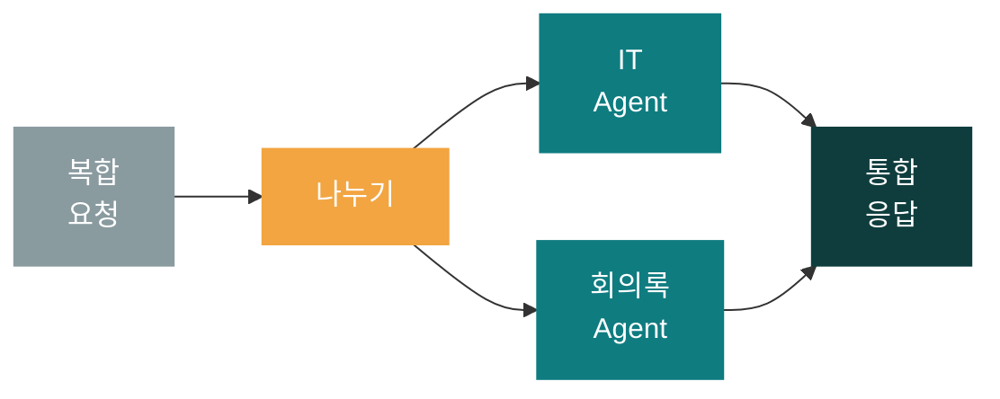
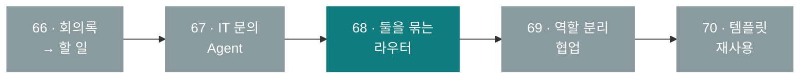
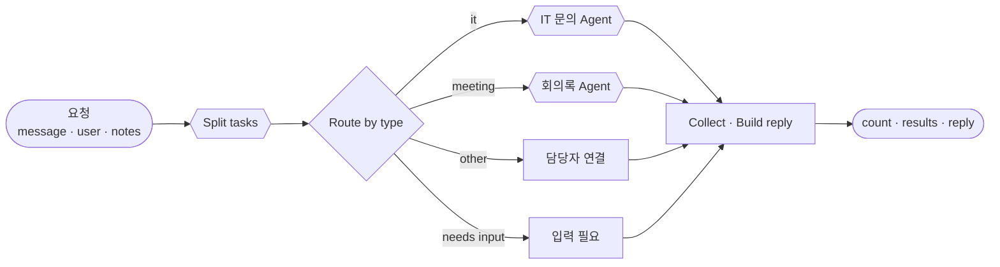
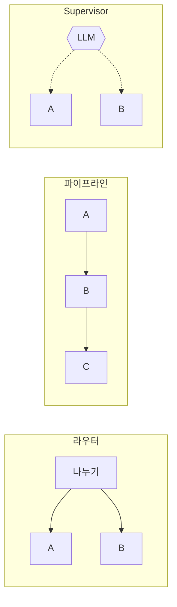

# 68일차 개요 · 복합 업무 시나리오와 Multi-Agent 워크플로우

> 운영·확장 관점의 AI 워크플로우 설계 고도화 · 2026-10-20
> 13장 · 각 장은 가로줄(`---`)로 나뉩니다. 1교시에는 1~5장을 보고, 나머지 장은 각 단계를 설명할 때 함께 띄웁니다.

| 장 | 범위 |
| --- | --- |
| 1~5 | 표지 · 목표 · 시간표 · 새 단원 · 오늘의 그림 |
| 6~7 | 1단계 · 복합 업무 시나리오 분석 |
| 8~9 | 2단계 · Multi-Agent 워크플로우 설계 |
| 10~11 | 3단계 · 장애 격리와 확장 |
| 12~13 | 7교시 바이브 코딩 · 정리와 예고 |

---

## 1 / 13 · 표지



**68일차**

# 복합 업무 시나리오와 Multi-Agent 워크플로우

업무 분석 · 업무 나누기 · Agent에게 분배 · 결과 통합 · 장애 격리

<sub>운영·확장 관점의 AI 워크플로우 설계 고도화 · 2026-10-20</sub>

---

## 2 / 13 · 오늘 할 수 있게 될 세 가지

| | 오늘 할 수 있게 될 것 |
| :-: | --- |
| **①** | 요청 하나에 섞인 업무를 **분석표**로 나누고, 그대로 나누는 워크플로우를 요청문으로 만든다 |
| **②** | 이미 만든 Agent의 **계약**을 정리하고, 그 Agent들을 부르는 **라우터**를 만든다. Supervisor와 비교한다 |
| **③** | Agent 하나가 꺼지거나 입력이 빠져도 **나머지 답은 나오게** 만들고, 측정값으로 확장 계획을 쓴다 |

---

## 3 / 13 · 오늘의 시간표

| ① 1~2교시 | ② 3~4교시 | ③ 5~6교시 | ④ 7~8교시 |
| --- | --- | --- | --- |
| **1단계** | **2단계** | **3단계** | **바이브 코딩** |
| 복합 업무 시나리오 분석 | Multi-Agent 설계 | 검증 · 장애 격리 · 확장 | `tflow` |
| Lab 01 분석표 · 나누기 | Lab 02 라우터 · Supervisor | Lab 03 빠진 입력 · 꺼진 Agent | 만들기 · 발표 · 정리 |

> 09:00 시작 · 50분 수업 10분 휴식 · 4교시 뒤 13:00~14:00 점심

---

## 4 / 13 · 새 단원: 하나의 Agent에서 여러 Agent로



- 66·67일차에 만든 것이 오늘은 **부품**(`agents/`)이 됩니다. 오늘 만드는 것은 그 부품을 묶는 쪽입니다.
- 방식은 67일차와 같습니다: 요청문은 내가, JSON은 에이전트가, push·test는 내가.

---

## 5 / 13 · 오늘의 그림



> 이 그림을 Lab 01(나누기) → Lab 02(분배·통합) → Lab 03(입력 필요·장애 격리) 순서로 완성합니다.

---

## 6 / 13 · 1단계 · 업무 분석 다섯 칸

> "T-1002 처리 상태 알려주고, 첨부한 회의록에서 할 일도 정리해줘. 그리고 프린터 출력이 안 돼요."

| 업무 | 유형 | 필요한 입력 | 요청에 있나 | 관계 |
| --- | --- | --- | --- | --- |
| T-1002 처리 상태 | it | 접수 번호, 요청한 사람 | 문장 + `user` | 독립 |
| 회의록 할 일 정리 | meeting | 회의록 원문 | `notes` | 독립 |
| 프린터 출력 안 됨 | it | 증상 | 문장 | 독립 |

> 필요한 입력은 **문장 밖**에도 있습니다. 나누기는 LLM이, 빠진 입력 확인은 규칙이.

---

## 7 / 13 · 1단계 · LLM이 할 일, 규칙이 할 일

| 일 | 누가 | 이유 |
| --- | --- | --- |
| 문장을 업무로 나누기, 유형 고르기 | LLM | 말의 뜻을 알아야 함 |
| 유형 → 담당 Agent | 규칙 (표) | 늘 같은 답이어야 함 |
| 필요한 입력이 있나 | 규칙 (빈 칸 확인) | 짐작하면 안 됨 |

수업 준비 때 정답 워크플로우: 나누기 `lab01` 7/7, 규칙을 더한 과제 `lab01-challenge` 0/4 → 4/4.

---

## 8 / 13 · 2단계 · Agent를 묶는 네 가지 모양



| 모양 | 언제 | 오늘 |
| --- | --- | --- |
| 라우터 | 업무가 서로 **독립** | Lab 02 예제 2 |
| 파이프라인 | 앞 결과가 뒤에 필요 | 69일차 |
| Fork-Join | 같은 입력을 여럿이 동시에 보고 합침 | 69일차 |
| Supervisor | 요청이 열려 있고 LLM이 고르게 | Lab 02 과제 |

---

## 9 / 13 · 2단계 · 라우터 vs Supervisor (수업 준비 측정)

| | 라우터 | Supervisor |
| --- | --- | --- |
| 누가 Agent를 고르나 | 유형 표 (코드) | LLM (Tool 설명·지시문) |
| 복합 요청 (업무 3개) | 4.5~6.6초 | 9.6~10.8초 |
| 결과 | 업무별 `results[]` (계약) | 답 글자 하나 |
| 라우터 테스트(`lab02`)를 그대로 | 6/6 | 1/6 |
| 흔들린 곳 | — | 지시문 낱말 하나로 4/5 ↔ 5/5 |

> 정해진 업무는 라우터, 열린 요청은 Supervisor. **계약이 있으면 둘을 같은 테스트로 비교**할 수 있습니다.

---

## 10 / 13 · 3단계 · 하나가 꺼지면 전체가 멈춘다

| 회의록 Agent 꺼짐 · 복합 요청 | 결과 |
| --- | --- |
| 고치기 전 (Lab 02 예제 라우터) | **HTTP 500** · T-1002 답까지 사라짐 (`lab03-down` 1/3) |
| `neverError` + 빈 결과는 담당자 연결 | 200 · IT 둘은 자동 답변, 회의록만 담당자 연결 (3/3) |

> 회의록 없이 온 회의 요청도 같은 문제(Agent가 400 → 전체 500). **부르기 전에 막거나, 받은 오류를 결과로 바꾸거나.**

---

## 11 / 13 · 3단계 · 측정으로 확장 계획

| 수업 준비 측정 (1회) | 시간 |
| --- | --- |
| 기타만 (LLM 나누기 한 번) | 0.9~1.0초 |
| IT 하나 | 2.3~2.6초 |
| 회의록 하나 | 3.5초 |
| 복합 요청 (업무 3개) | 4.5~6.6초 |

- 요청 하나가 Agent 실행 여러 개를 만든다 → 21명 동시면 n8n 실행 수는 몇 배?
- 시간 대부분은 LLM API 대기 → 더 큰 서버(수직)보다 작업자 여럿(수평)·속도 제한 관리가 먼저.

---

## 12 / 13 · 7교시 · 바이브 코딩 `tflow`

```text
$ tflow agents/it-agent.json
▼ IT question webhook [webhook POST /it-agent]
  ▼ Has question? [if]
    ├ true ▼ Has user? [if] ...
```

- 에이전트가 만든 n8n JSON을 **트리 · mermaid · 한국어 설명**으로 확인하는 TUI
- 오늘 만든 `my-work/assistant.json`을 열어 내 설계(`DESIGN.md`)와 같은지 봅니다.

---

## 13 / 13 · 정리와 69일차 예고

| 오늘 | 한 줄 |
| --- | --- |
| 1단계 | 업무 분석이 먼저, 나누기는 LLM, 담당·빠진 입력은 규칙 |
| 2단계 | Agent는 계약으로 묶는다. 라우터와 Supervisor는 같은 테스트로 비교 |
| 3단계 | 하나가 꺼져도 나머지는 답한다. 확장은 측정값으로 |

- 69일차: **역할 기반 Agent 분리** (작성자 → 검토자 → 정리자) · 바이브 코딩 `tcrew`
