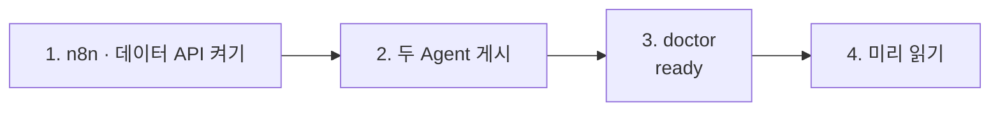

# 68일차 실습 준비 · 수업 전에 미리 해 두면 좋은 것

- 수업일: 2026-10-20 (68일차) · 복합 업무 시나리오 분석과 Multi-Agent 기반 워크플로우 설계
- 준비 시간: 약 15분 (67일차 준비를 했다면 1·3절만)
- 먼저 WSL에서 `cd ~/aio-01d4-stu && git pull`로 오늘 자료를 받습니다 (수강생 저장소: https://gl.isitsoft.kr/publicproj/aio-01d4-stu).
- **수업 전날까지** 1~3절을 끝내 주세요.
- 65~67일차를 하지 못해 n8n · Credential · 데이터 API가 없다면 [PREPARE-68-FROM-65.md](../../Last3Mon/68/PREPARE-68-FROM-65.md)를 따라 하면 최소 명령으로 `ready`까지 갑니다.



---

## 1. n8n과 데이터 API 켜기 (전날 필수, 3분)

67일차와 같습니다. n8n은 65일차 설치(`~/day65-n8n`)를 `Last3Mon/65/n8n`에서 켜고, 데이터 API는 67일차 폴더의 것을 그대로 씁니다.

```bash
sudo systemctl disable --now ollama 2>/dev/null   # WSL에 설치한 Ollama가 있으면 끄고 자동 시작도 끔
cd ~/aio-01d4-stu/Last3Mon/65/n8n
docker compose rm -sf ollama                      # Ollama 컨테이너가 있으면 지움 (없으면 그냥 지나감)
docker compose start
cd ~/aio-01d4-stu/Last3Mon/67/data-api
docker compose up -d
curl -s localhost:8800/health       # {"status": "ok"}
```

- **66일차부터 LLM은 OpenAI API 키(`Last3Mon/.env`, Credential `OpenAI (.env)`)만 씁니다.** Ollama는 쓰지 않으므로 위처럼 꺼서 메모리를 아낍니다. 다음 날부터는 같은 명령을 그대로 써도 됩니다.
- `network day65-n8n_default not found` → n8n이 켜져 있지 않음. 위 n8n 부분부터 다시.
- `.../day65-n8n/compose.yml: no such file or directory` → 홈이 아닌 곳에 설치함. `Last3Mon/65/n8n/.env`에 `N8N_HOME=<설치 폴더>` ([67일차 준비](../67/00-DAY67-PREP.md) 1절).

## 2. 오늘 부를 Agent 두 개 게시 (전날 필수, 2분)

오늘 라우터가 부르는 Agent입니다. 만들지 않고 **게시만** 합니다.

| Agent | 파일 | 웹훅 |
| --- | --- | --- |
| IT 문의 (67일차 Lab 03 완성본) | `agents/it-agent.json` | `/webhook/it-agent` |
| 회의록 (66일차 회의록 → 할 일) | `agents/meeting-agent.json` | `/webhook/meeting-agent` |

```bash
cd ~/aio-01d4-stu/Last3Mon/68
uv run tools/flow.py push agents/it-agent.json agents/meeting-agent.json     # 수업 준비 때 약 19초
uv run tools/flow.py call it-agent requests/agent-it.json                     # route 자동 답변, T-1002 처리 중
uv run tools/flow.py call meeting-agent requests/agent-meeting.json           # count 4
```

같은 경로를 쓰던 예전 워크플로우가 있으면 `push`가 게시를 해제하고 `! unpublished ...`로 알려 줍니다 (정상).

## 3. 준비 확인 (전날 필수, 2분)

```bash
cd ~/aio-01d4-stu/Last3Mon/68
uv run tools/flow.py doctor
```

```text
✔ n8n install folder /home/<사용자>/day65-n8n
✔ n8n container day65-n8n-n8n-1
✔ n8n http://localhost:5678
✔ data API http://localhost:8800
✔ n8n → http://data-api:8800
✔ credential 'OpenAI (.env)' (openAiCourse0001)
✔ node catalog (for check)
✔ agent webhook /it-agent
✔ agent webhook /meeting-agent
✔ CLI coding agent: codex, claude
ready
```

| ✘ 항목 | 할 일 |
| --- | --- |
| n8n container · data API | 1절 |
| credential | `cd ~/aio-01d4-stu/Last3Mon/65/n8n && bash register-credentials.sh` |
| agent webhook | 2절 `push` |
| CLI coding agent | [67일차 준비](../67/00-DAY67-PREP.md) 2절 (설치·로그인) |

---

## 4. 미리 읽어 오면 좋은 내용 (선택, 약 5분)

### 4.1 요청 하나에 업무가 여럿

> "T-1002 처리 상태 알려주고, 첨부한 회의록에서 할 일도 정리해줘. 그리고 프린터 출력이 안 돼요."

이 문장에 업무가 몇 개인지, 각각 누가(어느 Agent가) 맡으면 좋을지 생각해 옵니다.

### 4.2 용어

| 용어 | 한 줄 설명 |
| --- | --- |
| Multi-Agent | 일을 나눠 맡은 Agent 여럿이 함께 하나의 업무를 처리 |
| 라우터 | 요청을 보고 담당 Agent에게 **보내 주는** 정해진 흐름 |
| Supervisor | LLM 하나가 필요한 Agent를 **골라 부르는** 방식 |
| 계약 | Agent의 입력·결과 모양 약속. 계약을 지키면 Agent 속은 바꿔도 됨 |

## 5. 당일 준비물

- 충전된 노트북과 충전기, WSL의 Docker, Windows Terminal(WSL) 창 **두 개**, 웹 브라우저
- 67일차 `my-work/it-agent.json` (지우지 마세요, 7교시 `tflow` 연습에 씀)

## 확인

- [ ] `curl -s localhost:8800/health` → `{"status": "ok"}`
- [ ] `call it-agent`, `call meeting-agent` 응답을 받았다
- [ ] `uv run tools/flow.py doctor` → 마지막 줄 `ready`
