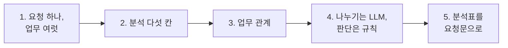
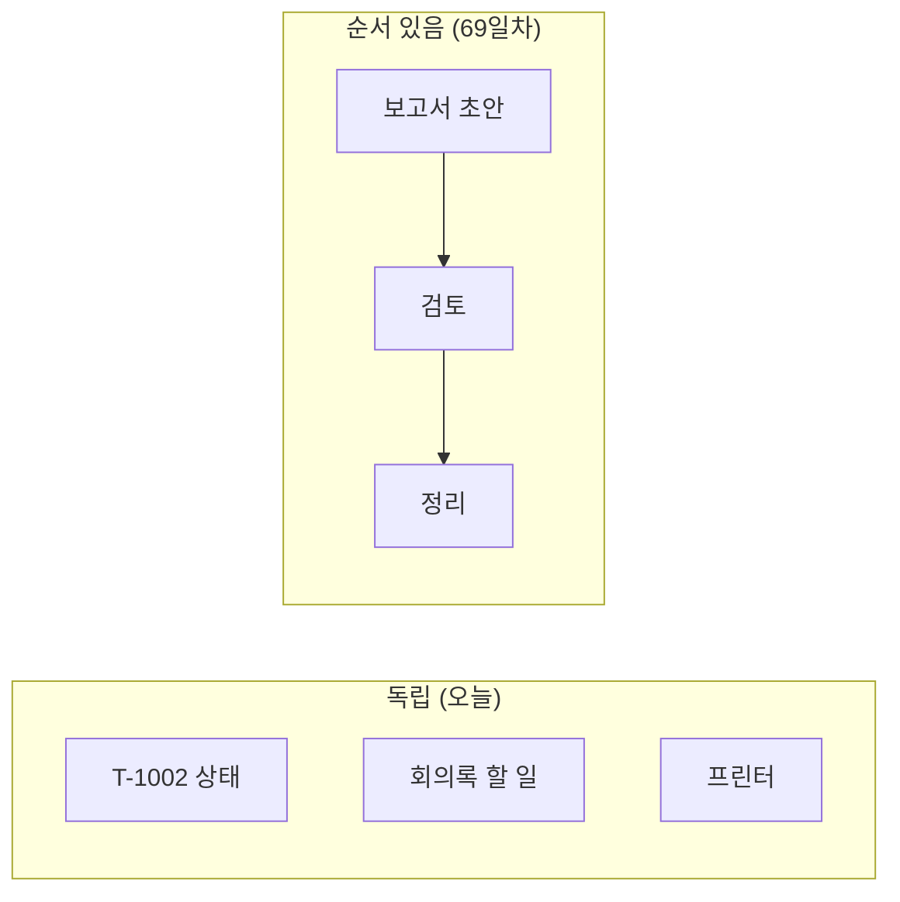

# 1단계 · 복합 업무 시나리오 분석

- 교시: 1~2교시 (09:00~10:50)
- 실습: [Lab 01](../../Last3Mon/68/LAB-01-Q-SCENARIO-AND-SPLIT.md)
- 이 단계가 끝나면: 요청 하나에 섞인 업무를 **분석표**로 나눌 수 있다. 업무 나누기에서 **LLM이 할 일과 규칙이 할 일**을 구분해 요청문에 적을 수 있다.



## 1. 요청 하나에 업무가 여럿

67일차 IT 문의 Agent는 질문 하나에 답 하나를 했습니다. 실제 직원 요청은 이렇게 옵니다.

> "T-1002 처리 상태 알려주고, 첨부한 회의록에서 할 일도 정리해줘. 그리고 프린터 출력이 안 돼요."

이 요청을 67일차 IT 문의 Agent에 그대로 보내면 회의록 정리는 할 수 없습니다 (그 Agent에는 회의록 Tool이 없음). Agent 하나에 Tool을 계속 붙이는 대신, **업무를 나눠 맡은 Agent 여럿**이 일하게 하는 것이 오늘의 주제입니다.

| Agent 하나에 다 붙이기 | 업무별 Agent로 나누기 |
| --- | --- |
| 지시문이 계속 길어지고 서로 부딪힘 | Agent마다 짧은 지시문, 자기 Tool만 |
| 하나를 고치면 전부 다시 테스트 | 고친 Agent만 테스트 (계약이 그대로면) |
| 하나가 느리면 전부 느림 | 느린 Agent만 따로 늘리거나 끌 수 있음 (3단계) |

## 2. 업무 분석 다섯 칸

요청을 받으면 에이전트에게 맡기기 전에 **사람이 먼저** 표를 채웁니다. 이 표가 곧 요청문과 테스트의 재료입니다.

| 칸 | 묻는 것 | 위 요청에서 |
| --- | --- | --- |
| 업무 | 한 번에 처리할 수 있는 단위는? | ① T-1002 상태 ② 회의록 할 일 ③ 프린터 |
| 유형 | 지금 있는 Agent 중 누구 일인가? | it · meeting · it |
| 필요한 입력 | 처리하려면 무엇이 있어야 하나? | ① 번호 + **요청한 사람** ② **회의록 원문** ③ 증상 |
| 요청에 있나 | 문장 안? 본문의 다른 칸? 없음? | ① `user` ② `notes` ③ 문장 |
| 관계 | 다른 업무의 결과가 필요한가? | 셋 다 독립 |

- **업무 수는 접속사 수가 아닙니다.** "비밀번호를 잊어버렸어요. 그리고 메일함 용량이 꽉 찼대요"는 같은 IT Agent지만 업무 둘입니다.
- **필요한 입력은 문장 밖에도 있습니다.** 회의록 원문은 문장에 없고 요청 본문의 `notes` 칸에 붙어 옵니다. 없으면 회의록 Agent를 불러도 소용이 없습니다.
- **맡을 Agent가 없는 업무**(회식 장소 추천)는 `other`로 두고 사람에게 넘깁니다. 억지로 다른 Agent에게 보내지 않습니다.

## 3. 업무 관계: 독립인가, 순서가 있나



| 관계 | 처리 | 모양 |
| --- | --- | --- |
| 독립 | 따로 처리해 마지막에 모음 | 라우터 (2단계) |
| 순서 | 앞 결과를 뒤에 넘김 | 파이프라인 (69일차) |

오늘 Lab의 요청은 모두 독립입니다. 내 업무 시나리오(64일차 Lab 03)에서 순서가 있는 업무가 있는지도 표에 적어 둡니다.

## 4. 나누기는 LLM, 판단은 규칙

업무 나누기 워크플로우에서 할 일을 둘로 나눕니다.

| 일 | 누가 | 왜 |
| --- | --- | --- |
| 문장을 업무로 나누고 유형 고르기 | LLM (AI Agent, Tool 없음) | 문장의 뜻을 알아야 함 |
| LLM 답을 JSON으로 읽고, 이상한 값 고치기 | Code | LLM은 앞뒤에 다른 글자를 붙이거나 없는 유형을 쓰기도 함 |
| 유형 → 담당 Agent | Code (표) | 늘 같은 답 |
| 필요한 입력이 있나 | Code (본문 빈 칸 확인) | 짐작하면 안 됨. 테스트로 확인할 수 있어야 함 |

수업 준비 때 정답 워크플로우의 결과 (1회, gpt-4.1-mini):

| 워크플로우 | `cases/lab01.json` | `cases/lab01-challenge.json` |
| --- | --- | --- |
| 나누기만 (예제 2) | 7/7 (0.9~3.2초) | 0/4 (담당·빠진 입력 칸 없음) |
| 규칙을 Code에 더함 (과제) | 7/7 | 4/4 |

> 67일차의 "LLM이 정하면 안 되는 값"(요청한 사람)과 같은 생각입니다. **매번 같아야 하는 것은 규칙으로.**

## 5. 분석표를 요청문으로

67일차 요청문 다섯 가지(① 파일 ② 입력 ③ 처리 ④ 결과 모양 ⑤ 기대 결과)는 그대로입니다. 오늘은 ③ 처리에 **분석표의 기준**이 들어갑니다. Lab과 다른 업무(총무 요청)로 예를 듭니다.

```text
my-work/office.json 에 n8n 워크플로우를 만들어 줘.
① 파일: my-work/office.json
② 입력: POST 웹훅 my-office, 본문 message(요청 문장), room(회의실 이름, 없을 수 있음)
③ 처리: AI Agent(Tool 없음)가 문장을 업무로 나눈다. 유형은 reserve(회의실 예약), parcel(택배 문의), other.
       업무 하나 = 한 번에 처리할 수 있는 요청 하나. 날짜·시간은 쓴 그대로 남긴다.
       Code에서 결과를 읽고, reserve 인데 본문 room 이 비었으면 missing ["room"].
④ 결과: {"count": 2, "tasks": [{"type": "reserve", "text": "...", "missing": []}]}
⑤ 기대 결과: cases/office.json (케이스 4개)
```

- 유형마다 **정의**(무엇이 여기에 드는지)를 적었습니다. 정의가 없으면 "회의실이 추워요"가 reserve인지 other인지를 LLM이 그때그때 정하게 됩니다.
- 규칙 부분은 "Code에서"라고 **어디서 할지**까지 적었습니다.
- Lab 01에서는 이 모양을 보고 **IT 문의 · 회의록** 요청문을 직접 씁니다.

## 정리

- [ ] 업무 분석 다섯 칸: 업무 · 유형 · 필요한 입력 · 요청에 있나 · 관계
- [ ] 필요한 입력은 문장 밖(본문의 다른 칸)에도 있다
- [ ] 나누기와 유형은 LLM, 담당과 빠진 입력은 규칙
