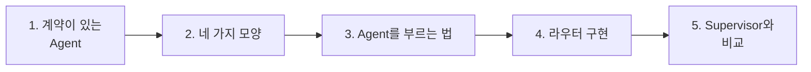
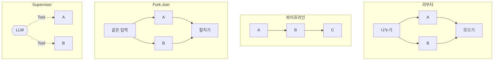
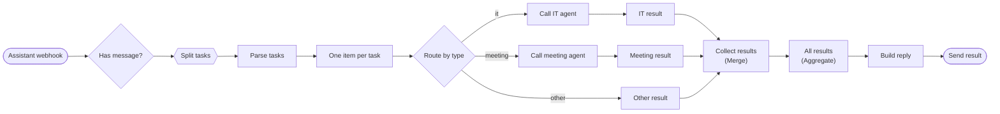
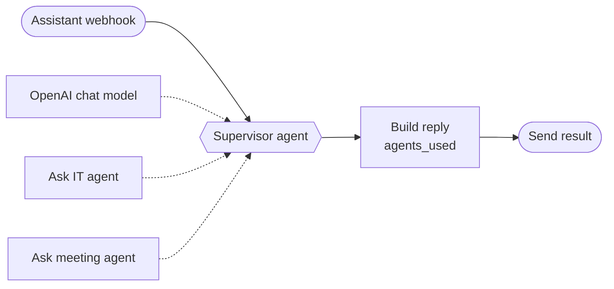

# 2단계 · Multi-Agent 워크플로우 설계

- 교시: 3~4교시 (11:00~12:50)
- 실습: [Lab 02](../../Last3Mon/68/LAB-02-Q-ROUTER-AGENTS.md)
- 이 단계가 끝나면: Agent의 **계약**을 정리하고, 업무를 유형별로 담당 Agent에게 보내 결과를 모으는 **라우터**를 요청문으로 만들 수 있다. 라우터와 **Supervisor**의 차이를 측정값으로 설명할 수 있다.

## 1. 계약이 있는 Agent

Agent를 여럿 묶으려면 각 Agent가 **무엇을 받고 무엇을 돌려주는지**가 정해져 있어야 합니다. 이것이 계약입니다.

| Agent | 웹훅 | 입력 | 결과 | 실패할 때 |
| --- | --- | --- | --- | --- |
| IT 문의 (67일차) | `/webhook/it-agent` | `question`, `user` 필수 | `route`, `answer`, `tools_used`, `sources` | 입력 없음 400 · 근거 없음·남의 접수 건 `route: 담당자 연결` |
| 회의록 (66일차) | `/webhook/meeting-agent` | `title`, `notes`(필수) | `route`, `count`, `summary`, `actions[]` | `notes` 없음 400 |

- 라우터는 Agent의 **속**(지시문, Tool)을 모릅니다. 계약만 압니다. 그래서 IT 문의 Agent의 지시문을 고쳐도 계약이 그대로면 라우터는 그대로입니다.
- 계약에서 가장 빠뜨리기 쉬운 칸이 **실패할 때**입니다. 3단계에서 이 칸 때문에 전체가 멈추는 것을 봅니다.
- 계약 표는 에이전트에게 **Agent 파일을 읽혀** 만들게 할 수 있습니다 (Lab 02 예제 1). 그 표를 `call` 결과와 대조하는 것은 사람의 일입니다.

수업 준비 때 직접 부른 결과: IT 문의 4.8초 (`Get_ticket`, "처리 중"), 회의록 2.3초 (할 일 4개), `notes` 없이 400 `{"error": "notes are required"}`.

## 2. Agent를 묶는 네 가지 모양

| 모양 | 누가 다음을 정하나 | 어울리는 업무 | 이 과정에서 |
| --- | --- | --- | --- |
| 라우터 | 정해진 규칙 (Switch) | 업무가 독립이고 종류가 정해짐 | 오늘 Lab 02 |
| 파이프라인 | 정해진 순서 | 앞 결과가 뒤에 필요 (초안 → 검토) | 69일차 |
| Fork-Join | 정해진 흐름 | 같은 입력을 여러 관점으로 보고 합침 | 69일차 |
| Supervisor | LLM | 요청이 열려 있고 무엇이 필요한지 미리 모름 | 오늘 Lab 02 과제 |

## 3. n8n에서 다른 Agent를 부르는 법

| 방법 | 어떻게 | 오늘 |
| --- | --- | --- |
| HTTP Request로 웹훅 부르기 | 게시된 Agent의 웹훅에 POST | **라우터** (계약을 HTTP로 확인하기 쉬움) |
| HTTP Request **Tool**로 붙이기 | Agent가 Tool로 골라 부름 | **Supervisor** |
| Execute Workflow | 같은 n8n 안의 워크플로우를 직접 실행 | 70일차 (모듈화) |

n8n 안에서 같은 n8n의 웹훅을 부를 때 주소는 `http://localhost:5678/webhook/<path>`입니다 (같은 컨테이너 안). 데이터 API(`http://data-api:8800`)와 다릅니다. [AGENTS.md](../../Last3Mon/68/AGENTS.md) 2절에 적어 두었습니다.

넘기는 값의 **출처**를 정합니다 (67일차 2단계와 같은 질문).

| 값 | 출처 | 이유 |
| --- | --- | --- |
| IT 질문 문장 | 나누기 결과 `text` | LLM이 나눈 조각 |
| 요청한 사람 `user` | 웹훅 본문 그대로 | LLM이 바꾸면 남의 접수 건이 보일 수 있음 |
| 회의록 원문 `notes` | 웹훅 본문 그대로 | LLM이 다시 쓰면 내용이 줄거나 바뀔 수 있음 |

## 4. 라우터 구현

| 노드 | 하는 일 | 놓치기 쉬운 것 |
| --- | --- | --- |
| One item per task (Code) | 업무 하나당 항목 하나, `index` 붙이기 | 다음 노드는 **항목마다** 실행됨 |
| Route by type (Switch) | 유형별 출력 | 출력 순서 = 연결의 칸 순서 |
| Call … agent (HTTP Request) | Agent 웹훅에 POST | 본문 값의 출처 (3절) |
| … result (Set) | Agent마다 다른 결과를 **같은 모양**으로 | 회의록은 `summary`·`actions` → `answer` |
| Collect results (Merge) · All results (Aggregate) | 갈래를 모아 `results` 배열 하나로 | 데이터가 안 온 갈래가 있어도 동작 |
| Build reply (Code) | `index` 순으로 정렬해 `reply` | 업무 순서 = 요청 순서 |

수업 준비 때 정답 라우터 (`reference/lab02-example2-router.json`, 1회):

| 케이스 | 결과 · 시간 |
| --- | --- |
| `cases/lab02.json` 전체 | 6/6 |
| 복합 요청 (업무 3개) | 6.6초 |
| IT 하나 · 회의록 하나 | 2.6초 · 3.5초 |
| 기타만 (Agent를 부르지 않음) | 0.9초 |

n8n **Executions**를 열면 `my-assistant` 실행 하나에 `it-agent`, `meeting-agent` 실행이 **따로** 생깁니다. Agent마다 실행 기록이 남으니 어느 Agent에서 문제가 났는지 찾기 쉽습니다.

## 5. Supervisor와 비교

같은 요청을 LLM 하나(Supervisor)가 두 Agent를 Tool로 골라 부르게 만들 수 있습니다.

수업 준비 때 정답 두 개를 같은 요청으로 비교했습니다 (gpt-4.1-mini, 측정값).

| | 라우터 | Supervisor |
| --- | --- | --- |
| 누가 Agent를 고르나 | 유형 표 (코드) | LLM (Tool 설명·지시문) |
| 복합 요청 시간 | 4.5~6.6초 | 9.6~10.8초 |
| 결과 | 업무별 `results[]` | 답 글자 하나 + `agents_used` |
| 라우터 테스트 `lab02.json`을 그대로 | 6/6 | 1/6 (빈 요청만, 계약이 다름) |
| 자기 테스트 `lab02-challenge.json` | — | 처음 4/5 → 지시문 고친 뒤 5/5 |
| Agent 하나 더 | Switch 갈래 + 결과 Set | Tool 하나 + 지시문 한 줄 |

- Supervisor가 처음 실패한 이유: 기타 요청에 "**담당 직원**이 도와드릴 예정입니다"라고 답해 테스트의 `담당자`가 없었습니다. 지시문에 정확한 문장을 주자 통과했습니다. **Supervisor는 지시문이 곧 분배 규칙**입니다.
- 결론은 "어느 쪽이 낫다"가 아니라 **계약이 있으면 같은 테스트로 비교할 수 있다**는 것입니다. 업무 종류가 정해져 있고 결과를 다른 시스템이 다시 쓰면 라우터, 요청이 열려 있고 사람에게 바로 답하면 Supervisor.

## 정리

- [ ] Agent는 계약(입력 · 결과 · 실패할 때)으로 묶는다
- [ ] 라우터: 나누기 → 항목마다 → Switch → HTTP → 같은 모양 → Merge·Aggregate → 답
- [ ] LLM이 정하면 안 되는 값(`user`, `notes`)은 웹훅 본문에서 그대로
- [ ] 라우터와 Supervisor는 시간·안정성·결과 모양이 다르고, 계약이 있어야 비교할 수 있다
