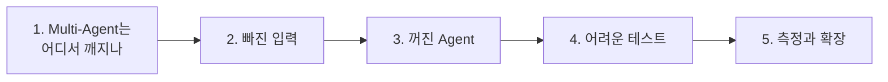
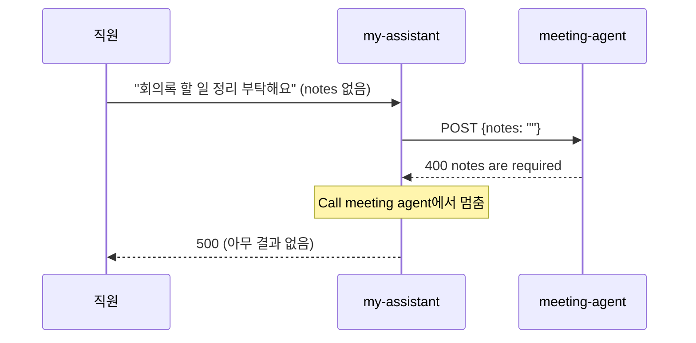

# 3단계 · 검증과 장애 격리, 확장 고려

- 교시: 5~6교시 (14:00~15:50)
- 실습: [Lab 03](../../Last3Mon/68/LAB-03-Q-VERIFY-AND-ISOLATE.md)
- 이 단계가 끝나면: Multi-Agent 워크플로우에서 **한 곳의 문제가 전체 답을 망치지 않게** 만들 수 있다. 측정값으로 확장 계획(수직·수평)을 설명할 수 있다.

## 1. Multi-Agent는 어디서 깨지나

Agent가 하나일 때보다 깨지는 곳이 늘어납니다.

| 깨지는 곳 | 예 | 테스트 |
| --- | --- | --- |
| 나누기 | 업무 수가 틀림, 유형이 틀림 | `lab01` |
| 넘기는 값 | 필요한 입력이 없음 (`notes`, `user`) | `lab03` · 과제 |
| 부른 Agent | 꺼짐(404), 오류(400·500), 느림 | `lab03-down` |
| 모으기 | 결과 모양이 다름, 순서가 섞임 | `lab02` |
| Agent 규칙 | 라우터를 거치면서 67일차 규칙(남의 접수 건)이 깨짐 | 과제 |

## 2. 빠진 입력: 부르기 전에 막는다

Lab 02 예제 라우터에 회의록 없이 회의 요청을 보내면:

수업 준비 때 `cases/lab03.json` 4/5, 이 케이스만 HTTP 500.

| 막는 방법 | 어떻게 | 직원이 받는 답 |
| --- | --- | --- |
| 부르기 전에 (권장) | Lab 01 과제의 `missing`이 있으면 Agent를 부르지 않고 `route: 입력 필요` | "회의록 정리를 하려면 회의록 내용(notes)을 함께 보내 주세요." |
| 받은 뒤에 | 400을 결과로 바꿈 (3절) | "담당자에게 전달" (다시 보내면 되는 걸 모름) |

> 직원이 **고쳐서 다시 보낼 수 있는 실패**는 무엇이 빠졌는지 알려 주고, 고칠 수 없는 실패(Agent 장애)는 사람에게 넘깁니다.

## 3. 꺼진 Agent: 하나가 꺼져도 나머지는 답한다

`uv run tools/flow.py off agents/meeting-agent.json`으로 회의록 Agent를 끄고 복합 요청을 보냅니다.

| | 응답 | T-1002 답 | 회의록 업무 | `lab03-down` |
| --- | --- | --- | --- | --- |
| 고치기 전 | **HTTP 500** | 사라짐 | — | 1/3 |
| `neverError` + 빈 결과는 담당자 연결 | 200 | "처리 중" | `담당자 연결` · "담당 Agent가 응답하지 않아 …" | 3/3 |

(수업 준비 때 측정, 1회)

장애 격리 세 가지:

| 장치 | n8n에서 | 하는 일 |
| --- | --- | --- |
| 오류를 결과로 | HTTP Request `options.response.response.neverError: true` | 404·500에도 멈추지 않고 응답을 다음 노드로 |
| 기다리는 한도 | `options.timeout` (예: 60000 ms) | 느린 Agent 때문에 직원이 끝없이 기다리지 않게 |
| 대체 답 | 결과 Set에서 `{{ $json.route \|\| '담당자 연결' }}` | 빈 결과를 정해진 답으로 |

- 67일차 IT 문의 Agent의 "검증 실패 → 담당자 연결"과 같은 생각을 **Agent 사이**에 한 번 더 둡니다.
- Agent를 나눠 둔 덕분에 회의록 Agent만 꺼도 IT 답은 나옵니다. Agent 하나에 다 붙였다면 함께 멈췄습니다.

## 4. 어려운 테스트: 내가 찾는 구멍

67일차 Lab 03처럼, 고친 것만 확인하는 테스트로는 부족합니다. 수업 준비 때 쓴 어려운 케이스 7개를 예제 2 정답(빠진 입력 + 장애 격리)에 돌린 결과 5/7이었습니다.

| 실패한 케이스 | 원인 | 고침 |
| --- | --- | --- |
| user 없이 IT 질문 | `missing: ["user"]`를 보지 않고 IT Agent를 부름 → 400 → 장애로 처리해 `담당자 연결` | IT 갈래도 `missing`을 보고 `입력 필요` |
| 공백만 보냄 | `"   "`도 "비어 있지 않음" → LLM까지 감 | 앞뒤 공백을 지우고 확인 |

통과한 케이스도 남겨 둡니다: 남의 접수 건이 섞인 요청(라우터를 거쳐도 "정우성"이 나오지 않음), 업무 4개, 소문자 `t1002`, 영어 질문. 고친 뒤 7/7, `lab02` 6/6, `lab03` 5/5, `lab03-down` 3/3.

> 수업 준비 때 "남의 접수 건" 케이스의 기대를 처음에 `본인이 접수한`(답 문장)으로 써서 실패했습니다. IT 문의 Agent의 계약은 이때 `route: 담당자 연결`입니다. **테스트가 틀렸는지 워크플로우가 틀렸는지는 계약 표로 판단**합니다.

## 5. 측정과 확장

수업 준비 때 정답 워크플로우의 시간 (1회씩, 여러 테스트에서 모음):

| 요청 | 시간 |
| --- | --- |
| 기타만 (LLM 나누기 한 번, Agent 없음) | 0.9~1.0초 |
| IT 하나 | 2.3~2.6초 |
| 회의록 하나 | 3.5초 |
| 복합 요청 (업무 3개) | 4.5~6.6초 |
| 업무 4개 | 4.6~4.8초 |

이 숫자에서 읽을 것:

- 시간 대부분은 **LLM API를 기다리는 시간**입니다 (나누기 한 번 약 1초, Agent마다 LLM 한두 번).
- 복합 요청이 단독 시간의 합(약 8.7초)보다 짧은 이유: 단독 시간마다 나누기 약 1초가 이미 들어 있고, **같은 Agent로 가는 업무들은 HTTP 노드 하나가 동시에** 보냅니다. 다른 Agent 갈래는 차례로 실행됩니다. 어림하면 나누기 1 + IT 둘(동시) 약 1.5 + 회의록 약 2.5 ≈ 5초.
- 요청 하나가 n8n 실행 여러 개를 만듭니다: 복합 요청 = 라우터 1 + Agent 3. 21명이 동시에 보내면 n8n 실행은 약 84개.

| 확장 | 무엇 | 이 측정값에서 |
| --- | --- | --- |
| 수직 | 더 큰 서버 (CPU · 메모리) | 기다리는 시간이 대부분이라 효과가 작음 |
| 수평 | n8n 큐 모드: 메인 1 + 작업자(worker) 여러 개, Redis 큐 | 동시에 처리하는 실행 수를 늘림 |
| Agent별 분리 | 자주 쓰는 Agent만 작업자를 더 주거나 따로 운영 | 업무별 Agent로 나눴기 때문에 가능 |
| 바깥 한도 | OpenAI 분당 요청·토큰 한도 | 실행을 늘리면 여기서 막힘 → 75일차 비용·사용량 |

- 큐 모드는 오늘 실습하지 않습니다. 확장 계획은 `DESIGN.md` 6절에 **내 측정값**으로 씁니다.

## 정리

- [ ] 고칠 수 있는 실패(빠진 입력)는 부르기 전에 막고, 무엇이 빠졌는지 알려 준다
- [ ] 부른 Agent의 실패는 `neverError` · timeout · 대체 답으로 그 업무에서 멈춘다
- [ ] 테스트 기대가 맞는지는 Agent 계약으로 판단한다
- [ ] 확장은 측정값으로: 기다리는 시간이 대부분이면 수평 확장과 바깥 한도가 먼저
