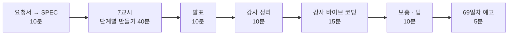

# 7·8교시 · 바이브 코딩 (`tflow`)

- 교시: 7교시 16:00~16:50 (각자 만들기), 8교시 17:00~17:50 (발표 · 정리 · 강사 바이브 코딩 · 팁 · 예고)
- 과제: [VIBE-REQ-TFLOW](../../Last3Mon/68/VIBE-REQ-TFLOW.md)(요청서) → 학생이 직접 쓰는 `SPEC.md` → [VIBE-Q-TFLOW](../../Last3Mon/68/VIBE-Q-TFLOW.md)(요구 · 단계)와 비교 → 만들기 → 수업 뒤 `VIBE-A-TFLOW.md` 공개
- **오늘부터 바뀐 점**: 지난 이틀 VIBE-Q를 통째로 에이전트에게 주고 "만들어 줘"가 많았습니다. 그러면 결과를 판단할 기준이 학생에게 없습니다. 오늘은 사람의 말(요청서)을 **확인할 수 있는 요구**로 바꾸는 일을 학생이 먼저 하고, VIBE-Q는 그 다음 단계(비교 대상)로 씁니다.
- 오늘은 `tflow`: n8n 워크플로우 JSON을 **트리 · mermaid · 노드별 한국어 설명**으로 보여 주는 TUI입니다. 에이전트가 만든 n8n 파일을 확인하는 도구라 오늘 오전 실습과 바로 이어집니다.

## 1. 7교시 · 각자 만들기 (50분)

| 시간 | 단계 | 확인 |
| --- | --- | --- |
| 16:00~16:02 | 0. 준비 (`~/vibe/tflow`, `git init`). **에이전트는 아직 켜지 않음** | |
| 16:02~16:12 | 0. 요청서 → `SPEC.md` (직접) → VIBE-Q와 비교 · 고치기 · commit | 요구마다 확인 방법(숫자 · 파일), 숨은 요구, 비교한 줄 |
| 16:12~16:23 | 1. 글자로 트리 · mermaid (R1 · R4). 첫 요청은 "SPEC.md를 읽고 확인 방법부터 말해" | `uv run tflow agents/it-agent.json`, `--md` → `.md` 미리보기 |
| 16:23~16:35 | 2. TUI · 상세 · 경고 (R2 · R3 · R5 · R6) | `IT help agent`의 모델·Tool, 망가진 파일 |
| 16:35~16:45 | 3. 한국어 설명 · 캐시 (R3) | 두 번째 선택은 바로 |
| 16:45~16:50 | 4. 정리 · `SPEC.md` 체크 · 내 `assistant.json` 열어 보기 · 발표 메모 | |

16:00에 화면에 띄울 것: 요청서의 ①~⑤와 예 하나(① → R1). "형용사는 확인할 수 없습니다. 숫자 · 파일 · 화면으로 바꿉니다." 16:10쯤 "VIBE-Q를 열어 비교하세요"를 알립니다.

강사는 교실을 돌며 아래를 봅니다.

| 볼 것 | 막혔을 때 한마디 |
| --- | --- |
| SPEC 없이 VIBE-Q를 통째로 붙여 넣었나 | "요청서로 SPEC.md부터. 확인 방법이 없으면 됐는지 모릅니다" |
| SPEC에 형용사만 ("보기 좋게") | "함께 받은 파일을 열어 노드 · 갈래 수를 세어서 숫자로" |
| 한 번에 TUI까지 만들어 달라고 했나 | "1단계는 글자 출력만. 트리가 맞는지부터" |
| 트리가 끝없이 길어지거나 같은 노드 반복 | "다시 모이는 노드(`Send result`)는 두 번째부터 한 줄로" |
| mermaid가 안 그려짐 | "노드 이름에 `?`·괄호가 있어요. id는 번호로" |
| TUI 안에서 그림을 그리려 함 | "터미널은 mermaid를 못 그립니다. `--md`로 `.md`를 만들어 VS Code 미리보기" |
| If 갈래가 반대 | "`main` 바깥 목록 0번이 true" |
| 설명에 Credential이 들어감 | "credentials는 빼고 보내라고 하세요" |
| 실행해 보지 않고 다음 요청 | "에이전트가 됐다고 해도 직접 `uv run tflow`" |

확인 기준 (입력 파일에서 센 값): `agents/it-agent.json` 노드 14 · main 11 · 모델 1 · Tool 2, `reference/lab03-example2-isolated.json` 노드 18 · main 19 · Switch 출력 4개. 수업 준비 때 tflow를 미리 만들어 보지는 않았습니다. 강사 바이브 코딩(4절)에서 걸린 시간을 재어 정답본(`VIBE-A-TFLOW.md`)에 남깁니다.

## 2. 8교시 · 발표 (10분)

- 1~2명. 7교시에 돌면서 **다시 모이는 노드나 mermaid 깨짐을 스스로 푼 사람**을 먼저 고릅니다.
- 3분 발표 · 2분 질문: **내 SPEC과 VIBE-Q가 달랐던 곳** / 잘 먹힌 요청문 / 안 먹힌 요청문 / 에이전트가 틀린 곳과 알아챈 방법 / 내 `assistant.json` 시연.

## 3. 강사 정리 (10분)

오늘 n8n 실습과 tflow를 이 표로 묶습니다.

| | n8n 사내 업무 도우미 | tflow |
| --- | --- | --- |
| 요청 분석 | 복합 요청 → 업무 분석표 (Lab 01) | 요청서 → SPEC.md (요구 · 숨은 요구 · 범위 밖 · 순서) |
| 나누기 | 요청 → 업무 (LLM) | 파일 → 노드·연결 목록 (코드) |
| 계약 | Agent 입력·결과 | `model.py`의 Node·Link (트리·mermaid·TUI가 함께 씀) |
| 규칙이 할 일 | 담당 Agent, 빠진 입력 | 갈래 이름, 다시 모이는 노드, 경고 |
| LLM이 할 일 | 업무 나누기 | 노드 설명 (캐시) |
| 실패해도 계속 | 꺼진 Agent → 담당자 연결 | 키 없음·LLM 실패 → 트리는 그대로 |
| 확인 | `cases/*.json` | 노드·연결 수 테스트, 망가진 파일 |

## 4. 강사 바이브 코딩 (15분)

학생 화면 앞에서 강사가 직접 이어서 만듭니다. 하나를 고릅니다.

| 주제 | 요청문 요지 | 보여 줄 것 |
| --- | --- | --- |
| `tflow diff a.json b.json` | "두 워크플로우의 노드 추가·삭제, 바뀐 parameters를 표로" | 74일차 `tver`의 예고. 에이전트가 고친 곳을 한눈에 |
| `flow.py check` 가져오기 | "Last3Mon/68/tools/flow.py 의 check 규칙을 읽고 tflow 경고에 더해" | 이미 있는 코드를 **읽혀서** 재사용 |
| 실행 기록 붙이기 | "runs/*.json 보고서를 읽어 실패한 케이스가 지나간 노드를 표시" | 테스트와 구조를 한 화면에 (77일차 `tlog` 예고) |

걸린 시간과 결과를 `Last3Mon/68/VIBE-A-TFLOW.md`에 적어 둡니다.

## 5. 보충 · 팁 (10분)

| 팁 | 설명 |
| --- | --- |
| 요청서 → 요구가 먼저 | 확인 방법이 있는 요구가 있어야 에이전트의 "완료"를 판단할 수 있음. SPEC.md는 에이전트에게 읽히는 문서 |
| 데이터 모양부터 | "파일 → Node·Link"를 먼저 만들고 테스트하면 화면은 나중에 얼마든지 바꿈 |
| 테스트 자료는 진짜 파일로 | 오늘 쓴 `agents/*.json`을 `tests/data`에 복사. 숫자(노드 14)로 확인 |
| 망가진 입력도 테스트 | 경고 기능은 망가진 파일이 있어야 확인됨 |
| 비싼 일은 캐시 | LLM 설명은 내용(해시)으로 캐시, 바뀌면 다시 |
| 비밀은 보내지도 않기 | Credential, 키는 LLM 입력에서 빼기 |
| 단계마다 `git commit` | 에이전트가 망가뜨려도 돌아갈 곳 |

## 6. 69일차 예고 (5분)

- 오늘: 독립 업무를 Agent에게 **나눠** 맡김 (라우터). 내일: 한 업무를 역할별 Agent가 **이어서** 처리 (작성자 → 검토자 → 정리자, 역할 기반 분리와 협업).
- 바이브 코딩: `tcrew` (한 질문을 역할별 LLM이 차례로 처리하는 TUI). 오늘 `tflow`는 지우지 마세요. 내일 만든 워크플로우를 여는 데 씁니다.

## 확인 (강사)

- [ ] 7교시 시작 전 `OPENAI_API_KEY` 꺼내는 명령을 화면에 띄웠다 (키 값은 띄우지 않음).
- [ ] 16:00 요청서 → SPEC 10분을 지켰다 (에이전트 없이), 16:10 VIBE-Q 비교 알림.
- [ ] 발표자 1~2명, 강사 정리 표, 강사 바이브 코딩 1개(시간 기록), 팁, 예고.
- [ ] 수업 뒤: `VIBE-A-TFLOW.md`의 "자주 빠뜨리는 것"·강사 바이브 코딩 시간을 채우고 **학생 저장소에 VIBE-A만** 올린다 (LAB-A는 올리지 않음).
