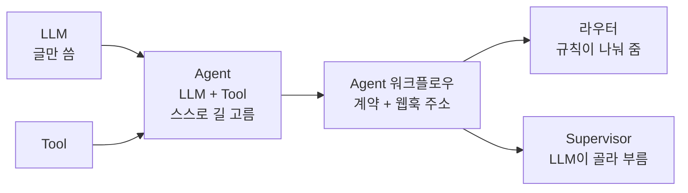
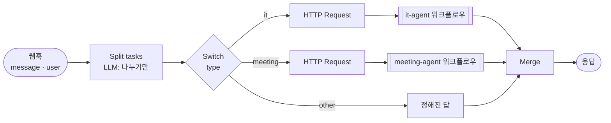
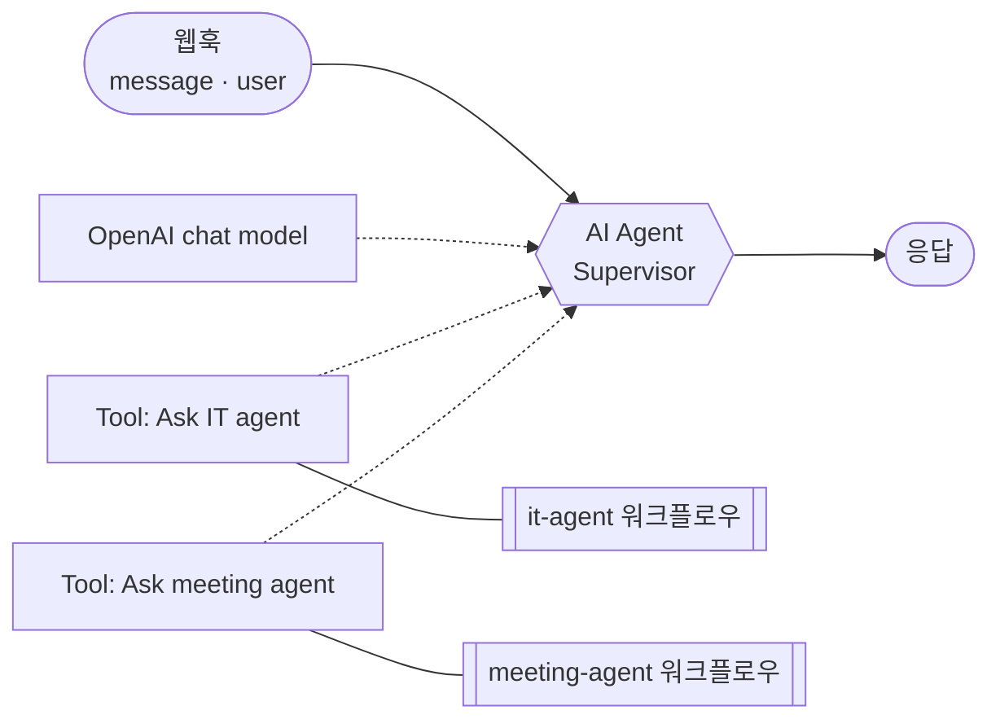

# 68일차 개념 정리 · LLM · Tool · Agent · 라우터 · Supervisor

- 관련 강의: [2단계 · Multi-Agent 설계](02-STAGE2-MULTI-AGENT-DESIGN.md) · 실습: [Lab 02](../../Last3Mon/68/LAB-02-Q-ROUTER-AGENTS.md) · 노드 규칙: [AGENTS.md](../../Last3Mon/68/AGENTS.md) 3 · 5절
- 오늘 개념은 질문 하나로 나뉩니다: **"다음에 어디로 갈지 누가 정하나?"** 정해진 흐름(규칙)이 정하면 **라우터**, LLM이 정하면 **Agent / Supervisor**입니다.

## 1. 다섯 개념을 오늘 파일에 대 보면

| 개념 | n8n에서 실체 | 다음 할 일은 누가 정하나 | 오늘 예 |
| --- | --- | --- | --- |
| **LLM** | `OpenAI chat model` 노드 | 스스로는 아무것도 못 함 (글만 씀) | gpt-4.1-mini |
| **Tool** | `HTTP Request Tool` 노드 (`ai_tool` 연결) | Agent가 부를지 말지 정함 | `Search FAQ`, `Get ticket` |
| **Agent** | `AI Agent` 노드 + 모델 + Tool | **LLM**이 "Tool을 부를까, 답할까"를 되풀이해 정함 | `IT help agent` (67일차) |
| **Agent 워크플로우** | 웹훅 → … → Agent → … → 응답. **계약**(입력 · 결과 모양)이 있는 워크플로우 하나 | 안에서는 Agent, 밖에서 보면 HTTP 주소 하나 | `/webhook/it-agent`, `/webhook/meeting-agent` |
| **라우터** | 웹훅 → 업무 나누기 → **Switch** → `HTTP Request`로 각 Agent 워크플로우 호출 → Merge → 응답 | **정해진 흐름** (Switch 규칙). LLM은 "나누기"에만 | Lab 02 예제 `my-assistant` |
| **Supervisor** | `AI Agent` 하나에 **다른 Agent 워크플로우를 Tool로** 붙임 (`HTTP Request Tool` → `/webhook/it-agent`) | **LLM**이 어느 Agent를 몇 번 부를지 정함 | Lab 02 과제 `my-supervisor` |

## 2. 헷갈리는 지점 세 가지

### 2.1 "Agent"라는 말이 두 층에 쓰인다

- n8n의 `AI Agent` **노드** 하나를 가리킬 때도, 그 노드를 품은 **워크플로우**(웹훅으로 부르는 `it-agent`)를 가리킬 때도 "Agent"라고 합니다.
- 오늘 **Multi-Agent의 "Agent"는 워크플로우** 쪽입니다. 그래서 라우터는 Agent를 노드로 품지 않고 **HTTP로 부릅니다** (`http://localhost:5678/webhook/it-agent`).
- 부르는 쪽은 계약(입력 `question` · `user`, 결과 `route` · `answer` …)만 알면 됩니다. 계약을 지키면 Agent 속은 바꿔도 됩니다.

### 2.2 라우터에도 LLM이 있지만 라우터는 Agent가 아니다

- `Split tasks`는 AI Agent 노드이지만 **Tool이 없고** JSON(업무 목록)만 돌려줍니다.
- 그다음 갈 곳은 **Switch가 `type` 값으로** 정합니다.
- 그래서 같은 업무 목록이면 같은 길로 가고, 테스트하기 쉽고, 꺼진 Agent는 규칙으로 "담당자 연결"로 돌릴 수 있습니다 (Lab 03).

### 2.3 Supervisor는 "Agent 위의 Agent"

- 겉모양은 67일차 `IT help agent`와 똑같습니다. **Tool 자리에 FAQ 대신 다른 Agent**(`Ask IT agent`, `Ask meeting agent`)가 붙는 것만 다릅니다.
- 유연합니다 (나누기 · 고르기 · 다시 묻기를 LLM이 알아서). 대신 몇 번 부를지 LLM이 정하므로 **같은 테스트가 매번 다를 수 있고 느립니다** (수업 준비 때 복합 요청 9.6~10.8초).

## 3. 그림으로

### 라우터 (정해진 흐름)

### Supervisor (LLM이 정함)

## 4. 라우터와 Supervisor 고르기

| | 라우터 | Supervisor |
| --- | --- | --- |
| 다음 갈 곳 | Switch 규칙 | LLM |
| 같은 입력 → 같은 길 | 예 (나누기 결과가 같으면) | 아닐 수 있음 |
| 테스트 · 원인 찾기 | 쉬움 (갈래마다 확인) | 어려움 (Tool 호출 기록을 봐야 함) |
| 새 업무 유형 | Switch 갈래와 규칙을 더함 | Tool 하나와 설명을 더함 |
| 장애 격리 | 규칙으로 "담당자 연결" (Lab 03) | 지시문에 맡김 |
| 어울리는 곳 | 업무 종류가 정해진 사내 접수 | 요청 모양이 자유롭고 종류가 자꾸 늘어날 때 |

## 5. 한 문장으로

> **Agent는 스스로 길을 고르는 일꾼, 라우터는 일꾼에게 일을 나눠 주는 정해진 접수 창구, Supervisor는 그 창구에 LLM 팀장을 앉힌 것입니다.** 일꾼끼리는 계약(입력 · 결과 모양)만 지키면 속을 바꿔도 됩니다.
