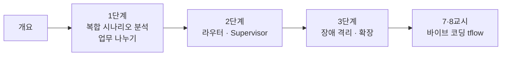

# 68일차 · 복합 업무 시나리오 분석과 Multi-Agent 기반 워크플로우 설계 (바이브 코딩)

- 일자: 2026-10-20 (68일차)
- 교과목: 노코드 멀티 에이전트 워크플로우 설계 및 운영
- 단원: 운영·확장 관점의 AI 워크플로우 설계 고도화
- 학습 내용: 복합 업무 시나리오 분석, Multi-Agent 기반 Workflow 설계
- 실습 폴더: [Last3Mon/68](../../Last3Mon/68/README.md)
- 실습 환경: 65일차 n8n 2.42.6 + OpenAI API(`gpt-4.1-mini`) + 67일차 데이터 API + **CLI 코딩 에이전트**(Codex · Claude Code · Antigravity 중 하나)
- **실습 준비: [00-DAY68-PREP.md](00-DAY68-PREP.md) (수업 전날까지 1~3절 완료)**

## 오늘의 시간표

| 교시 | 시간 | 내용 | 자료 |
| --- | --- | --- | --- |
| 1 | 09:00~09:50 | 오늘의 개요 · 1단계 · 복합 업무 시나리오 분석 | [개요](00-DAY68-OVERVIEW.md), [1단계](01-STAGE1-COMPOSITE-SCENARIO.md) |
| 2 | 10:00~10:50 | 1단계 · Lab 01 (분석표, 업무 나누기, 과제: 담당·빠진 입력) | [Lab 01](../../Last3Mon/68/LAB-01-Q-SCENARIO-AND-SPLIT.md) |
| 3 | 11:00~11:50 | 2단계 · Multi-Agent 워크플로우 설계, Lab 02 예제 1·2 | [2단계](02-STAGE2-MULTI-AGENT-DESIGN.md), [Lab 02](../../Last3Mon/68/LAB-02-Q-ROUTER-AGENTS.md) |
| 4 | 12:00~12:50 | 2단계 · Lab 02 과제 35분 (Supervisor로도 만들어 비교) · 풀이 | [Lab 02](../../Last3Mon/68/LAB-02-Q-ROUTER-AGENTS.md) |
| - | 13:00~14:00 | 점심 |  |
| 5 | 14:00~14:50 | 3단계 · 검증과 장애 격리, Lab 03 예제 1·2 | [3단계](03-STAGE3-VERIFY-AND-SCALE.md), [Lab 03](../../Last3Mon/68/LAB-03-Q-VERIFY-AND-ISOLATE.md) |
| 6 | 15:00~15:50 | 3단계 · Lab 03 과제 40분 (어려운 테스트 · 확장 계획) · 풀이 | [Lab 03](../../Last3Mon/68/LAB-03-Q-VERIFY-AND-ISOLATE.md) |
| 7 | 16:00~16:50 | 바이브 코딩 · 요청서 → SPEC → `tflow` 만들기 (각자) | [VIBE-REQ-TFLOW](../../Last3Mon/68/VIBE-REQ-TFLOW.md) → [VIBE-Q-TFLOW](../../Last3Mon/68/VIBE-Q-TFLOW.md), [진행](04-VIBE-CODING.md) |
| 8 | 17:00~17:50 | 바이브 코딩 발표 · 정리 · 강사 바이브 코딩 · 팁 · 69일차 예고 | [진행](04-VIBE-CODING.md) |

## 자료 목록

| 파일 | 내용 |
| --- | --- |
| `00-DAY68-PREP.md` | 실습 준비: n8n · 데이터 API 켜기, 두 Agent 게시, `flow.py doctor` (수업 전) |
| `00-DAY68-OVERVIEW.md` | 개요 13장 (PPT 대신 Markdown, 가로줄로 장 구분) |
| `01-STAGE1-COMPOSITE-SCENARIO.md` | 복합 요청, 업무 분석 다섯 칸, 업무 관계, LLM이 할 일과 규칙이 할 일 |
| `02-STAGE2-MULTI-AGENT-DESIGN.md` | Agent 계약, 라우터 · 파이프라인 · Fork-Join · Supervisor, 라우터 구현, Supervisor와 비교 |
| `03-STAGE3-VERIFY-AND-SCALE.md` | Multi-Agent 테스트, 빠진 입력, 장애 격리(`neverError`, 대체 답), 측정, 수직·수평 확장 |
| `04-VIBE-CODING.md` | 7·8교시 바이브 코딩 진행 (tflow), 발표, 강사 정리, 추가 바이브 코딩, 팁 |
| `CONCEPT-68.md` | 개념 정리: LLM · Tool · Agent · Agent 워크플로우 · 라우터 · Supervisor (누가 다음 갈 곳을 정하나) |
