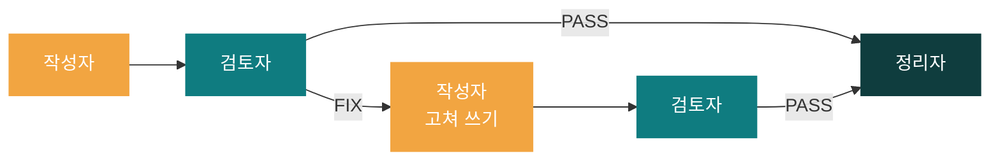
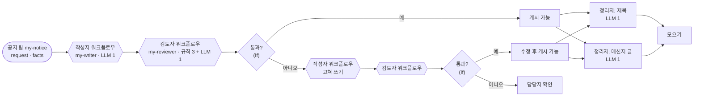
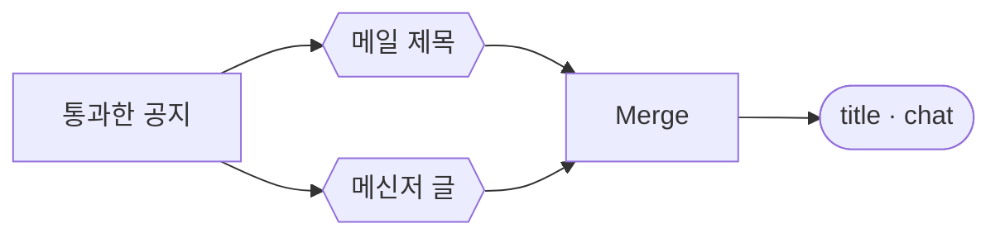

# 69일차 개요 · 역할 기반 Agent 분리와 협업 워크플로우

> 운영·확장 관점의 AI 워크플로우 설계 고도화 · 2026-10-21
> 13장 · 각 장은 가로줄(`---`)로 나뉩니다. 1교시에는 1~5장을 보고, 나머지 장은 각 단계를 설명할 때 함께 띄웁니다.

| 장 | 범위 |
| --- | --- |
| 1~5 | 표지 · 목표 · 시간표 · 어제와 오늘 · 오늘의 그림 |
| 6~7 | 1단계 · 역할 기반 Agent 분리 |
| 8~9 | 2단계 · 업무 분배와 협업 |
| 10~11 | 3단계 · 협업 검증과 역할 분리의 값 |
| 12~13 | 7교시 바이브 코딩 · 정리와 예고 |

---

## 1 / 13 · 표지



**69일차**

# 역할 기반 Agent 분리와 협업 워크플로우

역할 카드 · 작성자와 검토자 · 고쳐 쓰기 1회 · Fork-Join · fail-closed

<sub>운영·확장 관점의 AI 워크플로우 설계 고도화 · 2026-10-21</sub>

---

## 2 / 13 · 오늘 할 수 있게 될 세 가지

| | 오늘 할 수 있게 될 것 |
| :-: | --- |
| **①** | 한 업무를 **역할 카드**로 나누고, 역할마다 따로 만들고 따로 테스트한다 |
| **②** | 역할이 **이어서** 일하는 협업 흐름(검토 → 고쳐 쓰기 1회, 정리자 Fork-Join)을 요청문으로 만든다 |
| **③** | 협업 기록을 남기고, 검토가 없으면 게시하지 않게(fail-closed) 하고, **단일 Agent와 같은 테스트로** 비교한다 |

---

## 3 / 13 · 오늘의 시간표

| ① 1~2교시 | ② 3~4교시 | ③ 5~6교시 | ④ 7~8교시 |
| --- | --- | --- | --- |
| **1단계** | **2단계** | **3단계** | **바이브 코딩** |
| 역할 기반 분리 | 업무 분배 · 협업 | 협업 검증 · 비교 | `tcrew` |
| Lab 01 역할 카드 · 작성자 · 검토자 | Lab 02 공지 팀 · 정리자 | Lab 03 기록 · fail-closed · 단일 Agent | 만들기 · 발표 · 정리 |

> 09:00 시작 · 50분 수업 10분 휴식 · 4교시 뒤 13:00~14:00 점심

---

## 4 / 13 · 어제는 나눠 맡기기, 오늘은 이어서 하기

| | 68일차 | 69일차 |
| --- | --- | --- |
| 업무 | 요청 하나에 **독립** 업무 여럿 | 업무 **하나** (공지문) |
| 나누는 기준 | 업무 종류 (IT · 회의록) | **하는 일** (쓰기 · 검토 · 정리) |
| 모양 | 라우터 (분배 → 모으기) | 파이프라인 (앞 결과 → 다음 입력) + Fork-Join |
| 하나가 꺼지면 | 나머지는 계속 답 (fail-open) | 검토가 없으면 멈춤 (fail-closed) |

---

## 5 / 13 · 오늘의 그림



> 육각형 하나 = **역할 하나 = 웹훅 하나인 n8n 워크플로우**입니다. 역할 자체가 LLM은 아니고, 그 안에 AI Agent(LLM) 노드가 들어 있습니다. 공지 팀(`my-notice`)은 LLM 없이 역할들을 **HTTP로 부르고 If로 갈림**을 정합니다 (68일차 라우터의 Switch와 같은 자리).

### 데이터로 따라가기 · 연락처가 든 프린터 공지 (수업 준비 때 실제 실행 기록)

그림의 왼쪽부터, 각 상자가 **받은 것**과 **내놓은 것**입니다. 상자 사이로는 이 JSON만 오갑니다.

**① 요청** → 공지 팀 `my-notice` (`requests/notice-phone.json`)

```json
{"request": "프린터 드라이버 업데이트 공지를 써 주세요. 문의처 연락처도 꼭 넣어 주세요.",
 "facts": "10월 30일(목) 18:00~19:00 사내 프린터 드라이버 일괄 업데이트. 업데이트 중에는 출력이 안 됨. 문의는 IT팀 김민지(010-1234-5678, minji.kim@example.com).",
 "author": "김민지"}
```

**② 작성자** `my-writer` · 받음: `request`, `facts` → 내놓음: 초안

```json
{"draft": "[프린터 드라이버 업데이트 안내]\n\n- 10월 30일(목) 18:00~19:00 사내 프린터 드라이버 일괄 업데이트 진행\n- 업데이트 시간 동안 프린터 출력 불가\n- 문의: IT팀 김민지 (010-1234-5678, minji.kim@example.com)"}
```

요청("연락처도 꼭")대로 개인 연락처를 넣었습니다. 작성자는 요청을 따르고, **회사 규칙은 검토자가** 지킵니다.

**③ 검토자** `my-reviewer` · 받음: `facts`(①의 것), `draft`(②) → 내놓음: 판정

```json
{"passed": false, "codes": ["personal_info"],
 "issues": [{"code": "personal_info", "detail": "010-1234-5678, minji.kim@example.com"}]}
```

전화번호 · 메일 주소는 **규칙(Code)** 이 찾았습니다. `passed: false` → 공지 팀의 If가 "아니오" 길로 보냅니다.

**④ 작성자 · 고쳐 쓰기** · 받음: `request`, `facts`(①), `previous_draft`(②), `feedback`(③의 `issues`를 "code: detail" 줄로)

```json
{"feedback": "personal_info: 010-1234-5678, minji.kim@example.com"}
```

```json
{"draft": "[프린터 드라이버 업데이트 안내]\n\n- 10월 30일(목) 18:00~19:00 사내 프린터 드라이버 일괄 업데이트 진행\n- 업데이트 시간 동안 프린터 출력 불가\n- 문의: IT팀 김민지"}
```

연락처만 빠지고 날짜 · 시간 · 나머지는 그대로입니다. (다른 실행에서는 여기서 "(내선 1234)"를 지어낸 적이 있어, 작성자 지시문에 "고칠 때 새 정보 금지"를 넣었습니다.)

**⑤ 검토자 · 다시** · 받음: `facts`(**①의 것**, 고쳐 쓴 작성자가 전한 것이 아님), `draft`(④)

```json
{"passed": true, "codes": [], "issues": []}
```

**⑥ 정리자 둘** · 받음: 통과한 공지(④) → 내놓음: 메일 제목, 메신저 글

```json
{"title": "10월 30일 프린터 드라이버 업데이트 안내",
 "chat": "10/30(목) 18:00~19:00 프린터 드라이버 업데이트로 출력 불가. 문의: IT팀 김민지."}
```

**⑦ 공지 팀 응답** (5.9초, LLM 6번: 작성 2 · 검토 2 · 정리 2)

```json
{"route": "수정 후 게시 가능", "published": true, "rounds": 2,
 "notice": "[프린터 드라이버 업데이트 안내]\n\n- 10월 30일(목) 18:00~19:00 … 진행\n- … 출력 불가\n- 문의: IT팀 김민지",
 "codes": [], "first_codes": ["personal_info"],
 "title": "10월 30일 프린터 드라이버 업데이트 안내",
 "chat": "10/30(목) 18:00~19:00 프린터 드라이버 업데이트로 출력 불가. 문의: IT팀 김민지."}
```

`first_codes`는 ③에서 무엇이 걸렸는지, `codes`는 ⑤의 결과입니다. 메일 점검 공지처럼 ③에서 바로 `passed: true`면 ④ · ⑤ 없이 `게시 가능`, `rounds: 1`입니다.

> Lab 01(역할 하나씩) → Lab 02(이어 붙이기, 정리자) → Lab 03(기록, 검토자 장애, 비교) 순서로 완성합니다.

---

## 6 / 13 · 1단계 · 역할 카드

| 칸 | 작성자 | 검토자 |
| --- | --- | --- |
| 하는 일 | 사실로 초안 쓰기 | 규칙을 지키는지 찾기 |
| 내놓는 것 | `draft` | `passed`, `codes`, `issues` |
| **하지 않는 일** | 스스로 통과 판정 | 초안 고쳐 쓰기 |
| LLM · 규칙 | LLM | 규칙 3 (날짜·시간, 연락처, 길이) + LLM 1 (없는 약속) |
| n8n 워크플로우 안 | Webhook → If → **AI Agent**(LLM) → Code → 응답 | Webhook → If → **Code**(규칙 3) → **AI Agent**(LLM, 없는 약속) → Code(합치기 · LLM 판단 재확인) → 응답 |

> 역할을 나누면 **역할마다 따로 테스트**할 수 있습니다: 검토자에게 일부러 틀린 초안 5종 (`lab01-challenge` 6/6).

---

## 7 / 13 · 1단계 · LLM 검토자도 틀린다 (수업 준비 때 실제로)

| 일 | 결과 |
| --- | --- |
| 사실에 있는 "문의: IT팀 김민지"를 | LLM 검토자가 "사실에 없는 내용"으로 잡음 (거짓 경보) |
| 지시문에 "바꿔 쓴 문장은 문제 아님" | 한 번은 고쳐졌지만 다시 나옴 |
| **Code가 LLM 판단을 다시 확인** (그 문장의 낱말이 모두 사실에 있으면 뺌) | 이후 테스트 통과 |

> 검토자도 검토가 필요합니다. 매번 같아야 하는 판단은 규칙으로.

---

## 8 / 13 · 2단계 · 이어서 일하기: 고쳐 쓰기는 한 번

| 연락처가 든 공지 (수업 준비) | |
| --- | --- |
| 첫 초안 | 요청대로 전화번호·메일 주소를 넣음 → 검토 `personal_info` |
| 고쳐 쓰기 | 번호를 지움 → `수정 후 게시 가능` (4.1초) |
| 다른 실행 | 번호 대신 **"(내선 1234)"를 지어냄** → 검토자가 잡아 `담당자 확인` |

- 고쳐 쓰기를 **한 번**으로 정하고, 그래도 안 되면 사람에게. 끝없이 주고받지 않게.
- 다시 검토할 때 사실(`facts`)은 **처음 요청에서**. 고쳐 쓴 작성자가 바꿔 전한 사실로 검토하면 의미가 없습니다.

---

## 9 / 13 · 2단계 · Fork-Join: 정리자 둘



| 수업 준비 측정 | 결과 |
| --- | --- |
| `lab02-challenge` | 4/4 (두 번) |
| 요청 하나 | 정리자 없이 2.0~4.1초 → 정리자 붙이고 4.1~6.5초 |

> 설계는 "서로 기다릴 필요 없음". n8n이 실제로 동시에 돌리는지는 Executions의 노드 시각으로 함께 확인합니다.

---

## 10 / 13 · 3단계 · 검토자가 꺼지면 게시하지 않는다

| 검토자 꺼짐 (`off my-reviewer`) | 결과 |
| --- | --- |
| 고치기 전 | **HTTP 500** (`lab03-down` 0/2) |
| `neverError` + "검토 결과가 없으면 통과 아님" | 200 · `published: false` · "검토자가 응답하지 않아 게시하지 않습니다." (2/2) |

> 68일차는 fail-open(나머지라도 답), 오늘은 fail-closed(검토 없으면 멈춤). 기준은 **잘못 나갔을 때의 위험**.

---

## 11 / 13 · 3단계 · 역할 팀 vs 단일 Agent (수업 준비 측정)

| | 역할 팀 | 단일 Agent (규칙을 지시문에 다 적음) |
| --- | --- | --- |
| 어려운 케이스 7개 (자기 결과로) | 예제 6/7 → 최종 7/7 | 6/7 |
| 검토자가 다시 보면 | — | 5/6 |
| 요청 하나 | 1.8~6.0초 | 1.0~1.5초 |
| LLM 호출 | 2 (고치면 4, 정리자 +2) | 1 |

> 단일 Agent는 `codes: []`를 **스스로** 붙였습니다. 다른 역할이 검사해야 의미가 있습니다.

---

## 12 / 13 · 7교시 · 바이브 코딩 `tcrew`

```text
$ tcrew "VPN 인증서 교체 공지를 써 줘 ..."
┌ writer ✔ ┬ reviewer ✘ ┬ writer#2 ✔ ┬ editor ┐
```

- 역할 지시문은 `crew.yaml`, 프로그램은 그 순서대로 LLM을 부르고 탭으로 보여 줌
- 오늘 n8n 공지 팀을 파이썬으로 다시: 검토 답을 읽을 수 있는 모양, 고쳐 쓰기 1회, fail-closed

---

## 13 / 13 · 정리와 70일차 예고

| 오늘 | 한 줄 |
| --- | --- |
| 1단계 | 역할 카드의 핵심은 "하지 않는 일". 역할마다 따로 테스트 |
| 2단계 | 이어서 일할 때 고쳐 쓰기는 한 번, 사실은 처음 요청에서 |
| 3단계 | 기록을 남기고, 위험한 단계가 빠지면 멈춘다. 역할 분리의 값은 측정으로 |

- 70일차: **템플릿화와 모듈화** — 오늘 만든 작성자·검토자를 다른 공지에도 재사용 · 바이브 코딩 `tkit`
