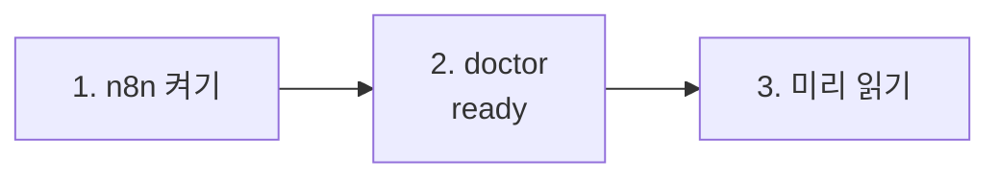

# 69일차 실습 준비 · 수업 전에 미리 해 두면 좋은 것

- 수업일: 2026-10-21 (69일차) · 역할 기반 Agent 분리와 협업 워크플로우 설계
- 준비 시간: 약 10분 (68일차 준비를 했다면 1·2절만)
- 먼저 WSL에서 `cd ~/aio-01d4-stu && git pull`로 오늘 자료를 받습니다 (수강생 저장소: https://gl.isitsoft.kr/publicproj/aio-01d4-stu).
- **수업 전날까지** 1~2절을 끝내 주세요.
- 65~68일차를 하지 못해 n8n · Credential이 없다면 [PREPARE-69-FROM-65.md](../../Last3Mon/69/PREPARE-69-FROM-65.md)를 따라 하면 최소 명령으로 `ready`까지 갑니다 (데이터 API · 68일차 Agent는 필요 없음).



---

## 1. n8n 켜기 (전날 필수, 2분)

오늘은 데이터 API를 쓰지 않습니다 (켜 두어도 됩니다).

```bash
sudo systemctl disable --now ollama 2>/dev/null   # WSL에 설치한 Ollama가 있으면 끄고 자동 시작도 끔
cd ~/aio-01d4-stu/Last3Mon/65/n8n
docker compose rm -sf ollama                      # Ollama 컨테이너가 있으면 지움 (없으면 그냥 지나감)
docker compose start
```

- **66일차부터 LLM은 OpenAI API 키(`Last3Mon/.env`, Credential `OpenAI (.env)`)만 씁니다.** Ollama는 쓰지 않으므로 위처럼 꺼서 메모리를 아낍니다. 다음 날부터는 같은 명령을 그대로 써도 됩니다.
- `.../day65-n8n/compose.yml: no such file or directory` → 홈이 아닌 곳에 설치함. `Last3Mon/65/n8n/.env`에 `N8N_HOME=<설치 폴더>` ([67일차 준비](../67/00-DAY67-PREP.md) 1절).

## 2. 준비 확인 (전날 필수, 2분)

```bash
cd ~/aio-01d4-stu/Last3Mon/69
uv run tools/flow.py doctor
```

```text
✔ n8n install folder /home/<사용자>/day65-n8n
✔ n8n container day65-n8n-n8n-1
✔ n8n http://localhost:5678
! data API http://localhost:8800 (not used today)    ← 켜 두었다면 ✔
✔ credential 'OpenAI (.env)' (openAiCourse0001)
✔ node catalog (for check)
✔ CLI coding agent: codex, claude
ready
```

| ✘ 항목 | 할 일 |
| --- | --- |
| n8n container | 1절 |
| credential | `cd ~/aio-01d4-stu/Last3Mon/65/n8n && bash register-credentials.sh` |
| CLI coding agent | [67일차 준비](../67/00-DAY67-PREP.md) 2절 |

---

## 3. 미리 읽어 오면 좋은 내용 (선택, 약 5분)

### 3.1 공지문 한 장이 나가기까지

IT팀이 "메일 서버 점검" 공지를 쓴다고 생각해 봅니다. 사람 팀이라면 누가 쓰고, 누가 확인하고, 확인에서 걸리면 어떻게 하나요? 확인하는 사람이 휴가 중이면 공지를 그냥 올릴까요?

### 3.2 용어

| 용어 | 한 줄 설명 |
| --- | --- |
| 역할 기반 분리 | 한 업무를 **하는 일이 다른** 역할(작성 · 검토 · 정리)로 나눔 |
| 역할 카드 | 역할마다 하는 일, 받는 것, 내놓는 것, **하지 않는 일** |
| 파이프라인 | 앞 역할의 결과가 다음 역할의 입력 |
| Fork-Join | 서로 기다릴 필요 없는 일을 갈래로 나눴다가 다시 모음 |
| fail-closed | 꼭 필요한 단계(검토)가 없으면 **진행하지 않음** |

## 4. 당일 준비물

- 충전된 노트북과 충전기, WSL의 Docker, Windows Terminal(WSL) 창 **두 개**, 웹 브라우저
- 68일차 `~/vibe/tflow` (7교시에 오늘 워크플로우를 열어 보는 데 씀)

## 확인

- [ ] `docker compose start` 후 http://localhost:5678 이 열린다
- [ ] `uv run tools/flow.py doctor`에서 n8n · credential · CLI 에이전트가 ✔
