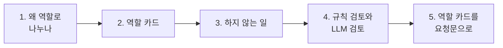

# 1단계 · 역할 기반 Agent 분리

- 교시: 1~2교시 (09:00~10:50)
- 실습: [Lab 01](../../Last3Mon/69/LAB-01-Q-ROLE-CARDS.md)
- 이 단계가 끝나면: 한 업무를 **역할 카드**로 나누고, 역할마다 따로 만들고 따로 테스트할 수 있다. 검토 항목을 **규칙과 LLM**으로 나눌 수 있다.



## 1. 왜 역할로 나누나

IT팀 공지에 있었던 사고 세 가지: 점검 **시간이 빠짐**, 담당자 **개인 연락처가 그대로** 나감, 하지 않은 **약속**("쿠폰을 드립니다")이 들어감. 한 사람(한 Agent)이 쓰고 바로 올렸기 때문입니다.

| Agent 하나가 쓰고 스스로 확인 | 역할을 나눔 (작성자 · 검토자) |
| --- | --- |
| 자기 글을 좋게 보기 쉬움 | 다른 기준으로 다시 봄 |
| 어디서 틀렸는지 모름 (결과 하나) | 첫 초안 · 검토 의견 · 고친 초안이 따로 남음 |
| 지시문 하나에 쓰기 규칙 + 검사 규칙 | 역할마다 짧은 지시문 |
| 테스트는 전체로만 | **역할마다** 테스트 (검토자에게 일부러 틀린 초안) |
| 빠르고 쌈 (LLM 1번) | 느리고 비쌈 (LLM 2번 이상) — 3단계에서 측정 |

68일차의 Agent 분리는 **업무 종류**(IT · 회의록)로 나눴습니다. 오늘은 **하는 일**(쓰기 · 검토 · 정리)로 나눕니다. 사람 팀의 기자 · 데스크 · 편집자와 같습니다.

## 2. 역할 카드

역할마다 다섯 칸을 정합니다. 이 카드가 요청문과 테스트의 재료입니다.

| 칸 | 작성자 | 검토자 | 정리자 |
| --- | --- | --- | --- |
| 하는 일 | 사실로 공지 초안 쓰기 | 초안이 규칙을 지키는지 찾기 | 통과한 공지를 채널별로 다듬기 |
| 받는 것 | `request`, `facts` | `facts`, `draft` | 통과한 `notice` |
| 내놓는 것 | `draft` | `passed`, `codes`, `issues` | `title`, `chat` |
| 하지 않는 일 | 스스로 통과 판정 | 고쳐 쓰기 | 내용 바꾸기 |
| 잘했는지 아는 법 | 날짜·시간이 그대로 (`lab01`) | 틀린 초안 5종을 맞게 잡음 (`lab01-challenge`) | 메신저 글에 날짜, 연락처 없음 |

- **내놓는 것**은 다음 역할이 읽을 수 있는 모양이어야 합니다. 검토자가 "대체로 좋지만 시간이 좀…"이라고 글로 답하면 다음 단계가 통과인지 모릅니다. 그래서 `passed`(불리언)와 `codes`(정해진 코드).
- 역할마다 **웹훅 하나**로 만들면, 사람이 직접 `call`로 그 역할만 시험해 볼 수 있습니다.

## 3. 하지 않는 일

역할 카드에서 가장 중요한 칸입니다.

| 섞이면 | 생기는 일 |
| --- | --- |
| 작성자가 검토까지 | "문제 없음"을 스스로 붙임 (3단계 단일 Agent에서 확인) |
| 검토자가 고쳐 쓰기까지 | 고친 글을 누가 검토하나? 검토 기준과 쓰기 기준이 섞임 |
| 정리자가 내용까지 | 검토를 통과한 뒤 바뀐 내용이 그대로 나감 |

## 4. 규칙 검토와 LLM 검토

검토 항목마다 "매번 같은 답이어야 하나?"를 묻습니다.

| 코드 | 검사 | 누가 | 이유 |
| --- | --- | --- | --- |
| `missing_fact` | 사실의 날짜(`10월 23일`)·시간(`22:00`)이 초안에 있나 | Code (정규식) | 셀 수 있음 |
| `personal_info` | 전화번호·메일 주소 | Code (정규식) | 셀 수 있음 |
| `too_long` | 600자 넘나 | Code | 셀 수 있음 |
| `unsupported_claim` | 사실에 없는 약속·보상·연락처 | LLM | 뜻을 봐야 함 |

수업 준비 때 정답 검토자(규칙 3 + LLM 1)에 일부러 틀린 초안 5종과 좋은 초안을 넣었습니다 (1회, gpt-4.1-mini).

| 일 | 결과 |
| --- | --- |
| 처음 | 5/6. "전화번호" 초안의 연락처가 사실에 없어서 LLM이 `unsupported_claim`도 잡음 → **LLM이 맞았고 테스트 자료가 틀림** → 자료 수정 → 6/6 |
| 2단계 실습 중 | 사실에 있는 "문의: IT팀 김민지"를 LLM이 `unsupported_claim`으로 잡음 (거짓 경보). 지시문 보강 뒤에도 한 번 더 나옴 |
| 고친 방법 | Code가 LLM 판단을 **다시 확인**: 잡힌 문장의 낱말이 모두 사실에 있으면 뺌 → 이후 통과 |

> LLM 검토자도 틀립니다. 테스트가 실패하면 **워크플로우 · 테스트 자료 · 기대 결과** 중 무엇이 틀렸는지부터 봅니다.

## 5. 역할 카드를 요청문으로

요청문 다섯 가지(① 파일 ② 입력 ③ 처리 ④ 결과 모양 ⑤ 기대 결과)에 **역할 카드**를 넣습니다. Lab과 다른 업무(신입 사원 환영 메일)로 예를 듭니다.

```text
my-work/welcome-reviewer.json 에 "환영 메일 검토자" 워크플로우를 만들어 줘.
① 파일: my-work/welcome-reviewer.json
② 입력: POST 웹훅 my-welcome-review, 본문 profile(이름·부서·입사일), draft(메일 초안). 둘 다 필수, 없으면 400.
③ 처리 (역할 카드):
   하는 일: 초안이 규칙을 지키는지 찾는다. 하지 않는 일: 초안을 고쳐 쓰지 않는다.
   규칙은 Code에서: 입사일이 초안에 그대로 있나(missing_fact), 사번·주민번호 모양이 있나(personal_info).
   LLM은 하나만: profile에 없는 약속(선물, 휴가)을 했나(unsupported_claim).
④ 결과: {"passed": false, "codes": ["missing_fact"], "issues": [{"code": "...", "detail": "..."}]}
⑤ 기대 결과: cases/welcome-review.json (틀린 초안 4종 + 좋은 초안 1)
```

- **하지 않는 일**을 요청문에 적었습니다. 적지 않으면 에이전트가 "고친 초안"까지 돌려주는 검토자를 만들기 쉽습니다.
- 규칙과 LLM을 **어느 노드에서** 할지까지 적었습니다.

## 정리

- [ ] 역할 카드 다섯 칸: 하는 일 · 받는 것 · 내놓는 것 · **하지 않는 일** · 잘했는지 아는 법
- [ ] 역할마다 웹훅 하나 → 역할마다 따로 테스트
- [ ] 셀 수 있는 검사는 규칙, 뜻을 봐야 하는 검사만 LLM. LLM 검토도 다시 확인
