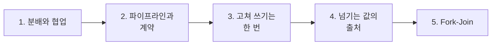
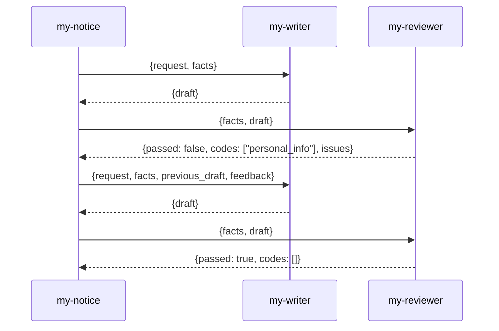
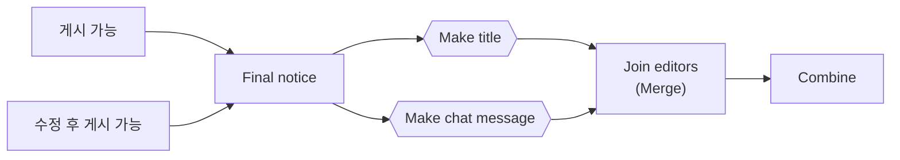

# 2단계 · 업무 분배와 협업 워크플로우

- 교시: 3~4교시 (11:00~12:50)
- 실습: [Lab 02](../../Last3Mon/69/LAB-02-Q-COLLABORATION.md)
- 이 단계가 끝나면: 역할이 **이어서** 일하는 협업 흐름을 설계하고 요청문으로 만들 수 있다. 고쳐 쓰기의 횟수, 넘기는 값의 출처, Fork-Join을 정할 수 있다.

## 1. 분배와 협업

| | 업무 분배 (68일차) | 협업 (오늘) |
| --- | --- | --- |
| 무엇을 나누나 | 요청 안의 **업무들** | 한 업무의 **단계들** |
| 순서 | 없음 (독립) | 있음 (앞 결과가 뒤 입력) |
| 모양 | 라우터 | 파이프라인 · 고쳐 쓰기 · Fork-Join |
| 결과 | 업무별 결과를 모음 | 마지막 역할의 결과 + 과정 기록 |

## 2. 파이프라인과 계약

공지 팀(`my-notice`)은 작성자(`my-writer`)와 검토자(`my-reviewer`)를 HTTP로 부릅니다. 68일차 라우터가 Agent를 부르던 방법과 같습니다.

- 역할의 계약(입력·결과)이 맞으면 **누가 만든 역할이든** 바꿔 끼울 수 있습니다. 검토자를 못 만든 사람은 `reference/lab02-start-reviewer.json`을 같은 웹훅으로 올려 이어 갑니다.
- 공지 팀은 직접 쓰거나 검토하지 않습니다 (공지 팀의 "하지 않는 일").

## 3. 고쳐 쓰기는 한 번

"통과할 때까지 고쳐라"는 위험합니다.

| 고쳐 쓰기 | 생길 수 있는 일 |
| --- | --- |
| 끝없이 | 작성자·검토자가 계속 주고받음, 시간·비용이 끝없이 늘어남 |
| 여러 번 | 고칠수록 글이 이상해지거나 새 정보가 생김 |
| **한 번, 그래도 안 되면 사람** | 시간이 정해짐, 사람이 볼 것만 남음 |

수업 준비 때 연락처가 든 공지 (요청: "문의처 연락처도 꼭 넣어 주세요"):

| 실행 | 첫 검토 | 고쳐 쓴 초안 | 두 번째 검토 | 결과 |
| --- | --- | --- | --- | --- |
| A | `personal_info` | 번호·메일 주소 지움 | 통과 | 수정 후 게시 가능 (4.1초) |
| B | `personal_info` | 번호 대신 **"(내선 1234)"를 지어냄** | `unsupported_claim` | 담당자 확인 |

- B는 고쳐 쓰기가 **새 정보를 만든** 경우입니다. 검토자가 잡았고, 한 번만 고치기로 했기 때문에 사람에게 넘어갔습니다.
- 이후 작성자 지시문에 "고칠 때 새 번호·내선을 넣지 않는다"를 더했습니다. 역할이 나뉘어 있어서 **작성자만** 고치면 됐습니다.

n8n에서 같은 역할을 두 번 부를 때는 노드를 따로 둡니다 (`Write draft` → `Review draft` → `Revise draft` → `Review again`). 화살표를 앞으로 되돌리는 고리는 만들지 않습니다.

## 4. 넘기는 값의 출처

| 값 | 출처 | 이유 |
| --- | --- | --- |
| `facts` (검토할 때) | **처음 요청** | 작성자가 바꿔 전한 사실로 검토하면 검토가 의미 없음 |
| `previous_draft` | 첫 작성 결과 | 무엇을 고칠지 |
| `feedback` | 첫 검토의 `issues` → `code: detail` 줄 | 작성자가 읽을 수 있게 |

67일차 "LLM이 정하면 안 되는 값"(요청한 사람)과 같은 질문을 역할 사이에서 다시 합니다.

## 5. Fork-Join: 정리자 둘

통과한 공지로 메일 제목과 메신저 글을 만듭니다. 둘은 서로의 결과가 필요 없습니다.

| 설계 결정 | 이유 |
| --- | --- |
| 통과한 두 길을 `Final notice` 하나로 | 정리자를 두 번 만들지 않음 |
| 정리자마다 chat model 노드 따로 | model 노드 하나는 Agent 하나에 연결 |
| 정리자의 "하지 않는 일": 새 정보, 날짜 바꾸기 | 검토를 통과한 뒤 바뀌면 안 됨 |

수업 준비 때 결과: `lab02-challenge` 4/4 (두 번 실행). 요청 하나가 정리자 없이 2.0~4.1초 → 정리자 붙이고 4.1~6.5초.

> Fork-Join은 **설계**에서 "서로 기다릴 필요 없음"입니다. n8n이 두 갈래를 실제로 동시에 돌리는지는 실행 방식에 따라 다릅니다. Lab 02 과제에서 Executions의 노드 시각으로 확인합니다.

## 정리

- [ ] 분배는 업무를, 협업은 단계를 나눈다
- [ ] 역할은 계약으로 이어 붙이고, 같은 역할을 두 번 부를 때는 노드를 따로
- [ ] 고쳐 쓰기는 한 번, 그래도 안 되면 사람에게
- [ ] 검토에 쓰는 사실은 처음 요청에서
- [ ] Fork-Join: 서로 필요 없는 일은 갈래로 나눴다가 모은다
